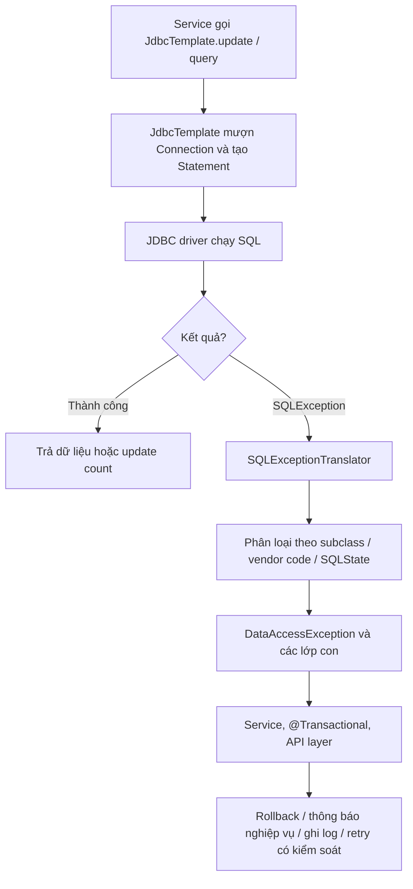
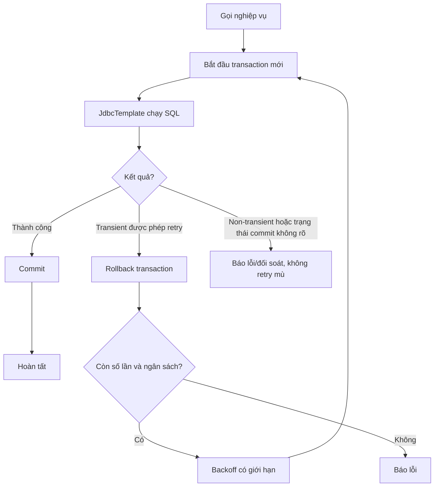

# Chuyển SQLException thành hệ thống ngoại lệ truy cập dữ liệu trong Spring

Trong JDBC thuần, phần lớn lỗi truy cập cơ sở dữ liệu được báo qua ngoại lệ kiểm tra **`java.sql.SQLException`**. Khi viết DAO, ứng dụng phải quyết định: nên truyền nguyên ngoại lệ này lên service, tự đọc `SQLState`/mã lỗi của DBMS, hay chuyển thành một dạng lỗi có ý nghĩa nhất quán hơn? Nếu mỗi DAO tự xử lý theo chuỗi thông báo của driver, mã sẽ khó bảo trì và đổi hệ quản trị cơ sở dữ liệu rất dễ phát sinh lỗi.

**Spring JDBC** giải quyết một phần vấn đề bằng cơ chế **exception translation**: chuyển các `SQLException` từ thao tác JDBC thành những ngoại lệ thuộc họ **`org.springframework.dao.DataAccessException`**. Nhờ đó, tầng gọi có thể xử lý theo nhóm lỗi như vi phạm ràng buộc dữ liệu, cú pháp SQL, mất kết nối, xung đột khóa hoặc timeout mà không phải hiểu mọi mã lỗi riêng của PostgreSQL, MySQL, SQL Server hay Oracle.

Bài này thuộc chương **Tích hợp Spring** trong module **JDBC**. Ta sẽ tìm hiểu mối liên hệ giữa `SQLException` và `DataAccessException`; cách `JdbcTemplate`, `NamedParameterJdbcTemplate` và `SQLExceptionTranslator` hoạt động; cách đặt ranh giới `@Transactional`; cách xử lý và kiểm thử ngoại lệ mà không che mất lỗi thực tế.

> **Nguyên tắc cốt lõi:** Spring giúp **phân loại và truyền lỗi** theo một API nhất quán hơn, nhưng **không sửa SQL sai, không tự rollback mọi giao dịch nếu transaction chưa được cấu hình, và không bảo đảm một mã lỗi của mọi driver luôn được dịch thành cùng một lớp con**. Luôn kiểm chứng hành vi với DBMS/driver thực tế.

## 1. Bài toán với SQLException trong JDBC thuần

Giả sử cơ sở dữ liệu có bảng sản phẩm:

```sql
CREATE TABLE product (
    product_id BIGINT PRIMARY KEY,
    sku VARCHAR(40) NOT NULL UNIQUE,
    display_name VARCHAR(120) NOT NULL,
    unit_price DECIMAL(12, 2) NOT NULL,
    stock INTEGER NOT NULL CHECK (stock >= 0)
);
```

Khi chèn một `sku` đã tồn tại, DBMS sẽ từ chối thao tác vì ràng buộc `UNIQUE`. Trong JDBC thuần, có thể nhận `SQLIntegrityConstraintViolationException`, một `SQLException` khác với `SQLState` hoặc vendor error code tương ứng, tùy driver và tình huống.

```java
import java.sql.Connection;
import java.sql.PreparedStatement;
import java.sql.SQLException;
import javax.sql.DataSource;

public final class RawProductDao {
    private final DataSource dataSource;

    public RawProductDao(DataSource dataSource) {
        this.dataSource = dataSource;
    }

    public void insert(long id, String sku, String name)
            throws SQLException {
        String sql = "INSERT INTO product "
                + "(product_id, sku, display_name, unit_price, stock) "
                + "VALUES (?, ?, ?, ?, ?)";

        try (Connection connection = dataSource.getConnection();
             PreparedStatement ps = connection.prepareStatement(sql)) {
            ps.setLong(1, id);
            ps.setString(2, sku);
            ps.setString(3, name);
            ps.setBigDecimal(4, new java.math.BigDecimal("0.00"));
            ps.setInt(5, 0);

            ps.executeUpdate();
        }
    }
}
```

Tầng gọi có thể kiểm tra:

```java
try {
    rawDao.insert(101L, "BOOK-A", "Sách JDBC");
} catch (SQLException ex) {
    System.out.println("SQLState: " + ex.getSQLState());
    System.out.println("Vendor code: " + ex.getErrorCode());
    throw ex;
}
```

Các thuộc tính này hữu ích để chẩn đoán, nhưng **không phải hợp đồng nghiệp vụ ổn định** cho mọi DBMS. Cùng loại vi phạm `UNIQUE` có thể có mã vendor khác nhau; cùng một SQLState lớp `23` có thể đại diện cho nhiều dạng vi phạm ràng buộc, không chỉ khóa trùng.

**Không nên** suy luận lỗi bằng cách tìm chuỗi như `"duplicate"`, `"unique"` hoặc tên index trong `ex.getMessage()`. Thông điệp có thể thay đổi theo driver, phiên bản, ngôn ngữ và cách DBMS xây lỗi.

## 2. DataAccessException là gì?

`DataAccessException` là **lớp cơ sở** của hệ thống ngoại lệ truy cập dữ liệu trong Spring. Đây là **runtime exception** (*unchecked exception*), không bắt buộc phải khai báo `throws` trong chữ ký phương thức Java.

Các lớp con mô tả những nhóm lỗi phổ biến:

| Nhóm / lớp Spring | Ví dụ tình huống | Lưu ý |
|---|---|---|
| `DataIntegrityViolationException` | Vi phạm `UNIQUE`, `FOREIGN KEY`, `CHECK` hoặc `NOT NULL`. | Nhóm tương đối rộng; không có nghĩa cứ thuộc nhóm này là khóa trùng. |
| `DuplicateKeyException` | Khóa chính hoặc ràng buộc duy nhất bị trùng **khi translator nhận diện được**. | Là một lớp con của `DataIntegrityViolationException`. |
| `BadSqlGrammarException` | Cú pháp SQL hoặc đối tượng SQL sai theo kết quả phân loại của Spring. | Tên lớp có thể bao trùm cả lỗi dùng đối tượng SQL; không chỉ thiếu dấu phẩy. |
| `DataAccessResourceFailureException` | Nguồn truy cập dữ liệu không khả dụng. | Nguyên nhân có thể là DBMS, mạng, xác thực hoặc cấu hình. |
| `CannotGetJdbcConnectionException` | Không lấy được kết nối JDBC trong một số đường đi của Spring. | Không đồng nghĩa truy vấn đã chạy rồi bị timeout. |
| `CannotAcquireLockException` | Không lấy được khóa trong tình huống được driver/Spring nhận diện. | Cần hiểu trạng thái transaction trước khi retry. |
| `CannotSerializeTransactionException` | Transaction không thể được serialize theo ngữ nghĩa DBMS. | Có thể cần chạy lại toàn bộ transaction. |
| `QueryTimeoutException` | Thao tác truy cập dữ liệu vượt timeout và được translator phân loại. | Không bảo đảm mọi query timeout của mọi driver đều thành lớp này. |
| `UncategorizedSQLException` | Spring không phân loại được một `SQLException` theo các nhóm đã biết. | Lỗi gốc vẫn cần được giữ để chẩn đoán. |

Ví dụ quan hệ thừa kế ở một phần của hệ thống:

```text
RuntimeException
  └─ org.springframework.dao.DataAccessException
       ├─ TransientDataAccessException
       │    ├─ CannotAcquireLockException (qua nhóm concurrency)
       │    └─ QueryTimeoutException
       ├─ NonTransientDataAccessException
       │    ├─ DataIntegrityViolationException
       │    │    └─ DuplicateKeyException
       │    ├─ BadSqlGrammarException (qua nhóm invalid resource usage)
       │    └─ DataAccessResourceFailureException
       ├─ RecoverableDataAccessException
       └─ UncategorizedDataAccessException
            └─ UncategorizedSQLException
```

Đây là **sơ đồ khái quát**, lược bỏ một số lớp trung gian và nhiều lớp con khác; không dùng nó làm tài liệu liệt kê đầy đủ hệ phân cấp Spring ở mọi phiên bản.

### “Transient” có phải luôn retry được không?

Không. Spring dùng các nhóm:

- **`TransientDataAccessException`:** lỗi được phân loại là có khả năng thành công nếu thử lại **sau một điều kiện thay đổi**, chẳng hạn tranh chấp tài nguyên.
- **`NonTransientDataAccessException`:** thường cần sửa dữ liệu, SQL, schema hoặc cấu hình thay vì lặp lại y nguyên thao tác.
- **`RecoverableDataAccessException`:** có khả năng phục hồi nếu ứng dụng thực hiện **bước khôi phục bổ sung**.
- **`UncategorizedDataAccessException`:** Spring không xác định được nhóm cụ thể.

Đây là **tín hiệu để xây chính sách**, không phải cam kết retry an toàn. Đặc biệt, một câu `INSERT` có thể đã tạo tác động trước khi mất kết nối hoặc phản hồi `commit()` bị mất. Quyết định retry còn cần idempotency, trạng thái transaction và deadline.

## 3. Luồng dịch lỗi của Spring JDBC

Với `JdbcTemplate`, ứng dụng giao việc quản lý statement/connection và thực thi câu SQL cho Spring. Khi một thao tác JDBC tạo `SQLException`, Spring dùng một **`SQLExceptionTranslator`** để chuyển sang một `DataAccessException` phù hợp trước khi ngoại lệ thoát ra tầng gọi.



**Điều được chuẩn hóa:** service có thể xử lý nhóm ngoại lệ Spring mà không tự phân tích mọi chuỗi thông báo của driver.

**Điều chưa được chuẩn hóa hoàn toàn:** mã lỗi DBMS, khả năng phân loại một lỗi đặc thù, cách DBMS xử lý transaction sau lỗi và hành vi khi mất kết nối đúng lúc `commit()`.

### Vì sao DataAccessException là unchecked?

Với JDBC thuần:

```java
Product findById(long id) throws SQLException;
```

Với Spring `JdbcTemplate`, Repository có thể khai báo:

```java
Product findById(long id);
```

Khi dữ liệu không tồn tại, phải thiết kế kết quả vắng mặt rõ ràng; khi DB có lỗi, phương thức có thể ném `DataAccessException` dù không khai báo `throws`.

Ưu điểm là tầng service không phải truyền `SQLException` qua mọi giao diện. Nhưng unchecked exception **không có nghĩa được phép bỏ qua**. Nếu xử lý lỗi ở ranh giới API hoặc transaction, vẫn phải phân loại, rollback và phản hồi phù hợp.

## 4. Spring JDBC không xóa vai trò của JDBC chuẩn

`JdbcTemplate` xây dựng trên các API JDBC. Nó vẫn thực hiện những công việc cơ bản:

1. Lấy `Connection` từ `DataSource`, theo cơ chế quản lý tài nguyên/transaction của Spring.
2. Tạo `PreparedStatement` khi có tham số.
3. Bind giá trị vào `?`.
4. Gọi `executeQuery()` hoặc `executeUpdate()`.
5. Dùng `ResultSet` để ánh xạ giá trị thành đối tượng Java.
6. Đóng `ResultSet`, `Statement` và trả/giải phóng connection đúng ngữ cảnh.
7. Chuyển những `SQLException` thích hợp thành `DataAccessException`.

| JDBC thuần | Spring JDBC |
|---|---|
| `Connection connection = dataSource.getConnection()` | `JdbcTemplate` lấy/giải phóng kết nối qua hạ tầng Spring. |
| `PreparedStatement ps = connection.prepareStatement(sql)` | `jdbcTemplate.query/update(...)` tạo và dùng statement. |
| `ps.setString(1, sku)` | `jdbcTemplate.query(sql, rowMapper, sku)` bind tham số. |
| `ResultSet rs = ps.executeQuery()` | `RowMapper<T>` đọc hàng hiện tại. |
| `try-with-resources` đóng cursor/connection | Template quản lý tài nguyên trong callback/operation. |
| `catch (SQLException ex)` | Ngoại lệ thường được chuyển thành `DataAccessException`. |

Không nên hiểu rằng `JdbcTemplate` “tự động tối ưu mọi SQL”. Projection, chỉ mục, thứ tự placeholder, fetch size, batching, transaction và tính đúng đắn của dữ liệu vẫn là trách nhiệm của thiết kế ứng dụng.

## 5. Ví dụ Spring JDBC với JdbcTemplate

Để dùng ví dụ này, dự án cần Spring JDBC cùng JDBC driver thích hợp và một `DataSource` đã được cấu hình. Trong Spring Boot, `spring-boot-starter-jdbc` thường cung cấp các thành phần liên quan và auto-configuration khi đủ điều kiện. Với Spring Framework thuần, ứng dụng phải đăng ký bean, DataSource và transaction manager theo nhu cầu.

Giả sử bảng `product` ở phần 1 và dữ liệu có `sku` duy nhất. Mô hình Java dùng cho ví dụ:

```java
import java.math.BigDecimal;

public final class Product {
    private final long id;
    private final String sku;
    private final String name;
    private final BigDecimal price;
    private final int stock;

    public Product(
            long id, String sku, String name,
            BigDecimal price, int stock
    ) {
        this.id = id;
        this.sku = sku;
        this.name = name;
        this.price = price;
        this.stock = stock;
    }

    public long getId() { return id; }
    public String getSku() { return sku; }
    public String getName() { return name; }
    public BigDecimal getPrice() { return price; }
    public int getStock() { return stock; }
}
```

Trong ứng dụng thật, thêm validation của nghiệp vụ và giới hạn giá trị phù hợp với schema. Việc chuyển SQLException không thay thế kiểm tra giá không âm hoặc độ dài SKU trước khi ghi.

### Repository dùng JdbcTemplate

```java
import java.math.BigDecimal;
import java.util.List;
import java.util.Optional;

import org.springframework.dao.DataIntegrityViolationException;
import org.springframework.jdbc.core.JdbcTemplate;
import org.springframework.jdbc.core.RowMapper;
import org.springframework.stereotype.Repository;

@Repository
public final class JdbcProductRepository {
    private static final String SELECT_COLUMNS =
            "product_id AS id, sku, display_name AS name, "
            + "unit_price AS price, stock";

    private static final RowMapper<Product> PRODUCT_MAPPER =
            (rs, rowNum) -> new Product(
                    rs.getLong("id"),
                    rs.getString("sku"),
                    rs.getString("name"),
                    rs.getBigDecimal("price"),
                    rs.getInt("stock")
            );

    private final JdbcTemplate jdbc;

    public JdbcProductRepository(JdbcTemplate jdbc) {
        this.jdbc = jdbc;
    }

    public Optional<Product> findById(long id) {
        String sql = "SELECT " + SELECT_COLUMNS
                + " FROM product WHERE product_id = ?";

        List<Product> rows = jdbc.query(sql, PRODUCT_MAPPER, id);
        return rows.isEmpty()
                ? Optional.empty()
                : Optional.of(rows.get(0));
    }

    public void insert(Product product) {
        String sql = "INSERT INTO product "
                + "(product_id, sku, display_name, unit_price, stock) "
                + "VALUES (?, ?, ?, ?, ?)";

        int changed = jdbc.update(
                sql,
                product.getId(),
                product.getSku(),
                product.getName(),
                product.getPrice(),
                product.getStock()
        );

        if (changed != 1) {
            throw new IllegalStateException(
                    "INSERT không tác động đúng một hàng");
        }
    }

    public boolean changePrice(long id, BigDecimal newPrice) {
        String sql = "UPDATE product SET unit_price = ? "
                + "WHERE product_id = ?";

        int changed = jdbc.update(sql, newPrice, id);
        return changed == 1;
    }
}
```

Code dùng `@Repository` để khai báo thành phần thuộc tầng truy cập dữ liệu. Với Spring, `RowMapper` là interface thuộc `org.springframework.jdbc.core.RowMapper<T>`; nó nhận hàng hiện tại và số thứ tự hàng, rồi tạo đối tượng. `JdbcTemplate` sở hữu việc gọi `rs.next()`, đóng tài nguyên và dịch ngoại lệ JDBC.

**Lưu ý:** `findById` dùng `jdbc.query(...)` để trường hợp không có bản ghi trả `Optional.empty()`. Nếu dùng `queryForObject(...)`, Spring thường ném `EmptyResultDataAccessException` khi không có hàng; đây là ngoại lệ về **kỳ vọng số hàng**, không phải chứng cứ DBMS hỏng. Hãy chọn cách thể hiện “không tìm thấy” phù hợp với hợp đồng repository.

### Khi xảy ra lỗi UNIQUE

Nếu hai `Product` có cùng `sku`, lời gọi `jdbc.update(...)` có thể ném:

- `DuplicateKeyException` khi translator phân biệt được lỗi khóa trùng.
- Hoặc `DataIntegrityViolationException` rộng hơn khi driver/translator chỉ xác định được vi phạm ràng buộc.
- Trong trường hợp không phân loại được, có thể là `UncategorizedSQLException` hoặc một `DataAccessException` khác.

Vì `DuplicateKeyException extends DataIntegrityViolationException`, mã nghiệp vụ có thể bắt nhóm rộng nếu chỉ cần nói “dữ liệu vi phạm ràng buộc”. **Không nên viết test portable bắt buộc mọi driver phải ném riêng `DuplicateKeyException`.**

### Query lỗi cú pháp

Một câu SQL như:

```java
jdbc.query("SELEC product_id FROM product",
        (rs, rowNum) -> rs.getLong(1));
```

có thể gây `BadSqlGrammarException`, vì cú pháp `SELEC` sai. Spring vẫn giữ nguyên `SQLException` gốc làm nguyên nhân để phục vụ debug. Không sử dụng thông điệp chi tiết của DB làm câu trả lời trực tiếp cho người dùng cuối vì có thể lộ tên bảng, cột, query hoặc dữ liệu nội bộ.

## 6. Cấu hình JdbcTemplate và NamedParameterJdbcTemplate

Trong cấu hình Spring Framework thuần, một bean `JdbcTemplate` có thể được tạo từ `DataSource`:

```java
import javax.sql.DataSource;

import org.springframework.context.annotation.Bean;
import org.springframework.context.annotation.Configuration;
import org.springframework.jdbc.core.JdbcTemplate;
import org.springframework.jdbc.core.namedparam.NamedParameterJdbcTemplate;

@Configuration
public class JdbcConfig {
    @Bean
    public JdbcTemplate jdbcTemplate(DataSource dataSource) {
        return new JdbcTemplate(dataSource);
    }

    @Bean
    public NamedParameterJdbcTemplate namedParameterJdbcTemplate(
            JdbcTemplate jdbcTemplate
    ) {
        return new NamedParameterJdbcTemplate(jdbcTemplate);
    }
}
```

Đoạn này **giả định DataSource đã có bean**. Với Spring Boot đã tự tạo `JdbcTemplate` và `NamedParameterJdbcTemplate`, thường không cần thêm hai bean trùng chức năng; kiểm tra auto-configuration của dự án trước khi viết cấu hình thủ công.

`NamedParameterJdbcTemplate` cho phép đặt tên tham số thay cho index:

```java
import java.math.BigDecimal;

import org.springframework.jdbc.core.namedparam.MapSqlParameterSource;
import org.springframework.jdbc.core.namedparam.NamedParameterJdbcTemplate;

public static int updatePrice(
        NamedParameterJdbcTemplate jdbc,
        long id,
        BigDecimal price
) {
    String sql = "UPDATE product SET unit_price = :price "
            + "WHERE product_id = :id";

    MapSqlParameterSource params = new MapSqlParameterSource()
            .addValue("price", price)
            .addValue("id", id);

    return jdbc.update(sql, params);
}
```

`NamedParameterJdbcTemplate` chuyển tên `:price`/`:id` thành tham số JDBC phù hợp và dựa vào hạ tầng `JdbcTemplate` để thực thi. Do đó, **cơ chế dịch `SQLException` thành `DataAccessException` cũng áp dụng**. Named parameters vẫn là **giá trị**, không thể dùng để tự thay tên bảng, cột hoặc cú pháp SQL tùy ý.

## 7. SQLExceptionTranslator: thành phần chịu trách nhiệm phân loại

Spring cung cấp interface:

```java
org.springframework.jdbc.support.SQLExceptionTranslator
```

Ý tưởng chính của hợp đồng:

```java
DataAccessException translate(
        String task,
        String sql,
        SQLException exception
);
```

`task` mô tả thao tác đang làm, `sql` là câu SQL liên quan, còn `exception` là lỗi JDBC gốc. Một translator **có thể trả `null`** khi nó không nhận diện được lỗi và muốn nhường cho translator khác trong chuỗi; khi gọi translator thủ công, phải có fallback phù hợp.

Các chiến lược phổ biến trong Spring JDBC:

| Translator | Cơ sở phân loại | Khi hữu ích? |
|---|---|---|
| `SQLExceptionSubclassTranslator` | Phân loại theo những lớp con chuẩn của `SQLException` và fallback khi cần. | Driver cung cấp đúng loại SQLException chuẩn JDBC. |
| `SQLErrorCodeSQLExceptionTranslator` | Dùng mã lỗi **riêng của DBMS** và cấu hình mã lỗi tương ứng; có fallback. | Cần nhận diện các mã đặc thù như lỗi unique/deadlock của DBMS. |
| `SQLStateSQLExceptionTranslator` | Dùng các ký tự lớp của `SQLState` theo quy tắc SQLState. | Fallback khi không có mã vendor hoặc subclass đủ đặc trưng. |

**Đừng cố ghi nhớ một thứ tự cố định cho mọi phiên bản Spring.** Các bản Spring Framework có thay đổi cách chọn translator mặc định; `JdbcTemplate` có thể dùng chiến lược dựa trên `SQLException` subclass, vendor error codes hoặc cấu hình translator được cung cấp. Muốn biết kết quả chắc chắn, kiểm tra cấu hình **của phiên bản Spring đang chạy**, driver và DBMS của ứng dụng.

### Mã SQLState và vendor code là nguồn dữ liệu, không phải hợp đồng API business

Các nhóm SQLState thường gặp:

| Tiền tố SQLState (khái quát) | Loại vấn đề |
|---|---|
| `08` | Lỗi kết nối. |
| `22` | Lỗi giá trị dữ liệu/ép kiểu. |
| `23` | Vi phạm ràng buộc toàn vẹn. |
| `40` | Transaction rollback/concurrency theo quy ước SQLState. |
| `42` | Cú pháp SQL hoặc quy tắc truy cập đối tượng. |

Driver có thể dùng mã SQLState cụ thể hoặc mã vendor riêng; một số lỗi xảy ra ngoài giai đoạn SQL nên không có SQLState hữu ích. **Không viết logic “`SQLState` bắt đầu `23` thì chắc chắn là duplicate key”**: còn nhiều ràng buộc khác như khóa ngoại, `CHECK` và `NOT NULL`.

Khi cần chẩn đoán, Spring vẫn giữ ngoại lệ gốc. Có thể xem `DataAccessException.getCause()` hoặc `getMostSpecificCause()`, nhưng lớp ngoại lệ đã dịch mới nên là cơ sở điều khiển luồng ở phần lớn tầng ứng dụng.

## 8. Khi vẫn dùng JDBC thuần: dịch SQLException thủ công

Một ứng dụng có thể chưa thể chuyển toàn bộ DAO sang `JdbcTemplate`, nhưng vẫn muốn thống nhất hệ thống lỗi truy cập dữ liệu với Spring. Khi đó, có thể gọi `SQLExceptionTranslator` **trong adapter JDBC**.

Ví dụ sau dùng `SQLExceptionSubclassTranslator` và fallback `UncategorizedSQLException`. Đây là một lựa chọn rõ ràng để minh họa API, không hàm ý nó là translator mặc định của mọi phiên bản Spring.

```java
import java.math.BigDecimal;
import java.sql.Connection;
import java.sql.PreparedStatement;
import java.sql.SQLException;
import javax.sql.DataSource;

import org.springframework.dao.DataAccessException;
import org.springframework.jdbc.support.SQLExceptionSubclassTranslator;
import org.springframework.jdbc.support.SQLExceptionTranslator;
import org.springframework.jdbc.UncategorizedSQLException;

public final class TranslatingProductDao {
    private static final String INSERT_SQL =
            "INSERT INTO product "
            + "(product_id, sku, display_name, unit_price, stock) "
            + "VALUES (?, ?, ?, ?, ?)";

    private final DataSource dataSource;
    private final SQLExceptionTranslator translator =
            new SQLExceptionSubclassTranslator();

    public TranslatingProductDao(DataSource dataSource) {
        this.dataSource = dataSource;
    }

    public void insert(long id, String sku, String name) {
        try (Connection connection = dataSource.getConnection();
             PreparedStatement ps =
                     connection.prepareStatement(INSERT_SQL)) {

            ps.setLong(1, id);
            ps.setString(2, sku);
            ps.setString(3, name);
            ps.setBigDecimal(4, new BigDecimal("0.00"));
            ps.setInt(5, 0);
            ps.executeUpdate();

        } catch (SQLException ex) {
            DataAccessException translated =
                    translator.translate("insert product", INSERT_SQL, ex);

            if (translated != null) {
                throw translated;
            }

            throw new UncategorizedSQLException(
                    "insert product", INSERT_SQL, ex);
        }
    }
}
```

Đoạn mã này cho thấy **hai lớp trách nhiệm**:

- JDBC thuần vẫn yêu cầu `try-with-resources` để đóng `PreparedStatement` và `Connection`.
- Translator thay đổi **hình thức ngoại lệ chuyển ra ngoài**, không thay thế transaction, constraint, phân loại nghiệp vụ hoặc quản lý vòng đời JDBC.

**Lưu ý đặc biệt khi có `@Transactional`:** nếu tự gọi `dataSource.getConnection()` trong mã thuần, bạn có thể nhận một kết nối **không tham gia transaction do Spring đang liên kết với thread**, tùy cấu hình. Khi cần dùng JDBC thủ công trong transaction Spring, hãy hiểu cách `DataSourceUtils.getConnection(...)`/`releaseConnection(...)` hoạt động hoặc dùng `JdbcTemplate` để được Spring quản lý kết nối đúng ngữ cảnh.

### Translator dựa trên vendor codes

Khi cần nhận diện mã lỗi của DBMS:

```java
import javax.sql.DataSource;
import org.springframework.jdbc.support.SQLErrorCodeSQLExceptionTranslator;
import org.springframework.jdbc.support.SQLExceptionTranslator;

SQLExceptionTranslator translator =
        new SQLErrorCodeSQLExceptionTranslator(dataSource);
```

Đoạn trên minh họa việc tạo translator bằng `DataSource`; **chỉ riêng việc khởi tạo không đồng nghĩa mọi mã vendor đã được cấu hình đúng**. Hãy thử lỗi thực tế của DBMS, kiểm tra cách Spring nhận diện tên sản phẩm và fallback. Đừng phụ thuộc vào mã lỗi đã hardcode từ một DBMS khác.

## 9. @Repository có tự dịch mọi SQLException không?

**Không nên hiểu `@Repository` là “đặt annotation rồi mọi SQLException được dịch”.** `@Repository` chủ yếu là stereotype đánh dấu bean truy cập dữ liệu, phục vụ component scanning và những cơ chế hạ tầng có thể gắn trên repository.

Spring còn có `PersistenceExceptionTranslationPostProcessor`, có thể tạo advice để dịch ngoại lệ tại các bean repository khi có **`PersistenceExceptionTranslator`** phù hợp. Nhưng:

1. Cơ chế AOP cần được cấu hình/kích hoạt phù hợp với môi trường Spring.
2. Đường đi dịch ngoại lệ phụ thuộc translator nào được đăng ký và loại ngoại lệ được ném ra.
3. Không được mặc định một `SQLException` do mã JDBC thuần tự ném ra sẽ được chuyển đúng kiểu chỉ nhờ annotation.
4. `JdbcTemplate` **tự dịch lỗi JDBC trong các thao tác của nó** dù không đặt `@Repository` trên class gọi nó.

Vì vậy, với Spring JDBC, cách chắc chắn và dễ hiểu nhất là **dùng `JdbcTemplate`/`NamedParameterJdbcTemplate` cho thao tác SQL**, hoặc **dịch thủ công qua `SQLExceptionTranslator`** khi vẫn thực thi JDBC trực tiếp.

### Đừng bắt rồi bỏ qua ngoại lệ ở DAO

Sai:

```java
try {
    jdbc.update(sql, args);
} catch (DataAccessException ex) {
    return false; // Không phân biệt lỗi DB, timeout hay trùng khóa.
}
```

Tình huống không tìm thấy hàng có thể được xác định bằng **update count 0**, không phải bằng cách coi mọi lỗi DB là `false`. Nếu cần xử lý một nhóm lỗi nghiệp vụ, bắt lớp cụ thể và chuyển thành domain exception rõ ràng; những lỗi còn lại phải được truyền/ghi nhận phù hợp.

## 10. Phối hợp @Transactional với DataAccessException

Đây là lợi ích thực tế quan trọng của việc Spring dùng unchecked exception. Với transaction được Spring quản lý, `@Transactional` **mặc định rollback khi phương thức ném `RuntimeException` hoặc `Error`**, còn ngoại lệ kiểm tra `Exception` như `SQLException` không mặc định kích hoạt rollback trừ khi cấu hình khác.

`DataAccessException extends RuntimeException` nên thường kích hoạt **rollback mặc định** khi nó thoát khỏi phương thức có `@Transactional` đang được quản lý đúng cách.

### Hai câu SQL phải cùng thành công

Giả sử thêm bảng:

```sql
CREATE TABLE stock_reservation (
    reservation_id BIGINT PRIMARY KEY,
    product_id BIGINT NOT NULL,
    quantity INTEGER NOT NULL CHECK (quantity > 0),
    CONSTRAINT fk_reservation_product
        FOREIGN KEY (product_id) REFERENCES product(product_id)
);
```

Một repository chuyên trách:

```java
import org.springframework.jdbc.core.JdbcTemplate;
import org.springframework.stereotype.Repository;

@Repository
public final class JdbcReservationRepository {
    private final JdbcTemplate jdbc;

    public JdbcReservationRepository(JdbcTemplate jdbc) {
        this.jdbc = jdbc;
    }

    public int insert(long reservationId, long productId, int quantity) {
        String sql = "INSERT INTO stock_reservation "
                + "(reservation_id, product_id, quantity) VALUES (?, ?, ?)";
        return jdbc.update(sql, reservationId, productId, quantity);
    }
}
```

Một lệnh giảm tồn kho nguyên tử:

```java
// Thêm vào JdbcProductRepository ở phần 5.
public boolean decreaseStock(long productId, int quantity) {
    String sql = "UPDATE product "
            + "SET stock = stock - ? "
            + "WHERE product_id = ? AND stock >= ?";
    int updated = jdbc.update(sql, quantity, productId, quantity);
    return updated == 1;
}
```

Service quản lý transaction cho cả hai thao tác:

```java
import org.springframework.stereotype.Service;
import org.springframework.transaction.annotation.Transactional;

@Service
public class ReservationService {
    private final JdbcProductRepository products;
    private final JdbcReservationRepository reservations;

    public ReservationService(
            JdbcProductRepository products,
            JdbcReservationRepository reservations
    ) {
        this.products = products;
        this.reservations = reservations;
    }

    @Transactional
    public void reserve(long reservationId, long productId, int quantity) {
        if (quantity <= 0) {
            throw new IllegalArgumentException("quantity phải dương");
        }

        if (!products.decreaseStock(productId, quantity)) {
            throw new InsufficientStockException("Không đủ hàng");
        }

        int inserted =
                reservations.insert(reservationId, productId, quantity);

        if (inserted != 1) {
            throw new IllegalStateException(
                    "Không thể tạo reservation");
        }
    }

    public static final class InsufficientStockException
            extends RuntimeException {
        public InsufficientStockException(String message) {
            super(message);
        }
    }
}
```

Ở đây:

- Cả hai repository dùng `JdbcTemplate` và cùng **`DataSource`/transaction manager** được Spring cấu hình đúng.
- `@Transactional` đặt ranh giới cho toàn bộ lời gọi service.
- `JdbcTemplate` dùng kết nối tham gia transaction Spring, không tự commit riêng từng câu SQL trong transaction đó.
- Nếu `INSERT` bị từ chối do trùng `reservation_id`, `DataAccessException` lan ra và **transaction được rollback mặc định**.
- Nếu không đủ tồn, service ném `InsufficientStockException` là runtime exception, cũng dẫn đến rollback. Không phải mọi kết quả nghiệp vụ không thành công đều cần dùng `DataAccessException`.
- Nếu phương thức trả về bình thường sau khi đã sửa dữ liệu, Spring có thể tiến hành commit; không tự cho rằng đã rollback chỉ vì service từng bắt một ngoại lệ trong nội bộ.

**Điều kiện bắt buộc:** Ứng dụng đã bật và cấu hình transaction management; lời gọi đi qua **Spring-managed proxy/transaction interceptor**; một transaction manager thích hợp như `JdbcTransactionManager` hoặc `DataSourceTransactionManager` được gắn với `DataSource`. Đừng kỳ vọng `@Transactional` tự có tác dụng trên một đối tượng được tạo bằng `new` ngoài Spring.

### Lỗi self-invocation

Trong chế độ proxy phổ biến, một phương thức cùng lớp tự gọi:

```java
this.reserve(reservationId, productId, quantity);
```

có thể **bỏ qua transaction proxy**, vì lời gọi không đi qua bean proxy do Spring quản lý. Hãy tổ chức ranh giới transaction ở một service bean mà caller bên ngoài đi qua, hoặc dùng phương án điều phối transaction khác đã được cấu hình rõ.

### Mã JDBC thuần ném checked SQLException thì sao?

Nếu một service `@Transactional` gọi code **không dịch** `SQLException` thành runtime exception, chính sách rollback mặc định của Spring đối với checked exception có thể không phù hợp. Có thể khai báo:

```java
@Transactional(rollbackFor = java.sql.SQLException.class)
public void runLegacyJdbcWorkflow() throws java.sql.SQLException {
    // Thực thi JDBC thuần với Connection tham gia đúng transaction.
}
```

Tuy nhiên, annotation này **không tự đảm bảo Connection JDBC thuần được lấy đúng ngữ cảnh transaction**. Cần phối hợp với `DataSourceUtils` hoặc cơ chế hạ tầng phù hợp. Nếu có thể, ưu tiên `JdbcTemplate` để thống nhất việc lấy kết nối và dịch lỗi.

## 11. Bắt lỗi ở đâu để không vô tình commit?

Một sai lầm thường gặp là bắt ngoại lệ của Spring **bên trong** phương thức `@Transactional`, ghi log rồi trả thành công:

```java
@Transactional
public void reserveSilently(...) {
    try {
        // update stock; insert reservation
    } catch (DataAccessException ex) {
        // Chỉ log rồi bỏ qua; không ném lại.
    }
}
```

Đoạn trên là **phản ví dụ minh họa**, không phải method biên dịch độc lập. Khi method trả về bình thường, transaction interceptor có thể tiến tới `commit()`, trừ khi transaction đã được đánh dấu rollback-only hoặc DBMS tự đặt transaction vào trạng thái lỗi. Kết quả có thể là **commit một phần**, `UnexpectedRollbackException`, hoặc lỗi khác tùy môi trường.

Các phương án an toàn hơn:

1. **Cho ngoại lệ tiếp tục lan ra** khỏi ranh giới `@Transactional` để Spring quyết định rollback theo quy tắc mặc định.
2. **Chuyển thành domain runtime exception** có ý nghĩa nhưng giữ `cause` gốc; transaction vẫn rollback.
3. Khi thật sự cần bắt và xử lý bên trong transaction, **đánh dấu rollback-only** một cách có chủ đích và hiểu trạng thái DBMS, hoặc dùng cấu trúc transaction khác.
4. Nếu cần retry sau deadlock/serialization failure, **retry toàn transaction mới**, không tiếp tục dùng một transaction có thể đã bị DBMS hủy.

### Chuyển lỗi kỹ thuật sang lỗi nghiệp vụ

Ví dụ khi API chèn SKU đã tồn tại, có thể muốn trả HTTP 409 thay vì để tầng controller thấy `DuplicateKeyException`. Một service có thể chuyển loại lỗi đã nhận diện:

```java
public final class SkuAlreadyExistsException extends RuntimeException {
    public SkuAlreadyExistsException(String sku, Throwable cause) {
        super("SKU đã tồn tại: " + sku, cause);
    }
}
```

```java
import org.springframework.dao.DuplicateKeyException;

public void createProduct(Product product) {
    try {
        productRepository.insert(product);
    } catch (DuplicateKeyException ex) {
        throw new SkuAlreadyExistsException(product.getSku(), ex);
    }
}
```

Đây là ví dụ **chỉ phù hợp nếu database/translator đã xác nhận lỗi unique được dịch thành `DuplicateKeyException`**, và mã đang bắt đúng ngữ cảnh nghiệp vụ. Nếu ứng dụng yêu cầu chạy đa DBMS, có thể phải kiểm tra ràng buộc hoặc xử lý `DataIntegrityViolationException` rộng hơn, nhưng **không đánh đồng mọi vi phạm FK/CHECK/NOT NULL với SKU trùng**.

Khi dùng `@Transactional`, domain exception nên là runtime exception hoặc cấu hình rollback phù hợp. Đừng đưa nguyên câu SQL hoặc thông điệp database ra response cho người dùng; thông điệp domain nên trung tính, tránh tiết lộ dữ liệu không được phép.

## 12. Xử lý lỗi bằng cấp độ cụ thể hợp lý

Không nhất thiết mọi nơi đều cần `catch (DataAccessException)`. Hãy quyết định dựa trên mục tiêu tầng gọi:

| Tầng | Xử lý phù hợp | Không nên làm |
|---|---|---|
| JDBC adapter / DAO | Để `JdbcTemplate` dịch lỗi; bổ sung ngữ cảnh nếu cần. | Bắt rồi trả `null` cho cả lỗi mạng và không có hàng. |
| Repository | Quy ước `Optional.empty()`/update count 0 cho kết quả bình thường. | Trộn lỗi DB với “không tìm thấy dữ liệu”. |
| Service | Chuyển lỗi đã biết sang domain exception; quyết định retry/transaction. | Retry mọi runtime exception hoặc nuốt lỗi trong transaction. |
| API/controller boundary | Ánh xạ domain lỗi sang HTTP status thông dụng; ẩn thông tin SQL. | Trả `getMessage()` chứa SQL/metadata nội bộ. |
| Observability | Ghi mã SQLState, vendor error code, nguyên nhân, trace ID. | Log payload, secret và stack trace trùng nhiều tầng. |

Ví dụ hướng xử lý ở API:

- `SkuAlreadyExistsException` → có thể trả **409 Conflict** nếu hợp đồng API quy định.
- `InsufficientStockException` → có thể trả **409 Conflict** hoặc mã nghiệp vụ tương ứng.
- `BadSqlGrammarException` → lỗi máy chủ/bug triển khai, không nên coi là dữ liệu người dùng không hợp lệ.
- `CannotGetJdbcConnectionException` → sự cố hạ tầng; API có thể trả 503 hoặc mã vận hành phù hợp.
- `DataAccessException` còn lại → không gắn một mã HTTP cố định cho mọi trường hợp; dùng chiến lược lỗi của hệ thống.

**Thứ tự bắt ngoại lệ quan trọng:** `DuplicateKeyException` là lớp con của `DataIntegrityViolationException`, nên nếu cần hai nhánh, bắt **lớp cụ thể trước**. Java sẽ không cho phép bắt một lớp con sau khi lớp cha đã được bắt ở phía trước trong cùng chuỗi `catch`.

## 13. Phân biệt ngoại lệ Spring JDBC và ngoại lệ JDBC gốc

| JDBC | Spring | Điểm cần nhớ |
|---|---|---|
| `SQLException` | `DataAccessException` và lớp con | Spring dịch lỗi từ thao tác JDBC khi sử dụng hạ tầng dịch lỗi phù hợp. |
| `SQLIntegrityConstraintViolationException` | Thường thuộc nhóm `DataIntegrityViolationException`, có thể `DuplicateKeyException` | Tùy thông tin của driver, translator và mã vendor. |
| `SQLSyntaxErrorException` | Thường `BadSqlGrammarException` | Có thể khác với từng DBMS/cách Spring dịch. |
| `SQLTimeoutException` | Có thể `QueryTimeoutException` | Không bảo đảm mọi timeout có đúng lớp con này. |
| SQL transaction rollback / lock error | Có thể `CannotAcquireLockException` hoặc `CannotSerializeTransactionException` | Cần thiết kế retry toàn transaction khi thích hợp. |
| Lỗi không phân loại | `UncategorizedSQLException` | Vẫn cần giữ `SQLException` để chẩn đoán. |

`DataAccessException` không che giấu toàn bộ dữ liệu gốc: các lớp con của Spring thường giữ **cause**, và `UncategorizedSQLException` còn cung cấp khả năng lấy `SQLException` liên quan theo API của lớp đó. Tuy nhiên, code tầng nghiệp vụ nên **ưu tiên ngoại lệ đã dịch**, chỉ dùng SQLState/vendor code ở nơi thật sự cần chi tiết DBMS.

### Cần nhớ SQLException có thể có chuỗi nextException

`SQLException` hỗ trợ `getNextException()` để chứa thêm lỗi JDBC, đặc biệt hữu ích trong các thao tác batch. Khi xử lý `BatchUpdateException`, ngoài cause còn có thể có `getUpdateCounts()` hoặc chuỗi lỗi bổ sung.

Spring translation giúp phân loại lỗi chính, nhưng **không đồng nghĩa mọi chi tiết batch được tự khôi phục thành kết quả nghiệp vụ**. Nếu batch phải thành công nguyên tử, vẫn cần transaction và kiểm tra kết quả trong ngữ cảnh thực thi.

## 14. Retry: lỗi transient không đồng nghĩa thao tác idempotent

Một thiết kế retry cần phân biệt ít nhất ba tình huống:

1. **Lỗi cấu trúc hoặc ràng buộc:** SQL sai, thiếu bảng, `NOT NULL` hay `UNIQUE` bị vi phạm. Retry ngay cùng dữ liệu thường chỉ tạo thêm tải và log.
2. **Lỗi cạnh tranh tạm thời:** deadlock, không lấy được lock, serialization conflict. Có thể retry **toàn bộ transaction** nếu nghiệp vụ an toàn, với số lần hữu hạn và backoff.
3. **Lỗi kết nối/commit không chắc chắn:** có thể không biết DBMS đã commit hay chưa. **Không retry thao tác ghi mù**; cần idempotency key, kiểm tra trạng thái thực hoặc đối soát.

Với Spring, nếu dùng retry framework, lưu ý **ranh giới retry phải bắt đầu một transaction mới cho mỗi lần thử**. Nếu bọc retry **bên trong** một phương thức `@Transactional` đang giữ cùng transaction, các lần thử tiếp theo có thể tiếp tục trên một transaction đã lỗi, không hợp lệ.

Quy trình mong muốn:



Đây là **mô hình khái niệm**, chưa phải mã cấu hình thứ tự Spring Retry/AOP cụ thể. Với nhiều proxy/annotation, cần kiểm tra thứ tự interceptor, transaction manager và ranh giới thực tế bằng integration test.

## 15. Kiểm thử exception translation trên cơ sở dữ liệu thật

Hãy dùng **database test có schema và dữ liệu xác định**. Kiểm thử nên tập trung vào lỗi thực do DBMS trả về thay vì mock luôn `SQLExceptionTranslator` rồi kết luận toàn bộ JDBC chạy đúng.

### Test 1 — UNIQUE và DataIntegrityViolationException

Với JUnit 5/Spring test context và `JdbcProductRepository` dùng `JdbcTemplate`:

```java
import static org.junit.jupiter.api.Assertions.assertThrows;

import java.math.BigDecimal;

import org.junit.jupiter.api.Test;
import org.springframework.dao.DataIntegrityViolationException;

class JdbcProductRepositoryTest {
    // repository và schema test do fixture/test setup cung cấp.
    private JdbcProductRepository repository;

    @Test
    void duplicateSkuViolatesConstraint() {
        Product first = new Product(
                101L, "BOOK-A", "Sách 1",
                new BigDecimal("129.90"), 3);

        Product second = new Product(
                102L, "BOOK-A", "Sách 2",
                new BigDecimal("99.90"), 4);

        repository.insert(first);

        assertThrows(
                DataIntegrityViolationException.class,
                () -> repository.insert(second)
        );
    }
}
```

Đây là **mảnh lớp test minh họa**, không phải file test tự chạy độc lập vì repository chưa được inject và schema/fixture chưa được dựng ở đoạn code này. Hãy dùng `@JdbcTest`, cấu hình Spring test hoặc cách khởi tạo bean/DB phù hợp với dự án.

**Vì sao assert lớp cha?** Khi DBMS/translator không phân biệt được mã duplicate key, `DataIntegrityViolationException` vẫn có thể là lớp đúng. Nếu muốn assert riêng `DuplicateKeyException`, hãy chỉ làm như vậy trong một **bài test tương thích với DBMS/driver đã xác định**.

### Test 2 — BadSqlGrammarException

```java
import static org.junit.jupiter.api.Assertions.assertThrows;
import org.junit.jupiter.api.Test;
import org.springframework.jdbc.BadSqlGrammarException;

@Test
void malformedSqlIsTranslated() {
    assertThrows(BadSqlGrammarException.class,
            () -> jdbcTemplate.query(
                    "SELEC product_id FROM product",
                    (rs, rowNum) -> rs.getLong(1)
            ));
}
```

Đoạn code giả định `jdbcTemplate` đã sẵn có trong test class. Nó cần chạy trên một DBMS/driver mà Spring phân loại lỗi cú pháp tương ứng thành `BadSqlGrammarException`. Không thay test tích hợp bằng việc tự ném `BadSqlGrammarException` rồi chỉ kiểm tra Java bắt được nó.

### Test 3 — @Transactional rollback khi INSERT lỗi

1. Tạo một `product` có tồn kho 5 và một `stock_reservation` sử dụng ID đã tồn tại để gây lỗi khóa trùng.
2. Gọi service `reserve(reservationId, productId, quantity)` qua **Spring bean proxy**.
3. Xác nhận lời gọi ném `DataAccessException` thuộc nhóm vi phạm ràng buộc.
4. Mở một connection/transaction đọc mới sau khi lời gọi kết thúc; `stock` vẫn bằng 5.
5. Xác nhận không có reservation mới bị commit.

Nếu test method được đánh dấu `@Transactional` và framework tự rollback test, cần phân biệt **rollback của transaction test** với **rollback thực sự của service**. Khi cần chứng minh commit/rollback của service, có thể dùng bài test không tự bọc toàn phương thức trong một transaction hoặc kiểm soát propagation rõ ràng.

### Test 4 — Translator riêng và khả năng fallback

Trong môi trường thử nghiệm, gọi `SQLExceptionTranslator.translate(...)` với một `SQLException` được xây có SQLState/error code tương ứng. Ghi nhận lớp `DataAccessException` nhận được; nếu translator không xác định được và trả `null`, áp dụng fallback. Đây là **unit test của translator**, khác với integration test chứng minh DBMS thật phát lỗi đó.

### Test 5 — Lỗi không do SQLException

Thử một `RowMapper` cố ý ném `IllegalArgumentException` trong code Java. Không nên mặc định mọi runtime exception được `JdbcTemplate` chuyển thành `DataAccessException`; translation tập trung vào `SQLException` từ thao tác JDBC, còn ngoại lệ ứng dụng thường lan ra theo chính kiểu của nó.

## 16. Những nhầm lẫn thường gặp

| Nhầm lẫn | Vấn đề | Cách làm đúng |
|---|---|---|
| `@Repository` tự dịch mọi SQLException của JDBC thuần | Translation AOP phụ thuộc cấu hình và translator; không bảo đảm mọi đường đi. | Dùng `JdbcTemplate` hoặc `SQLExceptionTranslator` tường minh. |
| Spring luôn biến duplicate key thành `DuplicateKeyException` | Vendor code/SQLState và cấu hình translator có thể khác. | Test trên driver thật, bắt nhóm `DataIntegrityViolationException` khi cần portable. |
| `DataAccessException` là checked exception | Đây là runtime exception. | Hiểu tác động tới `@Transactional` và chính sách rollback. |
| Gặp lỗi SQL thì trả `Optional.empty()` | Trộn lỗi hệ thống với kết quả không có dữ liệu. | Chỉ trả rỗng khi truy vấn đã thành công và không có hàng. |
| `SQLState=23` chắc chắn là trùng khóa | Lớp này gồm nhiều vi phạm toàn vẹn. | Chỉ kết luận duplicate key khi có phân loại đáng tin. |
| Spring exception translation tự rollback transaction | Translation chỉ đổi ngoại lệ; rollback do transaction manager/rule quyết định. | Cấu hình `@Transactional` đúng và kiểm tra rollback. |
| Bắt `DataAccessException` trong transaction rồi bỏ qua | Phương thức có thể return bình thường và dẫn tới commit/rollback-only bất ngờ. | Rethrow, chuyển domain runtime exception hoặc đánh dấu rollback. |
| Retry mọi `TransientDataAccessException` ngay | Có thể lặp tác dụng phụ hoặc vượt deadline. | Retry bounded toàn transaction mới, dùng idempotency/đối soát. |
| Ném `SQLException` từ JDBC thuần dưới `@Transactional` thì mặc định rollback | Checked exception không mặc định kích hoạt rollback. | Dịch lỗi, hoặc cấu hình `rollbackFor` với connection tham gia đúng transaction. |
| Chỉ cần `setAutoCommit(false)` trong JdbcTemplate | Spring transaction manager có quyền sở hữu transaction và connection. | Để transaction manager điều phối hoặc dùng JDBC thuần có ranh giới riêng. |
| `NamedParameterJdbcTemplate` có hệ ngoại lệ khác hẳn | Nó dựa trên hạ tầng Spring JDBC. | Vẫn xử lý qua `DataAccessException`. |
| Dùng `SQLException.getMessage()` để quyết định HTTP 409 | Thông điệp DB không ổn định và có thể lộ dữ liệu. | Dùng lỗi domain và phân loại có căn cứ. |
| Test translation chỉ bằng mock `SQLException` | Không chứng minh lỗi SQL của DBMS thật được dịch như kỳ vọng. | Thêm integration test với schema và driver mục tiêu. |

## 17. Bài thực hành

### Bài 1 — Thay JDBC thuần bằng JdbcTemplate

Từ `RawProductDao`, viết `JdbcProductRepository` với `JdbcTemplate.update(...)` và `query(...)`. Giữ nguyên schema `product` và SQL có tham số. Thử chèn một `sku` trùng; ghi nhận khác biệt giữa `SQLException` ở DAO thuần và `DataAccessException` tại Repository dùng Spring.

### Bài 2 — Kiểm tra ba nhóm lỗi

Tạo các lỗi có kiểm soát trong database test:

1. Vi phạm `UNIQUE(sku)`.
2. Câu SQL sai cú pháp.
3. Lỗi lấy kết nối bằng cấu hình hạ tầng thử nghiệm không khả dụng.

Với mỗi trường hợp, ghi lớp lỗi Spring, `SQLState`/vendor code ở cause nếu có, và quyết định tầng nào nên xử lý. Không chạy thử lỗi kết nối trên DB sản xuất.

### Bài 3 — SQLExceptionTranslator thủ công

Dùng `SQLExceptionSubclassTranslator` và `SQLErrorCodeSQLExceptionTranslator` trong các bài thử độc lập. Truyền `SQLException` có subclass, SQLState hoặc vendor code đã biết; so sánh kết quả. Giải thích vì sao `getQueryTimeout()`/driver và cơ chế báo lỗi thực tế có thể ảnh hưởng lớp được dịch.

### Bài 4 — Rollback hai bước

Dùng `ReservationService.reserve(...)`, tạo `reservation_id` trùng để câu `INSERT` thứ hai thất bại sau khi giảm tồn kho. Kiểm tra stock trở lại giá trị ban đầu sau transaction rollback. Thử bắt rồi bỏ qua ngoại lệ trong môi trường test riêng, so sánh kết quả để thấy tầm quan trọng của ranh giới `@Transactional`.

### Bài 5 — Bắt lớp cha và lớp con

Viết handler riêng cho `DuplicateKeyException` và `DataIntegrityViolationException`, sắp xếp thứ tự bắt lớp con trước. Thử lỗi `FOREIGN KEY` và `UNIQUE`; kiểm tra không nhầm mọi ràng buộc với SKU bị trùng.

### Bài 6 — Retry một transaction hoàn chỉnh

Tạo một tình huống lock contention hoặc serialization conflict trong DB test. Thiết kế retry **ngoài** transaction để mỗi lần thử dùng một transaction mới, giới hạn số lần và backoff. Không retry nếu kết quả commit không rõ; bổ sung idempotency key hoặc đối soát trước khi thử lại thao tác ghi.

### Bài 7 — SQL chứa named parameters

Dùng `NamedParameterJdbcTemplate` để chuyển câu `UPDATE product SET unit_price = ? WHERE product_id = ?` thành `:price` và `:id`. Truyền `MapSqlParameterSource`, kiểm tra affected rows và thử một lỗi constraint. Xác nhận ngoại lệ vẫn thuộc họ `DataAccessException`.

## 18. Câu hỏi tự kiểm tra

**1. DataAccessException là ngoại lệ checked hay unchecked?**

Là **unchecked/runtime exception**. Nó không cần `throws`, và mặc định có thể kích hoạt rollback khi thoát khỏi một method `@Transactional` được quản lý đúng.

**2. Vì sao dùng JdbcTemplate giúp giảm code JDBC lặp lại?**

Vì nó điều phối kết nối/statement/result set, tham số hóa, ánh xạ qua callback và dịch `SQLException`; tầng repository tập trung vào SQL và hợp đồng truy cập dữ liệu.

**3. @Repository có tự động dịch mọi SQLException không?**

Không thể mặc định như vậy. AOP exception translation phụ thuộc hạ tầng và translator; `JdbcTemplate` mới là đường đi dịch lỗi JDBC rõ ràng cho các operation mà nó thực thi.

**4. DuplicateKeyException và DataIntegrityViolationException quan hệ thế nào?**

`DuplicateKeyException` là **lớp con** của `DataIntegrityViolationException`. Khi translator không nhận diện riêng lỗi trùng khóa, ứng dụng có thể chỉ nhận nhóm toàn vẹn rộng hơn.

**5. Tại sao SQLState bắt đầu bằng 23 chưa đủ để kết luận duplicate key?**

Vì SQLState class `23` còn bao gồm khóa ngoại, `NOT NULL`, `CHECK` và các ràng buộc khác.

**6. Nếu một method @Transactional bắt DataAccessException rồi return bình thường, Spring chắc chắn rollback không?**

Không. Transaction interceptor có thể thấy phương thức thành công và cố commit, trừ khi transaction đã bị đánh dấu rollback-only hoặc DBMS ở trạng thái lỗi; kết quả phụ thuộc cấu hình và ngữ cảnh.

**7. Nếu DAO vẫn ném checked SQLException, @Transactional có rollback mặc định không?**

Thông thường **không** theo rule mặc định đối với checked exception. Có thể dùng `rollbackFor=SQLException.class`, nhưng còn phải bảo đảm DAO tham gia đúng transaction.

**8. Khi nào nên retry CannotAcquireLockException?**

Chỉ khi lỗi được nhận diện đúng, có chính sách retry giới hạn, transaction trước đã kết thúc/rollback và toàn bộ nghiệp vụ an toàn để thực hiện lại. Không retry mù trong transaction cũ.

**9. Spring exception translation có ngăn SQL injection không?**

Không. Nó chỉ phân loại lỗi. SQL injection cần phòng bằng `PreparedStatement`, bind giá trị và allowlist với định danh SQL động.

**10. Spring có thể giữ SQLException gốc để chẩn đoán không?**

Có. Ngoại lệ `DataAccessException` thường giữ cause; có thể xem nguyên nhân, SQLState và vendor error code ở tầng xử lý lỗi thích hợp, nhưng không để lộ SQL/chi tiết DB ở API.

## 19. Checklist áp dụng trong dự án Spring JDBC

- Có phân biệt **SQL exception của driver** với **ngoại lệ `DataAccessException` của Spring**, không nhầm sự kiện lỗi với kết quả truy vấn rỗng?
- `JdbcTemplate`/`NamedParameterJdbcTemplate` đã được tạo từ **DataSource đúng** và mọi bean Repository/Service dùng cùng hạ tầng transaction khi cần?
- Có hiểu `@Repository` chỉ là stereotype, không phụ thuộc mù vào AOP để dịch mọi SQLException của JDBC thuần?
- Nếu dùng JDBC trực tiếp, có quản lý `Connection/PreparedStatement/ResultSet` và sử dụng `SQLExceptionTranslator`/fallback một cách rõ ràng?
- Có xử lý những lỗi cụ thể như `DataIntegrityViolationException`, `DuplicateKeyException`, `BadSqlGrammarException`, lock/timeout mà không giả định translation giống hệt mọi DBMS?
- Có giữ nguyên nhân gốc và dữ liệu chẩn đoán phù hợp, nhưng không trả SQL, credential, stack trace hay nội dung nhạy cảm cho client?
- `@Transactional` có hoạt động qua Spring-managed bean/proxy, với transaction manager phù hợp, và ngoại lệ runtime được lan ra để rollback đúng?
- Nếu dùng checked `SQLException` trong transaction Spring, đã định nghĩa `rollbackFor` khi cần và bảo đảm connection thật sự tham gia giao dịch?
- Có tránh bắt rồi nuốt `DataAccessException` trong transaction đang thay đổi dữ liệu?
- Với lỗi transient, có retry bounded trên **transaction mới**, backoff, deadline, idempotency và đối soát khi kết quả commit không rõ?
- Có integration test trên **DBMS/driver mục tiêu** cho unique/FK/SQL syntax/rollback, không chỉ mock SQLExceptionTranslator?
- Có tách lỗi domain như “hết hàng” hoặc “SKU đã tồn tại” khỏi lỗi hạ tầng mà vẫn giữ cause/transaction semantics?

**Ghi nhớ:** `JdbcTemplate` và `NamedParameterJdbcTemplate` giúp chuyển các `SQLException` phát sinh khi thao tác JDBC thành họ ngoại lệ **`DataAccessException`** để tầng ứng dụng xử lý nhất quán hơn. `SQLExceptionTranslator` phân loại theo các thông tin như subclass của `SQLException`, mã lỗi DBMS và `SQLState`; kết quả cụ thể phụ thuộc Spring, driver và hệ quản trị. `@Transactional` chịu trách nhiệm kết thúc giao dịch, **không phải bản thân exception translation**. Kết hợp đúng ba phần — **SQL tham số hóa, dịch lỗi có căn cứ và transaction boundary rõ ràng** — sẽ giúp hệ thống JDBC tích hợp Spring dễ bảo trì, dễ kiểm thử và an toàn trước lỗi dữ liệu hoặc hạ tầng.
