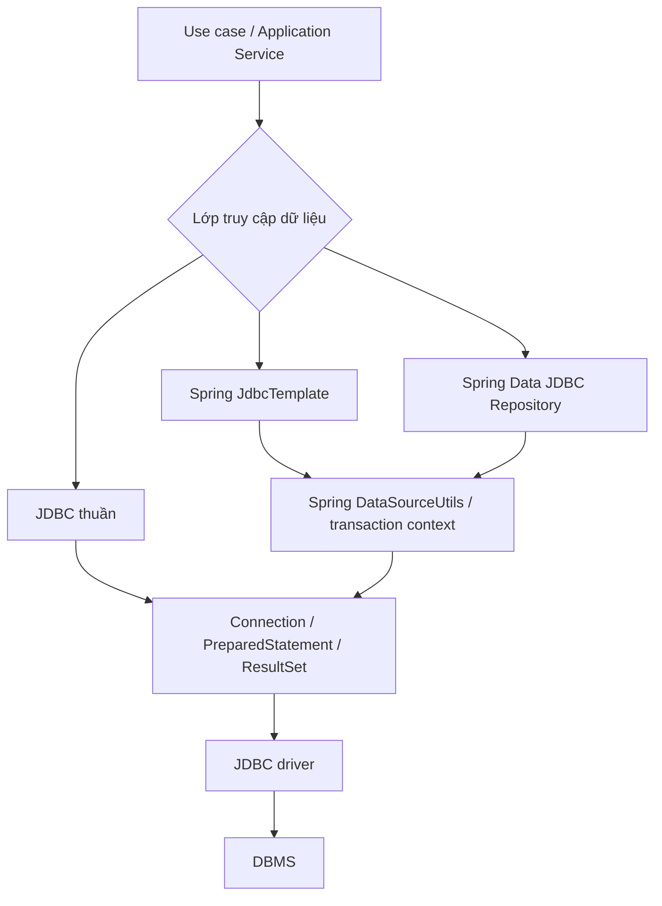
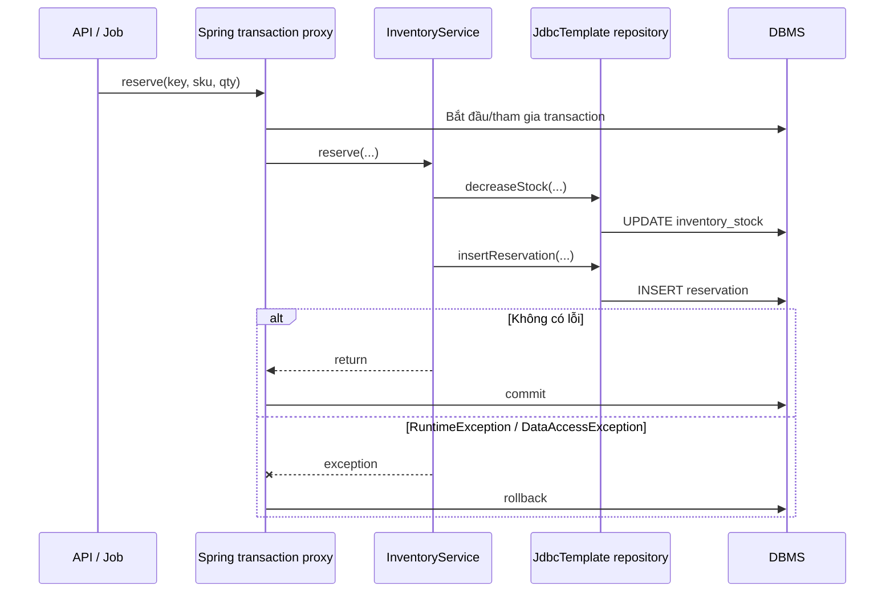

# Đánh giá khi JDBC thuần hoặc lớp hỗ trợ Spring phù hợp hơn

## 1. Câu hỏi kiến trúc: nên sử dụng JDBC trực tiếp hay Spring?

**JDBC** là API chuẩn để ứng dụng Java truy cập cơ sở dữ liệu quan hệ qua driver, `DataSource`, `Connection`, `PreparedStatement` và `ResultSet`. Nó cho phép thực thi SQL tham số hóa, CRUD, transaction, batch và các thao tác điều khiển hiệu năng ở mức thấp. **Spring JDBC** không thay thế JDBC bằng một giao thức truy cập mới: nó **dùng JDBC bên dưới**, nhưng cung cấp các lớp hỗ trợ như `JdbcTemplate`, `NamedParameterJdbcTemplate`, `RowMapper` và cơ chế quản lý transaction.

Vấn đề vì thế không phải “JDBC hay Spring cái nào đúng hơn”, mà là: **ứng dụng đang cần mức kiểm soát và mức trừu tượng nào?** Một chương trình CLI chạy vài câu SQL có thể dùng JDBC thuần rất hợp lý. Một ứng dụng Spring Boot có hàng chục repository, transaction liên quan nhiều bảng và yêu cầu xử lý lỗi thống nhất có thể hưởng lợi lớn từ Spring JDBC.

Hãy xét một use case: giữ trước một lượng hàng trong kho và tạo bản ghi đặt giữ. Nếu bước trừ số lượng thành công nhưng bước ghi đặt giữ thất bại, cả hai thay đổi phải rollback. JDBC thuần cần viết rõ vòng đời `Connection`, `PreparedStatement` và `commit/rollback`; Spring JDBC có thể giảm mã lặp và giao việc quản lý transaction cho Spring, **nếu** code dùng đúng `DataSource` và đi qua ranh giới transaction được Spring quản lý.

| Câu hỏi | JDBC thuần | Spring JDBC |
| --- | --- | --- |
| Ai gọi driver và gửi SQL? | Code ứng dụng trực tiếp. | Vẫn là JDBC driver; Spring gọi giúp qua template. |
| Ai tạo và đóng `PreparedStatement`/`ResultSet`? | Lập trình viên dùng `try-with-resources`. | `JdbcTemplate` quản lý tài nguyên cục bộ trong callback. |
| SQL có do framework tạo tự động không? | Không, ứng dụng viết SQL. | Không; với `JdbcTemplate` ứng dụng vẫn viết SQL. |
| Binding giá trị `?` | `PreparedStatement.setXxx()`. | `JdbcTemplate` và tham số truyền vào; cũng có named parameter. |
| Ánh xạ hàng thành domain/DTO | Code `while (rs.next())` tự viết. | `RowMapper<T>` hoặc `ResultSetExtractor<T>`. |
| Chuyển `SQLException` | Tự truyền hoặc bọc có chủ đích. | Thường chuyển thành các subclass `DataAccessException` (unchecked). |
| Ranh giới transaction | `setAutoCommit(false)`, `commit()`, `rollback()` thủ công. | Có thể dùng `@Transactional` hoặc `TransactionTemplate` với transaction manager. |
| Kiểm soát driver, LOB, batch, fetch size | Trực tiếp ở API JDBC. | Có các API hỗ trợ; lúc cần vẫn có đường dùng JDBC trực tiếp/callback. |
| Phụ thuộc thư viện ngoài JDK/driver | Không cần Spring. | Cần các module Spring tương ứng và cấu hình. |

**Kết luận mở đầu:** Spring JDBC thường **giảm boilerplate**, không mặc định làm một truy vấn SQL chậm trở nên nhanh, tự viết index hay tự bảo vệ quyền truy cập từng bản ghi. SQL, schema, bảo mật, phân trang và thiết kế transaction vẫn là trách nhiệm của ứng dụng.

## 2. Phân biệt bốn lựa chọn thường bị gọi chung là “Spring JDBC”

| Công nghệ | Cấp trừu tượng | Điều ứng dụng vẫn cần quyết định |
| --- | --- | --- |
| **JDBC thuần** (`java.sql`, `javax.sql.DataSource`) | Giao thức/API truy cập CSDL ở mức thấp. | Tất cả SQL, bind, mapping, connection, exception, transaction. |
| **Spring JDBC** (`JdbcTemplate`, `NamedParameterJdbcTemplate`) | Template/callback trên API JDBC; SQL do developer viết. | SQL, mapping, schema, phạm vi transaction, cách truy cập dữ liệu an toàn. |
| **Spring Data JDBC** | Mapping aggregate và repository hướng domain, dùng hạ tầng Spring JDBC. | Thiết kế aggregate, quan hệ lưu trữ, transaction, truy vấn đặc thù và giới hạn mapping. |
| **Spring Data JPA** | Repository cho ORM JPA/Hibernate hoặc provider JPA khác; **không đồng nghĩa** Spring Data JDBC. | Persistence context, entity lifecycle, lazy/eager loading, N+1, flush, transaction, schema. |

Đây là những lựa chọn khác cấp. Không nên chuyển từ `JdbcTemplate` sang JPA chỉ vì “đang dùng Spring”, và không nên gọi `Spring Data JDBC` là một phiên bản giản lược có toàn bộ hành vi ORM của JPA. Spring Data JDBC tập trung vào **aggregate**, không có cùng persistence context và cơ chế lazy loading truyền thống của JPA.

### Sơ đồ ranh giới



Spring không loại bỏ tầng `Connection` hay `PreparedStatement`: nó **quản lý cách sử dụng** chúng. Vì thế, kiến thức về SQL, SQL injection, isolation, lỗi transaction và connection pool của JDBC vẫn cần thiết dù người học chỉ viết `jdbcTemplate.update(...)`.

## 3. Chọn công nghệ theo ngữ cảnh, không theo số dòng code

| Ngữ cảnh | Thường ưu tiên | Lý do và giới hạn |
| --- | --- | --- |
| Công cụ nhỏ, chạy độc lập, vài truy vấn | **JDBC thuần** | Giữ dependency nhỏ, vòng đời tường minh, học và kiểm soát API chuẩn dễ. |
| Thư viện Java cần dùng ngoài Spring | **JDBC thuần** ở lõi, hoặc API nhận `DataSource`/`Connection` | Không buộc mọi caller phụ thuộc Spring. Có thể cung cấp adapter Spring riêng. |
| Ứng dụng Spring có nhiều DAO viết SQL trực tiếp | **Spring JDBC** | Giảm xử lý tài nguyên lặp lại, hỗ trợ transaction và exception translation nhất quán. |
| Truy vấn báo cáo SQL phức tạp, CTE, window function, vendor SQL | **JdbcTemplate/NamedParameterJdbcTemplate** hoặc JDBC thuần | Giữ kiểm soát SQL, tránh ép mọi query qua ORM. |
| CRUD domain theo aggregate với quan hệ vừa phải | **Spring Data JDBC** | Có repository và mapping aggregate; cần hiểu thay đổi graph và ranh giới aggregate. |
| Đồ thị entity phức tạp và cần đặc điểm ORM JPA | **Spring Data JPA** nếu phù hợp | Đổi lại phải quản lý lazy loading, persistence context, flush và nhiều loại chi phí. |
| API JDBC driver rất đặc thù, BLOB streaming hoặc handle riêng | **JDBC thuần**, hoặc callback `JdbcTemplate` | Cần dùng API vendor-specific, giữ vòng đời connection/LOB đúng. |
| Dịch vụ tải cao, nghi ngờ overhead framework | **Đo trước khi chọn** | Chi phí mạng/DB/query thường lớn hơn vài lớp wrapper; không đoán Spring chậm hay nhanh. |

**Không có lựa chọn tốt nhất cho mọi trường hợp.** Hai cách có thể cùng tồn tại: phần lớn DAO dùng `JdbcTemplate`, còn một repository đặc thù dùng `ConnectionCallback` để gọi API driver. Điều kiện là **cùng tham gia đúng transaction**, không tạo một hệ thống connection lifecycle mâu thuẫn.

## 4. Bài toán thực hành chung cho hai cách tiếp cận

Ví dụ sử dụng PostgreSQL với một lượng hàng có thể giữ trước. Hai thay đổi phải nằm trong **một transaction**:

1. Giảm `available_qty` của SKU chỉ khi còn đủ hàng.
2. Thêm một hàng vào `inventory_reservations` với `request_key` duy nhất.

```sql
CREATE TABLE inventory_stock (
    sku VARCHAR(64) PRIMARY KEY,
    available_qty INTEGER NOT NULL CHECK (available_qty >= 0)
);

CREATE TABLE inventory_reservations (
    request_key VARCHAR(80) PRIMARY KEY,
    sku VARCHAR(64) NOT NULL REFERENCES inventory_stock(sku),
    reserved_qty INTEGER NOT NULL CHECK (reserved_qty > 0),
    reserved_at TIMESTAMPTZ NOT NULL DEFAULT CURRENT_TIMESTAMP
);

INSERT INTO inventory_stock (sku, available_qty)
VALUES ('LAPTOP-01', 20);
```

Một câu lệnh giảm tồn kho an toàn hơn mẫu “`SELECT available_qty` rồi kiểm tra trong Java rồi `UPDATE`”:

```sql
UPDATE inventory_stock
SET available_qty = available_qty - ?
WHERE sku = ? AND available_qty >= ?;
```

Nếu kết quả cập nhật là `0` hàng, SKU có thể không tồn tại hoặc không đủ hàng: **không được tiếp tục chèn reservation như thể thành công**. Việc giữ điều kiện số lượng trong chính `UPDATE` giảm nguy cơ mất cập nhật khi nhiều transaction đồng thời, nhưng ứng dụng vẫn cần xem xét deadlock, isolation và idempotency ở cấp use case.

`request_key` giúp DBMS chặn hai reservation có cùng khóa, song **không tự làm retry idempotent hoàn chỉnh**: khi lần gọi trước đã commit nhưng response bị mất, caller cần đọc lại và xác minh reservation đã lưu trước khi trả kết quả của lần retry.

## 5. JDBC thuần: vòng đời Connection và transaction rõ ràng

Ví dụ sau dùng **Java 17+** và `DataSource` đã được cấu hình. Mã không cần `JdbcTemplate`, chủ động quản lý connection, hai statement, commit và rollback:

```java
import javax.sql.DataSource;
import java.sql.Connection;
import java.sql.PreparedStatement;
import java.sql.SQLException;
import java.util.Objects;

public final class PlainInventoryService {
    private final DataSource dataSource;

    public PlainInventoryService(DataSource dataSource) {
        this.dataSource = Objects.requireNonNull(dataSource);
    }

    public void reserve(String key, String sku, int quantity)
            throws SQLException {
        checkInput(key, sku, quantity);

        try (Connection connection = dataSource.getConnection()) {
            // Hợp đồng riêng của ví dụ: một transaction mới,
            // pool phải cấp connection ở autoCommit=true.
            if (!connection.getAutoCommit()) {
                throw new SQLException(
                    "Cần connection autoCommit=true lúc bắt đầu");
            }
            connection.setAutoCommit(false);

            try {
                String decrease = """
                    UPDATE inventory_stock
                    SET available_qty = available_qty - ?
                    WHERE sku = ? AND available_qty >= ?
                    """;
                try (PreparedStatement ps =
                        connection.prepareStatement(decrease)) {
                    ps.setInt(1, quantity);
                    ps.setString(2, sku);
                    ps.setInt(3, quantity);
                    if (ps.executeUpdate() != 1) {
                        throw new IllegalStateException(
                            "SKU không tồn tại hoặc không đủ tồn kho");
                    }
                }

                String insert = """
                    INSERT INTO inventory_reservations
                        (request_key, sku, reserved_qty)
                    VALUES (?, ?, ?)
                    """;
                try (PreparedStatement ps =
                        connection.prepareStatement(insert)) {
                    ps.setString(1, key);
                    ps.setString(2, sku);
                    ps.setInt(3, quantity);
                    if (ps.executeUpdate() != 1) {
                        throw new SQLException(
                            "Không ghi được reservation");
                    }
                }

                connection.commit();
            } catch (SQLException | RuntimeException | Error failure) {
                try {
                    connection.rollback();
                } catch (SQLException rollbackFailure) {
                    failure.addSuppressed(rollbackFailure);
                }
                throw failure;
            }
            // close() trả handle cho pool hoặc đóng kết nối vật lý.
        }
    }

    private static void checkInput(
            String key, String sku, int quantity) {
        if (key == null || key.isBlank() || key.length() > 80
                || sku == null || sku.isBlank() || sku.length() > 64
                || quantity <= 0) {
            throw new IllegalArgumentException(
                "Thông tin giữ hàng không hợp lệ");
        }
    }
}
```

**Những điều mã JDBC thuần buộc người viết kiểm soát:**

- `try-with-resources` phải đóng `PreparedStatement` và `Connection`, không giữ `ResultSet`/statement vượt phạm vi kết nối.
- Hai lệnh cùng dùng một `Connection` nên nằm trong cùng transaction sau `setAutoCommit(false)`.
- Lỗi `SQLException` và lỗi nghiệp vụ unchecked đều khiến chương trình **thử rollback**, sau đó giữ nguyên ngoại lệ gốc.
- Nếu `rollback()` cũng thất bại, `addSuppressed()` giữ lỗi dọn dẹp mà không che mất lỗi ban đầu.
- `commit()` chỉ được gọi sau cả hai lệnh thành công; nếu `commit()` ném lỗi mất kết nối, **không được kết luận chắc chắn DBMS đã rollback**, vì commit có thể đã xảy ra.
- Không tự gọi `setAutoCommit(true)` trong `finally` khi transaction có thể chưa rollback xong, vì chuyển trạng thái đó có thể dẫn tới commit theo JDBC. Trả connection về pool theo hợp đồng pool/driver đã kiểm chứng.

Khi service có nhiều use case, mã `try/commit/rollback` có thể lặp ở nhiều nơi; có thể tự viết transaction runner nhưng phải kiểm soát đúng trạng thái connection và ngoại lệ. Spring có sẵn lớp quản lý những khía cạnh này, tạo ra lợi ích đáng kể ở hệ thống lớn.

## 6. Spring JDBC: cùng SQL, ít mã quản lý tài nguyên hơn

Khi ứng dụng đã sử dụng Spring với một `DataSource` và transaction manager được cấu hình đúng, có thể tách **repository giữ SQL** và **service giữ ranh giới transaction**.

### Repository dùng `JdbcTemplate`

```java
import org.springframework.jdbc.core.JdbcTemplate;
import org.springframework.stereotype.Repository;

@Repository
public class SpringInventoryRepository {
    private final JdbcTemplate jdbc;

    public SpringInventoryRepository(JdbcTemplate jdbc) {
        this.jdbc = jdbc;
    }

    public void decreaseStock(String sku, int quantity) {
        int updated = jdbc.update("""
            UPDATE inventory_stock
            SET available_qty = available_qty - ?
            WHERE sku = ? AND available_qty >= ?
            """, quantity, sku, quantity);

        if (updated != 1) {
            throw new IllegalStateException(
                "SKU không tồn tại hoặc không đủ tồn kho");
        }
    }

    public void insertReservation(
            String key, String sku, int quantity) {
        int updated = jdbc.update("""
            INSERT INTO inventory_reservations
                (request_key, sku, reserved_qty)
            VALUES (?, ?, ?)
            """, key, sku, quantity);

        if (updated != 1) {
            throw new IllegalStateException(
                "Không ghi được reservation");
        }
    }
}
```

`JdbcTemplate.update(...)` tự tạo/bind/thực thi/đóng statement, và tham gia việc quản lý connection thông qua cơ chế hỗ trợ Spring. Các `SQLException` từ JDBC được chuyển qua **hệ thống exception translation** của Spring thành những `DataAccessException` thích hợp; vì thế repository không cần khai báo `throws SQLException` trong ví dụ.

### Service dùng `@Transactional`

```java
import org.springframework.stereotype.Service;
import org.springframework.transaction.annotation.Transactional;

@Service
public class SpringInventoryService {
    private final SpringInventoryRepository repository;

    public SpringInventoryService(SpringInventoryRepository repository) {
        this.repository = repository;
    }

    @Transactional
    public void reserve(String key, String sku, int quantity) {
        if (key == null || key.isBlank() || key.length() > 80
                || sku == null || sku.isBlank() || sku.length() > 64
                || quantity <= 0) {
            throw new IllegalArgumentException(
                "Thông tin giữ hàng không hợp lệ");
        }

        repository.decreaseStock(sku, quantity);
        repository.insertReservation(key, sku, quantity);
    }
}
```

Trong cấu hình Spring transaction thông thường, lời gọi **qua Spring proxy** vào phương thức public `reserve()` sẽ bắt đầu hoặc tham gia transaction theo cấu hình, hai `JdbcTemplate` call cùng dùng connection gắn với transaction hiện tại, rồi commit nếu thành công hoặc rollback khi exception unchecked được ném.

**Điều kiện tiên quyết:** có `PlatformTransactionManager` phù hợp với đúng `DataSource` mà `JdbcTemplate` dùng; annotation được kích hoạt và lời gọi đi qua proxy/transaction interceptor. Chỉ thêm `@Transactional` vào một đối tượng do `new` tạo thủ công **không tự mở transaction**. Không mặc định ví dụ Spring trên đúng nếu chưa xác minh wiring.

Với PostgreSQL và schema trên, hai cài đặt có cùng ý định giao dịch. Sự khác nhau là **Spring đảm nhiệm nhiều vòng đời tài nguyên và quy tắc transaction**; ứng dụng vẫn phải chọn đúng SQL, thứ tự thao tác, chính sách retry và quyền ghi.

## 7. Phải cấu hình cùng DataSource và transaction manager

`@Transactional` là **hợp đồng với hạ tầng Spring**, không phải tính năng tích hợp sẵn của JVM hay JDBC driver. Khi không dùng cơ chế cấu hình tự động, có thể kết nối các thành phần như sau:

```java
import javax.sql.DataSource;
import org.springframework.context.annotation.Bean;
import org.springframework.context.annotation.Configuration;
import org.springframework.transaction.PlatformTransactionManager;
import org.springframework.transaction.annotation.EnableTransactionManagement;
import org.springframework.jdbc.core.JdbcTemplate;
import org.springframework.jdbc.support.JdbcTransactionManager;

@Configuration
@EnableTransactionManagement
public class JdbcConfiguration {
    @Bean
    public JdbcTemplate jdbcTemplate(DataSource dataSource) {
        return new JdbcTemplate(dataSource);
    }

    @Bean
    public PlatformTransactionManager transactionManager(
            DataSource dataSource) {
        return new JdbcTransactionManager(dataSource);
    }
}
```

Ví dụ này **giả định đã có một bean `DataSource`** để Spring inject. Nó dành cho cấu hình thủ công, không nên sao chép nguyên xi vào ứng dụng Spring Boot đã **tự tạo `JdbcTemplate`/transaction manager** mà không kiểm tra xung đột bean. `JdbcTransactionManager` là lựa chọn Spring JDBC cho transaction cục bộ với một DataSource, đồng thời hỗ trợ chuyển đổi một số ngoại lệ khi commit/rollback; `DataSourceTransactionManager` là lớp khác trong cùng họ. Với phiên bản Spring đang dùng, cần xác nhận API và quy ước cấu hình thực tế.

**Điểm cần kiểm tra ở runtime:**

1. `JdbcTemplate` và transaction manager tham chiếu tới **cùng DataSource** (hoặc cùng target DataSource thực tế qua lớp proxy được hỗ trợ).
2. Repository được Spring quản lý và service được gọi qua **proxy có transaction advice**, không phải `new SpringInventoryService(...)` ở ngoài container.
3. `DataSource` có pool phù hợp với số request, transaction, timeout và giới hạn DBMS.
4. Service hoàn tất nghiệp vụ trước khi trả kết quả; không giữ connection qua HTTP request khác hoặc async callback không nằm trong transaction.

`DataSourceTransactionManager`/`JdbcTransactionManager` quản lý **transaction JDBC cục bộ** trên connection của một DataSource. Nếu một use case dùng **hai DataSource** hoặc gọi hệ thống ngoài qua HTTP, chỉ thêm `@Transactional` **không** bảo đảm tính nguyên tử giữa các tài nguyên. Khi cần, xem xét JTA/XA trong môi trường hỗ trợ hoặc mô hình outbox/saga với cơ chế idempotency.

## 8. Khác biệt trong xử lý `ResultSet` và ánh xạ hàng

JDBC thuần thường phải viết vòng lặp:

```java
List<StockView> found = new ArrayList<>();
try (PreparedStatement ps = connection.prepareStatement(
        "SELECT sku, available_qty FROM inventory_stock " +
        "WHERE sku LIKE ? ORDER BY sku LIMIT ?")) {
    ps.setString(1, pattern);
    ps.setInt(2, maxRows);

    try (ResultSet rs = ps.executeQuery()) {
        while (rs.next()) {
            found.add(new StockView(
                rs.getString("sku"),
                rs.getInt("available_qty")));
        }
    }
}
```

`StockView` ở đây là một DTO do ứng dụng định nghĩa. `maxRows` phải được kiểm tra giới hạn, còn `pattern` phải được thiết kế theo hợp đồng `LIKE` (tìm nguyên văn hay cho phép wildcard). Với Spring JDBC, tách mapping thành `RowMapper<T>`:

```java
import java.util.List;
import org.springframework.jdbc.core.JdbcTemplate;
import org.springframework.stereotype.Repository;

record StockView(String sku, int availableQty) {}

@Repository
public class StockReadRepository {
    private final JdbcTemplate jdbc;

    public StockReadRepository(JdbcTemplate jdbc) {
        this.jdbc = jdbc;
    }

    public List<StockView> search(String pattern, int limit) {
        if (pattern == null || limit < 1 || limit > 100) {
            throw new IllegalArgumentException("Điều kiện không hợp lệ");
        }

        return jdbc.query("""
            SELECT sku, available_qty
            FROM inventory_stock
            WHERE sku LIKE ?
            ORDER BY sku
            LIMIT ?
            """,
            (rs, rowNumber) -> new StockView(
                rs.getString("sku"),
                rs.getInt("available_qty")),
            pattern, limit);
    }
}
```

`JdbcTemplate.query(...)` tự quản lý `PreparedStatement` và `ResultSet`, gọi `RowMapper` cho từng hàng. Mapper chỉ đọc hàng **hiện tại**, không tự gọi `rs.next()` và **không đóng** `ResultSet`/`Connection`. Kết quả được materialize thành `List<StockView>`, phù hợp với số hàng có giới hạn. Với tập dữ liệu rất lớn, không nên dùng mặc định một `List` vô hạn; cần phân trang hoặc cơ chế stream/callback có vòng đời tài nguyên rõ.

### Khi kết quả có thể rỗng

Với JDBC thuần:

```java
try (ResultSet rs = ps.executeQuery()) {
    if (!rs.next()) {
        return Optional.empty();
    }
    return Optional.of(new StockView(
        rs.getString("sku"),
        rs.getInt("available_qty")));
}
```

Đoạn trên minh họa bên trong một phương thức trả `Optional<StockView>`. Với `JdbcTemplate.queryForObject(...)`, Spring thường ném `EmptyResultDataAccessException` nếu **không có hàng** và `IncorrectResultSizeDataAccessException` nếu có **hơn một hàng**:

```java
StockView item = jdbc.queryForObject(
    "SELECT sku, available_qty FROM inventory_stock WHERE sku = ?",
    (rs, rowNum) -> new StockView(
        rs.getString("sku"),
        rs.getInt("available_qty")),
    sku);
```

Nếu “không có bản ghi” là trường hợp bình thường, có thể sử dụng `query(...)` rồi chuyển danh sách 0/1 hàng thành `Optional`, hoặc bắt riêng `EmptyResultDataAccessException` theo hợp đồng repository. **Không bắt toàn bộ `DataAccessException` rồi trả empty** vì sẽ che cả timeout, lỗi connection và lỗi SQL.

## 9. Khi nào `NamedParameterJdbcTemplate` thật sự hữu ích?

Với câu SQL có nhiều placeholder, chỉ số 1, 2, 3 có thể khiến việc sửa filter dễ sai. `NamedParameterJdbcTemplate` cho phép đặt tên như `:sku`, `:quantity`, `:requestKey` thay cho dấu `?` trong chuỗi SQL và chuyển chúng thành tham số JDBC bên dưới:

```java
import org.springframework.jdbc.core.namedparam.MapSqlParameterSource;
import org.springframework.jdbc.core.namedparam.NamedParameterJdbcTemplate;

public class NamedStockRepository {
    private final NamedParameterJdbcTemplate named;

    public NamedStockRepository(NamedParameterJdbcTemplate named) {
        this.named = named;
    }

    public int decrease(String sku, int quantity) {
        String sql = """
            UPDATE inventory_stock
            SET available_qty = available_qty - :quantity
            WHERE sku = :sku AND available_qty >= :quantity
            """;

        var parameters = new MapSqlParameterSource()
            .addValue("quantity", quantity)
            .addValue("sku", sku);

        return named.update(sql, parameters);
    }
}
```

Trong ví dụ, `:quantity` xuất hiện **hai lần** nhưng chỉ được gán giá trị một lần qua tên. Spring vẫn dùng cơ chế binding dữ liệu; nó **không** chèn trực tiếp chuỗi nhập vào SQL. Named parameters đặc biệt dễ đọc khi nhiều điều kiện tùy chọn cùng tồn tại.

Tuy nhiên, `:columnName` không phải chỗ để bind một **tên cột động**, tương tự `ORDER BY ?` trong JDBC không thay thế identifier. Đối với tên bảng, cột, hướng `ASC/DESC` hoặc SQL fragments do người dùng lựa chọn, vẫn cần **allowlist từ server**, không lấy chuỗi tùy ý nối vào SQL.

`NamedParameterJdbcTemplate` cũng có hỗ trợ mở rộng danh sách giá trị trong những trường hợp như `IN (:ids)`. Dù tiện, phải xử lý tập rỗng, giới hạn độ dài danh sách, giới hạn tham số của DBMS và độ lớn câu SQL. Với hàng nghìn ID, có thể cần phương án bảng tạm, join hoặc nạp dữ liệu theo lô khác thay vì tạo một `IN` quá dài.

## 10. Exception translation: `SQLException` khác `DataAccessException`

JDBC thuần khai báo hoặc bắt `SQLException`, có thể phân loại dựa trên `SQLState`, `getErrorCode()` và các subclass như `SQLTimeoutException`. Spring JDBC có một lớp **exception translation** chuyển lỗi JDBC thành các subclass unchecked của `org.springframework.dao.DataAccessException`, ví dụ:

| Tình huống | JDBC thuần | Spring JDBC (ví dụ loại exception) |
| --- | --- | --- |
| Vi phạm unique key | `SQLException` có SQLState/vendor code. | `DuplicateKeyException` hoặc subclass khác của `DataIntegrityViolationException` khi translator nhận diện. |
| Vi phạm FK/check | `SQLException` theo driver. | `DataIntegrityViolationException` khi nhận diện được. |
| Không có hàng trong `queryForObject` | Tự xử lý `rs.next()==false`. | `EmptyResultDataAccessException`, không phải `SQLException`. |
| SQL sai hoặc thiếu bảng | `SQLException`. | `BadSqlGrammarException` khi nhận diện được. |
| Không kết nối được DB | `SQLException` hoặc subclass kết nối. | Có thể là `CannotGetJdbcConnectionException`. |
| Timeout câu lệnh | `SQLTimeoutException` hoặc lỗi theo driver. | Có thể là `QueryTimeoutException`. |

**Không phụ thuộc cứng vào việc một mã lỗi bất kỳ luôn ra đúng một subclass Spring.** Kết quả chuyển đổi tùy translator, driver, SQLState và vendor error code. Việc này đặc biệt quan trọng khi chuyển từ DBMS này sang DBMS khác hoặc nâng cấp driver.

### Vì sao unchecked exceptions có ích cho transaction?

Mặc định truyền thống của Spring transaction infrastructure là rollback khi phương thức `@Transactional` ném `RuntimeException` hoặc `Error`, còn exception **checked** không tự kích hoạt rollback nếu không có quy tắc bổ sung. Vì các `DataAccessException` là unchecked, lỗi SQL từ `JdbcTemplate` thường kích hoạt rollback tự nhiên:

```java
@Transactional
public void reserve(String key, String sku, int quantity) {
    repository.decreaseStock(sku, quantity);
    repository.insertReservation(key, sku, quantity);
    // Nếu insert ném DataAccessException, transaction rollback theo mặc định.
}
```

Nếu service của bạn ném checked exception mang ý nghĩa phải rollback, cần khai báo rule phù hợp, chẳng hạn `@Transactional(rollbackFor = SomeCheckedException.class)`, hoặc cấu hình chính sách rollback toàn cục theo phiên bản Spring. Không thể khẳng định mọi exception checked sẽ tự rollback với mọi cấu hình.

**Sai lầm nguy hiểm:** bắt `DataAccessException` ngay trong service rồi **không ném lại**, khiến interceptor thấy method trả về thành công và có thể commit các thay đổi trước đó. Nếu lỗi thật sự được phép bỏ qua, phải có chính sách transaction cụ thể, chẳng hạn savepoint hoặc trạng thái rollback-only, chứ không chỉ ghi log rồi tiếp tục.

## 11. `@Transactional` không tự có hiệu lực ở mọi lời gọi

Một trong những khác biệt lớn nhất giữa JDBC thuần và Spring JDBC là **ranh giới transaction có thể được điều khiển qua proxy/interceptor** thay vì những lời gọi `commit/rollback` hiển thị trong mỗi phương thức. Điều này giảm code lặp, nhưng buộc người viết phải hiểu cơ chế kích hoạt.

### Các trường hợp dễ khiến transaction không chạy như mong đợi

| Tình huống | Vấn đề | Cách xử lý |
| --- | --- | --- |
| Gọi method qua `new SpringInventoryService(...)` | Đối tượng không do Spring quản lý, không đi qua transaction proxy. | Lấy Spring bean từ container và gọi qua bean đó. |
| Trong cùng object gọi `this.reserve(...)` | **Self-invocation** thường bỏ qua proxy trong mô hình AOP proxy mặc định. | Tách entry point sang bean khác hoặc dùng transaction programmatic khi phù hợp. |
| Đặt `@Transactional` trên private method rồi gọi nội bộ | Không phải lời gọi xuyên qua proxy. | Đặt boundary ở service method được gọi qua proxy. |
| Đặt annotation trên method của class `final` khi cần class-based proxy | Spring không thể tạo subclass cho class final. | Tránh final khi dùng proxy dựa trên lớp, hoặc chọn kiến trúc/proxy phù hợp. |
| Service dùng transaction manager cho DataSource A, repository dùng DataSource B | Hai kết nối không cùng transaction local. | Cấu hình cùng target DataSource và xác minh transaction manager. |
| Từ trong transaction gọi `DataSource.getConnection()` trực tiếp ngoài cơ chế Spring | Có thể mượn **connection khác** không gắn transaction hiện tại. | Dùng `JdbcTemplate`, `DataSourceUtils` hoặc integration được hỗ trợ. |
| Bắt exception rồi nuốt và trả về bình thường | Interceptor có thể commit dù một bước bị lỗi. | Ném lại hoặc đánh dấu rollback-only theo quyết định nghiệp vụ rõ ràng. |
| Tưởng mọi checked exception tự rollback | Mặc định rollback rule không nhất thiết gồm checked exception. | Khai báo `rollbackFor` hoặc cấu hình transaction đúng yêu cầu. |
| Gọi JDBC trong thread async mới | Context transaction dạng thread-bound không tự truyền sang thread khác. | Mỗi tác vụ async có ranh giới transaction riêng. |

Mô hình proxy minh họa:



**Một điểm dễ nhầm về propagation:** nếu hai Spring service có `@Transactional` mặc định `REQUIRED` và lời gọi đi qua proxy, service B thường **tham gia transaction của A**. Nếu B dùng `REQUIRES_NEW`, nó mở một transaction **độc lập** (có thể cần connection khác); commit của B không bị rollback tự động khi A lỗi. Đó không phải công cụ để tạo “các bước nguyên tử chung” giữa A và B.

Khi một thành phần bên trong đánh dấu transaction **rollback-only** mà thành phần ngoài vẫn cố commit, Spring có thể báo `UnexpectedRollbackException` để tránh kết luận giao dịch đã thành công. Với `NESTED` hoặc savepoint, khả năng hỗ trợ phụ thuộc transaction manager/driver. Không áp dụng máy móc các propagation mode khi chưa xác định đúng yêu cầu nghiệp vụ.

## 12. `TransactionTemplate`: lựa chọn tường minh thay cho AOP

Nếu việc dùng proxy khó quan sát trong một callback, tác vụ CLI hoặc quy trình có nhiều nhánh, Spring cung cấp `TransactionTemplate` để xác định ranh giới transaction **trong code** mà vẫn hưởng lợi từ `PlatformTransactionManager`:

```java
import org.springframework.transaction.PlatformTransactionManager;
import org.springframework.transaction.support.TransactionTemplate;

public class ProgrammaticInventoryService {
    private final TransactionTemplate transactions;
    private final SpringInventoryRepository repository;

    public ProgrammaticInventoryService(
            PlatformTransactionManager manager,
            SpringInventoryRepository repository) {
        this.transactions = new TransactionTemplate(manager);
        this.repository = repository;
    }

    public void reserve(String key, String sku, int quantity) {
        // Trong ứng dụng thật, validate toàn bộ đầu vào trước khi ghi DB.
        if (quantity <= 0 || key == null || key.isBlank()
                || sku == null || sku.isBlank()) {
            throw new IllegalArgumentException("Đầu vào không hợp lệ");
        }

        transactions.executeWithoutResult(status -> {
            repository.decreaseStock(sku, quantity);
            repository.insertReservation(key, sku, quantity);
        });
    }
}
```

`TransactionTemplate` giúp làm rõ điểm bắt đầu/kết thúc giao dịch và thường thuận tiện trong code không đi qua proxy. Nó **không có nghĩa application được phép dùng một transaction manager bất kỳ**: các repository vẫn phải truy cập DataSource đã gắn với manager. `TransactionTemplate` không tự giải quyết vấn đề hai DBMS, lỗi commit chưa rõ hoặc retry nghiệp vụ. Trong ví dụ trên, bổ sung giới hạn độ dài `request_key` và `sku` tương tự service ở mục 6 trước khi triển khai.

### Không trộn giao dịch thủ công và transaction manager

Nếu method Spring đã chạy dưới `@Transactional`, **đừng** tùy tiện gọi:

```java
// SAI khi connection đang do Spring transaction manager quản lý:
connection.setAutoCommit(false);
// ... rồi tự commit/rollback tại repository ...
connection.commit();
```

Các thao tác đó có thể thay đổi trạng thái transaction mà Spring tin đang sở hữu. Muốn điều chỉnh isolation/read-only/propagation, hãy đặt ở **ranh giới transaction** với cấu hình tương ứng hoặc `TransactionDefinition`, không để DAO âm thầm thay đổi giữa chừng.

## 13. Cần API JDBC đặc thù: vẫn có đường đi bên trong Spring

`JdbcTemplate` không bắt buộc mọi SQL phải đi qua overload ngắn của `update()` hay `query()`. Khi cần thao tác sâu hơn với `Connection`, nó có callback:

```java
import org.springframework.jdbc.core.ConnectionCallback;
import org.springframework.jdbc.core.JdbcTemplate;
import java.sql.PreparedStatement;
import java.sql.SQLException;

public class DriverAwareRepository {
    private final JdbcTemplate jdbc;

    public DriverAwareRepository(JdbcTemplate jdbc) {
        this.jdbc = jdbc;
    }

    public int decrementWithJdbc(
            String sku, int quantity) {
        Integer affected = jdbc.execute(
            (ConnectionCallback<Integer>) connection -> {
                try (PreparedStatement ps = connection.prepareStatement(
                        "UPDATE inventory_stock " +
                        "SET available_qty = available_qty - ? " +
                        "WHERE sku = ? AND available_qty >= ?")) {
                    ps.setInt(1, quantity);
                    ps.setString(2, sku);
                    ps.setInt(3, quantity);
                    return ps.executeUpdate();
                }
            });
        return affected == null ? 0 : affected;
    }
}
```

Mã này dùng API JDBC thuần **trong callback** do `JdbcTemplate` quản lý. Connection được cung cấp bởi hạ tầng Spring và có thể đang tham gia một transaction Spring. **Không gọi `connection.close()`, `commit()` hoặc `rollback()` trong callback** nếu caller/transaction manager đang sở hữu kết nối.

Một lựa chọn khác, khi tích hợp mã JDBC cũ cần tự mượn connection trong phương thức được Spring quản lý:

```java
import javax.sql.DataSource;
import java.sql.Connection;
import java.sql.PreparedStatement;
import java.sql.SQLException;
import org.springframework.jdbc.UncategorizedSQLException;
import org.springframework.jdbc.datasource.DataSourceUtils;

static int countRows(DataSource dataSource) {
    Connection connection = DataSourceUtils.getConnection(dataSource);
    String sql = "SELECT COUNT(*) FROM inventory_stock";
    try {
        try (PreparedStatement ps = connection.prepareStatement(sql);
             var rows = ps.executeQuery()) {
            if (!rows.next()) {
                throw new IllegalStateException(
                    "COUNT(*) không trả kết quả");
            }
            return rows.getInt(1);
        }
    } catch (SQLException failure) {
        throw new UncategorizedSQLException("countRows", sql, failure);
    } finally {
        DataSourceUtils.releaseConnection(connection, dataSource);
    }
}
```

`DataSourceUtils.getConnection()`/`releaseConnection()` hiểu connection được Spring gắn với transaction thread hiện tại. Vì vậy chúng phù hợp hơn `dataSource.getConnection()`/`connection.close()` trực tiếp trong code legacy cần tham gia Spring transaction. Ví dụ dùng `UncategorizedSQLException` để không che lỗi; với ứng dụng thật nên dùng **SQLExceptionTranslator** phù hợp để phân loại tốt hơn, hoặc đơn giản ưu tiên `JdbcTemplate`.

**Quy tắc:** không vừa mượn connection bằng `DataSourceUtils` rồi lại đóng nó bằng `try (Connection c = ...)` theo kiểu JDBC thuần khi Spring đang sở hữu transaction. Hãy dùng đúng cặp API acquire/release. Cũng không chia sẻ connection/thread-bound transaction sang một thread khác một cách tùy tiện.

## 14. Batch, khóa sinh tự động và streaming: Spring có giúp được không?

Spring JDBC có lớp hỗ trợ cho nhiều khả năng tiêu chuẩn của JDBC, nhưng người viết vẫn phải hiểu **kết quả, giới hạn và vòng đời** của từng API.

### 14.1. Batch DML

Trong JDBC thuần, `PreparedStatement.addBatch()` và `executeBatch()` cho phép gửi nhiều bộ tham số trong một thao tác. Spring JDBC cung cấp `JdbcTemplate.batchUpdate(...)`:

```java
import java.sql.PreparedStatement;
import java.sql.SQLException;
import java.util.List;
import org.springframework.jdbc.core.BatchPreparedStatementSetter;
import org.springframework.jdbc.core.JdbcTemplate;

record ReservationLine(
    String requestKey, String sku, int quantity
) {}

public class ReservationBatchWriter {
    private final JdbcTemplate jdbc;

    public ReservationBatchWriter(JdbcTemplate jdbc) {
        this.jdbc = jdbc;
    }

    public int[] insertMany(List<ReservationLine> input) {
        List<ReservationLine> lines = List.copyOf(input);
        return jdbc.batchUpdate("""
            INSERT INTO inventory_reservations
                (request_key, sku, reserved_qty)
            VALUES (?, ?, ?)
            """,
            new BatchPreparedStatementSetter() {
                @Override
                public int getBatchSize() {
                    return lines.size();
                }

                @Override
                public void setValues(PreparedStatement ps, int i)
                        throws SQLException {
                    ReservationLine line = lines.get(i);
                    ps.setString(1, line.requestKey());
                    ps.setString(2, line.sku());
                    ps.setInt(3, line.quantity());
                }
            });
    }
}
```

Đây chỉ là ví dụ **insert reservation**; không tự thực hiện thao tác giảm tồn kho. Nếu nghiệp vụ cần hai bước cùng nguyên tử, chúng vẫn phải được thực hiện dưới **một transaction** và phải kiểm tra số hàng cập nhật. `batchUpdate` không tự biến nhiều lệnh khác nhau thành một transaction chung khi không có boundary thích hợp.

Các giá trị của `int[]` có thể bao gồm số hàng cập nhật hoặc các giá trị đặc biệt như `Statement.SUCCESS_NO_INFO`. Khi một batch lỗi, driver có thể báo `BatchUpdateException`, được Spring dịch thành `DataAccessException` tương ứng; **không giả định toàn batch rollback nếu đang auto-commit hoặc DBMS/driver không hỗ trợ transaction như mong đợi**.

### 14.2. Khóa sinh tự động

JDBC thuần có `PreparedStatement.RETURN_GENERATED_KEYS` hoặc `getGeneratedKeys()`; Spring JDBC cung cấp `KeyHolder`, `GeneratedKeyHolder` và `SimpleJdbcInsert` ở những tình huống phù hợp. Tuy nhiên, mỗi DBMS có khả năng và quy ước trả khóa khác nhau; không nên suy rằng một API Spring sẽ luôn dùng cùng SQL hoặc có thể lấy mọi kiểu khóa phức tạp mà không cần cấu hình.

Ví dụ, bảng minh họa `inventory_reservations` sử dụng **`request_key` do ứng dụng tạo** làm khóa chính, nên không cần `getGeneratedKeys()`. Nếu một schema khác sử dụng cột `BIGINT GENERATED ... AS IDENTITY`, có thể lựa chọn API lấy khóa được driver xác nhận hỗ trợ. **Thiết kế khóa nghiệp vụ/idempotency** vẫn độc lập với khả năng lấy khóa tự sinh.

### 14.3. Đọc hàng loạt không đồng nghĩa tải tất cả vào RAM

`JdbcTemplate.query(..., RowMapper)` thường trả một `List`. Với truy vấn trả hàng triệu bản ghi, cấu trúc đó có thể tốn bộ nhớ. Có thể dùng `RowCallbackHandler` để xử lý từng hàng trong khi template quản lý tài nguyên:

```java
import java.util.function.Consumer;
import org.springframework.jdbc.core.JdbcTemplate;
import org.springframework.jdbc.core.RowCallbackHandler;

public class StockFeedReader {
    private final JdbcTemplate jdbc;

    public StockFeedReader(JdbcTemplate jdbc) {
        this.jdbc = jdbc;
    }

    public void forEachStock(Consumer<StockView> consumer) {
        jdbc.query(
            "SELECT sku, available_qty FROM inventory_stock ORDER BY sku",
            (RowCallbackHandler) rs -> consumer.accept(
                new StockView(
                    rs.getString("sku"),
                    rs.getInt("available_qty"))));
    }
}
```

`RowCallbackHandler.processRow` **không** gọi `rs.next()`, không giữ `ResultSet` để dùng sau và không đóng kết nối. Mã trên xử lý mỗi hàng tại thời điểm callback, nhưng **không tự bảo đảm server gửi từng hàng thay vì buffer tất cả ở driver**. Để streaming thật trên DBMS/driver cụ thể, có thể phải cấu hình `fetchSize`, loại ResultSet và phạm vi transaction/auto-commit; ví dụ PostgreSQL có các điều kiện riêng cho server-side cursor. Vì vậy cần đo bộ nhớ/độ trễ thực tế.

**Không gọi HTTP hay thao tác rất chậm trên mỗi hàng trong callback khi đang giữ connection/transaction**, vì có thể kéo dài thời gian mượn pool và giữ snapshot/lock. Nếu cần xuất dữ liệu lớn ra ngoài, thiết kế giới hạn tốc độ, retry và chia trang/chunk tương ứng.

## 15. Spring Data JDBC khác gì `JdbcTemplate` và Spring Data JPA?

Đây là bước chọn trừu tượng tiếp theo, **không phải điều kiện bắt buộc** khi dùng Spring JDBC. Nếu mã ứng dụng chủ yếu là CRUD của các **aggregate** ổn định, Spring Data JDBC có thể hỗ trợ repository interface và ánh xạ đối tượng sang bảng.

Ví dụ minh họa cho **một bảng độc lập khác**:

```java
import org.springframework.data.annotation.Id;
import org.springframework.data.relational.core.mapping.Table;
import org.springframework.data.repository.CrudRepository;

@Table("catalog_products")
record CatalogProduct(@Id Long id, String name) {}

public interface CatalogProductRepository
        extends CrudRepository<CatalogProduct, Long> {}
```

Đoạn này cần dependency và cấu hình **Spring Data JDBC**, cùng bảng `catalog_products` có cấu trúc phù hợp. `id=null` biểu diễn đối tượng mới theo quy ước mapping thông thường; khi dùng ID do ứng dụng cấp sẵn, cần xem lại chiến lược xác định entity mới. Không nên mang interface này vào project chỉ đang dùng `spring-jdbc` rồi cho rằng sẽ tự chạy.

| Nhu cầu | `JdbcTemplate` / Spring JDBC | Spring Data JDBC | Spring Data JPA |
| --- | --- | --- | --- |
| Viết SQL tùy ý có nhiều join/CTE | Rất trực tiếp. | Có thể dùng query riêng, nhưng không nhất thiết là lựa chọn đơn giản nhất cho mọi báo cáo. | Có JPQL/native SQL; cần chú ý ORM mapping và hiệu năng. |
| CRUD aggregate đơn giản | Tự viết SQL và `RowMapper`. | Hỗ trợ mapping/repository theo aggregate. | Hỗ trợ entity/repository theo ngữ nghĩa JPA. |
| Tự động theo dõi thay đổi entity trong persistence context | Không. | Không giống mô hình persistence context của JPA. | Có, theo cơ chế JPA provider. |
| Lazy loading quan hệ theo kiểu JPA | Không tự có. | Không có cơ chế lazy-loading tương đương JPA mặc định. | Có thể có, kèm rủi ro N+1/lifetime session. |
| Tối ưu truy vấn đặc thù DBMS | Kiểm soát trực tiếp SQL. | Phải xem mức hỗ trợ query/mapping và escape hatch. | Có native SQL, nhưng cần xét tương tác entity mapping. |
| Học/kiểm soát tài nguyên JDBC | Thấy rõ qua template/callback hoặc raw JDBC. | Thêm tầng mapping/repository. | Nhiều khái niệm ORM hơn. |

Với Spring Data JDBC, **aggregate boundary** rất quan trọng: thao tác lưu một aggregate có thể ảnh hưởng các entity con theo cơ chế mapping của Spring Data JDBC. Không suy rằng thay một collection con chỉ phát ra một câu `UPDATE` tối thiểu giống code JDBC tự viết. Cần kiểm tra SQL thực thi và migration tương ứng.

**Nguyên tắc chọn:** nếu bạn thường xuyên muốn điều khiển từng câu SQL và query plan, `JdbcTemplate` là lựa chọn mạnh. Nếu chỉ cần repository đơn giản cho aggregate và chấp nhận mô hình mapping, Spring Data JDBC có thể giảm thêm mã. JPA phù hợp một nhóm vấn đề khác; không nên chọn chỉ vì “nhiều tính năng hơn”.

## 16. Hiệu năng: ít dòng Java không phải là ít round-trip SQL

Khi cả hai implementation gửi **cùng SQL qua cùng driver và DataSource**, chi phí nặng thường nằm ở truy vấn DBMS, I/O, lock, dữ liệu trả về và mức độ cạnh tranh của pool. `JdbcTemplate` vẫn phải tạo/bind/execute statement; nó không xóa round-trip SQL, tự thêm index hay tự chọn một execution plan tốt.

| Phần chi phí | Cần đo hoặc kiểm tra | JDBC thuần so với Spring |
| --- | --- | --- |
| Mượn connection | Pool wait time, active/idle/pending connections. | Cả hai có thể dùng cùng pool; cấu hình sai làm cả hai chậm. |
| Parse/prepare statement | Driver statement cache, server prepare, SQL text. | Template không bảo đảm DBMS giữ plan; SQL/driver vẫn quyết định. |
| Execution ở DBMS | `EXPLAIN`/query plan, index, lock, buffer reads, row count. | SQL và index quan trọng hơn tên lớp gọi JDBC. |
| Mạng | Số lần gửi SQL, số hàng và cột trả về. | Hai lệnh `update()` vẫn là hai round-trip logic; template không gộp tự động. |
| Mapping | Số DTO, chuyển đổi kiểu, GC. | `RowMapper` có overhead Java nhỏ; cần đo với workload thật nếu nó trở thành vấn đề. |
| Batch | `addBatch`/`executeBatch`, `batchUpdate`, driver rewrite. | Spring giúp API, kết quả và giới hạn vẫn do JDBC/DBMS quyết định. |
| Streaming | `fetchSize`, transaction, cursor, `ResultSet` lifetime. | Cả hai cần hiểu driver; callback không tự giải quyết buffering. |

Một thí nghiệm công bằng nên chạy hai implementation trên **cùng phiên bản JDK, JDBC driver, database, schema, index, pool, payload và transaction semantics**, sau đó đo:

- p50/p95/p99 độ trễ theo use case, throughput và số truy vấn trên một request.
- Số lần mượn kết nối, thời gian chờ pool, số connection đang dùng.
- Thời gian thực thi SQL, số hàng thực tế, query plan, buffer read, lock wait.
- CPU, heap, số allocation, GC và thời gian mapping nhiều hàng.
- Tỷ lệ lỗi timeout, deadlock, retry và các lần rollback.

**Không chỉ đo một vòng trên máy phát triển.** Warm-up JIT, data cache của DBMS, pool, network và độ lệch dữ liệu đều có thể làm một phương án trông nhanh hơn trong đo ngắn. Nếu muốn kết luận “Spring JDBC chậm hơn JDBC thuần”, cần tách được overhead của wrapper khỏi khác biệt query, schema và cấu hình.

### Phân biệt hiệu năng với chi phí bảo trì

Lợi ích lớn của Spring JDBC thường nằm ở **giảm code lặp và chuẩn hóa cách dùng transaction/error mapping**. Khi có 40 DAO, việc bớt nhiều khối `try-with-resources` thủ công có thể giảm lỗi cleanup, quên rollback và mapping không nhất quán. Đó là lợi ích kỹ thuật có thể đánh giá qua **thời gian phát triển, tần suất bug và khả năng kiểm thử**, không chỉ qua số mili giây.

Ngược lại, nếu một module là thư viện thuần Java nhỏ, việc thêm Spring container, proxy và nhiều dependency chỉ để chạy hai câu SQL có thể làm tăng **độ phức tạp triển khai** mà lợi ích không tương xứng.

## 17. Bảo mật và tính đúng đắn không thay đổi khi thêm Spring

Spring JDBC giúp dùng parameter binding thuận tiện hơn nhưng không thay thế các quy tắc bảo mật của JDBC:

1. **Giá trị từ người dùng là dữ liệu, không phải SQL.** Sử dụng `?` hoặc `:namedParameter`. Không nối email, SKU hay filter tùy ý vào SQL.
2. **Tên bảng/cột và thứ tự sắp xếp không bind được như giá trị.** Với SQL động, ánh xạ lựa chọn của client sang **allowlist** identifier/`ASC`/`DESC` do server kiểm soát.
3. **Phân quyền theo bản ghi vẫn bắt buộc.** Query đã tham số hóa nhưng lấy `tenant_id` tùy ý từ client vẫn có thể làm lộ dữ liệu của tenant khác.
4. **DB role phải có quyền tối thiểu.** `@Transactional` không giới hạn quyền của tài khoản DB được pool dùng; ứng dụng vẫn phải kiểm soát `GRANT`/schema và khi cần row-level security.
5. **Không để thông tin nhạy cảm trong log.** Cả `SQLException` và `DataAccessException` có thể chứa tên bảng/cột, câu SQL hoặc thông tin driver; không gửi nguyên exception về HTTP client.
6. **Không dùng connection chung trên nhiều thread.** Transaction Spring thường gắn với execution context/thread, còn `Connection` có trạng thái phiên và transaction mutable.
7. **Không tin mọi phép retry là an toàn.** Nếu mất response đúng lúc `commit()`, client không biết chắc giao dịch đã commit hay chưa; dùng `request_key`/idempotency và đối chiếu trạng thái bằng transaction mới.

Ngoài ra, `@Transactional(readOnly = true)` chủ yếu là **một gợi ý/thiết lập transaction** mà hành vi enforcement phụ thuộc transaction manager và DBMS, **không phải authorization control**. Không dùng nó thay `GRANT SELECT` hoặc kiểm soát truy cập dữ liệu.

**Spring Security và Spring JDBC là hai trách nhiệm khác nhau:** Spring Security có thể quản lý xác thực/ủy quyền trong ứng dụng; Spring JDBC thực hiện SQL. Một repository đọc theo `tenant_id` chỉ an toàn khi tenant đó đã được ràng buộc vào người dùng/role được xác thực hoặc DBMS áp dụng chính sách tương ứng. Cùng là thành phần Spring không khiến sự ràng buộc này xảy ra tự động.

## 18. Kiểm thử đối chiếu hai cách triển khai

Mock JDBC có thể xác nhận vị trí bind tham số hoặc mapper, nhưng không chứng minh transaction thực sự rollback. Cần **integration test** trên đúng DBMS/driver đang triển khai (ví dụ PostgreSQL trong container test) và test qua đúng Spring bean/proxy.

| Kịch bản | JDBC thuần cần xác minh | Spring JDBC cần xác minh |
| --- | --- | --- |
| Giữ hàng thành công | Stock giảm `quantity`, reservation được tạo, commit đúng. | Hai `JdbcTemplate.update` cùng một transaction, kết quả tương đương. |
| SKU thiếu hoặc tồn kho không đủ | Không thêm reservation; `IllegalStateException` làm rollback. | Runtime exception từ repository làm `@Transactional` rollback. |
| `request_key` bị trùng | Bước giảm tồn kho được rollback, không bị trừ hàng lần hai. | `DataAccessException` truyền ra; transaction không commit bước đầu. |
| Driver mất kết nối trong `executeUpdate()` | Không dùng lại handle lỗi; giữ SQLException và lỗi rollback nếu có. | Không nuốt `DataAccessException`, pool/transaction manager xử lý đúng. |
| Mất response tại `commit()` | Không khẳng định rollback chắc chắn; đối chiếu bằng khóa nghiệp vụ. | Cũng không suy ra trạng thái chỉ từ loại exception Spring. |
| Tìm SKU không tồn tại | `rs.next()==false` được xử lý rõ. | `query` trả empty hoặc `queryForObject` báo `EmptyResultDataAccessException`. |
| Nhiều hàng cùng điều kiện | Mapping từng hàng đúng kiểu; đóng ResultSet. | `RowMapper` không tự gọi `next()` và dữ liệu trả đúng. |
| Batch nhiều reservation | Kết quả `executeBatch` được kiểm tra; transaction phù hợp. | `batchUpdate` và update counts được kiểm tra tương tự. |
| Lời gọi `this.reserve()` nội bộ | Không có proxy, nhưng transaction thủ công vẫn do code quyết định. | Test chứng minh `@Transactional` có thể bị bỏ qua do self-invocation. |
| Service dùng sai DataSource | Hai connection không nằm cùng local transaction. | Spring transaction manager không tự bao phủ DataSource khác. |
| Nhiều request đồng thời | Không chia sẻ `Connection` hoặc `PreparedStatement` mutable. | Không giữ `ResultSet` sau callback, pool và transaction context sạch. |
| Trả row nhiều dữ liệu | Phân trang hoặc cursor/fetch size phù hợp. | Callback/RowMapper cùng yêu cầu giới hạn dữ liệu và kiểm soát driver buffering. |

### Cẩn thận với transaction bao quanh test

Trong hệ sinh thái Spring, một integration test có `@Transactional` đôi khi được test framework tự rollback sau mỗi test. Điều này hữu ích cho **cách ly dữ liệu**, nhưng có thể che khuất việc service thực sự **commit** hoặc cách transaction hoàn tất ở môi trường production.

Khi muốn kiểm chứng ranh giới commit/rollback của service, hãy chủ động chọn cách setup test: gọi service từ **ngoài test-managed transaction**, chờ phương thức kết thúc, rồi đọc trạng thái qua **connection/transaction mới**; hoặc dùng khả năng điều khiển test transaction mà framework hỗ trợ. Không chỉ assert số lần `jdbc.update(...)` được mock gọi.

### Các phép đo tối thiểu nên giữ

Thực hiện cùng một use case với hai cài đặt, đối chiếu:

- Dữ liệu DB trước và sau transaction.
- Tình huống lỗi ở **bước thứ hai**, để chứng minh bước thứ nhất rollback.
- Tên connection/transaction context được dùng trong repository (chỉ dùng công cụ test thích hợp; không log credential).
- Số câu SQL và thời gian xử lý tổng thể.
- Trạng thái pool sau lỗi, tránh connection leak và transaction chưa đóng.

Nếu dùng DB test khác production (ví dụ H2 thay PostgreSQL), phải biết rằng SQL dialect, locking, isolation, generated keys và exception translation có thể khác. Với nghiệp vụ phụ thuộc transaction hoặc SQL đặc thù, **integration test trên đúng loại DBMS** đáng tin hơn test giả lập đơn thuần.

## 19. Cách chuyển dần từ JDBC thuần sang Spring JDBC

Không nhất thiết viết lại toàn bộ DAO trong một lần. Một quá trình chuyển đổi an toàn thường đi theo các bước:

1. **Khoanh vùng use case và transaction.** Ghi rõ nhóm câu SQL phải dùng một connection/transaction chung; kiểm tra các DAO có tự commit hoặc mở connection mới không.
2. **Giữ nguyên SQL và schema trước.** Đừng vừa thay framework vừa đổi query/DDL/logic mapping nếu không cần thiết: khó phân biệt nguồn lỗi.
3. **Cấu hình một DataSource và transaction manager đúng.** Dùng kết nối pool ổn định; với Spring Boot kiểm tra bean hiện có trước khi thêm cấu hình thủ công.
4. **Chuyển một DAO nhỏ sang `JdbcTemplate`.** Đối chiếu binding, mapping, `NULL`, số hàng update và behavior khi không có kết quả.
5. **Đặt transaction boundary ở service.** Chọn `@Transactional` hoặc `TransactionTemplate`; tránh trộn `commit/rollback` thủ công trong repository.
6. **Tích hợp phần JDBC legacy.** Khi cần raw connection trong Spring transaction, ưu tiên callback của `JdbcTemplate` hoặc `DataSourceUtils` đúng cặp API.
7. **Chuẩn hóa xử lý lỗi.** Chuyển từ bắt `SQLException` sang chính sách `DataAccessException` phù hợp; tránh nuốt lỗi rồi để transaction commit.
8. **Kiểm chứng qua DBMS thật.** Test cả đường thành công, lỗi bước thứ hai, duplicate key, timeout và rollback.
9. **Đo hiệu năng trước/sau.** So sánh SQL count, query plan, pool wait, độ trễ, bộ nhớ và tác động mapping.
10. **Xóa mã cũ sau khi chứng minh tương đương.** Không để hai luồng transaction song song cùng ghi dữ liệu bằng hai quy tắc khác nhau nếu chưa có thiết kế nhất quán.

### Checklist quyết định cuối cùng

| Nếu câu trả lời là... | Hướng ưu tiên |
| --- | --- |
| “Tôi cần một thư viện nhỏ, không phụ thuộc Spring, mọi lifecycle rất đơn giản.” | JDBC thuần. |
| “Ứng dụng đã dùng Spring, tôi muốn giữ SQL nhưng giảm boilerplate.” | `JdbcTemplate`. |
| “SQL có rất nhiều placeholder, nhiều filter, cần code dễ đọc.” | `NamedParameterJdbcTemplate`. |
| “Tôi cần Spring transaction, nhưng muốn ranh giới thể hiện trực tiếp trong code.” | `TransactionTemplate`. |
| “Tôi cần API JDBC vendor-specific trong Spring transaction.” | `JdbcTemplate.execute(ConnectionCallback)` hoặc `DataSourceUtils`. |
| “Tôi có mô hình aggregate CRUD ổn định và muốn repository mapping.” | Đánh giá Spring Data JDBC. |
| “Tôi muốn persistence context/entity lifecycle/lazy loading của JPA.” | Đánh giá Spring Data JPA, cùng các chi phí ORM. |
| “Tôi cần I/O truy cập DB không chặn thread theo mô hình reactive.” | Đánh giá R2DBC riêng; **JDBC vẫn là API blocking** và Spring JDBC không tự biến nó thành reactive non-blocking. |

## 20. Ghi nhớ

**JDBC thuần** phù hợp khi cần ít dependency, vòng đời connection rất tường minh hoặc phải điều khiển sâu API driver. **Spring JDBC** phù hợp khi ứng dụng đã dùng Spring và có nhiều repository viết SQL trực tiếp: `JdbcTemplate`, `NamedParameterJdbcTemplate` và `RowMapper` giúp giảm mã lặp, còn `PlatformTransactionManager`, `@Transactional` hoặc `TransactionTemplate` giúp tập trung quản lý giao dịch. Spring Data JDBC là một tầng mapping/repository **khác**, không phải điều kiện bắt buộc để dùng Spring JDBC và cũng không đồng nhất với JPA.

Hai cách tiếp cận vẫn dựa trên **cùng nguyên lý JDBC**: SQL phải tham số hóa, `Connection` phải có owner, transaction phải có ranh giới rõ, tài nguyên phải đóng đúng hạn và lỗi phải được truyền tới nơi có thể xử lý. Spring có thể giúp **giảm xác suất sai sót về ceremony**, nhưng không tự sửa câu SQL không tối ưu, không cấp quyền truy cập đúng hay bảo đảm retry an toàn sau lỗi commit. Hãy chọn theo **kiến trúc, nhu cầu truy vấn, mức độ phức tạp transaction, khả năng kiểm thử và số liệu hiệu năng**, không chỉ vì code ngắn hơn hoặc vì một framework đang phổ biến.
