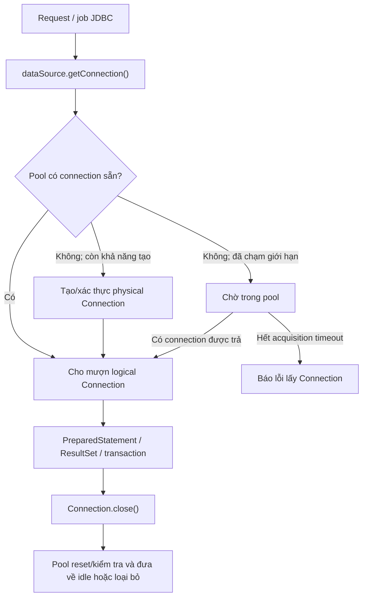
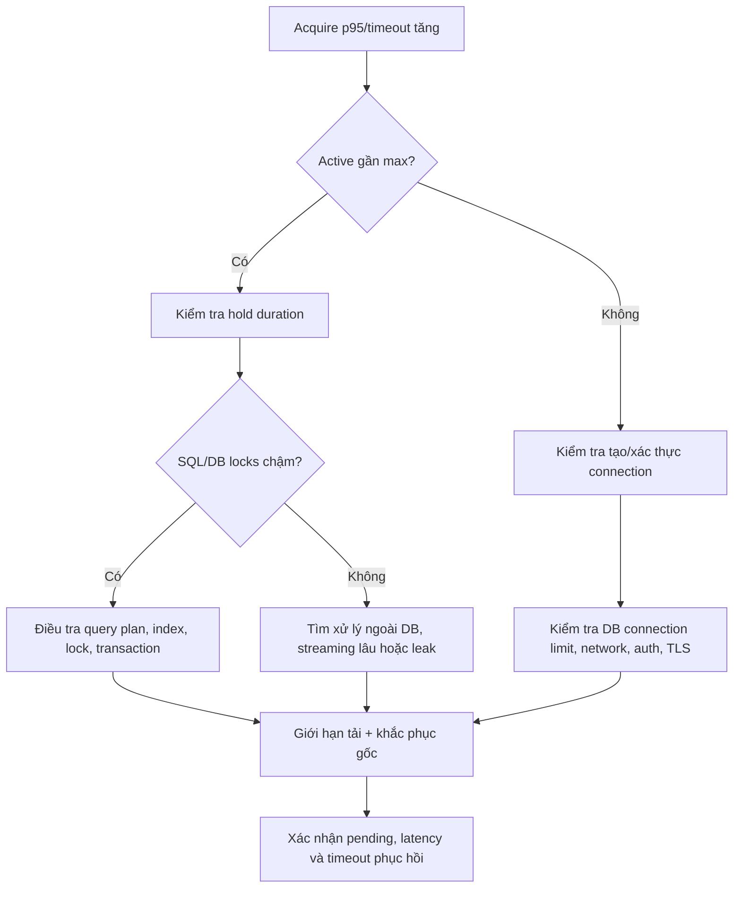

# Theo dõi kết nối đang dùng, kết nối nhàn rỗi và hàng chờ pool trong JDBC

## Mục tiêu học tập

Một ứng dụng **JDBC** có thể dùng `DataSource` để lấy `Connection`, thực thi SQL tham số hóa bằng `PreparedStatement`, đọc `ResultSet`, ghi dữ liệu CRUD và quản lý transaction. Trong môi trường vận hành, các kết nối thường được cấp bởi **connection pool** thay vì tạo kết nối vật lý mới cho từng yêu cầu. Pool giúp tái sử dụng kết nối, nhưng cũng là một **tài nguyên hữu hạn**: khi tất cả kết nối đều đang được mượn, các yêu cầu mới có thể phải xếp hàng, hết thời gian chờ hoặc thất bại.

Vì vậy, giám sát pool không thể dừng ở câu hỏi “database còn sống không?”. Một dịch vụ vẫn kết nối được tới DBMS nhưng phần lớn request đang đợi `getConnection()` quá lâu. Ngược lại, một pool có nhiều connection nhàn rỗi chưa chắc có vấn đề, nếu cấu hình chủ đích dự trữ kết nối cho lưu lượng đỉnh.

Bài thuộc chương **Giám sát vận hành** này tập trung vào bốn chỉ số:

- **Active / borrowed / in-use:** kết nối đang được ứng dụng mượn.
- **Idle / available:** kết nối đã có trong pool và đang sẵn sàng cho mượn.
- **Total:** tổng số kết nối pool đang quản lý tại thời điểm quan sát.
- **Pending / awaiting:** số yêu cầu đang đợi được cấp connection từ pool.

Bạn sẽ học cách đọc chúng đúng với bối cảnh JDBC, xây biểu đồ và cảnh báo có ý nghĩa, phân biệt pool cạn do truy vấn chậm với rò rỉ kết nối, dự toán sức chứa theo số instance, và kiểm tra bằng tải thực tế thay vì chỉ nhìn một ảnh chụp.

Sau bài học, bạn có thể:

1. Diễn giải `active`, `idle`, `total`, `pending` và giới hạn tối đa của pool mà không nhầm với số SQL query đang chạy.
2. Đo **thời gian chờ cấp connection** và **thời gian giữ connection** bên cạnh số lượng kết nối.
3. Thu thập chỉ số qua API riêng của pool, JMX hoặc thư viện metrics, đồng thời hiểu rằng interface JDBC `DataSource` không tự cung cấp các số đo này.
4. Phân loại các biểu hiện bão hòa, truy vấn chậm, transaction dài, lỗi mở kết nối mới và connection leak.
5. Thiết kế dashboard, ngưỡng cảnh báo và runbook ứng phó với lượng kết nối có hạn.
6. Ước lượng ngân sách kết nối toàn cụm và kiểm chứng cấu hình bằng kịch bản tăng tải, burst và lỗi mạng.

## 1. Một connection pool hoạt động như thế nào?

Trong JDBC chuẩn, `javax.sql.DataSource` mô tả cách ứng dụng **xin kết nối**; bản thân interface này không bắt buộc cung cấp cơ chế pool hoặc metrics. Pool là tầng triển khai bổ sung, có thể do application server, framework hay thư viện như **HikariCP** đảm nhiệm.

Một vòng đời mượn/trả thường như sau:



Khi dùng pool, `Connection.close()` được gọi trên đối tượng logic thông thường **trả connection cho pool**, không nhất thiết đóng socket vật lý. Việc pool có giữ lại kết nối, kiểm tra tình trạng, reset session hay loại bỏ kết nối hỏng phụ thuộc triển khai.

Một connection vật lý có thể lần lượt phục vụ nhiều request; trong mỗi lần mượn, ứng dụng có thể chạy nhiều statement hoặc một transaction gồm nhiều DML.

### 1.1. Khác biệt giữa một lần mượn và một truy vấn

Ví dụ service thực hiện:

```java
try (Connection connection = dataSource.getConnection()) {
    loadAccount(connection, accountId);
    loadSettings(connection, accountId);
    updateLastSeen(connection, accountId);
}
```

Ba lời gọi là các phương thức ứng dụng giả định; ví dụ chỉ minh họa quyền sở hữu connection. Một lần `getConnection()` có thể bao trùm **ba câu SQL**. Trong khi service đang xử lý kết quả hoặc làm công việc CPU giữa các statement, connection vẫn là **active** dù DBMS không thực thi query tại đúng thời điểm đó.

Do đó:

> **Active connections ≠ concurrent SQL queries ≠ active database sessions.**

Số liệu active thuộc **pool phía ứng dụng**. DBMS có thể báo session đang idle-in-transaction, đang chờ lock hoặc đang chạy câu SQL; đó là các góc nhìn khác.

## 2. Định nghĩa bốn chỉ số cốt lõi

| Chỉ số | Ý nghĩa trong một pool | Cách hiểu đúng |
| --- | --- | --- |
| `active` | Kết nối đã cấp cho caller nhưng chưa được trả | Bao gồm cả thời gian Java xử lý khi connection vẫn mở, không chỉ lúc SQL thực thi |
| `idle` | Kết nối vật lý đang được pool giữ và sẵn sàng cho mượn | Không đồng nghĩa database không có việc; chỉ nói về pool đó |
| `total` | Tổng số kết nối pool đang quản lý | Thường xấp xỉ `active + idle` tại cùng thời điểm quan sát |
| `pending` | Những yêu cầu đang đợi pool cấp connection | Thường phản ánh queue/waiter ở pool, không phải mọi request đang chờ trong ứng dụng |
| `max` | Giới hạn trên được cấu hình của pool | Trần cấu hình, không phải năng lực DBMS thật |
| `minIdle` hoặc mức tối thiểu tương ứng | Số kết nối idle mà pool cố duy trì nếu hỗ trợ | Không phải số connection phải luôn tồn tại tại mọi khoảnh khắc |

**Lưu ý quan trọng:** tên metrics, thời điểm cập nhật và ngữ nghĩa chính xác khác nhau theo pool. Một số pool báo `waiting threads` thay vì `pending requests`; với virtual threads Java 21, tên “threads” cũng chỉ có nghĩa **caller đang chờ**, không cho biết số platform thread đang bị chiếm.

### 2.1. Quan hệ giữa active, idle và total

Ở một thời điểm lý tưởng, trong **cùng một pool**:

\[
C_{\mathrm{total}} \approx C_{\mathrm{active}} + C_{\mathrm{idle}}
\]

và:

\[
0 \le C_{\mathrm{active}}, C_{\mathrm{idle}};\qquad
C_{\mathrm{total}} \le C_{\mathrm{max}}
\]

Dấu **xấp xỉ** là có chủ đích: pool có thể đang tạo, kiểm tra, thu hồi connection hoặc cập nhật các bộ đếm không đồng thời. Nếu code gọi bốn getter tuần tự, từng giá trị cũng có thể được lấy ở **những thời điểm hơi khác nhau**. Không viết cảnh báo “pool lỗi” chỉ vì một lần sample có chênh lệch 1 kết nối.

Các chỉ số này thuộc **một instance của một pool**. Nếu có 6 replica, mỗi replica cấu hình tối đa 12 connection, không được đọc biểu đồ của một instance rồi kết luận toàn cụm chỉ dùng tối đa 12.

### 2.2. Pending không phải độ dài của mọi hàng đợi

Giả sử application có semaphore giới hạn 30 công việc trước khi được gọi `getConnection()`. Trong lúc đó, HTTP ingress có thêm 500 yêu cầu chờ semaphore. Pool có thể chỉ báo `pending=5`, vì **495 yêu cầu khác chưa vào hàng chờ của pool**.

Tương tự, một queue công việc bất đồng bộ hoặc message consumer có thể chứa hàng nghìn job nhưng không có tác vụ nào đang gọi `getConnection()`. Cần giám sát **hàng chờ ở từng tầng**, không dùng một gauge `pending` để thay thế mọi chỉ số backlog.

## 3. Cách đọc các trạng thái pool thường gặp

Giả sử một pool có `maximumPoolSize = 12`. Những số liệu sau **chỉ là ví dụ minh họa**:

| Active | Idle | Total | Pending | Diễn giải ban đầu |
| ---: | ---: | ---: | ---: | --- |
| 2 | 10 | 12 | 0 | Nhiều connection sẵn sàng; chưa có dấu hiệu pool chờ |
| 10 | 2 | 12 | 0 | Pool đang bận nhưng vẫn có headroom nhỏ |
| 12 | 0 | 12 | 35 | Pool bão hòa, nhiều caller đang chờ cấp connection |
| 12 | 0 | 12 | 0 | Pool đầy nhưng chưa quan sát thấy hàng chờ; có thể là tải đỉnh bình thường |
| 5 | 0 | 5 | 12 | Có thể pool đang cố tạo thêm connection, tạo bị chậm/lỗi hoặc bị giới hạn khác |
| 0 | 0 | 0 | 20 | Cần kiểm tra pool chưa khởi tạo, database không kết nối được hoặc pool đã ngừng |
| 1 | 11 | 12 | 0 | Có thể dư capacity, nhưng cũng có thể đang giữ kết nối để đáp ứng burst |

**Không chẩn đoán chỉ bằng một dòng.** Phải quan sát xu hướng theo thời gian, acquire latency, connection timeouts, SQL latency, transaction duration, tình trạng DBMS và mức tải request.

### 3.1. Tình huống active = max, idle = 0, pending tăng

Đây là tín hiệu mạnh rằng **nhu cầu mượn connection vượt nguồn cung tức thời**. Nhưng nguyên nhân có thể khác nhau:

- SQL chậm hoặc bị lock nên mỗi request giữ connection lâu.
- Transaction kéo dài qua thao tác không cần DB, chẳng hạn gọi HTTP bên ngoài.
- `ResultSet` streaming/LOB bị consumer đọc chậm.
- Không đóng `Connection` ở đường lỗi (*leak*).
- Có quá nhiều job/batch cùng chạy hoặc retry tạo tải đột biến.
- Pool đặt quá nhỏ so với nhu cầu trong khi DBMS còn đủ năng lực.

Đừng lập tức tăng `maxPoolSize`. Nếu 12 connection đang kẹt do lock, tăng lên 24 có thể khiến database thêm contention. Cần biết **vì sao connection đang bị giữ**.

### 3.2. Tình huống idle nhiều, pending bằng 0

Thông thường pool còn khả năng đáp ứng yêu cầu mới. Nhưng không tự kết luận cần giảm pool: một số hệ thống chủ động giữ warm connections để đạt latency thấp khi burst tới.

Nếu số idle cao **liên tục** qua nhiều giờ trong mọi replica, DBMS gần giới hạn session và không có burst đáng kể, có thể xem xét giảm minimum idle hoặc pool max sau benchmark. Cần biết pool có cơ chế co giãn và lifetime riêng, vì `max` cao không nhất thiết đồng nghĩa luôn có từng ấy connection vật lý đang mở.

### 3.3. Pending tăng nhưng active chưa đạt max

Không nên bỏ qua tình huống này. Một số khả năng:

- Pool đang **tạo/xác thực connection vật lý** và chưa cấp được.
- DBMS từ chối kết nối mới, DNS/TLS/login chậm hoặc network lỗi.
- Pool đang đóng/đổi một nhóm connection hết hạn.
- Metrics được sample tại nhiều thời điểm không khớp.
- Cấu hình/triển khai pool có giới hạn phụ hoặc chính sách cấp connection riêng.

Hãy xem **tốc độ connection creation**, lỗi login/handshake và nhật ký pool được lọc an toàn, không chỉ chỉnh lại giới hạn.

## 4. Đừng chỉ theo dõi gauge: cần đo thời gian và lỗi

Bốn bộ đếm là ảnh chụp của tài nguyên. Để hiểu tác động tới người dùng, cần thêm các phân phối độ trễ và counter lỗi.

| Nhóm metrics | Đơn vị thường gặp | Câu hỏi được trả lời |
| --- | --- | --- |
| Active/idle/total/pending | Connection hoặc yêu cầu | Tải và sức chứa pool hiện tại |
| **Connection acquire duration** | ms hoặc giây, p50/p95/p99 | Caller chờ bao lâu từ khi xin tới khi nhận connection? |
| **Connection usage/hold duration** | ms hoặc giây, p50/p95/p99 | Caller giữ connection trong bao lâu trước khi trả? |
| Connection creation duration | ms hoặc giây | Mở session vật lý mới có chậm không? |
| Connection acquisition timeouts | Lần/giây, tổng số | Bao nhiêu caller không lấy được connection trong hạn? |
| Connection validation failures | Lần/giây | Connection được kiểm tra có bị hỏng/loại không? |
| Query execute latency | ms hoặc giây | SQL thực thi chậm hay không? |
| Transaction duration | ms hoặc giây | Giao dịch có bị giữ quá lâu? |
| DB session/CPU/I/O/locks | Theo DBMS | Nút cổ chai nằm ở database hay phía ứng dụng? |
| Request rate/error rate/latency | RPS, %, ms | Người dùng có đang chịu ảnh hưởng hay không? |

### 4.1. Acquire duration khác connection creation duration

`DataSource.getConnection()` có thể phải **chờ một connection sẵn có được trả**, hoặc pool có thể quyết định **mở kết nối vật lý mới**. Cả hai tình huống đều làm caller chờ. Do vậy:

\[
T_{\mathrm{acquire}}
=
\text{thời điểm được cấp Connection}
-
\text{thời điểm gọi getConnection()}
\]

Khoảng này không phải luôn là thời gian thực hiện authentication. Nếu acquire p95 tăng, nhưng DBMS báo connection login vẫn nhanh, nguyên nhân có thể là pool thiếu connection vì thời gian giữ quá dài.

### 4.2. Connection hold duration khác query duration

\[
T_{\mathrm{hold}}
=
\text{thời điểm trả Connection}
-
\text{thời điểm mượn thành công}
\]

Ví dụ:

```text
GET Connection:                  chờ 450 ms
SQL SELECT:                      thực thi 25 ms
Ánh xạ dữ liệu:                  10 ms
Gọi API bên ngoài (giữ conn):    1.200 ms
Connection.close():             trả về pool

Acquire latency = 450 ms
Connection hold  ≈ 1.235 ms, cộng chi phí close nếu đo tới sau close
SQL duration     = 25 ms
```

Nếu chỉ có đồ thị thời gian SQL, bạn có thể hiểu sai rằng database còn nhanh nên không có lý do pool bị cạn. Thực tế connection đang bị giữ bởi **1,2 giây I/O bên ngoài**.

**Độ trễ request** còn có các phần khác, như chờ admission, xử lý CPU và serialize HTTP. Không cộng những số p95 riêng lẻ rồi coi đó là p95 toàn request: percentile của các phân phối không cộng tuyến tính như vậy.

## 5. Thu thập metrics: DataSource chuẩn và pool cụ thể

`javax.sql.DataSource` chỉ định giao diện cấp connection. **Nó không có phương thức chuẩn** như `getActiveConnections()` hoặc `getPendingQueueLength()`. Do đó cách thu thập phụ thuộc vào connection pool mà ứng dụng thực sự sử dụng.

Các nguồn phổ biến:

1. **Metrics API riêng của pool:** một số pool có bean/counter cho active, idle, total, pending, wait và usage.
2. **JMX:** một số pool đăng ký MBean; hệ thống monitoring có thể xuất số đo của bean.
3. **Micrometer/OpenTelemetry hoặc collector tích hợp:** kết nối với metrics pool và đẩy tới hệ thống giám sát.
4. **Instrumentation tại tầng ứng dụng:** đo thời gian `getConnection()` và thời gian giữ connection bằng đồng hồ đơn điệu; không thay thế các gauge nội bộ của pool.
5. **DBMS monitoring:** quan sát session, lock, CPU và SQL chậm để giải thích tại sao pool bị chiếm.

**Chỉ tạo một nơi chịu trách nhiệm đo và export metrics pool** để tránh đếm trùng khi cùng một pool được ghi nhận bởi JMX và thư viện metrics dưới nhiều tên.

### 5.1. Ví dụ HikariCP: đọc active/idle/total/pending

**HikariCP** là thư viện connection pool bên ngoài JDBC chuẩn. Với ứng dụng **đã cấu hình một `HikariDataSource`** và có thư viện HikariCP trong dependencies, có thể đọc `HikariPoolMXBean`:

```java
import com.zaxxer.hikari.HikariDataSource;
import com.zaxxer.hikari.HikariPoolMXBean;
import java.util.Objects;

public final class HikariPoolSnapshotReader {
    public record Snapshot(
        int active, int idle, int total, int pending
    ) {}

    private final HikariDataSource dataSource;

    public HikariPoolSnapshotReader(HikariDataSource dataSource) {
        this.dataSource = Objects.requireNonNull(dataSource);
    }

    public Snapshot read() {
        HikariPoolMXBean pool = dataSource.getHikariPoolMXBean();
        if (pool == null) {
            throw new IllegalStateException(
                "Pool chưa khởi tạo hoặc không có MXBean"
            );
        }

        return new Snapshot(
            pool.getActiveConnections(),
            pool.getIdleConnections(),
            pool.getTotalConnections(),
            pool.getThreadsAwaitingConnection()
        );
    }
}
```

Ví dụ này chỉ **đọc metrics**, không dùng mật khẩu hoặc chỉnh cấu hình pool. `getThreadsAwaitingConnection()` là cách HikariCP biểu diễn **số caller đang chờ**, không phải yêu cầu tạo thêm platform threads.

Lưu ý:

- Các giá trị là **snapshot tức thời**, không bảo đảm chụp nguyên tử cả bốn số; pool có thể biến đổi giữa các getter.
- Phương thức `getHikariPoolMXBean()` có thể chưa sẵn sàng trước khi pool được khởi tạo.
- Đoạn mã **chỉ dành cho HikariCP**. `DataSource` của application server hoặc pool khác không bắt buộc có class/bean này.
- Nếu dùng JMX exporter, cơ chế đăng ký MBean hoặc metric reporter có thể cần cấu hình riêng. Không tự giả định mọi HikariCP instance đã được public lên monitoring endpoint.
- Không gọi các API điều khiển pool khi mục tiêu chỉ là thu thập metrics.
- Đừng dùng các getter này để ra quyết định transaction-critical vì giá trị có thể thay đổi ngay sau khi đọc.

### 5.2. Ví dụ JDBC thuần: đo borrow wait và hold time

Ngay cả khi dùng một pool không cung cấp API metrics thuận tiện, ứng dụng có thể đo **đường mượn connection** ở tầng repository. Ví dụ sau nhận một `DataSource` và recorder qua interface riêng do ứng dụng triển khai:

```java
import java.sql.Connection;
import java.sql.PreparedStatement;
import java.sql.ResultSet;
import java.sql.SQLException;
import java.util.Objects;
import javax.sql.DataSource;

public final class MeasuredOrderRepository {
    public interface Timings {
        void acquisitionNanos(long duration);
        void holdNanos(long duration);
        void acquisitionFailed();
    }

    private final DataSource dataSource;
    private final Timings timings;

    public MeasuredOrderRepository(DataSource dataSource, Timings timings) {
        this.dataSource = Objects.requireNonNull(dataSource);
        this.timings = Objects.requireNonNull(timings);
    }

    public String findStatus(long orderId) throws SQLException {
        long requestedAt = System.nanoTime();
        final Connection connection;

        try {
            connection = dataSource.getConnection();
        } catch (SQLException error) {
            timings.acquisitionFailed();
            throw error;
        }

        long borrowedAt = System.nanoTime();
        timings.acquisitionNanos(borrowedAt - requestedAt);

        try (connection) {
            String sql = "SELECT status FROM orders WHERE id = ?";

            try (PreparedStatement ps = connection.prepareStatement(sql)) {
                ps.setLong(1, orderId);

                try (ResultSet rs = ps.executeQuery()) {
                    return rs.next() ? rs.getString("status") : null;
                }
            }
        } finally {
            // finally chạy sau try-with-resources, bao gồm Connection.close().
            timings.holdNanos(System.nanoTime() - borrowedAt);
        }
    }
}
```

Đây là ví dụ **Java 9+** vì cú pháp `try (connection)`. `Timings` phải được ứng dụng nối với hệ thống metric recorder phù hợp, thường là histogram cho các duration và counter cho lỗi. **Không log trực tiếp từng lần mượn** ở tải cao, vì log khối lượng lớn có thể tạo nút cổ chai mới và gây lộ dữ liệu.

Những giới hạn của mẫu đo:

- `acquisitionNanos` bao gồm cả chờ pool và thời gian tạo/kiểm tra connection nếu pool thực hiện chúng trong `getConnection()`.
- `holdNanos` đo tới **sau `close()`**, bao gồm thời gian cleanup; nó không xác định chính xác statement nào gây chậm.
- Đường gọi khác trong ứng dụng có thể mượn connection mà không đi qua repository này. Muốn nhìn toàn bộ, cần instrumentation đủ bao phủ.
- Khi `getConnection()` ném lỗi, không có hold duration vì không có connection được mượn thành công.
- Không dùng số yêu cầu `acquisitionFailed()` để thay thế counter timeout riêng của pool: lỗi có thể do authentication, network hoặc cấu hình.

### 5.3. Không tạo metric labels chứa dữ liệu nhạy cảm

Nhãn metric nên có **số lượng giá trị hữu hạn**: tên pool, vai trò read/write, service, môi trường hoặc instance. Tránh dùng:

- Customer ID, tenant ID có cardinality cực lớn, order ID hoặc request ID.
- JDBC URL đầy đủ nếu có credential hoặc thông tin hạ tầng cần bảo vệ.
- SQL statement chứa tham số thật, password, token hoặc email người dùng.
- Stack trace/lỗi SQL tự do làm metric label.

Trace có thể giữ correlation ID phù hợp để điều tra một request cụ thể, nhưng metric labels phải có giới hạn cardinality. SQL logging và JDBC tracing cần lọc tham số nhạy cảm trước khi xuất telemetry.

## 6. Dashboard tối thiểu để vận hành pool

Một dashboard hữu ích nên hiển thị **theo thời gian** và **theo từng pool/instance**, không chỉ một con số tổng tại thời điểm mở trang.

Gợi ý bố cục:

| Khu vực | Panel | Cách đọc |
| --- | --- | --- |
| **Capacity** | Active, idle, total, maximum | Pool có headroom hay thường chạm trần? |
| **Waiting** | Pending, thời gian chờ cấp connection p95/p99 | Hàng chờ có kéo dài và ảnh hưởng request không? |
| **Failures** | Acquire timeout/error rate, lỗi xác thực và DB network | Có caller không được cấp connection? |
| **Usage** | Hold time p50/p95/p99, transaction duration | Connection bị giữ lâu do SQL hay code ngoài DB? |
| **Workload** | Requests/s, in-flight jobs, batch/export count | Tăng tải có tương quan với pending không? |
| **Database** | DB sessions, CPU/I/O, lock wait, long-running queries | Nút cổ chai phía DBMS có đang giới hạn pool? |
| **Fleet** | Số replica và tổng max/total của các pool | Toàn cụm có vượt ngân sách connection không? |

### 6.1. Prometheus/Micrometer: ví dụ cách đọc tên metric

Với cấu hình HikariCP và Micrometer phù hợp, tên metric có thể được xuất theo quy ước kiểu:

```text
hikaricp_connections_active
hikaricp_connections_idle
hikaricp_connections_pending
hikaricp_connections
hikaricp_connections_max
```

**Đây là tên thường gặp, không phải API chuẩn của JDBC hoặc cam kết cho mọi exporter/phiên bản.** Kiểm tra tên thực tế, đơn vị và labels của endpoint đang chạy. Một số reporter dùng tên khác hoặc gộp/đổi label.

Ví dụ truy vấn PromQL **chỉ khi metrics thực sự mang các tên tương ứng**:

```promql
# Kiểm tra từng chuỗi theo pool/instance.
hikaricp_connections_active

# Số caller đang đợi, quan sát cùng active và max.
hikaricp_connections_pending

# Khi cần tổng trên các instance nhưng vẫn phân biệt tên pool.
sum by (pool) (hikaricp_connections_active)
```

Dòng cuối chỉ có nghĩa nếu exporter thật sự có label `pool` và bạn muốn cộng các replica của cùng nhóm pool. Để phân tích một instance bị lệch, phải **giữ nhãn instance/pod**. Không lấy tổng active của nhiều instance chia cho `max` của **một instance** rồi gọi đó là utilization toàn cụm.

### 6.2. Chọn nhịp lấy mẫu và cửa sổ xem

- Gauge active/idle/pending là **trạng thái tức thời**. Lấy mẫu quá thưa có thể bỏ sót burst ngắn.
- Histogram acquire/hold time giúp nhìn tail latency mà gauge không thể hiện.
- Cảnh báo cần cửa sổ thời gian đủ lâu để tránh nhiễu do một lần bùng tải bình thường.
- Khi phân tích một incident, so sánh **cùng khoảng thời gian** của request rate, pending, pool usage và DBMS locks.
- Nếu các chỉ số được ghi theo nhiều nguồn đồng hồ, cần cân nhắc sai lệch thời gian và chu kỳ scrape.

Một điểm dữ liệu `active=12` trong một giây không tự chứng minh pool bị quá tải. Một xu hướng `active=12, idle=0, pending>0` kéo dài cùng acquire p99 tăng và timeout mới là tín hiệu đáng hành động.

## 7. Thiết kế cảnh báo: phát hiện tác động, không chỉ đạt ngưỡng

Một cảnh báo tốt trả lời:

1. Ai đang chịu ảnh hưởng?
2. Tình trạng có kéo dài đủ để cần can thiệp không?
3. Nhóm vận hành nên kiểm tra metrics và thành phần nào trước?
4. Có cách giảm tải an toàn không?

### 7.1. Ví dụ quy tắc cảnh báo mang tính hướng dẫn

| Điều kiện minh họa | Ý nghĩa cần đánh giá | Mức phản ứng |
| --- | --- | --- |
| Active/max trên 90% liên tục **và** pending tăng | Pool đang gần bão hòa và có người phải chờ | Cảnh báo sớm, điều tra tải/hold time |
| Pending dương kéo dài **và** acquire p95 vượt SLO | Người dùng bắt đầu chịu độ trễ do pool | Cảnh báo có tác động |
| Acquisition timeout rate lớn hơn baseline | Một phần yêu cầu không lấy được connection | Ưu tiên cao nếu ảnh hưởng request quan trọng |
| Hold p99 tăng đột ngột | Một nhóm request/transaction giữ connection lâu | Tìm SQL chậm, lock hoặc I/O ngoài DB |
| Total thấp dù active/pending cao | Pool không mở được connection mới | Xem DB session budget, TLS, auth, network |
| Idle rất cao kéo dài trên tất cả replica | Có khả năng dư connection vật lý | Cơ hội tối ưu, thường không phải paging khẩn cấp |

**90%, p95 và thời gian kéo dài chỉ là ví dụ định hướng**, không phải ngưỡng mặc định phù hợp mọi hệ thống. Chọn ngưỡng dựa trên SLO, burst bình thường, maximum pool, traffic giờ cao điểm và mức độ ưu tiên nghiệp vụ.

Một alert chỉ có `active/max > 0.9` có thể gây báo động giả khi 10 tác vụ ngắn cùng lúc mượn 10 connection nhưng không ai phải chờ. Ngược lại, pool `active=5/max=20` nhưng tất cả yêu cầu mới bị chặn do lỗi tạo connection hoặc lỗi môi trường vẫn cần xử lý.

### 7.2. Cảnh báo lỗi đột biến phải xem cả mẫu số

Nếu một instance có 2 acquire timeout trong 5 phút với 10 request tổng, tỷ lệ ảnh hưởng khác rất nhiều so với 2 timeout trên một triệu request. Hãy kết hợp:

- Số lỗi tuyệt đối.
- Tỷ lệ lỗi trên tổng lần xin connection.
- Request/error rate của API quan trọng.
- Số replica bị ảnh hưởng.
- Độ trễ thu thập metrics.

Đặt cảnh báo theo đơn vị rõ ràng. Không so một metric bằng **milliseconds** với một threshold hiểu là **seconds**, hoặc dùng histogram bucket tùy ý mà chưa xác nhận cách exporter đặt đơn vị.

## 8. Runbook: phân tích khi pool bắt đầu chờ

Khi dashboard báo pending tăng, áp dụng thứ tự điều tra từ **tác động người dùng** tới **nguồn gốc**.



### Bước 1 — Xác nhận ảnh hưởng và phạm vi

- Request rate có tăng không?
- Chỉ một pool, một instance hay mọi replica?
- API đọc hay ghi bị ảnh hưởng? Batch job, export hay request HTTP nào tăng tải?
- Acquisition timeouts có xuất hiện không? Các request có đang được retry dồn dập?
- DBMS có báo lock wait, CPU cao, I/O bão hòa hoặc session limit không?

Nếu một replica có active gần max và pending rất cao, trong khi các replica khác bình thường, hãy ưu tiên kiểm tra **lỗi cục bộ, connection leak hoặc phân phối tải lệch**. Nếu toàn cụm cùng tăng, hãy xem lưu lượng và năng lực DBMS.

### Bước 2 — Phân biệt pool nhỏ với connection giữ quá lâu

Quan sát hold duration và SQL duration cạnh nhau:

| Quan sát | Khả năng ưu tiên |
| --- | --- |
| Hold p99 tăng cùng SQL p99 và lock wait | Query/transaction chậm hoặc bị khóa |
| Hold p99 tăng, SQL p99 ổn định | Code giữ connection khi xử lý ngoài DB, đọc ResultSet chậm hoặc quên đóng |
| Active duy trì max sau khi traffic về gần 0 | Leak, task treo, transaction/cursor chưa đóng |
| Active giảm nhanh khi traffic giảm; pending ngắn | Burst bình thường hoặc pool max cần điều chỉnh trong ngân sách |
| Total thấp, pending tăng và lỗi tạo connection | DBMS/network/auth/TLS hoặc cơ chế pool cấp connection |

**Connection leak không đồng nghĩa kết nối có thời gian giữ dài.** Một export 20 phút có thể hợp lệ theo thiết kế nhưng làm pool cạn; ngược lại một code path quên `close()` có thể khiến borrowed connection không bao giờ được trả. Công cụ leak detection của pool thường dựa trên **ngưỡng thời gian mượn**, nên phải điều tra stack trace và nghiệp vụ để xác nhận.

### Bước 3 — Tìm code path giữ Connection

Các lỗi phổ biến:

- Trả `ResultSet` hoặc `InputStream` JDBC ra ngoài repository rồi để consumer đọc sau.
- Gọi dịch vụ HTTP hoặc ghi tệp qua network **trong lúc đã mượn connection** mà không cần transaction.
- Bắt exception rồi return sớm nhưng không có `try-with-resources`.
- Quên đóng `ResultSet`, `PreparedStatement`, `Connection` ở một nhánh.
- Chạy batch hoặc transaction quá lớn, giữ khóa/connection lâu.
- Gọi `getConnection()` **lần hai** trong khi một công việc đã giữ connection và pool rất nhỏ; có thể tự tạo tình trạng chờ cạn pool.
- Dùng pool cho health check quá nhiều lần trong thời điểm database chập chờn.

Đừng sửa leak bằng cách tăng `maximumPoolSize` vô hạn. Điều đó có thể chỉ trì hoãn thời điểm cạn pool.

### Bước 4 — Kiểm tra phía DBMS

Pool metrics trả lời “connection đang được mượn ở JVM?”, còn DBMS cho biết session đang:

- Thực thi SQL hay chờ lock?
- Idle nhưng transaction chưa kết thúc?
- Bị giới hạn CPU, memory, I/O hay max sessions?
- Đợi một transaction khác giữ khóa?
- Bị từ chối vì số lượng kết nối, tài khoản hoặc TLS?

Tên bảng/view hệ thống để xem session, blocking queries và locks khác nhau giữa PostgreSQL, MySQL, SQL Server, Oracle và các DBMS khác. **Không dùng một cú pháp giám sát của vendor làm chuẩn JDBC chung.** Cần kiểm tra quyền truy cập và tránh log SQL parameters nhạy cảm.

### Bước 5 — Giảm tác động trước khi tối ưu

Tùy tình huống, có thể:

- Giảm tần suất job batch/export không khẩn cấp.
- Giới hạn số request DB đồng thời bằng admission control.
- Dừng retry storm và đặt backoff.
- Xử lý transaction đang chặn nhiều công việc theo quy trình quản trị đã được phép.
- Tối ưu câu SQL/index hoặc rút ngắn thời gian giữ connection.
- Điều chỉnh pool max **nếu DBMS còn năng lực và ngân sách kết nối cho phép**.
- Kiểm tra rollout, connection rotation và trạng thái instance khi có lỗi xác thực.

Không đề xuất tự động “kill mọi session chậm” hoặc “tăng pool” như một phản ứng chung: có thể làm mất tác vụ quan trọng hoặc gia tăng cạnh tranh khóa.

### Bước 6 — Xác nhận phục hồi

Sau khắc phục, theo dõi:

- Pending giảm về baseline.
- Acquire p95/p99 phục hồi.
- Acquisition timeout rate giảm.
- Active/idle phản ánh lại nhịp tải bình thường.
- Hold duration giảm hoặc có lời giải thích nghiệp vụ.
- DBMS CPU/locks/session trở về vùng an toàn.
- Error rate và request latency ở tầng API trở về mục tiêu.

Một cảnh báo tắt chỉ vì tăng acquisition timeout chưa chắc là phục hồi: nhiều người dùng có thể vẫn phải chờ lâu hơn.

## 9. Dự toán giới hạn pool theo ngân sách của cả cụm

Kích thước pool không chỉ phụ thuộc vào nhu cầu của một instance. DBMS có giới hạn kết nối toàn hệ thống, bao gồm các dịch vụ, tác vụ quản trị và quá trình triển khai.

Giả sử:

- DBMS cho phép tối đa `120` connection.
- Cần dự phòng `30` connection cho quản trị và failover.
- Các workload khác có ngân sách `18` connection.
- Dịch vụ JDBC chạy cao nhất `4` replica, mỗi replica có **một pool**.

Trần ngân sách bình quân mỗi replica:

\[
P_{\mathrm{max,instance}}
\le
\left\lfloor
\frac{C_{\mathrm{DB,max}} - C_{\mathrm{reserve}} -
      C_{\mathrm{other}}}{N_{\mathrm{replicas}}}
\right\rfloor
\]

\[
P_{\mathrm{max,instance}}
\le
\left\lfloor \frac{120 - 30 - 18}{4} \right\rfloor
= 18
\]

**18 là trần từ ví dụ ngân sách, không phải đề xuất mặc định “chọn pool 18”.** DBMS có thể đạt giới hạn CPU hoặc lock trước khi đạt giới hạn session. Một pool nhỏ hơn đôi khi cho throughput tương đương nhưng tail latency tốt hơn.

Cần tính đúng số replica **khi scale tối đa**, pool đọc/ghi khác nhau, background workers, migration và instance cũ–mới cùng tồn tại khi rolling deploy. Nếu database dùng connection proxy/broker, vẫn phải kiểm tra giới hạn phía proxy và DBMS, không suy ra số session phía server từ số socket ứng dụng.

### 9.1. Dùng Little's Law để ước tính mức active trung bình

Với workload gần trạng thái ổn định:

\[
L \approx \lambda \times W
\]

Trong đó:

- `L`: số connection được mượn **trung bình**.
- `λ`: số **lần mượn connection** mỗi giây của workload đang xét.
- `W`: **thời gian giữ connection** trung bình (giây).

Ví dụ một instance có 125 lượt mượn/giây, mỗi lần giữ trung bình 52 ms:

\[
L \approx 125 \times 0.052 = 6.5
\]

Gợi ý nhu cầu active trung bình khoảng **6,5 connection**. Không được kết luận pool size 7 chắc chắn đủ: burst, p95/p99 hold time, transaction dài, isolation, deadlocks và DBMS bottleneck vẫn tạo peak cao hơn. Công thức là **điểm khởi đầu để đặt giả thuyết**, không phải bộ tính pool size tự động.

### 9.2. Utilization và hàng chờ

Một thước đo trực quan:

\[
U_{\mathrm{pool}}(t)
=
\frac{C_{\mathrm{active}}(t)}{C_{\mathrm{max}}}
\]

Nếu `U=1` trong một sample, pool đang dùng hết số slot theo giới hạn; nhưng muốn biết mức độ quá tải, xem thêm `pending` và acquire latency. Ngược lại, `U=0.6` không đảm bảo caller không chờ do pool đang tạo connection hoặc có giới hạn khác.

**Không áp dụng công thức cộng ratio sai khi tổng hợp:** để tính utilization toàn cụm, cần cộng số active và **cộng đúng tổng max của các pool cùng nhóm**, rồi mới chia. Tránh lấy trung bình các tỷ lệ instance khi các instance có pool max khác nhau mà không cân nhắc trọng số.

## 10. Transaction dài và ResultSet streaming có thể giữ pool bận

JDBC transaction và streaming ảnh hưởng trực tiếp tới active connections.

### 10.1. Transaction được sở hữu trong phạm vi ngắn

Một mẫu giao dịch có rollback rõ ràng:

```java
try (Connection c = dataSource.getConnection()) {
    c.setAutoCommit(false);
    try {
        updateInventory(c, productId, quantity);
        insertReservation(c, requestId, productId, quantity);
    } catch (SQLException | RuntimeException error) {
        try {
            c.rollback();
        } catch (SQLException rollbackError) {
            error.addSuppressed(rollbackError);
        }
        throw error;
    }

    // Không coi SQLException ở commit() là bằng chứng rollback.
    c.commit();
}
```

Các phương thức DML trong ví dụ do ứng dụng tự định nghĩa và phải dùng **cùng connection**. Không cho rằng `commit()` thất bại chắc chắn đã hủy thay đổi: lỗi mạng ngay lúc commit có thể tạo kết quả chưa xác định.

Trong suốt phạm vi trên, connection là **active** dù code Java đang kiểm tra dữ liệu giữa hai statement. Vì vậy, giảm thời gian **ngoài SQL** nằm trong transaction thường có lợi cho cả pool availability và lock contention.

### 10.2. Streaming giữ connection đến khi đọc xong

Ví dụ:

```java
try (Connection c = dataSource.getConnection();
     PreparedStatement ps = c.prepareStatement(
         "SELECT id, payload FROM audit_log ORDER BY id",
         ResultSet.TYPE_FORWARD_ONLY,
         ResultSet.CONCUR_READ_ONLY)) {

    ps.setFetchSize(200);

    try (ResultSet rs = ps.executeQuery()) {
        while (rs.next()) {
            sendToSlowClient(rs.getLong(1), rs.getString(2));
        }
    }
}
```

`sendToSlowClient(...)` là hàm minh họa do ứng dụng định nghĩa. Dù `setFetchSize(200)` có hiệu lực, nếu client nhận chậm, **connection vẫn đang được mượn** trong thời gian chờ. Với DBMS dùng server-side cursor/transaction cho streaming, còn có thể phát sinh session hoặc transaction dài.

Nếu consumer chậm:

- Đọc một trang dữ liệu có giới hạn vào DTO độc lập, **đóng connection rồi mới gửi trang**.
- Hoặc spool kết quả ra tệp/kho trung gian trước khi phục vụ client.
- Giới hạn số export lớn đồng thời.
- Nếu phải giữ snapshot/cursor dài, đo **hold time** và cấp ngân sách pool riêng hợp lý.

Một giải pháp backpressure tốt không chỉ giới hạn `Queue` mà còn phải bảo đảm producer không giữ connection khi queue đầy quá lâu.

## 11. Java 21 virtual threads không làm tăng connection vật lý

Trong Java 21, `Executors.newVirtualThreadPerTaskExecutor()` cho phép nhiều tác vụ chờ I/O với chi phí quản lý thread thấp hơn. Nhưng nếu pool chỉ có 10 connection, **10.000 virtual threads cũng không làm pool cấp 10.000 connection**.

Khi tải tăng:

- Nhiều virtual thread có thể đợi `getConnection()`.
- `pending` có thể tăng rất cao mà CPU JVM không cao tương ứng.
- Connection acquisition timeout vẫn xảy ra.
- DBMS vẫn có giới hạn session, CPU và locks.

Cần **giới hạn số tác vụ DB in-flight** hoặc admission ở request/job scheduler. Một semaphore có thể giới hạn số tác vụ vào đoạn DB, nhưng nếu application tạo vô hạn virtual threads **trước semaphore**, vẫn có một hàng đợi khác đang lớn lên. Giới hạn cả đầu vào và lượng việc chờ.

### 11.1. Không chia sẻ Connection giữa nhiều virtual threads

Đừng đặt `Connection` trong field singleton hoặc dùng một connection chung để chạy SQL đồng thời trên nhiều virtual threads khi driver không có hợp đồng thread-safety phù hợp. Mỗi tác vụ nên sở hữu connection mượn trong phạm vi rõ ràng, hoặc một service sở hữu transaction dùng một connection tuần tự cho cả nghiệp vụ.

Metrics active phản ánh **connection đang được mượn**, không phải số virtual threads. Khi phân tích sự cố, xem cả concurrency ở ingress, hàng đợi job và pool.

## 12. Kiểm thử metrics và kịch bản gây tải có kiểm soát

Một dashboard chỉ đáng tin khi các con số đã được đối chiếu với hành vi test có chủ đích trên **database kiểm thử**, đúng pool/driver/cấu hình vận hành. Không dùng production để cố tình cạn pool.

### 12.1. Các kịch bản tối thiểu

| Kịch bản | Cách mô phỏng | Điều mong đợi cần quan sát |
| --- | --- | --- |
| Pool chưa có tải | Không có request DB sau khi warm-up | Active gần 0; idle/total theo chính sách pool |
| Một connection đang mượn | Giữ một `Connection` trong scope test | Active tăng khoảng 1 ở đúng pool |
| Trả connection | Đóng `Connection` vừa mượn | Active giảm; idle có thể tăng hoặc pool loại bỏ connection |
| Cạn pool nhỏ | Cấu hình max 2; hai task giữ connection; task thứ ba xin connection | Pending xuất hiện; acquisition wait tăng hoặc timeout |
| Query chậm | Dùng test query/fixture được kiểm soát | Hold time tăng cùng SQL duration |
| Consumer chậm sau SELECT | Đọc dữ liệu rồi chờ sink khi vẫn giữ connection | Active duy trì; hold tăng dù SQL đã xong |
| Lỗi trước close | Ném lỗi ở giữa mapping ResultSet | `try-with-resources` vẫn trả connection |
| Không đóng connection (negative test) | Mô phỏng lỗi trong test cô lập | Leak detector/active không giảm theo kỳ vọng |
| DB từ chối tạo connection | Chặn tạo mới trong test infrastructure có kiểm soát | Total thấp, pending/error tăng, creation failure |
| Tăng nhiều replica | Chạy workload qua nhiều instance | Tổng pool max/total không vượt ngân sách |
| Burst ngắn | Tăng request trong thời gian ngắn | Pending có thể tăng ngắn rồi phục hồi |
| Hủy request | Ngắt task khi đang đợi pool hoặc truy vấn | Không giữ connection vĩnh viễn; errors được phân loại |

**Không coi giá trị gauge sẽ đổi ngay chính xác sau mỗi câu lệnh test.** Pool có cơ chế housekeeping và metrics sampling; test phải chờ trạng thái phù hợp trong một khoảng hữu hạn, tránh assertion flake dựa vào một tick.

### 12.2. Ca kiểm thử đơn giản: mượn hai connection

Nếu pool test có `maximumPoolSize=2` và không có workload khác cùng dùng pool:

```java
// Minh họa trong test đã có DataSource của pool test.
try (Connection first = dataSource.getConnection();
     Connection second = dataSource.getConnection()) {

    // Khi cả hai còn mở: pool có thể báo active gần 2.
    // Kiểm tra bằng API metrics của pool tương ứng.

    // Không tạo request thứ ba chờ vô hạn trên cùng thread.
}
// Sau scope: connection được trả theo contract của pool.
```

Để test `pending`, nên dùng **tác vụ riêng** xin connection thứ ba với acquisition timeout hữu hạn, rồi đối chiếu trạng thái pending/timeout trước khi trả hai connection đầu. Với virtual threads cũng cần timeout và cleanup nếu task bị hủy; không đợi vô hạn.

### 12.3. Kiểm thử leak bằng đường lỗi

Với code repository:

```java
try (Connection c = dataSource.getConnection();
     PreparedStatement ps = c.prepareStatement(sql);
     ResultSet rs = ps.executeQuery()) {
    while (rs.next()) {
        mapRow(rs); // Có thể ném SQLException/RuntimeException.
    }
}
```

Nếu `mapRow(...)` ném lỗi, Java vẫn đóng lần lượt `ResultSet`, `PreparedStatement` và `Connection`. Đây là lý do ưu tiên `try-with-resources` thay vì đóng tài nguyên chỉ ở nhánh thành công.

Đoạn trên giả định `sql` và `mapRow` thuộc phạm vi phương thức; không phải chương trình độc lập. Với transaction thủ công, đóng connection không thay thế việc xử lý `commit()/rollback()` theo contract: tầng sở hữu transaction phải dọn an toàn trước khi trả pool.

## 13. Những vấn đề giám sát và an toàn vận hành cần tránh

### 13.1. Health check có thể làm pool thêm tải

Một probe gọi `dataSource.getConnection()` và `SELECT 1` mỗi giây trên từng replica có thể hữu ích, nhưng khi pool cạn, chính probe đó cũng có thể phải chờ và thêm vào pending. Nếu cả readiness/liveness đều dùng truy vấn database nặng hoặc quá thường xuyên, một sự cố tạm thời có thể tạo vòng restart/retry làm tải tăng.

Nên phân biệt:

- **Liveness:** tiến trình còn hoạt động; thường không cần phải truy vấn DB mỗi lần.
- **Readiness:** ứng dụng có thể phục vụ request phụ thuộc database hay không, theo policy đã định.
- **Monitoring:** dùng metrics để điều tra nguyên nhân, không chỉ health status xanh/đỏ.

Không biến một lỗi pool ngắn thành việc tự động restart toàn bộ cụm nếu không có thiết kế hồi phục phù hợp.

### 13.2. Thu thập metrics không được làm lộ credential

Không xuất username/password hoặc JDBC URL có bí mật trong metric label, log hoặc error page. Nếu cần chẩn đoán kết nối thất bại, ưu tiên ghi:

- Tên pool và role read/write.
- SQLState và mã lỗi vendor, đã kiểm tra thông tin nhạy cảm.
- Loại lỗi connection timeout, authentication, network hoặc pool closed.
- Correlation ID của request/job phù hợp với policy.

Tránh log toàn bộ `Properties` của kết nối, giá trị tham số SQL và thông điệp lỗi có thể chứa thông tin xác thực. Metrics endpoint phải có quyền truy cập hợp lý; dashboard giám sát hạ tầng có thể tiết lộ tên DB và cấu trúc nội bộ.

### 13.3. Pool max là giới hạn, không phải chiến lược retry

Nếu `getConnection()` thất bại do timeout, ứng dụng cần phân loại lỗi và cân nhắc backoff/admission. Gửi ngay hàng trăm retry đồng thời thường làm pending lớn hơn và khiến DBMS khó phục hồi.

Với thao tác **ghi**, lỗi có thể xuất hiện sau khi lấy connection, nhất là tại `commit()`. Không dùng “pool timeout” làm lý do chung để lặp lại toàn bộ nghiệp vụ bằng request ID mới khi trạng thái commit chưa xác định. Cần idempotency và đối soát đúng giao dịch.

## 14. Những sai lầm thường gặp

| Sai lầm | Vì sao sai? | Cách khắc phục |
| --- | --- | --- |
| “Active là số SQL đang chạy.” | Connection có thể đang giữ nhưng không thực thi SQL | So sánh với DB active queries và hold duration |
| “Idle cao thì chắc chắn lãng phí.” | Có thể là warm capacity cần cho burst | Đo nhu cầu theo thời gian và ngân sách DB |
| “Pending = toàn bộ HTTP queue.” | Chỉ là waiter trong pool đó | Đo admission/job/HTTP queues riêng |
| “Active=max một lần là sự cố.” | Burst ngắn có thể bình thường | Kết hợp pending, acquire latency và timeout |
| “Pending tăng thì luôn phải tăng pool.” | Gốc có thể là lock, leak hoặc SQL chậm | Điều tra hold time và DBMS trước |
| “Total thấp nghĩa là ít tải.” | Pool có thể không tạo được connection mới | Xem creation errors, auth, network, DB session limit |
| “Đóng ResultSet là đủ trả connection.” | Statement/connection có vòng đời riêng | `try-with-resources` đóng đầy đủ |
| “Connection.close() từ pool là đóng socket.” | Thường chỉ trả logical connection về pool | Hiểu semantics pool |
| “Hikari metrics là API JDBC chuẩn.” | Thuộc implementation pool | Đặt adapter/instrumentation theo pool |
| “JDBC query p95 thấp thì pool chắc khỏe.” | Connection có thể chờ acquire hoặc bị giữ ngoài SQL | Đo acquire và hold riêng |
| “Tăng timeout làm hết bão hòa.” | Chỉ kéo dài thời gian chờ | Admission, tối ưu SQL, capacity đúng |
| “Một instance max=20 nghĩa toàn cụm max=20.” | Các replica cộng lại có thể vượt DB budget | Tính tổng pool của tất cả replica |
| “Virtual threads giúp có vô hạn connection.” | Pool/DBMS vẫn hữu hạn | Giới hạn in-flight và backpressure |
| “Leak detector báo thì chắc chắn quên close.” | Connection hợp lệ nhưng giữ lâu cũng kích hoạt | So stack, workload và thời gian giữ |
| “Không thấy pending nghĩa không có request chờ.” | Có thể chờ ở semaphore/queue khác | Đo cả hàng chờ upstream |
| “Biểu đồ tổng đủ để tìm instance lỗi.” | Aggregation che mất bất thường cục bộ | Giữ dashboard theo instance và pool |

## 15. Bài luyện tập

**Bài 1 — Diễn giải pool.** Một pool có `max=10`, `active=10`, `idle=0`, `pending=25` trong 3 phút; acquire p95 tăng mạnh. Bạn ưu tiên kiểm tra gì trước khi tăng max?

*Gợi ý đáp án:* Hold duration, SQL latency, lock wait, transaction dài, stream/consumer chậm và leak. Kiểm tra DBMS còn năng lực rồi mới xem cấu hình pool.

**Bài 2 — Active và query.** Một request đã SELECT xong nhưng đang gọi HTTP API bên ngoài trong khi vẫn giữ `Connection`. Connection đó được tính active hay idle?

*Đáp án:* Active, vì caller chưa trả connection về pool dù DBMS không đang chạy SELECT.

**Bài 3 — Tổng kết nối.** Dịch vụ có 6 replica, mỗi replica có một pool `max=12`. Chỉ riêng dịch vụ này có thể yêu cầu tối đa bao nhiêu connection từ các pool, nếu mọi pool tăng tới max?

*Đáp án:* 6 × 12 = **72 connection**, chưa tính pool khác, DBA hoặc ứng dụng khác.

**Bài 4 — Little's Law.** Một instance có 100 lượt mượn connection/giây, thời gian giữ trung bình 80 ms. Số connection active trung bình ước tính?

*Đáp án:* 100 × 0,080 = **8 connection**, chưa tính peak và phân phối hold time.

**Bài 5 — Pending và semaphore.** 500 yêu cầu đang chờ semaphore nhưng chỉ 4 yêu cầu đang chờ bên trong pool. Pool có bắt buộc báo `pending=504` không?

*Đáp án:* Không. Pool thường chỉ biết 4 caller đang chờ `getConnection()`. Hàng đợi semaphore nằm ngoài pool và cần metric riêng.

**Bài 6 — Snapshot lệch.** Khi gọi liên tiếp các getter, bạn thu được `active=7`, `idle=4`, `total=10`. Có chắc pool bị hỏng?

*Đáp án:* Không. Pool đang thay đổi giữa các lần đọc; bộ đếm không nhất thiết được chụp nguyên tử. Xem xu hướng, tài liệu pool và đo lại.

**Bài 7 — Acquire cao, SQL nhanh.** `getConnection()` p95 là 1,5 giây; `executeQuery()` p95 là 20 ms; hold p95 là 2 giây. Một giả thuyết hợp lý?

*Đáp án:* Connection bị giữ lâu bởi công việc ngoài DB, streaming, transaction hoặc leak, làm caller mới chờ pool. Cần đo chi tiết đoạn giữ connection.

**Bài 8 — Total thấp.** Pool `max=20` nhưng chỉ có `total=5` và pending tăng. Có thể kết luận pool max quá nhỏ không?

*Đáp án:* Không. Pool chưa chạm max, có thể tạo connection bị chậm/thất bại vì xác thực, network, TLS, DB session budget hoặc chính sách riêng.

**Bài 9 — Health check.** Vì sao `SELECT 1` chạy rất thường xuyên ở mọi replica có thể khiến sự cố pool trầm trọng hơn?

*Đáp án:* Probe cũng cần mượn connection, có thể thêm waiter và tạo tải trong lúc pool/DBMS đang gặp sự cố; nên cân bằng readiness/liveness và tần suất probe.

**Bài 10 — Lỗi commit.** Một giao dịch JDBC đã ghi dữ liệu, nhưng `commit()` ném lỗi kết nối. Metrics cho thấy connection bị loại bỏ. Có thể khẳng định giao dịch đã rollback không?

*Đáp án:* Không. Trạng thái commit có thể chưa xác định. Cần đối soát từ connection mới theo business key/idempotency.

## Kết luận

**Theo dõi connection pool trong JDBC phải kết hợp số lượng kết nối và thời gian sử dụng chúng.** `Active` cho biết connection đang được mượn, `idle` là khả năng sẵn sàng, `total` phản ánh số connection pool đang quản lý, còn `pending` biểu diễn các caller đang chờ bên trong pool. Không có chỉ số nào một mình chứng minh database quá tải hoặc ứng dụng rò rỉ connection. Hãy đo thêm acquire p95/p99, hold duration, timeout và SQL/transaction latency; đối chiếu metrics theo **pool, instance và toàn cụm** với session, CPU, I/O và lock của DBMS. Sử dụng `try-with-resources`, rút ngắn phạm vi mượn connection, giới hạn công việc đồng thời và có runbook phân biệt truy vấn chậm, connection leak, lỗi tạo connection với pool size thiếu. Khi dashboard, cảnh báo và phép thử tải cùng phản ánh một hợp đồng rõ ràng, ứng dụng Java có thể khai thác connection pool hiệu quả mà không để hàng chờ âm thầm trở thành sự cố vận hành.
