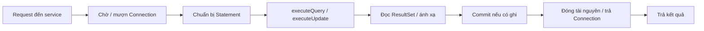

# Theo dõi độ trễ truy vấn và phân bố thời gian thực thi

Một ứng dụng Java có thể ghi log rằng câu `SELECT` chạy trong 20 ms nhưng người dùng vẫn phải chờ 800 ms để nhận dữ liệu. Ngược lại, hệ thống có thời gian phản hồi **trung bình** chỉ 35 ms nhưng cứ 100 yêu cầu lại có vài yêu cầu mất hơn 2 giây. Hai trường hợp này cho thấy việc chỉ nhìn một con số “thời gian query” hoặc một giá trị trung bình là chưa đủ để giám sát **JDBC** trong môi trường vận hành.

Trong chương **Giám sát vận hành**, bài này hướng dẫn theo dõi **độ trễ truy vấn**, đo các giai đoạn JDBC qua `DataSource`, `Connection`, `PreparedStatement` và `ResultSet`, rồi phân tích **phân bố thời gian thực thi** bằng histogram và percentile (p50, p95, p99). Bên cạnh SQL tham số hóa, quản lý transaction và connection pool, bạn sẽ học cách xác định độ trễ thực sự nằm ở DBMS, mạng, thời gian chờ pool, tải `ResultSet`, ánh xạ dữ liệu hay `commit()`.

> **Nguyên tắc cốt lõi:** Đo **từ góc nhìn ứng dụng lẫn DBMS**, theo **từng thao tác nghiệp vụ ổn định** và theo **phân bố**, không chỉ một giá trị trung bình. `executeQuery()` trả về không đồng nghĩa toàn bộ `ResultSet` đã được đọc xong; `executeUpdate()` thành công trong transaction chưa đồng nghĩa `commit()` đã hoàn tất.

## 1. “Độ trễ truy vấn” có thể chỉ những khoảng thời gian khác nhau

Một yêu cầu truy vấn JDBC có thể trải qua:



| Khoảng đo | Bắt đầu / kết thúc | Dùng để trả lời |
| --- | --- | --- |
| **Acquisition latency** | Trước `DataSource.getConnection()` đến khi có `Connection` hoặc lỗi. | Request có đang chờ pool cấp kết nối hay tạo/kiểm tra kết nối vật lý không? |
| **Prepare latency** | Trước `connection.prepareStatement(sql)` đến khi nhận statement. | Có chi phí chuẩn bị tại driver/DBMS, tương tác mạng hay bộ đệm statement không? |
| **Execute latency** | Trước `executeQuery()`/`executeUpdate()` đến khi phương thức trả về hoặc ném lỗi. | Driver mất bao lâu cho bước thực thi ban đầu? |
| **Consume/iteration latency** | Sau `executeQuery()` đến khi đọc hết các hàng cần lấy bằng `rs.next()` và getter. | Độ trễ nằm ở fetch tiếp, truyền dữ liệu, giải mã, mapping hay xử lý hàng? |
| **Commit latency** | Trước `Connection.commit()` đến khi trả về hoặc lỗi. | Giao dịch ghi tốn bao lâu để được xác nhận? |
| **Connection hold time** | Khi được cấp `Connection` đến khi gọi `close()`/trả pool. | Request chiếm tài nguyên pool bao lâu? |
| **Operation/endpoint latency** | Bắt đầu đến hoàn thành toàn use case hoặc request. | Người dùng/job chờ bao lâu, gồm cả mọi bước ngoài JDBC? |

Các khoảng trên có thể **lồng nhau**, không nên cộng bất kỳ số đo nào thành “total”. Chẳng hạn connection hold time có thể bao gồm prepare, execute, đọc `ResultSet`, commit, xử lý Java và đóng tài nguyên. Nếu đã đo `consume` thì đừng cộng riêng thời gian từng lần `next()` khi các số đó cùng nằm trong `consume`.

### ExecuteQuery không phải thời gian tải hết kết quả

```java
long t0 = System.nanoTime();
ResultSet rs = ps.executeQuery();
long t1 = System.nanoTime();

while (rs.next()) {
    consume(rs.getLong(1), rs.getString(2));
}
long t2 = System.nanoTime();

System.out.println("executeQuery ns: " + (t1 - t0));
System.out.println("read-and-consume ns: " + (t2 - t1));
```

Đây là **đoạn minh họa** nằm trong ngữ cảnh có `ps` và hàm `consume`, cần đóng `ResultSet` và `PreparedStatement` bằng `try-with-resources` khi triển khai. Tùy driver, một phần lớn dữ liệu có thể được buffer trong `executeQuery()` hoặc chỉ được lấy khi `rs.next()` chạy. Vì vậy không khẳng định `t1-t0` luôn là “thời gian DBMS thực thi SQL” và `t2-t1` chỉ là chi phí Java.

Với một câu `SELECT` trả một triệu hàng, tổng thời gian đọc kết quả và bytes truyền có thể chiếm phần lớn hơn việc DBMS tìm hàng đầu tiên. Khi tăng `fetchSize` hoặc thay đổi cách stream, sự phân chia giữa các khoảng đo cũng có thể đổi dù tổng thời gian gần như không đổi.

## 2. Đo bằng đồng hồ đơn điệu, không dùng đồng hồ lịch

Đối với **thời lượng trong cùng tiến trình**, dùng `System.nanoTime()` để lấy chênh lệch:

```java
long started = System.nanoTime();
try {
    runDatabaseOperation();
} finally {
    long elapsedNanos = System.nanoTime() - started;
    recordDuration("orders.lookup", "total", elapsedNanos);
}
```

`runDatabaseOperation` và `recordDuration` là các hàm do ứng dụng cung cấp. `nanoTime()` không dùng để xác định ngày/giờ theo lịch hay so trực tiếp mốc timestamp giữa **hai máy**. Chỉ lấy **hiệu giữa hai lần gọi** cùng nguồn đồng hồ. Trong hệ thống metrics, nên chuẩn hóa đơn vị rõ ràng, chẳng hạn histogram duration theo **giây** hoặc phép đo gốc bằng **nanosecond** để thư viện chuyển đổi.

**Luôn đo cả đường lỗi** bằng `finally` hoặc một wrapper tương đương. Nếu chỉ ghi metric khi `executeQuery` thành công, những truy vấn timeout, deadlock và kết nối lỗi sẽ **biến mất khỏi dữ liệu độ trễ**, làm p95/p99 nhìn đẹp hơn thực tế.

### Ba đại lượng khác nhau

| Đại lượng | Đơn vị hay dùng | Ý nghĩa |
| --- | --- | --- |
| **Latency/duration** | ms, s | Thời gian mỗi thao tác. |
| **Throughput** | request/s, query/s | Số thao tác hoàn tất trong một khoảng thời gian. |
| **Concurrency** | Số connection đang mượn, transaction đang mở | Số công việc cùng chiếm tài nguyên. |

Ba đại lượng tác động lẫn nhau: DBMS bão hòa khi concurrency lớn có thể làm latency tăng dù throughput không tăng; một pool quá nhỏ có thể làm **thời gian chờ mượn** tăng trong khi DB vẫn chưa bão hòa. Để chẩn đoán, phải nhìn các đại lượng này **cùng nhau**.

## 3. Trung bình, percentile và histogram: đọc phân bố cho đúng

Độ trễ của truy vấn trong thực tế thường có **đuôi dài** (*long tail*). Một số ít giao dịch bị chờ khóa, tải trang dữ liệu lớn hoặc GC có thể kéo p99 lên rất cao dù đa số request nhanh.

| Chỉ số | Cách hiểu | Hạn chế |
| --- | --- | --- |
| **Count** | Số phép đo trong cửa sổ. | Không cho biết nhanh/chậm. |
| **Mean** | Tổng duration chia số phép đo. | Một vài outlier làm lệch; che trải nghiệm ở đuôi. |
| **Median/p50** | Khoảng 50% mẫu có độ trễ không lớn hơn mức này (theo ước lượng percentile). | Không thể hiện nhóm chậm nhất. |
| **p90/p95** | Khoảng 90%/95% mẫu nằm dưới ngưỡng. | Cần đủ mẫu, đúng cửa sổ và nhãn metric để diễn giải. |
| **p99** | Khoảng 99% mẫu có độ trễ không lớn hơn mức p99. | Dao động mạnh với mẫu ít và dễ bị ảnh hưởng bởi burst. |
| **Maximum** | Giá trị lớn nhất trong cửa sổ. | Nhạy với một sự cố đơn lẻ, không phản ánh tần suất. |
| **Histogram** | Đếm số thao tác nằm trong các khoảng duration. | Độ chính xác percentile phụ thuộc cách chọn bucket và số mẫu. |

Ví dụ 10 phép đo đã sắp xếp (ms):

```text
10, 11, 12, 13, 14, 15, 18, 25, 70, 200
```

Trung bình là `38,8 ms`, lớn hơn nhiều so với **trung vị theo cách lấy trung bình hai giá trị giữa** là `(14 + 15) / 2 = 14,5 ms`. Theo **quy ước nearest-rank** (`rank = ceil(p × N)`), `p50 = 14 ms`, `p90 = 70 ms`, `p95 = 200 ms` và `p99 = 200 ms`. Sự khác biệt nhỏ giữa trung vị `14,5 ms` và p50 nearest-rank `14 ms` đến từ **cách định nghĩa/ước lượng phân vị**, không phải dữ liệu mâu thuẫn. Đây chỉ là ví dụ minh họa: **10 mẫu là quá ít để ước lượng p99 ổn định**, và các thư viện có thể dùng phương pháp nội suy/ước lượng khác nhau nên không nhất thiết cho đúng các con số nearest-rank này.

Nếu phần lớn truy vấn nhanh nhưng một số rất chậm, chỉ công bố “độ trễ trung bình 38,8 ms” sẽ bỏ qua mức ảnh hưởng ở phía đuôi phân bố. Ngược lại, nhìn p99 mà không xem count/rate có thể tạo cảnh báo sai khi cửa sổ chỉ có vài phép đo.

### Histogram và percentiles qua nhiều instance

Một histogram có thể dùng các mốc bucket theo giây:

```text
0.005, 0.010, 0.025, 0.050, 0.100,
0.250, 0.500, 1.000, 2.000, +Inf
```

Với định dạng histogram tích lũy kiểu Prometheus, bucket `le="0.100"` đếm **tất cả** phép đo `<= 0,100 s`, không phải riêng các phép đo từ `0,050` đến `0,100 s`. Chọn bucket dày hơn gần **ngưỡng SLO** và thưa hơn ở vùng ít quan tâm; mốc không đủ chi tiết có thể làm p95/p99 ước lượng thô.

**Không lấy trung bình các p95 của từng replica** rồi gọi đó là p95 toàn hệ thống. Percentile không cộng gộp theo cách đó, đặc biệt khi mỗi replica có số request khác nhau. Muốn có ước lượng toàn dịch vụ, gộp **histogram buckets** cùng định nghĩa hoặc dùng hệ thống tổng hợp phân bố hỗ trợ, rồi tính percentile trên dữ liệu đã gộp.

## 4. Nhãn metric: nhận diện câu SQL mà không làm nổ cardinality

Một dashboard chỉ có “JDBC query duration” cho toàn bộ ứng dụng sẽ che khuất việc một query báo cáo chậm trong khi truy vấn theo khóa chính vẫn nhanh. Nên gắn metric với **định danh thao tác ổn định**:

```text
operation="orders.find_by_id"
operation="orders.list_recent"
operation="orders.update_status"
operation="payments.insert_batch"
```

Các nhãn thường có ích:

| Nhãn | Ví dụ | Lưu ý |
| --- | --- | --- |
| `operation` | `orders.find_by_id` | Giá trị cố định trong mã; tránh SQL text thô. |
| `phase` | `pool_acquire`, `execute`, `consume`, `commit`, `hold` | Có định nghĩa ranh giới đo thống nhất. |
| `outcome` | `success`, `error`, `timeout` | Số lượng trạng thái nhỏ, rõ ràng. |
| `db_role` | `primary`, `replica` | Hữu ích khi đọc và ghi đến các endpoint khác nhau. |
| `db_system` | `postgresql`, `mysql`, `mssql` | Tùy hệ thống giám sát; giữ số giá trị có giới hạn. |
| `service` / `instance` | Dịch vụ, pod/host do hệ telemetry gắn. | Dùng label hạ tầng chuẩn; cân nhắc chi phí cardinality. |

**Không đặt** `user_id`, `order_id`, `request_id`, câu SQL đã nội suy tham số, số điện thoại hoặc token vào **metric labels**. Mỗi giá trị mới có thể tạo một time series mới, gây tăng bộ nhớ/chi phí hệ giám sát và rò rỉ dữ liệu. Correlation ID thuộc về **trace/log có chính sách truy cập và lấy mẫu**, không phải chiều histogram được tạo cho từng yêu cầu.

Khi cần phân biệt truy vấn, dùng tên thao tác hoặc **SQL fingerprint đã chuẩn hóa** do một thành phần quan sát phù hợp tạo ra; không tự ghi toàn bộ giá trị bind của `PreparedStatement`. Dù SQL có tham số `?`, tên bảng/column và nội dung truy vấn vẫn có thể tiết lộ cấu trúc nội bộ, nên cần kiểm soát cả query text trong trace/log.

## 5. Ví dụ Java: phân rã độ trễ một truy vấn JDBC

Giả sử bảng:

```sql
CREATE TABLE orders (
    id BIGINT PRIMARY KEY,
    status VARCHAR(30) NOT NULL,
    total_amount DECIMAL(18, 2) NOT NULL
);
```

Ví dụ sau là lớp Java hoàn chỉnh sử dụng `DataSource` được cấu hình sẵn và một giao diện `DurationSink` đơn giản. Nó đo `pool_acquire`, `prepare`, `execute`, `consume`, `connection_hold` và `operation_total`, bao gồm đường lỗi. Lớp **không phụ thuộc trực tiếp** vào một thư viện metrics; production có thể cài đặt `DurationSink` bằng Micrometer, OpenTelemetry hoặc công cụ telemetry đã chọn.

```java
import java.math.BigDecimal;
import java.sql.Connection;
import java.sql.PreparedStatement;
import java.sql.ResultSet;
import java.sql.SQLException;
import java.util.Objects;
import java.util.Optional;
import javax.sql.DataSource;

public final class OrderLatencyRepository {
    private static final String OP = "orders.find_by_id";
    private final DataSource dataSource;
    private final DurationSink metrics;

    public interface DurationSink {
        // Nên là phép ghi metric nhẹ và không ném exception.
        void record(String operation, String phase,
                    String outcome, long nanoseconds);
    }

    public static final class OrderView {
        public final long id;
        public final String status;
        public final BigDecimal totalAmount;

        public OrderView(long id, String status, BigDecimal totalAmount) {
            this.id = id;
            this.status = Objects.requireNonNull(status);
            this.totalAmount = Objects.requireNonNull(totalAmount);
        }
    }

    public OrderLatencyRepository(
            DataSource dataSource, DurationSink metrics) {
        this.dataSource = Objects.requireNonNull(dataSource);
        this.metrics = Objects.requireNonNull(metrics);
    }

    public Optional<OrderView> findById(long id) throws SQLException {
        long operationStart = System.nanoTime();
        long acquireStart = System.nanoTime();
        Connection acquired;
        String operationOutcome = "error";

        try {
            acquired = dataSource.getConnection();
            metrics.record(OP, "pool_acquire", "success",
                    System.nanoTime() - acquireStart);
        } catch (SQLException failure) {
            metrics.record(OP, "pool_acquire", "error",
                    System.nanoTime() - acquireStart);
            metrics.record(OP, "operation_total", "error",
                    System.nanoTime() - operationStart);
            throw failure;
        }

        // Thời điểm connection đã được cấp, trước prepare/execute.
        long holdStart = System.nanoTime();
        try (Connection connection = acquired) {
            String sql = "SELECT id, status, total_amount "
                       + "FROM orders WHERE id = ?";

            long prepareStart = System.nanoTime();
            PreparedStatement prepared;
            try {
                prepared = connection.prepareStatement(sql);
                metrics.record(OP, "prepare", "success",
                        System.nanoTime() - prepareStart);
            } catch (SQLException failure) {
                metrics.record(OP, "prepare", "error",
                        System.nanoTime() - prepareStart);
                throw failure;
            }

            try (PreparedStatement ps = prepared) {
                ps.setLong(1, id);
                ps.setQueryTimeout(5);

                long executeStart = System.nanoTime();
                ResultSet result;
                try {
                    result = ps.executeQuery();
                    metrics.record(OP, "execute", "success",
                            System.nanoTime() - executeStart);
                } catch (SQLException failure) {
                    metrics.record(OP, "execute", "error",
                            System.nanoTime() - executeStart);
                    throw failure;
                }

                try (ResultSet rs = result) {
                    long consumeStart = System.nanoTime();
                    String consumeOutcome = "error";
                    try {
                        Optional<OrderView> value;
                        if (!rs.next()) {
                            value = Optional.empty();
                        } else {
                            value = Optional.of(new OrderView(
                                    rs.getLong("id"),
                                    rs.getString("status"),
                                    rs.getBigDecimal("total_amount")));
                        }
                        consumeOutcome = "success";
                        operationOutcome = "success";
                        return value;
                    } finally {
                        metrics.record(OP, "consume", consumeOutcome,
                                System.nanoTime() - consumeStart);
                    }
                }
            }
        } finally {
            // finally này chạy sau khi try-with-resources gọi close().
            long finished = System.nanoTime();
            metrics.record(OP, "connection_hold", operationOutcome,
                    finished - holdStart);
            metrics.record(OP, "operation_total", operationOutcome,
                    finished - operationStart);
        }
    }
}
```

Đoạn gọi từ service, nơi `dataSource` và `durationSink` đã được cấu hình:

```java
OrderLatencyRepository repository =
        new OrderLatencyRepository(dataSource, durationSink);

Optional<OrderLatencyRepository.OrderView> order =
        repository.findById(101L);
```

### Hiểu chính xác phạm vi của ví dụ

1. `pool_acquire` bao gồm thời gian chờ pool, kiểm tra connection hoặc mở kết nối vật lý nếu cần; **không chỉ** là thời gian xếp hàng.
2. `prepare` và `execute` được ghi riêng. Khi `executeQuery()` trả nhanh, `consume` vẫn có thể chậm do fetch/giải mã.
3. `consume` trong ví dụ chỉ đọc **tối đa một hàng** vì truy vấn theo khóa chính `orders.id`; không áp kết quả này cho truy vấn scan nhiều hàng mà không sửa vòng lặp.
4. `connection_hold` bao trùm cả thao tác chuẩn bị, thực thi, ánh xạ và `close()`; `operation_total` còn gồm thời gian mượn connection. Hai metric này **lồng nhau**, không cộng vào nhau.
5. `operationOutcome` phản ánh thao tác đọc thành công hay phát sinh lỗi mà mã quan sát được. Để nhận diện `timeout` thay vì `error`, ứng dụng có thể phân loại `SQLTimeoutException` tại điểm biên theo policy; không dựa duy nhất vào thông điệp lỗi.
6. Ví dụ coi `DurationSink.record` là **không chặn và không ném exception**. Nếu code ghi metric dùng I/O đồng bộ hoặc ném lỗi, nó có thể làm chậm/đổi kết quả truy vấn. Trong production, adapter telemetry cần nhẹ, tách khỏi đường quan trọng và có xử lý lỗi riêng.
7. Thời gian `connection_hold` đo từ sau khi trả về từ `getConnection()` đến sau `close()`, không nhất thiết trùng chính xác bộ đếm của pool (pool có quy tắc tính riêng). Với trường hợp đóng connection ném lỗi sau khi logic SQL đã thành công, `operationOutcome` của ví dụ vẫn có thể là `success`; nếu ứng dụng yêu cầu phân loại riêng lỗi lúc close/reset pool, hãy bổ sung nhãn hoặc wrapper giám sát tài nguyên phù hợp.

Để có thông tin DBMS, thường cần **đối chiếu metric bên ứng dụng** với slow-query log, execution plan, wait events và số liệu từ DB tương ứng. Ví dụ `execute` tăng không đủ để suy ra “DB chạy SQL lâu”: còn có mạng, fetch ban đầu, driver và điều phối thread.

## 6. Ghi, batch và commit: không chỉ đo executeUpdate

Với ghi dữ liệu, một statement có thể hoàn thành nhưng `commit()` mới là giai đoạn quyết định transaction có được xác nhận không. Nếu đặt `autoCommit(false)`, đo cả `executeUpdate`/`executeBatch`, `commit` và thời gian giữ connection.

Ví dụ **đo commit trên một transaction do caller sở hữu**:

```java
// Caller đã mở transaction; chưa có commit ở bước trước.
long commitStarted = System.nanoTime();
String commitOutcome = "error";
try {
    connection.commit();
    commitOutcome = "success";
} finally {
    durationSink.record("orders.update_status",
            "commit", commitOutcome,
            System.nanoTime() - commitStarted);
}
```

Đây là đoạn thân phương thức; `connection` và `durationSink` đã được cấp. Nếu `commit()` ném `SQLException` do mất kết nối/timeout, việc ghi metric `error` là **đúng kết quả quan sát từ Java**, nhưng **không có nghĩa transaction chắc chắn rollback**. Kết quả commit có thể chưa rõ; cần idempotency và đối soát theo thiết kế nghiệp vụ. Tương tự, `BatchUpdateException.getUpdateCounts()` chỉ báo số đếm từng lệnh theo driver, **không xác nhận chúng đã commit**.

Khi đo lệnh batch, nên theo dõi thêm **số statement trong batch**, số hàng được báo tác động (nếu biết), tỷ lệ lỗi, độ trễ mỗi batch và độ trễ commit. Không đưa số lượng hàng cụ thể của mỗi batch làm label độ phân giải vô hạn; có thể dùng histogram batch-size hoặc nhóm giới hạn (ví dụ `1–100`, `101–500`, `>500`) nếu cần.

### Ranh giới quan trọng

| Loại tác vụ | Nên có metric nào? |
| --- | --- |
| `SELECT` theo khóa chính | Acquire, execute, consume, total và outcome. |
| Báo cáo trả hàng chục nghìn dòng | Acquire, execute, consume toàn `ResultSet`, rows returned, bytes nếu đo được, hold time. |
| `UPDATE` một hàng | Execute, row count, commit nếu caller mở transaction, lock wait và total. |
| `executeBatch()` | Batch size, execute duration, outcome, update counts và transaction commit. |
| Đọc/ghi `BLOB` hoặc `CLOB` | Thời gian stream, byte truyền, thời gian giữ connection; tránh gom toàn nội dung vào metric. |

## 7. Từ DurationSink đến histogram và dashboard

Trong production, `DurationSink` nên ghi dữ liệu vào timer/histogram có **tên metric thống nhất và nhãn ít giá trị**. Chẳng hạn một bộ metric theo quy ước riêng của dịch vụ:

```text
jdbc_phase_duration_seconds_bucket{operation="orders.find_by_id",phase="execute",outcome="success",le="0.025"}  ...
jdbc_phase_duration_seconds_count{operation="orders.find_by_id",phase="execute",outcome="success"}             ...
jdbc_phase_duration_seconds_sum{operation="orders.find_by_id",phase="execute",outcome="success"}               ...
```

Đây là **tên minh họa**, không phải tên tự động của JDBC, Micrometer hay OpenTelemetry. Hãy chọn một chuẩn telemetry phù hợp và giữ cách quy đổi đơn vị nhất quán. Với histogram kiểu Prometheus, có thể tham khảo công thức truy vấn sau sau khi đã xác định metric thực tế:

```promql
histogram_quantile(
  0.95,
  sum by (le, operation, phase) (
    rate(jdbc_phase_duration_seconds_bucket[5m])
  )
)
```

Truy vấn trên ước lượng p95 theo `operation` và `phase` từ **các bucket cùng ranh giới** trong cửa sổ 5 phút; vì cộng qua `outcome` nên sẽ gồm cả lỗi/timeout nếu được ghi vào histogram. Khi phân tích độ trễ **chỉ của thành công**, phải lọc `outcome="success"` rõ ràng và theo dõi **error rate** riêng; tuyệt đối không bỏ lỗi khỏi tổng thể giám sát.

Để đo tỷ lệ truy vấn vượt một ngưỡng SLO, histogram có bucket đúng ngưỡng sẽ hữu ích hơn một percentile đơn lẻ. Chẳng hạn nếu ngưỡng là 200 ms, có thể tính:

\[
\text{Tỉ lệ quá ngưỡng}
= 1 - \frac{\text{số phép đo }\leq 0{,}2s}{\text{tổng số phép đo}}
\]

Khi dùng counter tăng dần, áp dụng phép tính trên **mức tăng/rate cùng một cửa sổ**, không lấy tỉ số các giá trị tích lũy kể từ lúc service chạy rồi coi đó là tỷ lệ của 5 phút gần nhất. Ngoài latency histogram, dashboard nên có count/throughput, error rate, timeout, retry, số connection active/idle/pending và DB wait events.

## 8. Thiết kế dashboard theo câu hỏi vận hành

Một dashboard hữu ích không cần hàng chục biểu đồ giống nhau. Nó nên cho phép đi từ **người dùng chậm** đến **nguyên nhân có thể kiểm chứng**:

| Nhóm biểu đồ | Điều cần thấy |
| --- | --- |
| **Endpoint latency p50/p95/p99** | Request nào chậm, có biến động ở đuôi hay chỉ trung bình? |
| **JDBC operation latency p50/p95/p99** | DAO/SQL template nào tăng độ trễ theo thời gian? |
| **Phase breakdown** | `pool_acquire`, `execute`, `consume`, `commit`, `connection_hold` thay đổi thế nào? |
| **Traffic + error rate** | Số request/query mỗi giây, lỗi SQL, timeout, deadlock, retry. |
| **Connection pool** | Active, idle, pending, acquisition timeout, hold time; có cạn pool không? |
| **DBMS** | CPU, I/O, lock waits, active sessions, slow queries, transaction duration, plan regressions. |
| **Kích thước kết quả** | Rows returned, bytes/LOB khi có thể đo, số trang/fetch, batch size. |

Không cần vẽ `p99` cho mọi kết hợp nhãn nếu số lượng mẫu quá ít. Với những thao tác có lưu lượng thấp, hiển thị **số lượng mẫu và thời gian từng slow trace** có thể hữu ích hơn một p99 thay đổi mạnh theo từng request. Dashboard cần ghi rõ cửa sổ, đơn vị thời gian và môi trường (prod/staging).

### Ví dụ phân tích bốn kiểu tăng độ trễ

| Quan sát | Giả thuyết hợp lý | Bằng chứng cần kiểm tra |
| --- | --- | --- |
| `pool_acquire` p99 tăng, `execute` ổn định. | Pool bị giữ hết hoặc có leak/long transaction. | Pool pending, hold time, số connection, thread/stack trace; DB còn tải rảnh không. |
| `execute` tăng trên một query, pool vẫn ổn. | Query plan, khóa, I/O hoặc mạng/driver ở pha execute. | DB slow query, plan, lock waits, wait events, lượng tải. |
| `consume` tăng, số hàng/bytes trả về tăng. | Tải nhiều dữ liệu, fetch/giải mã/mapping chậm. | Rows returned, bytes mạng, fetch size, heap/GC, profiler. |
| `commit` tăng khi nhiều giao dịch ghi chạy đồng thời. | Log flush, contention hoặc đồng bộ giữa transaction. | DB transaction log/WAL, I/O latency, lock waits, số transaction/s. |

Đây là **giả thuyết để điều tra**, không phải chẩn đoán chắc chắn từ duy nhất một metric. Ví dụ `execute` tăng khi socket chậm cũng có thể trông giống query SQL chậm ở góc nhìn ứng dụng.

## 9. SLO và cảnh báo: đo cái người dùng thật sự chịu

Một SLO minh họa:

> Trong cửa sổ đánh giá, ít nhất 99% lượt `orders.find_by_id` **thành công** có thời gian **toàn operation** không quá 200 ms, và tỷ lệ lỗi được theo dõi bằng SLI riêng.

Đây chỉ là **ví dụ**, không phải ngưỡng JDBC chung. Ngưỡng phù hợp phải theo yêu cầu dịch vụ, dữ liệu thực và ngân sách latency của endpoint. Không nên đặt SLO chỉ trên `executeQuery()` nếu người dùng cần cả dữ liệu đã được lấy và chuyển thành đối tượng.

Một chiến lược cảnh báo cân bằng:

1. **Theo dõi latency kèm error rate:** truy vấn timeout hoặc lỗi không được vô hình trong biểu đồ.
2. **Tính đủ mẫu:** không cảnh báo p99 ở một thao tác chỉ có một request trong 5 phút mà không có điều kiện về số mẫu.
3. **Cửa sổ ngắn và dài:** phát hiện sự cố đột ngột, đồng thời giảm nhiễu từ spike vài giây.
4. **Ngưỡng người dùng quan tâm:** có thể cảnh báo tỷ lệ request vượt 200 ms cùng error budget, rồi dùng `phase` để điều tra.
5. **Liên hệ với DBMS:** cảnh báo DB CPU 100% có ý nghĩa khác với cảnh báo người dùng chậm; không dùng một chỉ số thay thế toàn bộ.
6. **Có đường giảm tải:** rate limiting, giảm đồng thời của job, tối ưu truy vấn, điều chỉnh pool có bằng chứng hoặc rollback release nếu plan regress.

Đừng nâng `maximumPoolSize` chỉ vì `pool_acquire` tăng mà không kiểm tra DB đang bão hòa hay giữ connection quá lâu. Một pool lớn hơn có thể đẩy thêm truy vấn vào DB, làm `execute` và p99 tệ hơn.

## 10. Slow query logs, traces và thông tin từ DBMS

Các phép đo từ Java nên được liên kết với công cụ phía database để trả lời câu hỏi **“DBMS đã thực thi điều gì?”**:

- **Slow-query log hoặc thống kê truy vấn:** giúp tìm mẫu SQL chậm, tần suất, thời lượng thực thi và thay đổi theo thời gian; tùy DBMS, log có thể ghi execution time khác với thời gian phía ứng dụng.
- **Execution plan:** cho biết scan/index, join, sort và chi phí ước lượng/thực tế nếu DBMS hỗ trợ. Kiểm tra plan trong môi trường có dữ liệu và thống kê gần production.
- **Wait events/lock monitoring:** giúp tách chậm do chờ khóa, I/O, log flush hay contention.
- **Distributed tracing:** nối endpoint → service → operation JDBC → các dịch vụ khác bằng trace/span; thời gian của các span lồng nhau không nên cộng tùy tiện.
- **GC và runtime metrics:** nhiều object mapping hoặc pause GC có thể làm `consume` và end-to-end latency tăng ngay khi SQL không chậm.

### Ví dụ “slow log” được kiểm soát thông tin

```text
service=orders-api
operation=orders.find_by_id
phase=execute
duration_ms=950
outcome=timeout
sql_state=<mã đã phân loại nếu có>
trace_id=<ID trace phục vụ đối chiếu>
```

Ở đây `trace_id` thuộc **log/trace**, không phải nhãn histogram; các giá trị giữa dấu `<...>` là placeholder minh họa. Không đưa email, token, số thẻ, câu SQL đã thay dấu `?` bằng dữ liệu thực vào log. Nếu có chính sách lưu query text, phải khử/giảm thông tin nhạy cảm và áp dụng kiểm soát truy cập.

**Sampling:** trace chi tiết cho mọi query ở hệ thống lớn có thể đắt. Có thể lấy mẫu có điều kiện cho lỗi, timeout, truy vấn vượt ngưỡng, kết hợp metrics tổng hợp cho toàn bộ lượng truy vấn. Nếu chỉ lấy mẫu trace chậm, **không dùng tập trace đó để tính percentile toàn bộ traffic**: phân bố đã bị thiên lệch bởi quy tắc lấy mẫu.

## 11. Mối liên hệ giữa timeout, retry và phân bố latency

Timeout là một phần của quan sát vận hành, nhưng có nhiều loại:

| Timeout | Vùng ảnh hưởng | Điều phải ghi nhận |
| --- | --- | --- |
| Chờ pool cấp connection | Trước khi có connection để chạy SQL. | `pool_acquire` duration, lỗi lấy connection, số pending. |
| `PreparedStatement.setQueryTimeout` | Thực thi statement theo khả năng driver. | `execute`/`consume` đang ở pha nào khi lỗi, SQLState, kết nối có còn dùng được không. |
| Network/socket timeout | Driver chờ mạng hoặc phản hồi DB. | Lỗi mạng, thời điểm mất kết nối, tính chắc chắn của kết quả commit. |
| Transaction/lock timeout DBMS | Transaction chờ khóa hoặc vượt ranh giới DB quy định. | Wait event, transaction rollback status, mã lỗi và phạm vi transaction. |
| Request deadline/gateway timeout | Toàn bộ request HTTP hoặc RPC. | Tổng latency, các SQL và bước bên ngoài, khả năng backend vẫn đang chạy. |

`setQueryTimeout(5)` **không bảo đảm** mọi driver sẽ hủy truy vấn chính xác ở 5 giây, và cũng không tự giới hạn tổng thời gian mượn connection, đọc stream, commit hoặc retry. Khi `Statement.cancel()` hay timeout xảy ra, driver có thể chỉ **cố gắng hủy**; không được suy ra transaction chắc chắn rollback.

Khi một thao tác ghi timeout sau khi `commit()` được gửi, **kết quả có thể chưa xác định**. Metric nên phân biệt `commit_error` với `business_failed`; hệ thống cần idempotency key và đối soát trên nguồn nhất quán trước khi retry mù quáng. Nếu retry tạo thêm các lần chạy SQL, nên đo cả **số attempt** và **thời gian tổng của một yêu cầu logic**: tổng latency người dùng có thể lớn hơn rất nhiều dù p95 từng attempt còn thấp.

## 12. Những sai lầm phổ biến khi theo dõi query latency

| Sai lầm | Hệ quả | Cách sửa |
| --- | --- | --- |
| Chỉ đo `executeQuery()` cho một báo cáo hàng triệu dòng. | Bỏ thời gian `ResultSet.next()`/fetch/mapper. | Đo tiêu thụ kết quả đến mốc cần thiết. |
| Chỉ báo trung bình mà không có phân bố. | Che giấu tail latency, timeout và lock waits. | Histogram, p50/p95/p99, count và error rate. |
| Lấy trung bình p95 của nhiều pod. | Sai về toán học khi phân bố và traffic khác nhau. | Gộp bucket tương thích rồi tính percentile. |
| Tạo nhãn metric theo `user_id` hoặc SQL chứa tham số. | Cardinality khổng lồ, chi phí cao, rủi ro lộ dữ liệu. | Operation/fingerprint có số giá trị hữu hạn. |
| Bỏ các phép đo lỗi/timeout. | Dashboard giả tạo ấn tượng tất cả đều nhanh. | Ghi duration mọi outcome; phân tích thành công và lỗi riêng. |
| Dùng timestamp đồng hồ lịch tính elapsed time. | NTP/clock adjustment gây thời lượng sai. | Dùng `System.nanoTime()` hoặc timer của metrics SDK. |
| Cộng `execute`, `hold` và `total` để có latency endpoint. | Đếm trùng vì các pha lồng nhau. | Xác định chính xác ranh giới đo. |
| Coi `pool_acquire` là thời gian DB chạy SQL. | Chẩn đoán nhầm pool với query chậm. | Đo acquisition riêng, đối chiếu pool metrics. |
| Dùng trace slow-query có sampling để tính p99 traffic. | Phân bố bị lệch vì chỉ lưu truy vấn chậm. | Tính từ histogram toàn bộ hoặc sampling được hiệu chỉnh. |
| Coi timeout `commit` là rollback. | Có thể retry ghi hai lần. | Idempotency, đối soát, phân loại outcome chưa rõ. |
| Ghi metrics bằng I/O đồng bộ cho mỗi hàng. | Chính telemetry làm chậm ứng dụng. | Timer/histogram nhẹ, ghi theo operation, không theo từng cell. |
| Gán cùng ngưỡng p99 cho mọi truy vấn. | Báo động nhiễu hoặc bỏ sót báo cáo/job chậm. | SLO theo loại thao tác và kỳ vọng nghiệp vụ. |

## 13. Bài tập thực hành: đọc dashboard JDBC

Một dịch vụ Java dùng `DataSource` có pool và gọi `PreparedStatement` để lấy lịch sử đơn hàng. Sau một lần triển khai, hệ thống ghi được các số liệu **giả định** trong cùng cửa sổ 5 phút:

| Chỉ số | Trước triển khai | Sau triển khai |
| --- | ---: | ---: |
| `orders.list_recent` p50 operation total | 65 ms | 70 ms |
| `orders.list_recent` p95 operation total | 180 ms | 510 ms |
| `orders.list_recent` p99 operation total | 320 ms | 1.900 ms |
| `pool_acquire` p95 | 8 ms | 12 ms |
| `execute` p95 | 55 ms | 62 ms |
| `consume` p95 | 95 ms | 440 ms |
| Số hàng trả về trung bình | 100 | 2.000 |
| Tỷ lệ lỗi/timeout | 0,1% | 0,4% |

Hãy trả lời:

1. Có hợp lý khi kết luận DBMS thực thi SQL chậm hơn gấp 10 lần chỉ vì p99 total tăng mạnh không? Vì sao?
2. Pha nào thay đổi rõ nhất? Ba giả thuyết nên kiểm tra là gì?
3. Tại sao không được cộng các giá trị p95 `acquire`, `execute` và `consume` để suy ra p95 total?
4. Nếu mỗi pod xuất một p95 khác nhau, có thể lấy trung bình các p95 đó để ra p95 toàn dịch vụ không?
5. Vì sao p99 cần xem kèm số mẫu và error rate? Một số lỗi timeout bị bỏ khỏi metric sẽ gây sai lệch thế nào?
6. Nếu request `orders.list_recent` chạy lại hai lần sau timeout, cần thêm chỉ số nào để phân biệt latency từng attempt với thời gian người dùng thật sự chờ?
7. Những nhãn nào an toàn hơn cho histogram: `operation`/`phase`/`outcome` hay `order_id`/`user_id`? Vì sao?

**Đáp án định hướng:**

1. **Không.** p99 total gồm nhiều giai đoạn; `execute` p95 chỉ tăng nhẹ, trong khi số hàng trả về và `consume` tăng rõ rệt. Cần xem DB plan/network/mapper trước khi quy trách nhiệm cho DBMS.
2. `consume`. Kiểm tra số hàng/cột được chọn, fetch/bytes mạng, chi phí giải mã/DTO/GC và việc giữ `ResultSet` lâu.
3. Percentile của các giai đoạn có thể xảy ra trên **các request khác nhau**, và các khoảng cũng có thể lồng nhau. Không cộng percentile để suy percentile tổng.
4. Không. Phải gộp các histogram tương thích (hoặc dữ liệu phân bố có trọng số/đúng thuật toán) rồi mới ước lượng p95 toàn dịch vụ.
5. p99 kém ổn định khi ít mẫu; bỏ phép đo lỗi làm phân bố nhìn nhanh hơn thực tế và che giấu vấn đề nghiêm trọng.
6. Đo **attempt count**, thời gian tổng **logical request** (gồm retry/backoff), và tỷ lệ hoàn thành thành công sau retry.
7. Dùng `operation`/`phase`/`outcome` vì có số giá trị giới hạn; `order_id`/`user_id` có cardinality cao và có thể nhạy cảm.

**Ghi nhớ:** Muốn giám sát **JDBC** chính xác, hãy đo **acquire → prepare → execute → consume → commit → release** theo ranh giới có định nghĩa, đặt tên thao tác ổn định, thu thập histogram và theo dõi **p50/p95/p99 cùng count, error rate và throughput**. Đừng đồng nhất `executeQuery()` với toàn bộ thời gian đọc kết quả, đừng cộng các percentile, đừng đưa định danh người dùng vào nhãn metric, và luôn đối chiếu độ trễ phía ứng dụng với plan, wait events và metric phía DBMS trước khi tối ưu.
