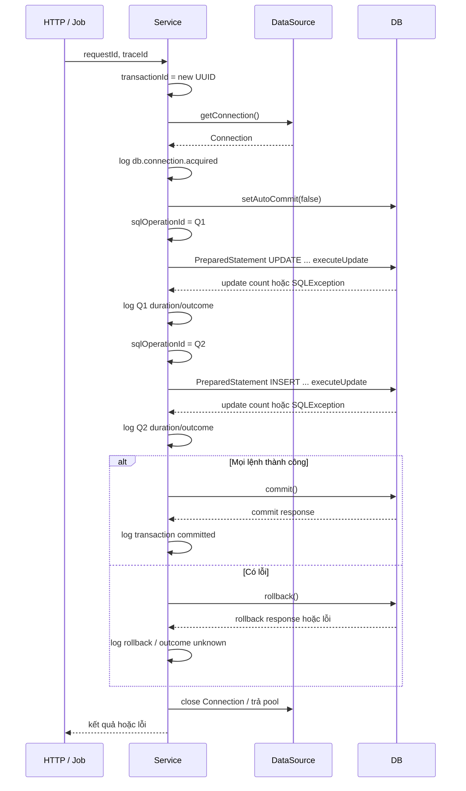

# Gắn mã tương quan giữa yêu cầu, giao dịch và thao tác SQL trong JDBC

## 1. Bài toán vận hành: một lỗi JDBC đi qua nhiều tầng

Một API nhận yêu cầu thanh toán đơn hàng. Tầng HTTP nhận request, service bắt đầu một transaction, repository thực thi hai câu `UPDATE`/`INSERT` qua `PreparedStatement`, rồi `Connection.commit()`. Sau đó database báo lỗi hoặc một lời gọi `ResultSet.next()` thất bại.

Nếu log chỉ ghi:

```text
ERROR SQLException: connection reset
ERROR Could not update order
ERROR Request failed
```

đội vận hành chưa biết ba dòng log có cùng một yêu cầu hay không. Họ cũng không biết có bao nhiêu SQL được thực thi, câu nào thất bại, lỗi có xuất hiện **trước hay trong commit**, và liệu cần đối soát transaction không.

Trong hệ thống có nhiều thread, nhiều service và connection pool, một request có thể tạo nhiều transaction; một transaction lại có nhiều thao tác SQL. Vì vậy cần **gắn mã tương quan** (*correlation identifiers*) qua các ranh giới:

1. **Yêu cầu/trace**: công việc đến từ đâu và đang thuộc chuỗi xử lý nào?
2. **Transaction logic của ứng dụng**: những thao tác JDBC nào được điều phối cùng ranh giới commit/rollback?
3. **Thao tác SQL**: một câu lệnh cụ thể, một lần thực thi cụ thể đã diễn ra ra sao?

Bài thuộc chương **Giám sát vận hành** của module **JDBC**. Nội dung đặt trong thực tế ứng dụng Java truy cập cơ sở dữ liệu quan hệ qua driver, `DataSource`, `PreparedStatement` và `ResultSet`; bao gồm SQL tham số hóa, CRUD, quản lý kết nối, transaction, batching, xử lý lỗi và quan sát hiệu năng qua API chuẩn.

**Mục tiêu bài học:**

- Phân biệt `requestId`, `traceId`, `transactionId` và `sqlOperationId`; không đồng nhất chúng với ID nghiệp vụ hay ID transaction nội bộ của DB.
- Thiết kế cấu trúc context và truyền cùng mã qua service, DAO/repository, statement và transaction.
- Ghi log/tracing có cấu trúc cho `getConnection()`, `executeUpdate()`, `executeQuery()`, vòng tiêu thụ `ResultSet`, `commit()` và `rollback()`.
- Giữ mã tương quan đúng khi có thread pool, retry, batch hoặc request đi qua nhiều service.
- Tránh lộ dữ liệu, rò ngữ cảnh giữa những connection được tái sử dụng và bùng nổ cardinality của metrics.
- Viết test xác minh chuỗi sự kiện đúng với kết quả transaction thực tế.

> **Mấu chốt:** mã tương quan giúp **truy tìm và đối soát**, nhưng bản thân nó không tạo transaction, không chứng minh dữ liệu đã commit và không thay thế cơ chế idempotency.

## 2. Các loại mã: một request có thể chứa nhiều transaction

### 2.1. Mô hình phân cấp

```text
Request: requestId=REQ-A
  Trace: traceId=TRACE-X
    |
    +-- Transaction app: transactionId=TX-1
    |     |
    |     +-- SQL operation: sqlOperationId=SQL-1  UPDATE orders
    |     +-- SQL operation: sqlOperationId=SQL-2  INSERT order_audit
    |     +-- Transaction outcome: COMMITTED
    |
    +-- Transaction app: transactionId=TX-2
          |
          +-- SQL operation: sqlOperationId=SQL-3  SELECT order_audit
          +-- Transaction outcome: ROLLED_BACK/COMMITTED nếu có

Request khác: requestId=REQ-B
    +-- Transaction app: transactionId=TX-3
          +-- SQL operation: sqlOperationId=SQL-4
```

Đây là **mô hình logic của ứng dụng**, không phải khẳng định mọi truy vấn `SELECT` đều cần transaction riêng. Trong một request có thể không có transaction tường minh, chỉ có nhiều statement ở chế độ auto-commit; khi đó **không tự bịa một transaction nhiều câu SQL** để log như thể chúng nguyên tử.

| Mã | Phạm vi | Nguồn tạo/nhận | Ý nghĩa |
|---|---|---|---|
| `requestId` | Một request HTTP hoặc một lần chạy job | Entry point đáng tin cậy, thường do server tạo | Lọc log theo **một yêu cầu cụ thể** |
| `traceId` | Một trace phân tán qua nhiều service | Hệ thống tracing theo chuẩn truyền context | Liên kết request và span xuyên tiến trình |
| `spanId` | Một đơn vị xử lý trong trace | Tracing SDK/instrumentation | Quan hệ cha–con, thời gian từng bước |
| `transactionId` | Một **transaction attempt logic do ứng dụng sở hữu** | Tầng service/transaction runner | Gom các SQL thuộc cùng ranh giới commit/rollback |
| `sqlOperationId` | Một lần thực thi SQL hoặc một thao tác DB được đo | DAO/repository/instrumentation | Phân biệt nhiều statement hoặc retry |
| `businessOperationId` | Nghiệp vụ cần đối soát (đơn hàng, lần nhập dữ liệu...) | Hệ thống nghiệp vụ | Liên hệ kết quả kỹ thuật với thực thể nghiệp vụ |
| `idempotencyKey` | Một yêu cầu nghiệp vụ có thể bị gửi lại | Do giao thức nghiệp vụ quản lý | Ngăn/đối soát tác động lặp; **khác** requestId |

Những tên trường ở bảng là **quy ước thiết kế được đề xuất**, không phải thuộc tính có sẵn của `java.sql.Connection`.

### 2.2. Không nhầm transactionId ứng dụng với transaction ID trong database

Một chuỗi UUID do Java tạo:

```java
String transactionId = UUID.randomUUID().toString();
```

là **mã tương quan ở tầng ứng dụng**. Nó không tự động trở thành transaction ID mà PostgreSQL, MySQL hay SQL Server dùng trong máy chủ.

Hệ quản trị có thể cung cấp ID transaction nội bộ, session ID hoặc server process ID qua SQL hay metadata riêng. Những ID đó có vòng đời và ngữ nghĩa khác nhau; có thể được dùng để đối chiếu khi cần, nhưng **không thay thế** mã ứng dụng trong log.

Tương tự, một `Connection` lấy từ pool có thể đại diện cho kết nối logic dùng tạm. Sau khi `close()` trả về pool, một request khác có thể mượn **cùng kết nối vật lý**. Không gắn `requestId` vĩnh viễn vào connection vật lý rồi coi đó là danh tính của mọi statement về sau.

### 2.3. Mã lần thử và mã nghiệp vụ phải được tách

Giả sử một thao tác tạo đơn nhận `idempotencyKey=checkout-123`:

```text
Business operation: checkout-123
    |
    +-- HTTP attempt 1: requestId=A
    |      transactionId=T1
    |      sqlOperationId=Q1, Q2
    |      outcome: timeout ở commit
    |
    +-- HTTP attempt 2: requestId=B
           transactionId=T2
           sqlOperationId=Q3
           outcome: đối soát thấy nghiệp vụ đã hoàn tất
```

Hai request có **requestId khác nhau**, dù cùng một thao tác nghiệp vụ. Nếu tái sử dụng một transactionId cho mọi retry, log dễ làm người đọc nhầm các lần thử thành một transaction đã tồn tại liên tục. Ngược lại, nếu mỗi retry tạo transactionId mới nhưng giữ cùng idempotency key, ta vừa theo dõi chính xác từng attempt vừa đối soát cùng nghiệp vụ.

## 3. Chọn điểm tạo và cách truyền mã tương quan

### 3.1. Tạo mã ở ranh giới đáng tin cậy

Với request HTTP, mã tương quan nên được chuẩn hóa ở tầng gateway/filter/controller **trước** khi gọi service.

- Nếu client gửi một header tương quan, coi đó là **dữ liệu chưa tin cậy**: kiểm tra độ dài, ký tự cho phép và chính sách cho phép dùng lại. Tránh cho chuỗi tùy ý đi thẳng vào log.
- Nếu không có mã hợp lệ, server tạo ID mới; `UUID.randomUUID()` là lựa chọn đơn giản cho ID opaque trong ví dụ Java.
- Không dùng email, số điện thoại, tên người dùng hoặc khóa bí mật làm requestId.
- Nếu có OpenTelemetry/W3C Trace Context, lấy `traceId` và `spanId` từ **tracing context đã được xác minh bởi thư viện**, không tự parse/chép một header bất kỳ rồi gọi nó là trace tin cậy.

Ví dụ sinh request ID:

```java
import java.util.UUID;

String requestId = UUID.randomUUID().toString();
```

Mã được sinh từ UUID là dữ liệu kỹ thuật ít có khả năng chứa ký tự phá log. Với correlation ID do client cung cấp, một số hệ thống chọn giữ nó dưới tên `clientCorrelationId` sau khi validation, còn `requestId` server-generated luôn độc lập để tránh gây nhầm quyền sở hữu.

### 3.2. Truyền context tường minh giữa các tầng

Có thể tạo một record chỉ chứa những ID đã được thẩm định:

```java
import java.util.Objects;

public record RequestContext(
        String requestId,
        String traceId
) {
    public RequestContext {
        Objects.requireNonNull(requestId, "requestId");

        // traceId có thể null khi chưa bật tracing.
        if (requestId.isBlank() || requestId.length() > 80) {
            throw new IllegalArgumentException(
                    "requestId không hợp lệ");
        }
    }
}
```

Trong một ứng dụng thật, entry point có nhiệm vụ validation và sinh ID; `RequestContext` không nên nhận trực tiếp chuỗi header chưa kiểm tra. Nếu muốn ràng buộc chặt hơn, chỉ cho phép một tập ký tự như chữ/số/gạch nối và giới hạn độ dài để tránh log injection.

Hợp đồng giữa các tầng:

```java
// Controller / job entry point:
RequestContext context = new RequestContext(
        requestId,
        currentTraceId
);

// Service:
paymentService.markOrderPaid(context, orderId);

// Repository hoặc helper JDBC:
repository.updateStatus(connection, context, transactionId, orderId);
```

`currentTraceId` và `paymentService` do ứng dụng cung cấp. Mỗi tầng có thể sử dụng cùng context mà không dựa hoàn toàn vào biến toàn cục hoặc `ThreadLocal`.

**Ưu điểm của truyền tường minh:** dễ unit test, dễ dùng khi chuyển thread, và có thể nhìn vào chữ ký phương thức để biết dữ liệu quan sát cần thiết. **Đánh đổi:** chữ ký phương thức có thêm tham số; với hệ thống lớn, nên tạo một context chung có kiểu thay vì truyền nhiều chuỗi rời.

## 4. Mô hình sự kiện: đo hành vi, không ghi dữ liệu nhạy cảm

Một thao tác SQL nên có **tên ổn định theo nghiệp vụ hoặc repository**, ví dụ:

```text
orders.mark_paid
order_audit.record_paid
orders.read_for_export
inventory.reserve
billing.capture_result
```

Tên như `orders.mark_paid` không phụ thuộc giá trị `orderId` và phù hợp để nhóm log/metric.

Một sự kiện quan sát nên trả lời các câu hỏi:

| Trường | Ví dụ | Mục đích |
|---|---|---|
| `event` | `jdbc.operation.finished` | Loại sự kiện |
| `requestId` | UUID | Cùng một request |
| `traceId` / `spanId` | ID do tracing SDK cấp | Ghép chuỗi trace |
| `transactionId` | UUID | Cùng một transaction attempt |
| `sqlOperationId` | UUID | Cùng một lần thực thi SQL |
| `operation` | `orders.mark_paid` | Tên SQL operation ổn định |
| `durationMs` | `14` | Độ trễ tại ranh giới được đo |
| `rowCount` | `1` | Số hàng do JDBC báo, nếu có |
| `outcome` | `success` / `failed` | Kết quả quan sát của thao tác |
| `sqlState` | `23505` (ví dụ PostgreSQL) | Phân loại lỗi SQL |
| `vendorCode` | Mã của driver/DB | Chẩn đoán vendor |
| `attempt` | `2` khi retry | Liên hệ các lần thử |
| `db.system` | `postgresql` | Phân biệt DB khi có nhiều nguồn |
| `db.pool` | `orders-pool` | Nhận diện pool theo tên hữu hạn |

Không phải trường nào cũng hiện diện ở mọi sự kiện. Ví dụ `rowCount` không có ý nghĩa cho một lần `getConnection()`; `sqlState` thường chỉ có khi bắt `SQLException`.

**Không mặc định log:**

- Password, connection URL chứa credentials, token, session cookie.
- Toàn bộ `PreparedStatement` sau khi nội suy tham số hoặc mọi giá trị bind.
- Nội dung SQL chứa dữ liệu cá nhân được ghép trực tiếp.
- BLOB/CLOB, dữ liệu thẻ thanh toán, thông tin sức khỏe hoặc payload người dùng.
- Raw exception text nếu có khả năng chứa tham số nhạy cảm mà chưa được kiểm soát.

Thường nên log **query operation name** và mẫu SQL cố định đã loại bỏ literal, hoặc query fingerprint đã chuẩn hóa. Với dữ liệu nhạy cảm cần điều tra, áp dụng chính sách phân quyền và retention riêng thay vì bật log mọi tham số trên production.

## 5. Vòng đời một request JDBC: gắn mã ở những điểm nào?



Những khoảng thời gian cần tách:

1. **Acquire:** từ trước `dataSource.getConnection()` đến khi có connection hoặc lỗi; với pool có thể bao gồm chờ mượn hoặc tạo connection mới.
2. **SQL execution:** từ trước `prepareStatement()`/bind đến khi statement thực thi và đóng xong (theo hợp đồng đo), không đồng nhất thời gian hoàn tất tất cả hàng của một `SELECT` lớn.
3. **Result consumption:** đối với `SELECT`, đo riêng `ResultSet.next()`, getter, mapping và vòng duyệt, vì driver có thể fetch ở những lần gọi `next()`.
4. **Commit/rollback:** đo riêng và ghi outcome; không gộp mọi failure thành “SQL chậm”.
5. **Connection held:** khoảng từ khi lấy connection đến khi trả về pool; hữu ích để tìm transaction dài và rò connection.

Nếu một transaction có 5 statement, tất cả dùng **cùng transactionId** và **cùng Connection** do service sở hữu, nhưng mỗi statement có `sqlOperationId` riêng. Nếu một retry bắt đầu transaction mới, tạo transactionId mới.

### 5.1. Sự kiện quan sát không phải kết quả transaction

Ví dụ:

```text
Q1 UPDATE orders             rowCount=1 outcome=success
Q2 INSERT order_audit        rowCount=1 outcome=success
T1 COMMIT                    outcome=failed sqlState=08006
```

Hai SQL báo thành công **không chứng minh** dữ liệu đã được commit. `commit()` thất bại do mất kết nối có thể tạo outcome **UNKNOWN** từ phía client, ngay cả khi server đã commit. Cần đối soát bằng khóa nghiệp vụ/idempotency và quy tắc DB, không chỉ dựa vào event của từng statement.

## 6. Ví dụ đầy đủ: service gắn requestId, transactionId và sqlOperationId

### 6.1. Schema PostgreSQL minh họa

Ta dùng một bảng đơn hàng và một bảng audit:

```sql
CREATE TABLE orders (
    order_id      BIGINT PRIMARY KEY,
    status        VARCHAR(16) NOT NULL,
    total_amount  NUMERIC(14, 2) NOT NULL
);

CREATE TABLE order_audit (
    audit_id   BIGINT GENERATED ALWAYS AS IDENTITY PRIMARY KEY,
    order_id   BIGINT NOT NULL REFERENCES orders(order_id),
    action     VARCHAR(32) NOT NULL,
    created_at TIMESTAMP NOT NULL DEFAULT CURRENT_TIMESTAMP
);

INSERT INTO orders (order_id, status, total_amount)
VALUES (101, 'PENDING', 250000.00);
```

DDL theo cú pháp PostgreSQL; với MySQL, SQL Server, Oracle hoặc DB khác cần chỉnh `IDENTITY`, kiểu dữ liệu và cú pháp tương ứng. Bảng audit trong ví dụ thuộc **cùng database và cùng transaction** với bảng orders. Nó không phải log vận hành thay thế cho hệ thống observability.

Nghiệp vụ: chuyển đơn từ `PENDING` sang `PAID`, sau đó ghi một dòng audit. Hai statement phải **cùng thành công rồi commit**, hoặc được rollback cùng nhau.

### 6.2. Java 17+ với JDBC thuần

Mẫu sau dùng `DataSource`, `PreparedStatement`, `Connection` và `System.Logger` có sẵn trong JDK. Không bắt buộc Spring hay OpenTelemetry để hiểu cách truyền correlation ID.

```java
import javax.sql.DataSource;
import java.sql.Connection;
import java.sql.PreparedStatement;
import java.sql.SQLException;
import java.util.Objects;
import java.util.UUID;
import java.util.concurrent.TimeUnit;

public final class ObservableOrderService {
    public record RequestContext(
            String requestId,
            String traceId
    ) {
        public RequestContext {
            Objects.requireNonNull(requestId, "requestId");
            if (requestId.isBlank() || requestId.length() > 80) {
                throw new IllegalArgumentException(
                        "requestId không hợp lệ");
            }
        }
    }

    @FunctionalInterface
    private interface Binder {
        void bind(PreparedStatement ps) throws SQLException;
    }

    private static final System.Logger LOG =
            System.getLogger(ObservableOrderService.class.getName());

    private final DataSource dataSource;

    public ObservableOrderService(DataSource dataSource) {
        this.dataSource = Objects.requireNonNull(dataSource);
    }

    public void markOrderPaid(RequestContext request, long orderId)
            throws SQLException {
        Objects.requireNonNull(request, "request");

        // Mã ứng dụng cho MỘT lần thử transaction.
        String transactionId = UUID.randomUUID().toString();
        long transactionStarted = System.nanoTime();
        long acquireStarted = System.nanoTime();

        try (Connection connection = dataSource.getConnection()) {
            event(request, transactionId, null,
                    "jdbc.connection.acquire", "acquired",
                    acquireStarted, -1, null);

            // Ví dụ này tự sở hữu transaction và yêu cầu pool cấp
            // Connection ở auto-commit mode như cấu hình dự kiến.
            if (!connection.getAutoCommit()) {
                throw new SQLException(
                        "Connection đã có transaction; "
                        + "cần transaction owner phù hợp");
            }

            connection.setAutoCommit(false);
            boolean resolved = false;
            boolean commitAttempted = false;
            Throwable primaryFailure = null;

            try {
                int changed = executeUpdate(
                        connection, request, transactionId,
                        "orders.mark_paid",
                        """
                        UPDATE orders
                        SET status = 'PAID'
                        WHERE order_id = ?
                          AND status = 'PENDING'
                        """,
                        ps -> ps.setLong(1, orderId));

                if (changed != 1) {
                    throw new SQLException(
                            "Đơn hàng không tồn tại hoặc "
                            + "không còn ở trạng thái PENDING");
                }

                executeUpdate(
                        connection, request, transactionId,
                        "order_audit.record_paid",
                        """
                        INSERT INTO order_audit
                            (order_id, action, created_at)
                        VALUES (?, 'PAID', CURRENT_TIMESTAMP)
                        """,
                        ps -> ps.setLong(1, orderId));

                commitAttempted = true;
                connection.commit();
                resolved = true;

                event(request, transactionId, null,
                        "jdbc.transaction", "committed",
                        transactionStarted, -1, null);

            } catch (SQLException | RuntimeException | Error failure) {
                primaryFailure = failure;

                try {
                    connection.rollback();
                    resolved = true;

                    // Nếu commit đã được thử, outcome trước
                    // rollback có thể không xác định từ client.
                    event(request, transactionId, null,
                            "jdbc.transaction",
                            commitAttempted
                                    ? "commit_outcome_unknown"
                                    : "rolled_back",
                            transactionStarted, -1,
                            failure instanceof SQLException sql
                                    ? sql : null);

                } catch (SQLException rollbackFailure) {
                    failure.addSuppressed(rollbackFailure);

                    event(request, transactionId, null,
                            "jdbc.transaction", "rollback_failed",
                            transactionStarted, -1, rollbackFailure);
                }
                throw failure;

            } finally {
                // Không bật auto-commit nếu không biết chắc
                // transaction đã kết thúc: thao tác này có
                // thể gây commit ngoài ý muốn.
                if (resolved) {
                    try {
                        connection.setAutoCommit(true);
                    } catch (SQLException restoreFailure) {
                        if (primaryFailure != null) {
                            primaryFailure.addSuppressed(restoreFailure);
                        } else {
                            throw restoreFailure;
                        }
                    }
                }
            }

        } catch (SQLException failure) {
            // Bao gồm lỗi acquire, begin, thao tác hoặc close.
            // Không mặc định mọi lỗi đều nghĩa là chưa commit.
            event(request, transactionId, null,
                    "jdbc.service", "failed",
                    transactionStarted, -1, failure);
            throw failure;
        }
    }

    private static int executeUpdate(
            Connection connection,
            RequestContext request,
            String transactionId,
            String operationName,
            String sql,
            Binder binder
    ) throws SQLException {
        String sqlOperationId = UUID.randomUUID().toString();
        long started = System.nanoTime();
        int changed;

        try (PreparedStatement ps =
                     connection.prepareStatement(sql)) {
            binder.bind(ps);
            changed = ps.executeUpdate();
        } catch (SQLException failure) {
            event(request, transactionId, sqlOperationId,
                    operationName, "failed",
                    started, -1, failure);
            throw failure;
        }

        event(request, transactionId, sqlOperationId,
                operationName, "success",
                started, changed, null);
        return changed;
    }

    private static void event(
            RequestContext request,
            String transactionId,
            String sqlOperationId,
            String operation,
            String outcome,
            long startedNanos,
            int rowCount,
            SQLException failure
    ) {
        long elapsedMs = TimeUnit.NANOSECONDS.toMillis(
                System.nanoTime() - startedNanos);

        String sqlState = failure == null
                ? "-"
                : String.valueOf(failure.getSQLState());

        int vendorCode = failure == null
                ? 0
                : failure.getErrorCode();

        try {
            // Minh họa key=value trong log, không log SQL literal
            // hoặc các tham số chứa dữ liệu người dùng.
            LOG.log(System.Logger.Level.INFO,
                    "operation={0} outcome={1} requestId={2} "
                    + "traceId={3} transactionId={4} "
                    + "sqlOperationId={5} durationMs={6} "
                    + "rows={7} sqlState={8} vendorCode={9}",
                    operation,
                    outcome,
                    request.requestId(),
                    request.traceId() == null
                            ? "-" : request.traceId(),
                    transactionId,
                    sqlOperationId == null ? "-" : sqlOperationId,
                    elapsedMs,
                    rowCount,
                    sqlState,
                    vendorCode);
        } catch (RuntimeException telemetryFailure) {
            // Không để lỗi logging làm thay đổi outcome transaction.
            // Production cần cảnh báo/fallback về lỗi telemetry này.
        }
    }
}
```

### 6.3. Giải thích mô hình sở hữu và quan sát

Đoạn mã cố ý làm rõ:

- `request.requestId()` và `request.traceId()` đi qua cùng một lời gọi service. `transactionId` được tạo **một lần** cho transaction attempt.
- `executeUpdate(...)` tạo `sqlOperationId` riêng cho từng câu SQL, log **tên operation ổn định** thay vì lưu order ID hay chuỗi SQL đã nội suy.
- `PreparedStatement` dùng dấu `?` và `setLong(...)` để truyền ID đơn hàng; không nối input vào SQL.
- Phương thức `executeUpdate(...)` dùng `try-with-resources` nên statement được đóng sau khi thực thi hoặc khi lỗi; mức thời gian ghi bao gồm chi phí prepare/bind/execute/close.
- Cùng một `Connection` phục vụ cả thay đổi trạng thái đơn hàng và ghi audit; `commit()` chỉ được gọi sau khi hai thao tác thành công.
- Khi statement thất bại, code thử `rollback()`; nếu rollback cũng thất bại, lỗi thứ cấp được gắn vào exception ban đầu qua `addSuppressed(...)`.
- Khi `commit()` ném lỗi kết nối, không khẳng định dữ liệu chắc chắn bị rollback. Sự kiện `commit_outcome_unknown` nhắc đội vận hành phải đối soát theo nghiệp vụ.
- Việc khôi phục `autoCommit=true` chỉ thực hiện sau khi code đã xác nhận kết thúc transaction bằng commit/rollback thành công. Nếu phải tương tác với transaction manager hoặc pool cấp connection ở trạng thái khác, cần dùng owner thích hợp thay vì ép mọi repository tự quản transaction.
- `System.Logger` chỉ dùng cho ví dụ học thuật. Production nên tích hợp một backend log có cấu trúc, chuẩn hóa tên trường và cấu hình retention/phân quyền.

**Lưu ý về chính xác:** sự kiện `jdbc.transaction` có outcome `committed` nghĩa là lệnh `commit()` **đã trả về thành công**; đây là quan sát từ client, không phải một bản chứng thực độc lập của hệ thống lưu trữ. Nếu lỗi xảy ra **sau commit**, chẳng hạn lúc khôi phục trạng thái hoặc đóng connection, có thể thấy cả sự kiện committed và sự kiện service failed. Đó là lý do không gộp mọi lỗi service thành transaction failed.

Ví dụ này ưu tiên tính minh bạch của các ranh giới kỹ thuật, chưa triển khai đầy đủ những yêu cầu như retry có giới hạn, idempotency, trace spans tự động, phân quyền dữ liệu hoặc chuẩn OpenTelemetry. Những mục đó sẽ được phân tích bên dưới.

### 6.4. Cách gọi từ tầng HTTP hoặc job

```java
String requestId = UUID.randomUUID().toString();

// Lấy từ tracing context tin cậy nếu hệ thống có tracing;
// không tự tin giá trị raw trace header của client.
String traceId = trustedTraceIdOrNull;

var context = new ObservableOrderService.RequestContext(
        requestId, traceId);

orderService.markOrderPaid(context, 101L);
```

`trustedTraceIdOrNull` và `orderService` do ứng dụng cung cấp. `UUID` cần import `java.util.UUID`. Một request thất bại có thể trả `requestId` cho client ở dạng **mã hỗ trợ điều tra** nếu chính sách ứng dụng cho phép; không trả raw stack trace, SQL text nhạy cảm hay connection credentials.

## 7. Đo SELECT lớn: thời gian executeQuery chưa phải toàn bộ thời gian SQL

Đối với `SELECT` trả hàng nghìn hoặc hàng triệu hàng, driver có thể chỉ nhận một phần dữ liệu khi `executeQuery()` trả về. Những lần gọi `ResultSet.next()` sau đó có thể tiếp tục tải dữ liệu qua mạng.

Nếu chỉ log:

```java
long started = System.nanoTime();
ResultSet rs = ps.executeQuery();
logDuration("query", System.nanoTime() - started);
```

thì phép đo bỏ qua thời gian lặp kết quả và ánh xạ dữ liệu.

### 7.1. Phạm vi đo đúng với một lần đọc

```java
String sqlOperationId = UUID.randomUUID().toString();
long started = System.nanoTime();
long rows = 0;

try (PreparedStatement ps = connection.prepareStatement(
        """
        SELECT order_id, status
        FROM orders
        WHERE status = ?
        ORDER BY order_id
        """)) {
    ps.setString(1, "PAID");

    try (ResultSet rs = ps.executeQuery()) {
        while (rs.next()) {
            long orderId = rs.getLong("order_id");
            String status = rs.getString("status");

            // Xử lý đồng bộ dữ liệu của hàng hiện tại.
            consumeOrder(orderId, status);
            rows++;
        }
    }
}

long elapsedNanos = System.nanoTime() - started;
recordSqlRead(requestId, transactionId, sqlOperationId,
        "orders.list_paid", rows, elapsedNanos);
```

Đây là khung tích hợp trong lớp đã có `connection`, `requestId`, `transactionId`, `consumeOrder(...)` và `recordSqlRead(...)`; cần import `PreparedStatement`, `ResultSet`, `UUID`. Đọc xong hàng và đóng statement **trước** khi tạo sự kiện hoàn tất; production cần thêm nhánh `catch/finally` để log khi có lỗi giữa vòng đọc, không chỉ khi thành công.

Với một vòng đọc chậm:

- Tách `executeQuery` và `result.consume` nếu muốn biết chậm ở DB/driver hay mapper/callback.
- Không log **mỗi hàng** trừ khi có nhu cầu đặc biệt và mức sampling phù hợp; log dày có thể làm truy vấn chậm và chiếm dung lượng.
- Log số hàng thực sự tiêu thụ, không mặc định đó là tổng số hàng của query nếu caller dừng sớm.
- Không giữ `ResultSet` ra khỏi scope của `Connection`; mã tương quan không thay thế quản lý tài nguyên.

## 8. Batch và giao dịch nhiều thao tác: gắn mã theo đúng lần thực thi

Batch JDBC có `addBatch()` và `executeBatch()`; một lần batch có thể chứa nhiều phần tử. Cần phân biệt:

- `batchOperationId`: một lần gọi batch ở tầng ứng dụng.
- `sqlOperationId`: có thể dùng cho toàn bộ lời gọi `executeBatch()` hoặc mỗi lệnh thành phần nếu hệ thống có cách ánh xạ tin cậy.
- `batchItemId`: khóa nghiệp vụ hoặc item index được phép log, dùng khi cần tìm hàng lỗi.
- `transactionId`: transaction chứa batch, nếu có ranh giới tường minh.
- `requestId`: yêu cầu/job đã kích hoạt batch.

Ví dụ log:

```text
event=jdbc.batch.started
requestId=REQ-A
transactionId=TX-9
sqlOperationId=SQL-B1
operation=inventory.import_batch
batchSize=200

event=jdbc.batch.failed
requestId=REQ-A
transactionId=TX-9
sqlOperationId=SQL-B1
operation=inventory.import_batch
sqlState=23505
reportedCountSize=87

event=jdbc.transaction.rolled_back
requestId=REQ-A
transactionId=TX-9
```

**Đừng** suy từ `BatchUpdateException.getUpdateCounts()` rằng 87 phần tử đã được commit. Mảng counts thể hiện báo cáo thực thi của driver; transaction có thể đã rollback hoặc driver có thể tiếp tục sau lỗi. Khi cần kiểm tra dữ liệu thực sự đã lưu, dùng truy vấn độc lập sau khi transaction kết thúc.

Với `Statement.SUCCESS_NO_INFO`, driver báo thực thi thành công nhưng không biết số hàng; `EXECUTE_FAILED` biểu diễn lệnh thất bại. Hai mã đặc biệt này **không** được cộng như số hàng tác động.

Nếu lỗi xảy ra ở item thứ 87, nên lưu **vị trí phần tử** (index) và một mã nghiệp vụ an toàn nếu được phép. Không log payload nguyên văn của item vì có thể chứa dữ liệu cá nhân.

### 8.1. Một batch có nhiều transaction

Nếu job chia 10.000 bản ghi thành 50 chunk, mỗi chunk được commit riêng, cấu trúc tương quan là:

```text
jobId=JOB-2026-11
  requestId=JOB-RUN-A
    chunk=0  transactionId=T-0  sqlOperationId=B-0 -> committed
    chunk=1  transactionId=T-1  sqlOperationId=B-1 -> committed
    chunk=2  transactionId=T-2  sqlOperationId=B-2 -> rolled_back
    ...
```

Không được gắn một transactionId duy nhất cho cả job rồi báo `COMMITTED` nếu thực tế mỗi chunk là một transaction. Đối soát cần xác định **chunk nào đã commit, chunk nào lỗi**. Khi retry chunk 2, tạo transactionId và sqlOperationId mới nhưng giữ `jobId`/`chunkId` ổn định để liên hệ lần thử mới với dữ liệu nghiệp vụ cũ.

## 9. Truyền context qua thread pool, callback và tác vụ bất đồng bộ

### 9.1. Vì sao ThreadLocal/MDC dễ bị rò?

Nhiều thư viện logging Java có cơ chế *Mapped Diagnostic Context* (MDC), thường lưu trường như `requestId` bằng `ThreadLocal`. Phương pháp này tiện khi mọi tầng chạy trên **cùng thread**. Nhưng thread pool tái sử dụng worker thread; nếu không dọn context sau request A, log của request B có thể bị gắn nhầm `requestId` cũ.

Ví dụ sai về mặt vòng đời:

```java
MDC.put("requestId", requestId);
service.handle();
// Không remove/clear: thread được tái sử dụng.
```

`MDC` trong ví dụ là API của thư viện logging như SLF4J, **không phải** API JDBC hoặc Java SE. Với framework cụ thể, hãy theo tài liệu propagation/context của framework.

Nếu dùng MDC thủ công:

```java
MDC.put("requestId", requestId);
try {
    service.handle();
} finally {
    MDC.remove("requestId");
}
```

Trên thread được tái sử dụng, việc set và cleanup phải **cân xứng**. Nếu ở đầu scope đã có MDC context khác, chỉ xóa key có thể không khôi phục đủ trạng thái; một số framework hỗ trợ snapshot/restore toàn bộ context.

### 9.2. Executor không tự sao chép context đúng cách trong mọi mô hình

Giả sử code chuyển bước xử lý sang executor:

```java
executor.submit(() -> {
    repository.updateStatus(...);
});
```

Thread chạy `updateStatus` có thể không có MDC hoặc tracing context của request ban đầu. Không nên kỳ vọng mọi `ThreadLocal` sẽ tự lan truyền qua pool.

Cách dễ kiểm thử với JDBC thuần là **truyền context tường minh**:

```java
RequestContext captured = requestContext;

executor.submit(() -> {
    service.processChunk(captured, chunkId);
});
```

`RequestContext` ở đây là record bất biến; `executor`, `service` và `chunkId` do ứng dụng cung cấp. Nếu dùng MDC/tracing, cần cài đặt adapter hoặc context propagation được hỗ trợ bởi framework, khôi phục trạng thái trong `finally`.

Một điểm còn quan trọng hơn: **không chuyển cùng một `Connection` và `ResultSet` sang nhiều thread** rồi tiếp tục commit trên thread khác tùy ý. Có thể truyền context và DTO bất biến, nhưng vòng đời transaction/connection vẫn cần một chủ sở hữu và chính sách đồng thời rõ ràng.

### 9.3. Trace context khác ThreadLocal tùy ý

Hệ thống tracing hiện đại thường quản lý propagation qua một *context carrier* và scope:

```text
HTTP request span
    |
    +-- service span
          |
          +-- JDBC acquire span
          +-- JDBC execute span
          +-- JDBC commit span
```

Khi một công việc chuyển sang thread khác hoặc sang message queue, cần tạo/khôi phục scope đúng theo SDK. Không chỉ copy chuỗi `traceId` mà coi như đã tạo liên kết cha–con của span; `spanId`, flags và baggage là những thành phần cần được xử lý theo chuẩn/tracing SDK.

Nếu không có tracing SDK, mã `requestId` truyền tường minh vẫn rất hữu ích cho log; nó không tự trở thành distributed trace.

## 10. OpenTelemetry: tích hợp mà không trộn các nguồn tương quan

Một hệ thống có thể dùng OpenTelemetry Java instrumentation để tự tạo span khi gọi JDBC. Đây là **thư viện/instrumentation ngoài JDBC chuẩn**, không phải phương thức mới của `DataSource`.

Thông thường, công cụ tracing có thể tạo:

- Span xử lý HTTP/gRPC.
- Span gọi service hoặc transaction do ứng dụng chủ động tạo.
- Span client JDBC cho `SELECT`/`UPDATE`/`INSERT`.
- Attributes mô tả loại DB, operation, thời gian và trạng thái lỗi.

Khi tự thêm event ở repository, phải kiểm tra instrumentation có sẵn để tránh **đếm đôi một câu SQL** thành hai span hoặc hai metric giống nhau. Một phương án dễ quản lý là:

1. Để instrumentation JDBC thu thập span kỹ thuật.
2. Thêm `operation.name` hoặc tên repository có tính ổn định theo nghiệp vụ.
3. Liên kết span tự động với request context đã hoạt động.
4. Bổ sung transactionId logic vào log hoặc span attribute được kiểm soát.
5. Đối chiếu trace ID trong log với trace backend.

**Không mặc định instrumentation có thể biết chính xác outcome commit của nghiệp vụ** chỉ vì thấy `executeUpdate()` thành công. Outcome của transaction cần được ghi ở tầng chủ sở hữu `commit()`/`rollback()`.

### 10.1. Trace, log và metric có vai trò khác nhau

| Công cụ | Phù hợp để hỏi | Không nên dùng làm |
|---|---|---|
| **Trace** | Một request đi qua những span nào và chậm ở đâu? | Nguồn xác nhận cuối cùng dữ liệu đã commit |
| **Log có correlation ID** | Lỗi SQL cụ thể, transaction nào và event nào nối nhau? | Hệ thống lưu mọi tham số nhạy cảm |
| **Metric tổng hợp** | p95 latency, tỷ lệ timeout, pool pending, số lỗi theo operation | Bộ chỉ mục từng `requestId` hoặc `sqlOperationId` |
| **DB audit/transaction data** | Bản ghi nghiệp vụ nào thật sự tồn tại? | Thay thế toàn bộ log lỗi và trace |

Với trace sampling, **không phải mọi request đều có trace được lưu**. Log chứa `requestId` ổn định có thể vẫn giúp điều tra khi trace bị sample bỏ. Tuy nhiên, nếu cả log lẫn trace đều bị lấy mẫu hoặc không được ghi do sự cố hạ tầng, mã tương quan không thể tái tạo những sự kiện chưa từng được ghi.

## 11. Tương quan log ứng dụng với log phía database

### 11.1. Đặt tên thao tác ổn định trước khi nghĩ tới session tag

Chỉ bằng `requestId`, `transactionId` và `sqlOperationId` trong log ứng dụng đã có thể liên hệ các bước service/repository, ngay cả khi DB không hỗ trợ gắn tag.

Nếu cần ghép thêm log DB, có các lựa chọn **phụ thuộc hệ quản trị và driver**:

- Ghi tên ứng dụng/pool hoặc client metadata được DB chấp nhận.
- Dùng session/application name theo cơ chế DB để phân biệt **nguồn kết nối**.
- Ghi server connection/session identifier và đối chiếu với log driver/DB.
- Đối chiếu theo thời gian, operation type, query fingerprint và trace khi hạ tầng hỗ trợ.
- Dùng cơ chế DB hỗ trợ gắn metadata theo transaction, với giới hạn và cleanup rõ ràng.

Một API JDBC liên quan là `Connection.setClientInfo(...)`:

```java
connection.setClientInfo("ApplicationName", "order-service");
```

Nhưng tên property `ApplicationName` và khả năng truyền tới server **không phải tiêu chuẩn chung được mọi driver hỗ trợ**. `setClientInfo` có thể ném `SQLClientInfoException` hoặc chỉ ghi metadata phía client tùy driver. Không giả định lệnh trên chắc chắn thay đổi nhãn phiên trong PostgreSQL/MySQL/SQL Server như nhau.

### 11.2. Cẩn thận với connection pool

Nếu gắn `requestId` hoặc `transactionId` vào **session state của DB**, phải nhớ connection vật lý có thể được tái sử dụng:

```text
Request A -> mượn connection P -> gắn tag A -> trả pool
Request B -> mượn lại connection P -> không reset tag
DB log của B có thể bị hiểu nhầm là A
```

Vì vậy:

1. Ưu tiên nhãn **ổn định của ứng dụng** cho trạng thái session chung.
2. Nếu cần tag theo request, sử dụng cơ chế **transaction-local** do DB hỗ trợ khi phù hợp, hoặc đảm bảo reset tag trong `finally` trước khi trả connection.
3. Không phụ thuộc JDBC `Connection.close()` luôn reset mọi thuộc tính vendor-specific; cần xác minh chính sách của pool/driver.
4. Không đưa ID nhạy cảm hoặc input người dùng chưa validation vào SQL comment/session metadata.
5. Nếu tag không reset được do connection lỗi, connection cần được xử lý theo chính sách loại bỏ/khôi phục của pool.

### 11.3. SQL comment và query fingerprint

Một số hệ thống chèn SQL comment vào statement để nối log ứng dụng với log DB:

```sql
/* app=orders operation=mark_paid */
UPDATE orders SET status = 'PAID' WHERE order_id = ?;
```

Đây chỉ là **ví dụ comment cố định**, không chứa request ID hay dữ liệu người dùng. Nếu chèn `requestId` thay đổi theo từng câu SQL, có thể gây:

- Tăng số phiên bản SQL text trong log hoặc plan cache tùy DB/driver.
- Làm lộ ID đến các hệ thống có quyền xem DB log.
- Kích thước log và cardinality tăng rất nhanh.
- Rủi ro SQL injection hoặc đóng comment nếu đưa raw untrusted input vào comment.

Không coi comment SQL là cơ chế chuẩn JDBC để truyền trace. Nếu cần dùng, phải có thư viện/hạ tầng được kiểm chứng, chính sách sanitization, và đo ảnh hưởng lên prepared statement caching/plan reuse.

## 12. Metrics: không dùng requestId làm label

Một lỗi vận hành phổ biến là biến mọi correlation ID thành **metric label**:

```text
jdbc_query_duration_ms{
    requestId="uuid-1",
    transactionId="uuid-2",
    sqlOperationId="uuid-3"
}
```

Nếu có 100.000 request khác nhau, ba trường này có thể tạo hàng trăm nghìn hoặc nhiều hơn các chuỗi thời gian riêng biệt. Đó là vấn đề **high cardinality**, gây tăng chi phí lưu trữ, RAM và thời gian truy vấn metrics.

Thay vào đó, metric nên dùng các nhãn **có tập giá trị hữu hạn**:

| Metric | Label đề xuất |
|---|---|
| `jdbc_connection_acquire_seconds` | `pool`, `outcome` |
| `jdbc_sql_duration_seconds` | `operation`, `db_system`, `outcome` |
| `jdbc_transaction_duration_seconds` | `operation`, `outcome` |
| `jdbc_sql_errors_total` | `operation`, `sqlstate_class` |
| `jdbc_pool_connections` | `pool`, `state` |
| `jdbc_batch_size` | `operation` |
| `jdbc_result_rows` | `operation` |

Tùy hệ thống observability có thể dùng tên và đơn vị khác, nhưng nguyên tắc giữ nguyên: **không dùng requestId, transactionId, sqlOperationId, email, user ID hoặc SQL text có literal làm label metric**.

Nếu backend hỗ trợ *exemplar*, có thể liên kết một quan sát metric với một trace ID được chọn theo cơ chế của hệ thống, nhưng trace ID không trở thành nhãn phân vùng chính của mọi series.

### 12.1. SQLState class dùng để nhóm lỗi

`SQLException.getSQLState()` có thể trả mã dài 5 ký tự, ví dụ:

- Class `08`: lỗi kết nối.
- Class `22`: dữ liệu không hợp lệ.
- Class `23`: vi phạm ràng buộc.
- Class `40`: rollback transaction/serialization/deadlock theo ngữ nghĩa chuẩn liên quan.

Tuy nhiên, SQLState có thể `null`, sử dụng mã riêng hoặc thay đổi theo driver. Khi đưa vào metric, thường nhóm theo **hai ký tự đầu** hoặc một phân loại hữu hạn do ứng dụng định nghĩa; tránh dùng toàn bộ error message như label.

Để điều tra một lỗi riêng, log/traces có thể lưu **SQLState đầy đủ và vendor code**, cùng với correlation IDs được cấp quyền truy cập phù hợp.

## 13. Lỗi, rollback và commit không rõ kết quả

### 13.1. Đừng ghi “transaction failed” chỉ vì một SQL thất bại

Nếu một `UPDATE` ném lỗi ràng buộc, service có thể rollback transaction thành công. Cấu trúc sự kiện đúng:

```text
jdbc.operation.finished
  operation=orders.mark_paid
  sqlOperationId=Q1
  outcome=failed
  sqlState=23xxx

jdbc.transaction.finished
  transactionId=T1
  outcome=rolled_back
```

Từ đây có thể kết luận **ứng dụng đã gọi rollback và DB phản hồi thành công** trong kịch bản được mô phỏng. Nhưng nếu repository khác trong cùng transaction đã phát thông báo tới queue hoặc gọi HTTP, rollback JDBC không hoàn tác những tác động bên ngoài.

### 13.2. Lỗi commit có thể để lại trạng thái UNKNOWN

```text
Service: COMMIT gửi tới DB
    |
DB có thể đã hoàn tất commit
    |
Mạng đứt trước khi response tới Java
    |
Connection.commit() ném SQLException
    |
Client không biết chắc đã commit hay chưa
```

Trường hợp này cần sự kiện phân biệt:

```text
event=jdbc.transaction.finished
outcome=commit_outcome_unknown
transactionId=T1
requestId=R1
sqlState=08006
```

**Không được** chuyển một cách chắc chắn thành `ROLLED_BACK` chỉ vì `rollback()` được gọi sau lỗi. Nếu server đã commit, rollback về sau không thể hoàn tác giao dịch ấy. Đây là tình huống cần idempotency key, mã nghiệp vụ và đối soát kết quả tồn tại trong DB.

Cũng cần phân biệt `rollback_failed` với `commit_outcome_unknown`. Một transaction có thể bị lỗi SQL trước commit rồi rollback thất bại do connection chết; outcome khi đó cũng cần được mô tả thận trọng, không tự gắn trạng thái đã hoàn tác.

### 13.3. Exception chain và lỗi cleanup

`SQLException` cung cấp `getSQLState()`, `getErrorCode()`, `getNextException()`; Java `Throwable` có `getCause()` và `getSuppressed()`. Khi rollback, đóng statement hoặc đóng connection cùng thất bại, nên bảo toàn lỗi gốc và gắn lỗi sau bằng `addSuppressed(...)`, không chỉ log thông điệp cuối cùng.

Không nên tự động retry tất cả lỗi có SQLState class `08` hay subclass `SQLTransientException`. Nếu lỗi xảy ra **sau khi server có thể đã thực thi lệnh ghi**, việc thử lại không có idempotency có thể tạo tác động kép.

Mã tương quan giúp tìm **tất cả các attempt** và kiểm tra ID nghiệp vụ đã được lưu, nhưng chính sách retry phải được quyết định bởi hợp đồng dữ liệu và trạng thái transaction.

## 14. Kịch bản thực tế: lần theo một request chậm qua log

Giả sử một request xử lý đơn hàng có sự kiện:

```text
10:00:00.000 request.started
  requestId=R-123 traceId=abc... operation=payment.confirm

10:00:00.020 jdbc.connection.acquired
  requestId=R-123 transactionId=T-11
  pool=orders-pool durationMs=19

10:00:00.023 jdbc.operation.finished
  requestId=R-123 transactionId=T-11
  sqlOperationId=Q-1 operation=orders.mark_paid
  durationMs=3 rows=1 outcome=success

10:00:00.047 jdbc.operation.finished
  requestId=R-123 transactionId=T-11
  sqlOperationId=Q-2 operation=order_audit.record_paid
  durationMs=24 rows=1 outcome=success

10:00:00.063 jdbc.transaction.finished
  requestId=R-123 transactionId=T-11
  outcome=committed durationMs=43

10:00:00.068 request.finished
  requestId=R-123 status=200 durationMs=68
```

Đây là **dữ liệu minh họa**, không phải log thật của một hệ thống. Một người vận hành có thể:

1. Tìm `requestId=R-123` để tập hợp mọi sự kiện trong tiến trình.
2. Tìm `traceId` trong tracing backend nếu có để đối chiếu các service.
3. Lọc `transactionId=T-11`, xác nhận hai câu SQL thuộc cùng lần thử transaction.
4. So sánh `durationMs` của acquire, hai thao tác SQL và transaction để tìm phần chậm.
5. Quan sát `sqlOperationId=Q-2` nếu cần tra một câu lệnh cụ thể trong log driver/DB.
6. Xác nhận `commit()` báo thành công trước khi request trả HTTP 200.

Nếu `jdbc.operation.finished` của Q-2 có `sqlState=23505`, cần xem thêm `jdbc.transaction.finished` để biết rollback đã được xác nhận hay chưa. **Không dừng phân tích chỉ ở lỗi SQL riêng lẻ.**

### 14.1. Trường hợp log bị lệch ngữ cảnh

Giả sử xuất hiện:

```text
request.started requestId=R-200
jdbc.operation.finished requestId=R-199
request.finished requestId=R-200
```

Điều này có thể do:

- MDC của request trước không được dọn khi thread pool tái sử dụng thread.
- Công việc async không được propagation context đúng.
- Một repository tạo ID mới thay vì dùng context của caller.
- Log được gửi trễ và thiếu một ID stable để liên kết.
- Một wrapper DataSource hoặc interceptor cài đặt context không cân xứng.

Hãy đối chiếu thread name, span parent, message/job ID và điểm capture context. Đừng kết luận transaction của R-200 đã dùng dữ liệu R-199 chỉ từ một dòng log; đó có thể là **lỗi gắn nhãn quan sát**, cần kiểm chứng trước khi quy thành lỗi nghiệp vụ.

## 15. Cảnh báo và dashboard nên dựa trên hành vi nào?

Correlation IDs giúp điều tra từng sự cố, nhưng dashboard/alert nên dùng metric tổng hợp:

| Tín hiệu | Điều cần theo dõi | Gợi ý xử lý |
|---|---|---|
| p95/p99 connection acquisition tăng | Pool bão hòa, mở connection chậm | Kiểm tra active/idle/pending, DB connect time |
| Thời gian transaction tăng | Transaction giữ connection/khóa lâu | Lọc operation, truy long-running tx |
| Lỗi SQLState class `08` tăng | Lỗi mạng/driver/DB | Kiểm tra network, failover, health |
| Lỗi constraint `23` tăng | Input nghiệp vụ, xung đột dữ liệu | Tìm operation/fixture và xem validation |
| Rollback rate tăng | Tỷ lệ transaction thất bại | Phân nhóm operation và nguyên nhân |
| `commit_outcome_unknown` > 0 | Có yêu cầu cần đối soát | Kích hoạt quy trình reconciliation |
| Batch partial failure tăng | Dữ liệu nhập có lỗi hoặc chính sách batch thay đổi | Kiểm tra counts, chunk, idempotency |
| ResultSet consume quá lâu | Query trả nhiều hàng, downstream chậm | Kiểm tra fetch, mapping, backpressure |
| Telemetry loss tăng | Logging/tracing bị quá tải hoặc lỗi | Kiểm tra exporter/queue và fallback metrics |

Không nên tạo alert riêng cho từng `requestId` hoặc `sqlOperationId`. Alert nên nói “operation=orders.mark_paid có tỷ lệ lỗi > ngưỡng” hoặc “pool=orders-pool có p99 acquisition quá cao”; sau khi alert phát, người trực mới dùng correlation ID để đi sâu vào request cụ thể.

### 15.1. Độ chính xác của phép đo

`System.nanoTime()` dùng để đo **khoảng thời gian đã trôi qua**. Không dùng `System.currentTimeMillis()` như một đồng hồ monotonic cho latency: đồng hồ hệ thống có thể được điều chỉnh.

Nếu log hiển thị mili giây nguyên, thao tác nhanh hơn 1 ms có thể xuất hiện dưới dạng `durationMs=0`. Với thao tác ngắn, có thể giữ `durationNanos` hoặc một dạng số thập phân đủ độ chính xác, nhưng thống nhất đơn vị trên dashboard.

Với các hệ thống nhiều server, so sánh timestamp tuyệt đối cần chú ý đồng bộ đồng hồ. **Trace parent/child và correlation ID** thường đáng tin cậy hơn việc chỉ xếp các dòng log từ nhiều host theo timestamp tới mili giây.

## 16. Kiểm thử tương quan xuyên tầng

### 16.1. Unit test với sink ghi sự kiện vào bộ nhớ

Để kiểm tra thông tin quan sát mà không cần DB, có thể thiết kế một interface nội bộ:

```java
@FunctionalInterface
interface JdbcEventSink {
    void record(JdbcEvent event);
}

record JdbcEvent(
        String requestId,
        String traceId,
        String transactionId,
        String sqlOperationId,
        String operation,
        String outcome,
        long durationNanos
) {}
```

Mã này là **khung thiết kế**; trong ứng dụng thật, thay `System.Logger` trong ví dụ mục 6 bằng một adapter nhận `JdbcEventSink`. Test tạo sink dùng `ArrayList<JdbcEvent>` để kiểm tra:

- Hai thao tác SQL của cùng transaction dùng một `transactionId`.
- Mỗi SQL có `sqlOperationId` riêng.
- RequestId giữ nguyên từ controller đến repository.
- Một transaction retry tạo transactionId mới nhưng vẫn liên hệ cùng `businessOperationId`.
- Khi lỗi, có event thất bại và event rollback/unknown tương ứng.
- Không có giá trị bind nhạy cảm trong event.
- Cơ chế log lỗi không được làm thay đổi outcome của transaction.

Nếu test chạy song song, sink nên dùng collection an toàn theo mức đồng thời hoặc mỗi test có sink độc lập; không dùng một `ArrayList` toàn cục có thể bị nhiều thread ghi mà không đồng bộ.

### 16.2. Integration test với DataSource và DB thật

| Tình huống | Cách kiểm thử | Kỳ vọng |
|---|---|---|
| Cập nhật đơn hợp lệ | `markOrderPaid(context, 101)` | Có hai SQL operation success; một transaction committed |
| Đơn không tồn tại | Dùng ID không có trong bảng | Update báo 0 hàng; service rollback; không thêm audit |
| Đơn đã PAID | Gọi lần hai với ID cũ | Không update thành công lần hai; có mã transaction mới |
| Audit insert lỗi | Tạo lỗi constraint ở audit trong DB thử nghiệm | Update trước đó bị rollback cùng audit, request/tx ID nhất quán |
| SQLException từ execute | Fault injection hoặc statement sai trong test | SQLState/vendor code được ghi; lỗi gốc được bảo toàn |
| Rollback thành công | Service ném lỗi trước commit | Event rolled_back và DB không còn thay đổi của transaction |
| Rollback thất bại | Proxy/fault test có kiểm soát | Event rollback_failed, exception chain giữ lỗi gốc |
| Lỗi quanh commit | Fault injection trong test DB/network | Outcome UNKNOWN, không khẳng định đã rollback |
| Lỗi sau commit | Đóng connection hoặc cleanup thất bại | Có sự kiện committed và lỗi cleanup tách biệt |
| Nhiều SQL cùng transaction | Thêm thao tác repository thứ ba | Cùng transactionId, sqlOperationId khác nhau |
| Hai request đồng thời | Chạy trên executor/HTTP test | RequestId khác nhau, không lẫn MDC/context |
| Thread pool tái sử dụng | A rồi B trên cùng worker | Log B không mang ID của A |
| Retry một nghiệp vụ | Hai transaction attempt cho cùng business operation | ID request/tx/op đúng phạm vi, idempotency không bị trùng tác động |
| Cùng physical DB connection từ pool | Mượn/trả pool qua nhiều request | Session tag không rò, connection được reset/kiểm soát |
| SELECT nhiều hàng | Duyệt hết và dừng sớm trong hai case | Đếm đúng số hàng tiêu thụ; tài nguyên được đóng |
| Batch nhiều item | Batch có item lỗi ở giữa | Log batch diagnostic đúng; kết luận commit dựa DB |
| Telemetry backend lỗi | Event sink ném RuntimeException | Không làm thay đổi transaction kết quả, có cảnh báo fallback nếu thiết kế hỗ trợ |

Kiểm thử **kết quả DB** phải dùng một kết nối độc lập sau khi transaction kết thúc, không suy từ log `rows=1` rằng dữ liệu chắc chắn tồn tại sau rollback.

### 16.3. Test tính an toàn của metrics và log

- Gửi 1.000 request với 1.000 ID khác nhau: số **metric series** theo operation phải không tăng tương ứng số requestId.
- Kiểm tra log không chứa raw password, token, toàn bộ query parameter hoặc PII.
- Đưa correlation header chứa ký tự xuống dòng/dấu phân tách vào controller: validation phải loại bỏ hoặc sinh ID mới trước logging.
- Nếu tracing lấy mẫu, các request không có trace vẫn phải có requestId hợp lệ trong log ứng dụng theo chính sách.
- Tắt DB tạm thời trong test: service ghi nhận lỗi acquire; không tạo giả event “SQL đã chạy” nếu chưa lấy được connection.
- Gửi hai lần một business operation với idempotency key giống nhau: log cho thấy hai attempt riêng và kết quả DB không bị nhân đôi theo hợp đồng.

## 17. Sai lầm phổ biến và cách khắc phục

| Sai lầm | Hậu quả | Cách khắc phục |
|---|---|---|
| Chỉ log `SQLException.getMessage()` | Không biết lỗi thuộc request/tx nào | Thêm context và stable operation name |
| Dùng một ID cho request, transaction và mọi SQL | Không phân biệt nhiều giao dịch/statement | Tạo ID đúng phạm vi, có quan hệ cha–con |
| Gán transactionId cho mọi SQL dù auto-commit | Ngụ ý sai một transaction nhiều câu | Chỉ tạo scope đúng ranh giới thực tế |
| Tạo requestId mới trong mỗi repository | Đứt chuỗi sự kiện | Truyền RequestContext từ entry point |
| Log toàn bộ SQL/bind value | Rò dữ liệu và tăng chi phí log | Query shape ổn định, redaction, phân quyền |
| Dùng requestId làm Prometheus label | Cardinality bùng nổ | Metrics dùng operation/outcome/pool |
| Giữ MDC sau request | Log request B bị gắn ID của A | `try/finally` và snapshot/restore |
| Nghĩ rằng ThreadLocal tự lan qua executor | Async task mất context | Propagation đúng SDK hoặc tham số tường minh |
| Gắn request ID vào connection pool không reset | DB session log sai request | Tag transaction-local/reset, kiểm chứng pool |
| Log SQL success rồi coi là committed | Sai khi rollback/lỗi commit | Event commit/rollback độc lập |
| Mọi `SQLException` đều gắn “rolled_back” | Che mất unknown outcome | Phân biệt lỗi trước commit, rollback, commit unknown |
| Tạo ID mới cho cùng nghiệp vụ retry nhưng không có idempotency | Không đối soát được tác động kép | Tách businessOperationId/idempotencyKey |
| Đếm hai lần span JDBC auto + manual | Dashboard nhân đôi latency/count | Rà instrumentation và scope |
| Không log acquisition time | Không thấy pool wait | Đo `getConnection()` riêng |
| Chỉ đo `executeQuery()` | Bỏ qua thời gian fetch/mapping | Đo result consumption |
| Ghi log trên mọi hàng triệu bản ghi | I/O log làm chậm hệ thống | Sampling và sự kiện tổng hợp |
| Tin rằng `setClientInfo` hoạt động mọi driver | DB không nhận tag hoặc lỗi runtime | Kiểm chứng driver, fallback log ứng dụng |
| Dùng thời gian từ nhiều host không đồng bộ để đo độ trễ | Chẩn đoán sai thứ tự | Monotonic timing cục bộ + tracing context |

## 18. Checklist triển khai

Trước khi đưa cơ chế correlation vào ứng dụng JDBC thật, hãy kiểm tra:

1. **Entry point:** mỗi HTTP request hoặc job có `requestId` hợp lệ được tạo/nhận ở ranh giới đáng tin cậy?
2. **Tracing:** `traceId`/`spanId` được lấy từ tracing SDK đúng chuẩn, có propagation qua các service và thread?
3. **Ranh giới transaction:** `transactionId` đại diện cho đúng một transaction attempt, không bị tái sử dụng qua retry?
4. **Ranh giới SQL:** mỗi lần statement/batch execution có `sqlOperationId` riêng và stable operation name?
5. **Ownership:** tất cả SQL cùng transaction sử dụng một Connection do owner quản lý, repository không tự commit/close connection được truyền vào?
6. **Sự kiện quan trọng:** có log acquire, SQL success/failure, result consumption, commit, rollback và lỗi cleanup?
7. **Outcome rõ ràng:** phân biệt `COMMITTED`, `ROLLED_BACK`, `COMMIT_OUTCOME_UNKNOWN`, `ROLLBACK_FAILED`?
8. **SQLState:** lưu đủ `SQLState`/vendor code trong log chẩn đoán nhưng metric chỉ dùng nhóm hữu hạn?
9. **Bảo mật:** ID opaque, validation header, không log credentials, SQL literals, tokens, payload và PII?
10. **Async:** context được capture/restore; MDC không rò giữa worker thread và request?
11. **Pool:** không để session/client-info chứa ID request trước đó khi connection được tái sử dụng?
12. **Metrics:** label có cardinality hữu hạn; không dùng requestId/transactionId/sqlOperationId làm nhãn?
13. **Hiệu năng:** có đo overhead telemetry, throughput, sampling và rủi ro log mỗi hàng?
14. **Integration test:** đã kiểm tra chuỗi sự kiện với đúng driver, DB và pool thật, cả nhánh lỗi/rollback/commit unknown?
15. **Đối soát:** có business key/idempotency để xử lý kết quả commit không chắc chắn hoặc retry?

## 19. Bài tập thực hành

### Bài 1 — Truy vết một transaction có hai câu SQL

Dùng `ObservableOrderService` tại mục 6:

1. Tạo hai bảng test và một đơn hàng `PENDING`.
2. Sinh `requestId` và lấy `traceId` nếu có.
3. Gọi `markOrderPaid` một lần.
4. Thu log và xác định hai `sqlOperationId` khác nhau, cùng `transactionId`, cùng `requestId`.
5. Dùng `SELECT` từ kết nối mới xác nhận trạng thái đơn hàng và dòng audit đã được commit.
6. Gọi lại với cùng đơn đã `PAID`; kiểm tra request/transaction attempt và trường hợp không có hàng cập nhật.

### Bài 2 — Tạo lỗi trong SQL thứ hai

Trong schema test, tạo một constraint buộc `INSERT order_audit` thất bại với dữ liệu được chọn. Sau đó:

1. Chạy transaction sửa đơn từ `PENDING` sang `PAID`.
2. Quan sát event `orders.mark_paid` success, `order_audit.record_paid` failed.
3. Xác nhận event rollback và dữ liệu orders **vẫn PENDING** sau khi kiểm tra bằng Connection mới.
4. Ghi rõ tại sao SQL đầu báo success nhưng transaction không commit.
5. Thử logging backend ném exception; xác nhận cơ chế telemetry không được làm thay đổi kết quả nghiệp vụ.

### Bài 3 — Điều tra lỗi context ở thread pool

Tạo hai task A và B trên một executor có một worker thread:

1. Gắn requestId khác nhau cho A/B.
2. Thử một adapter MDC cố ý không cleanup, quan sát log B có thể dính ID A.
3. Sửa bằng `try/finally` và context propagation theo framework.
4. Thực hiện lại bằng `RequestContext` truyền tường minh và so sánh.
5. Không chia sẻ cùng một `Connection` giữa hai task.

### Bài 4 — Phân biệt logging và metric

Sinh 5.000 lời gọi repository thử nghiệm với những requestId khác nhau, nhưng chỉ có hai operation name:

- `orders.mark_paid`
- `orders.read_for_export`

Xác nhận logs/traces có thể tìm request cụ thể khi được lưu, còn metrics tổng hợp theo operation/outcome không sinh 5.000 time series vì mỗi requestId khác nhau. Báo cáo chi phí tài nguyên khi bật log chi tiết và khi áp dụng sampling.

### Bài 5 — Mô phỏng commit không rõ kết quả

Trong môi trường database thử nghiệm có fault injection được kiểm soát:

1. Tạo business key/idempotency key cố định.
2. Ngắt kết nối quanh `commit()`.
3. Ghi event `commit_outcome_unknown`, không gắn nhãn `rolled_back` một cách chắc chắn.
4. Dùng query đối soát bằng Connection mới khi DB hồi phục để biết dữ liệu nghiệp vụ đã được lưu hay chưa.
5. Thử lại theo chính sách idempotency và kiểm tra không tạo tác động kép.

Không thực hiện thử nghiệm mất mạng trên production hoặc làm gián đoạn tài nguyên của người dùng thật.

## 20. Ghi nhớ

- **Mã tương quan phải đúng phạm vi:** `requestId` theo request, `traceId` theo trace phân tán, `transactionId` theo một transaction attempt, `sqlOperationId` theo lần thực thi SQL.
- **ID do ứng dụng tạo không phải transaction ID của DB.** Nếu cần ghép log DB, kiểm tra driver/session semantics thay vì mặc định `setClientInfo` luôn hỗ trợ.
- **Một transaction có nhiều SQL dùng cùng Connection và transactionId nhưng mỗi SQL có operationId riêng**; retry cần ID lần thử mới và business/idempotency key ổn định.
- **Log SQL execution riêng với commit/rollback.** Một statement thành công có thể bị rollback, và lỗi commit có thể để lại outcome chưa xác định.
- **Truyền context tường minh hoặc qua cơ chế propagation được framework hỗ trợ**, luôn cleanup MDC khi thread được tái sử dụng.
- **Metrics dùng label hữu hạn; logs/traces giữ correlation ID theo chính sách.** Không dùng requestId như metric label.
- **Quan sát hiệu năng đúng ranh giới:** connection acquisition, statement execution, ResultSet consumption, commit/rollback, connection held.
- **Không log bí mật hay dữ liệu cá nhân**, kiểm soát input từ client, retention, sampling và quyền truy cập observability.
- **Chỉ tin vào kết quả giao dịch sau kiểm chứng thích hợp**, kết hợp log/trace với truy vấn DB và idempotency khi gặp commit outcome không rõ.
