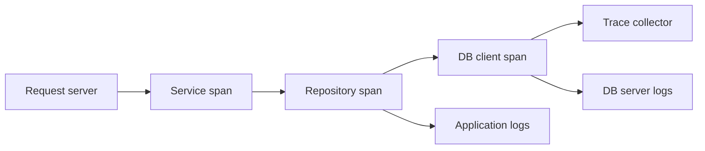
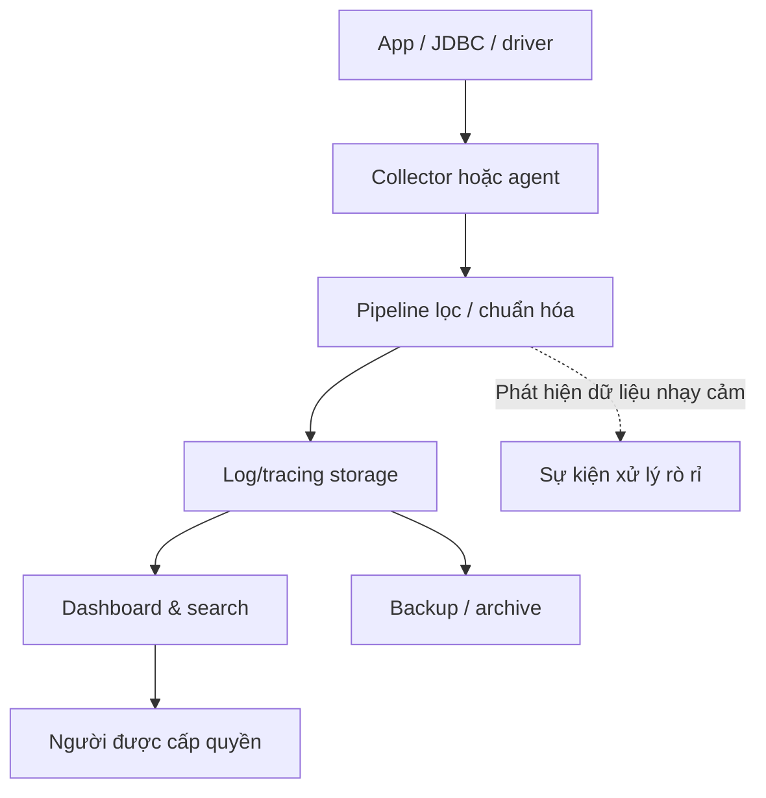

# Ghi SQL và tham số theo chính sách bảo vệ dữ liệu

## 1. Giám sát JDBC cần thông tin gì và có thể làm lộ điều gì?

Trong ứng dụng Java truy cập cơ sở dữ liệu quan hệ bằng **JDBC**, các hoạt động thông thường bao gồm lấy `Connection` từ `DataSource`, gửi truy vấn `PreparedStatement`, đọc `ResultSet`, cập nhật hàng, thực thi batch và quản lý transaction. Khi hệ thống chậm hoặc phát sinh lỗi, đội vận hành thường muốn biết:

- Tác vụ nào đang chạy: lấy danh sách đơn, tìm khách hàng, cập nhật tồn kho hay ghi audit?
- Truy vấn nào gây chậm, xảy ra bao nhiêu lần, lỗi theo nhóm nào?
- Thời gian chờ lấy connection, thực thi SQL, đọc dữ liệu và commit là bao nhiêu?
- Có timeout, deadlock, khóa chờ, lỗi mạng, cạn pool hoặc cập nhật không đúng số hàng?
- Lỗi xảy ra ở bản phát hành, loại database và môi trường nào?

Một giải pháp tưởng như đơn giản là **ghi toàn bộ câu SQL và mọi tham số** mỗi khi `executeQuery()` hoặc `executeUpdate()` được gọi. Nhưng tham số có thể chứa email, số điện thoại, mật khẩu, token, dữ liệu sức khỏe, thông tin thanh toán, nội dung hồ sơ và những trường nghiệp vụ cần bảo mật. Ngay cả **SQL text** cũng có thể chứa literal nhạy cảm nếu ứng dụng nối chuỗi thay vì bind bằng dấu `?`.

Ví dụ không nên đưa vào log:

```text
DEBUG JDBC: SELECT id FROM customers
WHERE email = 'user@example.invalid'
  AND recovery_token = 'demo-sensitive-token'

DEBUG binds: [tenant_id=42, email=user@example.invalid,
              recovery_token=demo-sensitive-token]
```

Trong thực tế, dữ liệu log có thể được chuyển qua console, agent thu thập, kho log tập trung, APM, hệ thống tìm kiếm, bản sao lưu và dashboard. Một dòng log nhạy cảm có thể được sao chép sang nhiều nơi hơn dữ liệu gốc trong database.

**Mục tiêu bài học:** xây dựng chính sách ghi log SQL và tham số theo mức độ nhạy cảm; áp dụng vào JDBC thuần và các lớp hỗ trợ; ghi đủ tín hiệu vận hành mà không phát tán dữ liệu nghiệp vụ; phân biệt log, metrics, trace và audit; kiểm tra cả driver, pool và database; đồng thời thiết kế phép thử phát hiện rò rỉ trước khi triển khai.

> **Nguyên tắc mặc định:** không ghi giá trị tham số SQL, hàng `ResultSet` hoặc bí mật vào log vận hành. Chỉ mở rộng trường dữ liệu khi có nhu cầu cụ thể, phân loại, phê duyệt, kiểm soát truy cập và thời hạn giữ phù hợp.

## 2. Ba lớp thông tin cần tách biệt

Khi giám sát SQL, trước hết phân biệt **câu lệnh**, **giá trị bind** và **kết quả thực thi**:

| Thành phần | Ví dụ | Mức an toàn để log mặc định |
|---|---|---|
| Định danh thao tác cố định | `orders.find-by-id.v1` | Thường phù hợp nếu tên không mang dữ liệu khách hàng |
| SQL template cố định | `SELECT id FROM orders WHERE tenant_id = ? AND id = ?` | Chỉ sau khi kiểm duyệt; có thể lộ tên bảng/cột hoặc cấu trúc hệ thống |
| SQL chứa literal | `... WHERE email = 'user@example.invalid'` | **Không** ghi nguyên văn |
| Tham số bind | `setString(1, email)`, `setBytes(2, token)` | **Không** ghi giá trị nguyên văn theo mặc định |
| Kiểu tham số | `VARCHAR`, `BIGINT`, `TIMESTAMP` | Có thể ghi nếu hữu ích và đã kiểm duyệt |
| Số lượng tham số | `parameter_count=3` | Thường ít nhạy cảm hơn giá trị; vẫn cần đánh giá ngữ cảnh |
| Kết quả `ResultSet` | Email, địa chỉ, tiền, ghi chú, tệp BLOB | **Không** ghi hàng hoặc payload |
| Thời lượng thực thi | `duration_ms=37` | Phù hợp với vận hành |
| Nhóm kết quả | `SUCCESS`, `TIMEOUT`, `SQL_ERROR` | Phù hợp nếu không lộ thông tin nghiệp vụ bí mật |
| Nhóm SQLState | `08`, `23`, `40` | Thường hữu ích để chẩn đoán; kiểm tra nguồn giá trị |
| Update count | `executeUpdate() == 1` | Hữu ích, nhưng có thể tiết lộ sự tồn tại bản ghi trong ngữ cảnh nhạy cảm |
| JDBC URL, credential | Host, username, password, tham số kết nối | Không ghi nguyên cấu hình; đặc biệt không ghi password/token |

SQL template là **hình dạng câu SQL** có placeholder thay cho giá trị. Nó khác với SQL do driver render thành chuỗi để debug: một số driver, thư viện proxy hoặc công cụ APM có thể thay dấu `?` bằng literal trước khi hiển thị. Vì vậy, **đừng cho rằng chuỗi từ `PreparedStatement.toString()` đã được khử nhạy cảm**.

### Ba câu hỏi trước khi thêm trường log

1. Trường này giúp phát hiện, phân loại hoặc điều tra lỗi nào?
2. Có thể đạt cùng mục tiêu bằng một **mã thao tác**, giá trị tổng hợp hoặc nhóm phân loại thay vì dữ liệu gốc không?
3. Nếu trường xuất hiện trong hệ thống log, trace, dashboard, bản sao và truy cập hỗ trợ, hậu quả khi người không có quyền đọc được nó là gì?

Nếu không chứng minh được nhu cầu, **không ghi trường đó**. Định nghĩa mức tối thiểu trước, rồi bổ sung theo chính sách thay vì log tất cả và hy vọng bộ lọc cuối đường truyền sẽ xóa được.

## 3. Phân loại dữ liệu và thiết lập chính sách cho tham số

Một chính sách giám sát nên phân loại dữ liệu theo **ngữ nghĩa nghiệp vụ** chứ không chỉ kiểu JDBC. Hai tham số `VARCHAR` có thể là enum trạng thái ít nhạy cảm hoặc chuỗi chứa mã truy cập rất nhạy cảm. `BIGINT` có thể là số lượng thông thường hoặc định danh cá nhân có khả năng liên kết.

Ví dụ ma trận phân loại để ứng dụng tham khảo:

| Nhóm | Ví dụ tham số | Chính sách log vận hành đề xuất |
|---|---|---|
| Bí mật xác thực | Password, API key, access token, refresh token, khóa riêng, recovery code | Không ghi giá trị; tránh cả bản mask chưa đủ an toàn |
| Dữ liệu cá nhân/khách hàng | Email, số điện thoại, địa chỉ, họ tên, số định danh, IP có tính nhận diện | Không ghi nguyên văn; nếu cần tương quan, dùng mã nội bộ được phê duyệt |
| Dữ liệu nhạy cảm theo nghiệp vụ | Số tài khoản, nội dung hợp đồng, thông tin sức khỏe, ghi chú riêng tư, số tiền giao dịch | Không ghi nguyên văn; chỉ giữ metadata đã phân loại và cho phép |
| Định danh liên kết | `user_id`, `tenant_id`, `order_id` | Không mặc định đưa vào log chung; dùng trace/request ID không chứa PII hoặc pseudonym được quản lý |
| Dữ liệu kỹ thuật ít nhạy cảm | Page size, query timeout, cờ retry, số phần tử batch | Có thể log sau khi giới hạn phạm vi và kiểm tra rủi ro |
| Giá trị enum đã duyệt | `OPEN`, `CLOSED` trong một miền không nhạy cảm | Chỉ log nếu được allowlist theo **tham số cụ thể** và nhu cầu rõ ràng |
| Payload lớn | BLOB, CLOB, JSON chứa hồ sơ, byte tệp | Không ghi nội dung; có thể ghi kích thước theo nhóm nếu được phép |

Một enum như `status=DIAGNOSED` có thể là dữ liệu sức khỏe rất nhạy cảm dù chuỗi trông giống enum. Do đó, không có quy tắc “mọi status đều an toàn”. Chính sách phải mô tả **query_id + tên tham số + mục đích sử dụng**, không dựa vào `String` hoặc `int`.

### Một hợp đồng chính sách có thể kiểm thử

```yaml
query_id: orders.find-by-email.v1
allow_raw_sql: false
allow_parameter_values: false
allowed_fields:
  - query_id
  - outcome
  - duration_ms
  - sqlstate_class
  - retry_attempt
retention_class: operational-short-lived
```

Đây là YAML **minh họa chính sách**, không phải cấu hình JDBC hoặc một API Spring có sẵn. Ý tưởng là xác định trường nào có quyền xuất hiện trong log, thay vì dựa vào lập trình viên nhớ “không nên log email” ở mọi dòng mã.

Chính sách cũng nên có **owner**, quy trình phê duyệt thay đổi, môi trường áp dụng và test ngăn bổ sung tham số ngoài allowlist.

## 4. Tạo query ID ổn định thay vì log toàn bộ SQL

Giả sử repository có câu truy vấn:

```sql
SELECT id, status, total_amount
FROM orders
WHERE tenant_id = ?
  AND customer_email = ?
ORDER BY id
LIMIT ?;
```

Đội vận hành thường không cần xem `customer_email` cụ thể. Để phát hiện truy vấn chậm, một **mã truy vấn cố định** có thể đủ:

```text
db.query
  query_id=orders.find-by-email.v1
  outcome=SUCCESS
  duration_ms=43
  db_role=primary
  retry_attempt=0
```

`query_id` do developer đặt theo **thao tác ứng dụng và phiên bản hình dạng SQL**; không gắn `email`, `orderId`, `tenantId` hoặc text do người dùng nhập vào mã này.

Lợi ích:

- Dễ tổng hợp tần suất, latency và lỗi theo một định danh ổn định.
- Không phải ghi giá trị bind hoặc cấu trúc SQL đầy đủ ở log mức INFO.
- Có thể liên kết `query_id` với SQL template trong tài liệu hoặc mã nguồn có quyền truy cập.
- Giữ số lượng giá trị nhãn ở mức hữu hạn để metrics không bị bùng nổ cardinality.
- Khi thay đổi query plan hoặc hình dạng SQL đáng kể, có thể tăng version của mã để so sánh trước/sau.

### SQL template có thể được ghi không?

**Có thể**, nhưng chỉ khi chính sách cho phép, câu SQL đã được kiểm duyệt và không chứa literal nhạy cảm hoặc tên đối tượng không nên công bố. Ví dụ:

```text
sql_template="SELECT id,status FROM orders WHERE tenant_id = ? AND id = ?"
```

Không nên tự đưa giá trị từ `PreparedStatement.toString()`, `SQLException.getMessage()` hoặc một chuỗi SQL sinh động vào trường này. `sql_template` chỉ nên đến từ **một hằng SQL được kiểm soát** và được rà soát trước khi log.

Với truy vấn được xây dựng động, chỉ cần log `query_id` và các đặc tính an toàn như `sort_mode=CREATED_ASC` nếu các giá trị đó là enum cố định đã allowlist.

## 5. SQL tham số hóa giúp an toàn truy vấn nhưng không tự làm sạch log

Trong JDBC, `PreparedStatement` tách cấu trúc SQL và giá trị tham số:

```java
String sql = """
        SELECT id, status
        FROM orders
        WHERE tenant_id = ?
          AND customer_email = ?
        """;

try (PreparedStatement ps = connection.prepareStatement(sql)) {
    ps.setLong(1, tenantId);
    ps.setString(2, customerEmail);

    try (ResultSet rs = ps.executeQuery()) {
        // Xử lý dữ liệu trong repository.
    }
}
```

Đây là cách phù hợp để tránh việc giá trị người dùng bị diễn giải thành cú pháp SQL khi được bind đúng vị trí. **Nhưng** một logger đặt sau lớp JDBC có thể quan sát từng lệnh `setString(2, customerEmail)` hoặc driver có thể render câu SQL kèm literal khi bật trace.

Phân biệt ba khái niệm:

| Khái niệm | Mục tiêu | Có tự bảo vệ log? |
|---|---|---|
| `PreparedStatement` tham số hóa | Truyền giá trị an toàn vào SQL, tránh nối chuỗi tạo SQL injection | Không |
| TLS cho kết nối DB | Mã hóa và xác minh kênh đến endpoint DB theo cấu hình | Không |
| Chính sách log/telemetry | Quyết định dữ liệu nào được phép đi vào log, trace, metrics | Có, nếu được áp dụng ở tất cả điểm thu thập |

Ngay cả khi ứng dụng chỉ dùng `PreparedStatement`, log ở phía **database server** có thể hiển thị chi tiết statement hoặc bind values tùy hệ quản trị, phiên bản, giao thức và cấu hình. Vì vậy cần kiểm soát cả hai phía, không chỉ logger trong Java.

### SQL động cần được thiết kế riêng

Các tên bảng, cột và hướng `ORDER BY` không được thay thế bằng giá trị bind `?` như dữ liệu thông thường. Nếu có sort động, dùng **allowlist**:

```java
enum SortMode { CREATED_ASC, CREATED_DESC }

String orderBy = switch (sortMode) {
    case CREATED_ASC -> "created_at ASC, id ASC";
    case CREATED_DESC -> "created_at DESC, id DESC";
};

String sql = """
        SELECT id, status
        FROM orders
        WHERE tenant_id = ?
        ORDER BY
        """ + orderBy;
```

`sortMode` là enum do ứng dụng chuyển đổi từ input đã kiểm tra. Không nối thẳng một chuỗi `orderBy` do client đưa vào SQL. Trong log, nếu cần, chỉ ghi giá trị enum `CREATED_ASC`/`CREATED_DESC` đã duyệt, không ghi nguyên text SQL do runtime tự ghép.

## 6. Ví dụ repository JDBC: ghi sự kiện an toàn, không ghi tham số

Đoạn sau sử dụng **JDBC chuẩn và `java.util.logging`** để minh họa. Mã vẫn dùng `DataSource`, `PreparedStatement` và `ResultSet` như thông thường; log chỉ chứa mã thao tác cố định, kết quả thực thi, thời lượng và nhóm SQLState.

```java
import java.sql.Connection;
import java.sql.PreparedStatement;
import java.sql.ResultSet;
import java.sql.SQLException;
import java.util.ArrayList;
import java.util.List;
import java.util.Objects;
import java.util.concurrent.TimeUnit;
import java.util.logging.Level;
import java.util.logging.Logger;
import javax.sql.DataSource;

public final class SafeOrderLookupRepository {
    private static final Logger LOG =
            Logger.getLogger(SafeOrderLookupRepository.class.getName());

    private static final String QUERY_ID = "orders.find-by-email.v1";
    private static final String SQL = """
            SELECT id, status
            FROM orders
            WHERE tenant_id = ?
              AND customer_email = ?
            ORDER BY id
            """;

    private final DataSource dataSource;

    public record OrderHeader(long id, String status) {}

    public SafeOrderLookupRepository(DataSource dataSource) {
        this.dataSource = Objects.requireNonNull(dataSource);
    }

    public List<OrderHeader> find(long tenantId, String customerEmail)
            throws SQLException {
        if (tenantId <= 0 || customerEmail == null
                || customerEmail.isBlank()) {
            throw new IllegalArgumentException("Invalid lookup arguments");
        }

        long startedNanos = System.nanoTime();
        String outcome = "SUCCESS";
        String sqlStateClass = "NONE";

        try (Connection connection = dataSource.getConnection();
             PreparedStatement ps = connection.prepareStatement(SQL)) {
            ps.setLong(1, tenantId);
            ps.setString(2, customerEmail);
            ps.setQueryTimeout(10);

            List<OrderHeader> results = new ArrayList<>();
            try (ResultSet rs = ps.executeQuery()) {
                while (rs.next()) {
                    results.add(new OrderHeader(
                            rs.getLong("id"),
                            rs.getString("status")));
                }
            }
            return List.copyOf(results);
        } catch (SQLException error) {
            outcome = "SQL_ERROR";
            sqlStateClass = safeSqlStateClass(error.getSQLState());
            throw error;
        } catch (RuntimeException error) {
            outcome = "APP_ERROR";
            throw error;
        } finally {
            long elapsedMs = TimeUnit.NANOSECONDS.toMillis(
                    System.nanoTime() - startedNanos);

            LOG.log(Level.INFO,
                    "db.query query_id=" + QUERY_ID
                            + " outcome={0} duration_ms={1}"
                            + " sqlstate_class={2}",
                    new Object[]{outcome, elapsedMs, sqlStateClass});
        }
    }

    private static String safeSqlStateClass(String state) {
        if (state == null || state.length() < 2) {
            return "UNKNOWN";
        }
        char first = state.charAt(0);
        char second = state.charAt(1);
        if (!Character.isLetterOrDigit(first)
                || !Character.isLetterOrDigit(second)) {
            return "UNKNOWN";
        }
        return "" + first + second;
    }
}
```

**Những gì ví dụ cố ý không log:**

- `tenantId`, `customerEmail`, kết quả `OrderHeader`, số điện thoại, dữ liệu cá nhân.
- JDBC URL, username/password hoặc bất kỳ thuộc tính kết nối nào.
- Câu SQL đã được thay placeholder bằng giá trị.
- `error.getMessage()` hoặc `ps.toString()` vì có thể chứa SQL và dữ liệu nhạy cảm.
- `ResultSet` hoặc JSON tuần tự hóa toàn bộ DTO.

`sqlstate_class` giúp phân nhóm lỗi như `08` (lỗi kết nối), `23` (lỗi ràng buộc dữ liệu) hoặc `40` (lỗi rollback transaction) khi driver cung cấp SQLState phù hợp. Nó **không đủ** để xác định chắc chắn nguyên nhân cuối cùng: nhiều driver có mã riêng hoặc trả SQLState rỗng.

Trong ví dụ, `duration_ms` đo từ lúc bắt đầu phương thức tới khi thoát, **bao gồm cả thời gian lấy connection, thực thi, mapping và dọn tài nguyên**. Đừng đặt tên metric là `db_execute_ms` khi nó thực tế đo cả các giai đoạn khác. Nếu cần tách borrow time, query time và fetch time, hãy đặt điểm đo riêng và công bố ý nghĩa rõ ràng.

`Logger` chỉ minh họa nguyên tắc tối thiểu. Trong hệ thống thật, nên sử dụng structured logging với formatter/sink được kiểm soát. **Chính sách còn phải áp dụng cho logger driver, pool, framework và APM**, không chỉ đoạn code repository này.

### Có cần log số hàng trả về?

Không tự động. Với một API tìm email, `rows_returned=0` hoặc `1` có thể tiết lộ khách hàng có tồn tại hay không. Khi thực sự cần quan sát khối lượng, có thể cân nhắc nhóm `row_count_bucket=SMALL` hoặc histogram tổng hợp với chính sách hạn chế truy cập. Cả bucket lẫn số lượng chính xác đều phải được đánh giá theo nghiệp vụ và nguy cơ suy luận.

## 7. Chính sách log thực thi không được đánh mất khả năng chẩn đoán

Chỉ xóa tất cả dữ liệu khỏi log có thể khiến vận hành khó phát hiện vấn đề. Cách tốt hơn là thiết kế các **tín hiệu an toàn, rõ nghĩa**.

Ví dụ sự kiện cấu trúc:

```text
event_name=db.query
query_id=orders.search-pending.v2
db_system=postgresql
db_role=read-replica
phase=EXECUTE
outcome=TIMEOUT
duration_ms=1250
timeout_configured_ms=1000
sqlstate_class=57
retry_attempt=0
trace_id=<server-generated-trace-id>
```

Các giá trị là **minh họa**, không phải một SQLState phổ quát cho timeout. `trace_id` phải được sinh/chuẩn hóa theo hệ thống tracing đáng tin cậy; không đưa một chuỗi request ID tùy ý do client kiểm soát vào log mà không giới hạn chiều dài/ký tự.

### Một mô hình sự kiện tối thiểu

| Trường | Tác dụng | Kiểm soát cần áp dụng |
|---|---|---|
| `query_id` | Xác định truy vấn logic | Chọn từ danh sách hằng được kiểm soát |
| `outcome` | `SUCCESS`, `SQL_ERROR`, `TIMEOUT`, `CANCELED` | Enum cố định, không copy exception message |
| `duration_ms` | Đo độ trễ | Ghi giai đoạn đo để không gây hiểu nhầm |
| `sqlstate_class` | Gom nhóm lỗi DB | Chỉ ghi mã nhỏ, không ghi nội dung thông báo lỗi |
| `db_role` | Phân biệt primary, replica hoặc pool logic | Chỉ dùng giá trị cấu hình an toàn, tránh địa chỉ hạ tầng nhạy cảm |
| `retry_attempt` | Quan sát vòng lặp retry | Giới hạn giá trị và không dùng raw request body |
| `trace_id` | Tương quan nhiều service | Sinh/kiểm tra định dạng; giới hạn quyền tra cứu |
| `transaction_phase` | `NONE`, `ACTIVE`, `COMMIT`, `ROLLBACK` | Không tự suy transaction đã commit nếu chỉ biết execute thành công |

**Mã lỗi và số lần thử lại giúp chẩn đoán; giá trị bind thường không cần thiết.** Nếu một thao tác báo conflict, log `outcome=OPTIMISTIC_CONFLICT` có thể đủ để theo dõi tần suất mà không phải ghi `expectedVersion` và các ID của khách hàng.

## 8. Metrics: đo xu hướng bằng nhãn cardinality thấp

Metrics giải quyết các câu hỏi tổng hợp như “truy vấn nào chậm lên?”, “tỷ lệ timeout tăng bao nhiêu?” hoặc “connection pool có đang cạn?”.

Các metric ví dụ:

```text
jdbc_query_duration_seconds{query_id="orders.find-by-email.v1",
                            outcome="SUCCESS"}
jdbc_query_errors_total{query_id="orders.find-by-email.v1",
                        error_class="08"}
jdbc_pool_active_connections{pool="main"}
jdbc_pool_pending_requests{pool="main"}
jdbc_transaction_rollback_total{reason="timeout"}
```

Đây là **tên minh họa**, không nhất thiết trùng tên metric của thư viện monitoring cụ thể.

### Không đưa giá trị tham số vào label

Tuyệt đối tránh:

```text
jdbc_query_duration_seconds{email="user@example.invalid"}
jdbc_query_duration_seconds{order_id="123456789"}
jdbc_query_duration_seconds{access_token="..."}
```

Ngoài rò rỉ dữ liệu, các giá trị khác nhau theo từng người hoặc từng đơn làm **cardinality tăng rất lớn**, có thể gây tốn tài nguyên, chi phí và mất khả năng truy vấn metrics.

Các nhãn thích hợp thường là tập hữu hạn đã kiểm soát: `query_id`, `outcome`, `db_role` hoặc `error_class`. Cần giới hạn số giá trị mới trong quá trình phát triển và giám sát cardinality của chính hệ thống telemetry.

### P95/P99, timeout và transaction

Một dashboard hữu ích có thể theo dõi:

- P50/P95/P99 thời gian thực thi theo `query_id` và `outcome`.
- Tỷ lệ `TIMEOUT`, `CONNECTION_ERROR`, deadlock/serialization failure và update count không kỳ vọng.
- Số connection đang dùng, đang chờ, thời gian mượn connection và thời gian giữ transaction.
- Số batch và phân bố kích thước batch theo nhóm.
- Thời gian commit/rollback và số transaction kết quả chưa rõ.
- Tỷ lệ lỗi theo bản phát hành, loại DB, pool hoặc môi trường.

Tránh dùng các metric này để suy thẳng kết quả nghiệp vụ khi chưa có bằng chứng. `executeUpdate() == 1` trong một transaction chưa commit không có nghĩa dữ liệu đã bền vững.

## 9. Distributed tracing và APM: SQL có thể đi vào span

Tracing liên kết request xuyên nhiều service và giúp nhìn thấy thời gian gọi DB trong tổng luồng xử lý. Tầng JDBC hoặc công cụ APM có thể tự tạo span cho truy vấn.



Các thuộc tính span có thể chứa tên database, thao tác SQL, loại statement, thời lượng và lỗi. **Một số thư viện instrumentation cũng có thể thu thập `db.statement`, câu SQL đã render hoặc thông tin tham số.** Không giả định agent APM tự loại bỏ PII.

Chính sách đề xuất:

1. Ưu tiên ghi `query_id` hoặc SQL template đã được kiểm duyệt.
2. Tắt việc ghi **raw bind values** và thông tin kết quả trong tracing/driver instrumentation.
3. Giới hạn thuộc tính span do application gắn thêm; không dùng `span.setAttribute("email", value)`.
4. Dùng trace ID để liên kết với log an toàn; không cần ghi email hoặc user ID vào cả hai hệ thống.
5. Sampling không phải biện pháp bảo vệ dữ liệu. Chỉ cần một span chứa password là đã có rủi ro, dù sampling thấp.
6. Sanitization ở collector là **lớp phòng vệ bổ sung**, không nên là lớp duy nhất; dữ liệu có thể đã đi qua agent/buffer hoặc side channel trước khi được lọc.

Khi bật tự động instrumentation trong môi trường mới, hãy quan sát **payload thực sự được xuất** ở tất cả mức log/trace. Đừng chỉ xem dashboard đã che trường nhạy cảm mà quên kiểm tra dữ liệu thô tại nơi nhận.

## 10. Driver, DataSource, connection pool và proxy cũng có thể log SQL

Một ứng dụng có thể đã dùng repository log an toàn nhưng vẫn rò dữ liệu vì những lớp khác:

| Thành phần | Nguy cơ | Cách giảm thiểu |
|---|---|---|
| JDBC driver | Debug/trace in SQL, bind values, dữ liệu protocol hoặc thông báo lỗi | Giới hạn log level, kiểm tra thuộc tính debug, không bật trace nhạy cảm trong production |
| `PreparedStatement.toString()` | Một số driver render SQL kèm tham số | Không dựa vào `toString()` để tạo log |
| Logging proxy hoặc datasource wrapper | Chặn `setXxx()` và lưu đầy đủ giá trị bind | Tắt value capture hoặc thiết lập policy allowlist ngay trong wrapper |
| Spring JDBC/framework | Log SQL template hoặc exception theo cấu hình | Rà soát log level và nội dung; không giả định mọi câu SQL đều được khử literal |
| Connection pool | Log JDBC URL, cấu hình connection, exception | Không ghi cấu hình thô, password, credential; kiểm soát debug dump |
| DB proxy/gateway | Quan sát SQL đã được giải mã từ TLS | Cấu hình log, quyền, retention và masking phía proxy |
| Database server | General query log, slow query log, audit log có thể chứa SQL/literal/param | Kiểm tra chính sách server, quyền truy cập và chế độ ghi |
| APM/trace collector | Span chứa statement hoặc biến môi trường | Loại field nhạy cảm trước khi xuất, giới hạn quyền và retention |
| Crash dump/diagnostic heap | Có thể chứa object tham số trong bộ nhớ JVM | Hạn chế tạo, truy cập, chia sẻ và thời gian giữ dump |

### Quy tắc quan trọng với Spring JDBC

`JdbcTemplate` và `NamedParameterJdbcTemplate` làm giảm mã JDBC lặp lại, nhưng vẫn dựa vào `DataSource`, driver và SQL. Một logger ở mức DEBUG/TRACE, thư viện ghi SQL hoặc APM tích hợp có thể ghi thông tin khác với logger tự viết trong repository.

Nếu triển khai logging proxy như P6Spy hoặc datasource-proxy, phải đánh giá **cụ thể phiên bản, cấu hình capture và output formatter**. Đừng coi việc lắp thêm thư viện ghi SQL là an toàn theo mặc định. Tắt log tham số hoặc thay bằng query ID và các trường đã cho phép; kiểm thử log đầu ra khi bật chế độ diagnostic.

### Dữ liệu phía database không tự tuân thủ chính sách JVM

Tắt log câu SQL trong Java **không** tắt `general_log`, `slow query log`, session trace hoặc extension audit trên DB. Các DBA có thể cần một luồng audit riêng để điều tra sự cố, nhưng phải có chính sách thu thập, quyền truy cập và thời hạn giữ độc lập với log ứng dụng.

Không chuyển thông tin nhạy cảm vào comment SQL để “tiện truy vết”:

```sql
-- KHÔNG NÊN: comment có thể bị ghi lại ở proxy/DB/APM.
SELECT id FROM orders
/* customer_email=user@example.invalid */
WHERE id = ?;
```

Nếu cần định danh truy vấn, dùng comment **chỉ chứa mã kỹ thuật cố định**, hoặc tốt hơn là correlation ID/query ID ở lớp instrumentation không làm lộ thông tin người dùng.

## 11. Những hình thức “che dữ liệu” dễ gây cảm giác an toàn giả

### 11.1. Masking không phải lúc nào cũng đủ

```text
email = "u***@example.com"
phone = "***1234"
account = "********5678"
```

Các dạng mask này vẫn có thể tạo khả năng liên kết hoặc tái nhận diện, đặc biệt khi kết hợp cùng thời gian, tenant và truy vấn hiếm. Masking cũng dễ sai nếu một giá trị xuất hiện ở vị trí không dự kiến, như JSON trong cột `notes` hoặc exception message.

**Mặc định tốt hơn là không thu thập giá trị.** Chỉ mask khi có nhu cầu nghiệp vụ/điều tra đã duyệt, và kiểm tra mẫu log thực tế xem có những bản sao chưa che của dữ liệu cùng xuất hiện ở nơi khác không.

### 11.2. Hash không tự biến dữ liệu cá nhân thành vô hại

Ví dụ, hash SHA-256 trực tiếp từ một email cố định có thể bị dò bằng danh sách email dự đoán, và cùng một hash tạo khả năng liên kết nhiều lần truy cập.

Nếu phải tương quan một định danh qua nhiều sự kiện, có thể cân nhắc **pseudonym có khóa** (như HMAC do hệ thống tin cậy tính), phạm vi mục đích rõ ràng, quản lý secret và rotation. Nhưng giá trị tạo ra vẫn có thể là **dữ liệu có khả năng liên kết** và vẫn cần chính sách bảo vệ, không được đưa vào metrics labels vô hạn.

Không dùng hash/token như cách né quyền truy cập log hoặc né quy định bảo vệ dữ liệu. Bất kể kỹ thuật gì, việc thu thập phải có mục đích và phạm vi cần thiết.

### 11.3. Regex redaction có giới hạn

Một regex thay email hoặc chuỗi “password=” không bắt được mọi định dạng: dữ liệu Unicode, payload JSON, Base64, token không có nhãn, câu SQL chứa escape, dữ liệu đã nén và các biến thể cú pháp DB.

Do đó, thứ tự phòng vệ nên là:

1. **Không đưa giá trị gốc vào sự kiện telemetry.**
2. Ghi những trường có schema/allowlist rõ.
3. Kiểm tra giá trị xuất ra trước khi gửi collector.
4. Thêm redaction phía collector để phòng vệ chiều sâu.
5. Có kiểm thử và quy trình xử lý khi phát hiện dữ liệu đã bị thu thập sai.

## 12. Batch, stored procedure, JSON và dữ liệu lớn có lưu ý riêng

### 12.1. Batch không phải một danh sách tham số để in ra log

Với `PreparedStatement.addBatch()`, một câu SQL có thể được thực thi với hàng nghìn bộ tham số. Nếu bật log từng bộ giá trị, chi phí, dung lượng log và nguy cơ rò rỉ tăng theo kích thước batch.

```java
String sql = """
        UPDATE inventory
        SET reserved_qty = reserved_qty + ?
        WHERE product_id = ?
        """;

try (PreparedStatement ps = connection.prepareStatement(sql)) {
    for (Reservation change : changes) {
        ps.setInt(1, change.quantity());
        ps.setLong(2, change.productId());
        ps.addBatch();
    }
    int[] counts = ps.executeBatch();
}
```

`Reservation` và `changes` là các kiểu/biến nghiệp vụ minh họa. Giám sát nên ghi `query_id=inventory.reserve-batch.v1`, `batch_size` theo nhóm, `duration_ms`, outcome, số phần tử lỗi (nếu chính sách cho phép) và nhóm lỗi DB. Không ghi `change.productId()` hoặc từng `quantity()` mặc định; những giá trị có thể tiết lộ tồn kho hay hoạt động khách hàng.

Các phần tử `Statement.SUCCESS_NO_INFO` và `Statement.EXECUTE_FAILED` cần được diễn giải đúng khi kiểm tra batch; không tự suy mọi lệnh đã commit chỉ vì `executeBatch()` trả về.

### 12.2. Stored procedure và IN/OUT

`CallableStatement` có thể mang tham số `IN`, `OUT` và `INOUT`. Giá trị `OUT` có thể là thông tin nghiệp vụ nhạy cảm, nên đừng nghĩ chỉ có đầu vào cần bảo vệ.

```text
query_id=finance.run-settlement-procedure.v1
procedure_call=SUCCESS
duration_ms=178
parameter_count=4
```

Không log raw `CallableStatement.toString()`, `getString()` của tham số OUT hay toàn bộ `ResultSet` trả về từ stored procedure.

### 12.3. JSON, BLOB/CLOB và stream

Một tham số `setString()` có thể là JSON gồm nhiều trường nhạy cảm. Một tham số `setBinaryStream()` có thể chứa PDF hoặc ảnh. Dữ liệu CLOB và chuỗi dài có thể chứa token, bí mật hoặc hồ sơ không dự đoán được.

Không chuyển toàn bộ stream thành chuỗi để “in log chẩn đoán”. Điều đó có thể:

- Tiêu tốn bộ nhớ lớn, gây OOM hoặc trì hoãn truy vấn.
- Tiêu thụ stream khiến dữ liệu truyền tới driver bị mất hoặc sai.
- Phát tán nội dung tệp ra các hệ thống log có quyền truy cập khác.

Nếu cần thông số kích thước, chỉ thu thập số byte hoặc nhóm kích thước được xác thực bởi pipeline xử lý, khi chính sách cho phép. Không tự tạo checksum của tài liệu nhạy cảm chỉ vì muốn ghi log; một hash có thể tạo định danh liên kết lâu dài.

## 13. Ghi log lỗi SQLException mà không làm rò dữ liệu

`SQLException` cung cấp các trường kỹ thuật:

```java
String state = error.getSQLState();
int vendorCode = error.getErrorCode();
SQLException chained = error.getNextException();
```

Chúng có thể giúp chẩn đoán lỗi connection, ràng buộc, deadlock hoặc timeout. Nhưng **`getMessage()` và các exception nối chuỗi** có thể chứa SQL, tên schema, giá trị bị từ chối, JDBC URL hoặc chi tiết truy cập DB tùy driver.

Vì vậy, dùng hai mức:

- **Log vận hành mặc định:** `query_id`, `outcome`, SQLState class, mã nhóm lỗi, duration, transaction phase; không ghi thông báo thô.
- **Điều tra hạn chế quyền:** nếu chính sách cho phép thu thêm thông tin lỗi, phải có kiểm tra nội dung, quyền truy cập, thời hạn giữ và mục đích rõ; không tự động bật stack trace chứa dữ liệu nhạy cảm trong mọi request.

`SQLState` không phải thông báo lỗi đã được chuẩn hóa tuyệt đối; có thể null, mã riêng hoặc thay đổi theo driver. Một số mã cụ thể thuộc DB, ví dụ PostgreSQL có thể dùng `57014` cho query canceled. Khi dashboard muốn phân loại lỗi, cần xây dựng mapping có nguồn gốc và kiểm thử với đúng driver/DB.

### Không làm mất ngoại lệ để tránh log

```java
try {
    jdbcWork();
} catch (SQLException error) {
    // Ghi mã an toàn, sau đó chuyển lỗi đến transaction owner.
    recordSafeFailure("orders.update-state.v2", error.getSQLState());
    throw error;
}
```

`jdbcWork()` và `recordSafeFailure(...)` là hàm minh họa. Không bỏ qua exception chỉ vì không được log raw message. Với transaction, service vẫn cần rollback, phân loại retry, xử lý trạng thái commit không chắc chắn và trả lỗi phù hợp.

**Ranh giới commit:** một log `UPDATE_SUCCESS` sau `executeUpdate() == 1` không chứng minh transaction đã commit. Nếu commit fail hoặc mất phản hồi, outcome có thể là `UNKNOWN`; không log `COMMITTED` khi chưa có bằng chứng.

## 14. Log vận hành khác audit log nghiệp vụ

Hai loại ghi nhận thường bị trộn:

| Thuộc tính | Log vận hành JDBC | Audit nghiệp vụ |
|---|---|---|
| Câu hỏi | “Truy vấn nào chậm hoặc lỗi?” | “Ai đã thực hiện hành động gì, khi nào, theo quyền nào?” |
| Khóa tương quan | `query_id`, trace ID, error class | Actor/subject ID được quản lý, business action, đối tượng và kết quả |
| Tần suất | Có thể nhiều lần cho mỗi truy vấn, tổng hợp/sampling | Theo những hành động yêu cầu ghi nhận |
| Dữ liệu cá nhân | Mặc định không cần | Có thể cần một số trường đã được phê duyệt và hạn quyền |
| Thời hạn giữ | Theo nhu cầu chẩn đoán/vận hành | Theo yêu cầu kiểm toán, pháp lý và nghiệp vụ của hệ thống |
| Quyền truy cập | Nhóm vận hành được cấp quyền | Nhóm audit/compliance được cấp quyền phù hợp |
| Tính toàn vẹn | Hữu ích nhưng thường không thay nghiệp vụ | Có thể cần chống sửa, đối soát và bằng chứng ranh giới commit |

Nếu cần audit một hành động như “phê duyệt đơn”, hãy ghi bản ghi audit theo hợp đồng nghiệp vụ, tốt nhất phối hợp transaction hoặc outbox phù hợp. Đừng cố tạo audit chỉ bằng cách bật log mọi câu `UPDATE` và giá trị tham số của JDBC.

**Chú ý:** một số audit event cần actor ID hoặc order ID để phục vụ điều tra, nhưng các trường này vẫn phải được phân loại, giới hạn quyền truy cập và quản lý retention. Không copy nguyên audit payload vào log ứng dụng chỉ vì hai hệ thống dùng chung trace ID.

## 15. Vòng đời log: quyền, lưu giữ, xóa và ứng phó sự cố

Chính sách bảo vệ dữ liệu không kết thúc khi logger tạo dòng. Cần kiểm soát toàn bộ đường đi:



Một số kiểm soát quan trọng:

1. **Phân quyền:** không để mọi developer hoặc toàn bộ nhân sự mặc định truy cập log production. Áp dụng least privilege và audit việc truy cập thông tin nhạy cảm.
2. **Mã hóa và truyền tải:** bảo vệ đường truyền collector và nơi lưu log theo chính sách hạ tầng. TLS bảo vệ kênh, không tự loại bỏ nội dung nhạy cảm.
3. **Retention:** chỉ giữ log đủ thời gian phục vụ mục đích đã duyệt; thiết lập tự động xóa/rollover và quy định cho bản lưu trữ.
4. **Tìm kiếm và chia sẻ:** tránh sao chép log vào ticket, chat, email hoặc công cụ AI bên ngoài khi chưa được phép.
5. **Sampling:** giảm chi phí và lượng log, nhưng không thay thế redaction/mặc định không thu thập.
6. **Sao lưu:** dữ liệu đã xóa khỏi dashboard có thể còn trong bản sao hoặc kho lạnh; kế hoạch xử lý phải bao gồm các hệ thống liên quan.
7. **Xử lý sự cố rò rỉ:** khi phát hiện log chứa token/PII, dừng thu thập, thu hồi hoặc xoay bí mật bị lộ nếu cần, kiểm soát truy cập bản ghi cũ, đánh giá phạm vi và xử lý theo quy trình tổ chức.
8. **Thay đổi chính sách:** mỗi lần nâng cấp driver, bật APM, thêm framework, thay logging proxy hoặc chuyển cloud nên kiểm tra lại dữ liệu thực sự được xuất.

Nếu quy định pháp lý hoặc hợp đồng đặt điều kiện riêng cho dữ liệu, chính sách triển khai phải theo các điều kiện đó. Bài này tập trung vào kỹ thuật JDBC và nguyên tắc giảm thiểu dữ liệu, không thay thế đánh giá pháp lý cụ thể.

## 16. Chế độ debug khẩn cấp: có mở log tham số được không?

Khi production gặp lỗi khó tái hiện, người vận hành có thể muốn bật debug ở driver và in toàn bộ tham số. Đây là thời điểm dễ đánh mất kiểm soát vì dữ liệu log được mở rộng đúng lúc hệ thống nhiều người truy cập hoặc đang xử lý dữ liệu nhạy cảm.

Một quy trình tốt hơn:

- Bắt đầu bằng `query_id`, SQL template đã duyệt, nhóm lỗi, timing, tracing an toàn và execution plan không chứa dữ liệu bí mật.
- Dùng môi trường test và **dữ liệu tổng hợp** để tái hiện lỗi.
- Khi cần thêm dữ liệu, chỉ bổ sung trường nằm trong allowlist và được phê duyệt cho thao tác cụ thể.
- Chế độ chẩn đoán phải có owner, giới hạn thời gian, quyền bật/tắt, log thay đổi cấu hình và cơ chế tự tắt khi hết hạn.
- Không bật logger thu thập raw password, token, recovery code, private key, toàn bộ `ResultSet` hoặc BLOB chỉ vì đang ở “debug mode”.
- Kiểm tra cả stdout, file log nội bộ, APM, proxy và database server để không còn đường thu thập bí mật ngoài dự kiến.

Nếu thực sự cần xem một giá trị nghiệp vụ cụ thể để điều tra, nên thực hiện theo **quy trình truy cập dữ liệu đã phê duyệt** tại hệ thống nguồn với audit và phân quyền thích hợp, thay vì phổ biến giá trị đó qua log chung.

## 17. Kiểm thử chính sách: chứng minh log không chứa giá trị bí mật

Kiểm thử logging là một phần của kiểm thử bảo mật, không chỉ kiểm tra cấu trúc câu SQL.

### 17.1. Bộ ca kiểm thử tối thiểu

| Ca | Hành động | Kết quả kỳ vọng |
|---|---|---|
| Truy vấn thành công | Bind email/tenant ID tổng hợp | Có query ID và duration; **không có email/tenant ID raw** |
| SQL lỗi ràng buộc | Insert giá trị vi phạm unique trên DB test | Có nhóm lỗi; không log giá trị gây lỗi hay thông báo thô |
| Timeout | Query timeout với dữ liệu tổng hợp | Outcome đúng; không in toàn bộ `PreparedStatement` |
| Connection failure | Tắt endpoint test hoặc proxy lỗi | Không log credential hoặc JDBC URL chứa secret |
| Batch | Thực thi nhiều bộ tham số test | Không xuất danh sách giá trị bind; chỉ thông tin batch được duyệt |
| Stored procedure | Gọi `CallableStatement` có OUT | Không log IN/OUT raw |
| BLOB/CLOB | Bind nội dung giả lập | Không xuất payload hoặc làm tăng log theo kích thước nội dung |
| Dữ liệu có newline/escape | Email/chuỗi test chứa ký tự xuống dòng | Không đưa trực tiếp vào log gây log injection |
| APM/trace | Bật instrumentation với dữ liệu tổng hợp | Span không chứa bind values, raw SQL có literal hoặc dữ liệu hàng |
| Driver DEBUG/TRACE | Thử cấu hình logging được hỗ trợ | Không được triển khai nếu mode sinh log nhạy cảm |
| Failure khi commit | Giả lập trạng thái không chắc chắn | Không log `COMMITTED` chỉ từ update count hoặc exception |

### 17.2. Kiểm tra một sự kiện đã chuẩn hóa

Thay vì cần kết nối thật cho mọi phép thử, có thể kiểm tra phần **tạo sự kiện** bằng JUnit 5. Ví dụ một helper nhận đầu vào kỹ thuật, **không nhận SQL text hoặc tham số**:

```java
import java.util.Map;

public final class SafeQueryEvent {
    private SafeQueryEvent() {}

    public static Map<String, Object> from(
            String queryId, String outcome, long durationMs,
            String sqlStateClass) {
        if (!queryId.matches("[a-z0-9.-]{1,80}")) {
            throw new IllegalArgumentException("Invalid query id");
        }
        if (!outcome.equals("SUCCESS")
                && !outcome.equals("SQL_ERROR")
                && !outcome.equals("TIMEOUT")) {
            throw new IllegalArgumentException("Invalid outcome");
        }
        if (durationMs < 0) {
            throw new IllegalArgumentException("Invalid duration");
        }
        if (!sqlStateClass.matches("[A-Za-z0-9]{2}|NONE|UNKNOWN")) {
            throw new IllegalArgumentException("Invalid SQLState class");
        }

        return Map.of(
                "query_id", queryId,
                "outcome", outcome,
                "duration_ms", durationMs,
                "sqlstate_class", sqlStateClass);
    }
}
```

Chữ ký hàm không có `email`, `password`, `parameterValues`, `rawSql` hoặc `ResultSet`. Thiết kế theo **schema allowlist** này dễ kiểm tra hơn một hàm nhận `Object... values` rồi cố che dữ liệu trước khi log.

Ví dụ test:

```java
import java.util.Map;
import org.junit.jupiter.api.Test;
import static org.junit.jupiter.api.Assertions.*;

class SafeQueryEventTest {
    @Test
    void eventContainsOnlyApprovedKeys() {
        Map<String, Object> event = SafeQueryEvent.from(
                "orders.find-by-email.v1", "SUCCESS", 37, "NONE");

        assertEquals(4, event.size());
        assertEquals("orders.find-by-email.v1", event.get("query_id"));
        assertFalse(event.containsKey("email"));
        assertFalse(event.containsKey("password"));
        assertFalse(event.containsKey("sql"));
        assertFalse(event.containsKey("parameters"));
    }

    @Test
    void rejectsArbitraryQueryId() {
        assertThrows(IllegalArgumentException.class,
                () -> SafeQueryEvent.from(
                        "user@example.invalid", "SUCCESS", 1, "NONE"));
    }
}
```

Đây là **unit test về cấu trúc event**, không chứng minh các logger khác đều an toàn. Cần test tích hợp để thu log thực tế từ repository/driver/APM và dùng giá trị giả lập **đặc trưng có thể tìm thấy** nhằm bảo đảm chúng không xuất hiện trong output. Đừng đưa dữ liệu khách hàng thật vào test.

### 17.3. Kiểm thử đầu ra của cả pipeline

Một bài test end-to-end có thể:

1. Dùng database và tài khoản test, tạo một giá trị giả có dấu hiệu nhận biết duy nhất.
2. Thực thi truy vấn thành công, truy vấn lỗi, batch và transaction qua đúng `DataSource`/pool.
3. Thu thập log ứng dụng, driver, proxy, trace collector và một phần log database mà test có quyền truy cập.
4. Tìm giá trị giả trong payload thô, không chỉ ở giao diện dashboard đã mask.
5. Xác nhận event vẫn có `query_id`, nhóm lỗi, thời lượng và trace ID đủ để chẩn đoán.
6. Kiểm tra kết nối lỗi/timeout cũng không làm exception message tiết lộ URL, credential hoặc tham số.
7. Lặp lại khi nâng cấp driver, framework, logging wrapper, APM agent hoặc cấu hình DB.

Nếu collector chạy không đúng chính sách hoặc không thể kiểm tra đường truyền log, hãy ghi nhận khoảng trống kiểm thử thay vì tuyên bố “đã bảo vệ toàn bộ”.

## 18. Những sai lầm thường gặp khi ghi SQL và tham số

| Sai lầm | Hậu quả | Cách sửa |
|---|---|---|
| Log `ps.toString()` để có “SQL đầy đủ” | Driver có thể chèn giá trị bind vào chuỗi | Ghi `query_id`, template đã duyệt, timing và outcome |
| Log mọi `setString()`/`setObject()` ở wrapper | Lộ email, token và payload nghiệp vụ | Không thu thập giá trị; chỉ cho phép metadata đã phân loại |
| Bật trace driver trong production không có hạn | Có thể xuất SQL, tham số, protocol và cấu hình | Chính sách log level, review trước khi bật, thời hạn và kiểm thử |
| Tin `PreparedStatement` tự làm log an toàn | Logger/DB vẫn có thể ghi bind values | Kiểm soát riêng telemetry ở mọi tầng |
| Tin TLS xóa được dữ liệu khỏi log | TLS chỉ bảo vệ truyền tải | Phân loại và tối thiểu hóa sự kiện |
| Dùng regex mask email làm bảo vệ duy nhất | Bỏ sót token/JSON/escape và có rủi ro tái nhận diện | Allowlist và không thu thập raw values ngay từ nguồn |
| Hash trực tiếp mọi ID/email rồi coi vô hại | Có thể dò ngược hoặc liên kết hành vi | Đánh giá mục đích và dùng pseudonym có quản trị nếu thật sự cần |
| Gắn `user_id`/`order_id` vào nhãn metric | Rò dữ liệu và bùng nổ cardinality | Dùng `query_id` và nhãn hữu hạn |
| Ghi nguyên `SQLException.getMessage()` | Có thể lộ SQL, giá trị gây lỗi, JDBC URL | Log nhóm lỗi/SQLState đã kiểm tra; giữ exception theo luồng xử lý |
| Log `ResultSet` để debug mapper | Lộ toàn bộ dữ liệu trả về | Test mapper bằng dữ liệu tổng hợp, log tên mapper/query ID |
| Log dữ liệu BLOB/CLOB hoặc stream | Tiêu thụ stream/RAM và rò dữ liệu lớn | Chỉ ghi kích thước đã được duyệt |
| Chỉ sửa logger Java, quên DB/proxy/APM | Dữ liệu vẫn bị thu ở tầng khác | Kiểm tra end-to-end pipeline |
| Dùng một log cho cả audit và debug | Khó phân quyền/retention, dư dữ liệu | Phân tách sự kiện audit và telemetry |
| Log `SUCCESS` trước commit rồi coi giao dịch thành công | Commit có thể thất bại hoặc kết quả chưa rõ | Gắn rõ transaction phase và outcome |
| Không kiểm tra thay đổi khi nâng cấp driver | Mặc định log/trace có thể đổi | Thêm negative tests trong CI hoặc pipeline xác minh |

## 19. Bài thực hành: thiết kế chính sách log JDBC an toàn

Giả sử ứng dụng có các API tìm khách hàng, tạo đơn, cập nhật tồn kho và xuất báo cáo. Hãy thực hành trên dữ liệu **giả lập**:

1. **Kiểm kê truy vấn:** liệt kê từng `query_id` và SQL template cần giám sát. Xác định tham số nào là PII, secret, dữ liệu nghiệp vụ hoặc metadata kỹ thuật.
2. **Thiết kế allowlist:** chọn bộ trường log tối thiểu gồm `query_id`, `outcome`, `duration_ms`, `sqlstate_class` và một trace ID đã chuẩn hóa. Ghi rõ trường nào bị cấm.
3. **So sánh cách log:** chạy JDBC repository mẫu, quan sát `PreparedStatement` được tham số hóa và xác nhận logger không nhận `customerEmail`.
4. **Mô phỏng lỗi:** dùng một `SQLException` tổng hợp có message chứa dữ liệu giả, kiểm tra log chỉ chứa nhóm lỗi an toàn.
5. **Kiểm thử batch:** tạo 100 bộ tham số giả, gọi `addBatch()`/`executeBatch()`. Bảo đảm log không chứa mảng giá trị đã bind.
6. **Kiểm thử tracing:** bật instrumentation trong môi trường test và tìm giá trị giả trong dữ liệu span thô.
7. **Kiểm thử lớp DB:** xem chế độ general/slow query log của DB test có ghi literal hoặc bind values không; điều chỉnh chính sách ở máy chủ nếu cần.
8. **Thiết kế retention:** xác định ai được xem log, giữ bao lâu, nơi sao lưu, quy trình xóa và phản ứng khi bí mật bị ghi nhầm.
9. **Đo khả năng quan sát:** dựng dashboard theo `query_id` và nhóm outcome; xem có thể tìm truy vấn chậm, tỷ lệ lỗi và pool pressure mà không cần dữ liệu nhạy cảm không.
10. **Negative test:** cố đưa chuỗi có ký tự xuống dòng, JSON và email giả vào bind values; xác nhận giá trị không xuất hiện ở bất kỳ sink telemetry nào được kiểm thử.

### Câu hỏi tự đánh giá

- Vì sao `PreparedStatement` giúp ngăn SQL injection nhưng không tự ngăn logger làm lộ giá trị bind?
- Trong giám sát JDBC, `query_id` mang lại lợi ích gì so với log toàn bộ SQL và tham số?
- Tại sao không thể phân loại dữ liệu an toàn chỉ dựa vào `VARCHAR`, `BIGINT` hoặc tên `status`?
- Có nên ghi `ResultSet` hoặc `CallableStatement` OUT parameter khi điều tra lỗi không? Vì sao?
- Vì sao `PreparedStatement.toString()` hoặc `SQLException.getMessage()` là nguồn log rủi ro?
- Tại sao không nên đưa email, order ID hoặc token vào metric label?
- Vì sao tokenization, hashing hoặc regex masking không thay thế chính sách tối thiểu hóa dữ liệu?
- Một câu `UPDATE` trả count `1` có đủ chứng minh transaction đã commit không?
- Nếu application log đã an toàn, vì sao vẫn cần kiểm tra JDBC driver, DB proxy, APM và general query log của database?
- Những phép thử nào có thể chứng minh log không chứa PII trong cả đường thu thập, lưu trữ và tìm kiếm?

### Ghi nhớ

**Ghi SQL và tham số trong JDBC là một quyết định bảo vệ dữ liệu, không chỉ là bật DEBUG.** `DataSource`, `PreparedStatement`, `ResultSet` và driver tạo ra nhiều tín hiệu hữu ích, nhưng giá trị bind, SQL literal, dữ liệu hàng, thông báo lỗi và cấu hình kết nối có thể chứa bí mật hoặc dữ liệu cá nhân. Hãy **mặc định không thu thập raw values**, dùng `query_id` ổn định, outcome, duration, nhóm SQLState và các trường allowlist; áp dụng chính sách ở repository, framework, driver, pool, APM, proxy và database server. Metrics và tracing cần nhãn hữu hạn, không mang định danh cá nhân. Kiểm soát quyền truy cập, retention và quy trình debug/audit riêng; kiểm thử với dữ liệu tổng hợp để xác nhận không có rò rỉ. Một hệ thống giám sát tốt giúp chẩn đoán truy vấn chậm, lỗi và transaction mà không biến log thành bản sao thiếu kiểm soát của dữ liệu trong database.
