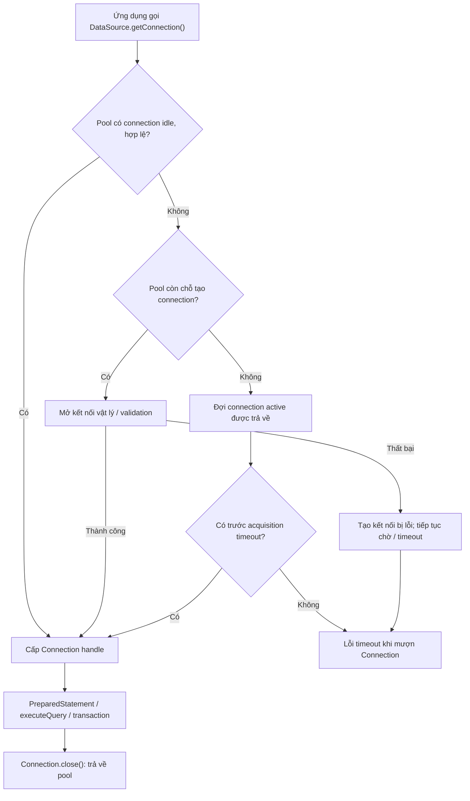
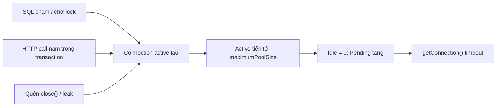

# Phân biệt lỗi pool cạn và cơ sở dữ liệu không sẵn sàng

## 1. Hai sự cố khác nhau nhưng cùng gây lỗi lấy `Connection`

Trong ứng dụng Java sử dụng **JDBC**, phần lớn DAO không trực tiếp tạo socket tới cơ sở dữ liệu. Chúng mượn `Connection` từ `DataSource` có **connection pool** (ví dụ HikariCP), chạy `PreparedStatement`, đọc `ResultSet`, quản lý transaction rồi đóng handle để trả về pool.

Khi một request báo lỗi:

```text
Không thể lấy kết nối JDBC trong thời gian cho phép.
```

có ít nhất hai giả thuyết cần phân biệt:

1. **Pool cạn kết nối khả dụng (*pool exhaustion / saturation*):** các kết nối hiện có đã được mượn, request mới phải chờ. Database **có thể vẫn khỏe và trả lời truy vấn bình thường** trên những kết nối khác.
2. **Database không sẵn sàng (*database unavailable*):** pool không tạo hoặc xác minh được kết nối vật lý do DBMS ngừng hoạt động, đường mạng bị chặn, DNS/TLS/xác thực lỗi, proxy mất kết nối hoặc DBMS từ chối phiên mới.

**Một lần `DataSource.getConnection()` timeout không đủ để kết luận đó là lỗi pool cạn hay database chết.** Pool có thể hết thời gian chờ vì mọi connection đang bận, nhưng cũng có thể đang cố tạo connection thay thế mà DBMS không nhận kết nối. Ngược lại, ứng dụng có thể gặp cả hai vấn đề đồng thời.

Ví dụ:

```text
Trường hợp A: DBMS khỏe, ứng dụng giữ connection quá lâu

HTTP requests ─┬─> [Pool size = 8; active = 8; idle = 0]
               └─> 18 request đang chờ ──> acquisition timeout
                                  |
                                  v
                          DBMS vẫn phục vụ được

Trường hợp B: DBMS không chấp nhận kết nối mới

HTTP requests ──> [Pool: không có connection hợp lệ]
                                  |
                                  v
                      TCP connect / TLS / auth thất bại
                                  |
                                  v
                           DBMS hoặc mạng lỗi
```

Đây là bài học về **giám sát vận hành JDBC**, không chỉ cách bắt `SQLException`. Mục tiêu là đọc đúng tín hiệu, xác định pha lỗi, tránh chẩn đoán vội, chọn hành động khắc phục có kiểm chứng và phân biệt lỗi truy cập kết nối với trạng thái transaction nghiệp vụ.

## 2. Đường đi của một lời gọi JDBC

Một `DataSource` có pooling thường có hai loại tài nguyên:

- **Connection logic/handle:** đối tượng `Connection` mà DAO nhận rồi gọi `close()`. Với pool, `close()` thường **trả handle về pool**.
- **Connection vật lý:** phiên/socket DBMS mà pool tạo, kiểm tra, tái sử dụng hoặc loại bỏ khi hỏng/quá tuổi.



Sơ đồ mô tả luồng chẩn đoán **khái niệm**. Thư viện pool có thể kiểm tra kết nối khi mượn, dùng cache kết quả validation, tạo connection ở luồng nền hoặc làm việc khác tùy phiên bản. Không coi sơ đồ là chi tiết triển khai chính xác của mọi pool.

Một sự cố còn có thể xảy ra **sau khi mượn connection thành công**, chẳng hạn:

- `executeQuery()` bị deadlock hoặc chờ khóa lâu.
- `executeUpdate()` bị query timeout.
- Mạng đứt trong lúc đọc `ResultSet`.
- Phản hồi `commit()` bị mất, khiến outcome giao dịch chưa rõ.

Những sự cố này **không phải acquisition timeout**, dù API cuối cùng đều có thể trả `SQLException`.

## 3. Bốn trạng thái cần theo dõi trong pool

Với HikariCP và nhiều pool tương tự, các metric quan trọng nhất là:

| Tín hiệu | Ý nghĩa |
| --- | --- |
| **Active** | Số connection đang được ứng dụng mượn |
| **Idle** | Số connection đã trả về pool, sẵn sàng được mượn |
| **Total** | Tổng connection mà pool đang quản lý (active + idle, tại một thời điểm quan sát nhất quán) |
| **Pending / awaiting** | Số luồng/request đang chờ được cấp connection |
| **Maximum pool size** | Số connection tối đa pool có thể quản lý theo cấu hình |
| **Acquisition time** | Thời gian từ lúc gọi `getConnection()` đến khi lấy được handle |
| **Acquisition timeout count** | Số lần không mượn được connection trong ngưỡng chờ |

Một cách hiểu giản lược:

```text
total ≈ active + idle

pool saturation thường có:
active ≈ maximumPoolSize
idle   ≈ 0
pending > 0
```

Dấu `≈` được dùng vì **đây là các số đo động**, có thể được lấy ở những thời điểm rất gần nhưng không hoàn toàn đồng thời. Pool cũng có thể ở trạng thái tạm thời khi tạo, loại bỏ hoặc thay thế connection.

### 3.1. Pool cạn không nhất thiết có leak

Ba tình huống có cùng dấu hiệu `active=max`:

- **Tải hợp lệ tăng:** số transaction đồng thời vượt công suất pool.
- **Truy vấn chậm hoặc chờ khóa:** request giữ connection lâu, dù code vẫn đóng đúng cách.
- **Connection leak:** code quên `close()`, giữ handle qua thời gian chờ bên ngoài hoặc transaction chưa kết thúc.

Vì vậy, **active cao là triệu chứng, chưa phải nguyên nhân**. Cần đo thêm thời gian giữ connection, thời gian thực thi SQL, lock wait, thread stack và những cảnh báo leak của pool.

### 3.2. Database không sẵn sàng cũng có thể làm pending tăng

Khi DBMS hoặc proxy từ chối các phiên mới, pool có thể:

1. Có rất ít connection hợp lệ đang idle.
2. Thử tạo connection mới nhưng thất bại.
3. Khiến request chờ `getConnection()` đến hết `connectionTimeout`.
4. Báo lỗi giống về bề ngoài với pool saturation.

Đặc biệt sau khi DBMS restart, những connection idle cũ có thể đã hỏng; pool cần loại chúng và xây dựng lại các kết nối. Trong thời gian đó, **pending tăng** không chứng minh đơn thuần “pool quá nhỏ”.

## 4. Bảng đọc tín hiệu để hình thành giả thuyết

| Quan sát trên một instance | Giả thuyết nên kiểm tra trước | Bằng chứng cần thêm |
| --- | --- | --- |
| `active=max`, `idle=0`, `pending` tăng; DB vẫn trả lời qua đường độc lập | Pool bão hòa bởi tải, SQL chậm hoặc leak | Query latency, lock wait, thời gian giữ connection, thread dump |
| `total < max`, không tạo thêm connection; nhiều lỗi connect/auth/validation | Không tạo được kết nối vật lý | Log driver, lỗi TCP/TLS/DNS, giới hạn DB sessions |
| `active` không cao, nhiều connection invalid/creation failures sau thời gian idle | Kết nối cũ bị hạ tầng đóng hoặc DBMS đang gián đoạn | Validation failures, network/proxy idle timeout, DB log |
| `active=max` nhưng request đang chờ gần như không chạy SQL | Handle bị giữ trong logic ứng dụng | Thời gian active, stack khi mượn, leak detector, HTTP call trong transaction |
| `active=max`, DB đang chờ lock dài | Tranh khóa làm connection bị chiếm lâu | `pg_stat_activity` hoặc công cụ lock của DBMS, slow query log |
| Mọi instance cùng lúc lỗi tạo connection; kết nối độc lập cùng tuyến cũng thất bại | DBMS hoặc dependency mạng chung không sẵn sàng | DB readiness thực tế, proxy, DNS, certificate, auth, DB logs |
| Chỉ một instance lỗi, instance khác khỏe | Vấn đề cấu hình/tải/network theo instance, pool riêng | So sánh metric/pod, route, credentials, thread pool |
| DB có nhiều phiên gần `max_connections` và báo từ chối phiên mới | Hết ngân sách kết nối DBMS | Tổng pool của mọi ứng dụng, session thực tế, workload khác |

**Không coi một hàng trong bảng là chẩn đoán chắc chắn.** Ví dụ `total < max` có thể xuất hiện ngay khi pool đang khởi động hoặc thay thế connection. Một DBMS “reachable” từ máy quản trị chưa chứng minh đường đi **từ ứng dụng tới DBMS** hoạt động, và một kết nối đã có sẵn chạy được SQL chưa chứng minh **kết nối mới** có thể tạo được.

## 5. Phân biệt lỗi xảy ra ở pha nào

Đo chính xác giai đoạn lỗi thường giúp thu hẹp nguyên nhân hơn tên exception.

| Pha | API JDBC | Dấu hiệu cần quan sát |
| --- | --- | --- |
| **Acquire** | `DataSource.getConnection()` | Độ trễ chờ, pending/active, creation failure, acquire timeout |
| **Prepare / bind** | `prepareStatement`, `setXxx` | Cấu trúc SQL, cột/kiểu tham số, tài nguyên statement |
| **Execute** | `executeQuery`, `executeUpdate` | Query timeout, deadlock, lock wait, resource limit, connection reset |
| **Fetch** | `ResultSet.next()`, `getXxx` | Độ trễ tải dữ liệu, lỗi mạng khi stream, dữ liệu lớn, driver buffering |
| **Commit / rollback** | `commit()`, `rollback()` | Giao dịch thành công, rollback xác nhận, hoặc outcome chưa rõ |
| **Release** | `Connection.close()` | Handle được trả pool, lỗi cleanup, connection invalidation |

Ví dụ một request đã mượn connection thành công rồi chạy `SELECT` trong 40 giây: lỗi chậm ở pha execute/fetch sẽ **giữ connection active lâu**, từ đó **gây ra acquisition timeout cho các request khác**. Nếu chỉ nhìn acquisition timeout ở request đến sau, người vận hành có thể tăng pool size nhưng bỏ qua nguyên nhân gốc là truy vấn chậm.

Nên ghi ít nhất **pha lỗi + thời gian từng pha + SQLState + vendor error code + tên nghiệp vụ**, không chỉ một thông báo chung “database error”.

## 6. Đọc `SQLException` đúng cách

`SQLException` cung cấp các thông tin chính:

```java
import java.sql.SQLException;

public final class SqlErrorDiagnostic {
    private SqlErrorDiagnostic() {}

    public static void log(String phase, SQLException error) {
        System.err.printf(
                "phase=%s exception=%s sqlState=%s vendorCode=%d%n",
                phase,
                error.getClass().getSimpleName(),
                error.getSQLState(),
                error.getErrorCode());

        SQLException next = error.getNextException();
        while (next != null) {
            System.err.printf(
                    "nextException=%s sqlState=%s vendorCode=%d%n",
                    next.getClass().getSimpleName(),
                    next.getSQLState(),
                    next.getErrorCode());
            next = next.getNextException();
        }
    }
}
```

**Không suy nguyên nhân chỉ từ tên exception:**

- `SQLTransientConnectionException` có thể xuất hiện khi pool không cấp kết nối đúng hạn, nhưng không tự xác nhận **database unreachable**.
- `SQLNonTransientConnectionException` có thể chỉ ra kết nối bị lỗi nghiêm trọng, nhưng vẫn cần xem nguồn lỗi, driver và pha xảy ra.
- Nhóm SQLState **`08`** thường mô tả lỗi kết nối. Nó **không** xác nhận DBMS hoàn toàn ngừng hoạt động; có thể chỉ là mạng tới DBMS của một instance hoặc một connection cụ thể.
- SQLState `40001` hoặc mã deadlock của DBMS thường nói về **transaction/concurrency**, không phải pool hết chỗ.
- `SQLTimeoutException` có thể chỉ câu SQL quá ngưỡng, khác hoàn toàn `getConnection()` đợi quá lâu.

Nhiều driver hoặc pool bọc ngoại lệ gốc trong cause/next-exception. Cần đọc **chuỗi nguyên nhân**, không chỉ câu thông báo đầu tiên. Không so khớp chuỗi tiếng Anh của driver làm quy tắc duy nhất vì wording có thể đổi qua phiên bản.

### Một lỗi pool timeout không chứa bằng chứng về outcome commit

Một request đã thực hiện DML rồi mất phản hồi tại `commit()` có thể ở trạng thái **UNKNOWN**: DBMS có thể đã commit nhưng client không nhận được xác nhận. Không retry một thao tác không lũy đẳng chỉ vì sau đó pool cũng đang cạn. Việc đối soát cần dựa vào request ID/idempotency key đã ghi bền vững, không dựa vào chỉ số `active/idle`.

## 7. Ví dụ Java: đo acquisition riêng với thực thi SQL

Mẫu sau đo thời gian mượn `Connection` **tách biệt** với thời gian thực thi truy vấn. Khi một bước ném `SQLException`, log thể hiện bước đó thay vì trộn tất cả thành “DB không hoạt động”.

Giả định có bảng `ops_orders(order_id BIGINT PRIMARY KEY, status VARCHAR(30))`, cùng một `DataSource` đã cấu hình. Đoạn mã dùng Java 17+, API JDBC chuẩn:

```java
import java.sql.Connection;
import java.sql.PreparedStatement;
import java.sql.ResultSet;
import java.sql.SQLException;
import javax.sql.DataSource;

public final class OrderStatusDao {
    private final DataSource dataSource;

    public OrderStatusDao(DataSource dataSource) {
        this.dataSource = dataSource;
    }

    public String findStatus(long orderId) throws SQLException {
        long acquireStarted = System.nanoTime();
        Connection connection;

        try {
            connection = dataSource.getConnection();
        } catch (SQLException acquireFailure) {
            long acquireMs = elapsedMillis(acquireStarted);
            System.err.println("acquireFailed afterMs=" + acquireMs);
            SqlErrorDiagnostic.log("ACQUIRE", acquireFailure);
            throw acquireFailure;
        }

        long acquireMs = elapsedMillis(acquireStarted);
        System.out.println("connectionAcquiredMs=" + acquireMs);

        // Đóng handle sau nghiệp vụ; với pool, close thường trả về pool.
        try (connection) {
            String sql = """
                    SELECT status
                    FROM ops_orders
                    WHERE order_id = ?
                    """;

            long queryStarted = System.nanoTime();
            try (PreparedStatement ps =
                         connection.prepareStatement(sql)) {
                ps.setLong(1, orderId);
                ps.setQueryTimeout(3); // Giây; không phải acquisition timeout.

                try (ResultSet rs = ps.executeQuery()) {
                    String result = rs.next()
                            ? rs.getString("status")
                            : null;
                    System.out.println(
                            "queryAndFetchMs=" + elapsedMillis(queryStarted));
                    return result;
                }
            } catch (SQLException queryFailure) {
                System.err.println(
                        "queryFailedAfterMs=" + elapsedMillis(queryStarted));
                SqlErrorDiagnostic.log("EXECUTE_OR_FETCH", queryFailure);
                throw queryFailure;
            }
        }
    }

    private static long elapsedMillis(long startedNano) {
        return (System.nanoTime() - startedNano) / 1_000_000L;
    }
}
```

Ví dụ schema PostgreSQL để thử DAO:

```sql
CREATE TABLE ops_orders (
    order_id BIGINT PRIMARY KEY,
    status VARCHAR(30) NOT NULL
);

INSERT INTO ops_orders(order_id, status)
VALUES (101, 'PAID'), (102, 'PENDING');
```

**Vì sao dùng `System.nanoTime()`?** Đây là đồng hồ phù hợp để đo **khoảng thời gian**, không phụ thuộc việc đồng hồ hệ thống thay đổi theo NTP hoặc timezone. Không dùng `System.currentTimeMillis()` làm căn cứ đo latency ngắn hoặc timeout tương đối.

**Giới hạn ví dụ:** `queryAndFetchMs` ở đây chỉ bao phủ một lần `next()` và đọc một hàng; nếu xử lý nhiều hàng hoặc truyền response lớn, phải đo toàn bộ thời gian fetch/map. `try-with-resources` có thể phát sinh lỗi khi `Connection.close()` sau khi truy vấn thành công; lỗi cleanup đó **không có nghĩa câu SQL đã không thành công**. Trong sản phẩm thật, nên phát metric/histogram thay vì in log trên mọi request, đồng thời ghi request ID và phase có kiểm soát.

## 8. Ví dụ HikariCP: snapshot active, idle, total, pending

Với HikariCP, có thể đọc trạng thái pool qua `HikariPoolMXBean`. Ví dụ sau giả định ứng dụng đã tạo `HikariDataSource` và bean đã khởi tạo:

```java
import com.zaxxer.hikari.HikariDataSource;
import com.zaxxer.hikari.HikariPoolMXBean;

public final class HikariPoolSnapshot {
    public record Snapshot(
            String poolName,
            int active,
            int idle,
            int total,
            int pending) {}

    private HikariPoolSnapshot() {}

    public static Snapshot read(HikariDataSource source) {
        HikariPoolMXBean pool = source.getHikariPoolMXBean();
        if (pool == null) {
            throw new IllegalStateException(
                    "HikariCP chưa khởi tạo pool");
        }

        return new Snapshot(
                source.getPoolName(),
                pool.getActiveConnections(),
                pool.getIdleConnections(),
                pool.getTotalConnections(),
                pool.getThreadsAwaitingConnection());
    }
}
```

Ví dụ quan sát:

```java
HikariPoolSnapshot.Snapshot s =
        HikariPoolSnapshot.read(hikariDataSource);

System.out.printf(
        "pool=%s active=%d idle=%d total=%d pending=%d%n",
        s.poolName(), s.active(), s.idle(), s.total(), s.pending());
```

Một mẫu đo như `active=8, idle=0, total=8, pending=18`, trên pool có `maximumPoolSize=8`, là **dấu hiệu mạnh của pool bão hòa tại thời điểm lấy mẫu**. Nó **chưa chứng minh** có connection leak hay DBMS đang khỏe. Cần đo trong một khoảng thời gian và đối chiếu tình trạng câu SQL/DBMS.

**Cảnh báo quan trọng:** các getter metric được gọi lần lượt. Đây không phải snapshot nguyên tử; giữa các getter, connection có thể được mượn/trả. Không lập trình assertion rằng `total == active + idle` phải luôn đúng trong mọi lần đọc tức thời.

HikariCP có thể cung cấp metric qua **Micrometer, JMX hoặc backend quan sát tương ứng**. Nếu dùng Spring Boot Actuator với cấu hình phù hợp, có thể xem các meter như số connection active, idle, pending, timeout và thời gian acquire. Tên meter và việc bật binder phụ thuộc Spring Boot/HikariCP/registry; hãy xác nhận trong cấu hình đang triển khai thay vì giả định endpoint luôn có.

**Bảo mật observability:** endpoint metrics/JMX không nên công khai ra Internet, không đưa username/password/JDBC URL có bí mật vào nhãn metric. Dùng pool name ổn định, tránh gắn mỗi request ID/SQL text động vào label vì gây bùng nổ cardinality.

## 9. Ghép metric thành một bảng chẩn đoán thực tế

Giả sử pool trên một instance có `maximumPoolSize = 8`. Sau khi thu thập metric và log trong vài phút, ta có những kịch bản sau (toàn bộ số là **minh họa giả định**):

| Kịch bản | Active | Idle | Pending | Lỗi nổi bật | Diễn giải ban đầu |
| --- | ---: | ---: | ---: | --- | --- |
| Tải tăng và SQL chậm | 8 | 0 | 15 | Acquire timeout, SQL p95 tăng | Pool bão hòa; tìm truy vấn chậm/lock |
| Quên trả Connection | 8 | 0 | 12 | Lease time tăng liên tục, leak warning | Có thể leak/giữ handle quá lâu |
| DB không tạo được phiên mới | 0 | 0 | 20 | Connect refused / TLS / auth failures | Nghi DB/proxy/network/auth hơn pool size |
| Pool hoạt động bình thường | 2 | 6 | 0 | Rất ít lỗi | Không có bằng chứng pool cạn |
| DB giới hạn phiên | 3 | 0 | 9 | Too many connections từ DBMS | Hết ngân sách DB; phải tính toàn cụm |
| Failover đang phục hồi | 0–2 | 0 | 8–20 | Validation/creation failure theo đợt | Pool xây dựng lại connection; cần xem trạng thái failover |

Những hàng trên chỉ có ý nghĩa khi biết thời điểm và nguồn đo. `Active=0, idle=0` cũng có thể bình thường với một pool được cấu hình cho phép co về 0; chỉ khi có **pending/creation failures** mới nghi sự cố.

## 10. Kiểm tra DBMS qua đường độc lập với pool bị lỗi

Khi pool đang cạn, **đừng chạy health query bằng chính pool đó rồi dùng kết quả timeout để khẳng định DBMS chết**. Health query cũng phải mượn connection; nó có thể timeout do cùng hàng đợi.

Cách khảo sát nên có ít nhất hai góc nhìn:

1. **Từ tiến trình ứng dụng:** metric pool, exception/driver log, DNS, TCP/TLS tới endpoint database, thời gian tạo connection.
2. **Từ phía database/proxy:** readiness, số phiên, giới hạn connection, lock/slow query, log authentication, trạng thái failover.

Nếu có quyền phù hợp và một kênh chẩn đoán **độc lập, được cấp phép**, có thể kiểm tra DBMS từ cùng mạng với ứng dụng. Việc một lệnh quản trị thành công từ máy khác chỉ chứng minh **đường đi của máy đó**, không chứng minh tuyến mạng/credentials của ứng dụng.

### 10.1. Ví dụ PostgreSQL: tổng phiên và trạng thái

Chạy bằng phiên đọc metadata/giám sát được cấp quyền thích hợp, **không chạy qua pool ứng dụng đang kẹt**:

```sql
SHOW max_connections;

SELECT COUNT(*) AS sessions_for_database
FROM pg_stat_activity
WHERE datname = current_database();

SELECT
    state,
    wait_event_type,
    COUNT(*) AS sessions
FROM pg_stat_activity
WHERE datname = current_database()
GROUP BY state, wait_event_type
ORDER BY state, wait_event_type;
```

Ở PostgreSQL:

- `max_connections` là giới hạn số phiên tổng thể của server; có những phiên/slot dự phòng theo cấu hình, nên không coi toàn bộ số đó là ngân sách dùng cho một ứng dụng.
- `pg_stat_activity` giúp quan sát phiên đang `active`, `idle`, `idle in transaction` và loại wait event. Quyền xem chi tiết của các phiên khác phụ thuộc role, phiên bản và quyền giám sát.
- `wait_event_type = 'Lock'` cùng số phiên active giữ lâu là dấu hiệu nên điều tra tranh khóa.
- `idle in transaction` có thể phản ánh code đã mở transaction nhưng không kết thúc; nó có thể giữ khóa hoặc làm tăng chi phí vận hành.

Một phiên SQL `idle` **ở phía PostgreSQL** không hoàn toàn tương đương metric `idle` của HikariCP. Ví dụ ứng dụng đang **mượn** một connection rồi chờ HTTP mà không chạy SQL: HikariCP đếm nó là **active**, còn DBMS có thể báo phiên **idle in transaction** hoặc **idle**, tùy trạng thái transaction.

### 10.2. Nếu DBMS trả “too many connections”

Đừng chỉ tăng `maximumPoolSize`:

```text
6 instance ứng dụng × tối đa 20 connection/instance
= 120 connection tiềm năng.

Giả sử DBMS chỉ dành được 100 slot hữu dụng cho nhóm ứng dụng:
=> cấu hình toàn cụm đã có thể vượt ngân sách trước khi tính job khác.
```

Hãy tính **tổng giới hạn pool trên tất cả instance, job nền và dịch vụ**, cộng kết nối quản trị/migration và dự phòng failover. Tăng pool ở mỗi instance có thể **làm lỗi DBMS nặng hơn** dù số timeout acquire trong một instance tạm thời giảm.

### 10.3. Database “không sẵn sàng” có nhiều dạng

| Loại sự cố | Tín hiệu cần kiểm chứng |
| --- | --- |
| DBMS process ngừng hoặc failover | Readiness phía DB/proxy, event failover, lỗi connect/refused |
| DNS sai hoặc thay đổi endpoint | Resolve từ ứng dụng, cấu hình host, TTL và log DNS |
| TLS/chứng chỉ | Handshake errors, thời hạn certificate, CA/truststore |
| Credentials bị đổi hoặc hết hạn | Authentication failures, rotation secrets, log DB |
| Mạng phân vùng | TCP timeout từ một số instance/zone, tuyến mạng khác vẫn khỏe |
| Proxy hết phiên/backend | Metric proxy, queue, max-client/max-server connections |
| DBMS chạy nhưng quá tải | CPU/I/O, max connections, queue, lock, các truy vấn quản trị chậm |
| Connection vật lý idle bị firewall đóng | Validation failure khi dùng lại, network idle timeout |

Kết luận đúng đôi khi là **“database có thể nhận truy vấn từ một tuyến, nhưng không thể phục vụ luồng kết nối mới từ ứng dụng này”**, thay vì nhị phân “DB sống/chết”.

## 11. Phân biệt slow SQL, lock wait và connection leak

Pool là tài nguyên giới hạn. Bất kỳ yếu tố nào làm **thời gian giữ connection** tăng đều có thể gây acquisition timeout.



### 11.1. Slow SQL

Một câu SQL thiếu index hoặc chạy kế hoạch truy vấn xấu có thể giữ connection lâu. Kiểm tra query latency theo **tên nghiệp vụ/query đã chuẩn hóa**, `EXPLAIN`/`EXPLAIN ANALYZE` ở môi trường an toàn, CPU/I/O DBMS, số hàng quét và số hàng trả về.

Không tối ưu bằng cách mù quáng tăng pool; khi DBMS đã bận, thêm connection có thể làm CPU, I/O và lock contention tệ hơn.

### 11.2. Lock contention

Một transaction giữ khóa lâu khiến các transaction khác chờ. Từ góc nhìn pool, tất cả vẫn là **active**, dù thread đang chờ DBMS.

Điều tra thời gian mở transaction, thứ tự khóa, mức cô lập, các câu `SELECT ... FOR UPDATE`, và dùng statement/lock timeout hợp lý. Nếu sửa được transaction giữ khóa, số pending có thể giảm **mà không đổi pool size**.

### 11.3. Connection leak hoặc “giữ handle lâu”

Ví dụ mã sai:

```java
Connection c = dataSource.getConnection();
// Chạy SQL, sau đó return hoặc ném exception trước khi c.close().
// Pool vẫn tính handle này là active.
```

Sửa bằng vòng đời ngắn:

```java
try (Connection c = dataSource.getConnection();
     PreparedStatement ps = c.prepareStatement(
             "SELECT status FROM ops_orders WHERE order_id = ?")) {
    ps.setLong(1, orderId);

    try (ResultSet rs = ps.executeQuery()) {
        if (rs.next()) {
            return rs.getString("status");
        }
    }
}
return null;
```

Đoạn trên nằm trong phương thức trả `String` có biến `dataSource` và `orderId` hợp lệ. Cần phân biệt **leak thật** (quên đóng) với **lease dài có chủ ý** (xử lý báo cáo lớn, giữ transaction). Cả hai đều ảnh hưởng pool, nhưng cách khắc phục khác nhau.

HikariCP có `leakDetectionThreshold` để cảnh báo connection được mượn lâu hơn một ngưỡng; nó **không phải cơ chế tự thu hồi an toàn** hoặc bằng chứng chắc chắn có leak. Một transaction hợp lệ nhưng chậm cũng có thể kích hoạt cảnh báo.

## 12. Cấu hình timeout để không che lỗi

Có nhiều timeout liên quan:

| Cấu hình | Bắt đầu tính khi nào? | Cần hiểu |
| --- | --- | --- |
| HikariCP `connectionTimeout` | Khi `getConnection()` chờ handle | Không giới hạn thời gian câu SQL |
| HikariCP `validationTimeout` | Khi xác minh connection | Không phải nhịp keepalive |
| HikariCP `maxLifetime` | Tính từ lúc tạo connection vật lý | Chủ động luân chuyển, không cắt ngang active connection đúng mốc |
| HikariCP `idleTimeout` | Khi connection idle dư thừa | Tác động khi pool có thể thu nhỏ, phụ thuộc `minimumIdle` |
| HikariCP `keepaliveTime` | Lịch kiểm tra connection đang idle | Không cứu transaction đang được ứng dụng mượn |
| `Statement.setQueryTimeout(seconds)` | Khi chạy statement theo driver | Không cam kết toàn request kết thúc đúng hạn |
| `Connection.setNetworkTimeout(executor, ms)` | Với thao tác mạng theo driver | Lỗi khi commit có thể làm outcome chưa rõ |
| DBMS lock/statement/transaction timeout | Theo cấu hình server | Có quy tắc rollback/đóng phiên riêng |

Ví dụ HikariCP minh họa cho một hệ thống có ngân sách **8 connection mỗi instance**:

```java
import com.zaxxer.hikari.HikariConfig;
import com.zaxxer.hikari.HikariDataSource;

HikariConfig config = new HikariConfig();
config.setJdbcUrl(System.getenv("DB_JDBC_URL"));
config.setUsername(System.getenv("DB_USER"));
config.setPassword(System.getenv("DB_PASSWORD"));

config.setPoolName("orders-primary");
config.setMaximumPoolSize(8);
config.setMinimumIdle(2);
config.setConnectionTimeout(2_000L); // ms: chờ borrow tối đa 2 giây
config.setValidationTimeout(1_000L); // ms: giới hạn validation

// Chỉ minh họa các tham số điều khiển thời gian sống.
// Phải chọn theo timeout thực của DBMS/proxy/mạng và đo kiểm.
config.setMaxLifetime(25 * 60_000L);
config.setIdleTimeout(5 * 60_000L);
config.setKeepaliveTime(2 * 60_000L);

// Tạo HikariDataSource MỘT LẦN tại lifecycle ứng dụng.
HikariDataSource dataSource = new HikariDataSource(config);
```

Khi ứng dụng dừng, cần đóng `HikariDataSource` đúng lifecycle; **không tạo một pool mới trong mỗi request**. Các giá trị 8/2/2s/25m/5m/2m là **con số giả định để học**, không phải giá trị tối ưu hoặc mặc định cho hệ thống của bạn.

**Cảnh báo:** Khi gặp acquire timeout, chỉ tăng `connectionTimeout` sẽ khiến request **đợi lâu hơn**, không tạo thêm công suất. Tăng `maximumPoolSize` có thể cần thiết khi DBMS còn năng lực và tải đã được đo, nhưng có thể làm một database đang quá tải tệ hơn. Cần giải quyết nguyên nhân giữ connection lâu và tổng ngân sách DBMS trước.

## 13. Runbook xử lý sự cố: đi từ tín hiệu tới hành động

Khi tỷ lệ JDBC connection acquisition timeout tăng, một quy trình nhất quán giúp hạn chế thay đổi cấu hình thiếu căn cứ.

### Bước 1 — Xác định phạm vi ảnh hưởng

Ghi nhận:

- Lỗi bắt đầu khi nào, tỷ lệ request lỗi, service/instance/zone nào bị ảnh hưởng?
- Lỗi ở `getConnection()` hay sau khi đã mượn connection?
- Có deploy, thay đổi secret, rotation certificate, failover hoặc thay đổi network policy vừa xảy ra?
- Những service khác cùng DBMS có gặp lỗi tương tự không?

Tránh tạo thêm tải bằng hàng nghìn lần retry ngay lập tức trong lúc sự cố đang diễn ra.

### Bước 2 — Đọc metric pool theo thời gian, không chỉ một mẫu

Quan sát trong một khoảng thời gian ngắn có ý nghĩa:

```text
active / max
idle
pending
acquisition p95, p99
acquisition timeout rate
connection creation / validation errors
thời gian giữ connection và leak warnings (nếu có)
```

Nếu `active/max` sát 100%, `idle=0` và `pending` tăng liên tục, điều tra **nguyên nhân connection bị giữ lâu**. Nếu `total` không thể tăng và có lỗi tạo connection rõ ràng, kiểm tra **tuyến kết nối/DBMS**.

### Bước 3 — Xác minh khả năng phục vụ của DB

Từ kênh độc lập phù hợp, kiểm tra:

- Địa chỉ DB, DNS, TCP/TLS và xác thực từ tuyến mạng tương tự ứng dụng.
- DB readiness và log của proxy/database.
- Số phiên so với giới hạn thực, transaction chờ khóa, CPU/I/O.
- Thành phần failover và trạng thái replica/primary.

**Không dùng chính acquisition timeout của pool như phép thử độc lập.** Nếu không thể lấy connection quản trị, báo rõ hạn chế thay vì tự suy đoán.

### Bước 4 — Điều tra connection active kéo dài

Nếu DB có thể phục vụ nhưng pool vẫn bão hòa:

1. Nhìn query latency/slow query và lock wait.
2. Xem thread stack hoặc profile có kiểm soát: request đang chờ DB, network, hay external API?
3. Kiểm tra `try-with-resources`, ranh giới transaction và các đường trả về sớm/exception.
4. Kiểm tra batch job, xuất báo cáo hoặc N+1 queries giữ connection quá lâu.
5. Nếu có leak warning, xác minh nó là leak thật hay thao tác hợp lệ nhưng chạy lâu.

### Bước 5 — Khắc phục theo nguyên nhân

| Nguyên nhân đã xác minh | Hành động thường phù hợp |
| --- | --- |
| SQL chậm | Tối ưu query/index/query plan, giảm dữ liệu tải, phân trang |
| Transaction giữ khóa lâu | Rút ngắn transaction, sửa thứ tự khóa, xử lý tranh chấp |
| Connection leak | Sửa đường code không đóng handle, thêm test vòng đời |
| Tải vượt công suất hợp lệ | Giới hạn đồng thời/bulkhead, backpressure; cân nhắc tăng pool **trong ngân sách DB** |
| DBMS ngừng hoặc failover | Khôi phục dependency, giám sát quá trình pool tạo lại kết nối, giảm retry storm |
| Credentials/TLS/DNS sai | Sửa cấu hình/secret/certificate/route và xác minh từ app instance |
| DBMS hết slot | Giảm tổng pool hoặc giải phóng phiên treo; hoạch định ngân sách toàn cụm |
| Socket idle bị đóng | Kiểm tra validation, lifetime/keepalive và timeout hạ tầng |

Không dùng `Thread.sleep` trong thread phục vụ request hoặc vòng retry không giới hạn để “đợi pool hồi phục”. Với DB unavailable, retry nên có **backoff + jitter**, số lần tối đa, deadline và có thể là circuit breaker/bulkhead theo thiết kế. Với yêu cầu ghi dữ liệu, retry chỉ được thực hiện khi **outcome transaction và idempotency** cho phép.

### Bước 6 — Xác nhận hồi phục

Quan sát:

- Pending và acquisition timeout rate giảm.
- Acquisition latency trở về mức bình thường.
- Active/idle ổn định, không còn connection churn hoặc validation failure tăng liên tục.
- Query latency, lock wait và thời gian giữ handle không còn bất thường.
- Số phiên DBMS nằm trong giới hạn; các request nghiệp vụ chạy thành công.

Chỉ một lời gọi `SELECT 1` thành công không chứng minh toàn bộ dịch vụ đã hồi phục: pool có thể tiếp tục bão hòa hoặc phần đường đi của nghiệp vụ vẫn bị lỗi.

## 14. Liveness, readiness và health probe nên đo gì?

Trong hệ thống container/Kubernetes hoặc platform có health check, cần phân biệt:

| Probe | Câu hỏi chính | Cạm bẫy nếu dùng sai |
| --- | --- | --- |
| **Liveness** | Tiến trình còn hoạt động và có thể tiếp tục chạy không? | Phụ thuộc trực tiếp vào DB có thể khiến các instance restart hàng loạt khi DB outage |
| **Readiness** | Instance có nên nhận request mới không? | Nếu đo qua pool đang cạn, có thể báo “DB chết” dù chỉ thiếu connection; cần định nghĩa chính sách hợp lý |
| **Dependency health** | Ứng dụng có truy cập được DBMS qua đường hiện tại không? | Probe dùng pool cũng có thể bị queueing; cần tách “pool bận” với “không tạo được phiên” |
| **Synthetic transaction** | Use case thực sự chạy được không? | Cần giới hạn tải, dùng dữ liệu test thích hợp, không tạo side effect ngoài dự kiến |

Không biến liveness probe thành một câu SQL bắt buộc chạy thành công trên mỗi lần kiểm tra. Khi DBMS gián đoạn ngắn, khởi động lại tất cả ứng dụng có thể tạo **connection storm** ngay lúc database hồi phục.

Readiness có thể phải trả trạng thái không sẵn sàng nếu dependency quan trọng thật sự ngừng hoạt động; nhưng nếu mọi instance đồng loạt bị loại khỏi luồng vì một sự cố chung, cần hiểu ảnh hưởng đến traffic routing và recovery. Thiết kế probe dựa trên kiến trúc cụ thể, không áp một quy tắc duy nhất cho mọi dịch vụ.

## 15. Alert nên kết hợp nhiều tín hiệu

Một alert vận hành tốt không chỉ báo `active=maximumPoolSize` trong một giây. Với workload có burst ngắn, chỉ số đó có thể bình thường.

Ví dụ các quy tắc cảnh báo **mang tính minh họa**:

| Mục tiêu | Điều kiện kết hợp | Vì sao hữu ích |
| --- | --- | --- |
| Pool saturation kéo dài | `pending > 0` liên tục, `active/max` cao và acquisition p95 tăng | Phân biệt burst ngắn với sự cố kéo dài |
| Pool acquisition failures | Tỷ lệ `getConnection()` timeout vượt ngưỡng trong nhiều phút | Đo ảnh hưởng trực tiếp đến request |
| Nghi DB/proxy unavailable | Creation/validation failures cùng lúc tăng trên nhiều instance, probe độc lập lỗi | Bằng chứng hỗ trợ outage liên quan DB |
| Nghi connection leak | Active không giảm sau tải và thời gian giữ handle tăng | Hướng điều tra vòng đời connection |
| DB connection capacity | Phiên DBMS gần giới hạn cùng với creation failures | Ngăn việc tăng pool gây quá tải thêm |
| Lock/slow query gây nghẽn | SQL p95 tăng, lock wait tăng rồi pending tăng | Tìm nguyên nhân upstream của acquisition timeout |

Đặt ngưỡng từ **đường cơ sở (*baseline*)** theo workload và SLO, kèm điều kiện thời gian, không bịa một ngưỡng phần trăm áp dụng cho mọi hệ thống. Gắn alert với hướng dẫn điều tra; ưu tiên dashboard theo **service, instance, pool, DB endpoint** có số nhãn hữu hạn.

Nếu dùng Spring Boot + Micrometer, tên metric HikariCP phổ biến có thể gồm nhóm `hikaricp.connections.*`; một số backend chuyển dấu chấm thành dấu gạch dưới hoặc tên khác. Hãy kiểm tra metric thực có trong deployment, đừng sao chép tên Prometheus giả định rồi kết luận hệ thống không phát metric.

## 16. Những sai lầm chẩn đoán phổ biến

| Sai lầm | Vì sao sai? | Cách làm tốt hơn |
| --- | --- | --- |
| Thấy `getConnection()` timeout là tuyên bố “DB chết” | Pool có thể hết handle vì SQL chậm hoặc leak | Xem active/idle/pending và probe DB độc lập |
| Thấy `active=max` là kết luận connection leak | Tải thật hoặc lock cũng giữ connection active | Đo lease time, query latency, thread stack |
| Thấy DB đáp ứng từ laptop là khẳng định mọi app đều kết nối được | Đường mạng, DNS, security group, secret khác nhau | Kiểm chứng từ cùng vùng mạng/identity phù hợp |
| Tăng `maximumPoolSize` mỗi khi pool cạn | DBMS có thể đã quá tải hoặc gần `max_connections` | Tính ngân sách toàn cụm và xử lý slow SQL |
| Tăng `connectionTimeout` để “chữa” timeout | Request chỉ đợi lâu hơn | Xác minh nghẽn thực sự và backpressure |
| Giữ một `Connection` qua HTTP call | Chiếm active handle và kéo dài transaction | Thu hẹp transaction, gọi ngoài DB bên ngoài scope khi có thể |
| Dùng `isValid()` để chứng minh giao dịch trước đã rollback | Liveness khác outcome commit | Theo dõi pha commit và đối soát idempotency key |
| Health probe dùng chính pool đang bão hòa rồi báo DB outage | Kết quả bị nhiễm bởi hàng đợi trong pool | Tách metric pool và dependency readiness |
| Nhìn một metric tức thời mà không xem xu hướng | Pool thay đổi liên tục, snapshot có sai số | Xem p95, rate, nhiều mẫu và log cùng thời điểm |
| Trộn timeout acquire với query timeout trong log | Không biết nên sửa pool hay SQL | Gắn nhãn pha ACQUIRE/EXECUTE/FETCH/COMMIT |
| Mặc định `close()` luôn đóng socket | Với pool, thường chỉ trả handle | Theo dõi connection creation/retirement thực tế |
| Retry mọi JDBC error ngay lập tức | Có thể gây retry storm và trùng side effects | Backoff/jitter, deadline và xác minh transaction outcome |

## 17. Kiểm thử hai loại sự cố một cách có kiểm soát

Chỉ đọc log khi có sự cố production là chưa đủ. Nên chuẩn bị bài kiểm thử trên **DBMS/driver/pool thật** ở môi trường test.

### 17.1. Kiểm thử pool bão hòa khi database vẫn khỏe

Với HikariCP đặt `maximumPoolSize=1`, lấy một connection rồi giữ nó trong scope. Lần mượn thứ hai sẽ phải chờ và có thể hết thời gian. Đây là **bằng chứng pool cạn handle**, nếu DBMS được xác minh vẫn sẵn sàng qua một kênh độc lập:

```java
import com.zaxxer.hikari.HikariConfig;
import com.zaxxer.hikari.HikariDataSource;
import java.sql.Connection;
import java.sql.SQLException;

// Chạy trong môi trường test, với URL/credentials test hợp lệ.
HikariConfig cfg = new HikariConfig();
cfg.setJdbcUrl(System.getenv("TEST_JDBC_URL"));
cfg.setUsername(System.getenv("TEST_DB_USER"));
cfg.setPassword(System.getenv("TEST_DB_PASSWORD"));
cfg.setMaximumPoolSize(1);
cfg.setMinimumIdle(1);
cfg.setConnectionTimeout(500L); // HikariCP: millisecond.

try (HikariDataSource pool = new HikariDataSource(cfg);
     Connection held = pool.getConnection()) {

    // Connection duy nhất đang được mượn; không phải DBMS bị tắt.
    try (Connection unexpected = pool.getConnection()) {
        throw new AssertionError(
                "Kỳ vọng lần mượn thứ hai phải timeout");
    } catch (SQLException expectedAcquireTimeout) {
        SqlErrorDiagnostic.log(
                "ACQUIRE_TEST", expectedAcquireTimeout);
    }
}
```

Giả định đây là đoạn mã trong test setup và DBMS cho phép kết nối từ pool lúc khởi tạo. Với pool max=1, lần mượn thứ hai không thể nhận handle khi `held` còn mở; để tránh phụ thuộc vào thread scheduling, test này không cần `Thread.sleep`. Trong test thực tế, cần dùng assertion và chụp metric active/idle/pending trước/sau.

**Đừng chạy kiểu test cố ý giữ pool trong production.** Nó làm gián đoạn request thật và tạo nhiễu cảnh báo.

### 17.2. Kiểm thử database không sẵn sàng

Ở môi trường test riêng, sử dụng fault injection có kiểm soát:

- Dừng DBMS hoặc database proxy test, không đụng production.
- Chặn tuyến TCP từ ứng dụng test đến endpoint test.
- Dùng credential sai có chủ đích để quan sát lỗi authentication.
- Khởi động lại database/proxy rồi quan sát pool validation, connection creation và thời gian phục hồi.

Kỳ vọng: log/metric cho thấy các lỗi tạo kết nối hoặc validation; pool có thể tăng pending và trả acquisition timeout dù **không có đủ active connection để chiếm hết maximumPoolSize**. Cần kiểm tra sự khác biệt với bài test 17.1.

### 17.3. Kiểm thử SQL chậm làm pool cạn gián tiếp

Tạo một truy vấn test chậm hoặc chờ khóa có kiểm soát, giữ nhiều connection active, sau đó quan sát acquisition timeout. Tình huống này chứng minh rằng **nguyên nhân gốc ở câu SQL/transaction** có thể xuất hiện phía request khác như một lỗi mượn connection.

Với kiểm thử lock, dùng hai connection riêng và barrier/`CountDownLatch` để xác nhận transaction giữ khóa đã thiết lập trước khi query kia chờ. Tránh dựa vào `Thread.sleep` rồi đoán server đã vào trạng thái cần kiểm tra.

### 17.4. Bảng xác minh

| Test | Pool metrics | DB/proxy metrics | Kết luận mong muốn |
| --- | --- | --- | --- |
| Giữ hết handle | Active chạm max, idle 0, pending xuất hiện | DB vẫn nhận kết nối độc lập | Pool bị bão hòa, **không** có bằng chứng DB outage |
| DB test ngừng | Creation/validation fail, pending/timeout có thể tăng | DB readiness thất bại | Dependency unavailable |
| Sai password | Connection creation báo auth failure | DB log từ chối auth | Lỗi cấu hình/xác thực, không sửa bằng tăng pool |
| Lock wait dài | Active cao, pending tăng | Session wait trên lock | Pool saturation **do transaction** |
| Leak | Active không trở về idle sau xử lý | DB session còn tồn tại | Cần sửa vòng đời handle |
| DB hồi phục | Creation success, pending giảm | DB readiness thành công | Hệ thống phục hồi khi cả pool và use case hoạt động |

## 18. Checklist vận hành JDBC

Trước khi kết luận “pool cạn” hay “database không sẵn sàng”:

1. **Ghi rõ pha lỗi:** `getConnection`, `executeQuery`, `ResultSet.next`, `commit` hay `close`.
2. **Đọc metric pool theo thời gian:** active, idle, total, pending, max, acquisition latency và timeout rate.
3. **Đọc exception chain:** SQLState, vendor code, cause, validation/creation error; đừng chỉ phân loại bằng text.
4. **Xác minh DB qua kênh độc lập:** đúng đường mạng, chứng chỉ, credentials, proxy, DB readiness và số phiên.
5. **Nếu active cao:** điều tra SQL chậm, lock, thời gian giữ connection, transaction và leak.
6. **Nếu không tạo được connection:** điều tra DB/proxy/network/auth/DB connection limit, không tăng pool mù quáng.
7. **Tính ngân sách toàn cụm:** mọi instance, job và service dùng chung DBMS.
8. **Giữ transaction ngắn và đóng handle đúng:** `try-with-resources`, không giữ connection trong công việc HTTP bên ngoài kéo dài.
9. **Cấu hình timeout theo từng tầng:** acquisition timeout, query timeout, validation/network timeout; không coi chúng đồng nghĩa.
10. **Quản lý retry an toàn:** backoff, deadline, giới hạn và idempotency cho giao dịch có thể đã commit.
11. **Thiết kế health/alert đúng:** liveness không gây restart storm, readiness không nhầm pool starvation với dependency outage.
12. **Kiểm thử trên driver, pool và DBMS thật:** fault injection test riêng, xác minh cả trạng thái hồi phục.

**Ghi nhớ:** **Pool cạn** nghĩa là ứng dụng không mượn được một `Connection` khả dụng đúng hạn; **database không sẵn sàng** nghĩa là đường đi tới dịch vụ dữ liệu hoặc khả năng phục vụ phiên/truy vấn không đáp ứng yêu cầu. Hai hiện tượng có thể tạo cùng lỗi `getConnection()` và có thể xảy ra đồng thời. Để phân biệt, cần kết hợp **pha lỗi JDBC, active/idle/pending của pool, creation/validation failures, tình trạng DBMS/proxy và độ trễ SQL/transaction**. Chỉ khi xác minh được nguyên nhân, mới quyết định tối ưu truy vấn, sửa leak, điều chỉnh pool, hạn chế đồng thời hay khôi phục database.
