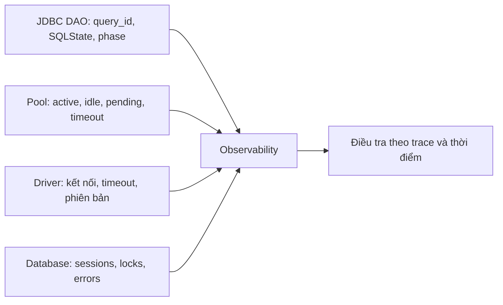

# Thu thập cảnh báo và mã lỗi phục vụ điều tra

Một ứng dụng Java dùng **JDBC** có thể thực thi đúng câu SQL nhưng vẫn nhận cảnh báo về cách driver hoặc hệ quản trị xử lý dữ liệu. Khi truy vấn thất bại, `SQLException` không chỉ cung cấp một thông điệp: nó còn mang **SQLState**, **vendor error code**, các ngoại lệ SQL nối tiếp, nguyên nhân (cause) và đôi khi các lỗi phát sinh lúc rollback hoặc đóng tài nguyên. Nếu ứng dụng chỉ log `e.getMessage()`, thông tin chẩn đoán có thể thiếu; nếu log toàn bộ `PreparedStatement` và exception, SQL/giá trị bind hoặc dữ liệu cá nhân lại có thể bị lộ.

Trong chương **Giám sát vận hành** của module **JDBC**, bài học này tập trung vào cách **thu thập cảnh báo và mã lỗi phục vụ điều tra** mà không làm sai hành vi nghiệp vụ. Ta sẽ quan sát `SQLWarning` ở `Connection`, `Statement` và `ResultSet`; phân tích `SQLException`, `SQLState` và mã vendor; xử lý chuỗi `getNextException()`, `cause`, `suppressed` và `BatchUpdateException`; thiết kế sự kiện log/metric/trace có cấu trúc; xây dựng mẫu Java dùng `DataSource`, `PreparedStatement` và `ResultSet`; rồi kiểm thử cả đường thành công, đường lỗi và đường cleanup.

Mục tiêu không phải ghi càng nhiều càng tốt. **Chẩn đoán vận hành tốt = thông tin kỹ thuật đủ để tìm nguyên nhân, được gắn ngữ cảnh và không phát tán dữ liệu nhạy cảm**. `SQLWarning` không tự biến thành lỗi nghiệp vụ; ngược lại, một `SQLException` nghiêm trọng không được nuốt chỉ vì đã ghi log.

## 1. Cảnh báo, lỗi và sự kiện giám sát khác nhau thế nào?

| Dấu hiệu | API JDBC điển hình | Ý nghĩa | Hành động thông thường |
| --- | --- | --- | --- |
| **SQL warning** | `SQLWarning`, `getWarnings()` | Driver/DB thông báo điều kiện không nhất thiết ngăn kết quả được trả | Thu thập đúng thời điểm, phân loại và kiểm tra tác động |
| **SQL failure** | `SQLException` từ `executeQuery()`/`executeUpdate()` | Thao tác JDBC không hoàn thành bình thường | Giữ lỗi, quyết định rollback/retry/fallback tại đúng tầng |
| **Lỗi liên quan bổ sung** | `SQLException.getNextException()` | Nhiều tình huống SQL đi kèm một thao tác | Duyệt có giới hạn và liên kết cùng sự kiện |
| **Lỗi gốc hay dọn dẹp** | `getCause()`, `getSuppressed()` | Lỗi bên dưới driver hoặc lúc đóng tài nguyên/rollback | Giữ quan hệ lỗi, không để lỗi close che lỗi chính |
| **Số đếm batch chưa chắc chắn** | `BatchUpdateException` | Một hoặc nhiều phần tử batch có thể thất bại | Kiểm tra update counts, transaction và trạng thái commit |
| **Dấu hiệu từ hệ thống** | Pool metrics, query duration, DB server logs | Tải, timeout, kết nối, query chậm | Kết hợp để điều tra, không suy đoán chỉ từ một mã lỗi |

Không phải mọi cảnh báo đều phải hiện mức `ERROR` trong log. Ví dụ một cảnh báo được driver phát sinh khi tính năng không được hỗ trợ đầy đủ cần kiểm tra **kết quả thực tế** và hợp đồng ứng dụng. Ngược lại, một lỗi `SQLState` thuộc lớp kết nối có thể đòi cách xử lý khác hẳn lỗi dữ liệu đầu vào.

Khi phục vụ API, cần phân biệt **thao tác không có hàng** với **truy vấn lỗi** và **truy vấn thành công nhưng có warning**. `ResultSet.next() == false` không đồng nghĩa `SQLException`; việc có `SQLWarning` cũng không mặc định làm kết quả SQL không hợp lệ.

## 2. Những nơi có thể xuất hiện SQLWarning

JDBC công bố cơ chế đọc warning ở ba phạm vi:

| Nơi phát sinh | Phương thức đọc | Ví dụ ngữ cảnh |
| --- | --- | --- |
| `Connection` | `Connection.getWarnings()` | Cảnh báo liên quan kết nối/session |
| `Statement` / `PreparedStatement` | `Statement.getWarnings()` | Cảnh báo khi thực thi SQL, cấu hình statement hoặc thao tác do driver báo |
| `ResultSet` | `ResultSet.getWarnings()` | Cảnh báo trong lúc đọc/di chuyển cursor hoặc chuyển đổi dữ liệu |

`SQLWarning` là một lớp con của `SQLException` nhưng có vai trò **cảnh báo**, và phần lớn không được ứng dụng nhận bằng `catch` như một truy vấn lỗi. Thay vào đó, ứng dụng cần chủ động gọi `getWarnings()` trên đối tượng đang mở. Một driver có thể không phát warning cho một trường hợp nào đó, hoặc trả warning ở phạm vi khác tùy cách triển khai.

Các điểm quan trọng:

- `getWarnings()` có thể trả `null` nếu không có cảnh báo.
- Một đối tượng có thể chứa **chuỗi** warning; phải duyệt tiếp, không chỉ đọc phần tử đầu tiên.
- Warning không phải lịch sử vĩnh viễn. JDBC có `clearWarnings()`; nhiều thao tác và driver có quy tắc tự xóa warning khi thực thi lệnh mới hoặc khi di chuyển cursor. **Thu thập gần thời điểm phát sinh**, trước khi đóng tài nguyên hoặc gọi các thao tác có thể làm thay đổi chuỗi.
- Không lưu `SQLWarning`/`Statement`/`ResultSet` làm “bản ghi telemetry” để xử lý bất đồng bộ sau khi resource đã đóng. **Trích xuất thông tin an toàn thành giá trị Java thuần** trong scope JDBC.
- `getWarnings()` tự nó có thể ném `SQLException`. Nếu thu thập telemetry theo kiểu best effort, phải ghi nhận lỗi quan sát riêng, không vô tình biến một truy vấn thành công thành lỗi chỉ vì bộ thu cảnh báo.

Ví dụ phạm vi:

```java
try (Connection con = dataSource.getConnection();
     PreparedStatement ps = con.prepareStatement(
             "SELECT id, full_name FROM customers WHERE status = ?")) {

    ps.setString(1, "ACTIVE");
    try (ResultSet rs = ps.executeQuery()) {
        SQLWarning statementWarning = ps.getWarnings();
        // Đọc/cô đọng warning ngay lúc statement vẫn còn mở.

        while (rs.next()) {
            long id = rs.getLong("id");
            String name = rs.getString("full_name");
            // Xử lý hàng; không log PII theo mặc định.

            SQLWarning rowWarning = rs.getWarnings();
            // Thu thập sớm nếu loại warning này cần quan sát.
        }
    }
    SQLWarning connectionWarning = con.getWarnings();
}
```

Đoạn code minh họa cần import `java.sql.Connection`, `PreparedStatement`, `ResultSet`, `SQLWarning` và có một `DataSource dataSource` đã cấu hình. Nó **chưa log warning**; phần tiếp theo hướng dẫn trích xuất thông tin phù hợp. Không giữ warning reference sau scope với giả định nó cung cấp một lịch sử đáng tin cậy.

## 3. Các thuộc tính cần lấy từ SQLWarning

Một `SQLWarning` có thể cung cấp:

- `getSQLState()`: mã trạng thái SQL năm ký tự nếu driver báo đúng quy ước; có thể `null` hoặc không chuẩn ở một số driver.
- `getErrorCode()`: mã lỗi/cảnh báo vendor, là `int` và phụ thuộc DB/driver; giá trị 0 không nhất thiết có nghĩa “không có vấn đề”.
- `getMessage()`: mô tả bằng văn bản **không có bảo đảm an toàn để log**.
- `getNextWarning()` hoặc chuỗi `getNextException()`: cảnh báo tiếp theo và các phần tử SQL liên quan.

Khi cần thu thập an toàn, ghi các trường như `query_id`, `source=statement`, `sql_state`, `vendor_code`, `warning_index` và thời gian. Không mặc định log `getMessage()`: driver có thể đưa câu SQL, giá trị vi phạm ràng buộc hoặc dữ liệu từ DB vào message.

Lưu ý kỹ thuật: `SQLWarning.getNextWarning()` được thiết kế để theo chuỗi các `SQLWarning`. Nếu chuỗi bất thường chứa một `SQLException` không phải warning, phương thức này có thể báo lỗi kiểu `Error` theo đặc tả API. Một bộ thu điều tra cần chịu được dữ liệu lỗi không đúng kỳ vọng có thể duyệt qua `getNextException()`, kiểm tra kiểu từng phần tử, giới hạn số phần tử và phát tín hiệu bất thường, thay vì tin mọi node trong chain đều là warning.

## 4. Hiểu SQLState: hai ký tự đầu và ba ký tự sau

`SQLException.getSQLState()` thường trả mã **năm ký tự**. Hai ký tự đầu là **class**; ba ký tự tiếp theo mô tả loại điều kiện cụ thể. Chuẩn và khả năng hỗ trợ của driver ảnh hưởng ý nghĩa chi tiết. Có thể hỏi `DatabaseMetaData.getSQLStateType()` để biết driver công bố quy ước SQLState kiểu X/Open hay SQL chuẩn; điều này không bảo đảm mọi mã vendor tuân theo đầy đủ.

| SQLState class | Nhóm ý nghĩa thường gặp | Hướng điều tra |
| --- | --- | --- |
| `01` | Cảnh báo (warning) | Kiểm tra thời điểm, driver, cấu hình và nội dung đã bị rút gọn theo chính sách |
| `02` | Không có dữ liệu theo quy ước SQLState | Xem thao tác thực tế; không tự xem mọi `02` là exception nghiêm trọng |
| `08` | Lỗi kết nối | Mạng, DB server, pool, session, credential/availability |
| `21` | Lỗi cardinality | Số hàng không phù hợp kỳ vọng của thao tác |
| `22` | Ngoại lệ dữ liệu | Chuyển kiểu, giá trị sai miền, chia cho 0 hoặc dữ liệu quá kích thước |
| `23` | Vi phạm ràng buộc toàn vẹn | PK, UNIQUE, FK, CHECK, NOT NULL |
| `24` | Trạng thái cursor không hợp lệ | Kết quả đã đóng, vị trí cursor, thao tác sau close |
| `25` | Trạng thái transaction không hợp lệ | Transaction/commit/rollback và auto-commit |
| `28` | Vấn đề xác thực/ủy quyền theo quy ước SQL | User/role/credential và cấu hình DB |
| `40` | Transaction rollback | Deadlock, serialization failure, rollback do DB yêu cầu |
| `42` | Lỗi cú pháp hoặc quyền truy cập theo SQLState | SQL/DDL/schema/privilege; xem mã vendor |

Ví dụ **PostgreSQL** có `23505` cho vi phạm `unique_violation` và `40001` cho `serialization_failure`. Đây là các mã hữu ích khi driver PostgreSQL trả đúng SQLState tương ứng, **không phải cam kết mọi DB đều dùng đúng mã con đó**. `08` thường gợi ý connection đang lỗi, nhưng không được tự động retry mọi thao tác ghi chỉ vì thấy lớp `08`.

Quy tắc phân tích:

1. Giữ **mã đầy đủ** nếu hợp lệ để phân biệt loại lỗi chi tiết.
2. Dùng **class hai ký tự** cho dashboard và alert tổng hợp, nhưng không bỏ mất mã đầy đủ ở sự kiện điều tra khi được phép.
3. Gắn `db_alias`/driver/phiên bản và `query_id` ổn định; cùng một mã vendor có thể có nghĩa khác nhau giữa DB.
4. Không tự quyết định retry chỉ theo `startsWith("40")`: xem operation có idempotent không, transaction đã commit chưa và lỗi cụ thể thuộc loại gì.
5. Nếu mã `null` hoặc sai định dạng, ghi `UNKNOWN`, không ném lỗi trong lúc quan sát.

**SQLState không phải ngôn ngữ nghiệp vụ.** Tầng JDBC có thể phân loại lỗi storage; tầng application quyết định trả mã API nào hoặc có thể yêu cầu khách hàng sửa gì. Đừng đặt việc kiểm tra SQLState vendor vào domain entity.

## 5. Vendor error code: mã bổ trợ, không phải khóa phân loại toàn cục

`SQLException.getErrorCode()` trả về một số nguyên đặc thù hệ quản trị. Khi kết hợp với `SQLState`, nó giúp phân biệt những tình huống mà SQLState có vẻ chung chung. Nhưng:

- Không so sánh mã vendor của Oracle, PostgreSQL, SQL Server, MySQL như thể dùng chung một bảng mã.
- Không dùng `getErrorCode() == 0` để bỏ qua exception.
- Không dựa vào tên driver do người dùng cung cấp như một trường tự do trong metric; dùng **alias cấu hình sẵn**.
- Không gắn nguyên `getMessage()` vào event chỉ vì error code không đủ chi tiết.

Một sự kiện điều tra nên có dạng:

```text
event=jdbc.error
query_id=orders.reserve-stock.v1
db_alias=orders-primary
phase=execute
sql_state=23505
sql_class=23
vendor_code=0
trace_id=6dd694a7-96e1-4858-96e7-ccf2f3f6d608
```

Giá trị trên chỉ minh họa schema, **không khẳng định `23505` sẽ xuất hiện từ chính truy vấn giữ tồn kho**. `query_id`, `db_alias`, `phase` là những giá trị allowlist do ứng dụng định nghĩa, không được lấy nguyên văn từ input của người gọi.

## 6. Phân biệt các nhánh SQLException

JDBC có các loại exception giúp gợi ý cách xử lý:

| Lớp | Ý nghĩa định hướng | Điều cần tránh |
| --- | --- | --- |
| `SQLTransientException` | Một điều kiện có thể thành công ở lần thử sau khi nguyên nhân tạm thời hết | Không retry vô hạn hoặc retry sau commit mơ hồ |
| `SQLNonTransientException` | Thường không thành công nếu chỉ retry ngay cùng thao tác khi nguyên nhân chưa sửa | Không biến mọi lỗi thành “mất kết nối tạm thời” |
| `SQLRecoverableException` | Cần thực hiện bước khôi phục, thường bao gồm lấy connection mới | Không tiếp tục dùng connection cũ như thể còn lành |
| `SQLTransientConnectionException` | Nhánh lỗi kết nối có tính tạm thời | Phải xem pool/network và trạng thái transaction |
| `SQLNonTransientConnectionException` | Nhánh lỗi kết nối không tạm thời | Kiểm tra cấu hình/credential/DB |
| `SQLTransactionRollbackException` | Driver báo transaction đã bị rollback do điều kiện liên quan | Retry nếu nghiệp vụ hỗ trợ và toàn transaction an toàn |
| `SQLIntegrityConstraintViolationException` | Vi phạm ràng buộc theo phân loại JDBC | Điều tra input/schema; có thể là xung đột nghiệp vụ dự kiến |
| `SQLTimeoutException` | Timeout do driver/JDBC báo | Không suy luận `commit()` chắc chắn chưa xảy ra |
| `SQLFeatureNotSupportedException` | API/tính năng không được driver hỗ trợ | Cần fallback hoặc đổi cấu hình |
| `BatchUpdateException` | Batch có lỗi, cung cấp update counts | Không đoán tất cả phần tử đã rollback |

Các lớp này không tạo một cây phân cấp “retry hay không retry” hoàn chỉnh. Ví dụ `SQLTransientConnectionException` vẫn có thể làm connection hiện tại không dùng được; một `SQLRecoverableException` đòi phục hồi connection nhưng chưa tự nói thao tác nghiệp vụ có an toàn để phát lại hay không.

**Một chiến lược đúng phải trả lời hai câu hỏi khác nhau:**

1. *Nguồn lỗi có thể được phục hồi hay không?* — dựa vào class, SQLState, vendor code, pool và tình trạng DB.
2. *Đơn vị công việc có thể chạy lại an toàn hay không?* — dựa vào idempotency, transaction boundary, trạng thái commit và side effects.

Không để bộ thu telemetry tự thực hiện retry. Telemetry chỉ cung cấp tín hiệu; application/transaction runner quyết định hành động.

## 7. Đừng bỏ qua getNextException(), cause và suppressed

`SQLException` có nhiều đường liên kết lỗi:

```text
SQLException A (lỗi chính tại executeBatch)
  ├─ getNextException() ---> SQLException B (lỗi phần tử batch)
  │                             └─ getNextException() ---> SQLException C
  ├─ getCause() ---------> Throwable D (lỗi driver/network nền)
  └─ getSuppressed() ----> SQLException E (lỗi ResultSet.close)
                          SQLException F (lỗi Connection.close)
```

`getNextException()` **không đồng nghĩa** `getCause()`. Lỗi SQL nối tiếp thường có ý nghĩa vận hành riêng, đặc biệt khi chạy batch. `getSuppressed()` xuất hiện nhiều khi `try-with-resources` đã có lỗi chính và việc đóng `ResultSet`, `PreparedStatement` hoặc `Connection` lại thất bại.

Ví dụ:

```java
SQLException queryFailure = new SQLException("Query failed", "08006", 100);
SQLException cleanupFailure =
        new SQLException("Connection close failed", "08003", 101);
queryFailure.addSuppressed(cleanupFailure);

// Không log getMessage() trong production nếu có thể chứa dữ liệu nhạy cảm.
System.out.println(queryFailure.getSQLState());
System.out.println(queryFailure.getErrorCode());
System.out.println(queryFailure.getSuppressed().length);
```

Khi xử lý lỗi, **đừng thay thế exception chính chỉ vì muốn log nhanh**:

```java
try (Connection con = dataSource.getConnection();
     PreparedStatement ps = con.prepareStatement(sql)) {
    // ...
} catch (SQLException failure) {
    diagnosticCollector.record(failure);  // Không ném lỗi thay thế.
    throw failure;                        // Bảo toàn root, next và suppressed.
}
```

Đây là mảnh code minh họa; `diagnosticCollector` và `sql` do lớp ứng dụng định nghĩa. Khi ghi log một exception đã bọc thành loại khác, phải giữ nguyên `cause` nếu không sẽ mất SQLState và các mối liên kết chẩn đoán. Một số driver còn cung cấp `SQLException.iterator()` để duyệt các exception liên quan; trong ví dụ dưới đây ta duyệt tường minh để **giới hạn và xác định nguồn** từng liên kết.

**Không traversal vô hạn:** code telemetry phải có giới hạn số node, phát hiện đối tượng lặp và chịu được chuỗi cause/next/suppressed dài bất thường. Đồng thời không để chính bộ thu lỗi ném exception mới làm che lỗi SQL ban đầu.

## 8. Thiết kế schema sự kiện có cấu trúc

Thay vì ghi một câu `logger.error("SQL failed: " + ps + e)`, hãy định nghĩa các trường cố định:

| Trường | Giá trị minh họa | Nguồn/phạm vi |
| --- | --- | --- |
| `event` | `jdbc.warning`, `jdbc.error`, `jdbc.query.completed` | Hằng số trong code |
| `query_id` | `customers.lookup.v1` | ID query tĩnh, không phải raw SQL |
| `db_alias` | `customer-primary` | Alias cấu hình, không phải JDBC URL chứa secret |
| `phase` | `borrow`, `prepare`, `execute`, `fetch`, `commit`, `close` | Tập giá trị allowlist |
| `origin` | `connection`, `statement`, `result_set` | Phạm vi warning |
| `sql_state` | `08006`, `23505` hoặc `UNKNOWN` | Đã kiểm tra định dạng |
| `sql_class` | `08`, `23` hoặc `UNKNOWN` | Dùng cho tổng hợp |
| `vendor_code` | Số nguyên | Không đưa vào metric label quá rộng |
| `exception_family` | `TRANSIENT`, `RECOVERABLE`, `OTHER` | Phân loại ổn định |
| `warning_index` | `0`, `1`, `2` | Vị trí trong chuỗi warning |
| `trace_id` | UUID do hệ thống sinh | Liên kết các event cùng request |
| `duration_ms` | `82` | Thời lượng `System.nanoTime()` |
| `outcome` | `success`, `failure` | Kết quả đã xác nhận theo phạm vi đo |

Những trường **không đưa vào log mặc định**: bind parameters, mật khẩu, token, email, request body, `ResultSet`, `PreparedStatement.toString()`, JDBC URL thô, thông điệp exception có chứa dữ liệu và SQL đã ghép literal.

Với tracing/metric, số lượng giá trị khác nhau (**cardinality**) cũng rất quan trọng: `query_id` nên đến từ catalog nhỏ, `sql_class` có tập giá trị hạn chế, còn `trace_id` chỉ nên có trong **log/span**, không dùng làm label metric. Tham số như `customer_id` hoặc email càng không nên là metric label.

## 9. Ví dụ Java: bộ thu warning và error không log dữ liệu nhạy cảm

Ví dụ dùng **Java 17+** và `java.util.logging`, không cần thư viện logging ngoài. Để giữ an toàn, bộ thu chỉ ghi các mã đã chuẩn hóa và nhãn do code đặt; **không gọi `getMessage()`**, không serialize throwable và không ghi SQL/bind values.

```java
import java.sql.BatchUpdateException;
import java.sql.SQLException;
import java.sql.SQLFeatureNotSupportedException;
import java.sql.SQLNonTransientConnectionException;
import java.sql.SQLNonTransientException;
import java.sql.SQLRecoverableException;
import java.sql.SQLTimeoutException;
import java.sql.SQLTransactionRollbackException;
import java.sql.SQLTransientConnectionException;
import java.sql.SQLTransientException;
import java.sql.SQLWarning;
import java.util.ArrayDeque;
import java.util.Collections;
import java.util.IdentityHashMap;
import java.util.Locale;
import java.util.Queue;
import java.util.Set;
import java.util.logging.Level;
import java.util.logging.Logger;

public final class JdbcSafeDiagnostics {
    private static final int MAX_NODES = 24;

    private JdbcSafeDiagnostics() {}

    private record Node(Throwable error, String edge) {}

    public static String safeSqlState(String state) {
        if (state == null || !state.matches("[A-Za-z0-9]{5}")) {
            return "UNKNOWN";
        }
        return state.toUpperCase(Locale.ROOT);
    }

    public static String sqlClass(String state) {
        String normalized = safeSqlState(state);
        return "UNKNOWN".equals(normalized)
                ? "UNKNOWN" : normalized.substring(0, 2);
    }

    public static String family(SQLException sql) {
        if (sql instanceof SQLWarning) return "WARNING";
        if (sql instanceof SQLTimeoutException) return "TIMEOUT";
        if (sql instanceof SQLTransactionRollbackException) {
            return "TX_ROLLBACK";
        }
        if (sql instanceof SQLRecoverableException) return "RECOVERABLE";
        if (sql instanceof SQLTransientConnectionException) {
            return "TRANSIENT_CONNECTION";
        }
        if (sql instanceof SQLNonTransientConnectionException) {
            return "NONTRANSIENT_CONNECTION";
        }
        if (sql instanceof SQLFeatureNotSupportedException) {
            return "UNSUPPORTED_FEATURE";
        }
        if (sql instanceof BatchUpdateException) return "BATCH";
        if (sql instanceof SQLTransientException) return "TRANSIENT";
        if (sql instanceof SQLNonTransientException) return "NONTRANSIENT";
        return "SQL_EXCEPTION";
    }

    // Chỉ truyền queryId và origin lấy từ tập hằng số cho phép.
    public static void warnings(
            Logger log, String queryId, String origin, SQLWarning head) {

        Set<SQLException> seen =
                Collections.newSetFromMap(new IdentityHashMap<>());
        SQLException current = head;
        int index = 0;
        while (current != null && index < MAX_NODES
                && seen.add(current)) {
            String state = safeSqlState(current.getSQLState());
            String kind = current instanceof SQLWarning
                    ? "WARNING" : "CHAINED_EXCEPTION";

            log.log(Level.WARNING,
                    "event=jdbc.warning query_id={0} origin={1} "
                    + "warning_index={2} kind={3} sql_state={4} "
                    + "sql_class={5} vendor_code={6}",
                    new Object[] {
                        queryId, origin, index, kind, state,
                        sqlClass(state), current.getErrorCode()
                    });

            current = current.getNextException();
            index++;
        }
        if (current != null) {
            log.log(Level.WARNING,
                    "event=jdbc.warning_chain_truncated query_id={0} "
                    + "origin={1}", new Object[] {queryId, origin});
        }
    }

    // Duyệt next, cause, suppressed nhưng không log message/stack trace.
    public static void error(
            Logger log, String queryId, String phase, SQLException root) {

        Queue<Node> pending = new ArrayDeque<>();
        Set<Throwable> seen =
                Collections.newSetFromMap(new IdentityHashMap<>());
        pending.add(new Node(root, "root"));
        int count = 0;

        while (!pending.isEmpty() && count < MAX_NODES) {
            Node node = pending.remove();
            Throwable failure = node.error();
            if (!seen.add(failure)) {
                continue;
            }
            count++;

            if (failure instanceof SQLException sql) {
                String state = safeSqlState(sql.getSQLState());
                log.log(Level.WARNING,
                        "event=jdbc.error query_id={0} phase={1} "
                        + "edge={2} sql_state={3} sql_class={4} "
                        + "vendor_code={5} family={6}",
                        new Object[] {
                            queryId, phase, node.edge(), state,
                            sqlClass(state), sql.getErrorCode(), family(sql)
                        });
                if (sql.getNextException() != null) {
                    pending.add(new Node(sql.getNextException(), "next"));
                }
            } else {
                log.log(Level.WARNING,
                        "event=jdbc.error_related query_id={0} "
                        + "phase={1} edge={2} kind=NON_SQL_THROWABLE",
                        new Object[] {queryId, phase, node.edge()});
            }

            if (failure.getCause() != null) {
                pending.add(new Node(failure.getCause(), "cause"));
            }
            for (Throwable suppressed : failure.getSuppressed()) {
                if (suppressed != null) {
                    pending.add(new Node(suppressed, "suppressed"));
                }
            }
        }

        if (!pending.isEmpty()) {
            log.log(Level.WARNING,
                    "event=jdbc.error_chain_truncated query_id={0} "
                    + "phase={1}", new Object[] {queryId, phase});
        }
    }
}
```

### Giới hạn và quyết định thiết kế

- `Collections.newSetFromMap(new IdentityHashMap<>())` ghi nhận **đối tượng Throwable cụ thể**, ngăn lặp nếu chain có vòng. `MAX_NODES` hạn chế lượng log nếu một lỗi chứa chuỗi rất dài.
- Bộ thu giữ `SQLState` hợp lệ theo mẫu 5 ký tự chữ/số; nếu không đạt ghi `UNKNOWN`. `getErrorCode()` được ghi dạng số, không suy nghĩa từ số khi chưa biết vendor.
- `getNextException()`, `getCause()`, `getSuppressed()` được phân biệt qua `edge` nhưng **không** tự in `getMessage()` của bất kỳ node nào.
- `family()` chỉ tạo nhãn thuộc một tập hữu hạn. Những lớp exception không nhận ra được gắn `SQL_EXCEPTION`, không dùng tên class tùy ý làm metric label.
- Bộ thu warning sử dụng `getNextException()` để không giả định tất cả phần tử chain đều là `SQLWarning`; phần tử không phải warning được đánh dấu `CHAINED_EXCEPTION`.
- Đầu vào `queryId`, `origin`, `phase` **phải là hằng số/enum từ ứng dụng**, không phải giá trị raw của request. Nếu cần nhận giá trị bên ngoài, hãy ánh xạ về allowlist trước khi gọi logger.
- Để quan sát hệ thống thực, giới hạn log theo tần suất và nguồn (rate limiting/aggregation), tránh một warning lặp hàng triệu lần gây tràn bộ lưu log.

**Bộ thu này không được phép thay đổi hành vi SQL.** Nếu logger có appender lỗi hoặc bị ngắt, quyết định hệ thống có tiếp tục hay fail-closed là một chính sách vận hành riêng. Trong ví dụ bình thường, nên tách lỗi telemetry khỏi lỗi nghiệp vụ và không cho lỗi ghi log che `SQLException` chính.

## 10. Tích hợp với DataSource, PreparedStatement và ResultSet

Một repository có thể gọi bộ thu sau `executeQuery()`, trong lúc đọc kết quả và ở nhánh lỗi. Để `getWarnings()` thất bại không làm hỏng kết quả nghiệp vụ, ta dùng helper best effort cho riêng thao tác **đọc warning**.

```java
import java.sql.Connection;
import java.sql.PreparedStatement;
import java.sql.ResultSet;
import java.sql.SQLException;
import java.sql.SQLWarning;
import java.util.Optional;
import java.util.concurrent.TimeUnit;
import java.util.logging.Level;
import java.util.logging.Logger;
import javax.sql.DataSource;

public final class CustomerLookup {
    private static final String QUERY_ID = "customers.lookup-active.v1";
    private static final String SQL = """
            SELECT id FROM customers
            WHERE email = ? AND status = ?
            """;

    @FunctionalInterface
    private interface WarningReader {
        SQLWarning read() throws SQLException;
    }

    private final DataSource source;
    private final Logger log;

    public CustomerLookup(DataSource source, Logger log) {
        this.source = source;
        this.log = log;
    }

    private void inspectWarnings(
            String origin, WarningReader reader) {
        try {
            JdbcSafeDiagnostics.warnings(
                    log, QUERY_ID, origin, reader.read());
        } catch (SQLException inspectionFailure) {
            // Không thay kết quả query chỉ vì warning inspection lỗi.
            try {
                JdbcSafeDiagnostics.error(
                        log, QUERY_ID, "warning_inspection", inspectionFailure);
            } catch (RuntimeException loggingFailure) {
                inspectionFailure.addSuppressed(loggingFailure);
                // Không có sink log dự phòng được bảo đảm hoạt động.
            }
        } catch (RuntimeException loggingFailure) {
            // Lỗi tầng quan sát không được thay đổi dữ liệu truy vấn.
            // Sức khỏe logging/collector phải được giám sát độc lập.
        }
    }

    public Optional<Long> findActiveCustomerId(String email)
            throws SQLException {

        long started = System.nanoTime();
        Optional<Long> result;
        try (Connection con = source.getConnection();
             PreparedStatement ps = con.prepareStatement(SQL)) {

            ps.setString(1, email);       // Không ghi email vào log.
            ps.setString(2, "ACTIVE");
            ps.setQueryTimeout(10);       // Driver áp dụng theo hỗ trợ.

            try (ResultSet rs = ps.executeQuery()) {
                inspectWarnings("statement", ps::getWarnings);

                if (rs.next()) {
                    long id = rs.getLong("id");
                    if (rs.wasNull()) {
                        throw new SQLException("customers.id bất ngờ NULL");
                    }
                    result = Optional.of(id);
                } else {
                    result = Optional.empty();
                }

                inspectWarnings("result_set", rs::getWarnings);
            }

            inspectWarnings("connection", con::getWarnings);
        } catch (SQLException failure) {
            try {
                JdbcSafeDiagnostics.error(
                        log, QUERY_ID, "query_or_cleanup", failure);
            } catch (RuntimeException loggingFailure) {
                failure.addSuppressed(loggingFailure);
            }
            throw failure; // Giữ nguyên lỗi cho tầng transaction/application.
        }

        long durationMs = TimeUnit.NANOSECONDS.toMillis(
                System.nanoTime() - started);
        try {
            log.log(Level.FINE,
                    "event=jdbc.query.completed query_id={0} duration_ms={1}",
                    new Object[] {QUERY_ID, durationMs});
        } catch (RuntimeException loggingFailure) {
            // Query đã đóng tài nguyên thành công; lỗi log không đảo kết quả.
        }
        return result;
    }
}
```

Ví dụ dùng Java 17+, giả định bảng `customers(id, email, status)` và tài khoản DB có quyền `SELECT`. `CustomerLookup` không đặt nội dung `ResultSet` hay email vào event; lỗi `SQLException` vẫn được ném lại, không biến lỗi DB thành `Optional.empty()`. `try-with-resources` đóng `ResultSet → PreparedStatement → Connection` khi hoàn tất hoặc lỗi.

**Cần hiểu rõ phạm vi của ví dụ:**

1. `inspectWarnings("statement", ...)` đọc warning sau thực thi; `inspectWarnings("result_set", ...)` đọc sau khi đã lấy hàng. Nếu ứng dụng cần bắt warning **trên từng lần `rs.next()`**, phải gọi ở điểm thích hợp trước khi warning bị xóa bởi lần đọc hàng tiếp theo.
2. Việc đọc `Connection.getWarnings()` diễn ra khi connection còn mở, không phải sau `close()`. Nếu connection đã phát warning sớm rồi tự xóa nó qua thao tác khác, không thể tái tạo từ lời gọi cuối.
3. `WarningReader` tách thao tác quan sát khỏi xử lý nghiệp vụ. Nếu `getWarnings()` lỗi, hệ thống ghi event an toàn riêng nhưng vẫn giữ kết quả query; với ứng dụng đòi cảnh báo là điều kiện bắt buộc, phải định nghĩa chính sách khác rõ ràng.
4. Biến `result` chỉ trả sau khi toàn bộ scope đóng thành công. Nếu `close()` ném `SQLException`, phương thức không log “completed” rồi trả thành công giả.
5. SQL trả nhiều hàng cho cùng email/status nếu DB không ràng buộc uniqueness. Nếu hợp đồng đòi đúng một hàng, cần constraint/query và test phù hợp; ví dụ chỉ trình bày cách lấy hàng đầu tiên.
6. Không có `trace_id` trong code vì cần được cấp từ application/request context an toàn; không tự lấy email làm correlation ID.

## 11. BatchUpdateException: chẩn đoán từng phần tử mà không lộ payload

Khi `PreparedStatement.executeBatch()` hoặc `executeLargeBatch()` lỗi, JDBC có thể ném `BatchUpdateException`. Ngoài `SQLState` và mã vendor, exception này còn cung cấp **update counts**:

| Giá trị | Ý nghĩa | Cách ghi nhận |
| --- | --- | --- |
| Số `>= 0` | Số hàng mà driver báo đã bị tác động bởi phần tử tương ứng | Tổng hợp nếu phù hợp, không dùng làm bằng chứng đã commit |
| `Statement.SUCCESS_NO_INFO` (`-2`) | Phần tử được thực thi nhưng không có số hàng đáng tin cậy | Đếm thành một loại riêng |
| `Statement.EXECUTE_FAILED` (`-3`) | Phần tử được báo thất bại khi driver tiếp tục xử lý batch | Đếm thành một loại riêng |
| Không có phần tử tương ứng trong mảng | Có thể driver dừng ở lỗi đầu hoặc chỉ báo một phần | Đánh dấu kết quả **chưa rõ**, không tự coi phần còn lại thành công |

Ví dụ trích xuất thống kê an toàn:

```java
import java.sql.BatchUpdateException;
import java.sql.Statement;

public final class BatchDiagnostics {
    private BatchDiagnostics() {}

    public record BatchSummary(
            int reportedEntries,
            int knownSuccess,
            int successNoInfo,
            int failedEntries,
            int unrecognizedCodes,
            int notReported) {}

    public static BatchSummary summarizeBatch(
            BatchUpdateException error, int submitted) {
        if (submitted < 0) {
            throw new IllegalArgumentException("submitted không được âm");
        }
        long[] counts = error.getLargeUpdateCounts();
        if (counts == null) {
            counts = new long[0];
        }
        int success = 0;
        int noInfo = 0;
        int failed = 0;
        int unrecognized = 0;

        for (long count : counts) {
            if (count >= 0) {
                success++;
            } else if (count == Statement.SUCCESS_NO_INFO) {
                noInfo++;
            } else if (count == Statement.EXECUTE_FAILED) {
                failed++;
            } else {
                unrecognized++;
            }
        }

        // Chưa báo count không đồng nghĩa phần tử chắc chắn thất bại.
        int notReported = Math.max(0, submitted - counts.length);
        return new BatchSummary(counts.length,
                success, noInfo, failed, unrecognized, notReported);
    }
}
```

`BatchDiagnostics` là lớp minh họa độc lập; `getLargeUpdateCounts()` thuộc JDBC hiện đại. Nếu ứng dụng dùng `executeBatch()` trên driver cũ, kiểm tra khả năng hỗ trợ và có thể dùng `getUpdateCounts()` với `int[]`. Mã chưa nhận ra ở `unrecognizedCodes` và phần tử chưa được báo ở `notReported` cần được điều tra, **không được diễn giải thành thành công hoặc thất bại chắc chắn**. Cần chú ý số hàng tác động lớn, trường hợp driver cung cấp `SUCCESS_NO_INFO` và cách driver dừng/tiếp tục xử lý batch.

**Không log** mảng tham số đã bind, danh sách email/ID khách hàng, `PreparedStatement.toString()` hoặc các `SQLException.getMessage()` của từng hàng. Chỉ log `batch_id` tĩnh, số phần tử, số count được báo, số phần tử failed/no-info và mã lỗi. Các count có thể mang thông tin nhạy cảm tùy nghiệp vụ; cân nhắc chỉ tổng hợp ở cấp công việc.

**Ranh giới quan trọng:** phần tử “thực thi thành công” trong update counts **không chứng minh transaction đã commit**. Khi một batch nằm trong transaction và xử lý lỗi bằng rollback, các thao tác đã thực thi có thể bị hoàn tác. Nếu `commit()` sau đó mất phản hồi, cần idempotency/đối soát, không dựa vào `updateCounts` để kết luận.

## 12. Transaction, trạng thái connection và khả năng retry

Khi phân tích exception, đừng tách nó khỏi trạng thái giao dịch:

```text
execute DML thành công
  |
  +-- commit trả thành công   -> ghi nhận transaction hoàn tất
  |
  +-- commit ném lỗi mạng    -> kết quả commit có thể không xác định
  |
  +-- rollback thành công    -> transaction đã được yêu cầu hoàn tác
  |
  +-- rollback cũng ném lỗi -> không thể xác nhận trạng thái từ client
```

Nếu `SQLException` xuất hiện **trước** khi transaction được bắt đầu, code cần biết có connection hợp lệ hay không để cleanup. Nếu lỗi xuất hiện giữa transaction, tầng application/transaction owner thường quyết định rollback, giữ nguyên lỗi và chỉ reset trạng thái connection khi transaction đã kết thúc an toàn.

Các dấu hiệu vận hành cần liên kết:

- `SQLState class 08` hoặc `SQLRecoverableException`: kiểm tra sức khỏe connection; không mặc định tái sử dụng connection cũ hoặc retry một thao tác ghi có kết quả mơ hồ.
- `SQLTransactionRollbackException` hoặc mã `40`: phân loại rollback/deadlock/serialization; kiểm tra **toàn transaction** có thể retry, không chỉ chạy lại statement cuối.
- `SQLIntegrityConstraintViolationException` hoặc mã `23`: có thể là input/business conflict dự kiến, cũng có thể báo regression schema hoặc race; xem `query_id` và tần suất.
- `SQLTimeoutException`: query timeout và network timeout có phạm vi khác nhau; nếu xảy ra lúc commit, phải đối soát.
- Lỗi `rollback()` hoặc `close()`: lưu dưới dạng suppressed nếu có lỗi chính, đồng thời đưa connection nghi ngờ tới cơ chế invalidate của pool/driver theo hợp đồng provider.

Telemetry nên ghi **phase=execute/commit/rollback/close** thay vì chỉ ghi “SQL error”. Cùng một `08006` ở lúc mượn connection và ở lúc commit mang rủi ro nghiệp vụ khác nhau.

**Không tự động đóng toàn bộ pool vì một query lỗi**. Connection pool có cơ chế kiểm tra/evict connection riêng. Repo/service chỉ đóng logical connection của nó và thông báo lỗi; lifecycle owner mới đóng cả pool khi ứng dụng dừng.

## 13. Phân biệt lỗi được kỳ vọng và lỗi cần cảnh báo vận hành

Không phải mọi `SQLException` đều cần page on-call. Một yêu cầu nhập dữ liệu vi phạm ràng buộc có thể là lỗi nghiệp vụ thường gặp, còn nhiều lỗi kết nối liên tiếp có thể báo sự cố DB.

| Tín hiệu | Có thể là hành vi bình thường? | Điều tra hoặc cảnh báo khi |
| --- | --- | --- |
| `23` / `23505` | Người dùng tạo bản ghi trùng được xử lý theo hợp đồng | Tần suất tăng bất thường sau release, xung đột không dự kiến |
| `22` | Input sai kiểu/giới hạn trong trường hợp lỗi đầu vào chưa được chặn | Tăng đột biến, hệ thống sinh dữ liệu sai |
| `40` | Retry transaction đã được dự kiến trong một hệ thống có cạnh tranh ghi | Deadlock/serialization failure tăng và retry hết hạn |
| `08` | Lỗi mạng thoáng qua hiếm gặp | Nhiều instance cùng lỗi, pool cạn, DB không sẵn sàng |
| `28` | Sai credential/role khi cấu hình triển khai | Sau rollout, các connection mới không xác thực được |
| `42` | SQL/schema/permission thay đổi | Ngay sau migration/deploy, một query ID bắt đầu lỗi |
| `01` / SQLWarning | Một warning đã hiểu và được chấp nhận | Xuất hiện dạng mới, lặp liên tục, biểu hiện data truncation/driver downgrade |
| Timeout | Có thể đến từ client hủy/giới hạn được cấu hình | Tăng kèm latency p95/p99, connection wait, DB active queries |

**Cảnh báo phải dựa trên tín hiệu được đo và mục tiêu dịch vụ**, không tạo một ngưỡng tuyệt đối áp dụng cho mọi hệ thống. Ví dụ một dịch vụ xử lý hàng triệu truy vấn có thể có vài lỗi constraint mỗi phút mà vẫn bình thường, trong khi một job chạy mỗi giờ chỉ cần một lỗi là đáng chú ý.

Không đánh đồng **warning count** với **số truy vấn warning**: một query có thể phát nhiều warning và một driver có thể báo lại warning theo nhiều thời điểm. Nếu cần tỉ lệ “truy vấn có warning”, cần đếm theo request/operation ID và tránh tính trùng.

## 14. Metrics phục vụ phát hiện xu hướng

Các metric có ích:

| Metric đề xuất | Kiểu | Nhãn nên có |
| --- | --- | --- |
| `jdbc_query_total` | Counter | `query_id`, `outcome`, `db_alias` |
| `jdbc_query_duration_seconds` | Histogram | `query_id`, `db_alias` |
| `jdbc_sql_warning_total` | Counter | `query_id`, `origin`, `sql_class` |
| `jdbc_sql_error_total` | Counter | `query_id`, `phase`, `sql_class` |
| `jdbc_batch_failure_total` | Counter | `batch_id`, `sql_class` |
| `jdbc_transaction_rollback_total` | Counter | `db_alias`, `reason_family` |
| `jdbc_pool_active_connections` | Gauge (pool cung cấp) | `pool_alias` |
| `jdbc_pool_pending_requests` | Gauge | `pool_alias` |
| `jdbc_pool_connection_wait_seconds` | Histogram | `pool_alias` |

Các tên metric chỉ là ví dụ thiết kế; HikariCP, Micrometer, OpenTelemetry hoặc framework khác có tên và convention riêng. **Không gửi email, khóa tài khoản, query text động, SQL message, trace ID hoặc vendor message làm label**, vì chúng vừa làm lộ dữ liệu vừa tạo cardinality cao.

Khi cần chi tiết vendor code, ưu tiên **event log an toàn có trace ID**, hoặc nhóm một danh sách code nhỏ đã kiểm duyệt. Mọi error code vendor là giá trị nguyên nhưng không nhất thiết là tập nhỏ trên mọi DB. Dashboard tổng hợp thường chỉ cần `sql_class`, `family` và `phase`.

**Không dùng metric thành “bản sao dữ liệu truy vấn”.** Ví dụ `rows_affected` của một thao tác riêng lẻ có thể tiết lộ tình trạng một tài khoản nếu gắn với ID; nên dùng histogram/tổng hợp theo query ID hoặc không ghi nếu không phục vụ mục đích vận hành.

## 15. Tracing: gắn cùng ngữ cảnh, không nhân bản dữ liệu nhạy cảm

Distributed tracing giúp nối HTTP request → service → repository → JDBC → DB. Một span JDBC nên mang:

- Tên thao tác cố định như `jdbc.customers.lookup-active.v1`.
- Alias DB/pool đã phê duyệt; không phải JDBC URL có password.
- Thời lượng và trạng thái thành công/thất bại.
- `SQLState` đã chuẩn hóa hoặc error family khi phù hợp.
- Trace/span ID kỹ thuật do hệ thống sinh, không suy ra từ dữ liệu khách hàng.

Tránh gắn:

- `PreparedStatement.toString()`.
- SQL có giá trị literal, bind parameters, BLOB/CLOB, email/địa chỉ/số điện thoại.
- `SQLException.getMessage()` hoặc stack trace nguyên vẹn nếu hệ thống trace không bảo đảm kiểm soát dữ liệu.
- Giá trị request/response tùy ý trong baggage được truyền xuyên dịch vụ.

**Auto-instrumentation có thể thu thập khác với code DAO.** Cần kiểm tra cấu hình JDBC agent, SQL proxy, APM collector và database server. Việc DAO chỉ ghi error code không bảo đảm một agent khác không ghi lại bind values.

Một trace hữu ích để điều tra có thể cho biết:

```text
trace_id=<generated>
  HTTP POST /reservations           420 ms
    ReservationService.place         390 ms
      JDBC query orders.reserve.v1   370 ms
        sql_class=40
        phase=commit
```

Ví dụ cho thấy **đường đi** và **giai đoạn** lỗi mà không cần công khai product ID, customer ID hay SQL parameters. Mã `40` ở phase `commit` là điểm cần kiểm tra transaction semantics và log DB, không phải lời khuyên tự động retry.

## 16. Liên kết với log của connection pool và database

Một mã lỗi hiếm khi đủ để kết luận nguyên nhân. Nên đối chiếu các nguồn:



Một vài tình huống:

1. **`08` tăng, pool pending cũng tăng:** kiểm tra DB availability, network, số connection và thời gian borrow.
2. **`40` tăng, latency transaction tăng:** kiểm tra deadlock, lock contention, isolation và thứ tự cập nhật bảng.
3. **`42` tăng ngay sau deploy:** kiểm tra migration và quyền của role DB; xác định query ID nào đang dùng schema không tương thích.
4. **`23` tăng trong batch import:** kiểm tra dữ liệu nguồn và constraint tương ứng; không log bản ghi chứa PII khi điều tra.
5. **Warning về khả năng driver tăng sau nâng cấp:** kiểm tra driver, kiểu result set, cách bind và API thực tế; đừng chỉ tắt cảnh báo.

Hệ thống có thể có nhiều pool/DB khác nhau. Dùng `db_alias` hoặc `pool_alias` **được đặt từ cấu hình**, không lấy hostname đầy đủ hoặc connection string chứa secret làm nhãn.

## 17. Runbook điều tra một đợt SQLException

Khi hệ thống phát hiện lỗi JDBC bất thường, quy trình tối thiểu:

1. **Xác định phạm vi:** dịch vụ, phiên bản deploy, khoảng thời gian, DB alias/pool, query IDs và số request bị ảnh hưởng.
2. **Đọc mã lỗi:** SQLState class, SQLState đầy đủ (nếu hợp lệ), vendor code, exception family và phase xảy ra.
3. **Đối chiếu cảnh báo:** có SQLWarning trước lỗi hay không? Cảnh báo có phải loại mới xuất hiện?
4. **Đối chiếu pool/DB:** active/pending/idle, connection wait, query latency, deadlocks, DB uptime và các lỗi phía server.
5. **Phân biệt nghiệp vụ:** một ràng buộc UNIQUE hợp lệ có khác với outage hay regression schema không?
6. **Kiểm tra transaction:** lỗi xảy ra trước `execute`, trong `execute`, sau khi `commit`, hay lúc `close`? Có rủi ro kết quả commit mơ hồ không?
7. **Quyết định khôi phục:** retry có giới hạn khi an toàn, vô hiệu hóa đường lỗi, rollback/đối soát, khôi phục DB hoặc sửa cấu hình.
8. **Ghi nhận và phòng tái diễn:** root cause, điều kiện kích hoạt, test hồi quy, cảnh báo/metric cần thêm và cách không lộ dữ liệu trong quá trình điều tra.

Nếu cần chi tiết exception message để điều tra một lỗi vendor đặc biệt, phải có **quy trình chẩn đoán có phân quyền, phạm vi nhỏ, thời gian hữu hạn và dữ liệu đã được kiểm soát**. Không bật raw SQL/bind logging toàn bộ production chỉ để xem một request.

## 18. Unit test bộ thu và xử lý chuỗi lỗi

Để kiểm tra collector, dùng JUnit 5 và một `java.util.logging.Handler` trong bộ nhớ. Test không yêu cầu DB thật, nhưng cần xác nhận **chuỗi cảnh báo/lỗi được duyệt có giới hạn, SQLState không hợp lệ thành UNKNOWN, bí mật trong message không xuất hiện**.

```java
import static org.junit.jupiter.api.Assertions.*;

import java.sql.SQLException;
import java.sql.SQLWarning;
import java.util.ArrayList;
import java.util.List;
import java.util.logging.Handler;
import java.util.logging.Level;
import java.util.logging.LogRecord;
import java.util.logging.Logger;
import org.junit.jupiter.api.Test;

class JdbcSafeDiagnosticsTest {
    private static final class CaptureHandler extends Handler {
        final List<LogRecord> records = new ArrayList<>();

        @Override public void publish(LogRecord record) {
            records.add(record);
        }
        @Override public void flush() {}
        @Override public void close() {}
    }

    @Test
    void errorChainDoesNotLogSecrets() {
        Logger logger = Logger.getLogger("jdbc-diagnostics-test");
        logger.setUseParentHandlers(false);
        logger.setLevel(Level.ALL);
        CaptureHandler handler = new CaptureHandler();
        handler.setLevel(Level.ALL);
        logger.addHandler(handler);
        try {
            SQLException root = new SQLException(
                    "email=private@example.invalid", "23505", 10);
            SQLException next = new SQLException(
                    "SECRET_TEST_TOKEN", "08006", 20);
            SQLException cleanup = new SQLException(
                    "password=do-not-print", "08003", 30);
            root.setNextException(next);
            root.addSuppressed(cleanup);

            JdbcSafeDiagnostics.error(
                    logger, "customers.insert.v1", "execute", root);

            String all = handler.records.stream()
                    .map(r -> {
                        StringBuilder b = new StringBuilder(r.getMessage());
                        Object[] args = r.getParameters();
                        if (args != null) {
                            for (Object value : args) {
                                b.append(' ').append(value);
                            }
                        }
                        return b.toString();
                    })
                    .reduce("", (a, b) -> a + "\n" + b);

            assertTrue(all.contains("23505"));
            assertTrue(all.contains("08006"));
            assertTrue(all.contains("suppressed"));
            assertFalse(all.contains("private@example.invalid"));
            assertFalse(all.contains("SECRET_TEST_TOKEN"));
            assertFalse(all.contains("do-not-print"));
            assertEquals("UNKNOWN",
                    JdbcSafeDiagnostics.safeSqlState("not-valid"));
        } finally {
            logger.removeHandler(handler);
        }
    }

    @Test
    void warningChainIsCapturedWithoutRawMessage() {
        Logger logger = Logger.getLogger("jdbc-warning-test");
        logger.setUseParentHandlers(false);
        logger.setLevel(Level.ALL);
        CaptureHandler handler = new CaptureHandler();
        handler.setLevel(Level.ALL);
        logger.addHandler(handler);
        try {
            SQLWarning first =
                    new SQLWarning("secret warning one", "01000", 12);
            SQLWarning second =
                    new SQLWarning("secret warning two", "01004", 13);
            first.setNextWarning(second);

            JdbcSafeDiagnostics.warnings(
                    logger, "reports.export.v1", "statement", first);

            assertEquals(2, handler.records.size());
            assertTrue(handler.records.stream().noneMatch(
                    r -> r.getMessage().contains("secret warning")));
        } finally {
            logger.removeHandler(handler);
        }
    }
}
```

Trong test thật, cần kiểm tra cả `LogRecord.getParameters()` vì formatter có thể ghép các tham số này vào message khi xuất log. Test ở trên kiểm tra cả message và tham số của event lỗi; nhánh warning chứa **mã và nhãn đã xác định**, không đưa warning message vào tham số.

**Giới hạn của unit test:** xác nhận collector không log dữ liệu từ `getMessage()`, nhưng không chứng minh JDBC driver/proxy/APM/DB server không có kênh log riêng. Phần sau cần integration test với cấu hình giống môi trường triển khai.

## 19. Integration test: driver, pool và cơ sở dữ liệu thật

Một bộ kiểm thử tích hợp nên dùng driver, hệ quản trị và connection pool đại diện cho production. Có thể dùng Testcontainers để khởi tạo PostgreSQL/MySQL phù hợp, cùng JUnit 5; không cần cố tình làm hỏng DB production.

| Kịch bản | Điều cần kiểm chứng |
| --- | --- |
| Truy vấn thành công không có warning | `getWarnings()` có thể trả null; không phát event giả |
| Tình huống driver thực sự phát warning | Warning được thu thập trước khi bị clear, đúng origin và mã |
| Gọi `Statement.clearWarnings()` | Chuỗi warning được xóa theo hợp đồng driver |
| Constraint violation đã biết (ví dụ PostgreSQL unique) | Nhận SQLState và vendor code đúng driver, không log dữ liệu trùng |
| SQL syntax error | Có mã class `42`/mã vendor thực tế, thông tin query ID đúng |
| Invalid connection hoặc DB tạm ngắt | Phân loại nguồn lỗi, connection được pool xử lý, không leak |
| Timeout query/fetch | SQLState/class và exception type thực tế; kết nối được giải phóng |
| Batch có phần tử thất bại | `BatchUpdateException` và counts được đọc đúng; rollback kiểm chứng bằng dữ liệu DB |
| Lỗi trong `ResultSet.next()`, sau đó `close()` cũng lỗi (mock hoặc proxy) | Lỗi đọc chính, lỗi dọn dẹp suppressed |
| Commit timeout/mất kết nối | Không giả định rollback; có đối soát bằng request ID |
| Driver và connection pool nâng cấp | Metric/log không thay tên vô hạn, cảnh báo được giữ hoặc thay đổi có kiểm soát |
| SQL proxy/APM/DB slow query logs | Canary PII/token giả không xuất hiện ở sink ngoài phạm vi cho phép |

**Cảnh báo thường phụ thuộc DB/driver và session settings.** Không viết test “mọi driver phải trả warning X cho cùng một SQL” nếu không có tài liệu vendor và điều kiện tái hiện rõ. Có thể unit test `SQLWarning` tự tạo để xác minh logic collector, sau đó integration test chỉ những loại warning mà môi trường thật đã công bố hỗ trợ.

Một phép kiểm tra chẩn đoán đơn giản trên PostgreSQL test:

```sql
CREATE TABLE users_for_test (
    id BIGINT PRIMARY KEY,
    email VARCHAR(120) NOT NULL UNIQUE
);

INSERT INTO users_for_test VALUES (1, 'test@example.invalid');
INSERT INTO users_for_test VALUES (2, 'test@example.invalid');
-- Truy vấn thứ hai vi phạm UNIQUE trên DB PostgreSQL,
-- SQLState điển hình là 23505. Không log email trong production.
```

Không dựa vào ví dụ SQL này để tạo warning: nó tạo **exception**. Nếu test thông qua `PreparedStatement` có transaction `autoCommit=false`, cần rollback sau lỗi trước khi thực hiện lệnh tiếp trong PostgreSQL.

## 20. Các phản mẫu thường gặp

| Phản mẫu | Rủi ro | Cách sửa |
| --- | --- | --- |
| Chỉ log `SQLException.getMessage()` | Thiếu SQLState/next/suppressed, có thể lộ PII | Ghi mã lỗi, query ID và phase |
| Chỉ đọc warning đầu tiên | Bỏ sót nhiều cảnh báo cùng một thao tác | Duyệt warning chain có giới hạn |
| Đọc warning sau khi statement đã đóng | Thông tin không còn truy cập được | Thu thập trong vòng đời statement/result set |
| Đợi cuối request mới gọi `ResultSet.getWarnings()` | Warning có thể bị xóa khi fetch tiếp | Thu thập đúng thời điểm |
| Coi `SQLWarning` là SQL exception thất bại | Báo lỗi giả hoặc phá kết quả đã thành công | Phân loại warning riêng |
| Coi không có warning là DB hoàn hảo | Driver có thể không hỗ trợ hoặc không phát cảnh báo | Kết hợp test/metric DB khác |
| Bỏ qua `getNextException()` trong batch | Mất lỗi phần tử hoặc ngữ cảnh | Duyệt next/cause/suppressed |
| Gọi `logger.error("failed", exception)` ở mọi nơi | Có thể lộ giá trị từ message/cause/suppressed | Logger theo schema an toàn |
| Đưa `PreparedStatement.toString()` vào trace | Driver có thể render bind values | Query ID cố định |
| Dùng `trace_id` hoặc email làm metric label | Cardinality cao, rò rỉ thông tin | Label chỉ với giá trị ít biến thể |
| Dựa vào `getErrorCode() == 0` để xem lỗi là vô hại | Vendor code 0 vẫn có thể đi cùng lỗi nghiêm trọng | Kết hợp SQLState, phase, type |
| Coi lớp `08` chứng minh retry ghi an toàn | Có thể đã commit | Idempotency/đối soát |
| Coi update counts là trạng thái commit | Batch counts không xác nhận transaction outcome | Kiểm tra commit/rollback riêng |
| Đóng pool vì một connection gặp SQLException | Làm hỏng các request khác | Để pool/driver quản lý connection hỏng |
| Alert mọi lỗi `23` với cùng mức độ cao | Báo động giả, nhiễu người vận hành | Dựa tỉ lệ/baseline và query ID |
| Để telemetry throw che lỗi query | Mất nguyên nhân chính | Thu thập best effort và giữ failure |
| Lưu nguyên exception graph không giới hạn | Rò rỉ dữ liệu, tốn bộ nhớ và log volume | Bounded traversal và allowlist fields |

## 21. Bài tập thực hành

**Bài 1 — Thu thập warning:** Viết phương thức lấy warning từ `Connection`, `PreparedStatement` và `ResultSet` sau một truy vấn. Nếu driver không báo warning, thử một fake `SQLWarning` trong unit test để xác nhận chuỗi có nhiều phần tử được đọc đủ.

**Bài 2 — Phân loại SQLState:** Cho `01004`, `08006`, `22001`, `23505`, `40001`, `42000` và `null`. Viết hàm chuẩn hóa SQLState và trả class hai ký tự hoặc `UNKNOWN`. Giải thích vì sao mã cụ thể có thể khác giữa DB.

**Bài 3 — SQLException graph:** Tạo một `SQLException A` có `nextException B`, `cause C` và hai `suppressed D/E`. Dùng collector ở mục 9 để ghi các node không có raw message. Kiểm thử giới hạn traversal, vòng lặp và không log canary email/token.

**Bài 4 — Lỗi batch:** Mô phỏng `BatchUpdateException` với `getLargeUpdateCounts()` gồm số hàng, `SUCCESS_NO_INFO` và `EXECUTE_FAILED`. Tạo `BatchSummary`, giải thích phần tử nào chưa rõ và vì sao không suy ra trạng thái commit.

**Bài 5 — Dashboard:** Thiết kế counter theo `query_id`, `sql_class`, `phase` và histogram thời gian. Tính tỉ lệ lỗi lớp `08` trong một cửa sổ thời gian và đề xuất điều kiện cảnh báo dựa trên mức nền của ứng dụng, không đặt ngưỡng tùy tiện cho mọi dịch vụ.

**Bài 6 — Incident response:** Sau deploy, các query ID bắt đầu trả `42`, đồng thời pool pending tăng. Hãy trình bày cách tách sự cố SQL/schema/privilege khỏi sự cố kết nối, dữ liệu cần thu thập từ log ứng dụng và DB server, và cách tránh lộ bind values.

**Bài 7 — Timeout commit:** Mô phỏng `commit()` ném `SQLException` lớp `08` sau khi server có thể đã commit. Thiết kế event có `phase=commit` và cơ chế đối soát bằng request ID trước khi retry.

**Bài 8 — Canary log:** Dùng email và token **giả**, cố ý đặt chúng trong `SQLException.getMessage()` và một `SQLWarning`. Kiểm tra app log, proxy, APM và DB logs để bảo đảm bí mật không nằm trong những sink không được phép.

## 22. Checklist vận hành và triển khai

- [ ] Có thu thập `SQLWarning` đúng lúc từ `Connection`, `Statement` và `ResultSet` khi cần?
- [ ] Có duyệt warning chain/`getNextException()` với giới hạn số phần tử và chống vòng lặp?
- [ ] Có phân biệt warning, SQL exception, cause và suppressed, không gộp tất cả thành một message?
- [ ] Có ghi `SQLState` đầy đủ đã chuẩn hóa, class hai ký tự và vendor code khi phù hợp?
- [ ] Có gắn query ID, DB alias, phase, origin, trace ID kỹ thuật và duration để điều tra?
- [ ] Không log raw SQL bind values, `PreparedStatement.toString()`, JDBC URL có credential, PII và raw exception messages?
- [ ] Bộ thu telemetry không che `SQLException` ban đầu, không tự retry hoặc thay đổi transaction?
- [ ] Với `BatchUpdateException`, đã kiểm tra counts và phân biệt kết quả thực thi với commit?
- [ ] Với lỗi commit/rollback hoặc connection `08`, đã nhận diện tình huống chưa rõ kết quả?
- [ ] Có metric tập giá trị hạn chế theo query ID/error class/phase, không có nhãn tùy biến theo request?
- [ ] Có dashboard đối chiếu mã lỗi JDBC với connection pool, DB server, latency và phiên bản triển khai?
- [ ] Có phân biệt lỗi nghiệp vụ dự kiến (`23`) với lỗi vận hành cần báo động (`08`, `28`, `42` tăng đột biến)?
- [ ] Có runbook xác định tác động, nguồn lỗi, trạng thái transaction và cách khôi phục an toàn?
- [ ] Có unit test cảnh báo/chuỗi lỗi/suppressed và integration test với DB/driver/pool thực?
- [ ] Có kiểm tra các sink SQL proxy, driver logging, APM và database logs bằng dữ liệu canary giả?
- [ ] Có kiểm soát retention, quyền truy cập, rate limiting và bảo vệ hệ thống observability khỏi khối lượng warning quá lớn?

Trong **JDBC**, khả năng điều tra đáng tin cậy đến từ việc **giữ ngữ cảnh kỹ thuật**: warning xuất hiện ở đâu và khi nào, SQLState và mã vendor nào được trả, exception nào là nguyên nhân chính, lỗi nào đi theo chuỗi hoặc phát sinh lúc cleanup, transaction đang ở giai đoạn nào. Kết hợp các mã đó với query ID cố định, metrics pool/DB và trace an toàn giúp tìm lỗi nhanh mà không phải log dữ liệu nhạy cảm. Quan trọng hơn, **thu thập cảnh báo và mã lỗi là hoạt động quan sát**, không thay thế việc xử lý ngoại lệ, rollback, quản lý kết nối và idempotency của ứng dụng.
