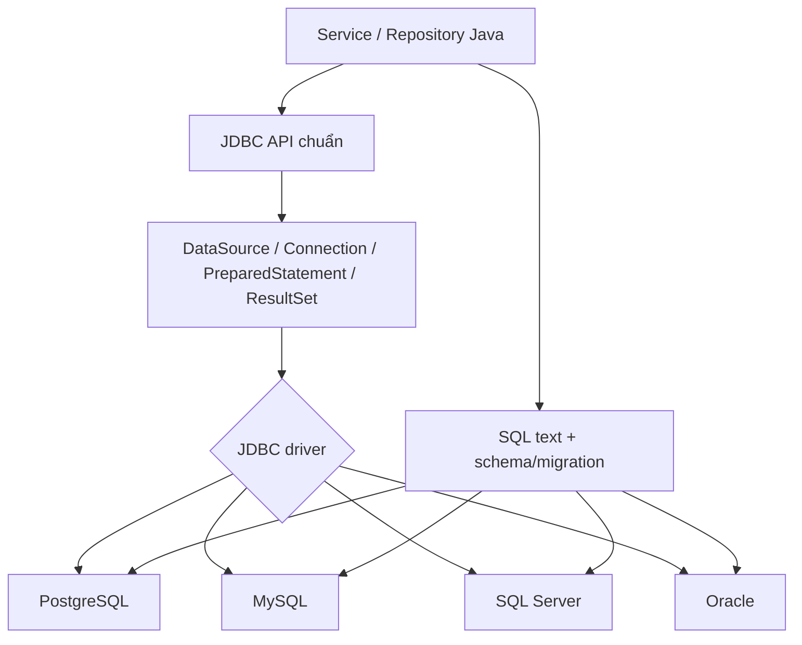

# Phân biệt tính khả chuyển API JDBC và tính khả chuyển SQL

> **Chương:** Đa hệ quản trị  
> **Bối cảnh:** Ứng dụng Java dùng **JDBC** qua driver, `DataSource`, `Connection`, `PreparedStatement` và `ResultSet` để thực hiện SQL tham số hóa, CRUD, transaction, batching, kiểm soát lỗi và hiệu năng trên nhiều hệ quản trị cơ sở dữ liệu quan hệ.

Một ứng dụng ban đầu dùng PostgreSQL. Repository Java đã viết đúng JDBC: lấy `Connection` từ `DataSource`, dùng `PreparedStatement`, bind giá trị bằng `setString()`/`setBigDecimal()` và đọc `ResultSet` trong `try-with-resources`. Khi chuyển sang MySQL hoặc SQL Server, liệu chỉ cần đổi JDBC URL và driver là toàn bộ hệ thống chạy được?

**Không nhất thiết.** Có hai câu hỏi khác nhau:

1. **Tính khả chuyển API JDBC:** Code Java gọi những interface và phương thức JDBC tiêu chuẩn có thể dùng với nhiều driver/DBMS hay không?
2. **Tính khả chuyển SQL:** Câu SQL, kiểu dữ liệu, DDL, transaction và cách diễn giải kết quả có chạy **đúng ngữ nghĩa** trên từng DBMS hay không?

JDBC cung cấp một **giao diện truy cập chung**, nhưng không biến PostgreSQL, MySQL, SQL Server và Oracle thành một SQL dialect thống nhất. Ngược lại, một câu SQL có vẻ giống chuẩn SQL vẫn có thể cần thay đổi vì cách triển khai kiểu dữ liệu, identity, phân trang, UPSERT, khóa, isolation và thông báo lỗi.

Bài này xây dựng cách tách hai lớp trách nhiệm, xác định phần có thể giữ nguyên trong Java và phần cần kiểm chứng/tùy biến cho từng database. Mục tiêu không phải viết một abstraction che giấu mọi khác biệt, mà **biết khác biệt nào là hợp đồng chuẩn và khác biệt nào phải được thiết kế, thử nghiệm rõ ràng**.

## 1. Một ứng dụng “dùng JDBC chuẩn” gồm những tầng nào?



Các lớp có trách nhiệm khác nhau:

| Lớp | Điều được chuẩn hóa hoặc cung cấp | Điều có thể khác nhau |
|---|---|---|
| **JDBC API** | Chữ ký `Connection.prepareStatement()`, `PreparedStatement.setXxx()`, `ResultSet.getXxx()`, `commit()`/`rollback()`, `SQLException` | Driver có thể không hỗ trợ mọi tính năng tùy chọn, hoặc xử lý các gợi ý hiệu năng khác nhau |
| **JDBC driver** | Cầu nối từ Java API sang giao thức DBMS | URL, tên class driver, cách bind kiểu, cursor/fetch, timeout, generated keys, SQLState |
| **SQL** | Một phần câu lệnh phổ biến như `SELECT`, `WHERE`, `INSERT`, `UPDATE` | `LIMIT`/`TOP`/`FETCH`, UPSERT, identity, JSON/array, function, procedure, quoting |
| **Schema và migration** | Ý nghĩa bảng, cột, khóa, constraint ở mức nghiệp vụ | Loại dữ liệu, DDL, index, partition, trigger, quyền, auto-increment |
| **Transaction / consistency** | JDBC có `setAutoCommit()`, `commit()`, `rollback()`, isolation API | Mức isolation được hỗ trợ, khóa, DDL implicit commit, deadlock, visibility |
| **Vận hành** | Có thể đo qua thời gian/metric và sử dụng pool | Sức chứa connection, kế hoạch truy vấn, cách tối ưu, replication, timeout, failover |

**Một đoạn Java biên dịch thành công với `java.sql` không chứng minh SQL bên trong sẽ chạy được trên mọi DBMS.** Và một câu SQL được cả hai database chấp nhận không chứng minh chúng trả cùng kết quả trong mọi tình huống.

### Khả chuyển có ba mức

- **Khả chuyển ở mức biên dịch:** mã Java sử dụng những interface chuẩn, không import class vendor ở repository.
- **Khả chuyển ở mức thực thi:** driver và DBMS hỗ trợ các thao tác cần thiết; truy vấn không lỗi.
- **Khả chuyển về ngữ nghĩa nghiệp vụ:** dữ liệu, giao dịch, kết quả, thứ tự, khóa và xử lý lỗi **đúng như cùng một hợp đồng** ở mọi DBMS.

Mức thứ ba là quan trọng nhất. Ví dụ cùng câu `SELECT` có thể trả các hàng theo thứ tự khác nếu thiếu `ORDER BY`; cùng biểu thức tìm kiếm có thể so sánh chữ hoa/chữ thường khác theo collation.

## 2. Phần lớn mã làm việc với JDBC có thể giữ nguyên

Những thành phần tiêu chuẩn phổ biến:

| API JDBC | Mục đích | Lưu ý về tính khả chuyển |
|---|---|---|
| `javax.sql.DataSource` | Cấp `Connection` cho ứng dụng | Một implementation có thể là pool hoặc không pool |
| `java.sql.Connection` | Phiên làm việc, transaction, metadata | Không mặc định mọi driver hỗ trợ cùng isolation/savepoint/holdability |
| `PreparedStatement` | SQL tham số hóa bằng dấu `?` | Dấu `?` bind **giá trị**, không bind tên bảng/cột |
| `ResultSet` | Duyệt và lấy giá trị hàng/cột | Mapping kiểu và khả năng scroll/cursor phụ thuộc driver |
| `ResultSetMetaData` | Thông tin các cột kết quả | Tên kiểu/precision và cách driver ánh xạ có thể khác |
| `DatabaseMetaData` | Nhận diện driver/DBMS và hỏi khả năng hỗ trợ | Thông tin driver báo cần được xác minh bằng test |
| `SQLException` | Lỗi SQL, SQLState, vendor code, linked exceptions | Mã vendor và phân loại lỗi khác nhau |
| `Statement.addBatch()` / `executeBatch()` | Gửi nhiều lệnh | Counts, rewrite, partial failure và hiệu năng tùy driver |
| `Savepoint` | Tạo điểm rollback trong transaction | Không phải mọi DBMS/driver/trạng thái transaction đều hỗ trợ |
| `Statement.setQueryTimeout()` | Yêu cầu giới hạn thời gian câu lệnh | Không bảo đảm cùng độ chính xác hoặc ngữ nghĩa hủy |
| `Statement.getGeneratedKeys()` | Đọc khóa được database tạo từ statement phù hợp | Cách hỗ trợ, kiểu khóa và thứ tự kết quả phụ thuộc driver/DBMS |

Với generated keys, có thể yêu cầu trả khóa khi tạo statement bằng `Connection.prepareStatement(sql, Statement.RETURN_GENERATED_KEYS)`, sau đó đọc qua `ps.getGeneratedKeys()`. Tính khả chuyển của phương thức chuẩn vẫn cần được kiểm chứng theo driver/DBMS.

**Dùng interface chuẩn là điều kiện thuận lợi, không phải bằng chứng khả chuyển hoàn toàn.** Ví dụ `ResultSet.TYPE_SCROLL_SENSITIVE` là hằng chuẩn, nhưng driver có thể không hỗ trợ đúng kiểu con trỏ đó. Nếu tính năng không hỗ trợ, có thể nhận `SQLFeatureNotSupportedException` hoặc biến thể phản hồi khác tùy API/driver.

## 3. Ví dụ JDBC dùng chung cho nhiều DBMS

Ta bắt đầu từ một hợp đồng dữ liệu nhỏ, không dựa vào khóa tự tăng hoặc hàm SQL riêng của vendor.

### 3.1. Schema chung về mặt thiết kế

```sql
CREATE TABLE products (
    tenant_id VARCHAR(36) NOT NULL,
    product_id BIGINT NOT NULL,
    sku VARCHAR(80) NOT NULL,
    name VARCHAR(200) NOT NULL,
    price DECIMAL(12, 2) NOT NULL,
    status VARCHAR(16) NOT NULL,
    PRIMARY KEY (tenant_id, product_id),
    CONSTRAINT uq_products_tenant_sku UNIQUE (tenant_id, sku)
);
```

Đây là **schema cơ sở để giải thích ý tưởng**. Các kiểu `VARCHAR`, `BIGINT`, `DECIMAL`, `PRIMARY KEY` và `UNIQUE` khá phổ biến, nhưng không có nghĩa DDL nguyên xi được kiểm chứng trên mọi phiên bản PostgreSQL, MySQL, Oracle và SQL Server. Schema production còn cần migration, collation, độ dài chuỗi, encoding, index, `CHECK`, quyền và cách tổ chức schema/catalog theo từng DBMS.

Bảng dùng `tenant_id` dạng chuỗi 36 ký tự để không giả định mọi DBMS đều có kiểu `UUID` native; đây chỉ là lựa chọn demo. Ứng dụng thật phải quyết định định dạng, chuẩn hóa và index phù hợp. **Tenant ID vẫn phải được authorization kiểm tra trước khi đưa vào repository.**

Tại sao `product_id` do ứng dụng cung cấp trong ví dụ đầu? Vì identity/generation là một trong những khác biệt đáng khảo sát riêng; tách nó khỏi câu CRUD cơ bản giúp phân biệt API portability và SQL portability.

### 3.2. Repository chỉ sử dụng JDBC chuẩn

```java
import java.math.BigDecimal;
import java.sql.Connection;
import java.sql.PreparedStatement;
import java.sql.ResultSet;
import java.sql.SQLException;
import java.util.Objects;
import java.util.Optional;
import javax.sql.DataSource;

record Product(
    long id, String sku, String name,
    BigDecimal price, String status
) {}

public final class ProductRepository {
    private final DataSource dataSource;

    public ProductRepository(DataSource dataSource) {
        this.dataSource = Objects.requireNonNull(dataSource);
    }

    public Optional<Product> findById(
            String authorizedTenantId, long productId
    ) throws SQLException {

        String sql = """
            SELECT product_id, sku, name, price, status
            FROM products
            WHERE tenant_id = ? AND product_id = ?
            """;

        try (Connection connection = dataSource.getConnection();
             PreparedStatement ps = connection.prepareStatement(sql)) {

            ps.setString(1, authorizedTenantId);
            ps.setLong(2, productId);

            try (ResultSet rs = ps.executeQuery()) {
                if (!rs.next()) {
                    return Optional.empty();
                }

                return Optional.of(new Product(
                    rs.getLong("product_id"),
                    rs.getString("sku"),
                    rs.getString("name"),
                    rs.getBigDecimal("price"),
                    rs.getString("status")
                ));
            }
        }
    }

    public int changePrice(
            String authorizedTenantId,
            long productId,
            BigDecimal newPrice
    ) throws SQLException {

        Objects.requireNonNull(newPrice, "newPrice");
        if (newPrice.signum() < 0) {
            throw new IllegalArgumentException(
                "Price must be nonnegative"
            );
        }

        String sql = """
            UPDATE products
            SET price = ?
            WHERE tenant_id = ? AND product_id = ?
            """;

        try (Connection connection = dataSource.getConnection();
             PreparedStatement ps = connection.prepareStatement(sql)) {

            ps.setBigDecimal(1, newPrice);
            ps.setString(2, authorizedTenantId);
            ps.setLong(3, productId);

            return ps.executeUpdate();
        }
    }
}
```

**Các điểm có tính khả chuyển cao ở đây:**

1. Repository nhận `DataSource`, không tự biết JDBC URL hoặc driver class.
2. `Connection`, `PreparedStatement` và `ResultSet` là API chuẩn, resource được đóng bằng `try-with-resources`.
3. SQL chỉ dùng `SELECT`, `UPDATE`, `WHERE`, phép so sánh `=` và dấu `?` ở những vị trí tham số giá trị thông dụng.
4. `BigDecimal` phù hợp cột `DECIMAL` hơn `double` khi lưu tiền.
5. `tenant_id` và `product_id` được bind tường minh; statement không nối trực tiếp input người dùng vào SQL.

**Những điều ví dụ chưa đảm bảo:**

- SQL và DDL vẫn cần test trên từng DBMS thật (nhất là precision, collation và kiểu `DECIMAL`).
- `findById()` mở connection mới trong mỗi lời gọi. Khi một service cần **nhiều DAO chung transaction**, service phải sở hữu một connection và truyền nó cho DAO, không gọi hai method tự mở connection rồi nghĩ rằng chúng được rollback cùng nhau.
- `changePrice()` trả update count, không tự xác minh số dư/giá mới sau commit. Quy ước “phải đúng một hàng” là trách nhiệm của service.
- Cùng SQL không có nghĩa cùng tốc độ; index, query planner, session settings và dữ liệu thực tế quyết định hiệu năng.

### 3.3. Kiểu Java cũng thuộc hợp đồng

| Kiểu Java / JDBC | Kiểu SQL thường tương ứng | Điểm cần test |
|---|---|---|
| `long` / `setLong()` | `BIGINT` | Khả năng lưu, range, generated IDs |
| `String` / `setString()` | `VARCHAR`, `CHAR`, `TEXT` | Encoding, collation, khoảng trắng ở `CHAR` |
| `BigDecimal` / `setBigDecimal()` | `DECIMAL`, `NUMERIC` | Precision, scale, rounding, overflow |
| `boolean` / `setBoolean()` | `BOOLEAN` hoặc biểu diễn khác | Một số DBMS dùng `BIT`/số hoặc không có boolean SQL giống nhau |
| `LocalDate` / `setObject()` | `DATE` | JDBC 4.2 và mapping driver |
| `LocalDateTime` / `setObject()` | `TIMESTAMP` (không timezone) | Độ chính xác, múi giờ session, giá trị DST |
| `OffsetDateTime` / `setObject()` | Loại có timezone/offset tùy DBMS | Có thể không giữ **offset gốc** dù giữ instant |
| `byte[]` / `setBytes()` | `BYTEA`, `BLOB`, `VARBINARY` | BLOB lớn, buffering, giới hạn packet |
| `UUID` / `setObject()` | PostgreSQL `UUID` hoặc `CHAR/BINARY` | Mapping khác theo driver, không mặc định mọi DBMS hỗ trợ UUID native |
| `null` / `setNull(index, Types.X)` | SQL `NULL` | Đúng `Types`, predicate `IS NULL` thay vì `= NULL` |

Đặc biệt với `DECIMAL(12,2)`, dùng `new BigDecimal("199.90")` để tránh tạo giá trị từ floating-point không chính xác. Với nullable primitive, `ResultSet.getInt()` có thể trả `0` cho SQL NULL; phải gọi `rs.wasNull()` hoặc dùng getter đối tượng phù hợp.

## 4. Đổi JDBC driver không đồng nghĩa đổi ngữ nghĩa SQL

Ví dụ cấu hình URL:

| DBMS | JDBC URL thường gặp | Driver thường dùng |
|---|---|---|
| PostgreSQL | `jdbc:postgresql://localhost:5432/shop` | PostgreSQL JDBC (pgJDBC) |
| MySQL | `jdbc:mysql://localhost:3306/shop` | MySQL Connector/J |
| SQL Server | `jdbc:sqlserver://localhost:1433;databaseName=shop` | Microsoft JDBC Driver for SQL Server |
| Oracle | `jdbc:oracle:thin:@//localhost:1521/XEPDB1` | Oracle JDBC thin driver |

Các URL chỉ là **ví dụ phát triển cục bộ**. Thực tế cần SSL/TLS, timeout, credential rotation, naming, connection pool và cấu hình riêng của từng driver. Không đưa mật khẩu vào source code hoặc coi URL này đủ để kết nối vào mọi môi trường.

Có thể tạo một `DataSource` khác rồi truyền vào **cùng `ProductRepository`**. Đây là **khả chuyển kiến trúc/API**: DAO không phụ thuộc import class của driver. Nhưng schema, query ngoài CRUD đơn giản và test có thể vẫn khác.

### `DataSource` không tự tạo pool

`javax.sql.DataSource` là interface cấp connection. Một implementation có thể mở physical connection mới mỗi lần, hoặc được backed bởi pool như HikariCP. Tính khả chuyển của repository tăng khi chỉ phụ thuộc interface; sự hiện diện của `DataSource` **không tự đảm bảo pooling**, cũng không tự đồng bộ transaction của nhiều connection.

Khi đổi DBMS, thay driver/URL chưa đủ: pool có thể cần validation settings, lifetime, timeout, connection initialization và số connection phù hợp với DBMS mới.

## 5. Những câu SQL tưởng tương đương nhưng không khả chuyển nguyên xi

### 5.1. Phân trang

Yêu cầu nghiệp vụ: lấy tối đa 20 sản phẩm sau `product_id = 100`, theo thứ tự ID tăng dần.

**PostgreSQL/MySQL (các phiên bản thông dụng):**

```sql
SELECT product_id, sku, name, price
FROM products
WHERE tenant_id = ?
  AND product_id > ?
ORDER BY product_id
LIMIT ?;
```

**SQL Server (phiên bản hỗ trợ `OFFSET/FETCH`):**

```sql
SELECT product_id, sku, name, price
FROM products
WHERE tenant_id = ?
  AND product_id > ?
ORDER BY product_id
OFFSET 0 ROWS FETCH NEXT ? ROWS ONLY;
```

**Một dạng SQL standard được một số DBMS hỗ trợ:**

```sql
SELECT product_id, sku, name, price
FROM products
WHERE tenant_id = ?
  AND product_id > ?
ORDER BY product_id
FETCH FIRST 20 ROWS ONLY;
```

Dạng `FETCH FIRST` không chứng minh mọi driver/DBMS/phiên bản cho phép bind tham số giới hạn như nhau. Oracle, PostgreSQL, DB2 và SQL Server có hỗ trợ mức khác nhau tùy phiên bản/cú pháp; việc dùng `LIMIT` hoặc `OFFSET/FETCH` phải được xác minh trên các target cụ thể.

**Vì sao `ORDER BY` quan trọng?** `LIMIT`/`TOP`/`FETCH` không tự tạo thứ tự ổn định. Khi không có `ORDER BY`, “20 hàng đầu tiên” không có nghĩa nghiệp vụ nhất quán; với keyset pagination nên dùng thứ tự theo khóa duy nhất và điều kiện tương ứng.

### 5.2. Khóa tự sinh

Một cột ID tự sinh có thể được khai báo khác nhau:

```sql
-- PostgreSQL:
id BIGINT GENERATED BY DEFAULT AS IDENTITY PRIMARY KEY

-- MySQL:
id BIGINT NOT NULL AUTO_INCREMENT PRIMARY KEY

-- SQL Server:
id BIGINT IDENTITY(1,1) PRIMARY KEY

-- Oracle 12c+ (phụ thuộc phiên bản/cấu hình):
id NUMBER(19) GENERATED BY DEFAULT AS IDENTITY PRIMARY KEY
```

Một câu `CREATE TABLE` chứa phần định nghĩa này không nên được gửi nguyên xi tới mọi DBMS. Các hệ quản trị còn khác nhau ở cách seed/increment identity, reset sequence, giá trị insert thủ công và cách nhận ID đã tạo.

### 5.3. UPSERT: insert nếu chưa có, cập nhật nếu trùng

**PostgreSQL:**

```sql
INSERT INTO products (
    tenant_id, product_id, sku, name, price, status
) VALUES (?, ?, ?, ?, ?, ?)
ON CONFLICT (tenant_id, sku)
DO UPDATE SET
    name = EXCLUDED.name,
    price = EXCLUDED.price,
    status = EXCLUDED.status;
```

**MySQL:**

```sql
INSERT INTO products (
    tenant_id, product_id, sku, name, price, status
) VALUES (?, ?, ?, ?, ?, ?)
ON DUPLICATE KEY UPDATE
    name = ?,
    price = ?,
    status = ?;
```

Hai câu chỉ là **ví dụ về cú pháp**, không mặc định tương đương hoàn toàn. PostgreSQL `ON CONFLICT (tenant_id, sku)` chỉ định conflict target rõ ràng; MySQL `ON DUPLICATE KEY UPDATE` có thể kích hoạt bởi **bất kỳ unique/primary key liên quan**. Với bảng có cả PK `(tenant_id, product_id)` lẫn UNIQUE `(tenant_id, sku)`, hành vi trên những xung đột khác nhau cần được thiết kế và test, không dùng UPSERT mù.

Ngoài cú pháp, còn khác ở update count, trigger, lock và khả năng trả generated keys. Với nhu cầu cạnh tranh cao, một chuỗi `SELECT` rồi `INSERT` không mặc nhiên thay thế atomic UPSERT: hai request có thể cùng thấy “chưa có” rồi cùng insert.

### 5.4. Nối chuỗi, xử lý NULL, collation

```sql
-- Toán tử || được PostgreSQL và nhiều DBMS hỗ trợ:
SELECT sku || ' - ' || name FROM products;

-- MySQL thường sử dụng hàm CONCAT để nối chuỗi:
SELECT CONCAT(sku, ' - ', name) FROM products;
```

Ở nhiều môi trường, toán tử, hàm và hành vi khi một đối số là `NULL` có thể khác. Tương tự, `LIKE`, collation, so sánh phân biệt hoa/thường và chuẩn hóa Unicode không hoàn toàn giống nhau. Nếu nghiệp vụ yêu cầu mã SKU được so sánh **không phân biệt hoa/thường** thì cần xác định policy tường minh (chuẩn hóa dữ liệu, collation/index hoặc biểu thức SQL phù hợp) và test trên từng DBMS.

### 5.5. Tên bảng, cột và identifier quoting

| DBMS | Dấu quote identifier thường dùng |
|---|---|
| PostgreSQL | `"column_name"` |
| MySQL | Dấu backtick bao quanh tên identifier, ví dụ tên cột `column_name` |
| SQL Server | `[column_name]`; cũng có `"..."` trong chế độ cấu hình phù hợp |
| Oracle | `"COLUMN_NAME"` |

Tránh đặt tên cột trùng từ khóa như `user`, `order`, `group` nếu không cần. Tên không quote thường bị DBMS xử lý khác về chữ hoa/chữ thường; tên quote có thể nhạy cảm chính xác theo cách đã tạo. `DatabaseMetaData.getIdentifierQuoteString()` hữu ích để **quan sát** ký tự quote được driver khai báo, nhưng không biến chuỗi identifier tùy ý từ client thành SQL an toàn.

**`PreparedStatement` chỉ bind giá trị**, không bind tên cột/schema:

```java
// Sai mục đích: dấu ? không thay thế tên cột.
String badSql = "SELECT ? FROM products WHERE product_id = ?";
```

Khi tên cột được chọn động, mapping input vào **allowlist hằng SQL do developer kiểm soát**, rồi bind các **giá trị** bằng `?`.

## 6. Tách SQL dialect khỏi repository thay vì rải `if (dbVendor)`

Một repository hỗ trợ nhiều DBMS không nhất thiết phải chứa hàng loạt `if/else` tạo SQL trong mọi method. Có thể tách những phần thật sự khác bằng **dialect interface**.

### 6.1. Định nghĩa hợp đồng câu SQL theo database

```java
public interface ProductSqlDialect {
    String nextPageSql();
}
```

Một enum minh họa hai kiểu phân trang:

```java
public enum ProductDialect implements ProductSqlDialect {
    POSTGRESQL_MYSQL("""
        SELECT product_id, sku, name, price
        FROM products
        WHERE tenant_id = ?
          AND product_id > ?
        ORDER BY product_id
        LIMIT ?
        """),

    SQLSERVER("""
        SELECT product_id, sku, name, price
        FROM products
        WHERE tenant_id = ?
          AND product_id > ?
        ORDER BY product_id
        OFFSET 0 ROWS FETCH NEXT ? ROWS ONLY
        """);

    private final String pageSql;

    ProductDialect(String pageSql) {
        this.pageSql = pageSql;
    }

    @Override
    public String nextPageSql() {
        return pageSql;
    }
}
```

Cả hai câu SQL có **ba giá trị bind cùng thứ tự**: tenant, afterId, limit. Chỉ phần cú pháp phân trang khác nhau. SQL Server example yêu cầu phiên bản hỗ trợ `OFFSET/FETCH`; kiểm thử integration là bước bắt buộc trước khi nhận nó là target hỗ trợ.

Nếu sau này thêm Oracle hoặc SQLite, cần kiểm tra cú pháp và giới hạn target rồi bổ sung implementation, không mặc định một SQL string đã hỗ trợ tự động. Đây là cách *cô lập khác biệt*, không phải bằng chứng mọi DBMS đều chỉ cần một thay đổi nhỏ.

### 6.2. Repository dùng API JDBC chuẩn và dialect được tiêm vào

```java
import java.math.BigDecimal;
import java.sql.Connection;
import java.sql.PreparedStatement;
import java.sql.ResultSet;
import java.sql.SQLException;
import java.util.ArrayList;
import java.util.List;
import java.util.Objects;
import javax.sql.DataSource;

record ProductPageRow(
    long id, String sku, String name, BigDecimal price
) {}

public final class PagedProductRepository {
    private final DataSource dataSource;
    private final ProductSqlDialect dialect;

    public PagedProductRepository(
            DataSource dataSource,
            ProductSqlDialect dialect
    ) {
        this.dataSource = Objects.requireNonNull(dataSource);
        this.dialect = Objects.requireNonNull(dialect);
    }

    public List<ProductPageRow> nextPage(
            String authorizedTenantId,
            long afterId,
            int pageSize
    ) throws SQLException {

        if (pageSize < 1 || pageSize > 100) {
            throw new IllegalArgumentException(
                "pageSize must be between 1 and 100"
            );
        }

        try (Connection connection = dataSource.getConnection();
             PreparedStatement statement =
                 connection.prepareStatement(dialect.nextPageSql())) {

            statement.setString(1, authorizedTenantId);
            statement.setLong(2, afterId);
            statement.setInt(3, pageSize);

            try (ResultSet rs = statement.executeQuery()) {
                List<ProductPageRow> page =
                    new ArrayList<>(pageSize);

                while (rs.next()) {
                    page.add(new ProductPageRow(
                        rs.getLong("product_id"),
                        rs.getString("sku"),
                        rs.getString("name"),
                        rs.getBigDecimal("price")
                    ));
                }
                return page;
            }
        }
    }
}
```

Sử dụng:

```java
PagedProductRepository repository =
    new PagedProductRepository(
        dataSource,
        ProductDialect.POSTGRESQL_MYSQL
    );

List<ProductPageRow> firstPage =
    repository.nextPage(authorizedTenantId, 0L, 20);
```

Trong code production, **dialect phải là cấu hình đã được kiểm tra**, nhất quán với `DataSource`. Không nhận tên dialect từ request của người dùng rồi để client thay SQL được thực thi. Ví dụ `afterId = 0` giả định ID dương; nếu ứng dụng cho phép ID âm, cần cursor/token thích hợp.

**Ưu điểm tách riêng:**

- DAO tiếp tục phụ thuộc `DataSource`, `PreparedStatement`, `ResultSet` chuẩn.
- SQL đặc thù được đóng gói vào một số implementation có tên và test riêng.
- Không rải logic vendor khắp service/mapper.
- Có thể thêm test contract chạy cùng repository trên nhiều `DataSource`.

**Giới hạn:** khi khác biệt sâu hơn về kiểu dữ liệu, upsert, JSON, stored procedures hoặc cách transaction hoạt động, một interface chỉ trả SQL string không đủ. Cần thiết kế adapter rõ ràng cho use case đó, thay vì cố “ẩn” mọi sai khác bằng một lớp generic khổng lồ.

## 7. Nhận diện DBMS bằng `DatabaseMetaData` — nhưng đừng đoán năng lực

JDBC cung cấp `DatabaseMetaData` để truy vấn driver/database:

```java
import java.sql.Connection;
import java.sql.DatabaseMetaData;
import java.sql.ResultSet;
import java.sql.SQLException;

static void describeDatabase(Connection connection)
        throws SQLException {

    DatabaseMetaData meta = connection.getMetaData();

    System.out.println("DBMS: "
        + meta.getDatabaseProductName() + " "
        + meta.getDatabaseProductVersion());

    System.out.println("Driver: "
        + meta.getDriverName() + " "
        + meta.getDriverVersion());

    System.out.println(
        "Batch updates: " + meta.supportsBatchUpdates()
    );
    System.out.println(
        "Transactions: " + meta.supportsTransactions()
    );
    System.out.println(
        "Savepoints: " + meta.supportsSavepoints()
    );
    System.out.println(
        "Generated keys: " + meta.supportsGetGeneratedKeys()
    );
    System.out.println(
        "Stored procedures: " + meta.supportsStoredProcedures()
    );
    System.out.println(
        "Scrollable ResultSet: " +
        meta.supportsResultSetType(
            ResultSet.TYPE_SCROLL_INSENSITIVE
        )
    );
    System.out.println(
        "Identifier quote: [" +
        meta.getIdentifierQuoteString() + "]"
    );
}
```

Các giá trị trả về phản ánh khả năng mà **driver báo**. Chúng rất hữu ích cho preflight, debug và log môi trường test, nhưng không thay thế integration test:

- Driver có thể nói hỗ trợ generated keys, nhưng cách nhận khóa của một câu SQL cụ thể vẫn khác.
- Hỗ trợ scrollable `ResultSet` không nói gì về chi phí memory hoặc tính nhạy với thay đổi concurrent.
- `supportsBatchUpdates()` không bảo đảm batch sẽ có cùng update counts hay all-or-nothing.
- `supportsSavepoints()` không bảo đảm bạn có thể dùng savepoint qua mọi statement/DDL.
- Một database có thể hỗ trợ cú pháp nào đó theo phiên bản mới nhưng ứng dụng đang kết nối tới phiên bản cũ.

### Có nên tự đoán dialect từ product name?

Có thể dùng `getDatabaseProductName()` để hỗ trợ **kiểm tra cấu hình**, nhưng nên thiết kế nguyên tắc rõ ràng:

1. Application configuration chọn dialect mục tiêu và `DataSource`.
2. Ở bootstrap hoặc test, đọc `DatabaseMetaData` để xác minh DBMS/version có đúng kỳ vọng không.
3. Nếu không nhận diện được môi trường, **fail rõ ràng** thay vì tự chọn ngẫu nhiên dialect.
4. Với version khác, chạy bộ integration tests tương ứng.
5. Không dựa vào một nhánh `contains("sql")` trên product name để quyết định SQL bảo mật hoặc migration.

Một số hệ quản trị tương thích giao thức PostgreSQL có thể tự mô tả tương tự PostgreSQL nhưng khác chi tiết transaction, function hoặc planner. Tên product **không đủ chứng minh tương thích hoàn toàn**.

## 8. DDL và migration là phần đặc thù cần quản lý có chủ đích

Schema của bài toán lớn hơn một câu `CREATE TABLE`. Những thành phần khác biệt có thể bao gồm:

- Identity/sequence/auto-increment và generated keys.
- `BOOLEAN`/`BIT`, `UUID`, `JSONB`/`JSON`, `BYTEA`/`BLOB`/`VARBINARY`.
- `TIMESTAMP WITH TIME ZONE`/`TIMESTAMPTZ`/`DATETIMEOFFSET`, precision và timezone.
- `CHECK`, index có điều kiện, expression index, included columns.
- Collation, charset, so sánh chuỗi và độ dài/index của chuỗi.
- Partition, materialized view, trigger, stored procedure/function.
- Default expressions như UUID generator, current timestamp.
- Cú pháp `CREATE INDEX IF NOT EXISTS`, `DROP ... IF EXISTS` và độ khả chuyển DDL.
- Quyền database, role, schema/search path và row-level security.

### Migration nên có biến thể theo DBMS khi cần

Một cách tổ chức ở tầng build/deploy:

```text
db/
  common/
    contract.md        (mô tả nghiệp vụ, không phải SQL dùng chung)
  postgresql/
    V001__create_products.sql
    V002__add_indexes.sql
  mysql/
    V001__create_products.sql
    V002__add_indexes.sql
  sqlserver/
    V001__create_products.sql
    V002__add_indexes.sql
```

Đây là **sơ đồ tổ chức minh họa**, không phải yêu cầu cụ thể của Flyway/Liquibase. Migration tool có quy tắc naming/location khác nhau. Cốt lõi là chạy đúng migration cho từng target, có test nâng cấp và cơ chế theo dõi version schema.

**Không giấu DDL trong repository** bằng cách mỗi lần khởi động tự chạy `CREATE TABLE` rồi bỏ qua lỗi. DDL có thể implicit commit ở một số DBMS, giữ lock mạnh hoặc không rollback được như kỳ vọng. Migration thuộc lifecycle riêng, có chiến lược rollback/forward-fix rõ ràng.

### Ràng buộc có thể cùng tên nhưng khác cách thực thi

`CHECK (price >= 0)` là cú pháp phổ biến, nhưng ví dụ **MySQL trước 8.0.16** không thực thi `CHECK` theo cách các phiên bản mới thực thi. Vì vậy khi mở rộng hỗ trợ, phải kiểm tra **phiên bản tối thiểu** và thử chèn dữ liệu âm trên database thật; không chỉ kiểm tra câu `CREATE TABLE` chạy thành công.

DBMS cũng có thể khác khi kiểu `DECIMAL(12,2)` nhận số nhiều chữ số thập phân: làm tròn, từ chối, cảnh báo hoặc phụ thuộc SQL mode. Hợp đồng nghiệp vụ về tiền cần được xác nhận cả ở Java lẫn DB.

## 9. Generated keys: API chuẩn nhưng cách hỗ trợ không hoàn toàn giống nhau

JDBC có hỗ trợ yêu cầu keys:

```java
import java.sql.Connection;
import java.sql.PreparedStatement;
import java.sql.ResultSet;
import java.sql.SQLException;
import java.sql.Statement;

static long insertAndReadId(Connection connection)
        throws SQLException {

    String sql = """
        INSERT INTO products_auto (
            sku, name
        ) VALUES (?, ?)
        """;

    try (PreparedStatement ps = connection.prepareStatement(
             sql, Statement.RETURN_GENERATED_KEYS
         )) {

        ps.setString(1, "JDBC-101");
        ps.setString(2, "JDBC Guide");

        if (ps.executeUpdate() != 1) {
            throw new SQLException("Insert count != 1");
        }

        try (ResultSet keys = ps.getGeneratedKeys()) {
            if (!keys.next()) {
                throw new SQLException("No generated key returned");
            }
            return keys.getLong(1);
        }
    }
}
```

**Lưu ý:** `products_auto` là **bảng giả định riêng** có cột identity `id` và hai cột `sku`/`name`, **không phải** bảng `products` ở mục 3. Mỗi DBMS phải được tạo đúng schema identity trước khi chạy ví dụ.

Kết quả có thể khác tùy driver:

- Một số driver trả generated key dưới dạng `BIGINT`/`NUMERIC`/`DECIMAL` hoặc các kiểu Java khác.
- Một số câu SQL/driver cần chỉ định tên cột khóa: `prepareStatement(sql, new String[]{"id"})`.
- `getGeneratedKeys()` có thể không hỗ trợ ở một số tình huống hoặc không trả thứ tự/cột như code giả định.
- Các DBMS còn có cú pháp SQL riêng như PostgreSQL `INSERT ... RETURNING id` hoặc SQL Server `OUTPUT INSERTED.id`.
- Generated key **không đồng nghĩa transaction đã commit**. Nếu commit mất phản hồi, ID đã có thể được tạo/lưu nhưng caller chưa biết trạng thái chính xác.

Khi cần portability, chọn chiến lược rõ: ưu tiên JDBC generated keys nếu được hỗ trợ và test; hoặc cung cấp adapter riêng dùng `RETURNING`/`OUTPUT`. Không cố dùng `SELECT MAX(id)` để lấy key vừa tạo vì không an toàn khi nhiều request insert đồng thời.

## 10. Kiểu ngày giờ và timezone: API có thể chung, ý nghĩa lưu trữ khác

Giả sử ứng dụng muốn lưu thời điểm một đơn hàng được tạo. Các khái niệm cần tách:

- **`LocalDate`:** một ngày theo lịch, không mang timezone.
- **`LocalDateTime`:** ngày giờ cục bộ **không** có timezone/offset.
- **`Instant`:** điểm thời gian UTC trên timeline.
- **`OffsetDateTime`:** ngày giờ kèm offset; **không mặc nhiên là timezone vùng địa lý**.
- **`TIMESTAMP`, `TIMESTAMP WITH TIME ZONE` và các kiểu riêng vendor:** cách lưu và hiển thị phụ thuộc DBMS.

JDBC 4.2 hỗ trợ các API `setObject()`/`getObject()` với một số kiểu `java.time`:

```java
import java.time.LocalDate;
import java.time.LocalDateTime;
import java.time.OffsetDateTime;
import java.sql.PreparedStatement;
import java.sql.ResultSet;

LocalDate businessDate = LocalDate.of(2026, 11, 17);
LocalDateTime localTime = LocalDateTime.of(
    2026, 11, 17, 9, 30
);
OffsetDateTime timestamp =
    OffsetDateTime.parse("2026-11-17T09:30:00+07:00");

// Ví dụ khi bảng/cột đã được tạo với SQL type phù hợp:
ps.setObject(1, businessDate);
ps.setObject(2, localTime);
ps.setObject(3, timestamp);

// Khi đọc:
LocalDate day = rs.getObject("business_date", LocalDate.class);
OffsetDateTime eventAt =
    rs.getObject("event_time", OffsetDateTime.class);
```

`ps` và `rs` trong đoạn này là các đối tượng `PreparedStatement`/`ResultSet` được tạo ở phạm vi ngoài; đây là **minh họa mapping API**, không phải chương trình độc lập.

Đừng mặc định cùng một `TIMESTAMP` lưu giống nhau trên PostgreSQL, MySQL và SQL Server. Cần xác định:

1. Muốn lưu **instant**, ngày giờ địa phương hay một offset cụ thể?
2. DBMS có kiểu timezone-aware không? Kiểu đó có **giữ offset gốc** hay chuẩn hóa về instant?
3. Driver có dùng timezone của JVM/session khi bind/đọc không?
4. Precision có giữ đủ microsecond/nanosecond không?
5. Giá trị qua DST, thay đổi timezone session và round-trip có giữ hợp đồng không?

Một test tối thiểu nên ghi các giá trị quanh ranh giới ngày, chuyển ngày theo offset, precision thập phân giây và so sánh round-trip trên **từng DBMS**. Nếu yêu cầu lưu tên timezone như `Asia/Ho_Chi_Minh`, phải lưu riêng định danh vùng khi cần; `OffsetDateTime` không biểu diễn đầy đủ quy tắc DST lịch sử.

## 11. Transaction API chuẩn, còn hành vi khóa và isolation khác nhau

JDBC cung cấp API rõ ràng:

```java
try (Connection connection = dataSource.getConnection()) {
    connection.setAutoCommit(false);

    try {
        // DAO 1 và DAO 2 phải dùng CÙNG connection này.
        runFirstUpdate(connection);
        runSecondUpdate(connection);

        connection.commit();
    } catch (SQLException | RuntimeException failure) {
        try {
            connection.rollback();
        } catch (SQLException rollbackFailure) {
            failure.addSuppressed(rollbackFailure);
        }
        throw failure;
    }
}
```

`runFirstUpdate`/`runSecondUpdate` là method minh họa nhận chính connection được cấp; ví dụ này giả định caller sở hữu transaction và không phải connection do JTA/Spring transaction manager đang quản lý.

**`setAutoCommit(false)`, `commit()` và `rollback()` có API giống nhau**, nhưng các trường hợp sau cần khảo sát riêng:

| Khía cạnh | Điểm có thể khác |
|---|---|
| Isolation mặc định | PostgreSQL thường dùng `READ COMMITTED`; MySQL/InnoDB thường dùng `REPEATABLE READ`, còn cấu hình có thể thay đổi |
| `TRANSACTION_REPEATABLE_READ` và `SERIALIZABLE` | Hiệu lực về snapshot, predicate locks, gap locks và conflict khác nhau |
| `SELECT ... FOR UPDATE` | SQL/hành vi khóa hàng, lock timeout, `SKIP LOCKED`/`NOWAIT` khác |
| Deadlock/serialization failure | SQLState, thời điểm phát hiện, transaction cần retry |
| Savepoint | Có/hạn chế theo DBMS, loại câu SQL và transaction state |
| DDL trong transaction | Một số DBMS transactional DDL; một số DDL gây implicit commit |
| Nested transaction | Không tự có chỉ vì gọi `setAutoCommit(false)` nhiều lần; cần savepoint hoặc transaction manager rõ |
| Read-only mode | `Connection.setReadOnly(true)` thường là **hint/chính sách tùy implementation**, không thay thế quyền DB |
| Trạng thái sau statement lỗi | DBMS có thể yêu cầu rollback toàn transaction trước khi chạy lệnh mới |

### Isolation được cấu hình bằng JDBC, nhưng kết quả cần test

```java
import java.sql.Connection;
import java.sql.DatabaseMetaData;

DatabaseMetaData meta = connection.getMetaData();

if (meta.supportsTransactionIsolationLevel(
        Connection.TRANSACTION_SERIALIZABLE)) {
    connection.setTransactionIsolation(
        Connection.TRANSACTION_SERIALIZABLE
    );
}

// Dù driver nói hỗ trợ, vẫn phải test anomaly nghiệp vụ
// trong môi trường có hai connection chạy đồng thời.
```

Đoạn này giả định `connection` còn trong trạng thái có thể thay isolation theo hợp đồng driver/transaction hiện tại; **không thay isolation tùy ý giữa một transaction đang chạy**. Thay đổi isolation có thể gây lỗi hoặc kết thúc transaction tùy DBMS/driver, nên cấu hình tại ranh giới transaction theo chính sách được hỗ trợ.

**Cùng tên `READ COMMITTED` không có nghĩa mọi chi tiết khóa, snapshot và retry giống nhau.** Bài test cạnh tranh với hai connection là cần thiết khi nghiệp vụ dựa vào isolation.

### `commit()` thất bại không chứng minh “chưa ghi”

Nếu driver báo `SQLException` đúng lúc `commit()`, server có thể **đã commit nhưng phản hồi bị mất**. Một retry ghi dữ liệu với ID mới có thể tạo bản ghi trùng. Cần dùng request ID/idempotency key ổn định và đối soát trên connection mới trước khi thử lại. Đây là vấn đề phát sinh trên nhiều DBMS, dù mã gọi `Connection.commit()` giống hệt.

## 12. Batch JDBC: phương thức chung, kết quả và tối ưu khác nhau

Một `PreparedStatement` có thể thực hiện batch:

```java
String sql = """
    UPDATE products
    SET status = ?
    WHERE tenant_id = ? AND product_id = ?
    """;

try (PreparedStatement ps = connection.prepareStatement(sql)) {
    for (long id : productIds) {
        ps.setString(1, "ACTIVE");
        ps.setString(2, authorizedTenantId);
        ps.setLong(3, id);
        ps.addBatch();
    }

    int[] counts = ps.executeBatch();

    for (int value : counts) {
        if (value == Statement.SUCCESS_NO_INFO) {
            // Thành công nhưng không biết số hàng cụ thể.
        } else if (value == Statement.EXECUTE_FAILED) {
            // Batch item được báo lỗi nếu driver cung cấp.
        } else {
            // value >= 0: số hàng được báo ảnh hưởng.
        }
    }
}
```

`connection` trong ví dụ là connection do caller sở hữu; nếu nghiệp vụ cần batch nguyên tử, đặt nó trong transaction và `commit()/rollback()` rõ ràng.

Điểm khác nhau theo driver/DBMS:

- Driver có thể gom batch thành nhiều gói, rewrite SQL hoặc thực thi lặp.
- `getUpdateCounts()` của `BatchUpdateException` có thể ngắn hơn số item hoặc chứa mã `SUCCESS_NO_INFO`/`EXECUTE_FAILED` tùy cách xử lý lỗi.
- Một batch lỗi **không tự có nghĩa** những lệnh trước đó đã rollback.
- Việc nhận generated keys từ batch cần xác minh về thứ tự và số lượng.
- Batch size tối ưu, giới hạn số bind/packet và memory rất khác nhau.
- Một số driver có cấu hình rewrite batch riêng; đó không phải JDBC API chung.

Không dùng một con số “batch size = 1.000 luôn tối ưu” cho mọi DBMS. Đo throughput, latency, redo/WAL, lock, memory và network với dữ liệu representative.

## 13. `SQLException` là API chung; SQLState và mã vendor cần chiến lược riêng

JDBC quy định `SQLException` cùng các thuộc tính:

```java
try {
    runDatabaseOperation();
} catch (SQLException failure) {
    System.err.println("SQLState=" + failure.getSQLState());
    System.err.println("VendorCode=" + failure.getErrorCode());

    for (SQLException next = failure.getNextException();
         next != null;
         next = next.getNextException()) {
        System.err.println("Linked SQL error: " + next);
    }

    for (Throwable suppressed : failure.getSuppressed()) {
        System.err.println("Cleanup error: " + suppressed);
    }

    throw failure;
}
```

`runDatabaseOperation()` là method ví dụ có khai báo `throws SQLException`. Trong log production, phải tránh in dữ liệu nhạy cảm và giới hạn kích thước chuỗi exception.

**Đừng so sánh `SQLException.getMessage()` để nhận diện constraint**: thông báo có thể thay đổi theo locale, driver và phiên bản DB.

Một số mã minh họa:

| Ngữ cảnh | PostgreSQL | MySQL/MariaDB | Cần ghi nhớ |
|---|---|---|---|
| Trùng unique/PK | SQLState `23505` | Thường SQLState `23000`, MySQL vendor code `1062` | Không viết `if ("23505".equals(state))` rồi tuyên bố support MySQL |
| FK violation | PostgreSQL `23503` | Thường SQLState `23000` cùng mã vendor riêng | Ràng buộc cần được kiểm tra theo DBMS |
| Connection failure | SQLState class `08` thường được dùng | Có thể có SQLState/mã riêng | Không phải driver nào cũng trả mã đầy đủ |
| Transaction/serialization | SQLState class `40` trong nhiều tình huống | Có các mã rollback/deadlock riêng | Retry phải xét phạm vi transaction, không retry vô hạn |

Các mã trên là **tín hiệu ví dụ**, không phải danh sách đầy đủ. Cùng một SQLState có thể phân loại rộng hơn một lỗi nghiệp vụ; một driver có thể cung cấp `null` hoặc mã không theo kỳ vọng.

### Thiết kế bộ phân loại lỗi theo dialect

Một cách tổ chức:

```java
public enum DbFailureKind {
    DUPLICATE_KEY,
    FOREIGN_KEY,
    RETRYABLE_TRANSACTION,
    CONNECTION_BROKEN,
    OTHER
}

public interface SqlErrorClassifier {
    DbFailureKind classify(SQLException failure);
}
```

Cài đặt PostgreSQL và MySQL có thể căn cứ SQLState + vendor code **đã được kiểm thử**, không chỉ substring của message. Trong mapper lỗi:

- **Duplicate key:** thường chuyển thành conflict/idempotency check, không retry như lỗi mạng.
- **Foreign key:** thường là vi phạm yêu cầu dữ liệu/ràng buộc.
- **Retryable transaction:** có thể retry **toàn use case** với idempotency và giới hạn backoff.
- **Broken connection:** đóng/loại handle, lấy connection mới; không cố tiếp tục transaction cũ.
- **Unknown:** giữ lỗi thật và log để điều tra.

Một **SQL exception classifier** không giải quyết toàn bộ portability; nó chỉ đặt một vùng phụ thuộc DBMS tại nơi có thể kiểm thử.

## 14. Thao tác nâng cao: có API JDBC nhưng semantics theo vendor

| Tính năng | API JDBC | Tính phụ thuộc DBMS/driver |
|---|---|---|
| Stored procedure | `CallableStatement` | Cú pháp, loại tham số IN/OUT, result sets, transaction và function/procedure model |
| Generated keys | `Statement.getGeneratedKeys()` | Cột/trật tự/kiểu khóa, hỗ trợ batch |
| Large object | `setBinaryStream()`, `getBinaryStream()`, `Blob`/`Clob` | Cơ chế streaming/buffering, giới hạn packet/LOB và lifetime |
| Scrollable cursor | `TYPE_SCROLL_INSENSITIVE`/`SENSITIVE` | Hỗ trợ thật, memory, sensitivity, holdability |
| Query timeout | `Statement.setQueryTimeout()` | Hủy query, SQLState, tình trạng transaction sau timeout |
| Savepoints | `Connection.setSavepoint()`/`rollback(savepoint)` | Hỗ trợ, ảnh hưởng DDL, tương tác rollback |
| Arrays / structured types | `Connection.createArrayOf()`, `createStruct()` | SQL type name và driver support |
| SQLXML | `SQLXML` | DBMS lưu XML theo kiểu/cú pháp nào |
| JSON | Không có **một API JDBC JSON chung** với ngữ nghĩa đầy đủ cho mọi vendor | `JSONB`, `JSON`, `NVARCHAR`, mapping, operator/index |
| Fetch size | `Statement.setFetchSize()` | Là **gợi ý**, không bảo đảm server-side streaming |
| Connection validation | `Connection.isValid(timeout)` | Driver check khác nhau; không loại trừ lỗi xảy ra ngay sau đó |

**Đừng coi một class/hằng Java là bảo đảm mọi driver hỗ trợ tính năng.** Kiểm tra `DatabaseMetaData`, xử lý `SQLFeatureNotSupportedException` khi thích hợp, và chạy integration test bằng driver thật.

Đặc biệt, muốn dùng tính năng SQL native như `JSONB` của PostgreSQL hoặc `FOR JSON` của SQL Server, có thể chấp nhận code/dialect adapter riêng nếu nghiệp vụ hưởng lợi. Khả chuyển tốt không đồng nghĩa “cấm mọi tính năng tối ưu của vendor”.

## 15. Thiết kế test matrix trên những DBMS được tuyên bố hỗ trợ

Một hệ thống chỉ đáng được gọi là hỗ trợ đa DBMS khi có **danh sách target và bộ test hợp đồng**.

| Kiểm thử | PostgreSQL | MySQL | SQL Server | Điều xác minh |
|---|---|---|---|---|
| Schema/migration | Chạy migration PG | Chạy migration MySQL | Chạy migration SQL Server | Bảng, unique, FK, check, index |
| CRUD với API JDBC chung | Thực thi | Thực thi | Thực thi | Bind `String/long/BigDecimal`, ResultSet mapping |
| Keyset pagination | `LIMIT ?` | `LIMIT ?` | `OFFSET/FETCH` | Thứ tự, giới hạn số hàng, bind parameter |
| UPSERT/idempotency | `ON CONFLICT` | `ON DUPLICATE KEY` | Phương án riêng đã kiểm chứng | Xung đột, tính nguyên tử, concurrency |
| Generated keys | JDBC/`RETURNING` | JDBC generated keys | JDBC/`OUTPUT` | Giá trị key, nhiều insert, rollback |
| Transaction | Commit/rollback | Commit/rollback | Commit/rollback | Hai DAO dùng cùng connection, không partial commit |
| Unique/FK/Check | Chèn dữ liệu lỗi | Chèn dữ liệu lỗi | Chèn dữ liệu lỗi | Constraint thật sự được thực thi |
| SQLState mapping | Mã PG | Mã MySQL | Mã SQL Server | Phân loại conflict/connection/retry |
| Date/time round-trip | Timezone/precision | Timezone/precision | Timezone/precision | Bảo toàn hợp đồng thời gian |
| Batch | Counts/rollback | Counts/rollback | Counts/rollback | Cùng quy tắc xử lý item lỗi |
| Lock/isolation | Hai connection | Hai connection | Hai connection | Không lost update; deadlock/timeout |
| LOB/fetch | Memory/stream | Memory/stream | Memory/stream | Không vượt memory, đóng tài nguyên |
| Pool resilience | DB restart/timeout | DB restart/timeout | DB restart/timeout | Connection hỏng bị loại, request có giới hạn chờ |

**Chỉ có test xanh ở H2 không chứng minh SQL PostgreSQL hay SQL Server chạy đúng.** H2 có thể rất hữu ích cho unit hoặc một phần integration test, nhưng khác về dialect, constraint, isolation và lỗi; không thay thế DBMS thật khi claim hỗ trợ.

### Cách thực thi trên cơ sở dữ liệu thật

Có thể dùng Docker/Testcontainers để chạy các database thử nghiệm ở môi trường CI được phép. Mỗi target có image/license/lifecycle riêng. Cần cấu hình:

1. Driver đúng phiên bản và `DataSource`/JDBC URL từ container đang chạy.
2. Migration đúng dialect.
3. Fixture tương đương về **ngữ nghĩa**, không nhất thiết DDL giống từng ký tự.
4. Repository/service dùng chung contract, thay `ProductSqlDialect` tương ứng.
5. Assertion giống nhau về dữ liệu, số hàng, transaction và authorization.
6. Test đặc thù vendor tách khỏi test chung.
7. CI báo rõ target nào failed/skipped; không âm thầm bỏ qua một DBMS.

**Không dùng DB production** làm nơi chạy test có `DROP`, `TRUNCATE`, gây deadlock hoặc thử lỗi connection. Bài kiểm thử cần database riêng, quyền hạn riêng và cleanup xác định.

### Contract test về cùng một thao tác

Giả sử interface:

```java
public interface ProductOperations {
    void insert(
        String tenantId,
        long productId,
        String sku,
        String name,
        BigDecimal price
    ) throws SQLException;

    Optional<Product> findById(
        String tenantId, long productId
    ) throws SQLException;
}
```

Một contract test chạy cùng assertion trên từng implementation/dialect:

```java
// Pseudocode JUnit để minh họa test dùng lại trên nhiều target.
// fixture được tạo từ từng database container và migration riêng.
@Test
void insertedProductCanBeReadBack() throws SQLException {
    ProductOperations repository = fixture.repository();

    repository.insert(
        "tenant-A", 42L, "SKU-42", "JDBC", new BigDecimal("199.90")
    );

    Product found = repository
        .findById("tenant-A", 42L)
        .orElseThrow();

    assertEquals("SKU-42", found.sku());
    assertEquals(new BigDecimal("199.90"), found.price());
}
```

Đây là **pseudocode JUnit context**, không phải file Java đầy đủ: cần import `org.junit.jupiter.api.Test`, `Assertions.assertEquals`, triển khai `fixture` và mã `insert()`. Test có ý nghĩa khi mỗi fixture kết nối DBMS thật và sử dụng cùng business contract.

Bổ sung test **tenant A không đọc được sản phẩm của tenant B**. Tham số hóa SQL đúng không thay thế authorization, nên context tenant cần được xác minh ở tầng service, không lấy trực tiếp từ input chưa xác thực.

## 16. Kiểm tra metadata và hành vi ở runtime

Một bộ test có thể ghi metadata từ connection đang chạy để lưu dấu môi trường:

```java
try (Connection connection = dataSource.getConnection()) {
    DatabaseMetaData meta = connection.getMetaData();

    System.out.printf(
        "product=%s %s, driver=%s %s%n",
        meta.getDatabaseProductName(),
        meta.getDatabaseProductVersion(),
        meta.getDriverName(),
        meta.getDriverVersion()
    );

    boolean generatedKeys = meta.supportsGetGeneratedKeys();
    boolean savepoints = meta.supportsSavepoints();

    // Dùng các flag này để báo khả năng theo driver.
    // Không thay test đọc generated key hoặc rollback(savepoint).
}
```

Bên cạnh metadata, kiểm tra:

- Giá trị SQLState thực tế khi vi phạm unique/FK.
- `ResultSetMetaData.getColumnType()` và `getColumnTypeName()` cho các cột số/ngày giờ.
- Kết quả `getObject(..., targetClass)` của kiểu tùy chọn.
- `Connection.getTransactionIsolation()` và hành vi thực khi concurrent update.
- `PreparedStatement.executeBatch()` và `BatchUpdateException.getUpdateCounts()`.
- Trạng thái transaction sau một statement thất bại; nếu DBMS đặt transaction vào trạng thái lỗi, phải rollback đúng cách.
- Tính đúng đắn của `Connection.close()` khi dùng pooled DataSource (trả logical connection, không đóng toàn pool).

Một lớp application không nên tự dò metadata trước **mỗi query** chỉ để xây SQL. Cấu hình dialect và khả năng nên được xác nhận ở bootstrap/test, rồi giữ quyết định cho vòng đời phù hợp.

## 17. Hiệu năng có thể khác dù cùng API và SQL

Hai DBMS có thể hỗ trợ cùng câu:

```sql
SELECT product_id, sku, name, price
FROM products
WHERE tenant_id = ?
ORDER BY product_id;
```

Nhưng chi phí thực thi khác vì:

- Cấu trúc index, statistics và query optimizer.
- Row/page storage, caching, memory grant, parallelism.
- Kích thước fetch mặc định, server cursor và giao thức JDBC driver.
- Cơ chế pooling/validation, statement cache và network latency.
- Cách xử lý isolation/locking, MVCC và concurrent writes.
- Transaction log/WAL/redo, batch rewrite hoặc giới hạn bind/packet.

**`Statement.setFetchSize(200)` là gợi ý JDBC**, không chứng minh cả PostgreSQL và MySQL sẽ lấy từng 200 hàng theo cùng cách. Ví dụ PostgreSQL cursor-based fetching thường có điều kiện về `autoCommit=false`, `TYPE_FORWARD_ONLY` và fetch size dương; MySQL Connector/J có cấu hình khác. Không chuyển nguyên bộ tuning giữa driver rồi tin rằng cùng tác dụng.

### Chọn baseline trước khi tối ưu đặc thù

1. SQL tường minh, tránh `SELECT *` nếu chỉ dùng vài cột.
2. Chọn đúng hàng qua `WHERE`/paging và thứ tự ổn định.
3. Có index phù hợp với query thực tế.
4. Thời gian giữ `Connection` ngắn; transaction không bao quanh HTTP call.
5. Đo p50/p95, throughput, query plan, heap, GC, network, pool occupancy.
6. Sau đó áp dụng tối ưu riêng DBMS và lưu nó sau dialect/cấu hình có test.

Không có một con số pool size, batch size, fetch size hoặc timeout đúng cho mọi driver/DBMS. Khả chuyển API không bảo đảm khả chuyển **tuning**.

## 18. Khi nào nên chấp nhận phụ thuộc vendor?

Không phải mọi dự án cần chạy trên bốn DBMS. Mục tiêu khả chuyển nên được xác định thành **hợp đồng sản phẩm**:

| Tình huống | Quyết định hợp lý |
|---|---|
| Ứng dụng nội bộ chỉ triển khai PostgreSQL | Có thể dùng `ON CONFLICT`, `RETURNING`, `JSONB` khi giúp đơn giản và đúng nghiệp vụ |
| Sản phẩm thương mại cam kết PostgreSQL + SQL Server | Xây dialect adapters, migration riêng và CI matrix ngay từ đầu |
| Khách hàng thỉnh thoảng muốn xuất dữ liệu sang DB khác | Có thể cần công cụ migration/export, không nhất thiết runtime phải đa DBMS |
| Chỉ cần đổi driver cho môi trường test | Không đồng nghĩa thay được SQL production; test đúng dialect vẫn quan trọng |
| Tính năng nâng cao chỉ một DBMS có | Cung cấp đường thay thế hoặc giới hạn tính năng theo target đã công bố |
| Tối ưu hiệu năng khác nhau | Cho phép vendor-specific index/query plan/config, nhưng contract kết quả phải nhất quán |

Đừng tạo một “universal SQL generator” phức tạp chỉ để hỗ trợ một DBMS không nằm trong yêu cầu. Cũng đừng tuyên bố “portable” chỉ vì repository import `java.sql.*`. Mức trừu tượng phù hợp là **những khác biệt đã xuất hiện hoặc dự kiến rõ theo danh sách DBMS cần hỗ trợ**.

## 19. Lỗi thiết kế thường gặp

| Sai lầm | Vì sao sai? | Cách làm tốt hơn |
|---|---|---|
| “Có JDBC chuẩn nên SQL cũng chuẩn” | JDBC không chuẩn hóa toàn bộ SQL dialect | Tách API/SQL, chạy DBMS matrix |
| Chỉ đổi JDBC URL và driver để chuyển DB | DDL, function, pagination, identity khác | Migration/dialect/feature tests theo target |
| Dùng `LIMIT ?` rồi tuyên bố hỗ trợ SQL Server | SQL Server dùng cú pháp phân trang khác | Adapter `OFFSET/FETCH` đã test |
| Coi `getGeneratedKeys()` trả kết quả giống mọi driver | Hỗ trợ/type/order có thể khác | Integration test keys; fallback vendor-specific |
| Dùng `UUID` native ở mọi database | Không phải DBMS nào có kiểu/mapping giống PG | Chọn contract lưu trữ và converter |
| Dùng `setFetchSize(100)` như giới hạn số hàng | Chỉ là hint fetch | Dùng paging/`WHERE` và đo memory |
| So chuỗi `SQLException.getMessage()` để bắt duplicate | Message không ổn định | SQLState/vendor classifier có test |
| Coi `SERIALIZABLE` có cùng thuật toán khóa ở mọi DBMS | Semantics triển khai khác | Concurrent tests và retry policy |
| Coi `SELECT` thiếu `ORDER BY` có thứ tự mặc định | DBMS có quyền trả thứ tự khác | `ORDER BY` với tie-breaker |
| Dùng `setAutoCommit(true)` trong `finally` khi rollback lỗi | Có thể commit transaction còn mở | Chỉ reset sau khi transaction đã kết thúc |
| Bỏ qua khác biệt DDL implicit commit | Migration gây partial state | DDL/migration riêng, kế hoạch rollback |
| Kết luận tính năng có sẵn từ một metadata flag | Driver support không đồng nghĩa hành vi đầy đủ | Metadata + runtime contract test |
| Cho client chọn tên cột/dialect rồi nối SQL | Rủi ro SQL injection và route sai | Allowlist/cấu hình trusted, bind mọi giá trị |
| Dùng H2 để chứng minh mọi target | H2 khác PostgreSQL/MySQL/SQL Server | Test DBMS thật trong container |
| Bê nguyên timeout/pool/driver tuning | Cơ chế khác nhau, có thể tệ hơn | Benchmark theo target |

## 20. Bài thực hành

1. **Phân loại:** cho một đoạn DAO chứa `PreparedStatement`, `LIMIT ?`, `RETURNING id`, `setQueryTimeout(5)` và `BigDecimal`. Chỉ ra đâu là API JDBC chuẩn, đâu là SQL dialect, đâu là hành vi driver cần kiểm chứng.
2. **Repository chung:** tạo bảng `products` trên PostgreSQL và MySQL bằng migration phù hợp. Chạy `ProductRepository.findById()` và `changePrice()` không sửa Java method, chỉ thay `DataSource`.
3. **Phân trang:** viết và test `ProductDialect.POSTGRESQL_MYSQL` và `ProductDialect.SQLSERVER`, dùng cùng `PagedProductRepository`/assertion, với hai SQL khác nhau.
4. **Khóa sinh:** tạo bảng `products_auto` dùng identity tương ứng; thử `RETURN_GENERATED_KEYS`, `getGeneratedKeys()` và biến thể chỉ định cột. Ghi nhận driver/type trả về.
5. **UPSERT:** thử cùng một dữ liệu có conflict do `sku` và conflict do `product_id`; so sánh PostgreSQL `ON CONFLICT` và MySQL `ON DUPLICATE KEY UPDATE`, giải thích vì sao không hoàn toàn tương đương.
6. **Type mapping:** kiểm tra `DECIMAL(12,2)`, `NULL`, `UUID`, `LocalDate`/`OffsetDateTime` trên ít nhất hai DBMS. Đo precision, scale và timezone round-trip.
7. **Constraint:** chèn giá âm dưới một migration có `CHECK`. Xác minh DBMS/phiên bản thực sự từ chối, không chỉ đọc DDL.
8. **Exception classifier:** gây trùng khóa/vi phạm FK, lấy SQLState và vendor code từ từng DBMS rồi viết `SqlErrorClassifier` không dựa vào message.
9. **Transaction nhiều DAO:** update sản phẩm rồi cố gây lỗi ở insert liên quan trên cùng connection; kiểm tra rollback trên DBMS A/B. Sau đó cố tình dùng hai connection và giải thích vì sao không cùng transaction.
10. **Batch:** chạy `addBatch()`/`executeBatch()`, tạo một phần tử gây lỗi, đọc `BatchUpdateException` và xử lý `SUCCESS_NO_INFO`/`EXECUTE_FAILED`, xác minh state sau rollback.
11. **Metadata:** in product/driver/version, `supportsSavepoints()`, `supportsGetGeneratedKeys()`, `supportsBatchUpdates()` và `supportsResultSetType()`. Chỉ ra điều gì vẫn phải test bằng thực thi thật.
12. **Tính nhất quán concurrent:** dùng hai connection cập nhật cùng dữ liệu, thử các mức isolation mà target hỗ trợ, quan sát lock/serialization và thiết kế retry giới hạn.
13. **Hiệu năng:** so sánh p95 latency, số hàng/byte, CPU và heap khi chạy chung query trên PostgreSQL/MySQL; không kết luận driver nào nhanh hơn nếu khác dữ liệu/index.
14. **CI matrix:** tạo pipeline test PostgreSQL/MySQL/SQL Server theo những target sản phẩm cam kết. Dùng image/version có kiểm soát, migration/fixture tương ứng và báo test result theo từng target.
15. **Thiết kế kiến trúc:** đề xuất interface dialect chỉ chứa khác biệt cần thiết (pagination, generated keys hoặc UPSERT), giải thích vì sao không nên làm abstraction bao phủ mọi SQL feature ngay từ đầu.

### Checklist trước khi tuyên bố “hỗ trợ nhiều DBMS”

- [ ] Có danh sách rõ **DBMS, phiên bản server và JDBC driver** được hỗ trợ.
- [ ] Repository ưu tiên `DataSource`/`Connection`/`PreparedStatement`/`ResultSet` chuẩn.
- [ ] SQL dialect, schema và migration được kiểm tra theo từng target.
- [ ] Pagination/UPSERT/identity/JSON/timezone không giả định cú pháp/semantics giống nhau.
- [ ] Truy vấn có `ORDER BY` và điều kiện tenant/authorization phù hợp.
- [ ] Các kiểu số, NULL, date/time, UUID và LOB được test round-trip.
- [ ] Generated keys và batch update counts đã được test với driver thật.
- [ ] Transaction nhiều DAO dùng cùng connection hoặc transaction manager chính xác.
- [ ] DDL, savepoint, isolation, deadlock và commit-unknown được đánh giá.
- [ ] Phân loại lỗi dựa trên SQLState/vendor code có kiểm chứng, không so message.
- [ ] Metadata được dùng để kiểm tra khả năng, không thay thế integration test.
- [ ] Tham số hóa chỉ bind giá trị; identifier động từ allowlist/trusted config.
- [ ] Cấu hình pool, fetch size, timeout và performance được đo riêng từng driver.
- [ ] Có CI integration test trên database thật cho tất cả target đã cam kết.
- [ ] Kết quả test bao gồm **đúng ngữ nghĩa nghiệp vụ**, không chỉ “SQL chạy không lỗi”.

**Tiêu chí hoàn thành:** người học phân biệt rõ tính khả chuyển của **API JDBC** với khả chuyển **SQL dialect, schema và hành vi DBMS**; giữ được DAO dùng `DataSource`/`PreparedStatement`/`ResultSet` chuẩn trong khi tách cú pháp riêng như pagination, UPSERT và generated keys qua adapter khi cần; biết dùng `DatabaseMetaData` để kiểm tra khả năng nhưng không suy diễn quá mức; và thiết kế được bộ kiểm thử tích hợp nhiều DBMS về CRUD, kiểu dữ liệu, transaction, batching, lỗi, bảo mật và hiệu năng trước khi tuyên bố ứng dụng hỗ trợ đa hệ quản trị.
