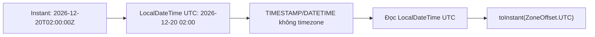

# Đối chiếu kiểu boolean, số, văn bản và thời gian giữa các hệ quản trị qua JDBC

Một ứng dụng Java có thể dùng cùng những interface **`DataSource`, `Connection`, `PreparedStatement` và `ResultSet`** để truy cập PostgreSQL, MySQL, SQL Server hoặc Oracle. Nhưng **cùng một giá trị nghiệp vụ không nhất thiết được lưu bằng cùng một kiểu SQL** trên các hệ quản trị. Cờ bật/tắt có thể nằm trong `BOOLEAN`, `BIT` hoặc `NUMBER(1)`; tiền có thể là `NUMERIC`, `DECIMAL` hay `NUMBER`; văn bản Unicode chịu tác động của charset và collation; còn một “thời điểm” có thể được lưu thành timestamp có hoặc không có thông tin múi giờ.

Bài học thuộc chương **Đa hệ quản trị** của module **JDBC**. Mục tiêu là **đối chiếu kiểu boolean, số, văn bản và thời gian** ở cả ba tầng: cột SQL, API JDBC để bind/đọc và kiểu Java biểu diễn ý nghĩa nghiệp vụ. Ta sẽ xem các khác biệt quan trọng, viết DAO có quy tắc mapping rõ ràng, tránh mất dữ liệu khi chuyển kiểu, và xây kiểm thử tích hợp trên từng DBMS.

> **Thông điệp chính:** JDBC chuẩn hóa cách ứng dụng giao tiếp qua driver, **không biến các kiểu dữ liệu của mọi DBMS thành hoàn toàn giống nhau**. Hãy đặt hợp đồng dữ liệu theo ý nghĩa nghiệp vụ, chọn kiểu SQL thích hợp cho từng hệ, bind bằng `PreparedStatement` và kiểm tra round-trip trên chính driver/DBMS dùng khi triển khai.

## 1. Bốn tầng cần đối chiếu khi chọn kiểu dữ liệu

Giả sử hệ thống lưu một bản ghi giao dịch:

- `active`: trạng thái bật/tắt.
- `quantity`: số lượng nguyên.
- `amount`: số tiền chính xác đến hai chữ số thập phân.
- `externalCode`: mã giao dịch có thể gồm chữ và các số 0 ở đầu.
- `eventDate`: ngày theo lịch nghiệp vụ.
- `createdAt`: thời điểm tuyệt đối khi bản ghi được tạo.

Mỗi trường phải được xem xét qua bốn tầng:

| Tầng | Câu hỏi cần trả lời |
|---|---|
| **Ý nghĩa nghiệp vụ** | Đây là trạng thái hai giá trị, số nguyên, số thập phân chính xác, văn bản hay một thời điểm tuyệt đối? Có chấp nhận `NULL` không? |
| **Kiểu SQL của DBMS** | Dùng `BOOLEAN`, `BIT`, `DECIMAL`, `VARCHAR2`, `DATETIME2` hoặc kiểu nào? Độ rộng, precision/scale và timezone ra sao? |
| **Cách driver JDBC ánh xạ** | Dùng `setBoolean`, `setInt`, `setBigDecimal`, `setString`, `setObject` và getter nào? Driver có hỗ trợ JDBC 4.2 không? |
| **Kiểu Java và validation** | Dùng `boolean`/`Boolean`, `long`, `BigDecimal`, `String`, `LocalDate`, `LocalDateTime`, `OffsetDateTime` hay `Instant`? |


**Kiểm chứng quan trọng nhất là round-trip:** ghi một giá trị có chủ đích, đọc lại qua một kết nối mới và xác nhận **ý nghĩa không thay đổi** theo hợp đồng đã chọn. Không chỉ nhìn SQL chạy không lỗi hay `ResultSetMetaData` báo tên kiểu có vẻ hợp lý.

## 2. Bảng đối chiếu nhanh giữa bốn DBMS

Bảng dưới đây mô tả các **lựa chọn thông dụng**, không có nghĩa mọi phiên bản của cùng DBMS đều hỗ trợ hết các kiểu hay cách ánh xạ như nhau.

| Nhu cầu dữ liệu | PostgreSQL | MySQL | SQL Server | Oracle Database |
|---|---|---|---|---|
| Cờ đúng/sai | `BOOLEAN` | `BOOLEAN`/`BOOL` là alias của `TINYINT(1)` | `BIT` | Bản cũ thường `NUMBER(1)` hoặc `CHAR(1)`; bản mới có hỗ trợ SQL `BOOLEAN` |
| Số nguyên thông thường | `SMALLINT`, `INTEGER`, `BIGINT` | `SMALLINT`, `INT`, `BIGINT` và biến thể unsigned | `SMALLINT`, `INT`, `BIGINT`; `TINYINT` không âm | `NUMBER(p,0)` hoặc `INTEGER` được ánh xạ theo ngữ nghĩa `NUMBER` |
| Số thập phân chính xác | `NUMERIC(p,s)` / `DECIMAL(p,s)` | `DECIMAL(p,s)` / `NUMERIC(p,s)` | `DECIMAL(p,s)` / `NUMERIC(p,s)` | `NUMBER(p,s)` |
| Số dấu phẩy động | `REAL`, `DOUBLE PRECISION` | `FLOAT`, `DOUBLE` | `REAL`, `FLOAT` (precision theo SQL Server) | `BINARY_FLOAT`, `BINARY_DOUBLE` |
| Văn bản ngắn | `VARCHAR(n)`, `TEXT` | `VARCHAR(n)` với charset phù hợp | `NVARCHAR(n)`; `VARCHAR(n)` tùy collation/encoding | `VARCHAR2(n CHAR)`, `NVARCHAR2(n)` |
| Văn bản dài | `TEXT` | `TEXT`/`LONGTEXT` | `NVARCHAR(MAX)` / `VARCHAR(MAX)` | `CLOB` / `NCLOB` |
| Ngày lịch | `DATE` | `DATE` | `DATE` | `DATE`, **còn chứa giờ/phút/giây** |
| Chỉ giờ theo đồng hồ | `TIME` | `TIME` (cũng có semantics duration đặc thù) | `TIME` | Không có kiểu SQL `TIME` độc lập tương đương; cân nhắc mô hình khác |
| Ngày giờ không kèm múi giờ | `TIMESTAMP` | `DATETIME(fsp)` | `DATETIME2(scale)` | `TIMESTAMP(scale)` |
| Thời điểm có xử lý múi giờ | `TIMESTAMPTZ` | `TIMESTAMP` có chuyển đổi theo session time zone | `DATETIMEOFFSET(scale)` | `TIMESTAMP WITH TIME ZONE` hoặc `WITH LOCAL TIME ZONE` |

**Hai bẫy thường gặp:** `TIMESTAMP` của **SQL Server** là tên cũ của **`ROWVERSION`**, **không** phải kiểu ngày giờ; còn `DATE` của **Oracle** có thành phần giờ/phút/giây, không hoàn toàn tương đương `DATE` chỉ mang ngày của các DBMS khác.

**Lưu ý phiên bản:** Oracle SQL `BOOLEAN` có ở các phiên bản hiện đại, trong khi nhiều ứng dụng Oracle cũ vẫn dùng `NUMBER(1)`. Với MySQL, `BOOLEAN` chỉ là một alias kiểu số; chính schema và các constraint mới quyết định trường có bị giới hạn đúng 0/1 hay không. Không kết luận theo tên kiểu được viết trong DDL.

## 3. Boolean: một ý nghĩa, nhiều dạng lưu trữ

Kiểu Java:

```java
boolean enabled = true;      // Không có trạng thái null.
Boolean optionalFlag = null; // Có thể biểu diễn chưa biết/chưa đặt.
```

Về nghiệp vụ, `true` và `false` là hai trạng thái; nếu cột SQL cho phép `NULL`, lúc đó dữ liệu có thể có **ba trạng thái**. Nhưng cách lưu trên từng DBMS khác nhau:

| DBMS / kiểu SQL | Cách hiểu thông dụng | Getter/binder JDBC nên thử |
|---|---|---|
| PostgreSQL `BOOLEAN` | Giá trị SQL `TRUE/FALSE/NULL`. | `setBoolean`, `getBoolean`; `wasNull` nếu nullable. |
| MySQL `BOOLEAN` / `TINYINT(1)` | Thường lưu dạng số nguyên nhỏ; 0=false, 1=true theo quy ước ứng dụng. | Có thể `setBoolean/getBoolean` hoặc `setInt/getInt`; đọc tài liệu Connector/J và cấu hình metadata. |
| SQL Server `BIT` | 0, 1 hoặc `NULL`. | `setBoolean/getBoolean` hoặc APIs phù hợp với driver. |
| Oracle truyền thống `NUMBER(1)` | Quy ước 0/1 do schema/ứng dụng đặt ra. | Thường dùng `setInt/getInt`; không mặc định driver sẽ bind `BOOLEAN` như một cột `NUMBER`. |
| Oracle SQL `BOOLEAN` trên bản hỗ trợ | Kiểu boolean SQL thực sự. | Dùng API boolean khi **driver tương thích**; xác minh phiên bản. |

### 3.1. Với kiểu boolean tự nhiên

```java
try (PreparedStatement ps = connection.prepareStatement(
        "UPDATE feature_flag SET enabled = ? WHERE feature_id = ?")) {

    ps.setBoolean(1, true);
    ps.setLong(2, 101L);
    ps.executeUpdate();
}
```

Đây là ví dụ cho cột mà driver hỗ trợ bind boolean, như PostgreSQL `BOOLEAN` hoặc SQL Server `BIT`. Không dùng nguyên đoạn này như một cam kết phổ quát cho cột Oracle cũ kiểu `NUMBER(1)`.

### 3.2. Với cột số theo quy ước 0/1

```java
try (PreparedStatement ps = connection.prepareStatement(
        "UPDATE feature_flag SET enabled = ? WHERE feature_id = ?")) {

    ps.setInt(1, enabled ? 1 : 0);
    ps.setLong(2, 101L);
    ps.executeUpdate();
}
```

Khi cần bảo đảm cột số chỉ nhận 0 hoặc 1, thiết kế **ràng buộc ở DBMS** nếu phiên bản/engine hỗ trợ:

```sql
-- Ví dụ cho cột enabled kiểu số:
CHECK (enabled IN (0, 1))
```

Đây là **mảnh constraint**, cần đặt trong DDL đúng dialect. Một số phiên bản MySQL cũ từng parse nhưng không thực thi `CHECK`, vì vậy phải kiểm tra hành vi với **phiên bản MySQL thực tế**. Hệ thống cũng cần quy ước cách xử lý giá trị bất thường như 2 hoặc -1 thay vì âm thầm chuyển chúng thành `true`.

### 3.3. Đọc boolean và SQL NULL

`ResultSet.getBoolean(...)` trả `false` khi giá trị SQL là `NULL`. Phải gọi `wasNull()` **ngay sau getter** nếu muốn phân biệt:

```java
boolean raw = rs.getBoolean("enabled");
Boolean enabled = rs.wasNull() ? null : raw;
```

Với schema dùng cột số 0/1, đọc và kiểm tra nghiêm ngặt:

```java
int raw = rs.getInt("enabled");
if (rs.wasNull()) {
    throw new SQLException("enabled không được NULL");
}
if (raw != 0 && raw != 1) {
    throw new SQLException("Giá trị enabled ngoài quy ước 0/1: " + raw);
}
boolean enabled = raw == 1;
```

Điều này đặc biệt có ích khi kết nối nhiều DBMS, import dữ liệu cũ hoặc cho phép hệ khác ghi trực tiếp. **Không lấy `rs.getBoolean("enabled")` và giả định mọi giá trị số khác 0 đều là dữ liệu hợp lệ theo nghiệp vụ.**

### 3.4. Cấu hình driver và metadata

Với MySQL Connector/J, việc ánh xạ `TINYINT(1)` thành JDBC `BOOLEAN`/`BIT` trong metadata có thể chịu ảnh hưởng thuộc tính driver như `tinyInt1isBit`. Ứng dụng không nên dùng `ResultSetMetaData.getColumnType(...)` rồi mặc định mọi cột được nhận diện là boolean đều là kiểu SQL boolean gốc.

Nếu cần hỗ trợ nhiều hệ, hãy lưu một **hợp đồng mapping** (native boolean hoặc numeric 0/1) từ cấu hình schema/dialect. Không suy diễn đơn thuần từ cách driver hiển thị tên kiểu.

## 4. Số nguyên: độ rộng, dấu và phạm vi giá trị

Các số nguyên Java phổ biến là `byte`, `short`, `int` và `long`; SQL có các kiểu tương tự nhưng **không hoàn toàn trùng phạm vi**.

| Kiểu Java | Phạm vi (có dấu) | Kiểu SQL thường dùng |
|---|---|---|
| `byte` | -128 đến 127 | Tùy DBMS, không mặc định bằng mọi `TINYINT`. |
| `short` | -32.768 đến 32.767 | `SMALLINT` trên nhiều DBMS. |
| `int` | -2.147.483.648 đến 2.147.483.647 | `INTEGER/INT` hoặc `NUMBER(10,0)` theo schema. |
| `long` | -9.223.372.036.854.775.808 đến 9.223.372.036.854.775.807 | `BIGINT` hoặc `NUMBER(19,0)` kèm kiểm tra phạm vi. |

### 4.1. Không phải mọi TINYINT đều có dấu

- **SQL Server `TINYINT`** nhận giá trị từ **0 đến 255**, không phải -128 đến 127.
- **MySQL `TINYINT`** có biến thể signed/unsigned; tương tự, `BIGINT UNSIGNED` có thể chứa giá trị vượt phạm vi `long` Java.
- **PostgreSQL** không có kiểu `TINYINT` SQL chuẩn cùng semantics đó; `SMALLINT` thường là lựa chọn cho số nhỏ.
- **Oracle `NUMBER(p,0)`** cho phép xác định độ chính xác thập phân, nhưng một `NUMBER(19,0)` có thể chứa giá trị lớn hơn `Long.MAX_VALUE`. Chọn precision 19 **không tự bảo đảm** mọi số trong cột đọc được bằng `long`.

Nếu dữ liệu có thể vượt phạm vi `long`, cần xác định lại hợp đồng: dùng kiểu SQL và Java thích hợp như `BigDecimal`/`BigInteger` (tùy driver), hoặc giới hạn bằng constraint và validation. Đừng cố gọi `getLong()` rồi để dữ liệu bị cắt/ép kiểu ngoài dự kiến.

### 4.2. Bind và đọc số nguyên có thể NULL

```java
ps.setInt(1, quantity);
ps.setLong(2, productId);
```

Nếu cột `INTEGER` có thể `NULL`:

```java
int raw = rs.getInt("reorder_level");
Integer reorderLevel = rs.wasNull() ? null : raw;
```

Với tham số nullable:

```java
import java.sql.Types;

if (reorderLevel == null) {
    ps.setNull(1, Types.INTEGER);
} else {
    ps.setInt(1, reorderLevel);
}
```

Trong ví dụ này, index `1` là placeholder của một câu SQL minh họa có cột `INTEGER`. Thực tế phải chọn `Types` phù hợp với **kiểu SQL của cột đích**; `Types.INTEGER` không nên dùng bừa cho cột `DECIMAL` hoặc `VARCHAR`.

### 4.3. Không lưu mã định danh bằng kiểu số nếu cần giữ định dạng

Mã như `"00001234"`, số điện thoại hoặc mã bưu chính không nên mặc định thành `INTEGER` chỉ vì toàn chữ số. Khi ép sang số, các số 0 đầu mất đi và có thể gặp tràn phạm vi. Nên lưu theo **`VARCHAR`/`NVARCHAR` hoặc kiểu văn bản phù hợp**, rồi kiểm tra pattern/độ dài ở ứng dụng và DB theo yêu cầu.

## 5. Số thập phân chính xác: DECIMAL, NUMERIC và NUMBER

Các đại lượng như **tiền, số dư, đơn giá, tỷ lệ yêu cầu tính chính xác** thường nên lưu bằng kiểu số thập phân chính xác:

- PostgreSQL: `NUMERIC(p,s)` hoặc `DECIMAL(p,s)`.
- MySQL: `DECIMAL(p,s)`.
- SQL Server: `DECIMAL(p,s)` hoặc `NUMERIC(p,s)`.
- Oracle: `NUMBER(p,s)`.

Trong đó:

- **Precision `p`**: số chữ số thập phân tối đa theo định nghĩa kiểu.
- **Scale `s`**: số chữ số ở bên phải dấu thập phân, đối với định nghĩa thông dụng `DECIMAL(p,s)` với scale không âm.

Ví dụ `DECIMAL(18,2)` dành tối đa 18 chữ số chính xác, trong đó có 2 chữ số sau dấu thập phân; giá trị lớn nhất dương thường có 16 chữ số phần nguyên và 2 chữ số thập phân. Phạm vi chính xác và quy tắc làm tròn/overflow vẫn cần kiểm tra trên từng hệ.

### 5.1. Java dùng BigDecimal, không mặc định dùng double

```java
import java.math.BigDecimal;

BigDecimal amount = new BigDecimal("129.90");

try (PreparedStatement ps = connection.prepareStatement(
        "UPDATE invoice SET amount = ? WHERE invoice_id = ?")) {

    ps.setBigDecimal(1, amount);
    ps.setLong(2, invoiceId);
    ps.executeUpdate();
}
```

Khi đọc:

```java
BigDecimal stored = rs.getBigDecimal("amount");
if (stored == null) {
    throw new SQLException("amount không được NULL");
}
```

Lý do dùng `new BigDecimal("129.90")` thay vì `new BigDecimal(129.90)` là literal `double` có thể mang xấp xỉ nhị phân. Với phép so sánh **giá trị số**:

```java
boolean sameValue =
        new BigDecimal("129.9").compareTo(new BigDecimal("129.90")) == 0;
```

`BigDecimal.equals(...)` còn so sánh scale, nên có thể báo `false` cho hai giá trị bằng nhau về số học. Khi test DB có thể chuẩn hóa scale, nên chọn phép so sánh phản ánh **hợp đồng nghiệp vụ**.

### 5.2. Chốt quy tắc scale ở biên dữ liệu

Ví dụ yêu cầu không nhận quá hai chữ số thập phân:

```java
import java.math.RoundingMode;

BigDecimal normalized = inputAmount.setScale(
        2, RoundingMode.UNNECESSARY);
```

Lệnh trên chấp nhận dữ liệu có thể biểu diễn chính xác ở scale 2 và **ném `ArithmeticException`** nếu cần làm tròn để giảm số chữ số có nghĩa sau dấu thập phân. Nếu nghiệp vụ cho phép làm tròn, phải chọn chính sách `RoundingMode` có chủ đích và test cụ thể, không giao toàn bộ quyết định cho hành vi mặc định của DBMS.

### 5.3. Đừng nhầm số xấp xỉ và số chính xác

`REAL`, `FLOAT`, `DOUBLE` và các kiểu floating point có thể khác về precision giữa DBMS; chúng thường biểu diễn số nhị phân **xấp xỉ**, phù hợp với một số bài toán đo lường, khoa học hoặc thống kê, nhưng **không mặc định phù hợp với tiền**.

Chẳng hạn, SQL Server `FLOAT` có tham số precision theo quy tắc riêng, trong khi Oracle có `BINARY_FLOAT`/`BINARY_DOUBLE`. Không nên tạo một câu DDL `FLOAT(10,2)` rồi mặc định cùng semantics trên mọi DBMS.

### 5.4. Khác biệt số tiền đặc thù

Một số DBMS cung cấp kiểu tiền riêng như `MONEY`. Tuy nhiên, quy tắc scale, phạm vi và chuyển đổi có thể phụ thuộc hệ quản trị. Với thiết kế đa DBMS cần portable, **`DECIMAL(p,s)` + `BigDecimal`** thường cho hợp đồng dễ kiểm tra hơn. Vẫn phải thử ràng buộc precision/scale và xử lý overflow ở DBMS mục tiêu.

## 6. Văn bản: ký tự, byte, Unicode và collation

`String` trong Java là chuỗi UTF-16 ở mức representation của JVM. Khi lưu vào DB, driver chuyển ký tự sang **bộ mã của kết nối/cột** theo cấu hình. Việc `setString(...)` chạy không lỗi **không bảo đảm** mọi ký tự Unicode, emoji hoặc mã tiếng Việt đã được lưu/đọc lại đúng nếu charset/schema không phù hợp.

### 6.1. So sánh kiểu văn bản

| DBMS | Văn bản ngắn | Văn bản dài | Điều cần chú ý |
|---|---|---|---|
| PostgreSQL | `VARCHAR(n)`, `TEXT` | `TEXT` | Encoding của database, collation và quy tắc so sánh. |
| MySQL | `VARCHAR(n)` | `TEXT`/`LONGTEXT` | Chọn charset như `utf8mb4` cho Unicode đầy đủ; collation ảnh hưởng so sánh/unique. |
| SQL Server | `NVARCHAR(n)`, `VARCHAR(n)` | `NVARCHAR(MAX)`/`VARCHAR(MAX)` | `NVARCHAR` thường là lựa chọn rõ ràng cho Unicode; `VARCHAR` và UTF-8 collation có ngữ nghĩa riêng. |
| Oracle | `VARCHAR2(n CHAR)` / `VARCHAR2(n BYTE)`, `NVARCHAR2` | `CLOB` / `NCLOB` | Chiều dài có thể tính theo byte hoặc ký tự; charset database/national charset quan trọng. |

**Không chọn `CHAR(n)` cho mọi mã chỉ vì độ dài cố định.** `CHAR` có thể được đệm khoảng trắng và ảnh hưởng so sánh/trả dữ liệu tùy DBMS. Nếu mã không thực sự có định dạng cố định, `VARCHAR` thường đơn giản hơn.

### 6.2. Tiếng Việt, emoji và độ dài

Thử với dữ liệu:

```java
String label = "Cà phê ☕";
String emoji = "Đặt hàng 📦";
String code = "00001234";
```

Với MySQL, cấu hình `utf8mb4` (không phải bộ mã `utf8` 3-byte cũ) phù hợp cho nhiều ký tự Unicode ngoài BMP như emoji. Với SQL Server, `NVARCHAR` thường giúp biểu diễn Unicode rõ ràng; với Oracle, cần xem `VARCHAR2` theo database character set và `NVARCHAR2` theo national character set.

**Giới hạn `VARCHAR(80)` không nhất thiết bằng 80 byte.** Cách đếm ký tự, code point, UTF-16 code unit, byte và *grapheme cluster* có thể khác nhau. Ví dụ một emoji hoặc một chữ có dấu được tạo từ nhiều code point có thể chiếm nhiều đơn vị lưu trữ dù người dùng nhìn thấy một ký tự. Hãy test độ dài và truncation ở đúng schema/driver, thay vì dựa vào `String.length()` làm thước đo duy nhất.

### 6.3. Bind và đọc chuỗi

```java
String sql = "UPDATE customer SET display_name = ? WHERE customer_id = ?";

try (PreparedStatement ps = connection.prepareStatement(sql)) {
    ps.setString(1, "Nguyễn Thị Minh");
    ps.setLong(2, customerId);
    ps.executeUpdate();
}
```

`setString` là API phổ biến cho các cột văn bản hỗ trợ ánh xạ tương ứng. JDBC còn có `setNString/getNString` dành cho kiểu SQL quốc gia như `NVARCHAR/NCHAR`, nhưng **khả năng hỗ trợ và việc sử dụng thích hợp cần kiểm tra theo driver**; không tự động thay `setString` bằng `setNString` cho mọi cột `VARCHAR`.

### 6.4. Oracle: chuỗi rỗng và NULL

Một khác biệt rất dễ gây lỗi khi chuyển từ PostgreSQL/MySQL/SQL Server sang **Oracle**: đối với các kiểu chuỗi ký tự SQL thông dụng, **chuỗi rỗng `''` được xử lý như `NULL`**. Do đó, việc ghi Java `""` vào cột `VARCHAR2 NOT NULL` có thể thất bại, hoặc việc đọc lại không giữ được phân biệt “rỗng” và “không có giá trị”.

```java
String empty = "";
ps.setString(1, empty);
```

Đừng mặc định đoạn này có cùng kết quả trên mọi DBMS. Nếu nghiệp vụ buộc phải phân biệt hai trạng thái, hãy thiết kế **quy ước dữ liệu khác** (ví dụ một cột trạng thái riêng hoặc format có cấu trúc), không chỉ cố gắng ép `VARCHAR2` giữ nguyên chuỗi rỗng.

### 6.5. Collation tác động so sánh và UNIQUE

Trong nhiều DBMS, collation quyết định:

- `"ABC"` có được xem bằng `"abc"` không?
- Có phân biệt dấu và các biến thể Unicode không?
- Thứ tự sắp xếp chữ cái có theo locale không?
- Ràng buộc `UNIQUE` có coi hai chuỗi khác nhau ở Java là trùng nhau không?

Ví dụ cùng `sku="Book-A"` và `"book-a"` có thể được coi trùng hoặc không tùy collation và cấu trúc index. JDBC không quyết định collation; **DBMS và schema** quyết định. Với mã định danh phải so sánh chính xác, hãy chọn collation/cách chuẩn hóa và ràng buộc nhất quán, rồi kiểm thử dữ liệu mixed-case, dấu tiếng Việt và Unicode normalization.

### 6.6. Khi nào cần CLOB/stream?

Một tài liệu văn bản hàng chục MB không nên mặc định lấy bằng `rs.getString(...)` nếu mục tiêu là xử lý theo luồng và hạn chế heap. JDBC cung cấp `getCharacterStream(...)` và các API `CLOB`/`NCLOB` khi driver hỗ trợ:

```java
try (java.io.Reader reader =
             rs.getCharacterStream("description")) {
    if (reader != null) {
        char[] buffer = new char[8192];
        int n;
        while ((n = reader.read(buffer)) != -1) {
            // Tiêu thụ buffer[0..n) ngay, không gom toàn bộ vào String.
        }
    }
}
```

Mảnh mã này nằm trong phương thức có xử lý `SQLException`/`IOException`, khi `ResultSet` và `Connection` còn mở. Lưu ý stream ký tự có thể được driver đệm, và API `getCharacterStream` không bảo đảm mọi DBMS chuyển dữ liệu theo cùng giao thức.

## 7. Thời gian: đừng đồng nhất DATE, TIMESTAMP và “Instant”

Đây là nhóm kiểu dễ tạo lỗi khó thấy nhất. Trước khi chọn kiểu SQL, phải xác định **ý nghĩa của giá trị**:

| Dữ liệu nghiệp vụ | Kiểu Java phù hợp | Ý nghĩa |
|---|---|---|
| Sinh nhật, ngày hóa đơn theo lịch | `LocalDate` | Chỉ có ngày, **không có giờ hoặc múi giờ**. |
| Giờ mở cửa hằng ngày | `LocalTime` | Chỉ giờ-phút-giây trong ngày, không có ngày hoặc múi giờ. |
| Lịch hẹn địa phương “09:00 ngày 20/12” | `LocalDateTime` và **ZoneId** ở ngữ cảnh | Giờ theo đồng hồ; không tự xác định một instant duy nhất khi chưa biết múi giờ/quy tắc DST. |
| Thời điểm sự kiện thực sự xảy ra | `Instant` | Một điểm trên trục thời gian UTC, không tự chứa cách hiển thị địa phương. |
| Ngày giờ kèm offset | `OffsetDateTime` | Có offset cụ thể với UTC; không tương đương timezone region có quy tắc DST. |
| Lịch hẹn gắn vùng thời gian | `ZonedDateTime` | Có `ZoneId` và quy tắc timezone (như `Asia/Ho_Chi_Minh` hoặc vùng DST). |

**JDBC 4.2** bổ sung ánh xạ với nhiều kiểu `java.time` như `LocalDate`, `LocalTime`, `LocalDateTime` và `OffsetDateTime`; việc gọi `getObject(column, Class)` với từng kiểu vẫn phụ thuộc driver và kiểu SQL thực tế. `Instant` hoặc `ZonedDateTime` **không được hỗ trợ đồng nhất** trong mọi triển khai JDBC, vì thế không nên mặc định có thể `setObject(index, Instant)` trên mọi DBMS.

### 7.1. DATE không giống nhau hoàn toàn

- PostgreSQL, MySQL, SQL Server: `DATE` được dùng chủ yếu cho ngày lịch.
- Oracle: `DATE` **còn lưu giờ, phút, giây**, dù tên kiểu là DATE.

Vì vậy, nếu một DAO Oracle dùng `getDate(...)` để lấy `LocalDate`, thành phần giờ trong cột có thể bị bỏ qua khi chuyển đổi. Nếu cột Oracle có ý nghĩa **chỉ ngày**, cần bảo đảm phần giờ được chuẩn hóa theo hợp đồng (chẳng hạn về đầu ngày), hoặc chọn mô hình lưu dữ liệu khác có quy tắc rõ.

### 7.2. TIMESTAMP không có múi giờ

Các kiểu thường dùng cho ngày giờ **không kèm timezone**:

- PostgreSQL `TIMESTAMP WITHOUT TIME ZONE` (có thể viết `TIMESTAMP`).
- MySQL `DATETIME(fsp)`.
- SQL Server `DATETIME2(scale)`.
- Oracle `TIMESTAMP(scale)`.

Chúng phù hợp với `LocalDateTime` khi ý nghĩa nghiệp vụ là **giờ theo đồng hồ**, hoặc có thể dùng làm **quy ước lưu UTC** nếu toàn bộ hệ thống tuân thủ chặt chẽ. Bản thân cột không lưu `ZoneId` hoặc original offset.

### 7.3. Các kiểu xử lý timezone/offset

| DBMS | Kiểu thường dùng | Điều cần hiểu |
|---|---|---|
| PostgreSQL | `TIMESTAMP WITH TIME ZONE` / `TIMESTAMPTZ` | Biểu diễn instant; **không lưu lại nguyên timezone/offset đầu vào** như một thuộc tính riêng của giá trị. |
| MySQL | `TIMESTAMP(fsp)` | Chuyển đổi theo session time zone khi ghi/đọc; phụ thuộc cấu hình driver/session, có giới hạn phạm vi ngày khác `DATETIME`. |
| SQL Server | `DATETIMEOFFSET(scale)` | Lưu ngày giờ kèm offset; API Java mapping phụ thuộc phiên bản Microsoft JDBC Driver. |
| Oracle | `TIMESTAMP WITH TIME ZONE` | Có thể lưu thông tin offset/region theo kiểu và input; cần xác minh quy tắc driver. |
| Oracle | `TIMESTAMP WITH LOCAL TIME ZONE` | Chuẩn hóa khi lưu và hiển thị theo session timezone; không giữ nguyên timezone đầu vào như một field tách biệt. |

**Đừng chuyển một cột SQL Server `ROWVERSION/TIMESTAMP` bằng `getTimestamp(...)`.** Nó là dấu phiên bản nhị phân để theo dõi thay đổi hàng, không phải đồng hồ thời gian.

### 7.4. Có nên dùng một kiểu SQL cho mọi instant không?

Không có một kiểu timestamp timezone-aware với **semantics giống hệt** trên cả bốn DBMS. Có hai chiến lược thường dùng:

1. **Dùng kiểu riêng của DBMS** (`TIMESTAMPTZ`, `DATETIMEOFFSET`, `TIMESTAMP WITH TIME ZONE`...) và viết adapter JDBC theo driver. Phù hợp khi muốn tận dụng tính năng DBMS, nhưng cần test mapping và timezone.
2. **Lưu ngày giờ UTC quy ước** trong cột *không timezone* (`TIMESTAMP/DATETIME2/DATETIME`) và chuyển đổi `Instant` ↔ `LocalDateTime` UTC trong ứng dụng. Dễ thiết kế cùng hợp đồng hơn, nhưng **DBMS không tự biết cột này là UTC**, nên mọi đường ghi/đọc phải tuân thủ quy ước.

Khi nghiệp vụ cần truy vết **múi giờ vùng ban đầu** (ví dụ lịch họp tại một địa điểm có DST), lưu thêm `ZoneId` dạng văn bản và quy tắc nghiệp vụ. Một `OffsetDateTime` không tự chứa mọi thay đổi DST lịch sử/tương lai của một vùng.

## 8. JDBC và java.time: bind/getter đúng ngữ nghĩa

### 8.1. Ngày lịch dùng LocalDate

```java
import java.time.LocalDate;

// JDBC 4.2 khi driver hỗ trợ.
LocalDate businessDate = LocalDate.of(2026, 12, 20);
ps.setObject(1, businessDate);
```

Khi đọc:

```java
LocalDate date = rs.getObject("business_date", LocalDate.class);
```

Nếu driver chưa hỗ trợ kiểu `java.time` tương ứng, một phương án truyền thống:

```java
ps.setDate(1, java.sql.Date.valueOf(businessDate));

java.sql.Date sqlDate = rs.getDate("business_date");
LocalDate date = sqlDate == null ? null : sqlDate.toLocalDate();
```

Phương án fallback cần được kiểm tra nếu cột là Oracle `DATE` có giờ hoặc môi trường có chính sách session timezone không như mong đợi. Không nhầm `java.util.Date` với `java.sql.Date`.

### 8.2. Ngày giờ địa phương dùng LocalDateTime

```java
import java.time.LocalDateTime;

LocalDateTime scheduledLocal =
        LocalDateTime.of(2026, 12, 20, 9, 30);

ps.setObject(2, scheduledLocal); // Cột TIMESTAMP/DATETIME không timezone.

LocalDateTime readBack =
        rs.getObject("scheduled_local", LocalDateTime.class);
```

Đoạn code trên là các mảnh API độc lập; `ps`/`rs` cần tương ứng câu SQL và schema thật. Nếu phải chuyển lịch hẹn thành thời điểm tuyệt đối, còn cần một **`ZoneId` có ý nghĩa nghiệp vụ**. Không gọi `scheduledLocal.toInstant(ZoneOffset.UTC)` trừ khi dữ liệu thật sự được định nghĩa là UTC.

### 8.3. OffsetDateTime không phải luôn portable

```java
import java.time.OffsetDateTime;

// Chỉ dùng khi kiểu SQL và driver hỗ trợ ánh xạ tương ứng.
OffsetDateTime eventTime = rs.getObject(
        "occurred_at", OffsetDateTime.class);
```

Với PostgreSQL `TIMESTAMPTZ`, nhiều phiên bản driver hỗ trợ kiểu `OffsetDateTime` theo JDBC 4.2. Với SQL Server `DATETIMEOFFSET` và Oracle `TIMESTAMP WITH TIME ZONE`, cần xác minh hỗ trợ và cách bảo toàn offset ở driver thực tế. Với MySQL `TIMESTAMP`, không giả định getter `OffsetDateTime` trả lại offset gốc đã ghi: MySQL dùng session timezone và không lưu original offset như một field.

### 8.4. Precision thời gian

Các hệ có mức chính xác và khả năng làm tròn khác nhau:

- MySQL `DATETIME(6)` / `TIMESTAMP(6)` lưu tối đa phần giây tới microsecond theo cấu hình.
- PostgreSQL `TIMESTAMP(6)` cho độ chính xác thường ở microsecond.
- SQL Server `DATETIME2(6)` có scale 6; nếu cần nhiều hơn, SQL Server hỗ trợ precision khác theo kiểu.
- Oracle `TIMESTAMP(6)` là lựa chọn phổ biến; precision có thể cấu hình.

Java `Instant` và `LocalDateTime` hỗ trợ nanosecond. Nếu ghi `2026-01-01T00:00:00.123456789Z` vào cột precision 6, không nên assert đọc lại **đúng đủ 9 chữ số nanosecond**. Hãy xác định quy tắc cắt/làm tròn theo driver/DBMS và chuẩn hóa trước khi test.

## 9. Một hợp đồng dữ liệu và bốn biến thể schema minh họa

Để có ví dụ xuyên suốt, ta thống nhất một bản ghi:

| Trường | Hợp đồng chung |
|---|---|
| `record_id` | ID nguyên dương vừa phạm vi Java `long`. |
| `enabled` | Cờ hai giá trị, `NOT NULL`. |
| `quantity` | Số nguyên không âm, trong phạm vi Java `int`. |
| `amount` | Số thập phân không âm, tối đa 18 chữ số với scale 2. |
| `label` | Văn bản Unicode ngắn, không `NULL` và **không rỗng** theo validation của ứng dụng. |
| `event_date` | `LocalDate`, không có giờ theo nghiệp vụ. |
| `created_at_utc` | `Instant` được lưu dưới dạng **LocalDateTime UTC theo quy ước** ở cột không timezone, precision 6. |

Mục tiêu là giữ **cùng ý nghĩa**, không ép mọi hệ có một DDL y hệt.

### 9.1. PostgreSQL

```sql
CREATE TABLE portable_record (
    record_id BIGINT PRIMARY KEY,
    enabled BOOLEAN NOT NULL,
    quantity INTEGER NOT NULL CHECK (quantity >= 0),
    amount NUMERIC(18, 2) NOT NULL CHECK (amount >= 0),
    label VARCHAR(80) NOT NULL,
    event_date DATE NOT NULL,
    created_at_utc TIMESTAMP(6) WITHOUT TIME ZONE NOT NULL
);
```

### 9.2. MySQL

```sql
CREATE TABLE portable_record (
    record_id BIGINT PRIMARY KEY,
    enabled TINYINT(1) NOT NULL,
    quantity INT NOT NULL CHECK (quantity >= 0),
    amount DECIMAL(18, 2) NOT NULL CHECK (amount >= 0),
    label VARCHAR(80) CHARACTER SET utf8mb4 NOT NULL,
    event_date DATE NOT NULL,
    created_at_utc DATETIME(6) NOT NULL,
    CONSTRAINT ck_portable_record_enabled CHECK (enabled IN (0, 1))
);
```

**Giả định:** phiên bản/engine MySQL thực thi `CHECK` (ví dụ các bản MySQL 8.0 hiện đại; xác minh phiên bản cụ thể). Với phiên bản cũ, phải có cơ chế khác bảo đảm chỉ nhận 0/1. `DATETIME(6)` được chọn thay vì `TIMESTAMP(6)` để biểu diễn trường thời gian UTC theo quy ước **không tự chuyển theo session time zone**.

### 9.3. SQL Server

```sql
CREATE TABLE portable_record (
    record_id BIGINT PRIMARY KEY,
    enabled BIT NOT NULL,
    quantity INT NOT NULL CHECK (quantity >= 0),
    amount DECIMAL(18, 2) NOT NULL CHECK (amount >= 0),
    label NVARCHAR(80) NOT NULL,
    event_date DATE NOT NULL,
    created_at_utc DATETIME2(6) NOT NULL
);
```

`BIT` biểu diễn cờ, `NVARCHAR` phù hợp với văn bản Unicode, còn `DATETIME2(6)` là ngày giờ không mang offset. **Không dùng `TIMESTAMP` của SQL Server** cho `created_at_utc`.

### 9.4. Oracle Database với quy ước boolean số 0/1

```sql
CREATE TABLE portable_record (
    record_id NUMBER(19, 0) PRIMARY KEY,
    enabled NUMBER(1, 0) NOT NULL
        CONSTRAINT ck_portable_record_enabled CHECK (enabled IN (0, 1)),
    quantity NUMBER(10, 0) NOT NULL
        CONSTRAINT ck_portable_record_quantity CHECK (quantity >= 0),
    amount NUMBER(18, 2) NOT NULL
        CONSTRAINT ck_portable_record_amount CHECK (amount >= 0),
    label VARCHAR2(80 CHAR) NOT NULL,
    event_date DATE NOT NULL,
    created_at_utc TIMESTAMP(6) NOT NULL
);
```

**Lưu ý riêng của Oracle:**

- Schema này dùng `NUMBER(1)` vì phù hợp với những phiên bản và hệ thống cũ không có SQL `BOOLEAN`; có thể dùng kiểu boolean SQL ở phiên bản mới với driver tương ứng.
- `NUMBER(19,0)` có phạm vi một phần lớn hơn `long`. Hợp đồng `long` phải được giữ bằng validation, constraint bổ sung hoặc định nghĩa kiểu/precision hẹp hơn nếu yêu cầu.
- `DATE` lưu cả thành phần giờ; ứng dụng phải chỉ ghi giá trị đã chuẩn hóa thành ngày và có thể thêm ràng buộc nếu cần bảo đảm.
- `VARCHAR2(80 CHAR)` đặt ngữ nghĩa chiều dài theo ký tự; **chuỗi rỗng vẫn có thể được xử lý như SQL NULL**.

**Các DDL trên là bốn biến thể để so sánh**, không phải một migration duy nhất chạy trên mọi DBMS. Cần quản lý migration/dialect theo hệ thống thực, kiểm tra tài khoản, default schema, encoding, collation, phiên bản DBMS và quyền DDL.

## 10. DAO minh họa: cùng ý nghĩa dữ liệu, khác cách bind boolean

Ví dụ Java 17+ sau dùng một DTO `record` và DAO JDBC thuần. Chúng ta cố tình chọn **thời điểm UTC lưu bằng cột không timezone** để tập trung vào cách tổ chức mapping đa DBMS:

- PostgreSQL và SQL Server: boolean bản địa/`BIT` với `setBoolean/getBoolean`.
- MySQL và Oracle theo DDL ở trên: numeric 0/1 với `setInt/getInt`, kiểm tra giá trị hợp lệ.
- `quantity` dùng `int`; `amount` dùng `BigDecimal`; `label` dùng `String`.
- `event_date` dùng `LocalDate`.
- `created_at_utc` dùng `LocalDateTime` theo UTC, đổi lại thành `Instant`.

```java
import java.math.BigDecimal;
import java.math.RoundingMode;
import java.sql.Connection;
import java.sql.PreparedStatement;
import java.sql.ResultSet;
import java.sql.SQLException;
import java.time.Instant;
import java.time.LocalDate;
import java.time.LocalDateTime;
import java.time.ZoneOffset;
import java.time.temporal.ChronoUnit;
import java.util.Objects;
import java.util.Optional;
import javax.sql.DataSource;

public final class PortableRecordDao {
    public enum BooleanStorage {
        NATIVE_BOOLEAN, NUMERIC_ZERO_ONE
    }

    public record Entry(
            long id,
            boolean enabled,
            int quantity,
            BigDecimal amount,
            String label,
            LocalDate eventDate,
            Instant createdAt
    ) {
        public Entry {
            if (id <= 0 || quantity < 0) {
                throw new IllegalArgumentException("ID/quantity không hợp lệ");
            }
            Objects.requireNonNull(amount, "amount");
            Objects.requireNonNull(label, "label");
            Objects.requireNonNull(eventDate, "eventDate");
            Objects.requireNonNull(createdAt, "createdAt");
            if (label.isEmpty() || amount.signum() < 0) {
                throw new IllegalArgumentException("Label/amount không hợp lệ");
            }
        }
    }

    private static final String INSERT_SQL =
            "INSERT INTO portable_record "
            + "(record_id, enabled, quantity, amount, label, "
            + "event_date, created_at_utc) "
            + "VALUES (?, ?, ?, ?, ?, ?, ?)";

    private static final String SELECT_SQL =
            "SELECT record_id, enabled, quantity, amount, "
            + "label, event_date, created_at_utc "
            + "FROM portable_record WHERE record_id = ?";

    private final DataSource dataSource;
    private final BooleanStorage booleanStorage;

    public PortableRecordDao(
            DataSource dataSource,
            BooleanStorage booleanStorage
    ) {
        this.dataSource = Objects.requireNonNull(dataSource);
        this.booleanStorage = Objects.requireNonNull(booleanStorage);
    }

    public void insert(Entry entry) throws SQLException {
        Objects.requireNonNull(entry, "entry");

        // Tránh gửi precision nanosecond mà schema chỉ lưu microsecond.
        Instant storedInstant =
                entry.createdAt().truncatedTo(ChronoUnit.MICROS);
        LocalDateTime utc =
                LocalDateTime.ofInstant(storedInstant, ZoneOffset.UTC);

        BigDecimal amount =
                entry.amount().setScale(2, RoundingMode.UNNECESSARY);
        if (amount.precision() > 18) {
            throw new IllegalArgumentException("amount vượt DECIMAL(18,2)");
        }

        try (Connection connection = dataSource.getConnection();
             PreparedStatement ps = connection.prepareStatement(INSERT_SQL)) {

            ps.setLong(1, entry.id());
            bindBoolean(ps, 2, entry.enabled());
            ps.setInt(3, entry.quantity());
            ps.setBigDecimal(4, amount);
            ps.setString(5, entry.label());

            // JDBC 4.2: LocalDate và LocalDateTime, nếu driver hỗ trợ.
            ps.setObject(6, entry.eventDate());
            ps.setObject(7, utc);

            int changed = ps.executeUpdate();
            if (changed != 1) {
                throw new SQLException("INSERT không tạo đúng một hàng");
            }
        }
    }

    public Optional<Entry> findById(long id) throws SQLException {
        try (Connection connection = dataSource.getConnection();
             PreparedStatement ps = connection.prepareStatement(SELECT_SQL)) {

            ps.setLong(1, id);

            try (ResultSet rs = ps.executeQuery()) {
                if (!rs.next()) {
                    return Optional.empty();
                }

                boolean enabled = readBoolean(rs, "enabled");
                LocalDate eventDate =
                        rs.getObject("event_date", LocalDate.class);
                LocalDateTime utc =
                        rs.getObject("created_at_utc", LocalDateTime.class);

                if (eventDate == null || utc == null) {
                    throw new SQLException("Thiếu trường thời gian bắt buộc");
                }

                Entry result = new Entry(
                        rs.getLong("record_id"),
                        enabled,
                        rs.getInt("quantity"),
                        rs.getBigDecimal("amount"),
                        rs.getString("label"),
                        eventDate,
                        utc.toInstant(ZoneOffset.UTC)
                );
                return Optional.of(result);
            }
        }
    }

    private void bindBoolean(
            PreparedStatement ps,
            int index,
            boolean value
    ) throws SQLException {
        if (booleanStorage == BooleanStorage.NUMERIC_ZERO_ONE) {
            ps.setInt(index, value ? 1 : 0);
        } else {
            ps.setBoolean(index, value);
        }
    }

    private boolean readBoolean(ResultSet rs, String column)
            throws SQLException {
        if (booleanStorage == BooleanStorage.NUMERIC_ZERO_ONE) {
            int value = rs.getInt(column);
            if (rs.wasNull()) {
                throw new SQLException(column + " không được NULL");
            }
            if (value != 0 && value != 1) {
                throw new SQLException(column + " không hợp lệ: " + value);
            }
            return value == 1;
        }

        boolean value = rs.getBoolean(column);
        if (rs.wasNull()) {
            throw new SQLException(column + " không được NULL");
        }
        return value;
    }
}
```

Cấu hình DAO theo schema đã chọn:

```java
// PostgreSQL BOOLEAN hoặc SQL Server BIT:
PortableRecordDao pgOrSqlServer = new PortableRecordDao(
        dataSource, PortableRecordDao.BooleanStorage.NATIVE_BOOLEAN);

// MySQL TINYINT(1) hoặc Oracle NUMBER(1) với quy ước 0/1:
PortableRecordDao mysqlOrOracle = new PortableRecordDao(
        dataSource, PortableRecordDao.BooleanStorage.NUMERIC_ZERO_ONE);
```

**Đây là các ví dụ cấu hình thay thế**, không tạo cả hai DAO trên cùng một DataSource rồi sử dụng đan xen nếu schema chỉ có một dạng boolean.

### Điều kiện để mã trên chạy đúng

1. Dùng Java 17+ (ví dụ dùng `record`).
2. Driver JDBC hỗ trợ `setObject(LocalDate/LocalDateTime)` và `getObject(..., Class)` theo JDBC 4.2. Nếu không, cần **adapter thời gian riêng** dùng `java.sql.Date`/`Timestamp` theo hợp đồng driver.
3. Bốn schema được dựng đúng và cột `created_at_utc` **không bị trigger/default tự chuyển đổi timezone**.
4. Mọi code khác ghi cột `created_at_utc` cũng tuân thủ **quy ước UTC không timezone**; nếu code khác ghi giờ địa phương, cách đọc `toInstant(UTC)` sẽ tạo thời điểm sai.
5. `label` không rỗng; ứng dụng cần thêm validation độ dài/collation phù hợp DBMS.
6. `insert` minh họa **một DML**, không gọi `commit()`; nó giả định connection được cấp theo hợp đồng auto-commit phù hợp. Nếu có transaction manager hoặc auto-commit tắt, tầng sở hữu transaction phải kết thúc giao dịch.

**Không dùng lại đối tượng DAO của một dialect cho schema khác nếu không đánh giá mapping.** Tên bảng giống nhau không chứng minh cột boolean hoặc timestamp có cùng semantics.

## 11. Quy ước UTC với timestamp không timezone: ưu và nhược

Tại sao ví dụ chọn cột `created_at_utc` không timezone?

- `LocalDateTime.ofInstant(instant, ZoneOffset.UTC)` tạo **các trường lịch UTC** từ `Instant`.
- JDBC lưu các trường đó vào `TIMESTAMP`/`DATETIME` không timezone.
- Khi đọc, `localDateTime.toInstant(ZoneOffset.UTC)` khôi phục cùng thời điểm trong giới hạn precision.



**Ưu điểm:** có thể chọn các kiểu cột gần nhau cho bốn DBMS, tránh phụ thuộc cách từng DBMS biểu diễn original offset.

**Nhược điểm:** database **không biết** giờ này là UTC; một câu `INSERT` thủ công với giờ địa phương vẫn được nhận. Ngoài ra, phép ánh xạ cần driver thật sự truyền/nhận `LocalDateTime` mà không tự đổi timezone. Với dữ liệu cần auditing nghiêm ngặt, nên kiểm tra từng driver, cấu hình connection/session, và cân nhắc kiểu timezone-aware riêng của DBMS.

### Không để SQL hiện tại âm thầm sai quy ước

Các hàm SQL như `CURRENT_TIMESTAMP`, `NOW()`, `SYSDATE` và `SYSTIMESTAMP` có cách xác định giờ hệ thống/session khác nhau. Nếu cột được quy ước UTC nhưng SQL dùng “thời gian hiện tại” của DBMS mà không chỉ rõ timezone, dữ liệu có thể lệch.

Với hệ thống đa DBMS, chọn một nguồn thời gian nhất quán:

- Truyền `Instant.now(clock)` từ ứng dụng qua adapter UTC đã kiểm thử; hoặc
- Dùng hàm lấy thời gian UTC **đặc thù DBMS**, có quy ước rõ và integration test.

Không ghi cứng `ZoneId.systemDefault()` rồi cho rằng mọi máy JVM, DB và CI đều chạy UTC.

## 12. So sánh dữ liệu thời gian: mốc UTC và lịch địa phương

Một bản ghi lúc **09:00 tại Việt Nam** khác với **09:00 UTC** nếu nó đại diện cho một sự kiện thực. Khi hiển thị mốc giờ theo múi giờ địa phương:

```java
import java.time.Instant;
import java.time.ZoneId;
import java.time.ZonedDateTime;

Instant event = Instant.parse("2026-12-20T02:00:00Z");
ZonedDateTime local = event.atZone(
        ZoneId.of("Asia/Ho_Chi_Minh"));

// Giờ hiển thị: 09:00 theo UTC+07:00 ở ngày minh họa.
```

**Phải phân biệt:**

- `LocalDate`: “ngày nào” theo lịch nghiệp vụ, không tự chuyển qua timezone.
- `LocalDateTime`: “mấy giờ trên đồng hồ” tại một vùng chưa được chỉ định.
- `Instant`: “khi nào trên trục thời gian”.
- `ZoneId`: quy tắc vùng để diễn giải giờ địa phương.
- `OffsetDateTime`: giờ cộng offset, nhưng chưa chắc lưu quy tắc thay đổi DST của vùng.

### Khoảng thời gian nên dùng dạng nửa mở

Truy vấn “tất cả bản ghi trong ngày UTC 2026-12-20” nên có thể biểu diễn bằng:

```sql
SELECT record_id, created_at_utc
FROM portable_record
WHERE created_at_utc >= ?
  AND created_at_utc < ?
ORDER BY created_at_utc, record_id;
```

Bind hai mốc UTC:

```java
import java.time.LocalDate;
import java.time.LocalDateTime;

LocalDate day = LocalDate.of(2026, 12, 20);
LocalDateTime startUtc = day.atStartOfDay();
LocalDateTime nextUtc = day.plusDays(1).atStartOfDay();

ps.setObject(1, startUtc);
ps.setObject(2, nextUtc);
```

Khoảng **`[start, nextDay)`** tránh phải đoán “cuối ngày” là `23:59:59.999`, `23:59:59.999999` hay một độ chính xác khác. Khi lọc **ngày tại một timezone địa phương**, trước tiên phải dùng `ZoneId` để xác định hai mốc thực theo quy tắc vùng rồi đổi về UTC; **một ngày DST có thể không dài đúng 24 giờ**. Không cộng cứng 86.400 giây cho mọi ngày ở mọi vùng.

## 13. JDBC metadata: xác minh driver đang báo kiểu gì

Không nên suy tất cả kiểu SQL từ tên cột. JDBC cung cấp:

- `ResultSetMetaData` để xem **kiểu cột kết quả của một SELECT**.
- `DatabaseMetaData.getColumns(...)` để xem **cột vật lý của bảng**.
- `DatabaseMetaData.getTypeInfo()` để xem các kiểu SQL mà driver công bố.

Ví dụ kiểm tra kiểu cột kết quả:

```java
import java.sql.Connection;
import java.sql.PreparedStatement;
import java.sql.ResultSet;
import java.sql.ResultSetMetaData;
import java.sql.SQLException;
import javax.sql.DataSource;

public static void printColumnTypes(DataSource dataSource)
        throws SQLException {

    String sql = "SELECT enabled, quantity, amount, label, "
            + "event_date, created_at_utc "
            + "FROM portable_record WHERE 1 = 0";

    try (Connection connection = dataSource.getConnection();
         PreparedStatement ps = connection.prepareStatement(sql);
         ResultSet rs = ps.executeQuery()) {

        ResultSetMetaData md = rs.getMetaData();

        for (int i = 1; i <= md.getColumnCount(); i++) {
            System.out.printf(
                    "%s: JDBC type=%d, DB type=%s, "
                    + "precision=%d, scale=%d, nullable=%d%n",
                    md.getColumnLabel(i),
                    md.getColumnType(i),
                    md.getColumnTypeName(i),
                    md.getPrecision(i),
                    md.getScale(i),
                    md.isNullable(i)
            );
        }
    }
}
```

Kết quả có thể khác nhau:

- Một cột MySQL `TINYINT(1)` có thể được driver mô tả là `BIT`/`BOOLEAN` hoặc số tùy cấu hình.
- Oracle `NUMBER(p,s)` có thể hiển thị mã `NUMERIC`/`DECIMAL` hoặc kiểu khác theo driver và ngữ cảnh.
- Cột Oracle `DATE` vẫn có thông tin ngày giờ theo DBMS dù mã JDBC có thể khiến ứng dụng suy ra “chỉ ngày”.
- Một `SELECT CAST(...)` hoặc biểu thức tính toán có thể làm metadata **khác kiểu cột vật lý**; cần dùng `DatabaseMetaData.getColumns` nếu phải kiểm tra schema.

**Metadata là công cụ chẩn đoán, không thay thế kiểm thử giá trị thật.** Với bài toán multi-DB, hãy lưu kết quả `getDatabaseProductName()`, `getDatabaseProductVersion()`, `getDriverName()` và `getDriverVersion()` trong log kiểm thử (không log password/secret) để biết chính xác môi trường.

## 14. Kiểm thử round-trip theo ma trận DBMS

Một test dữ liệu đa hệ quản trị nên tạo schema đúng dialect và chạy **cùng hợp đồng dữ liệu** trên từng DBMS có cấu hình driver thực.

| Nhóm | Dữ liệu cần thử | Điều cần xác nhận |
|---|---|---|
| Boolean | `true`, `false`, `NULL` nếu nullable, số bất thường 2/-1 khi schema dùng số | Không mất phân biệt 0/1; constraint từ chối dữ liệu không hợp lệ. |
| Số nguyên | 0, -1 nếu cột cho phép, giới hạn `int`/`long`, giá trị vượt phạm vi | Không tràn, không bị cắt hoặc âm thầm ép kiểu. |
| Decimal | `0.00`, `129.90`, giá trị sát precision/scale, dữ liệu dư chữ số thập phân | Quy tắc làm tròn/overflow theo hợp đồng; `BigDecimal` đọc lại có giá trị phù hợp. |
| Văn bản | `"00001234"`, tiếng Việt, emoji, chuỗi có dấu nháy, mixed-case, chuỗi rỗng | Không mất ký tự, không mất số 0, ràng buộc/collation đúng. |
| DATE | Ngày thường, ngày cuối tháng, 29/02 năm nhuận | Đúng ngày lịch; Oracle không tạo giờ ngoài dự kiến. |
| Local timestamp | Thời điểm có phần giây, chuyển ngày, mốc gần DST | Không tự thay đổi giá trị giờ đồng hồ. |
| UTC Instant | `Instant` với phần giây đến microsecond, đổi JVM/session timezone | Đọc lại đúng thời điểm theo precision đã quy định. |
| SQL NULL | Với cột nullable, test riêng `NULL` và giá trị rỗng/0 | Getter và `wasNull` không đánh đồng các trạng thái. |

### Ví dụ JUnit 5 cho hợp đồng chung

Giả sử framework test đã tạo `dataSource` trỏ tới **đúng database test**, chạy migration thích hợp và xây `PortableRecordDao` theo kiểu boolean của DBMS:

```java
import static org.junit.jupiter.api.Assertions.assertEquals;
import static org.junit.jupiter.api.Assertions.assertTrue;

import java.math.BigDecimal;
import java.time.Instant;
import java.time.LocalDate;
import org.junit.jupiter.api.Test;

class PortableRecordContractTest {
    private PortableRecordDao dao; // Được tạo trong test setup.

    @Test
    void roundTripPreservesBusinessValues() throws Exception {
        PortableRecordDao.Entry input =
                new PortableRecordDao.Entry(
                        101L,
                        true,
                        7,
                        new BigDecimal("129.90"),
                        "Cà phê ☕",
                        LocalDate.of(2026, 12, 20),
                        Instant.parse("2026-12-20T02:00:00.123456Z")
                );

        dao.insert(input);

        PortableRecordDao.Entry found =
                dao.findById(101L).orElseThrow();

        assertTrue(found.enabled());
        assertEquals(input.quantity(), found.quantity());
        assertEquals(0, input.amount().compareTo(found.amount()));
        assertEquals(input.label(), found.label());
        assertEquals(input.eventDate(), found.eventDate());
        assertEquals(input.createdAt(), found.createdAt());
    }
}
```

Đây là **mẫu test**; `dao` chưa được khởi tạo trong đoạn trích. Để chạy thật, cần test setup riêng với schema/migration, tài khoản test, DataSource, cleanup và `BooleanStorage` tương ứng. Test trên DBMS thật phải xử lý trường hợp Oracle `VARCHAR2`, MySQL charset, SQL Server `NVARCHAR` và thời gian/precision đúng như đã thống nhất.

**Không nên** chỉ chạy test trên H2 rồi kết luận bốn DBMS đã tương thích. H2 có kiểu, conversion và SQL dialect riêng; sử dụng container hoặc instance DB test đúng sản phẩm/phiên bản để kiểm chứng hành vi driver.

### Tại sao cần thử thay đổi session timezone?

Nếu hệ thống lưu instant theo kiểu `TIMESTAMP` có timezone/driver conversion, hãy chạy cùng bộ test với vài cấu hình session/JVM timezone khác nhau trong môi trường kiểm thử có kiểm soát. Nếu kết quả thay đổi, cần sửa contract hoặc cấu hình chuyển đổi. Với chiến lược UTC-naive ở phần 10, phép đọc/ghi `LocalDateTime` phải giữ nguyên các trường UTC, không phụ thuộc múi giờ hệ thống.

**Không đổi timezone của toàn JVM bừa bãi khi chạy test song song**, vì đó là trạng thái toàn cục có thể ảnh hưởng test khác. Tách tiến trình/runner hoặc dùng cấu hình test có phạm vi rõ ràng.

## 15. Lựa chọn kiến trúc khi cần nhiều DBMS

Có ba mức linh hoạt:

| Cách làm | Ưu điểm | Chi phí/rủi ro |
|---|---|---|
| Chỉ dùng tập kiểu/cú pháp gần nhau | Code và schema dễ hiểu; ít adapter. | Bỏ lỡ tính năng DBMS; vẫn có khác biệt Unicode/timezone/boolean. |
| Định nghĩa interface mapper/dialect riêng | Rõ ranh giới cho boolean, timestamp, DDL và một số SQL đặc thù. | Phải duy trì và kiểm thử từng dialect. |
| Sử dụng framework/ORM có khả năng hỗ trợ dialect | Có thể giảm SQL/DDL khác biệt ở một số đường đi. | Không xóa hết khác biệt precision, collation, transaction và driver. |

Một ứng dụng JDBC có thể chỉ cần một **`BooleanStorage` enum**, một adapter cho temporal types và các migration theo DBMS; không nhất thiết tạo một “framework dialect” đồ sộ từ đầu. Nhưng nếu triển khai query có nhiều cú pháp đặc thù (UPSERT, pagination, generated keys), nên cô lập chúng thay vì rải rác các nhánh `if (dbVendor)` trong từng DAO.

### Không tự suy DBMS để chọn mapping một cách mù quáng

`DatabaseMetaData.getDatabaseProductName()` giúp nhận diện hệ quản trị, nhưng **một cột có thể khác kiểu trong cùng DBMS giữa các phiên bản schema**. Ví dụ Oracle mới có thể dùng SQL `BOOLEAN` hoặc vẫn dùng `NUMBER(1)` vì migration cũ. Do đó, lựa chọn adapter nên dựa vào **schema thực và phiên bản migration đã xác minh**, không chỉ tên DBMS.

## 16. Lỗi thường gặp và cách phòng tránh

| Nhầm lẫn | Hậu quả | Cách làm đúng |
|---|---|---|
| Xem `BOOLEAN` là kiểu native giống nhau ở mọi DBMS | MySQL dùng alias số; Oracle cũ dùng `NUMBER(1)`. | Định nghĩa boolean storage và test driver/constraint. |
| Dùng `getBoolean` mà không `wasNull` | SQL `NULL` có thể bị coi thành `false`. | Phân biệt nullable và NOT NULL, kiểm tra ngay sau getter. |
| Coi `TINYINT` là signed byte ở mọi DBMS | SQL Server có 0–255; MySQL có unsigned. | Chọn kiểu Java theo phạm vi thực. |
| Coi `NUMBER(19)` luôn nằm trong Java `long` | Giá trị có thể vượt `Long.MAX_VALUE`. | Giới hạn dữ liệu hoặc dùng loại số lớn hơn. |
| Dùng `double` lưu tiền | Lỗi số học xấp xỉ và rounding. | `DECIMAL/NUMBER` + `BigDecimal` với quy tắc scale. |
| Dùng `BigDecimal.equals` để so giá trị đọc lại | Scale khác nhau dù giá trị bằng nhau. | `compareTo` nếu nghiệp vụ chỉ xét trị số. |
| Lưu mã `00001234` thành số nguyên | Mất các số 0 đầu. | Dùng văn bản với validation/collation phù hợp. |
| Chọn MySQL `utf8` cũ rồi nghĩ đã đủ cho mọi Unicode | Emoji/Unicode ngoài BMP có thể không lưu được. | Chọn `utf8mb4` khi cần Unicode đầy đủ. |
| Dùng SQL Server `VARCHAR` và giả định luôn tương đương `NVARCHAR` | Phụ thuộc collation/encoding, có thể sai ký tự. | Chọn kiểu Unicode theo phiên bản và schema. |
| Dùng `String.length()` như số byte trong `VARCHAR(n)` | Có thể lỗi truncation hoặc giới hạn ký tự không như mong đợi. | Xác minh byte/char semantics và test Unicode. |
| Nghĩ Oracle phân biệt `''` và `NULL` trong `VARCHAR2` | Mất sự phân biệt hoặc vi phạm `NOT NULL`. | Thiết kế contract riêng cho chuỗi rỗng. |
| Nghĩ SQL Server `TIMESTAMP` là ngày giờ | Thực tế là `ROWVERSION`. | Dùng `DATETIME2`/`DATETIMEOFFSET`. |
| Nghĩ Oracle `DATE` chỉ có ngày | Thành phần giờ có thể làm dữ liệu khác kỳ vọng. | Chuẩn hóa/ngăn thời gian nếu chỉ cần ngày. |
| Nghĩ PostgreSQL `TIMESTAMPTZ` lưu original ZoneId | Múi giờ/offset gốc không phải field được giữ lại. | Lưu `ZoneId` riêng nếu nghiệp vụ cần. |
| Dùng MySQL `TIMESTAMP` như `DATETIME` không conversion | Session timezone có thể đổi giá trị hiển thị. | Chọn semantics và cấu hình session/driver rõ. |
| Gửi `Instant` trực tiếp bằng `setObject` trên mọi driver | Ánh xạ có thể không được hỗ trợ hoặc khác nghĩa. | Chuyển đổi có chủ đích, test JDBC 4.2 driver. |
| Assert nanosecond đầy đủ trên cột `TIMESTAMP(6)` | Mất/đổi phần precision; test sai giả định. | Chuẩn hóa precision và kiểm tra rounding. |
| Chỉ test bằng H2 | SQL thực có thể khác về boolean, collation và date/time. | Chạy contract test trên từng DBMS mục tiêu. |
| Suy từ tên kiểu trong metadata rằng dữ liệu không bị đổi | Metadata không phản ánh toàn bộ semantics. | Kiểm tra round-trip và constraint thực. |

## 17. Thực hành từng bước

### Bài 1 — Khác biệt boolean

1. Tạo bảng cờ nhỏ trên ít nhất hai DBMS test, một bên native `BOOLEAN`/`BIT` và một bên numeric 0/1.
2. Ghi `true`, `false` và thử `NULL` nếu schema cho phép.
3. Đọc bằng `getBoolean`/`wasNull` và `getInt`/`wasNull` tùy schema.
4. Thử ghi giá trị 2 vào cột số dưới môi trường kiểm thử; xác nhận constraint có ngăn được không.

### Bài 2 — Phạm vi số nguyên và decimal

1. Ghi `0`, `Integer.MAX_VALUE` và vài số âm vào cột số phù hợp.
2. Thử `BIGINT UNSIGNED` hoặc `NUMBER(19,0)` với giá trị ngoài Java `long` trong test riêng, xác nhận hành vi driver và chọn chính sách xử lý.
3. Ghi `BigDecimal("129.90")`, `BigDecimal("0.01")` và giá trị vượt scale 2.
4. Kiểm tra `DECIMAL(18,2)` có làm tròn, từ chối hay chuyển đổi thế nào theo DBMS; không cho phép kết quả ngoài hợp đồng nghiệp vụ.

### Bài 3 — Tiếng Việt, emoji và collation

1. Chèn `"Cà phê ☕"`, `"Đặt hàng 📦"` và `"00001234"` bằng `PreparedStatement.setString`.
2. Đọc lại bằng `getString` và so sánh chính xác các chuỗi.
3. Thử hai SKU khác chữ hoa/thường trên collation đã cấu hình.
4. Với Oracle, kiểm tra trường hợp chuỗi rỗng và SQL `NULL`.
5. Với văn bản rất dài, thử `getCharacterStream` và đo bộ nhớ khi xử lý.

### Bài 4 — Đối chiếu DATE và TIMESTAMP

1. Chọn ngày lịch `2026-12-20` và một `Instant` có microsecond.
2. Ghi/đọc `LocalDate` và timestamp UTC-naive theo quy ước phần 10.
3. Trên Oracle, quan sát `DATE` thực sự có thành phần giờ khi dùng các thao tác SQL thích hợp.
4. Trên SQL Server, phân biệt `DATETIME2` với `ROWVERSION`.
5. Thay đổi timezone session/test có kiểm soát, xác nhận dữ liệu không bị dịch chuyển ngoài quy ước.

### Bài 5 — Kiểm chứng metadata

1. Chạy `printColumnTypes(...)` với bốn biến thể bảng.
2. Ghi các giá trị `getColumnType`, `getColumnTypeName`, precision, scale và nullable.
3. So sánh kiểu của `enabled` và `created_at_utc` theo driver.
4. Giải thích vì sao metadata không thể tự chứng minh emoji/precision/timezone vẫn bảo toàn.

### Bài 6 — Kiểm thử contract ở nhiều DBMS

1. Dựng schema tương ứng bằng migration của từng DBMS test.
2. Chạy cùng `PortableRecordContractTest` với cấu hình boolean adapter đúng.
3. Thêm test âm: label rỗng, boolean numeric ngoài 0/1, amount vượt precision/scale.
4. Không đánh đồng lỗi không tương thích schema với lỗi nghiệp vụ.
5. Ghi DBMS version, JDBC driver version và session timezone/charset quan trọng vào báo cáo test.

## 18. Câu hỏi tự kiểm tra

**1. Vì sao JDBC dùng cùng `PreparedStatement` nhưng không có một DDL kiểu boolean chạy giống nhau trên mọi hệ?**

Vì JDBC chuẩn hóa API truy cập và chuyển giá trị, còn kiểu cột SQL và semantics do DBMS quyết định. PostgreSQL có `BOOLEAN`, SQL Server dùng `BIT`, MySQL dùng alias số, còn Oracle cũ thường dùng `NUMBER(1)`.

**2. Với SQL `NULL`, `rs.getBoolean(...)` trả gì và làm sao phát hiện?**

Getter primitive có thể trả `false`; gọi `rs.wasNull()` ngay sau getter để biết giá trị SQL thật có `NULL` hay không.

**3. Vì sao không nên dùng `double` cho số tiền `DECIMAL(18,2)`?**

Vì floating point nhị phân có thể xấp xỉ nhiều số thập phân. `BigDecimal` cho phép biểu diễn chính xác và quy định scale/rounding rõ ràng.

**4. Nếu cột là `NUMBER(19,0)`, có chắc `getLong()` an toàn cho mọi giá trị không?**

Không. Miền giá trị của số thập phân 19 chữ số có thể lớn hơn phạm vi `long` có dấu. Cần giới hạn dữ liệu hoặc chọn loại Java/driver mapping khác.

**5. Vì sao mã `"00001234"` nên lưu dưới dạng chuỗi?**

Vì đây là **định danh có định dạng**, không phải đại lượng dùng để tính toán. Chuyển sang số sẽ mất các số 0 đầu.

**6. SQL Server `TIMESTAMP` và PostgreSQL `TIMESTAMP` có cùng ý nghĩa không?**

Không. `TIMESTAMP` SQL Server là `ROWVERSION`, còn PostgreSQL `TIMESTAMP` là kiểu ngày giờ.

**7. Vì sao Oracle `DATE` có thể gây bất ngờ khi ánh xạ sang `LocalDate`?**

Vì Oracle `DATE` còn lưu giờ/phút/giây; đọc thành `LocalDate` có thể bỏ thành phần thời gian mà dữ liệu đang chứa.

**8. `TIMESTAMPTZ` có lưu nguyên `ZoneId` như `Asia/Ho_Chi_Minh` không?**

Không. PostgreSQL biểu diễn instant và không bảo toàn tên timezone gốc như một field riêng. Nếu cần thông tin vùng ban đầu, lưu thêm `ZoneId`.

**9. Tại sao timestamp UTC-naive là một quy ước, không phải tính năng bảo đảm của cột?**

Vì `TIMESTAMP`/`DATETIME` không timezone chỉ lưu ngày-giờ. Nếu một đường ghi chèn giờ địa phương, DBMS không thể tự nhận ra nó vi phạm quy ước UTC.

**10. Vì sao test trên H2 chưa đủ cho ứng dụng triển khai đa DBMS?**

Vì driver, kiểu boolean, encoding/collation, ràng buộc, precision và temporal conversion có thể khác PostgreSQL/MySQL/SQL Server/Oracle.

## 19. Checklist áp dụng khi thiết kế đa hệ quản trị

- Đã mô tả **ý nghĩa nghiệp vụ** của từng field trước khi chọn SQL type?
- Boolean dùng native `BOOLEAN/BIT` hay numeric 0/1, có xử lý `NULL` và constraint đúng không?
- Số nguyên có nằm trong phạm vi kiểu Java; đã xem xét signed/unsigned và Oracle `NUMBER(p,0)`?
- Số tiền dùng `DECIMAL/NUMERIC/NUMBER` + `BigDecimal` với precision/scale và rounding rõ ràng?
- Mã định danh có số 0 đầu được lưu dưới dạng văn bản, không ép thành số?
- Charset, Unicode, `VARCHAR/NVARCHAR/VARCHAR2`, ngữ nghĩa byte/char và collation đã được xác minh?
- Có phân biệt chuỗi rỗng và `NULL` theo hành vi Oracle nếu hỗ trợ Oracle?
- `LocalDate`, `LocalDateTime`, `Instant` và `OffsetDateTime` được dùng theo **đúng ý nghĩa** chứ không chỉ vì driver trả được?
- Có tránh `TIMESTAMP` của SQL Server cho thời gian và hiểu `DATE` của Oracle chứa giờ?
- Với instant, có chọn rõ kiểu timezone-aware theo DBMS **hoặc** quy ước UTC-naive được mọi đường ghi tuân thủ?
- Precision microsecond/nanosecond, khoảng `[start, end)` và ngày có DST đã được xử lý/test?
- `setObject/getObject` Java Time có được driver hỗ trợ, đã có fallback khi cần?
- SQL được bind bằng `PreparedStatement`, không ghép dữ liệu người dùng vào câu lệnh?
- Metadata được dùng để kiểm tra schema nhưng **không thay thế** round-trip test?
- Đã chạy migration và kiểm thử hợp đồng với đúng **DBMS, driver, phiên bản và cấu hình encoding/timezone** sẽ triển khai?

**Ghi nhớ:** Khi hỗ trợ nhiều hệ quản trị qua **JDBC**, điều cần giữ bất biến là **ý nghĩa dữ liệu**, không phải tên kiểu SQL. Boolean có thể là `BOOLEAN`, `BIT` hoặc quy ước 0/1; số tiền cần `BigDecimal` và số thập phân chính xác; văn bản cần charset/collation và xử lý Unicode phù hợp; thời gian cần phân biệt ngày lịch, giờ địa phương và instant. Dùng `PreparedStatement` để bind, `ResultSet` để đọc, adapter nhỏ cho khác biệt driver/schema và **kiểm thử round-trip trên từng DBMS thực tế** để tránh lỗi chuyển kiểu âm thầm.
