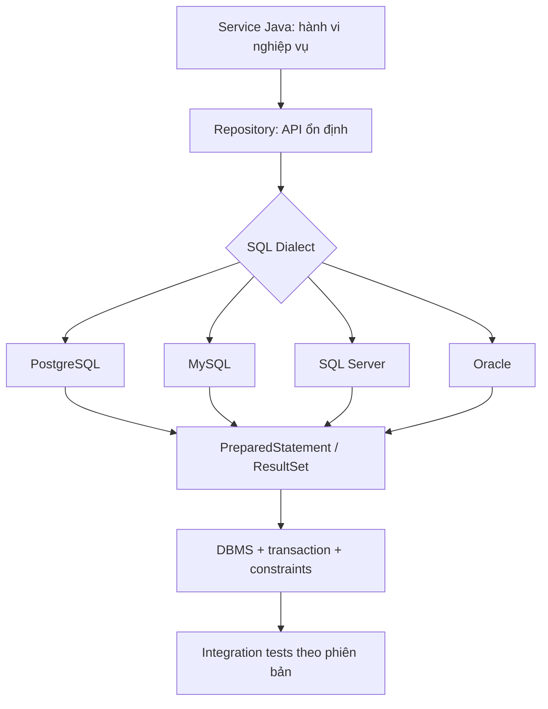
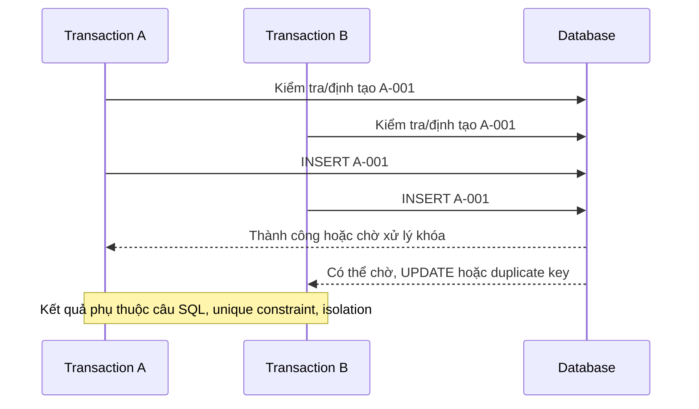

# Đối chiếu phân trang, upsert và khóa bi quan giữa các hệ quản trị trong JDBC

## Mục tiêu học tập

JDBC giúp ứng dụng Java truy cập cơ sở dữ liệu quan hệ thông qua driver, `DataSource`, `Connection`, `PreparedStatement` và `ResultSet`. Các thao tác đọc/ghi tham số hóa, quản lý transaction và đóng tài nguyên có thể dùng API chuẩn. Tuy nhiên, **JDBC không chuẩn hóa mọi cú pháp SQL của từng DBMS**. Khi một ứng dụng phải hỗ trợ PostgreSQL, MySQL, SQL Server và Oracle, ba nhóm chức năng thường bộc lộ khác biệt rõ rệt:

1. **Phân trang:** lấy một phần kết quả theo thứ tự ổn định bằng `LIMIT/OFFSET`, `OFFSET/FETCH` hoặc phân trang theo khóa (*keyset pagination*).
2. **Upsert:** chèn khi khóa chưa tồn tại, cập nhật khi đã có; SQL tương ứng có thể là `ON CONFLICT`, `ON DUPLICATE KEY UPDATE` hoặc `MERGE`.
3. **Khóa bi quan:** khóa hàng để phối hợp nhiều transaction; các cú pháp `FOR UPDATE`, `NOWAIT`, `SKIP LOCKED` và table hints không đồng nhất.

Bài thuộc chương **Đa hệ quản trị** nhằm giúp bạn chọn **hợp đồng hành vi thống nhất ở tầng Java**, đồng thời đặt những khác biệt cú pháp, mức khóa và khả năng hỗ trợ vào một tầng adapter SQL được kiểm thử. Điều quan trọng không chỉ là câu SQL chạy được, mà còn là **đúng khi nhiều transaction thực thi đồng thời, an toàn khi retry và không làm mất dữ liệu**.

Sau khi học, bạn có thể:

- Phân biệt `OFFSET` pagination và keyset pagination, nhất là khi dữ liệu thay đổi giữa các trang.
- Viết câu SQL phân trang tham số hóa cho bốn DBMS và tránh giả định chúng có cùng cú pháp.
- So sánh ngữ nghĩa, update count và xung đột khóa của các dạng upsert.
- Sử dụng khóa bi quan đúng transaction, không giữ khóa qua lời gọi mạng chậm.
- Chọn `NOWAIT`, `SKIP LOCKED` hoặc cơ chế tương tự dựa vào phiên bản DBMS và mục đích nghiệp vụ.
- Xây lớp `SqlDialect`/strategy trong Java, giữ `PreparedStatement` cho **giá trị**, dùng whitelist cho identifier/cú pháp.
- Thiết lập ma trận integration test để phát hiện sai lệch giữa driver, DBMS, isolation và cấu hình pool.

## 1. Phân biệt phần JDBC chuẩn và SQL đặc thù

`PreparedStatement.setLong(1, ...)` hay `Connection.setAutoCommit(false)` là API JDBC tiêu chuẩn. Ngược lại, JDBC không đưa ra một hàm API chung kiểu `statement.upsert(...)` hoặc `resultSet.lockSkipLocked(...)` để tự động chuyển thành SQL đúng cho mọi hệ quản trị.

| Nhu cầu | API JDBC chung | Phần phải kiểm tra theo DBMS/driver |
| --- | --- | --- |
| Lấy connection và chạy SQL | `DataSource.getConnection()`, `prepareStatement()` | JDBC URL, driver, tên schema, dialect |
| Gắn giá trị vào điều kiện | `setLong()`, `setString()`, `setObject()` | Tương thích kiểu SQL và parameter marker |
| Đọc kết quả | `executeQuery()`, `ResultSet.next()` | Kiểu dữ liệu, collation và cách sort `NULL` |
| Ghi dữ liệu | `executeUpdate()` | Cú pháp UPSERT/MERGE, số hàng bị ảnh hưởng |
| Transaction | `setAutoCommit(false)`, `commit()`, `rollback()` | Isolation và semantics lock/deadlock |
| Khóa bi quan | Chạy câu `SELECT`/`UPDATE` phù hợp | `FOR UPDATE` hoặc SQL Server hints, timeout |
| Khóa sinh | `RETURN_GENERATED_KEYS`, `getGeneratedKeys()` | Kiểu khóa và tính năng trả khóa của driver |

**Quy tắc thiết kế:** tầng ứng dụng diễn đạt nhu cầu như “lấy trang kế”, “ghi một bản ghi theo khóa tự nhiên”, “giành quyền xử lý công việc”. Tầng persistence chọn SQL cụ thể, xử lý update count và ngoại lệ theo **hợp đồng đã được kiểm thử** trên đúng DBMS.



## 2. Ma trận tổng quan PostgreSQL, MySQL, SQL Server và Oracle

Bảng dưới đây nói về **các phiên bản phổ biến có tính năng tương ứng**; không thay thế việc xác nhận phiên bản bạn sử dụng:

| Nhu cầu | PostgreSQL | MySQL | SQL Server | Oracle |
| --- | --- | --- | --- | --- |
| Lấy trang theo offset | `LIMIT ? OFFSET ?` | `LIMIT ? OFFSET ?` | `ORDER BY ... OFFSET ? ROWS FETCH NEXT ? ROWS ONLY` (2012+) | `ORDER BY ... OFFSET ? ROWS FETCH NEXT ? ROWS ONLY` (12c+) |
| Trang tiếp theo theo khóa | `WHERE id > ? ... LIMIT ?` | `WHERE id > ? ... LIMIT ?` | `WHERE id > ? ORDER BY ... OFFSET 0 ROWS FETCH NEXT ? ROWS ONLY` | `WHERE id > ? ORDER BY ... OFFSET 0 ROWS FETCH NEXT ? ROWS ONLY` |
| Chèn hoặc cập nhật | `INSERT ... ON CONFLICT ... DO UPDATE` | `INSERT ... ON DUPLICATE KEY UPDATE` | `MERGE` hoặc quy trình `UPDATE/INSERT` có khóa | `MERGE INTO ... USING ...` |
| Khóa hàng để cập nhật | `SELECT ... FOR UPDATE` | `SELECT ... FOR UPDATE` (ví dụ InnoDB) | `SELECT ... WITH (UPDLOCK, ...)` | `SELECT ... FOR UPDATE` |
| Không chờ khóa | `FOR UPDATE NOWAIT` | `FOR UPDATE NOWAIT` (MySQL 8.0+/InnoDB) | Cơ chế `SET LOCK_TIMEOUT` / lock hints theo ngữ cảnh | `FOR UPDATE NOWAIT` |
| Bỏ qua hàng đang bị khóa | `FOR UPDATE SKIP LOCKED` | `FOR UPDATE SKIP LOCKED` (MySQL 8.0+/InnoDB) | `READPAST` hint với hạn chế riêng | `FOR UPDATE SKIP LOCKED` |

**Không đồng nhất các ô trong bảng:** Oracle `MERGE` không phải PostgreSQL `ON CONFLICT`; SQL Server `READPAST` không bảo đảm tương đương tuyệt đối với `SKIP LOCKED`; MySQL `ON DUPLICATE KEY UPDATE` có thể bị kích hoạt bởi **bất kỳ ràng buộc UNIQUE liên quan**, chứ không có tham số conflict target giống PostgreSQL.

Hãy ghi rõ DBMS **edition/version**, JDBC driver **version**, schema và transaction isolation khi tuyên bố “hỗ trợ”. Một câu SQL chạy trên phiên bản phát triển có thể thất bại hoặc khác ngữ nghĩa trên môi trường triển khai cũ hơn.

## 3. Phân trang OFFSET: dễ dùng nhưng có giới hạn

Mục tiêu: lấy trang thứ 3, mỗi trang 20 hàng, theo `id` tăng dần:

\[
\text{offset} = (\text{pageNumber}-1)\times\text{pageSize}
\]

Với trang 3, offset = 40.

### 3.1. PostgreSQL và MySQL

```sql
SELECT id, sku, quantity
  FROM inventory
 ORDER BY id
 LIMIT ? OFFSET ?;
```

Tham số thứ nhất là `pageSize`, thứ hai là `offset`. Không tính offset bằng cách nối chuỗi người dùng vào SQL.

### 3.2. SQL Server (2012 trở lên) và Oracle (12c trở lên)

```sql
SELECT id, sku, quantity
  FROM inventory
 ORDER BY id
 OFFSET ? ROWS FETCH NEXT ? ROWS ONLY;
```

Tham số thứ nhất là `offset`, thứ hai là `pageSize`. Để thực thi đúng, `ORDER BY` phải xác định thứ tự; SQL Server yêu cầu `ORDER BY` khi dùng `OFFSET/FETCH` trong ngữ cảnh này.

**Cần chú ý thứ tự bind khác nhau**: PostgreSQL/MySQL thường dùng `LIMIT pageSize OFFSET offset`, còn hai câu `OFFSET/FETCH` dùng `OFFSET offset ... FETCH NEXT pageSize`. Một adapter dùng chung SQL string nhưng bind sai vị trí sẽ trả trang không đúng mà **không nhất thiết ném lỗi**.

### 3.3. OFFSET sâu và dữ liệu thay đổi giữa hai trang

OFFSET dễ hiểu nhưng có hai rủi ro:

- Với offset rất sâu, nhiều kế hoạch truy vấn vẫn phải duyệt hoặc loại bỏ nhiều hàng đầu trước khi trả trang cuối. Chi phí phụ thuộc index và kế hoạch thực thi, không chỉ số hàng trả về.
- Nếu hàng bị thêm hoặc xóa giữa hai truy vấn, ranh giới offset có thể dịch chuyển, gây **trùng hoặc bỏ sót**.

Ví dụ lúc tải trang 1:

```text
ORDER BY id: [10, 20, 30, 40, 50, 60]
Trang 1, size=3: [10, 20, 30]
```

Trước khi tải trang 2, một transaction khác thêm hàng `id=15`:

```text
ORDER BY id: [10, 15, 20, 30, 40, 50, 60]
Trang 2, OFFSET 3: [30, 40, 50]
```

Hàng 30 bị lặp lại. Tình huống xóa hàng trước ranh giới có thể làm bỏ sót một phần dữ liệu.

**Thêm `ORDER BY` là điều kiện cần, nhưng không đủ để ổn định snapshot qua nhiều request.** Nếu báo cáo phải phản ánh một thời điểm nhất quán, cần transaction isolation/snapshot phù hợp DBMS, hoặc tạo snapshot xuất dữ liệu riêng; khi đó phải tính chi phí connection và tài nguyên giữ lâu.

## 4. Keyset pagination: tiếp tục sau khóa cuối

Thay vì “bỏ qua 40 hàng”, keyset pagination hỏi: **“hãy lấy những hàng có khóa lớn hơn hàng cuối cùng tôi đã xử lý”**.

Giả sử `inventory.id` là `BIGINT PRIMARY KEY`, tăng ổn định và không bị sửa:

### 4.1. PostgreSQL và MySQL

```sql
SELECT id, sku, quantity
  FROM inventory
 WHERE id > ?
 ORDER BY id
 LIMIT ?;
```

### 4.2. SQL Server và Oracle

```sql
SELECT id, sku, quantity
  FROM inventory
 WHERE id > ?
 ORDER BY id
 OFFSET 0 ROWS FETCH NEXT ? ROWS ONLY;
```

Đối với các phiên bản được hỗ trợ, dạng thứ hai tránh phải tính offset lớn và vẫn tham số hóa được `pageSize`. SQL Server cũng có `TOP (?)`, nhưng cách dùng `FETCH NEXT ?` giúp giữ cùng thứ tự tham số với truy vấn của Oracle.

| Tham số | Nội dung |
| --- | --- |
| `afterId` | Khóa cuối của trang đã xử lý thành công |
| `pageSize` | Số hàng tối đa cần lấy |
| `ORDER BY id` | Bảo đảm thứ tự duyệt có tie-breaker duy nhất |

Nếu consumer chậm, một vòng lặp an toàn có thể **đọc từng trang sang DTO, đóng JDBC connection, xử lý trang, rồi mới yêu cầu trang tiếp theo**.

### 4.3. Điều kiện để keyset đúng

Keyset phù hợp khi:

- Thứ tự duyệt dựa trên khóa có index phù hợp.
- Khóa sắp xếp **duy nhất và ổn định**, không bị cập nhật tùy tiện.
- Query luôn có cùng bộ lọc và quy tắc sắp xếp.
- Cursor lưu đủ thành phần của khóa khi sắp xếp theo nhiều cột.
- Ứng dụng hiểu rằng nhiều transaction riêng vẫn có thể quan sát thay đổi dữ liệu giữa các trang.

Nếu sort theo `created_at` mà nhiều hàng có cùng timestamp, chỉ lưu `lastCreatedAt` làm cursor có thể bỏ sót hàng. Dùng khóa tổng hợp như `(created_at, id)`:

```sql
SELECT id, created_at, sku
  FROM inventory
 WHERE created_at > ?
    OR (created_at = ? AND id > ?)
 ORDER BY created_at, id;
```

Đây là **phần điều kiện cốt lõi**; thêm cú pháp giới hạn hàng theo dialect. Đặt tên cột/sort direction bằng whitelist, không nối SQL identifier từ request. Nếu cột sort cho phép `NULL`, cần định nghĩa quy tắc sắp xếp `NULL` riêng vì DBMS có thể đặt `NULL` đầu hoặc cuối khác nhau.

### 4.4. High watermark không phải snapshot tuyệt đối

Với export lớn, có thể xác định `MAX(id)` đầu quá trình và chỉ duyệt `id <= maxId`. Cách này tránh tiếp tục lấy những ID lớn hơn mới được sinh trong lúc export, nhưng **không bảo đảm snapshot tại một thời điểm**: hàng có ID thấp hơn có thể commit muộn; các hàng cũ có thể bị cập nhật/xóa giữa các trang. Muốn tính nhất quán mạnh hơn phải xét snapshot isolation, dữ liệu bất biến hoặc chiến lược xuất chuyên biệt.

## 5. Ví dụ Java: một API phân trang, nhiều dialect

Ta đặt contract ở tầng Java: `pageAfter(afterId, pageSize)` trả về **danh sách DTO đã tách rời connection**. Để đơn giản, bảng `inventory(id, sku, quantity)` có khóa `id` duy nhất, `quantity` là số nguyên không NULL và `sku` là chuỗi không NULL.

```java
import java.sql.Connection;
import java.sql.PreparedStatement;
import java.sql.ResultSet;
import java.sql.SQLException;
import java.util.ArrayList;
import java.util.List;
import java.util.Locale;
import java.util.Objects;
import javax.sql.DataSource;

public final class PortableInventoryReader {
    public record InventoryRow(long id, String sku, long quantity) {}

    private final DataSource dataSource;

    public PortableInventoryReader(DataSource dataSource) {
        this.dataSource = Objects.requireNonNull(dataSource);
    }

    enum Dialect {
        POSTGRESQL, MYSQL, SQL_SERVER, ORACLE;

        static Dialect detect(Connection connection) throws SQLException {
            String name = connection.getMetaData()
                .getDatabaseProductName()
                .toLowerCase(Locale.ROOT);

            if (name.contains("postgresql")) return POSTGRESQL;
            if (name.contains("mysql")) return MYSQL;
            if (name.contains("microsoft sql server")) return SQL_SERVER;
            if (name.contains("oracle")) return ORACLE;

            throw new SQLException("DBMS chưa được hỗ trợ: " + name);
        }

        String nextPageSql() {
            return switch (this) {
                case POSTGRESQL, MYSQL -> """
                    SELECT id, sku, quantity
                      FROM inventory
                     WHERE id > ?
                     ORDER BY id
                     LIMIT ?
                    """;
                case SQL_SERVER, ORACLE -> """
                    SELECT id, sku, quantity
                      FROM inventory
                     WHERE id > ?
                     ORDER BY id
                     OFFSET 0 ROWS FETCH NEXT ? ROWS ONLY
                    """;
            };
        }
    }

    public List<InventoryRow> pageAfter(long afterId, int pageSize)
            throws SQLException {
        if (afterId < 0 || pageSize < 1 || pageSize > 500) {
            throw new IllegalArgumentException(
                "afterId phải không âm, pageSize trong [1,500]"
            );
        }

        List<InventoryRow> rows = new ArrayList<>(pageSize);

        try (Connection connection = dataSource.getConnection()) {
            Dialect dialect = Dialect.detect(connection);

            try (PreparedStatement ps =
                     connection.prepareStatement(dialect.nextPageSql())) {
                ps.setLong(1, afterId);
                ps.setInt(2, pageSize);

                try (ResultSet rs = ps.executeQuery()) {
                    while (rs.next()) {
                        rows.add(new InventoryRow(
                            rs.getLong("id"),
                            rs.getString("sku"),
                            rs.getLong("quantity")
                        ));
                    }
                }
            }
        }
        return List.copyOf(rows);
    }
}
```

Ví dụ dùng **Java 17+** (`record`, text block và switch expression). Mã minh họa một **tập dialect đã biết**. Trong triển khai thật, ngoài product name còn phải xác minh **major/minor version**, khả năng hỗ trợ cú pháp, cách driver báo metadata, tên schema/table và test tích hợp trên hệ thống tương ứng.

### Tại sao detect() chỉ là bước đầu?

`DatabaseMetaData.getDatabaseProductName()` giúp nhận diện DBMS, nhưng không đủ để khẳng định mọi tính năng hoạt động. Cùng một DBMS có phiên bản quá cũ chưa hỗ trợ `OFFSET/FETCH`; proxy hoặc driver tương thích có thể báo tên khác. Với production, có thể khai báo dialect bằng cấu hình được xác nhận và **fail fast** nếu kết nối không khớp.

Không fallback tùy tiện về PostgreSQL hay MySQL khi tên DBMS không nhận diện được. Càng không chọn SQL bằng cách nối một tên bảng hoặc fragment `ORDER BY` do người dùng nhập trực tiếp.

### Duyệt nhiều trang

```java
PortableInventoryReader reader =
    new PortableInventoryReader(dataSource);

long afterId = 0;
while (true) {
    List<PortableInventoryReader.InventoryRow> page =
        reader.pageAfter(afterId, 200);

    if (page.isEmpty()) {
        break;
    }

    processPage(page); // Ứng dụng tự định nghĩa, có thể chậm.
    afterId = page.get(page.size() - 1).id();
}
```

`processPage` là hàm nghiệp vụ do ứng dụng định nghĩa. Vì `pageAfter()` đã đóng connection trước khi trả `List`, consumer chậm **không giữ connection trong lúc xử lý trang**. Nếu consumer chỉ đẩy page vào queue không giới hạn rồi trả về, backpressure cuối-cuối sẽ không còn. Nếu cần checkpoint sau sự cố, chỉ lưu `afterId` khi hệ thống đích đã xác nhận mức độ hoàn tất theo contract.

## 6. Upsert: giống ý định, khác ngữ nghĩa

**Upsert** thường mô tả: với khóa nghiệp vụ `sku`, nếu chưa có hàng thì INSERT; nếu đã có thì UPDATE. Muốn đúng khi hai request chạy đồng thời, schema phải có **ràng buộc duy nhất** thích hợp, ví dụ `UNIQUE(sku)`.

Giả sử:

```text
inventory
  id         BIGINT PRIMARY KEY, tự sinh
  sku        VARCHAR(...) NOT NULL UNIQUE
  quantity   BIGINT NOT NULL
```

Câu hỏi quan trọng:

- Upsert **gán** quantity thành giá trị mới, hay **cộng** vào quantity cũ?
- Nếu cùng `sku` đã tồn tại, có được ghi đè không, hay phải báo conflict?
- Khi hai request gửi cùng một yêu cầu, retry có tạo tác động lần hai không?
- Khi `sku` trùng UNIQUE nhưng một ràng buộc khác cũng trùng, DBMS chọn hành động nào?
- Khi có trigger/cascade, update count có ý nghĩa gì?
- Nếu cần ID của hàng, có phải DBMS/driver đều trả generated key cho cả nhánh INSERT và UPDATE không?

**Không gọi mọi upsert là idempotent.** Ví dụ “SET quantity = ?” với cùng giá trị thường có thể lặp lại về trạng thái; “SET quantity = quantity + ?” **không idempotent** nếu retry, trừ khi hệ thống có cơ chế khử trùng lặp theo request ID.

### 6.1. PostgreSQL: ON CONFLICT

```sql
INSERT INTO inventory (sku, quantity)
VALUES (?, ?)
ON CONFLICT (sku)
DO UPDATE SET quantity = EXCLUDED.quantity;
```

`EXCLUDED.quantity` biểu diễn giá trị `quantity` được đề xuất INSERT. `ON CONFLICT (sku)` cần một **unique index/constraint** tương ứng mà PostgreSQL có thể dùng làm conflict arbiter. Có thể dùng `DO NOTHING` nếu nghiệp vụ là “thêm nếu chưa có”, hoặc bổ sung điều kiện update theo contract.

Với `RETURNING`, PostgreSQL có thể trả dữ liệu sau INSERT/UPDATE:

```sql
INSERT INTO inventory (sku, quantity)
VALUES (?, ?)
ON CONFLICT (sku)
DO UPDATE SET quantity = EXCLUDED.quantity
RETURNING id, sku, quantity;
```

Khi dùng câu lệnh có `RETURNING`, cách gọi `executeQuery()`/đọc `ResultSet` cần tương ứng với driver và SQL. **Không giả định** một thao tác `executeUpdate()` luôn phù hợp cho mọi câu có output row.

### 6.2. MySQL: ON DUPLICATE KEY UPDATE

Với các phiên bản MySQL hỗ trợ **row alias sau VALUES**, chẳng hạn MySQL 8.0.19+:

```sql
INSERT INTO inventory (sku, quantity)
VALUES (?, ?) AS incoming
ON DUPLICATE KEY UPDATE quantity = incoming.quantity;
```

Thay thế tên alias theo quy tắc identifier của DBMS nếu cần. Cách viết `VALUES(quantity)` trong nhánh update từng phổ biến nhưng đã bị đánh dấu deprecated trên các phiên bản MySQL mới hơn; sử dụng alias phù hợp với phiên bản đang triển khai.

**Khác PostgreSQL:** `ON DUPLICATE KEY UPDATE` có thể được kích hoạt bởi vi phạm **PRIMARY KEY hoặc bất kỳ UNIQUE index liên quan**; không có conflict target `(sku)` được chỉ định tường minh. Trên bảng có nhiều ràng buộc duy nhất, phải kiểm tra conflict nào khiến bản ghi bị update, và liệu upsert có còn đúng về nghiệp vụ.

Update count của MySQL cũng cần xử lý riêng:

| Trường hợp thường gặp | Affected rows MySQL có thể báo |
| --- | --- |
| INSERT thành công | 1 |
| Trùng khóa và UPDATE làm thay đổi giá trị | 2 |
| Trùng khóa, UPDATE giữ nguyên giá trị | 0 theo cấu hình mặc định ở nhiều trường hợp |
| Client bật chế độ `CLIENT_FOUND_ROWS` tương ứng | Giá trị cho trường hợp không đổi có thể thành 1 |

Đây là mô tả ngữ nghĩa thông dụng; cấu hình driver, loại statement và phiên bản có thể ảnh hưởng. **Không viết contract “upsert hợp lệ phải trả đúng 1” áp dụng cho cả PostgreSQL lẫn MySQL**. Với kết quả nghiệp vụ, nên đọc lại dữ liệu hoặc sử dụng cơ chế output được DBMS hỗ trợ.

### 6.3. SQL Server: MERGE hoặc UPDATE/INSERT có kiểm soát

SQL Server có `MERGE`:

```sql
MERGE dbo.inventory WITH (HOLDLOCK) AS target
USING (VALUES (?, ?)) AS source(sku, quantity)
ON target.sku = source.sku
WHEN MATCHED THEN
    UPDATE SET quantity = source.quantity
WHEN NOT MATCHED THEN
    INSERT (sku, quantity)
    VALUES (source.sku, source.quantity);
```

Dấu chấm phẩy kết thúc `MERGE` là quan trọng trong T-SQL. `HOLDLOCK` trên target giúp yêu cầu ngữ nghĩa khóa tương ứng serializable khi thực thi trong bối cảnh phù hợp; **không tự động chứng minh mọi trường hợp cạnh tranh đều được xử lý**.

**Lưu ý production:** `MERGE` trên SQL Server có nhiều khác biệt và tình huống cạnh tranh/triển khai phức tạp. Với workload ghi quan trọng, thường nên cân nhắc quy trình `UPDATE` rồi `INSERT` trong một transaction có unique constraint, lock/isolation phù hợp và xử lý va chạm khóa/ retry rõ ràng, thay vì mặc định chọn `MERGE` chỉ vì câu SQL ngắn hơn.

Một ví dụ T-SQL *mang tính phác thảo* của hướng UPDATE/INSERT:

```sql
BEGIN TRANSACTION;

UPDATE dbo.inventory WITH (UPDLOCK, HOLDLOCK)
   SET quantity = @quantity
 WHERE sku = @sku;

IF @@ROWCOUNT = 0
BEGIN
    INSERT INTO dbo.inventory (sku, quantity)
    VALUES (@sku, @quantity);
END;

COMMIT TRANSACTION;
```

`@quantity` và `@sku` ở đây là **biến T-SQL trong một thủ tục/script**, không phải placeholder JDBC `?`; khi triển khai qua Java cần dùng `PreparedStatement` cho giá trị và điều khiển transaction một cách phù hợp. Việc bảo vệ khoảng khóa khi chưa có hàng phụ thuộc isolation, lock hints và **index duy nhất**; cần thử concurrency thực sự và có xử lý lỗi unique constraint.

### 6.4. Oracle: MERGE INTO ... USING

```sql
MERGE INTO inventory target
USING (SELECT ? AS sku, ? AS quantity FROM dual) incoming
   ON (target.sku = incoming.sku)
WHEN MATCHED THEN
    UPDATE SET target.quantity = incoming.quantity
WHEN NOT MATCHED THEN
    INSERT (sku, quantity)
    VALUES (incoming.sku, incoming.quantity);
```

Đây là cú pháp MERGE phổ biến của Oracle, với input một hàng từ `dual`. Oracle có các hạn chế riêng đối với những cột xuất hiện trong điều kiện `ON`, biểu thức update, trigger và cách báo update counts.

**Oracle MERGE không phải cam kết tránh mọi race** khi hai transaction cùng cố thêm `sku` mới. Một transaction vẫn có thể nhận lỗi duplicate key trong tình huống cạnh tranh; phải dựa vào unique constraint, chính sách retry có điều kiện và kiểm thử. Không cho rằng `MERGE` của Oracle trả đúng loại kết quả như PostgreSQL `ON CONFLICT ... RETURNING`.

## 7. Adapter Java cho upsert: nhất quán ở API, không ép update count

Một API nghiệp vụ hợp lý có thể là `setQuantity(sku, quantity)`. Tất cả dialect nhận **cùng thứ tự hai tham số**, nhưng SQL được chọn riêng.

```java
import java.sql.Connection;
import java.sql.PreparedStatement;
import java.sql.SQLException;
import java.util.Locale;
import java.util.Objects;
import javax.sql.DataSource;

public final class InventoryUpsertRepository {
    private final DataSource dataSource;

    public InventoryUpsertRepository(DataSource dataSource) {
        this.dataSource = Objects.requireNonNull(dataSource);
    }

    private enum Dialect {
        POSTGRESQL, MYSQL, SQL_SERVER, ORACLE;

        static Dialect of(Connection c) throws SQLException {
            String product = c.getMetaData().getDatabaseProductName()
                .toLowerCase(Locale.ROOT);
            if (product.contains("postgresql")) return POSTGRESQL;
            if (product.contains("mysql")) return MYSQL;
            if (product.contains("microsoft sql server")) return SQL_SERVER;
            if (product.contains("oracle")) return ORACLE;
            throw new SQLException("Unsupported DBMS: " + product);
        }

        String upsertSql() {
            return switch (this) {
                case POSTGRESQL -> """
                    INSERT INTO inventory (sku, quantity)
                    VALUES (?, ?)
                    ON CONFLICT (sku)
                    DO UPDATE SET quantity = EXCLUDED.quantity
                    """;
                case MYSQL -> """
                    INSERT INTO inventory (sku, quantity)
                    VALUES (?, ?) AS incoming
                    ON DUPLICATE KEY UPDATE
                        quantity = incoming.quantity
                    """;
                case SQL_SERVER -> """
                    MERGE dbo.inventory WITH (HOLDLOCK) AS target
                    USING (VALUES (?, ?)) AS source(sku, quantity)
                    ON target.sku = source.sku
                    WHEN MATCHED THEN
                        UPDATE SET quantity = source.quantity
                    WHEN NOT MATCHED THEN
                        INSERT (sku, quantity)
                        VALUES (source.sku, source.quantity);
                    """;
                case ORACLE -> """
                    MERGE INTO inventory target
                    USING (
                        SELECT ? AS sku, ? AS quantity FROM dual
                    ) incoming
                    ON (target.sku = incoming.sku)
                    WHEN MATCHED THEN
                        UPDATE SET target.quantity = incoming.quantity
                    WHEN NOT MATCHED THEN
                        INSERT (sku, quantity)
                        VALUES (incoming.sku, incoming.quantity)
                    """;
            };
        }
    }

    public void setQuantity(String sku, long quantity)
            throws SQLException {
        if (sku == null || sku.isBlank() || quantity < 0) {
            throw new IllegalArgumentException(
                "sku không rỗng, quantity không âm"
            );
        }

        try (Connection c = dataSource.getConnection()) {
            Dialect dialect = Dialect.of(c);

            try (PreparedStatement ps =
                     c.prepareStatement(dialect.upsertSql())) {
                ps.setString(1, sku);
                ps.setLong(2, quantity);

                // Không áp dụng một điều kiện affectedRows == 1
                // chung cho mọi dialect/upsert branch.
                ps.executeUpdate();
            }
        }
    }
}
```

Ví dụ yêu cầu:

- Bảng/schema đã được tạo đúng theo **mỗi DBMS**, với `sku` duy nhất.
- SQL Server dùng schema `dbo` trong ví dụ; nếu database thật có schema khác, adapter phải được cấu hình bằng **identifier đã whitelist**, không nối trực tiếp input người dùng.
- MySQL bản cũ chưa hỗ trợ alias dạng ví dụ phải dùng chiến lược tương thích riêng đã được test.
- `MERGE` trên SQL Server/Oracle không đảm bảo tính an toàn cạnh tranh chỉ vì một statement đã chạy thành công trên đường happy path.
- Ví dụ mở một connection ở chế độ auto-commit mặc định theo cấu hình pool. Nếu thao tác là một phần của nghiệp vụ nhiều DML, **service phải sở hữu một transaction**, dùng cùng connection và không để repository tự commit hoặc đóng connection do caller cấp.
- Kết quả `executeUpdate()` chỉ là tín hiệu từ driver; cần thêm validation/SELECT/returning/OUTPUT tùy contract nếu muốn biết bản ghi nào được tạo hoặc cập nhật.

Việc `setQuantity()` dùng tên **“set”** thay vì “add” là chủ đích: cùng cặp `(sku, quantity)` được áp lại thường cho cùng **giá trị cuối**, còn phép cộng dồn phải có request ID/idempotency để tránh cộng hai lần khi retry.

## 8. Upsert khi nhiều transaction chạy đồng thời

Hãy xét hai request cùng lúc muốn lưu `sku='A-001'` chưa có trong database:



Một cách viết không an toàn:

```java
// SAI khi không có cơ chế phối hợp cạnh tranh:
if (!existsSku(connection, sku)) {
    insertSku(connection, sku, quantity);
} else {
    updateSku(connection, sku, quantity);
}
```

`existsSku`, `insertSku` và `updateSku` là các helper giả định. Hai transaction có thể đều thấy hàng chưa tồn tại rồi cùng INSERT. Vì vậy:

1. Khai báo **unique constraint** tại DBMS để bảo vệ tính duy nhất.
2. Dùng upsert nguyên tử **nếu DBMS hỗ trợ đúng ngữ nghĩa cần thiết**, hoặc dùng transaction với khóa/isolation và xử lý lỗi duplicate.
3. Phân loại lỗi **unique violation**, serialization failure, deadlock và timeout riêng; không nuốt mọi `SQLException` rồi coi là “chỉ cần UPDATE”.
4. Chỉ retry những tình huống hợp lệ, trong **transaction mới** khi DBMS đã đánh dấu transaction cũ thất bại.
5. Nếu commit báo lỗi mạng, trạng thái có thể **chưa xác định**; dùng mã yêu cầu ổn định và đối soát trước khi lặp lại một hành động có tác động.
6. Với update cần kiểm tra phiên bản, dùng **optimistic locking** hoặc `WHERE version = ?` trong logic phù hợp, không upsert ghi đè vô điều kiện.

### 8.1. Cập nhật số lượng tồn kho không giống gán giá trị

Nếu upsert từ `quantity=10` sang `quantity=12` có nghĩa “đặt tồn kho bằng 12”, chiến lược `SET quantity = new.quantity` có thể phù hợp.

Nếu ý định là “cộng thêm 2”, câu SQL nên biểu đạt phép cộng có điều kiện, nhưng **retry có thể cộng hai lần**:

```sql
UPDATE inventory
   SET quantity = quantity + ?
 WHERE sku = ?;
```

Đây là DML tham số hóa phổ biến cho các DBMS; kết quả affected rows phải được kiểm tra. Với nghiệp vụ tài chính, kiểm kê hoặc đơn hàng, nên gắn request ID duy nhất vào một bản ghi/idempotency table cùng transaction, không chỉ dựa vào khóa `sku`.

## 9. Khóa bi quan: khóa khi còn transaction, không chỉ khi còn biến Java

**Khóa bi quan (pessimistic locking)** thường được dùng khi ứng dụng cần đọc một bản ghi rồi quyết định cập nhật nó, nhưng không muốn transaction khác thay đổi cùng bản ghi trong khoảng thời gian đó.

Ý tưởng chung:

```text
BEGIN TRANSACTION
  SELECT ... khóa hàng cần sửa
  kiểm tra quy tắc nghiệp vụ
  UPDATE ... dựa trên trạng thái đã kiểm tra
COMMIT hoặc ROLLBACK
```

Nếu `autoCommit=true`, một câu `SELECT ... FOR UPDATE` có thể kết thúc transaction quá sớm để bảo vệ một bước `UPDATE` thực thi sau đó. Cần transaction tường minh với thời gian sống **đủ ngắn**.

### 9.1. PostgreSQL, MySQL và Oracle

```sql
SELECT id, quantity
  FROM inventory
 WHERE sku = ?
 FOR UPDATE;
```

Câu này có thể yêu cầu **row-level lock** cho hàng trả về theo ngữ nghĩa của DBMS, engine và isolation hiện tại. MySQL cần chú ý storage engine (ví dụ InnoDB), transaction mode, phạm vi index/range lock và isolation; không suy rằng mọi table engine có hành vi giống nhau.

### 9.2. SQL Server

SQL Server thường dùng table hints để yêu cầu khóa phù hợp:

```sql
SELECT id, quantity
  FROM dbo.inventory WITH (UPDLOCK, ROWLOCK)
 WHERE sku = ?;
```

- `UPDLOCK` yêu cầu kiểu update lock, hữu ích khi code có ý định cập nhật tiếp trong cùng transaction.
- `ROWLOCK` là hint hướng tới row-level locking, **không bảo đảm tuyệt đối** DBMS không chọn/escalate hình thức khóa khác.
- Khi cần giữ khóa/range theo ngữ nghĩa serializable, phải xét `HOLDLOCK` hoặc isolation phù hợp, kế hoạch truy vấn và index.

**Không chuyển `FOR UPDATE` thành `UPDLOCK` bằng tìm/thay văn bản tùy tiện.** Phạm vi khóa, cơ chế chờ và tác động tới các câu lệnh khác cần được kiểm chứng riêng.

### 9.3. Khóa hàng đã tồn tại không tự bảo vệ hàng chưa tồn tại

Nếu chạy:

```sql
SELECT id FROM inventory WHERE sku = ? FOR UPDATE;
```

và truy vấn **không trả hàng nào**, bạn không thể mặc định “đã khóa chỗ trống” cho `sku` mới. Bảo vệ việc tạo một khóa mới cần unique constraint và/hoặc cơ chế range lock/serializable phù hợp từng DBMS. Các kiểu predicate/gap/key-range locking khác nhau, đặc biệt giữa MySQL InnoDB, SQL Server và PostgreSQL.

## 10. Ví dụ JDBC: đọc rồi cập nhật trong một khóa bi quan

Ví dụ dưới đây dùng transaction tường minh và **một connection duy nhất** cho SELECT khóa và UPDATE. `quantity` được giả định không âm, `sku` duy nhất và đã tồn tại.

```java
import java.sql.Connection;
import java.sql.PreparedStatement;
import java.sql.ResultSet;
import java.sql.SQLException;
import java.util.Locale;
import java.util.Objects;
import javax.sql.DataSource;

public final class LockedInventoryService {
    private final DataSource dataSource;

    public LockedInventoryService(DataSource dataSource) {
        this.dataSource = Objects.requireNonNull(dataSource);
    }

    private String lockSql(Connection c) throws SQLException {
        String db = c.getMetaData().getDatabaseProductName()
            .toLowerCase(Locale.ROOT);

        if (db.contains("microsoft sql server")) {
            return """
                SELECT quantity
                  FROM dbo.inventory WITH (UPDLOCK, ROWLOCK)
                 WHERE sku = ?
                """;
        }
        if (db.contains("postgresql") || db.contains("mysql")
                || db.contains("oracle")) {
            return """
                SELECT quantity
                  FROM inventory
                 WHERE sku = ?
                 FOR UPDATE
                """;
        }
        throw new SQLException("DBMS chưa hỗ trợ khóa: " + db);
    }

    public boolean addQuantity(String sku, long delta)
            throws SQLException {
        Objects.requireNonNull(sku, "sku");
        if (delta <= 0) {
            throw new IllegalArgumentException("delta phải dương");
        }

        try (Connection c = dataSource.getConnection()) {
            c.setAutoCommit(false);
            boolean exists;
            long newQuantity = 0;

            try {
                try (PreparedStatement locked = c.prepareStatement(
                        lockSql(c))) {
                    locked.setString(1, sku);
                    locked.setQueryTimeout(10);

                    try (ResultSet rs = locked.executeQuery()) {
                        exists = rs.next();
                        if (exists) {
                            long current = rs.getLong("quantity");
                            newQuantity = Math.addExact(current, delta);

                            if (rs.next()) {
                                throw new SQLException(
                                    "sku không duy nhất"
                                );
                            }
                        }
                    }
                }

                if (exists) {
                    // Dùng cùng Connection và transaction còn giữ lock.
                    String sql =
                        "UPDATE inventory SET quantity = ? WHERE sku = ?";
                    if (c.getMetaData().getDatabaseProductName()
                            .toLowerCase(Locale.ROOT)
                            .contains("microsoft sql server")) {
                        sql = "UPDATE dbo.inventory "
                            + "SET quantity = ? WHERE sku = ?";
                    }

                    try (PreparedStatement ps =
                             c.prepareStatement(sql)) {
                        ps.setLong(1, newQuantity);
                        ps.setString(2, sku);
                        if (ps.executeUpdate() != 1) {
                            throw new SQLException(
                                "Không cập nhật đúng một hàng đã khóa"
                            );
                        }
                    }
                }
            } catch (SQLException | RuntimeException failure) {
                try {
                    c.rollback();
                } catch (SQLException rollbackError) {
                    failure.addSuppressed(rollbackError);
                }
                throw failure;
            }

            if (!exists) {
                // Không có hàng để sửa; kết thúc transaction đọc.
                c.rollback();
                return false;
            }

            // Commit nằm ngoài catch rollback của lỗi trước commit:
            // nếu commit ném lỗi mạng, kết quả có thể chưa xác định.
            c.commit();
            return true;
        }
    }
}
```

Mục đích ví dụ là **quản lý vòng đời khóa**, không phải một API kiểm kê production hoàn chỉnh. Cần kiểm tra:

- Có index UNIQUE phù hợp trên `sku` để lookup và khóa hiệu quả.
- Driver/DBMS hỗ trợ kiểu khóa đang chọn trên đúng phiên bản, isolation và storage engine.
- Không có một tầng service khác sở hữu `Connection` mà helper lại tự commit/rollback/close.
- `Math.addExact` bảo vệ tràn `long` trong Java, nhưng kiểu SQL `quantity` vẫn phải có khoảng giá trị phù hợp. Kiểm tra constraint không âm nếu nghiệp vụ yêu cầu.
- `setQueryTimeout(10)` **không tương đương** mọi loại lock-wait timeout và không thay thế deadline toàn transaction.
- Nếu `sku` không có hàng, hàm **không upsert**. Muốn tạo hàng mới phải có logic riêng với unique constraint; không coi “không tìm thấy để khóa” là đã đặt khóa cho INSERT.
- Cập nhật được tuần tự hóa với các writer khác dựa trên cơ chế lock của DBMS; **retry** của phép cộng vẫn có nguy cơ cộng hai lần nếu kết quả commit không rõ. Cần idempotency theo mã yêu cầu.

### 10.1. Không giữ khóa trong lúc gọi API ngoài database

Mẫu bất lợi:

```java
c.setAutoCommit(false);
selectForUpdate(c, sku);
remotePaymentApi(sku); // Có thể mất nhiều giây hoặc timeout.
updateInventory(c, sku);
c.commit();
```

Các helper trên do ứng dụng tự định nghĩa, chỉ minh họa thứ tự. Trong khoảng chờ network, transaction vẫn giữ khóa và connection. Điều này có thể làm hàng chờ pool tăng, tạo deadlock hoặc lock timeout.

Nếu cần phối hợp database với hệ thống ngoài, cân nhắc outbox, idempotency và workflow bù trừ, thay vì giả định lời gọi HTTP có thể tham gia cùng local JDBC transaction.

## 11. NOWAIT, SKIP LOCKED và cơ chế tương tự

Nhiều ứng dụng dùng khóa bi quan không muốn chờ mãi:

- **NOWAIT:** không giành được khóa ngay thì báo lỗi để caller quyết định thử lại hoặc trả về bận.
- **SKIP LOCKED:** bỏ qua hàng bị khóa và xử lý hàng khác có thể nhận được.
- **Lock timeout:** chờ có giới hạn rồi báo lỗi.

### 11.1. PostgreSQL, MySQL và Oracle

Các DBMS này có biến thể:

```sql
SELECT id
  FROM jobs
 WHERE status = 'READY'
 FOR UPDATE NOWAIT;
```

```sql
SELECT id
  FROM jobs
 WHERE status = 'READY'
 FOR UPDATE SKIP LOCKED;
```

Trên MySQL, hỗ trợ `NOWAIT/SKIP LOCKED` gắn với các phiên bản/engine phù hợp, ví dụ InnoDB MySQL 8.0+. Oracle và PostgreSQL cũng có cú pháp trên nhưng khả năng kết hợp với phân trang, subquery và từng loại view **khác nhau**.

**Ví dụ giới hạn hàng đặc biệt quan trọng:** PostgreSQL và MySQL có thể hỗ trợ query dạng:

```sql
SELECT job_id
  FROM jobs
 WHERE status = 'READY'
 ORDER BY job_id
 LIMIT ?
 FOR UPDATE SKIP LOCKED;
```

Đây **không phải câu SQL portable sang Oracle**: trong Oracle, việc kết hợp `row_limiting_clause` (`FETCH FIRST/OFFSET`) và `FOR UPDATE` trong cùng query block có hạn chế; không chỉ thay `LIMIT` bằng `FETCH NEXT` rồi kỳ vọng chạy. Cần thiết kế query/PLSQL hoặc cơ chế claim jobs được Oracle hỗ trợ và kiểm thử trên phiên bản thật.

### 11.2. SQL Server: READPAST và các lưu ý

SQL Server có thể sử dụng table hints:

```sql
SELECT TOP (?) job_id
  FROM dbo.jobs WITH (UPDLOCK, READPAST, ROWLOCK)
 WHERE status = ?
 ORDER BY job_id;
```

`READPAST` cho phép bỏ qua những hàng bị khóa trong **những điều kiện xác định**, thường dùng trong mô hình queue worker. Nhưng nó **không hoàn toàn tương đương** `SKIP LOCKED` ở mọi tình huống: loại khóa (row/page), isolation, `READ_COMMITTED_SNAPSHOT` và cấu hình DBMS có thể ảnh hưởng. `ROWLOCK` là hint, không phải bảo đảm không bao giờ gặp page/table lock.

Nếu cần “không chờ”, SQL Server còn có cơ chế `SET LOCK_TIMEOUT ...` trong session. **Cẩn thận với connection pool:** trạng thái session có thể sống qua các lần mượn nếu pool/driver không reset đầy đủ; thay đổi timeout phải có chính sách khôi phục rõ. Không đặt SQL Server lock timeout bằng cách giả định mọi `Statement.setQueryTimeout()` của JDBC đều có cùng ngữ nghĩa.

### 11.3. SKIP LOCKED phù hợp cho queue, không phù hợp với mọi truy vấn

`SKIP LOCKED` cố ý trả một **tập kết quả không đầy đủ** tại thời điểm có hàng đang bị khóa. Điều này hữu ích khi nhiều worker cùng chọn công việc:

```text
Transaction A khóa job 101
Transaction B chọn job READY bằng SKIP LOCKED
  -> B bỏ qua 101 và có thể lấy 102
```

Nhưng nếu dùng nó trong báo cáo doanh thu hoặc kiểm toán cần mọi hàng, kết quả có thể bỏ sót dữ liệu mà không báo lỗi. **Không dùng SKIP LOCKED để “tăng tốc” truy vấn báo cáo đầy đủ.**

Trong job queue, nguyên tắc đúng là: **chọn và đánh dấu job đã được claim trong cùng transaction**, sau đó commit rồi mới làm công việc ngoài DB. Chỉ SELECT với `SKIP LOCKED` rồi commit mà không cập nhật trạng thái claim có thể khiến worker khác chọn lại job ngay sau khi khóa được giải phóng.

## 12. Isolation, deadlock và thời gian giữ khóa

Khóa bi quan phụ thuộc mạnh vào transaction isolation:

| Yếu tố | Ảnh hưởng |
| --- | --- |
| `READ COMMITTED` | Tùy DBMS, mức bảo vệ cho một query/transaction có thể khác khi dùng locking read |
| `REPEATABLE READ` | Có thể tăng thời gian giữ/độ rộng một số loại lock và ngữ nghĩa snapshot |
| `SERIALIZABLE` | Có thể bảo vệ predicate/range mạnh hơn, nhưng tăng xung đột/serialization failure |
| Unique index và execution plan | Ảnh hưởng chính xác hàng/range được tìm và khóa |
| Lock timeout/deadlock victim | Một trong các transaction có thể phải rollback và thử lại |
| Transaction dài | Giữ connection và lock lâu, tăng p95 latency và hàng chờ |
| Trigger/cascade | Có thể khóa thêm bảng/hàng ngoài câu SQL trực tiếp |

Cùng một tên mức isolation trong JDBC **không bảo đảm** mọi DBMS dùng cùng cơ chế vật lý. Ví dụ một DBMS dùng MVCC/snapshot, DBMS khác có chế độ locking read hoặc gap/key-range lock khác nhau. Do đó cần kiểm thử khả năng chống lost update, phantom, duplicate insert và deadlock trên DBMS thực tế.

### 12.1. Giảm nguy cơ deadlock

Một số nguyên tắc:

1. Truy cập bảng/hàng theo thứ tự nhất quán giữa các nghiệp vụ.
2. Dùng index phù hợp để tránh khóa nhiều hàng ngoài ý định.
3. Giữ transaction ngắn: không chờ user, HTTP hoặc file upload khi đang giữ khóa.
4. Giới hạn batch size và số transaction đồng thời.
5. Bắt lỗi deadlock/serialization theo SQLState và vendor code đã kiểm chứng.
6. Rollback transaction thất bại trước khi thử lại; dùng backoff và giới hạn số lần retry.
7. Với side effect bên ngoài hoặc lỗi commit chưa rõ, đối soát và dùng idempotency; không retry toàn bộ một cách mù quáng.

**NOWAIT không loại bỏ deadlock ở mọi bước khác**, và `SKIP LOCKED` không bảo đảm công bằng: job thường xuyên bị khóa có thể bị hoãn nhiều lần. Nếu nghiệp vụ đòi không bỏ quên công việc, cần giám sát tuổi job và cơ chế requeue.

## 13. Transaction ownership và kết nối từ pool

Trong ứng dụng dùng connection pool, câu SQL khóa phải chạy trong phạm vi **cùng một logical `Connection`** với thao tác được nó bảo vệ.

Mẫu đúng cơ bản:

```java
try (Connection c = dataSource.getConnection()) {
    c.setAutoCommit(false);
    try {
        lockAndValidate(c, sku);
        updateWithSameConnection(c, sku);
    } catch (SQLException | RuntimeException error) {
        try {
            c.rollback();
        } catch (SQLException rollbackError) {
            error.addSuppressed(rollbackError);
        }
        throw error;
    }
    c.commit();
}
```

`lockAndValidate` và `updateWithSameConnection` là helper do ứng dụng định nghĩa. Nếu repository nhận connection từ service, repository **không tự commit/rollback/close** connection của caller. Nếu repository tự lấy connection, nó phải đóng nó, và contract phải nêu rõ transaction boundary.

Hậu quả của thiết kế sai:

- Chạy SELECT khóa trên connection A, UPDATE trên connection B: hai câu không thuộc cùng local transaction.
- Trả `ResultSet` chứa hàng bị khóa rồi đóng connection A: khóa có thể hết hạn trước khi xử lý.
- Gọi `setAutoCommit(true)` trong `finally` khi transaction chưa được kết thúc rõ ràng: có thể gây commit ngoài ý muốn ở một số tình huống.
- Trả connection cho pool khi còn transaction chưa commit và giả định pool nào cũng rollback giống nhau.
- Giữ connection trong một HTTP session hoặc `ThreadLocal` dài hạn: dễ làm pool cạn.

**Connection.close() từ pool thường là trả kết nối**, không thể dùng việc này để suy luận rằng transaction đã commit/rollback đúng hợp đồng nghiệp vụ. Lỗi tại `commit()` có thể tạo trạng thái chưa xác định và cần đối soát.

## 14. Test ma trận tương thích trên database thật

Một dự án đa DBMS phải kiểm thử **hành vi**, không chỉ “cú pháp chạy không lỗi”. Mock JDBC không mô phỏng được locking, update counts, unique index, isolation và query plan của DBMS.

### 14.1. Trước khi chạy test

- Dùng schema/database test riêng cho từng DBMS, không chạy DML nguy hiểm trên production.
- Ghi rõ DBMS/phiên bản, JDBC driver/phiên bản, Java version, isolation và storage engine.
- Tạo bảng `inventory` có `id` duy nhất, `sku` duy nhất và `quantity` có kiểu/ràng buộc đúng.
- Seed các hàng có ID biết trước, từ khóa Unicode, khóa không tồn tại và dữ liệu `NULL` khi schema cho phép.
- Dọn fixture sau test bằng transaction/cleanup riêng; chú ý DDL có thể commit ngầm tùy DBMS.
- Khi thử concurrency, dùng **hai connection thật**, đồng bộ bằng barrier/latch có timeout, không dựa vào `Thread.sleep()`.
- Kiểm tra quyền và TLS/connection credentials của test environment, không log secret.
- Chạy trên các version được hỗ trợ, không chỉ một DBMS nhúng cho mọi thứ.

### 14.2. Ma trận phân trang

| Ca test | Kỳ vọng |
| --- | --- |
| Trang đầu, size=3 | Đúng 3 hàng đầu theo thứ tự khóa |
| Trang sau bằng OFFSET | Đúng tập dữ liệu trong snapshot không đổi |
| Keyset `afterId` | Không lặp ID, thứ tự tăng |
| Trang cuối thiếu hàng | Trả ít hơn `pageSize` |
| Không còn hàng | Danh sách rỗng, không `SQLException` |
| Thêm/xóa trước ranh giới OFFSET | Ghi nhận khả năng lặp/bỏ sót theo contract |
| Cột sort trùng timestamp | Cursor dùng cả timestamp và ID |
| Dữ liệu có `NULL` | Thứ tự `NULL`/predicate theo DBMS |
| Offset rất sâu | Đo query plan, latency và index |
| Parameter binding | Thứ tự `LIMIT/OFFSET` so với `OFFSET/FETCH` chính xác |

Với keyset chạy qua nhiều trang trong các transaction khác nhau, không nên assert một snapshot tuyệt đối khi có writer đồng thời, trừ khi test đã chủ động thiết lập isolation/snapshot hoặc dùng dữ liệu bất biến.

### 14.3. Ma trận upsert

| Ca test | Điều cần kiểm tra |
| --- | --- |
| `sku` chưa tồn tại | Thêm đúng một hàng với giá trị yêu cầu |
| `sku` đã tồn tại | Cập nhật đúng hàng; không tạo hàng thứ hai |
| Hai request cùng INSERT cùng `sku` | Unique constraint bảo vệ, xử lý race đúng |
| Giá trị upsert bằng giá trị cũ | Không áp đặt affected rows giống nhau giữa dialect |
| Bảng có hai unique constraints | MySQL có thể chọn nhánh xung đột khác mong đợi |
| Trigger thay đổi giá trị | Đọc lại dữ liệu thay vì chỉ tin input hoặc count |
| Lỗi sau execute, trước/sát commit | Đối soát từ connection mới; không tự nhân đôi |
| Retry cùng request | Đúng tính idempotency nghiệp vụ |
| Nhiều bản ghi trong một batch | Kiểm tra quy tắc lỗi và update counts |
| SQL Server/Oracle MERGE concurrency | Kiểm tra duplicate race/locking và chính sách retry |

### 14.4. Ma trận khóa bi quan

| Ca test | Điều cần quan sát |
| --- | --- |
| A `SELECT ... FOR UPDATE`, B `UPDATE` cùng hàng | B chờ hoặc lỗi phù hợp cho tới khi A kết thúc transaction |
| A rollback | B có thể tiếp tục theo semantics DBMS |
| NOWAIT trên hàng đã khóa | Lỗi nhanh; SQLState/vendor code đã được phân loại |
| SKIP LOCKED/READPAST | Hàng khóa bị bỏ qua theo giới hạn của từng dialect |
| Hàng chưa tồn tại | Không mặc định SELECT FOR UPDATE ngăn INSERT trùng |
| Hai transaction khóa hai hàng theo thứ tự ngược | Có thể phát sinh deadlock; rollback và retry đúng |
| Isolation khác nhau | Ghi nhận sự khác biệt về blocking/phantom/range |
| SQL Server READPAST dưới RCSI | Test điều kiện hỗ trợ/hint phù hợp, không giả định tương đương |
| Oracle row limiting + FOR UPDATE | Kiểm tra giới hạn cú pháp, dùng cách claim riêng |
| Long-running consumer | Đo thời gian giữ connection/lock và pending pool |

**Đừng viết assertion “B chắc chắn chờ đúng 500 ms”**: scheduler, database load, locking strategy và network đều làm kết quả timing biến thiên. Kiểm tra tương quan trạng thái/ngoại lệ trong **timeout hữu hạn** và xác nhận dữ liệu cuối cùng.

## 15. Những sai lầm thường gặp khi viết JDBC đa DBMS

| Sai lầm | Hậu quả | Cách sửa |
| --- | --- | --- |
| Dùng `LIMIT ? OFFSET ?` cho SQL Server/Oracle | Lỗi cú pháp | Chọn dialect, dùng `OFFSET/FETCH` |
| Bind sai thứ tự page size/offset | Trả trang sai, có thể không báo lỗi | Test mỗi dialect với dữ liệu biết trước |
| Phân trang không có `ORDER BY` duy nhất | Trùng/bỏ sót hàng | Sort key ổn định và tie-breaker |
| Dùng OFFSET rất sâu cho export lớn | Tốn thời gian và chịu rủi ro offset dịch | Keyset/snapshot theo yêu cầu |
| Nghĩ keyset là snapshot tuyệt đối | Thay đổi mới vẫn có thể xuất hiện | Isolation/snapshot khi cần |
| Dùng `SELECT MAX(id)` để tìm generated key sau upsert | Race và không gắn với chính statement | `getGeneratedKeys()` hoặc returning/OUTPUT đã test |
| Coi MySQL upsert luôn affectedRows=1 | Nhận nhầm nhánh UPDATE thành lỗi | Phân loại driver-specific counts |
| Giả định `ON DUPLICATE KEY` chỉ kiểm tra `sku` | Có thể update hàng vì unique key khác | Xem toàn bộ ràng buộc UNIQUE |
| Tin rằng `MERGE` luôn tránh duplicate race | Có thể gặp concurrency bug/unique violation | Unique constraint, lock/isolation và test |
| Gọi UPDATE ngay sau `FOR UPDATE` nhưng dùng connection khác | Khóa không bảo vệ transaction thứ hai | Một connection cho cả nghiệp vụ |
| Dùng `FOR UPDATE` với `autoCommit=true` | Khóa không còn bảo vệ bước sau | Transaction tường minh |
| Trả `ResultSet` bị đóng để xử lý hàng khóa | Cursor không còn hợp lệ | Map DTO trong phạm vi JDBC |
| Dùng `SKIP LOCKED` cho báo cáo phải đủ dữ liệu | Bỏ sót hàng bị khóa | Dùng chiến lược snapshot/đọc đầy đủ |
| Chuyển Oracle `LIMIT` thành `FETCH FIRST` rồi ghép `FOR UPDATE` | Có thể vi phạm hạn chế cú pháp | Dùng query/claim phù hợp Oracle |
| Xem `READPAST` giống hệt `SKIP LOCKED` | Khác phạm vi khóa/isolation | Test theo engine và RCSI |
| Giữ khóa trong lúc gọi HTTP | Lock wait, deadlock, pool cạn | Transaction ngắn, outbox/workflow |
| Catch mọi SQLException rồi retry INSERT | Có thể lặp nghiệp vụ hoặc che lỗi kết nối | Phân loại SQLState, đối soát commit |
| Dùng SQL identifier từ request nối trực tiếp | SQL injection qua tên bảng/sort | Whitelist cấu trúc SQL, bind giá trị |
| Dùng một test DBMS nhúng cho tất cả dialect | Bỏ sót khác biệt thực tế | Integration test từng DBMS/driver |

## 16. Bài luyện tập

**Bài 1 — Thứ tự tham số phân trang.** Cần lấy trang số 4 với size 25 (đánh số trang từ 1). Offset bằng bao nhiêu? Trong `LIMIT ? OFFSET ?` và `OFFSET ? ROWS FETCH NEXT ?`, tham số thứ nhất lần lượt là gì?

*Đáp án:* Offset = `(4-1)×25 = 75`. Với PostgreSQL/MySQL dùng `LIMIT 25 OFFSET 75`; SQL Server/Oracle dùng `OFFSET 75 ... FETCH NEXT 25`. Khi bind JDBC phải theo đúng thứ tự này.

**Bài 2 — OFFSET bị dịch chuyển.** Trang 1 có IDs `[10,20,30]`. Người khác chèn ID 15 trước khi bạn lấy trang 2 bằng `OFFSET 3`. Trang 2 có thể chứa ID nào bị lặp?

*Đáp án:* ID 30 có thể xuất hiện lần nữa do thứ tự danh sách bị dịch. Keyset `WHERE id>30` tránh kiểu lặp này trong điều kiện khóa sắp xếp ổn định.

**Bài 3 — Nhiều khóa duy nhất.** Bảng MySQL có `UNIQUE(sku)` và `UNIQUE(barcode)`. Dùng `ON DUPLICATE KEY UPDATE` có chắc chỉ cập nhật hàng trùng `sku` không?

*Đáp án:* Không. Vi phạm một UNIQUE khác cũng có thể dẫn tới nhánh UPDATE. Cần kiểm tra schema và contract.

**Bài 4 — Affected rows.** Một upsert MySQL cập nhật một hàng có quantity mới; driver báo 2 hàng ảnh hưởng. Có nên kết luận hai hàng đã được thêm không?

*Đáp án:* Không. MySQL thường báo `2` cho nhánh UPDATE trong `ON DUPLICATE KEY UPDATE`. Phải hiểu semantics của driver và đọc lại dữ liệu.

**Bài 5 — Khóa bi quan thiếu transaction.** Bạn dùng `SELECT ... FOR UPDATE` trong `autoCommit=true`, đóng ResultSet rồi gọi UPDATE ở một connection khác. Tại sao không an toàn?

*Đáp án:* Khóa có thể đã được giải phóng khi transaction của SELECT kết thúc; UPDATE trên connection khác không thuộc cùng phạm vi được bảo vệ.

**Bài 6 — SKIP LOCKED.** Một worker A đang khóa job 101. Worker B dùng `SKIP LOCKED` và được trả job 102. B có thể coi tất cả job READY đã được duyệt đầy đủ không?

*Đáp án:* Không. Job 101 bị cố ý bỏ qua vì đang khóa; phù hợp queue, không phù hợp báo cáo phải đủ dữ liệu.

**Bài 7 — SQL Server.** Vì sao không thể thay trực tiếp `FOR UPDATE SKIP LOCKED` bằng `READPAST` mà bỏ qua isolation và loại khóa?

*Đáp án:* `READPAST` có giới hạn với row/page locks và phụ thuộc isolation/RCSI cùng hints khác; phải kiểm thử cụ thể.

**Bài 8 — Race trong upsert.** Hai transaction cùng thấy `sku='X'` chưa có và cùng INSERT. Biện pháp bắt buộc ở DBMS là gì?

*Đáp án:* Một unique constraint/index trên `sku` phù hợp với hợp đồng. Ngoài ra dùng upsert/concurrency strategy, phân loại lỗi và retry an toàn.

**Bài 9 — Oracle.** Có thể chắc chắn ghép `FETCH FIRST 10 ROWS ONLY FOR UPDATE SKIP LOCKED` để lấy 10 job ở Oracle không?

*Đáp án:* Không. Oracle có hạn chế kết hợp row-limiting clause với `FOR UPDATE` trong cùng query block; phải dùng chiến lược claim được DBMS/phiên bản hỗ trợ.

**Bài 10 — Commit không rõ kết quả.** `MERGE` hoặc `ON CONFLICT` đã được thực thi, nhưng `commit()` ném lỗi mạng. Có thể mặc định chưa ghi và thử lại phép “cộng tồn kho” bằng ID mới?

*Đáp án:* Không. Transaction có thể đã commit; phép cộng có thể lặp tác động. Cần đối soát bằng mã yêu cầu ổn định và cơ chế idempotency.

## Kết luận

**Hỗ trợ nhiều DBMS trong JDBC không chỉ là thay một cú pháp SQL bằng cú pháp khác.** Phân trang phải xét cả `ORDER BY`, giới hạn row count, hiệu năng offset sâu và tính nhất quán giữa các trang; upsert phải dựa trên ràng buộc UNIQUE, hiểu khác biệt của `ON CONFLICT`, `ON DUPLICATE KEY UPDATE` và `MERGE`, cũng như xử lý đúng concurrency và retry; khóa bi quan phải sống trong transaction trên đúng connection, với `FOR UPDATE` hoặc table hints phù hợp và giới hạn thời gian giữ khóa. Hãy cô lập SQL khác nhau ở tầng dialect, dùng `PreparedStatement` cho tham số, giữ connection/transaction ownership rõ ràng và **kiểm thử hành vi thực tế trên từng DBMS/driver/phiên bản**. Khi đó ứng dụng Java có thể dùng các API JDBC chuẩn để truy cập dữ liệu mà vẫn tôn trọng khác biệt về SQL và concurrency ở mỗi hệ quản trị.
