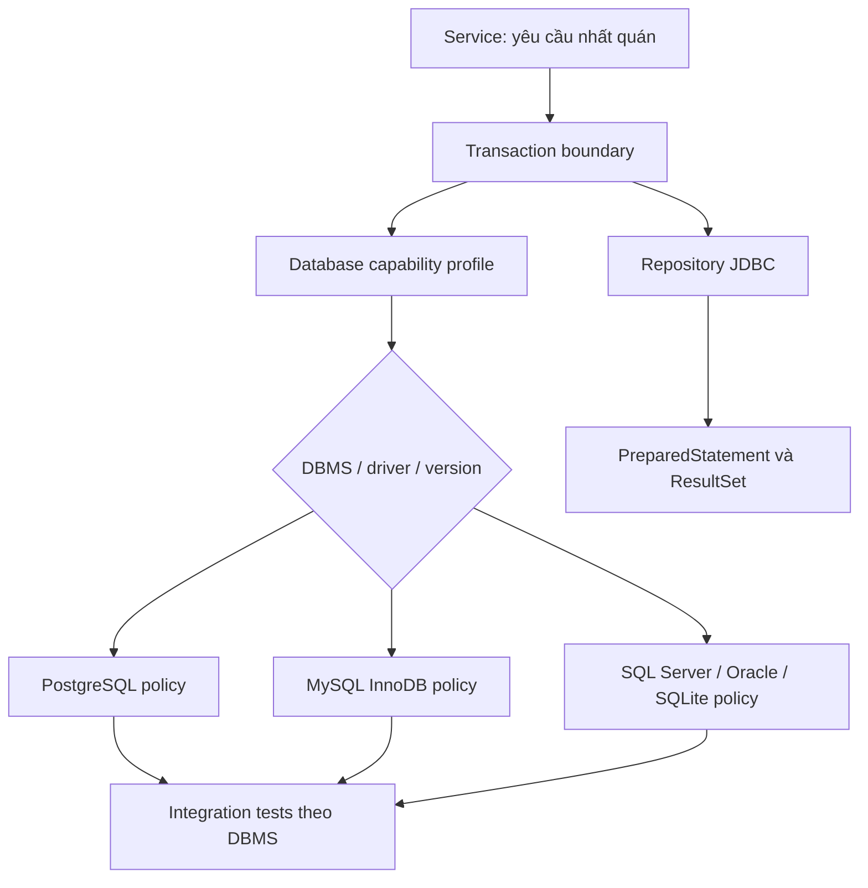

# Kiểm tra mức cô lập và hành vi DDL trong giao dịch với nhiều DBMS

## 1. Vì sao cùng một JDBC API nhưng kết quả có thể khác nhau?

**JDBC** cung cấp API chuẩn để ứng dụng Java truy cập cơ sở dữ liệu quan hệ qua driver, `DataSource`, `Connection`, `PreparedStatement` và `ResultSet`. Khi một nghiệp vụ dùng transaction, Java có thể gọi:

```java
connection.setTransactionIsolation(Connection.TRANSACTION_READ_COMMITTED);
connection.setAutoCommit(false);
// ... PreparedStatement, ResultSet, CRUD ...
connection.commit();
```

Nhưng **cùng tên mức cô lập** không bảo đảm các hệ quản trị thực thi cùng cơ chế khóa, snapshot, hiện tượng đồng thời hoặc quy tắc DDL. Một DBMS có thể hỗ trợ rollback `CREATE TABLE`; DBMS khác có thể **implicit commit** trước hoặc sau câu DDL, dù JDBC connection đang `autoCommit=false`.

Đây là bài toán quan trọng khi **hỗ trợ nhiều hệ quản trị**: source code Java có thể biên dịch và chạy với nhiều JDBC driver, nhưng **tính nguyên tử và tính nhất quán của dữ liệu** chỉ được bảo đảm nếu hiểu và kiểm chứng hành vi của **đúng DBMS, storage engine, phiên bản và cấu hình**.

Hai nhóm câu hỏi phải được kiểm tra **độc lập**:

1. **Transaction isolation:** DBMS có chấp nhận `READ COMMITTED`, `REPEATABLE READ`, `SERIALIZABLE` không? Khi hai session đọc/ghi đồng thời, có thể xảy ra đọc bẩn, đọc không lặp lại, phantom, write skew hoặc serialization failure nào?
2. **DDL trong transaction:** sau khi `CREATE TABLE`, `ALTER TABLE`, `CREATE INDEX` hoặc `DROP TABLE`, lệnh `rollback()` có thực sự hoàn tác thay đổi schema không? DDL có gây commit các thay đổi DML đang chờ không?

**Không trộn hai kết luận:** một DBMS hỗ trợ `SERIALIZABLE` chưa chắc hỗ trợ rollback DDL; một DBMS rollback được `CREATE TABLE` chưa chắc có cùng hành vi snapshot với DBMS khác.

| Nội dung | API JDBC cần xem | Điều phải xác minh |
| --- | --- | --- |
| Tắt/tự commit | `Connection.setAutoCommit()`, `getAutoCommit()` | Thời điểm một transaction bắt đầu/kết thúc và tác động của DDL. |
| Isolation | `setTransactionIsolation()`, `getTransactionIsolation()` | Mức thực tế, lỗi khi không hỗ trợ và hiện tượng trong truy cập đồng thời. |
| Metadata năng lực | `DatabaseMetaData.supportsTransactionIsolationLevel()` | Báo cáo của driver có khớp với hành vi quan sát được không. |
| Transactional DDL | Các hàm metadata DDL/transaction | `CREATE/ALTER/DROP` có rollback được không, có implicit commit không. |
| Lỗi xung đột | `SQLException`, `getSQLState()`, `getErrorCode()` | Retry cả transaction hay báo lỗi, không giả định một mã lỗi dùng chung cho mọi DBMS. |

## 2. Nhắc lại các mức cô lập chuẩn JDBC

JDBC định nghĩa các hằng số ở `java.sql.Connection`:

- `TRANSACTION_NONE`: connection không hỗ trợ transaction theo hợp đồng JDBC; không phải một mức cô lập để lựa chọn cho nghiệp vụ cần nguyên tử.
- `TRANSACTION_READ_UNCOMMITTED`: theo mô hình chuẩn, có thể cho phép đọc dữ liệu chưa commit.
- `TRANSACTION_READ_COMMITTED`: ngăn đọc bẩn; các lần đọc khác nhau có thể nhìn thấy dữ liệu được giao dịch khác commit xen giữa.
- `TRANSACTION_REPEATABLE_READ`: ngăn đọc bẩn và hiện tượng đọc không lặp lại theo các bảo đảm tối thiểu của mức này; phantom và nhiều hiện tượng khác phụ thuộc triển khai.
- `TRANSACTION_SERIALIZABLE`: đặt mục tiêu kết quả tương đương một thứ tự thực thi tuần tự của các transaction; có thể phải chặn, phát hiện xung đột hoặc hủy một transaction.

| Hiện tượng | Diễn giải ngắn | Tại sao quan trọng? |
| --- | --- | --- |
| **Dirty read** | Transaction A đọc giá trị B ghi nhưng B chưa commit, sau đó B rollback. | A quyết định dựa trên dữ liệu chưa từng được xác nhận. |
| **Non-repeatable read** | A đọc cùng hàng hai lần, giữa hai lần B commit một sửa đổi. | Quyết định dựa trên cùng một ID có thể thay đổi giữa chừng. |
| **Phantom** | A chạy cùng một truy vấn lọc hai lần và thấy tập hàng thay đổi do B insert/delete. | Tổng hợp hoặc kiểm tra số hàng có thể thiếu ổn định. |
| **Lost update** | Một sửa đổi ghi đè kết quả của sửa đổi khác do thiết kế đọc-sửa-ghi thiếu kiểm soát. | Mất cập nhật của người dùng. |
| **Write skew** | Hai giao dịch đọc cùng ràng buộc rồi sửa các hàng khác nhau, khiến ràng buộc tổng thể bị vi phạm. | Snapshot nhất quán riêng lẻ chưa đủ bảo đảm mọi bất biến nghiệp vụ. |

**Bảng ANSI thường được dạy là mô hình tối thiểu, không phải bảng tiên đoán mọi DBMS.** Chẳng hạn, PostgreSQL ở `REPEATABLE READ` sử dụng snapshot isolation, nên hành vi phantom có thể khác câu diễn giải đơn giản theo ANSI; nhưng snapshot isolation vẫn không tự tương đương `SERIALIZABLE` trong mọi tình huống. MySQL InnoDB có cơ chế consistent reads và locking reads với hành vi khác nhau.

Không nên khẳng định “tôi đặt `REPEATABLE READ` nên không thể có anomaly nào” hoặc “`SERIALIZABLE` khiến mọi thao tác tự chạy lại thành công”. Mức mạnh hơn có thể **từ chối một transaction** nhằm giữ tính đúng đắn; ứng dụng phải có chính sách xử lý lỗi.

### Một số khác biệt điển hình cần kiểm chứng

| DBMS / engine | Điều cần lưu ý về isolation |
| --- | --- |
| **PostgreSQL** | `READ UNCOMMITTED` được xử lý tương tự `READ COMMITTED`; `REPEATABLE READ` là snapshot isolation; `SERIALIZABLE` có thể ném serialization failure cần retry. |
| **MySQL/InnoDB** | `REPEATABLE READ` thường là mặc định; consistent read và locking read có hành vi khác, gap/next-key lock liên quan đến phạm vi đọc và index. |
| **Oracle Database** | Dùng cơ chế nhất quán đọc; mức hỗ trợ và hành vi khác SQL Server/MySQL, chẳng hạn không xem `READ UNCOMMITTED` là một lựa chọn phổ quát; serializable có thể báo lỗi xung đột. |
| **SQL Server** | Có cơ chế locking và các tùy chọn row-versioning như `READ_COMMITTED_SNAPSHOT`/`SNAPSHOT`; cách hoạt động của `READ COMMITTED` có thể đổi theo cấu hình database. |
| **SQLite** | Mô hình lock, journal/WAL và khả năng một writer tại một thời điểm tác động lớn tới concurrent transactions; tên isolation JDBC có thể không ánh xạ 1:1. |

Bảng là định hướng khảo sát, **không thay thế release notes của phiên bản driver/DBMS đang dùng**. Khi hỗ trợ nhiều hệ quản trị, phải lưu lại phiên bản đã kiểm thử và những lựa chọn cấu hình ảnh hưởng concurrency.

## 3. `DatabaseMetaData`: kiểm tra năng lực trước khi giả định

JDBC cung cấp `DatabaseMetaData` để hỏi thông tin DBMS và driver. Các hàm cần biết:

- `supportsTransactions()`: driver báo DBMS có hỗ trợ transaction không.
- `getDefaultTransactionIsolation()`: mức isolation mặc định được driver công bố.
- `supportsTransactionIsolationLevel(level)`: mức JDBC cụ thể có được hỗ trợ không.
- `supportsDataDefinitionAndDataManipulationTransactions()`: driver báo DDL và DML có thể cùng nằm trong transaction.
- `supportsDataManipulationTransactionsOnly()`: driver báo transaction chỉ bao gồm DML, không bao gồm DDL.
- `dataDefinitionCausesTransactionCommit()`: driver báo DDL có thể buộc transaction commit.
- `dataDefinitionIgnoredInTransactions()`: driver báo DDL bị bỏ qua trong transaction.

Đây là **metadata khai báo năng lực**, không phải phép chứng minh tuyệt đối rằng mọi loại DDL cùng có hành vi đó. Một DBMS có thể rollback được `CREATE TABLE` nhưng yêu cầu `CREATE DATABASE` chạy ngoài transaction; hoặc driver khai báo thông tin không đầy đủ so với engine/phiên bản thực tế.

### Ví dụ Java 17+: in năng lực DBMS/driver

```java
import javax.sql.DataSource;
import java.sql.Connection;
import java.sql.DatabaseMetaData;
import java.sql.SQLException;
import java.util.Objects;

public final class DatabaseTransactionCapabilities {
    private DatabaseTransactionCapabilities() {}

    public static void print(DataSource source) throws SQLException {
        Objects.requireNonNull(source, "source");

        try (Connection connection = source.getConnection()) {
            DatabaseMetaData meta = connection.getMetaData();

            System.out.println("DBMS: " +
                meta.getDatabaseProductName() + " " +
                meta.getDatabaseProductVersion());
            System.out.println("JDBC driver: " +
                meta.getDriverName() + " " + meta.getDriverVersion());
            System.out.println("Transactions: " +
                meta.supportsTransactions());
            System.out.println("Default isolation: " +
                isolationName(meta.getDefaultTransactionIsolation()));
            System.out.println("Current isolation: " +
                isolationName(connection.getTransactionIsolation()));

            int[] levels = {
                Connection.TRANSACTION_READ_UNCOMMITTED,
                Connection.TRANSACTION_READ_COMMITTED,
                Connection.TRANSACTION_REPEATABLE_READ,
                Connection.TRANSACTION_SERIALIZABLE
            };
            for (int level : levels) {
                System.out.printf("%s supported=%s%n",
                    isolationName(level),
                    meta.supportsTransactionIsolationLevel(level));
            }

            System.out.println("DDL and DML transactional: " +
                meta.supportsDataDefinitionAndDataManipulationTransactions());
            System.out.println("Only DML transactional: " +
                meta.supportsDataManipulationTransactionsOnly());
            System.out.println("DDL commits transaction: " +
                meta.dataDefinitionCausesTransactionCommit());
            System.out.println("DDL ignored in transaction: " +
                meta.dataDefinitionIgnoredInTransactions());
        }
    }

    private static String isolationName(int level) {
        return switch (level) {
            case Connection.TRANSACTION_NONE -> "NONE";
            case Connection.TRANSACTION_READ_UNCOMMITTED -> "READ_UNCOMMITTED";
            case Connection.TRANSACTION_READ_COMMITTED -> "READ_COMMITTED";
            case Connection.TRANSACTION_REPEATABLE_READ -> "REPEATABLE_READ";
            case Connection.TRANSACTION_SERIALIZABLE -> "SERIALIZABLE";
            default -> "UNKNOWN(" + level + ")";
        };
    }
}
```

Gọi với một `DataSource` đã được cấu hình:

```java
DatabaseTransactionCapabilities.print(dataSource);
```

Không hard-code một bản output “chuẩn” cho mọi hệ quản trị. Trong kiểm thử tích hợp, ghi nhận **giá trị thực tế** do driver trả về cùng tên DBMS/phiên bản; sau đó chạy thí nghiệm giao dịch để kiểm chứng. Cấu hình pool có thể thay đổi isolation mặc định của connection được mượn, vì vậy `meta.getDefaultTransactionIsolation()` và `connection.getTransactionIsolation()` **không nhất thiết giống nhau**.

## 4. Thiết lập isolation đúng lúc, không đổi giữa transaction

Một cách thiết kế transaction JDBC thủ công:

```java
import javax.sql.DataSource;
import java.sql.Connection;
import java.sql.DatabaseMetaData;
import java.sql.SQLException;
import java.sql.SQLFeatureNotSupportedException;

static void runAtReadCommitted(DataSource source) throws SQLException {
    try (Connection connection = source.getConnection()) {
        if (!connection.getAutoCommit()) {
            throw new SQLException(
                "Ví dụ yêu cầu connection mới với autoCommit=true");
        }

        DatabaseMetaData meta = connection.getMetaData();
        int level = Connection.TRANSACTION_READ_COMMITTED;
        if (!meta.supportsTransactions()
                || !meta.supportsTransactionIsolationLevel(level)) {
            throw new SQLFeatureNotSupportedException(
                "DBMS/driver không công bố hỗ trợ READ COMMITTED");
        }

        // Chọn isolation TRƯỚC khi bắt đầu các thao tác transaction.
        connection.setTransactionIsolation(level);
        connection.setAutoCommit(false);
        try {
            // Gọi các repository nhận CHÍNH connection này.
            // repository.updateOne(connection, ...);
            // repository.insertAudit(connection, ...);
            connection.commit();
        } catch (SQLException | RuntimeException failure) {
            try {
                connection.rollback();
            } catch (SQLException rollbackFailure) {
                failure.addSuppressed(rollbackFailure);
            }
            throw failure;
        }
    }
}
```

Các thao tác repository hiện được để dưới dạng comment. Đoạn mã minh họa **thứ tự thiết lập** chứ không phải một use case CRUD độc lập.

**Vì sao không đổi isolation giữa chừng?** Theo JDBC, thay đổi isolation khi một transaction đang hoạt động có thể dẫn tới commit, báo lỗi hoặc hành vi phụ thuộc driver/DBMS. PostgreSQL còn có quy tắc mức isolation phải được chốt trước những thao tác nhất định trong transaction. Hãy quyết định isolation tại **ranh giới transaction**, trước câu SQL nghiệp vụ đầu tiên, thay vì để DAO đổi tùy ý.

Khi dùng **connection pool**, một request có thể trả logical handle về pool nhưng physical connection được giữ lại. Tầng quản lý transaction phải bảo đảm `autoCommit`, isolation, read-only, schema/session settings được reset theo **hợp đồng của pool**. Không tự gọi `setAutoCommit(true)` để “reset” khi rollback chưa rõ kết quả: chuyển từ `false` sang `true` có thể tự commit transaction theo JDBC.

Nếu đang dùng **Spring**, nên cấu hình isolation ở `@Transactional(isolation = Isolation.READ_COMMITTED)` hoặc `TransactionDefinition` của transaction manager tương ứng, không để repository gọi `setTransactionIsolation()` trên connection Spring đang quản lý.

## 5. Thí nghiệm hai session: điều gì thay đổi giữa hai lần đọc?

Muốn biết một isolation level hoạt động thế nào, chỉ gọi `setTransactionIsolation()` và kiểm tra giá trị trả về **chưa đủ**. Cần tạo **ít nhất hai session độc lập** cùng truy cập dữ liệu thử nghiệm.

Giả sử trong database test có bảng riêng:

```sql
CREATE TABLE isolation_lab (
    id INTEGER PRIMARY KEY,
    quantity INTEGER NOT NULL
);

INSERT INTO isolation_lab(id, quantity) VALUES (1, 10);
```

**Thứ tự thử nghiệm:**

1. **Session A** bắt đầu transaction với `READ COMMITTED`, đọc `quantity` của hàng `id = 1`, nhận 10.
2. **Session B** cập nhật hàng thành 11 và **commit**.
3. **Session A** chạy lại **chính SELECT đó trong cùng transaction**.
4. Ghi nhận A đọc 10 hay 11, hoặc B bị chặn vì khóa; A rollback rồi kết thúc.
5. Reset fixture và chạy lại ở `REPEATABLE READ` hoặc `SERIALIZABLE`.

Kỳ vọng thường gặp:

| Cấu hình | Điều có thể quan sát |
| --- | --- |
| PostgreSQL `READ COMMITTED` | A thường đọc giá trị 11 ở lần thứ hai do snapshot theo statement. |
| PostgreSQL `REPEATABLE READ` | A thường vẫn đọc 10 trong transaction đang mở do snapshot transaction. |
| PostgreSQL `SERIALIZABLE` | A có snapshot nhất quán; trong bài toán đồng thời phức tạp có thể gặp serialization failure, không chỉ đơn giản đổi giá trị SELECT. |
| DBMS có read lock kéo dài | B có thể **đợi A kết thúc** thay vì cập nhật và commit ngay. Thí nghiệm phải tính cả khả năng bị khóa. |

**Không chạy thí nghiệm tuần tự vô hạn trên DBMS dùng shared lock.** Nếu session B chờ lock do A giữ, còn người chạy lại chờ B commit trước khi cho A kết thúc, phép thử có thể tự gây deadlock ở mức điều phối. Cần dùng hai cửa sổ SQL hoặc hai luồng có timeout, quan sát lock wait và kết thúc/rollback an toàn.

### Java 17+: đọc hai lần qua hai Connection

Đoạn sau nhắm tới **PostgreSQL trên cơ sở dữ liệu thử nghiệm**, nơi `SELECT` thường dùng MVCC snapshot, để phép đo dễ quan sát. Đừng mặc định chạy y nguyên trên mọi DBMS; với hệ thống khóa đọc kéo dài, câu `UPDATE` ở B có thể bị chặn.

```java
import javax.sql.DataSource;
import java.sql.Connection;
import java.sql.PreparedStatement;
import java.sql.ResultSet;
import java.sql.SQLException;

public final class IsolationReadProbe {
    private IsolationReadProbe() {}

    public static void inspect(DataSource source, int level)
            throws SQLException {
        try (Connection a = source.getConnection();
             Connection b = source.getConnection()) {
            if (!a.getAutoCommit() || !b.getAutoCommit()) {
                throw new SQLException(
                    "Fixture yêu cầu hai connection mới autoCommit=true");
            }

            a.setTransactionIsolation(level);
            a.setAutoCommit(false);
            try {
                int before = quantity(a);

                // B dùng autoCommit=true: UPDATE kết thúc và commit riêng.
                try (PreparedStatement ps = b.prepareStatement(
                        "UPDATE isolation_lab " +
                        "SET quantity = quantity + 1 WHERE id = ?")) {
                    ps.setQueryTimeout(5); // giây; driver có thể giới hạn khác.
                    ps.setInt(1, 1);
                    if (ps.executeUpdate() != 1) {
                        throw new SQLException("Fixture thiếu hàng id=1");
                    }
                }

                int after = quantity(a);
                System.out.printf(
                    "isolation=%d, before=%d, after=%d%n",
                    level, before, after);
            } catch (SQLException | RuntimeException failure) {
                try {
                    a.rollback();
                } catch (SQLException rollbackFailure) {
                    failure.addSuppressed(rollbackFailure);
                }
                throw failure;
            }
            // A chỉ đọc trong ví dụ, vẫn chủ động kết thúc transaction.
            a.rollback();
        }
    }

    private static int quantity(Connection connection)
            throws SQLException {
        try (PreparedStatement ps = connection.prepareStatement(
                "SELECT quantity FROM isolation_lab WHERE id = ?")) {
            ps.setQueryTimeout(5);
            ps.setInt(1, 1);
            try (ResultSet rs = ps.executeQuery()) {
                if (!rs.next()) {
                    throw new SQLException("Fixture thiếu hàng id=1");
                }
                return rs.getInt(1);
            }
        }
    }
}
```

Ví dụ sử dụng, sau khi bảo đảm pool cho phép **hai connection đồng thời**:

```java
IsolationReadProbe.inspect(
    dataSource, Connection.TRANSACTION_READ_COMMITTED);
IsolationReadProbe.inspect(
    dataSource, Connection.TRANSACTION_REPEATABLE_READ);
```

Ở lần chạy thứ hai, số lượng trong fixture có thể đã tăng từ 10 lên 11 do session B commit trong lần trước. Vì vậy hãy so sánh **`before` với `after` trong mỗi lượt**, không hard-code rằng lần đầu luôn bằng 10. Để test độc lập, reset fixture và dùng dataset riêng cho từng testcase.

**Giới hạn quan trọng:**

- `Statement.setQueryTimeout(5)` là yêu cầu timeout cho statement, không phải cam kết một deadline tổng tuyệt đối ở mọi driver, nhất là khi gặp sự cố network.
- Sau khi B đã commit, `a.rollback()` không hoàn tác cập nhật của B: chúng là **hai transaction trên hai connection khác nhau**.
- Nếu A bị isolation error hoặc B bị lock timeout, đó là một **kết quả cần ghi nhận**, không nên nuốt lỗi rồi kết luận “driver không hỗ trợ”.
- Test này tập trung vào **non-repeatable read**. Nó không chứng minh mức `SERIALIZABLE` thật sự ngăn được **write skew** hay toàn bộ phantom.

## 6. Các bài kiểm tra isolation khác cần dùng nhiều transaction

| Hiện tượng | Kịch bản test | Cách đọc kết quả |
| --- | --- | --- |
| Dirty read | B cập nhật nhưng chưa commit; A đọc trước khi B rollback. | Nếu A thấy dữ liệu chưa commit thì có dirty read; nếu A đợi B, ghi nhận lock wait. |
| Non-repeatable read | A đọc hàng; B commit UPDATE; A đọc lại. | So sánh giá trị và có/không bị blocking, như mục 5. |
| Phantom | A đếm hàng khớp `WHERE`; B commit INSERT hàng khớp; A đếm lại. | So sánh số hàng, đồng thời ghi nhận lock/serialization error. |
| Lost update | A và B đều đọc một giá trị rồi cùng ghi giá trị tính từ bản cũ. | Nếu một cập nhật bị ghi đè âm thầm, cần sửa SQL/locking hoặc isolation. |
| Write skew | Hai giao dịch đọc cùng điều kiện toàn cục, rồi cập nhật hai hàng **khác nhau** làm ràng buộc tổng thể sai. | Cần kiểm tra transaction có bị chặn/hủy hay invariant có thể bị phá. |
| Serialization failure | Chạy hai transaction đụng nhau dưới isolation mạnh. | Ghi `SQLState`/vendor code, rollback và kiểm tra chiến lược retry **toàn transaction**. |

Ví dụ write skew điển hình: hệ thống yêu cầu **luôn có ít nhất một bác sĩ trực**. A và B cùng đọc “đang có hai người trực”, sau đó mỗi bên cho người khác nhau nghỉ. Nếu cả hai cùng commit thì không còn ai trực, dù hai bên sửa **hai hàng khác nhau**. Nhiều cơ chế snapshot isolation có thể cho phép tình huống này; isolation đủ mạnh hoặc khóa phù hợp phải bảo vệ được bất biến.

**Một transaction đọc không lặp lại không phải là phép thử `SERIALIZABLE` đầy đủ.** Mức này liên quan tới mọi tương tác đọc/ghi và lịch thực thi, nên cần test trường hợp xung đột thật với hai hoặc nhiều connection.

### Khi có lỗi xung đột

Một lỗi serialization/deadlock phải được **đưa lên ranh giới transaction**. Phần sở hữu transaction mới quyết định rollback, mở connection/transaction mới và retry **toàn use case**, có backoff, giới hạn số lần và idempotency khi có side effect bên ngoài. Không tự retry câu `UPDATE` cuối cùng trên transaction đã bị đánh dấu lỗi.

Với PostgreSQL, `SQLState 40001` thường chỉ serialization failure và `40P01` là deadlock; SQLState và mã lỗi khác có thể dùng ở DBMS khác. Không viết một hàm “mọi SQLState bắt đầu bằng `40` đều retry an toàn vô hạn”: phải dựa trên lỗi, khả năng retry của nghiệp vụ và trạng thái commit thực tế.

## 7. DDL là gì và vì sao nó phá giả định transaction?

**DDL** (*Data Definition Language*) là các thao tác thay đổi cấu trúc hoặc metadata như:

- `CREATE TABLE`, `ALTER TABLE`, `DROP TABLE`.
- `CREATE INDEX`, `DROP INDEX`.
- Một số lệnh tạo view, schema, sequence, database hoặc đối tượng quyền theo cú pháp từng DBMS.

**DML** (*Data Manipulation Language*) thường gồm `INSERT`, `UPDATE`, `DELETE` và các thao tác dữ liệu; `SELECT` là thao tác truy vấn. Khi nói “transaction rollback được”, cần hỏi rõ là **rollback DML, DDL hay cả hai**, và với **lệnh DDL nào**.

### Ba kiểu hành vi cần phân biệt

| Hành vi của DBMS | Ví dụ hậu quả |
| --- | --- |
| **Transactional DDL** đối với lệnh đang xét | `CREATE TABLE` trong transaction rồi `ROLLBACK` có thể làm bảng vừa tạo biến mất. |
| **Implicit commit** do DDL | Trước và/hoặc sau `CREATE TABLE`, DBMS commit transaction; DML chưa commit trước đó có thể **được giữ lại**. |
| **DDL không hợp lệ trong transaction** | DBMS từ chối một lệnh cụ thể (ví dụ một số cách tạo database/index đặc biệt) khi đang trong transaction. |

**Điểm nguy hiểm nhất:** `connection.setAutoCommit(false)` chỉ đề nghị JDBC quản lý giao dịch thủ công; nó **không thể ép DBMS rollback một câu DDL vốn gây implicit commit**.

Giả sử cùng transaction có:

```sql
UPDATE accounts SET balance = balance - 100 WHERE account_id = 1;
CREATE TABLE audit_stage (id INTEGER);
-- sau đó ứng dụng cố ROLLBACK
```

Trong DBMS cho phép DDL commit ngầm, câu `UPDATE` có thể đã **commit** tại thời điểm chạy `CREATE TABLE`. Một `ROLLBACK` sau đó không đưa tiền về như trước. Đây là lỗi nghiêm trọng nếu ứng dụng chạy migration/schema change ngay giữa nghiệp vụ.

## 8. Hành vi DDL: đừng gộp các DBMS vào một quy tắc

| DBMS / engine | Định hướng hành vi cần kiểm thử |
| --- | --- |
| **PostgreSQL** | Nhiều lệnh DDL như `CREATE TABLE` và `ALTER TABLE` có thể nằm trong transaction và rollback được. **Không phải mọi DDL** đều chạy được trong transaction: ví dụ `CREATE DATABASE`, `CREATE INDEX CONCURRENTLY` có yêu cầu riêng. |
| **MySQL/InnoDB** | Nhiều lệnh DDL đối với bảng thường gây **implicit commit** (trước/sau lệnh); `ROLLBACK` sau đó không undo được DDL. “Atomic DDL” trong một số phiên bản **không có nghĩa transactional DDL** đối với transaction ứng dụng. |
| **Oracle Database** | Nhiều câu DDL gây implicit commit trước, và khi thành công commit tiếp theo; transaction DML đang mở có thể bị chốt dù câu DDL không liên quan nghiệp vụ. |
| **SQL Server** | Nhiều thao tác DDL có thể tham gia transaction, nhưng có lệnh hoặc ngữ cảnh bị giới hạn; phải kiểm tra chính xác loại DDL và phiên bản. |
| **SQLite** | Nhiều thay đổi schema có thể rollback trong transaction được mở tường minh; hành vi locking, `PRAGMA`, journal/WAL và driver cần kiểm thử riêng. |

**Lưu ý MySQL:** `CREATE TEMPORARY TABLE` là ngoại lệ thú vị: trong một số trường hợp nó không gây implicit commit như `CREATE TABLE` thông thường, nhưng **việc tạo bảng tạm lại không được rollback theo cách người học dễ tưởng**. Do đó “không implicit commit” không đủ để kết luận “DDL này transactional”.

**Lưu ý PostgreSQL:** `CREATE INDEX CONCURRENTLY` được thiết kế hạn chế blocking nhưng **không chạy trong transaction block như `CREATE INDEX` thông thường**. Một migration tool tự bọc toàn bộ file SQL bằng một transaction có thể thất bại vì lệnh này. Nên tách pha migration theo giới hạn thật, không vô hiệu hóa transaction cho mọi bước mà không đánh giá.

Không lấy bảng này làm nguồn duy nhất để quyết định production. Phải đối chiếu tài liệu đúng phiên bản, quyền role, engine lưu trữ, cấu hình và **chạy integration test trên hệ quản trị thực tế**.

## 9. Thí nghiệm DDL có rollback được không?

Hãy thực hiện chỉ trên **database/schema thử nghiệm riêng**, bằng role được cấp quyền tạo/xóa đối tượng test. Dùng một **tên bảng mới, không trùng** cho mỗi lần đo. Không chạy `DROP TABLE` hoặc `ALTER TABLE` trên bảng nghiệp vụ, và không tạo một công cụ test tự động cho phép client truyền tên bảng tùy ý.

### PostgreSQL: tạo bảng trong transaction rồi rollback

Ví dụ trên PostgreSQL, trong schema kiểm thử mặc định của session:

```sql
BEGIN;

CREATE TABLE ddl_probe_pg_001 (
    id INTEGER PRIMARY KEY
);

ROLLBACK;

-- NULL nghĩa là không tìm thấy bảng trong search_path hiện tại.
SELECT to_regclass('ddl_probe_pg_001') AS table_after_rollback;
```

Với một bảng chưa từng tồn tại trước đó và `CREATE TABLE` không gặp lỗi, kết quả thường là **NULL**: việc tạo bảng đã được rollback. Nếu tên bảng có sẵn hoặc bảng nằm ở schema khác, phép kiểm tra có thể không còn đại diện cho kết quả mong muốn.

Hãy tách **hai câu hỏi**:

1. Sau `ROLLBACK`, bảng được tạo trong transaction còn tồn tại không?
2. Nếu DML đã chạy **trước khi DDL**, DML đó có bị rollback cùng transaction không?

Với PostgreSQL và các lệnh DDL transactional thông thường, cả hai có thể rollback chung. Nhưng nếu một lệnh **không được phép chạy trong transaction block**, DBMS sẽ từ chối — khác với việc tự động commit.

### MySQL/InnoDB: DDL có thể commit DML trước đó

Giả sử có một bảng marker test `ddl_marker` dùng **InnoDB**:

```sql
-- Chuẩn bị từ trước, NGOÀI transaction đang thử nghiệm:
CREATE TABLE ddl_marker (
    id INT PRIMARY KEY,
    quantity INT NOT NULL
) ENGINE=InnoDB;

INSERT INTO ddl_marker(id, quantity) VALUES (1, 10);
```

Sau đó chạy một transaction test riêng:

```sql
START TRANSACTION;

UPDATE ddl_marker SET quantity = 11 WHERE id = 1;

CREATE TABLE ddl_probe_mysql_001 (
    id INT PRIMARY KEY
) ENGINE=InnoDB;

ROLLBACK;

SELECT quantity FROM ddl_marker WHERE id = 1;
SHOW TABLES LIKE 'ddl_probe_mysql_001';
```

Ở những phiên bản MySQL/InnoDB với hành vi implicit commit thông thường của `CREATE TABLE`, bạn sẽ thấy `quantity = 11` **vẫn được giữ lại** và bảng `ddl_probe_mysql_001` **vẫn tồn tại**. Việc gọi `ROLLBACK` sau DDL không đảo ngược implicit commit đã diễn ra. Đây chính là rủi ro khi một service đặt DDL vào giữa transaction nghiệp vụ.

**Dọn dữ liệu test có chủ đích:** sau khi đã ghi nhận kết quả, xóa các bảng `ddl_probe_mysql_001` và `ddl_marker` chỉ trong **schema thử nghiệm**. `DROP TABLE` cũng có thể gây implicit commit; không dùng nó để “cleanup” trong transaction nghiệp vụ.

### Cần phân biệt “DDL atomic” và “DDL transactional”

Một DBMS có thể bảo đảm một câu DDL **không để lại trạng thái nửa chừng khi crash** (*atomic DDL*), nhưng vẫn **không cho rollback nó trong transaction của ứng dụng**. Vì thế không thể kết luận “DDL này atomic” nghĩa là:

```text
BEGIN
INSERT ...
ALTER TABLE ...
ROLLBACK
=> cả dữ liệu lẫn schema quay về trạng thái cũ
```

Phải kiểm chứng đầy đủ hai điểm: **tác động của DDL lên transaction DML đang mở** và **khả năng rollback chính đối tượng schema đã thay đổi**.

## 10. Kiểm tra DDL từ Java: metadata và thử nghiệm thực tế

Ở chương trình dùng `DataSource`, có thể tạo một **phép thử tích hợp** theo trình tự sau:

```text
Chỉ chạy trong schema test với quyền tạo/xóa bảng:

1. Tạo tên bảng test nội bộ mới, ví dụ
   jdbc_ddl_probe_<random_suffix> (không lấy tên từ client).
2. Mượn Connection A; xác minh trạng thái autoCommit.
3. A.setAutoCommit(false).
4. A tạo bảng bằng Statement.executeUpdate("CREATE TABLE ...").
5. A.rollback() (nếu lỗi rollback thì báo UNKNOWN, không khẳng định).
6. A.close().
7. Mượn Connection B MỚI, kiểm tra bảng còn tồn tại không
   qua DatabaseMetaData.getTables(...) hoặc catalog phù hợp.
8. Ghi kết quả và SQLState/vendor code nếu có lỗi.
9. Nếu bảng vẫn còn, dọn bằng DROP TABLE với quyền test;
   kiểm tra dọn sạch thành công.
```

**Tại sao dùng Connection B?** Một kết quả đọc từ chính session vừa chạy DDL có thể khác kết quả session khác nhìn thấy do transaction hoặc metadata cache. Kiểm tra sau khi A đã đóng giúp xác minh trạng thái **được công bố tới một session độc lập**.

### Đọc tồn tại bảng bằng `DatabaseMetaData.getTables()`

Ví dụ một helper cho bảng test có **tên riêng, chữ thường ASCII**; nếu driver đổi chữ thường/thành chữ hoa ở catalog, helper sẽ chuẩn hóa pattern:

```java
import java.sql.Connection;
import java.sql.DatabaseMetaData;
import java.sql.ResultSet;
import java.sql.SQLException;
import java.util.Locale;

static boolean tableExists(
        Connection connection, String generatedTableName)
        throws SQLException {
    DatabaseMetaData meta = connection.getMetaData();
    String pattern = generatedTableName;

    if (meta.storesUpperCaseIdentifiers()) {
        pattern = pattern.toUpperCase(Locale.ROOT);
    } else if (meta.storesLowerCaseIdentifiers()) {
        pattern = pattern.toLowerCase(Locale.ROOT);
    }

    try (ResultSet tables = meta.getTables(
            connection.getCatalog(),
            null, // hoặc schema test đã biết nếu driver hỗ trợ
            pattern,
            new String[] {"TABLE"})) {

        while (tables.next()) {
            if (generatedTableName.equalsIgnoreCase(
                    tables.getString("TABLE_NAME"))) {
                return true;
            }
        }
        return false;
    }
}
```

Đây là **helper minh họa**, không phải test suite bao quát mọi DBMS. `getTables()` dùng pattern, và dấu gạch dưới trong tên là ký tự wildcard trong nhiều kiểu pattern metadata; vì vậy helper còn lọc lại theo **tên chính xác**. Để tránh khớp bảng cùng tên ở schema khác, một bài test nghiêm túc phải ràng buộc **catalog/schema test** bằng `TABLE_CAT`, `TABLE_SCHEM` (hoặc cách định danh được driver hỗ trợ), không chỉ so tên.

Nếu `getTables()` không thấy bảng, cũng cần phân biệt “thực sự không tồn tại” với “role kiểm tra không có quyền nhìn metadata”, hoặc connection B đang dùng schema khác. Đừng coi **không tìm thấy** là bằng chứng rollback thành công nếu phép thử bị giới hạn quyền hoặc driver báo lỗi.

**Ranh giới tin cậy:** tên bảng được tạo **nội bộ** từ prefix cố định và hậu tố an toàn (chẳng hạn chuỗi UUID chỉ gồm hex), không phải input không đáng tin. `PreparedStatement` không thể bind tên bảng bằng dấu `?`. Nếu tổ chức bắt buộc kiểm thử DDL theo nhiều DBMS, hãy đặt cú pháp tạo/xóa đối tượng trong adapter test cho từng dialect, không tự nối arbitrary identifier do caller đưa vào.

## 11. Những trường hợp DDL đặc biệt thường bị bỏ quên

### 11.1. `CREATE INDEX` so với tạo index online/concurrent

Một câu `CREATE INDEX` thông thường có thể khóa hoặc làm chậm ghi trong thời gian xây index. Một biến thể online/concurrently có thể thay đổi quy tắc về transaction và thời điểm index có hiệu lực.

- PostgreSQL phân biệt `CREATE INDEX` với `CREATE INDEX CONCURRENTLY`: lựa chọn thứ hai có giới hạn transaction block và nhiều pha xử lý.
- SQL Server và Oracle có lựa chọn/cú pháp online khác, với điều kiện license/edition/phiên bản hoặc loại index tùy môi trường.
- MySQL có lựa chọn thuật toán/lock cho một số thao tác `ALTER TABLE`; không suy rằng tất cả đều có cùng tác động transactional.

Không bọc mọi loại tạo index trong một transaction tổng quát rồi mặc định rollback khi lỗi. Migration cần chia theo **năng lực và giới hạn của câu DDL cụ thể**.

### 11.2. `ALTER TABLE` và tương thích giữa phiên bản ứng dụng

DDL có thể thành công về cú pháp nhưng phá ứng dụng đang chạy:

- Đổi tên cột trong lúc phiên bản cũ của ứng dụng còn truy vấn tên trước đó.
- Đổi kiểu dữ liệu làm driver trả kiểu Java khác, ví dụ thời gian hoặc JSON.
- Thêm ràng buộc `NOT NULL` trên bảng có dữ liệu lịch sử chưa hợp lệ.
- Khóa bảng kéo dài trong một migration chạy trên tập dữ liệu lớn.
- Làm mất hiệu lực statement/plan cache hoặc view phụ thuộc schema cũ.

Vì vậy, cần thiết kế **expand → migrate/backfill → contract**, kiểm tra khả năng tương thích hai phiên bản và kế hoạch rollback có chủ đích. Việc một DBMS hỗ trợ transactional DDL chỉ giúp ích cho một số lỗi; nó không thay thế khả năng rollback **logic của migration** hoặc hoàn tác dữ liệu đã được các version ứng dụng mới ghi.

### 11.3. DDL và `Savepoint`

`Connection.setSavepoint()` giúp đánh dấu vị trí trong transaction nếu driver/DBMS hỗ trợ. Nhưng:

```java
Savepoint s = connection.setSavepoint();
// Chạy DDL tại đây...
connection.rollback(s);
```

Không được suy rằng rollback savepoint chắc chắn hoàn tác DDL. Nếu DDL implicit commit toàn transaction, **savepoint cũ có thể không còn giá trị**; nếu DDL bị cấm trong transaction, câu lệnh có thể bị từ chối trước khi cần rollback.

Khi test, cần quan sát cả **lỗi rollback(savepoint)** lẫn sự tồn tại của đối tượng schema sau đó. Nếu phát sinh lỗi, đừng cố tiếp tục dùng transaction như chưa có chuyện gì xảy ra.

## 12. Chọn isolation theo use case, không ép một mức cho mọi DBMS

Mục đích của isolation là **bảo vệ bất biến dữ liệu ở mức chấp nhận được**, không phải cố tìm con số hằng mạnh nhất hoặc tốc độ cao nhất.

| Use case | Rủi ro đồng thời | Thiết kế cần đánh giá |
| --- | --- | --- |
| Đọc trang sản phẩm công khai | Các hàng có thể thay đổi giữa hai request. | `READ COMMITTED` hoặc snapshot phù hợp; phân trang ổn định, hiểu stale read. |
| Trừ tồn kho | Hai người cùng mua sản phẩm còn ít hàng. | `UPDATE ... WHERE quantity >= ?`, kiểm tra update count, transaction và retry hợp lý. |
| Chuyển tiền trong một DBMS | Trừ một tài khoản nhưng không cộng tài khoản kia. | Một transaction, thứ tự khóa, số dư bất biến, idempotency; isolation là một phần của giải pháp. |
| Đặt lịch với điều kiện “không trùng” | Hai giao dịch cùng thấy khung giờ còn trống. | Unique/exclusion constraint, khóa hoặc serializable; test write skew/race. |
| Báo cáo tại một thời điểm | Các câu SELECT liên tiếp thấy phiên bản dữ liệu khác nhau. | Snapshot/transaction phù hợp hoặc tạo bản chụp dữ liệu; kiểm tra thời gian giữ tài nguyên. |
| Migration schema | DDL có thể thay đổi bảng, index và quyền. | Chạy tách biệt traffic nghiệp vụ; policy theo DBMS và từng loại DDL. |

### Tránh dùng isolation thay constraint

`SERIALIZABLE` không phải lý do để bỏ unique key, foreign key, check constraint hoặc validation nghiệp vụ. Ngược lại, chỉ dựa trên một câu `SELECT` kiểm tra điều kiện trước khi `INSERT` cũng dễ xảy ra race ở nhiều mức isolation. Với một mã thanh toán không được trùng, **unique constraint trong DBMS** là cơ chế mạnh và trực tiếp, còn transaction đảm bảo các thay đổi xung quanh được hoàn tất nhất quán.

Một ứng dụng chạy đa DBMS có thể chọn **mức tối thiểu phù hợp và một chiến lược khóa/constraint tường minh** rồi kiểm thử trên từng engine. Không tự chuyển xuống `READ UNCOMMITTED` chỉ để tăng throughput khi nghiệp vụ cần tính chính xác cao.

## 13. Thiết kế tầng tương thích đa hệ quản trị

Nên tách ba loại kiến thức:

1. **Logic nghiệp vụ:** invariant, các thay đổi phải nằm cùng một transaction và lỗi có thể retry.
2. **JDBC transaction boundary:** mở connection, chọn isolation, commit/rollback, đóng tài nguyên, giữ ngoại lệ gốc.
3. **Năng lực DBMS/dialect:** isolation có thực sự hỗ trợ, loại DDL nào rollback được, SQLState nào là serialization/deadlock, và cú pháp migration phù hợp.



Một **capability profile** có thể ghi:

| Thuộc tính | Giá trị cần theo dõi |
| --- | --- |
| `databaseProductName`, `databaseProductVersion` | Tên và phiên bản DBMS đã kiểm thử. |
| `driverName`, `driverVersion` | Tên và phiên bản JDBC driver. |
| `supportsTransactions` | Kết quả từ metadata và test DML rollback. |
| Các isolation được hỗ trợ | Kết quả metadata + test hiện tượng đồng thời và lock. |
| DDL transactional hay implicit commit | Gắn với **từng loại câu DDL**, không chỉ một boolean chung. |
| `supportsSavepoints` | Mức hỗ trợ savepoint và hành vi sau lỗi. |
| Mã lỗi xung đột có thể retry | `SQLState`/vendor code được kiểm chứng và chính sách retry toàn transaction. |
| Cơ chế lock/timeout của engine | Lệnh tạo khóa và timeout phù hợp với DBMS, không hard-code SQL chung nếu khác cú pháp. |

**Không nên chọn hành vi chỉ bằng `getDatabaseProductName().contains("SQL")`.** Tên DBMS không đủ nêu storage engine, cấu hình snapshot, edition hoặc giới hạn DDL theo phiên bản. Hãy dùng **cấu hình dialect tường minh**, kiểm tra product name/version lúc khởi động và **fail fast** nếu một yêu cầu tính đúng đắn chưa được chứng minh.

### Metadata là bước lọc, integration test là bước quyết định

Nếu `meta.supportsTransactionIsolationLevel(SERIALIZABLE)` trả `false`, ứng dụng nên coi đây là dấu hiệu mạnh để **không yêu cầu** mức đó. Nếu trả `true`, vẫn cần chạy test use case và xác nhận mức thực tế sau khi gọi `setTransactionIsolation()`.

Tương tự, nếu `dataDefinitionCausesTransactionCommit()` trả `false`, **không được suy** rằng mọi `ALTER TABLE`, `CREATE INDEX` và `CREATE DATABASE` có thể rollback. Chỉ đánh dấu một loại migration **transactional** sau khi đã kiểm chứng nó trên DBMS/phiên bản mục tiêu.

### Chia migration thành bước có và không có transaction

Trong một công cụ migration như Flyway hoặc Liquibase, tùy phiên bản và DBMS, có thể có cơ chế chọn chạy một migration trong/ngoài transaction. Nhưng **công cụ không thể thay đổi quy tắc implicit commit của DBMS**. Thiết kế migration cần:

- Phân nhóm DDL có thể rollback, DDL gây commit ngầm và DDL bị cấm trong transaction.
- Tách riêng thay đổi schema khỏi transaction nghiệp vụ đang phục vụ request.
- Dùng lock hoặc cơ chế điều phối migration để tránh hai phiên bản schema change chạy cùng lúc.
- Có kế hoạch dừng/tiếp tục khi migration thất bại giữa chừng; với DDL nontransactional phải kiểm tra trạng thái thật trước khi retry.
- Xem xét khả năng tương thích **ứng dụng cũ và mới** khi rolling deployment.

**Không dùng `@Transactional` hay `Connection.setAutoCommit(false)` như một lời bảo đảm chung rằng migration sẽ được rollback an toàn trên mọi DBMS.**

## 14. Lỗi transaction: xử lý đúng cho từng giai đoạn

| Thời điểm lỗi | Rủi ro | Hướng xử lý |
| --- | --- | --- |
| `setTransactionIsolation()` bị từ chối | Driver không hỗ trợ hoặc transaction đã vào trạng thái không thích hợp. | Dừng trước khi ghi nghiệp vụ; xác minh metadata/driver/config. |
| `PreparedStatement.executeUpdate()` lỗi | Có thể là constraint, deadlock, timeout hoặc lỗi mạng. | Phân loại lỗi; rollback toàn transaction khi cần nguyên tử. |
| `CREATE TABLE`/`ALTER TABLE` lỗi | DDL có thể đã commit DML trước đó hoặc để lại thay đổi một phần tùy DBMS. | Đối chiếu schema và dữ liệu thực tế; không tin rollback đã xóa tất cả. |
| `rollback()` cũng thất bại | Không biết chắc transaction đã được hoàn tác chưa. | Giữ ngoại lệ gốc, `addSuppressed()` lỗi rollback, điều tra trạng thái. |
| `commit()` mất phản hồi | DBMS có thể đã commit dù Java nhận lỗi. | Không retry ghi dữ liệu mù quáng; kiểm tra bằng khóa nghiệp vụ trên connection mới. |
| Xung đột serialization/deadlock | DBMS có thể chủ động hủy transaction. | Retry **toàn use case** khi an toàn, có idempotency, backoff và giới hạn. |
| Mất kết nối vật lý | Handle không còn an toàn; pool có thể phải evict. | Đóng logical handle, để pool/driver quản lý loại connection hỏng. |

Một mẫu code giữ ngoại lệ rollback:

```java
try {
    // SQL nghiệp vụ trong transaction đã mở.
    connection.commit();
} catch (SQLException | RuntimeException failure) {
    try {
        connection.rollback();
    } catch (SQLException rollbackFailure) {
        failure.addSuppressed(rollbackFailure);
    }
    throw failure;
}
```

Mẫu này dùng bên trong thành phần **sở hữu transaction**, không phải DAO. `rollback()` được gọi như một nỗ lực dọn trạng thái, **không** là bằng chứng một `commit()` trước đó chưa thành công. Trong DBMS có DDL implicit commit, rollback còn có thể **không ảnh hưởng** những DML đã được commit tại thời điểm DDL.

## 15. Ma trận integration test bắt buộc cho đa DBMS

Các test phải chạy với **DBMS, phiên bản, storage engine, JDBC driver, pool và cấu hình isolation** tương đương môi trường triển khai. Mock `Connection` không thể mô phỏng đầy đủ lock, MVCC, implicit commit hoặc DDL visibility.

| Test | Thao tác | Điều cần ghi lại |
| --- | --- | --- |
| Capability metadata | `supportsTransactions()`, `supportsTransactionIsolationLevel()`, các cờ DDL. | DBMS/driver version, cờ công bố và mức thực tế. |
| DML rollback | `INSERT/UPDATE` rồi `rollback()`. | Dữ liệu không được giữ lại; đọc bằng connection mới. |
| DML commit | `INSERT/UPDATE` rồi `commit()`. | Dữ liệu tồn tại và đúng constraint. |
| `READ COMMITTED` | Hai session, A đọc, B commit, A đọc lại. | Giá trị, lock wait, timeout, SQLState. |
| `REPEATABLE READ` | Cùng kịch bản trên. | Snapshot/read locking có khác `READ COMMITTED` không. |
| `SERIALIZABLE` | Kịch bản write skew hoặc transaction xung đột. | Bảo đảm invariant và lỗi serialization nếu có. |
| Phantom | A đếm hàng theo `WHERE`, B thêm hàng khớp. | Thứ tự hiển thị, lock và kết quả lặp truy vấn. |
| DDL rollback | `CREATE TABLE` trong transaction rồi rollback. | Bảng có còn nhìn thấy từ connection mới không. |
| DDL + DML | `UPDATE` rồi `CREATE TABLE` rồi rollback. | DML có bị commit ngầm không; schema có còn không. |
| `ALTER TABLE` | Thêm cột trong transaction rồi rollback. | Khả năng rollback và các lock/metadata cache. |
| Index tạo thường / concurrent | Chạy đúng biến thể được hỗ trợ. | Giới hạn transaction, blocking và kết quả khi hủy. |
| Savepoint và DDL | Tạo savepoint, chạy DDL, rollback tới savepoint. | Savepoint còn hợp lệ không, trạng thái DDL sau đó. |
| Lỗi DDL ở giữa migration | Một câu DDL cố ý lỗi sau thay đổi trước đó. | Đối tượng nào còn tồn tại; cleanup/recovery đúng. |
| Pool reuse | Thay isolation/read-only trong request A, đóng handle, mượn tiếp. | Request B có nhận trạng thái được reset đúng không. |
| Lỗi commit/connection | Inject lỗi mạng trong test environment. | Không retry mù quáng, có cơ chế đối chiếu transaction. |

### Tổ chức test an toàn

- Chạy **database/container dành riêng cho test**; không chủ động hủy session, tạo bảng tạm hàng loạt hoặc thay isolation trên production.
- Dùng schema test riêng và tên đối tượng có hậu tố ngẫu nhiên để tránh trùng giữa các worker/test chạy song song.
- Giới hạn timeout cho truy vấn, lock wait và toàn bộ test; **tránh deadlock do chính script điều phối**.
- Test DDL cần **kiểm tra sự tồn tại sau rollback** rồi dọn những đối tượng còn lại bằng thủ tục test, thay vì trông chờ rollback tự dọn.
- Ghi cả kết quả **blocked / timed out / serialization failure**, không biến mọi trường hợp không trả dữ liệu thành “test bị treo”.
- Khi một test thất bại do driver không hỗ trợ tính năng, phân biệt `SQLFeatureNotSupportedException` với lỗi quyền và lỗi cú pháp.
- Khi chuyển engine/version, chạy lại test, vì khả năng rollback DDL hoặc lựa chọn kế hoạch khóa có thể thay đổi.

## 16. Sai lầm thường gặp

| Sai lầm | Hệ quả | Cách sửa |
| --- | --- | --- |
| `setAutoCommit(false)` được xem là đủ cho mọi DDL. | DML có thể bị commit ngầm và DDL không rollback được. | Đối chiếu DDL transaction behavior theo DBMS và loại lệnh. |
| Tin metadata `supports...=true` là bằng chứng tuyệt đối. | Không phát hiện khác biệt phiên bản, dialect hoặc storage engine. | Kết hợp metadata với phép thử DBMS thật. |
| Gán cùng ngữ nghĩa cho `REPEATABLE READ` trên mọi DBMS. | Sai giả định snapshot/locking và mức chặn phantom. | Test hai session, ghi cách đọc và lock wait. |
| Dùng `READ UNCOMMITTED` để tối ưu nhưng không test. | Có thể đọc bẩn, hoặc DBMS ánh xạ sang mức khác. | Chọn theo yêu cầu nhất quán, không theo tên mức cô lập. |
| Tưởng `SERIALIZABLE` không bao giờ báo lỗi. | Serialization failure/deadlock chưa được xử lý. | Retry toàn use case có giới hạn khi an toàn. |
| Đổi isolation trong DAO giữa transaction. | Có thể gây commit hoặc lỗi, làm sai transaction boundary. | Đặt isolation ở transaction owner trước SQL nghiệp vụ. |
| Gọi `setAutoCommit(true)` để reset sau rollback thất bại. | Có thể tự commit transaction còn mở. | Đóng/evict connection đúng hợp đồng pool; giữ lỗi gốc. |
| Dùng cùng transaction cho DDL migration và nghiệp vụ. | DDL có thể chốt DML hoặc giữ lock quá lâu. | Tách schema migration khỏi request transaction. |
| Coi atomic DDL là transactional DDL. | Tưởng `ROLLBACK` hoàn tác được tạo bảng/index. | Test riêng khả năng rollback DDL và implicit commit. |
| Đọc metadata từ session vừa DDL và kết luận chung. | Có thể nhầm với visibility, transaction state hoặc metadata cache. | Xác minh bằng connection mới, catalog/schema chính xác. |
| Chạy DDL probe bằng tên bảng từ client. | Rủi ro SQL injection hoặc thay đổi bảng không mong muốn. | Sinh tên test nội bộ, whitelist dialect và chỉ dùng schema test. |
| Catch `SQLException` rồi vẫn commit. | Một bước lỗi nhưng các bước khác có thể được lưu. | Đưa lỗi về transaction owner để rollback. |
| Tưởng hai `DataSource` tự tham gia một transaction. | Transaction độc lập, không có rollback chung. | Dùng transaction manager phù hợp hoặc giải pháp phân tán. |

## 17. Checklist ra quyết định

1. **Xác định bất biến nghiệp vụ.** Cần chống đọc bẩn, lost update, write skew hay cần nhất quán snapshot?
2. **Lập danh sách DBMS/driver được hỗ trợ.** Ghi cả phiên bản, engine, chế độ WAL/snapshot và cấu hình pool.
3. **Đọc năng lực JDBC.** Dùng `DatabaseMetaData` để lấy isolation và cờ DDL/transaction, đồng thời ghi nhận hạn chế.
4. **Chọn isolation ở đầu transaction.** Xác nhận hỗ trợ, tránh để DAO tự đổi hoặc tự commit.
5. **Thử hai connection.** Quan sát dirty/nonrepeatable/phantom/write-skew, bao gồm locking, timeout và serialization failure.
6. **Phân loại DDL theo từng lệnh.** `CREATE TABLE`, `ALTER TABLE`, tạo index thường/concurrent và `CREATE DATABASE` có thể khác nhau.
7. **Kiểm chứng rollback DDL thật.** Sau `ROLLBACK`, dùng connection độc lập để kiểm tra schema và DML đã ghi trước đó.
8. **Không chạy migration trong transaction nghiệp vụ.** Dùng quy trình migration riêng, có khóa điều phối, compatibility và recovery plan.
9. **Lập chính sách retry an toàn.** Phân biệt deadlock, serialization và commit không xác định; dùng khóa idempotency nếu cần.
10. **Kiểm thử trên DBMS thật.** Tự động hóa ma trận trong CI; fail fast khi capability khác với hợp đồng ứng dụng.

## 18. Ghi nhớ

Trong **JDBC**, mức cô lập được chọn bằng `Connection.setTransactionIsolation()` và hỗ trợ được công bố qua `DatabaseMetaData`, nhưng **cùng tên mức cô lập không đồng nghĩa cùng hành vi concurrency trên mọi DBMS**. Thêm vào đó, **DDL có quy tắc giao dịch riêng**: PostgreSQL có thể rollback nhiều lệnh thay đổi schema, trong khi MySQL/InnoDB hoặc Oracle có thể implicit commit ở các lệnh DDL thông thường; một số DDL khác bị cấm chạy trong transaction.

Vì vậy, với ứng dụng hỗ trợ **đa hệ quản trị**, hãy **đo năng lực, thử hai session, kiểm chứng rollback DDL và DML trên một connection mới**, rồi ghi kết quả theo đúng driver/DBMS/phiên bản. Giữ transaction boundary trong service hoặc transaction manager, tách migration khỏi SQL nghiệp vụ, và không coi `autoCommit=false` hay một cờ metadata là lời hứa rằng “mọi thứ đều rollback được”. Tính đúng đắn được bảo đảm bằng **hợp đồng rõ ràng, phép thử tích hợp và cơ chế xử lý lỗi phù hợp**, không chỉ bằng việc dùng API JDBC chuẩn.
