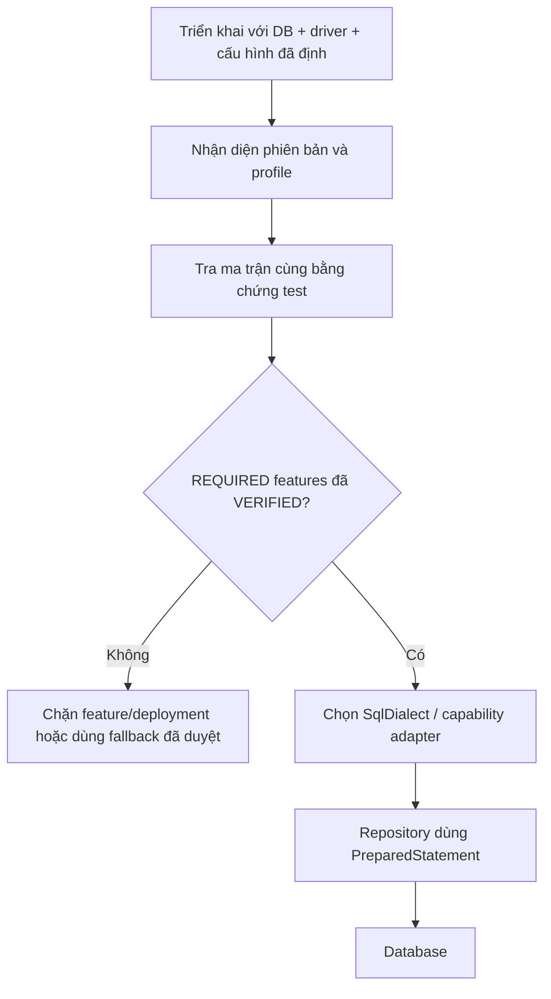
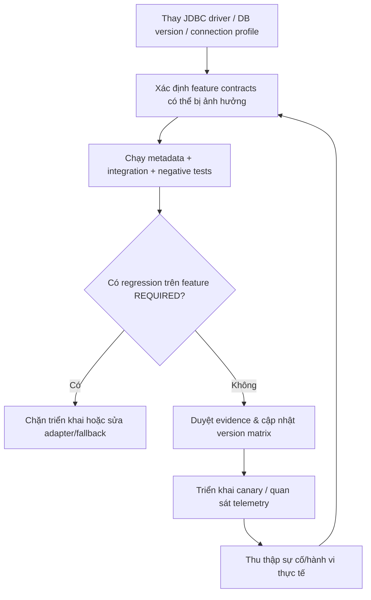

# Lập ma trận năng lực theo driver và hệ quản trị

## 1. Vì sao ứng dụng JDBC đa hệ quản trị cần ma trận năng lực?

**JDBC** cung cấp các API chuẩn để Java truy cập cơ sở dữ liệu quan hệ: ứng dụng lấy `Connection` từ `DataSource`, gửi SQL qua `PreparedStatement`, duyệt `ResultSet`, thực thi CRUD, transaction và batch theo hợp đồng `java.sql`. Từ đó dễ nảy sinh một giả định sai: *đã có JDBC driver thì mọi tính năng JDBC sẽ vận hành giống nhau trên mọi hệ quản trị*.

Trong thực tế, cùng một đoạn Java có thể chạy trên PostgreSQL, MySQL, SQL Server hoặc Oracle nhưng gặp khác biệt ở:

- Khả năng hỗ trợ savepoint, kiểu isolation, batch update và generated keys.
- Khả năng cuộn/cập nhật `ResultSet`, trả nhiều result set từ stored procedure.
- Cú pháp phân trang, UPSERT, trả giá trị từ `INSERT` và cách trích xuất JSON/ARRAY.
- Cách ánh xạ `BOOLEAN`, `TIMESTAMP WITH TIME ZONE`, `DECIMAL` và large object.
- SQLState, vendor error code, timeout, cancel và hành vi sau khi connection bị đứt.
- Hiệu quả tối ưu hóa SQL, giới hạn tham số, kích thước batch và cơ chế khóa.

Ngay cả **cùng DB** nhưng nâng phiên bản **JDBC driver**, thay cấu hình URL/connection pool, quyền tài khoản hoặc cấu hình server có thể làm hành vi khác đi. Vì thế, thay vì rải những câu `if (isPostgres)` hoặc `try/catch` khắp repository, ta cần một **ma trận năng lực có bằng chứng** (*capability matrix*).

Ma trận trả lời các câu hỏi:

1. Tổ hợp DB + driver + cấu hình **nào** đã được kiểm thử?
2. Tính năng **nào** cần cho nghiệp vụ, và mức hỗ trợ cụ thể đến đâu?
3. Bằng chứng đến từ `DatabaseMetaData`, test tích hợp hay tài liệu đã xác minh?
4. Nếu tính năng không khả dụng thì **fallback** có giữ nguyên tính đúng đắn không?
5. Ai sở hữu, kiểm tra, cập nhật ma trận khi nâng cấp hoặc thay môi trường?

**Mục tiêu bài học:** xây dựng ma trận có trạng thái, điều kiện và bằng chứng; thu thập thông tin bằng `DatabaseMetaData`; kiểm thử các năng lực quan trọng bằng JDBC thật; xác định chiến lược fallback và biến kết quả thành điều kiện kiểm thử/triển khai.

> **Nguyên tắc:** một câu trả lời `supportsXxx() == true` chỉ là *tín hiệu khả năng được driver công bố*, chưa chứng minh toàn bộ đường nghiệp vụ hoạt động đúng trên schema, phiên bản và cấu hình đang chạy.

## 2. Đơn vị của ma trận là một tổ hợp triển khai, không chỉ tên database

Ma trận kiểu:

```text
PostgreSQL : có transaction, có batch, có generated keys
MySQL      : có transaction, có batch, có generated keys
SQL Server : có transaction, có batch, có generated keys
```

quá chung để làm cơ sở quyết định vận hành. Nó không cho biết **driver nào**, phiên bản nào, storage engine nào, tài khoản có quyền gì hay các tính năng đã thật sự được test chưa.

Một hàng ma trận đáng tin hơn cần mô tả **fingerprint môi trường**:

| Thuộc tính | Ý nghĩa |
|---|---|
| `environment_id` | Mã môi trường test/production do hệ thống cấp; không cần hostname hoặc secret thô |
| `dbms`, `dbms_version` | Tên và phiên bản hệ quản trị; tính cả cấu hình engine quan trọng |
| `jdbc_driver`, `driver_version` | Implementation và phiên bản driver |
| `jdbc_api_version` | Mức JDBC mà driver thông báo qua metadata |
| `java_version` | Phiên bản JDK chạy ứng dụng |
| `connection_profile` | Profile cấu hình đã kiểm duyệt: TLS, pool, charset, timezone, fetch/cursor mode |
| `schema_revision` | Phiên bản schema/migration được áp dụng |
| `db_role` | Primary, read replica, proxy route hoặc vai trò có ảnh hưởng khả năng ghi |
| `db_privilege_profile` | Tài khoản read-only, read-write, migration... |
| `tested_at`, `test_suite_revision` | Thời điểm và phiên bản bộ test tạo bằng chứng |

Không ghi username/password, toàn bộ JDBC URL chứa credential, private key hoặc token vào ma trận. Nếu cần phân biệt cấu hình, dùng tên profile có kiểm soát và liên kết tới nơi lưu cấu hình an toàn.

### Tại sao phiên bản và cấu hình là bắt buộc?

Ví dụ một driver báo hỗ trợ batch nhưng trên đường kết nối qua proxy nào đó, cách xử lý timeout hoặc gói tin có thể khác. Một `SELECT` cập nhật được trên bảng có khóa chính có thể trở thành chỉ đọc khi thay bằng truy vấn `JOIN`. Một hệ DB hỗ trợ transaction nhưng bảng được tạo bằng engine/cấu hình không đáp ứng giả định của ứng dụng sẽ có kết quả khác. Một feature có sẵn trên server nhưng tài khoản không có quyền vẫn **không dùng được** với nghiệp vụ.

Ma trận nên gắn với **hành vi của ứng dụng trên môi trường được kiểm thử**, không phải lời hứa chung cho mọi chế độ của một sản phẩm.

## 3. Thiết kế trạng thái và mức bằng chứng

Để tránh nhầm “driver có báo hỗ trợ” với “đã kiểm thử thành công”, nên dùng các trạng thái tách bạch:

| Trạng thái ma trận | Ý nghĩa | Được bật tính năng sản phẩm chưa? |
|---|---|---|
| `VERIFIED` | Bài test tích hợp với schema/cấu hình tương ứng đã chạy và xác nhận hành vi cần thiết | Có thể bật nếu đủ các yêu cầu khác |
| `CONDITIONAL` | Chỉ hỗ trợ dưới điều kiện ghi rõ (loại SQL, privilege, cấu hình, giới hạn) | Chỉ bật khi điều kiện được đáp ứng |
| `UNSUPPORTED` | Driver báo không hỗ trợ hoặc test xác nhận không dùng được | Không; dùng fallback đã duyệt |
| `UNVERIFIED` | Chưa kiểm thử, bằng chứng thiếu hoặc metadata không khả dụng | Không suy rằng hỗ trợ |
| `REGRESSION` | Trước đây đã đạt, nay test không còn đạt | Chặn phát hành hoặc điều tra trước khi bật |

Đây là **quy ước của dự án**, không phải enum hay API JDBC tiêu chuẩn.

Mỗi ô nên có **hai lớp thông tin**:

- **Driver claim:** `REPORTED_YES`, `REPORTED_NO` hoặc `UNKNOWN`, thường lấy từ `DatabaseMetaData`.
- **Observed result:** `PASS`, `FAIL`, `NOT_RUN`, `INCONCLUSIVE`, thu từ test thực tế và theo dõi ticket/CI.

Ví dụ:

```text
feature_id          = generated-keys.single-insert.v1
driver_claim        = REPORTED_YES
observed_result     = PASS
effective_status    = VERIFIED
condition           = insert 1 row; identity column; explicit key-column name
evidence            = jdbc-capability-it#generated-keys-01
fallback            = DB-specific RETURNING/OUTPUT when implemented & tested
owner               = data-platform
```

Đừng chuyển `UNKNOWN` thành `UNSUPPORTED` chỉ vì `DatabaseMetaData` ném lỗi; không có bằng chứng khác với bằng chứng phủ định. Cũng không được tự động coi `REPORTED_YES` là `VERIFIED`.

## 4. Khung ma trận tham chiếu cho nhiều DB và driver

Trước khi chạy test, ma trận nên bắt đầu ở trạng thái **chưa xác minh**, không tô xanh mặc định. Ví dụ minh họa dưới đây có ba **profile giả định**, chưa phải kết quả đo hay kết luận về một phiên bản driver thực:

| `feature_id` | PostgreSQL + pgJDBC, profile A | MySQL + Connector/J, profile B | SQL Server + Microsoft JDBC, profile C |
|---|---|---|---|
| `tx.local-commit-rollback` | Chưa kiểm thử | Chưa kiểm thử | Chưa kiểm thử |
| `tx.savepoint` | Chưa kiểm thử | Chưa kiểm thử | Chưa kiểm thử |
| `tx.isolation.repeatable-read` | Chưa kiểm thử | Chưa kiểm thử | Chưa kiểm thử |
| `dml.batch-updates` | Chưa kiểm thử | Chưa kiểm thử | Chưa kiểm thử |
| `dml.generated-keys.single-insert` | Chưa kiểm thử | Chưa kiểm thử | Chưa kiểm thử |
| `resultset.scroll-insensitive` | Chưa kiểm thử | Chưa kiểm thử | Chưa kiểm thử |
| `resultset.updatable-single-table` | Chưa kiểm thử | Chưa kiểm thử | Chưa kiểm thử |
| `procedure.out-parameter` | Chưa kiểm thử | Chưa kiểm thử | Chưa kiểm thử |
| `procedure.multiple-results` | Chưa kiểm thử | Chưa kiểm thử | Chưa kiểm thử |
| `sql.pagination.keyset` | Chưa kiểm thử | Chưa kiểm thử | Chưa kiểm thử |
| `sql.upsert` | Chưa kiểm thử | Chưa kiểm thử | Chưa kiểm thử |
| `data.timestamp-offset-roundtrip` | Chưa kiểm thử | Chưa kiểm thử | Chưa kiểm thử |
| `error.timeout-cancel` | Chưa kiểm thử | Chưa kiểm thử | Chưa kiểm thử |

Sau khi chạy test trên từng profile, thay các ô bằng `VERIFIED`, `CONDITIONAL`, `UNSUPPORTED`, `UNVERIFIED` hoặc `REGRESSION` và đính kèm evidence cụ thể.

**Vì sao không chèn một bảng “PostgreSQL có/MySQL không” cố định?** Khả năng phụ thuộc phiên bản server/driver, schema, engine, quyền và các thuộc tính kết nối; một bảng tổng quát có thể nhanh chóng trở thành dữ liệu sai, nhất là các hành vi có tính tùy biến của driver. Mẫu trên là **khung kiểm thử**, không phải tuyên bố sản phẩm nào hỗ trợ hay không hỗ trợ.

### Cấu trúc mỗi ô khi mở rộng

| Trường | Ví dụ |
|---|---|
| `feature_id` | `resultset.updatable-single-table` |
| `status` | `CONDITIONAL` |
| `conditions` | Chỉ thử trên SELECT một bảng, có primary key, privilege UPDATE |
| `driver_claim` | `REPORTED_YES` |
| `test_case` | `UpdatableResultSetIT#singleTable` |
| `observed_at` | Ngày CI chạy test; ghi theo UTC |
| `fallback_id` | `sql.update-with-where` |
| `severity` | `REQUIRED`, `OPTIONAL` hoặc `EXPERIMENTAL` theo nhu cầu ứng dụng |

`severity` là **mức quan trọng đối với ứng dụng**, không phải mức hỗ trợ của DB. Có tính năng tồn tại nhưng không cần sử dụng; ngược lại, một tính năng thiết yếu không thể bật bằng giả định thiếu bằng chứng.

## 5. Dùng DatabaseMetaData để thu thập thông tin ban đầu

`java.sql.DatabaseMetaData` là API JDBC chuẩn, được lấy từ `Connection.getMetaData()`. Nó cung cấp tên DB, tên driver, phiên bản và nhiều phương thức `supportsXxx()`.

Các phương thức đặc biệt hữu ích cho ma trận:

| Năng lực cần kiểm tra | API metadata | Giới hạn |
|---|---|---|
| Transaction | `supportsTransactions()` | Không xác nhận mọi bảng/engine/SQL đều transactional |
| Savepoint | `supportsSavepoints()` | Cần transaction thật và kiểm tra rollback tới savepoint |
| Batch DML | `supportsBatchUpdates()` | Không khẳng định tốc độ hoặc số dòng cập nhật trả chính xác |
| Khóa sinh | `supportsGetGeneratedKeys()` | Không bảo đảm câu INSERT và dạng khóa cụ thể hoạt động |
| Isolation | `supportsTransactionIsolationLevel(level)` | Không mô tả toàn bộ ngữ nghĩa snapshot/locking của DB |
| ResultSet có thể cuộn | `supportsResultSetType(type)` | Driver có thể downgrade tùy statement |
| ResultSet cập nhật được | `supportsResultSetConcurrency(type, concurrency)` | Khả năng thực tế phụ thuộc SELECT, key và privilege |
| Stored procedure | `supportsStoredProcedures()` | Không chứng minh OUT, function, REF_CURSOR đều giống nhau |
| Nhiều kết quả | `supportsMultipleResultSets()` | Không bảo đảm có nhiều result set mở đồng thời |
| Nhiều kết quả cùng mở | `supportsMultipleOpenResults()` | Độc lập với khả năng có nhiều result set nối tiếp |
| Cú pháp SQL và định danh | `getIdentifierQuoteString()`, `getSearchStringEscape()` | Không thay thế kiểm thử SQL dialect hay bind parameter |

### 5.1. Ví dụ chương trình khảo sát tự chứa

Mã sau chỉ gọi `DataSource` và metadata; nó không chèn dữ liệu và không ghi cấu hình kết nối có thể chứa bí mật. Các phép kiểm tra có thể trả trạng thái `UNKNOWN` khi driver ném `SQLException`, thay vì âm thầm ghi `false`.

```java
import java.sql.Connection;
import java.sql.DatabaseMetaData;
import java.sql.ResultSet;
import java.sql.SQLException;
import java.util.Collections;
import java.util.LinkedHashMap;
import java.util.Map;
import java.util.Objects;
import javax.sql.DataSource;

public final class JdbcCapabilityProbe {
    private JdbcCapabilityProbe() {}

    @FunctionalInterface
    private interface SqlCheck {
        boolean run() throws SQLException;
    }

    public record MetadataSnapshot(
            String databaseProduct,
            String databaseVersion,
            String driverName,
            String driverVersion,
            int jdbcMajorVersion,
            int jdbcMinorVersion,
            Map<String, String> claims) {
    }

    private static void addClaim(
            Map<String, String> claims, String id, SqlCheck check) {
        try {
            claims.put(id, check.run() ? "REPORTED_YES" : "REPORTED_NO");
        } catch (SQLException unavailable) {
            // UNKNOWN không đồng nghĩa tính năng không được hỗ trợ.
            // Kênh xử lý lỗi riêng có thể ghi SQLState class đã kiểm duyệt.
            claims.put(id, "UNKNOWN");
        }
    }

    public static MetadataSnapshot inspect(DataSource dataSource)
            throws SQLException {
        Objects.requireNonNull(dataSource, "dataSource");
        try (Connection connection = dataSource.getConnection()) {
            DatabaseMetaData md = connection.getMetaData();
            Map<String, String> claims = new LinkedHashMap<>();

            addClaim(claims, "tx.local", md::supportsTransactions);
            addClaim(claims, "tx.savepoint", md::supportsSavepoints);
            addClaim(claims, "dml.batch", md::supportsBatchUpdates);
            addClaim(claims, "dml.generated-keys",
                    md::supportsGetGeneratedKeys);
            addClaim(claims, "procedure.supported",
                    md::supportsStoredProcedures);
            addClaim(claims, "procedure.multiple-results",
                    md::supportsMultipleResultSets);
            addClaim(claims, "procedure.multiple-open-results",
                    md::supportsMultipleOpenResults);

            int scrollType = ResultSet.TYPE_SCROLL_INSENSITIVE;
            addClaim(claims, "rs.scroll-insensitive",
                    () -> md.supportsResultSetType(scrollType));
            addClaim(claims, "rs.updatable-scroll-insensitive",
                    () -> md.supportsResultSetConcurrency(
                            scrollType, ResultSet.CONCUR_UPDATABLE));
            addClaim(claims, "tx.repeatable-read",
                    () -> md.supportsTransactionIsolationLevel(
                            Connection.TRANSACTION_REPEATABLE_READ));
            addClaim(claims, "tx.serializable",
                    () -> md.supportsTransactionIsolationLevel(
                            Connection.TRANSACTION_SERIALIZABLE));

            return new MetadataSnapshot(
                    md.getDatabaseProductName(),
                    md.getDatabaseProductVersion(),
                    md.getDriverName(),
                    md.getDriverVersion(),
                    md.getJDBCMajorVersion(),
                    md.getJDBCMinorVersion(),
                    Collections.unmodifiableMap(
                            new LinkedHashMap<>(claims)));
        }
    }
}
```

Sử dụng từ tầng test hoặc công cụ quản trị:

```java
JdbcCapabilityProbe.MetadataSnapshot info =
        JdbcCapabilityProbe.inspect(dataSource);

// Có thể ghi một artifact có quyền truy cập vào CI, sau khi
// kiểm tra metadata không chứa thông tin nhạy cảm theo chính sách.
String batchClaim = info.claims().get("dml.batch");
```

Lưu ý:

1. `dataSource` do ứng dụng/test cung cấp, đã cấu hình driver, chứng chỉ server, quyền truy cập và pool phù hợp.
2. `MetadataSnapshot` là **khảo sát**. Một phép gọi metadata thất bại được đánh dấu `UNKNOWN`; nếu chính `getConnection()`/`getMetaData()` thất bại, toàn phép khảo sát ném `SQLException`.
3. Việc bắt `SQLException` riêng cho từng feature chỉ phù hợp cho **thu thập thông tin**; đừng nuốt lỗi kết nối trong đường CRUD rồi tiếp tục ghi dữ liệu như bình thường.
4. `getDatabaseProductVersion()` và `getDriverVersion()` là chuỗi do driver cung cấp, cần chuẩn hóa nếu định dùng làm nhãn metrics có cardinality thấp.
5. Không log `DatabaseMetaData.getURL()` hay `getUserName()` một cách vô điều kiện. URL có thể tiết lộ host, database name, tùy chọn kết nối hoặc credential tùy cách sử dụng.
6. Nếu ứng dụng có nhiều `DataSource`, phải khảo sát từng nguồn riêng. Một bean kết nối tới replica/read-only không thay cho bằng chứng về primary có quyền ghi.

## 6. Metadata là lời khai; test tích hợp là bằng chứng hành vi

Hai loại thông tin cần đặt cạnh nhau:

```text
DatabaseMetaData.supportsBatchUpdates() = true
                       |
                       v
           DRIVER_CLAIM = REPORTED_YES
                       |
                       v
Chạy batch INSERT/UPDATE thật trên schema test + rollback
                       |
                 +-----+-----+
                 |           |
             TEST_PASS    TEST_FAIL
                 |           |
              VERIFIED    REGRESSION/CONDITIONAL
```

Một feature chỉ nên được coi là đã xác minh nếu test dùng **đúng workload nghiệp vụ tương ứng**:

- Batch: không chỉ gọi `supportsBatchUpdates()` mà còn gửi nhiều bộ tham số, kiểm tra update counts, rollback và lỗi giữa batch.
- Generated keys: không chỉ kiểm tra `supportsGetGeneratedKeys()` mà còn thực hiện `INSERT`, gọi `getGeneratedKeys()` và đối chiếu hàng được chèn.
- Isolation: không chỉ báo hỗ trợ cấp độ mà còn chạy hai transaction cạnh tranh và quan sát hành vi.
- Updatable ResultSet: không chỉ báo `CONCUR_UPDATABLE` mà còn tạo `SELECT` được hỗ trợ, gọi `updateXxx()/updateRow()`, kiểm tra commit hoặc rollback.
- Timeout/cancel: không chỉ set được cấu hình mà còn kiểm chứng driver và database thực sự phản hồi thế nào khi truy vấn chậm.

**Không thực thi các test có tác dụng phụ trên production chỉ để cập nhật ma trận.** Dùng DB thử nghiệm cùng họ/version/cấu hình hợp lý và schema riêng; chỉ triển khai probe read-only tối thiểu trên production nếu đã được phép và đã đánh giá rủi ro.

## 7. Nhóm transaction: commit, rollback, savepoint và isolation

Đây là nhóm feature thường liên quan trực tiếp tới tính đúng đắn của CRUD.

| `feature_id` | Metadata cần xem | Bài kiểm tra thực tế | Điều kiện và rủi ro |
|---|---|---|---|
| `tx.local-commit-rollback` | `supportsTransactions()` | Chèn hàng trong transaction, rollback và kiểm tra hàng không tồn tại | Bảng/engine phải transactional |
| `tx.savepoint` | `supportsSavepoints()` | DML A, tạo savepoint, DML B, rollback về savepoint; xác nhận A còn, B mất | Savepoint chỉ tồn tại trong transaction phù hợp |
| `tx.isolation.repeatable-read` | `supportsTransactionIsolationLevel(...)` | Hai connection đọc/ghi đồng thời, đối chiếu snapshot/hành vi khóa | Ngữ nghĩa cụ thể phụ thuộc DB |
| `tx.isolation.serializable` | Metadata theo mức `SERIALIZABLE` | Kiểm thử write skew/phantom hoặc conflict được thiết kế rõ | Có thể block hoặc trả serialization failure cần retry |
| `tx.ddl-atomicity` | `dataDefinitionCausesTransactionCommit()`, `supportsDataDefinitionAndDataManipulationTransactions()` | DDL trong transaction test rồi rollback | Một số DB có implicit commit hoặc hạn chế DDL |

### 7.1. Probe savepoint có kiểm soát

Ví dụ logic test (cú pháp bảng test được chuẩn bị riêng theo DB):

```java
import java.sql.Connection;
import java.sql.PreparedStatement;
import java.sql.ResultSet;
import java.sql.Savepoint;
import java.sql.SQLException;

// Trong test đã mở connection chuyên dụng, ở auto-commit = false:
try (PreparedStatement add = connection.prepareStatement(
        "INSERT INTO capability_probe(marker) VALUES (?)")) {
    add.setString(1, "before-savepoint");
    add.executeUpdate();
}

Savepoint point = connection.setSavepoint("probe_b");
try (PreparedStatement add = connection.prepareStatement(
        "INSERT INTO capability_probe(marker) VALUES (?)")) {
    add.setString(1, "after-savepoint");
    add.executeUpdate();
}

connection.rollback(point);
// Trong cùng transaction: SELECT xác minh before còn,
// after đã bị hoàn tác, sau đó rollback toàn bộ test fixture.
```

Đoạn này **không phải phương thức hoàn chỉnh**; connection do test sở hữu, bảng `capability_probe` do fixture tạo và có cột `marker`. Chỉ gọi trong transaction thử nghiệm có `autoCommit = false`, không dùng `commit()` cho dữ liệu test. Trong `finally`, toàn transaction phải được rollback; nếu rollback thất bại, connection cần được xem là không an toàn và xử lý theo pool/driver.

### 7.2. Metadata isolation không mô tả hết MVCC

`supportsTransactionIsolationLevel(Connection.TRANSACTION_REPEATABLE_READ)` có thể trả `true` trong nhiều hệ DB, nhưng **không đủ** để khẳng định các hệ có cùng snapshot/lock semantics. Ví dụ, cách xử lý phantom, snapshot cho nhiều câu `SELECT` hoặc lỗi serialization có thể khác nhau theo DB.

Với nghiệp vụ tránh lost update, vẫn phải thử `UPDATE ... WHERE version = ?`, kiểm tra `executeUpdate() == 1`, ranh giới `commit()` và policy retry. Không dùng một ô “isolation có” để thay thế kiểm thử đồng thời.

## 8. Nhóm batch, generated keys và update count

### 8.1. Batch update

```java
import java.sql.Connection;
import java.sql.PreparedStatement;
import java.sql.Statement;

// connection nằm trong transaction test, không auto-commit.
try (PreparedStatement ps = connection.prepareStatement(
        "UPDATE capability_probe SET flag = ? WHERE id = ?")) {
    for (long id : new long[]{101L, 102L, 103L}) {
        ps.setBoolean(1, true);
        ps.setLong(2, id);
        ps.addBatch();
    }
    int[] counts = ps.executeBatch();

    for (int count : counts) {
        if (count == Statement.EXECUTE_FAILED) {
            throw new IllegalStateException("Batch item failed");
        }
        if (count == Statement.SUCCESS_NO_INFO) {
            // Thành công nhưng driver không cung cấp số hàng chính xác.
        }
    }
}
```

Đoạn mã chỉ minh họa hạt nhân một bài test; fixture cần có các ID đó và cột `flag`, đồng thời transaction owner phải rollback sau phép đo.

**Các điểm cần ghi vào ma trận:**

- Driver có báo hỗ trợ batch không (`supportsBatchUpdates()`)?
- Có thể chạy `executeBatch()` trên đúng DML mà ứng dụng dùng không?
- Driver trả `1`, `0`, `Statement.SUCCESS_NO_INFO` (`-2`) hay `Statement.EXECUTE_FAILED` (`-3`) khi có lỗi?
- Khi một phần tử lỗi, batch dừng hay tiếp tục, và `BatchUpdateException.getUpdateCounts()` thể hiện phần nào?
- Có thể rollback toàn batch khi nằm trong một transaction không? Có DDL hoặc statement đặc biệt làm implicit commit không?
- Giới hạn kích thước batch, độ dài tham số, packet và memory có cho phép khối lượng nghiệp vụ không?

`SUCCESS_NO_INFO` **không xác nhận đúng một hàng** dù driver có thể đã thực thi thành công. Nếu nghiệp vụ đòi hỏi kiểm tra ảnh hưởng đúng từng hàng, cần fallback DML đơn lẻ hoặc cơ chế đối soát khác.

### 8.2. Generated keys

```java
import java.sql.Connection;
import java.sql.PreparedStatement;
import java.sql.ResultSet;
import java.sql.SQLException;
import java.sql.Statement;

// Bảng capability_probe đã có cột id do database sinh
// theo cú pháp/kiểu dữ liệu của chính DB đang kiểm thử.
try (PreparedStatement ps = connection.prepareStatement(
        "INSERT INTO capability_probe(marker) VALUES (?)",
        Statement.RETURN_GENERATED_KEYS)) {
    ps.setString(1, "generated-key-probe");
    if (ps.executeUpdate() != 1) {
        throw new SQLException("Expected one inserted probe row");
    }
    try (ResultSet keys = ps.getGeneratedKeys()) {
        if (!keys.next()) {
            throw new SQLException("Missing generated key");
        }
        long id = keys.getLong(1);
        if (keys.wasNull() || id <= 0 || keys.next()) {
            throw new SQLException("Unexpected generated keys result");
        }
        // Dùng SELECT cùng transaction để đối chiếu id + marker.
    }
}
```

Phải ghi rõ trong matrix: `SINGLE_ROW` hay `MULTI_ROW`, có khai báo tên cột khóa không, driver trả một hay nhiều cột, kiểu khóa `long` hay UUID, tính bền vững sau commit và sự khác biệt giữa các dạng INSERT. Một test đơn hàng thành công **không chứng minh** batch INSERT sẽ trả khóa theo thứ tự đã gửi.

Nếu DB có `RETURNING`, `OUTPUT` hoặc cú pháp tương đương, đó là **tính năng SQL riêng của hệ quản trị** cần hàng ma trận khác. Không giả định mọi driver ánh xạ cùng dạng result về `getGeneratedKeys()`.

Nếu thiếu khóa sinh mà INSERT đang ở auto-commit, ném ngoại lệ **không tự rollback hàng đã ghi**. Với test mà không được phép để lại dữ liệu, hãy dùng transaction chủ động và rollback toàn bộ.

## 9. Nhóm ResultSet, metadata cột và thủ tục lưu trữ

### 9.1. Cuộn/cập nhật ResultSet

Các cặp cần phân biệt:

```java
ResultSet.TYPE_FORWARD_ONLY
ResultSet.TYPE_SCROLL_INSENSITIVE
ResultSet.TYPE_SCROLL_SENSITIVE
ResultSet.CONCUR_READ_ONLY
ResultSet.CONCUR_UPDATABLE
```

Một DB/driver có thể hỗ trợ `TYPE_SCROLL_INSENSITIVE` nhưng không hỗ trợ `CONCUR_UPDATABLE` với kiểu đó, hoặc có khả năng tổng quát nhưng **từ chối SQL cụ thể** (join, aggregate, thiếu khóa chính, read-only connection).

Thử trực tiếp:

```java
String sql = """
        SELECT id, status
        FROM capability_probe
        WHERE id = ?
        """;

try (PreparedStatement ps = connection.prepareStatement(
        sql,
        ResultSet.TYPE_SCROLL_INSENSITIVE,
        ResultSet.CONCUR_UPDATABLE)) {
    ps.setLong(1, testId);
    try (ResultSet rs = ps.executeQuery()) {
        if (rs.getConcurrency() != ResultSet.CONCUR_UPDATABLE) {
            throw new SQLException("Updatable cursor unavailable");
        }
        if (rs.next()) {
            rs.updateString("status", "CHECKED");
            rs.updateRow();
        }
    }
}
```

Hãy xem đây là **test riêng** có bảng/schema và quyền `UPDATE` phù hợp; sau đó rollback transaction. Driver có thể downgrade mức concurrency hoặc báo lỗi ngay khi prepare/query. `updateRow()` không thay `commit()`, và cursor cập nhật được không tự bảo vệ khỏi lost update.

### 9.2. Stored procedure và nhiều kết quả

Ma trận nên có các hàng riêng:

| `feature_id` | Test cần có |
|---|---|
| `procedure.call` | `CallableStatement` gọi một procedure thực sự |
| `procedure.in-out` | `registerOutParameter()` và đọc OUT/INOUT qua getter phù hợp |
| `procedure.multiple-results` | `execute()`, `getResultSet()`, `getUpdateCount()`, `getMoreResults()` |
| `procedure.multiple-open-results` | Test khả năng giữ nhiều `ResultSet` mở nếu nghiệp vụ thật sự yêu cầu |

Kể cả khi metadata báo hỗ trợ stored procedure, **cú pháp `CALL`**, phân biệt function/procedure, cursor trả về, cách đọc nhiều result set và thứ tự update count có thể khác. Không “giả lập” kết quả của một procedure dựa trên chức năng metadata.

Trong vòng lặp `getMoreResults()`, cần xử lý cả `getUpdateCount() == -1` để xác nhận đã hết kết quả; chỉ gọi `getMoreResults()` một lần rồi kết luận thủ tục chỉ có một kết quả là sai.

### 9.3. ResultSetMetaData, ParameterMetaData và các giới hạn

`ResultSetMetaData` giúp kiểm tra nhãn cột, JDBC type, precision, scale và nullability của kết quả. `ParameterMetaData` có thể báo kiểu và số tham số của `PreparedStatement`, nhưng **không phải driver nào cũng cung cấp đầy đủ hoặc chính xác trước khi thực thi**.

Vì vậy, nếu ứng dụng bắt buộc dùng `ParameterMetaData.getParameterType(index)`, hãy tạo feature test riêng. Không mặc định mọi dấu `?` đều có thể xác định kiểu một cách độc lập với SQL/context của database.

## 10. Nhóm SQL dialect: điều JDBC không tự chuẩn hóa

Một vấn đề thường bị bỏ qua là `DatabaseMetaData` mô tả **khả năng của driver/DB**, còn SQL mà ứng dụng viết vẫn chịu ảnh hưởng của hệ quản trị. JDBC không tự biến mọi cú pháp PostgreSQL thành cú pháp SQL Server hoặc Oracle.

### 10.1. Phân trang

Ví dụ truy vấn lấy 50 đơn hàng tiếp theo có ID lớn hơn `lastId`:

```sql
-- PostgreSQL / MySQL (minh họa)
SELECT id, status
FROM orders
WHERE id > ?
ORDER BY id
LIMIT ?;
```

```sql
-- SQL Server (minh họa)
SELECT id, status
FROM orders
WHERE id > ?
ORDER BY id
OFFSET 0 ROWS FETCH NEXT ? ROWS ONLY;
```

```sql
-- Oracle trong những phiên bản hỗ trợ row-limiting clause
SELECT id, status
FROM orders
WHERE id > ?
ORDER BY id
FETCH FIRST ? ROWS ONLY;
```

Đây là **ví dụ cú pháp**; khả năng bind biến ở `LIMIT`/`FETCH`, tên schema, kế hoạch thực thi và cách hỗ trợ trên phiên bản cụ thể vẫn phải được kiểm thử. Nếu một driver không chấp nhận bind page size ở vị trí đó, không được nối trực tiếp giá trị tùy ý từ client; cần validate giới hạn rồi dùng cú pháp/adapter phù hợp.

Đặt `ORDER BY` có tie-breaker duy nhất, ví dụ `ORDER BY created_at, id`, mới là điều kiện giúp keyset pagination có thứ tự xác định. Không coi “truy vấn hợp lệ” đồng nghĩa đã giải quyết vấn đề dữ liệu thay đổi giữa các trang.

### 10.2. UPSERT không có một cú pháp dùng chung

Một số cách làm theo từng DB:

| DB / họ cú pháp | Hình thức thường gặp | Cần kiểm thử gì? |
|---|---|---|
| PostgreSQL | `INSERT ... ON CONFLICT ... DO UPDATE` | Unique constraint, update count, dữ liệu trả về, concurrency |
| MySQL | `INSERT ... ON DUPLICATE KEY UPDATE` | Khóa trùng nào kích hoạt, update count, semantics khi không đổi giá trị |
| SQL Server | Transactional `UPDATE` rồi `INSERT` có bảo vệ tranh chấp, hoặc cơ chế phù hợp | Khóa/race khi hai worker cùng tạo, constraint violation |
| Oracle | `MERGE` hoặc logic khác theo phiên bản | Điều kiện match, thao tác đồng thời, trigger, update count |

Mục đích của bảng là **định hướng lựa chọn test**, không phải khẳng định các cú pháp có ngữ nghĩa tuyệt đối tương đương. Ví dụ `MERGE` của một DB có thể có giới hạn hoặc rủi ro tranh chấp khác với `ON CONFLICT`.

Nếu nghiệp vụ yêu cầu idempotent INSERT, hàng ma trận phải ghi rõ:

- Unique key hoặc constraint nào tạo cơ sở chống trùng.
- Hai transaction cạnh tranh có thể cùng kết thúc thành công không?
- Trong trường hợp xung đột, giá trị trả về/số dòng ảnh hưởng có thống nhất không?
- Cách retry sau deadlock hoặc serialization failure là gì?
- Sửa cùng hàng theo version/`WHERE` có ngăn lost update hay không?

### 10.3. Cú pháp tạo khóa, trả kết quả và đối tượng DB

`IDENTITY`, `AUTO_INCREMENT`, sequence, `RETURNING`, `OUTPUT`, JSON expressions, array operators, full-text search, stored functions và temporary tables có thể dùng cơ chế khác nhau. Chúng cần những hàng **SQL dialect capability** với test tương ứng; đừng gộp mọi thứ vào một ô “JDBC chuẩn”.

Các metadata như `supportsANSI92EntryLevelSQL()` hoặc `getSQLKeywords()` có thể giúp khảo sát SQL dialect, nhưng không thay thế test thực thi câu SQL mục tiêu và đối chiếu ý nghĩa thực tế.

## 11. Nhóm kiểu dữ liệu: một tên JDBC type chưa chứng minh round-trip đúng

Các API `PreparedStatement.setXxx()` và `ResultSet.getXxx()` giúp làm việc với kiểu Java, nhưng cách driver ánh xạ tới kiểu SQL cụ thể có thể khác.

| Tính năng | Câu hỏi cần kiểm thử | Chú ý |
|---|---|---|
| `BigDecimal` ↔ `DECIMAL/NUMERIC` | Precision/scale có được giữ đúng khi ghi và đọc? | Không dùng `double` cho tiền |
| `Boolean` ↔ boolean/bit/tinyint | `NULL` khác `false` thế nào? | `ResultSet.getBoolean()` cần `wasNull()` khi cột nullable |
| `LocalDate`/`LocalDateTime` | Ngày, timestamp và precision round-trip? | Không ngầm hiểu timezone của `LocalDateTime` |
| `OffsetDateTime` | Driver và SQL type có giữ instant/offset theo hợp đồng? | Có DB chuẩn hóa offset; so sánh theo yêu cầu nghiệp vụ |
| `UUID` | Có bind/`getObject(..., UUID.class)` ổn định? | Có DB dùng UUID native, DB khác dùng chuỗi/byte |
| JSON | Kiểu cột, bind và đọc có tương thích? | Có thể cần kiểu vendor-specific hoặc chuỗi |
| ARRAY | `Connection.createArrayOf()` có dùng được không? | Cơ chế và type name tùy DB |
| BLOB/CLOB | Stream, độ dài, memory, `free()`, null handling | Driver có thể buffer, không bảo đảm RAM cố định |
| String/Unicode | Dấu tiếng Việt, emoji, collation, chuẩn hóa | Charset/collation ở DB và kết nối đều quan trọng |

### Ví dụ kiểm tra chính xác số tiền

```java
import java.math.BigDecimal;
import java.sql.PreparedStatement;
import java.sql.ResultSet;
import java.sql.SQLException;

BigDecimal expected = new BigDecimal("123456.78");
try (PreparedStatement ps = connection.prepareStatement(
        "INSERT INTO capability_amounts(id, amount) VALUES (?, ?)")) {
    ps.setLong(1, 1001L);
    ps.setBigDecimal(2, expected);
    ps.executeUpdate();
}

try (PreparedStatement ps = connection.prepareStatement(
        "SELECT amount FROM capability_amounts WHERE id = ?")) {
    ps.setLong(1, 1001L);
    try (ResultSet rs = ps.executeQuery()) {
        if (!rs.next() ||
                rs.getBigDecimal(1).compareTo(expected) != 0) {
            throw new SQLException("DECIMAL round-trip failed");
        }
    }
}
```

Ví dụ là **thân test** chạy trên connection/transaction và bảng fixture đã định nghĩa; sau phép thử phải rollback. `compareTo()` kiểm tra giá trị số, không yêu cầu scale của hai đối tượng `BigDecimal` giống nhau. Nếu ứng dụng bắt buộc giữ scale chính xác, thêm assertion `scale()` riêng.

### Kiểu thời gian cần thử cả ranh giới

Chỉ kiểm thử một timestamp “hôm nay” chưa đủ. Bộ dữ liệu thử nên có:

- Ngày gần ranh giới tháng/năm; leap day khi hợp lệ.
- Thời điểm chuyển DST nếu ứng dụng làm việc với vùng có daylight saving.
- Precision cao hơn mili giây nếu nghiệp vụ đòi hỏi.
- Cột SQL nullable và giá trị Java `null`.
- Các phiên bản/driver khác nhau khi dùng `setObject()`, `getObject(..., OffsetDateTime.class)`.

Không mặc định `TIMESTAMP WITHOUT TIME ZONE` là một thời điểm UTC. Ma trận nên ghi rõ **mô hình thời gian của ứng dụng** và vùng múi giờ cấu hình cho session/driver nếu ảnh hưởng kết quả.

## 12. Nhóm lỗi, timeout, cancel và bảo mật kết nối

Một tính năng có vẻ không liên quan schema nhưng rất quan trọng khi vận hành đa DB là cách driver báo lỗi và phản ứng khi mạng hoặc statement bị hủy.

| `feature_id` | Kịch bản test | Bằng chứng cần ghi |
|---|---|---|
| `error.unique-violation` | Chèn bản ghi trùng unique | SQLState, vendor code, transaction còn dùng được? |
| `error.deadlock-retryable` | Hai transaction tạo tranh chấp có kiểm soát | Phân loại lỗi, rollback và khả năng retry toàn transaction |
| `error.query-timeout` | `setQueryTimeout()` và câu SQL chậm | Loại `SQLException`, thời gian, trạng thái connection |
| `error.statement-cancel` | Thread khác gọi `Statement.cancel()` | SQL đã dừng hay chưa, race, cleanup |
| `error.network-drop` | Network proxy ngắt kết nối test | Driver thoát blocking I/O, pool loại connection lỗi |
| `error.commit-unknown` | Mất phản hồi sau/đang commit | Quy trình đối soát/idempotency, không suy rollback |
| `security.server-identity` | TLS với CA đúng/sai và SAN đúng/sai | Kết nối sai chứng chỉ phải bị từ chối |

Không gom tất cả `SQLException` vào một mã lỗi “RETRYABLE”. Ví dụ lỗi unique constraint có thể là xung đột nghiệp vụ, trong khi mất kết nối trong lúc commit có thể dẫn đến **kết quả chưa xác định**. SQLState `08` thường nói về lỗi kết nối; `40` thường liên quan transaction rollback, nhưng mã và hành vi cụ thể phải được kiểm thử đúng driver.

**Quan trọng:** `Thread.interrupt()` hoặc `Future.cancel(true)` không bảo đảm SQL trên server đã bị hủy. `Statement.cancel()` và `setQueryTimeout()` cũng có giới hạn và race. Hàng ma trận phải bao gồm kiểm chứng worker/statement chấm dứt, transaction được xử lý và pool không rò connection.

### TLS là một phần của năng lực kết nối

Một kết nối được mã hóa **chưa chắc đã xác minh server**. Khi xây dựng ma trận, không ghi `security.tls = yes` chung chung; thay bằng tiêu chí `TLS_REQUIRED_AND_HOSTNAME_VERIFIED`, có negative test dùng CA không tin cậy, chứng chỉ hết hạn hoặc hostname không khớp. Các thuộc tính SSL/TLS là **riêng driver**, không được lấy cấu hình PostgreSQL áp dụng máy móc cho SQL Server/MySQL.

## 13. Thiết kế fallback theo năng lực, không rải if/else trong nghiệp vụ

Ma trận chỉ có ích nếu ứng dụng biết **lựa chọn đường thực thi đúng** khi năng lực khác nhau. Có thể tổ chức một lớp `SqlDialect` hoặc `DatabaseCapabilities` được tạo lúc khởi động từ cấu hình đã phê duyệt và kết quả kiểm thử.



### 13.1. Ranh giới API rõ ràng

```java
import java.sql.Connection;
import java.sql.PreparedStatement;
import java.sql.SQLException;

interface SqlDialect {
    String selectNextOrdersSql();
}

final class LimitDialect implements SqlDialect {
    @Override
    public String selectNextOrdersSql() {
        return """
                SELECT id, status FROM orders
                WHERE tenant_id = ? AND id > ?
                ORDER BY id
                LIMIT ?
                """;
    }
}

final class OffsetFetchDialect implements SqlDialect {
    @Override
    public String selectNextOrdersSql() {
        return """
                SELECT id, status FROM orders
                WHERE tenant_id = ? AND id > ?
                ORDER BY id
                OFFSET 0 ROWS FETCH NEXT ? ROWS ONLY
                """;
    }
}
```

Hai adapter cùng yêu cầu ba tham số `(tenantId, lastId, pageSize)` và cùng thứ tự kết quả; khác biệt được cô lập trong dialect. Các câu SQL này chỉ là mẫu; ứng dụng vẫn cần test bind page size, kiểu dữ liệu và execution plan trên profile DB/driver được chọn.

Đối với các hành vi phức tạp hơn, adapter có thể có `insertReturningId(...)` hoặc `upsert(...)` với **hợp đồng nghiệp vụ giống nhau**, nhưng implementation dùng SQL riêng theo DB.

### 13.2. Tránh fallback thay đổi ý nghĩa dữ liệu

| Tính năng không có | Fallback có thể xem xét | Điều không được phép |
|---|---|---|
| Updatable ResultSet | `UPDATE ... WHERE id = ? AND version = ?` | Bỏ kiểm tra version và gây lost update |
| Batch update | Nhiều lệnh `executeUpdate()` trong cùng transaction | Mặc định mỗi lệnh auto-commit khi nghiệp vụ cần nguyên tử |
| Generated keys | Cơ chế `RETURNING`/`OUTPUT` được DB hỗ trợ và test | Dùng `SELECT MAX(id)` để đoán ID vừa sinh |
| Savepoint | Transaction nhỏ độc lập hoặc thay đổi quy trình nghiệp vụ | Giả vờ rollback được một phần khi thực tế chỉ có full rollback |
| ParameterMetaData | Bind kiểu SQL/JDBC tường minh từ schema/domain mapping | Dò loại tham số bằng giá trị null không đáng tin |
| Query timeout | Server-side statement/lock timeout, network timeout bổ sung | Tin `Future.cancel(true)` tự dừng SQL |
| SQL UPSERT | Transaction + unique constraint + retry có kiểm soát | Dùng `SELECT rồi INSERT` không bảo vệ race đồng thời |

Một fallback đúng là **phương án giữ nguyên hợp đồng nghiệp vụ và giới hạn bảo mật**, không chỉ là đoạn code khiến thao tác “không còn ném lỗi”.

## 14. Biến ma trận thành artifact có phiên bản và thể kiểm chứng

Không cần một định dạng chung cho mọi tổ chức, nhưng mỗi kết quả nên có thể **liên kết ngược về bộ test và cấu hình** đã chạy. Ví dụ mẫu YAML nằm ngay trong tài liệu này để minh họa, **không phải file cấu hình đã được tạo trên workspace**:

```yaml
matrix_schema_version: 1
profile:
  id: pg-integration-rw
  dbms: PostgreSQL
  dbms_version: "<read from DatabaseMetaData in CI>"
  jdbc_driver: pgJDBC
  driver_version: "<read from DatabaseMetaData in CI>"
  java_version: "<read from test runtime>"
  schema_revision: "migration-set-A"
  connection_profile: "tls-verified-rw"
evidence:
  test_suite: "jdbc-capability-it"
  run_id: "example-ci-run-id"
  source_revision: "example-commit-id"
  tested_at_utc: "<generated by CI>"
features:
  - id: tx.savepoint
    metadata_claim: REPORTED_YES
    observed: PASS
    status: VERIFIED
    conditions: "Transactional table; explicit transaction"
    test_case: "SavepointIT#rollsBackOnlyAfterMarker"
    fallback: null
  - id: dml.generated-keys.batch
    metadata_claim: REPORTED_YES
    observed: NOT_RUN
    status: UNVERIFIED
    conditions: "Batch-generated IDs and ordering untested"
    test_case: "GeneratedKeysIT#batchOrder"
    fallback: "Single-row INSERT until verified"
```

**Các giá trị trên hoàn toàn là mẫu dữ liệu**, không khẳng định đã chạy CI và không phản ánh kết quả thật của pgJDBC. Trong artifact thực tế, mọi `observed: PASS` phải có bằng chứng kiểm thử tương ứng.

### Quy tắc kiểm soát chất lượng của ma trận

1. Không có `VERIFIED` nếu `observed` không phải `PASS` hoặc không có test case/bằng chứng.
2. Không được thay `NOT_RUN` bằng `PASS` chỉ dựa trên `DatabaseMetaData`.
3. Bất kỳ thay đổi driver/database/schema/profile quan trọng nào đều yêu cầu xem lại các ô bị ảnh hưởng.
4. `CONDITIONAL` phải ghi điều kiện kiểm chứng được, không chỉ viết “tùy DB”.
5. Khi `REPORTED_NO` nhưng test có vẻ chạy được, đánh dấu mâu thuẫn để điều tra; đừng tự sửa metadata hoặc bôi bỏ bằng chứng.
6. Khi `REPORTED_YES` nhưng test fail, không được lặng lẽ bật tính năng.
7. Tính năng `REQUIRED` mà không có fallback đúng thì phải chặn đường triển khai sử dụng tính năng đó.
8. Không lưu raw credential/JDBC URL chứa password vào artifact CI.

## 15. Kế hoạch kiểm thử liên DB trên CI

Một bộ test nên được tổ chức theo **feature contract** thay vì theo tên driver trong mã nghiệp vụ.

| Nhóm test | Ví dụ test name | Dữ liệu/fixture cần có |
|---|---|---|
| Metadata/fingerprint | `DatabaseProfileIT#reportsVersion` | Kết nối read-only test |
| Transaction | `TransactionIT#rollbackAtomic` | Hai bảng transactional |
| Savepoint | `SavepointIT#partialRollback` | Các hàng test và connection riêng |
| Isolation | `IsolationIT#repeatableRead` | Hai session, latch, quy tắc thời điểm |
| Batch | `BatchIT#countsAndRollback` | Nhiều ID và một phần tử gây lỗi |
| Generated keys | `GeneratedKeysIT#singleInsert` | Bảng sinh ID đúng theo DB |
| ResultSet | `CursorIT#updatableSingleTable` | Khóa chính, UPDATE privilege, isolation phù hợp |
| Stored procedure | `ProcedureIT#outAndMultipleResults` | Procedure riêng được tạo theo dialect |
| SQL dialect | `PaginationIT#seekPage` | Dữ liệu có ID/created_at trùng để thử tie-breaker |
| Kiểu dữ liệu | `TypeMappingIT#moneyAndTime` | DECIMAL, timestamp, null, Unicode |
| Timeout/cancel | `CancelIT#cancelsLongQuery` | Test DB, query chậm, worker đồng bộ |
| Network/TLS | `ConnectionIT#rejectsWrongHostname` | Proxy/cert thử nghiệm cách ly |

### 15.1. Điều phối nhiều database test

Có thể sử dụng các container dịch vụ trong CI hoặc DB staging cách ly, với các bước:

1. Khởi tạo profile DB và driver trong ma trận tương ứng.
2. Tạo schema bằng migration phù hợp dialect; tạo fixture/seed độc lập cho từng test.
3. Thu thập metadata ban đầu; xác nhận phiên bản, vai trò và quyền.
4. Chạy các bài test hợp đồng giống nhau; khác biệt SQL được đóng trong fixture/dialect.
5. Chạy nhóm test hành vi đồng thời và fault injection ở môi trường riêng có timeout tổng.
6. Rollback hoặc cleanup dữ liệu; xác nhận không còn session/lock/test job chạy treo.
7. Kết xuất kết quả với trạng thái và evidence ID; so sánh với ma trận được phê duyệt.
8. Nếu có regression ở feature required, chặn phát hành hoặc chọn fallback đã xác minh.

Không chỉ chạy trên database nhúng rồi suy rằng PostgreSQL/MySQL/SQL Server sẽ giống nhau. Database nhúng hữu ích cho unit test/mapping nhưng thường không chứng minh đầy đủ SQL dialect, transaction isolation hoặc lỗi mạng của hệ DB đích.

### 15.2. Ví dụ JUnit 5 kiểm tra metadata và hợp đồng thử nghiệm

```java
import javax.sql.DataSource;
import org.junit.jupiter.api.Test;
import static org.junit.jupiter.api.Assertions.*;

final class CapabilityMetadataIT {
    private final DataSource dataSource;

    CapabilityMetadataIT(DataSource dataSource) {
        this.dataSource = dataSource; // Test harness cung cấp DataSource.
    }

    @Test
    void fingerprintsRealDriverAndDatabase() throws Exception {
        JdbcCapabilityProbe.MetadataSnapshot snapshot =
                JdbcCapabilityProbe.inspect(dataSource);

        assertNotNull(snapshot.databaseProduct());
        assertFalse(snapshot.databaseProduct().isBlank());
        assertNotNull(snapshot.driverName());
        assertFalse(snapshot.driverName().isBlank());
        assertTrue(snapshot.claims().containsKey("tx.local"));

        // Không assert "tx.local == YES" khi chưa xác định
        // profile/requirement; snapshot không thay thế test transaction.
    }
}
```

Lớp test trên là **khung minh họa**: phải có JUnit extension, factory hoặc test fixture tạo `DataSource` và truyền vào constructor; JUnit không tự tiêm `DataSource` vào constructor tùy ý. Trong Spring Boot có thể sử dụng test context và `@Autowired`, hoặc viết factory/setup riêng. Không đưa test này vào production flow và không suy từ assertion metadata rằng DML/transaction đã được kiểm chứng.

### 15.3. Không viết test phụ thuộc thời gian cố định để xác nhận concurrency

Thử transaction isolation hoặc cancel phải đồng bộ hai worker bằng `CountDownLatch` hoặc cơ chế giám sát server có bằng chứng. `Thread.sleep(100)` chỉ đoán lúc server đã bắt đầu, có thể khiến test thất bại ngẫu nhiên trên CI. Mọi test gây lỗi mạng hoặc giữ khóa phải có `finally` giải phóng tài nguyên và một **hạn mức thời gian tổng**.

## 16. Quy trình cập nhật ma trận khi thay driver hoặc DB

Một ma trận có giá trị là ma trận **được duy trì theo vòng đời phát hành**.



Các thay đổi thường cần kích hoạt kiểm tra:

- Nâng JDBC driver, Java runtime hoặc thư viện `DataSource`/pool.
- Nâng DB server hoặc đổi cấu hình isolation, timezone, encoding, storage engine.
- Chuyển từ primary sang replica, qua proxy/SSL termination hoặc thay TLS/certificate profile.
- Thay migration schema, loại cột sinh khóa, trigger, unique constraint hoặc stored procedure.
- Đổi chiến lược batch, query timeout, fetch size hoặc cursor type.
- Chuyển sang một driver khác cùng hỗ trợ một DB, hoặc thay nhà cung cấp DB managed service.

Khi phát hiện khác biệt chỉ trên production, không vội “sửa ma trận thành PASS” dựa trên một lần thao tác thành công. Ghi tình huống, tái hiện trong môi trường an toàn, phân loại **feature contract** và bổ sung test hồi quy.

### Quan sát sau triển khai

Telemetry nên dùng `feature_id`/`query_id` có số lượng hữu hạn, nhóm lỗi `SQLState`, thời lượng, số lần fallback và kết quả transaction. Không ghi password, raw bind values, SQL có literal hoặc dữ liệu `ResultSet` vào log để khảo sát driver.

Một feature đã `VERIFIED` trên CI vẫn có thể gặp lỗi vận hành vì mạng, tải, quyền hoặc config drift; ma trận là **bằng chứng tương thích của cấu hình đã test**, không phải cam kết hệ thống không bao giờ thất bại.

## 17. Những lỗi thường gặp khi lập ma trận năng lực

| Sai lầm | Hậu quả | Cách làm phù hợp |
|---|---|---|
| Ghi “DB X hỗ trợ JDBC” chung chung | Che khác biệt theo driver/version/config | Gắn fingerprint đầy đủ |
| Coi `supportsXxx() == true` là bảo đảm sản phẩm | Một câu SQL hoặc schema vẫn không chạy | Cần test hành vi đúng workload |
| Coi metadata ném lỗi là `false` | Đánh mất thông tin chưa biết | Ghi `UNKNOWN`/`UNVERIFIED` |
| Tô xanh mọi feature theo tài liệu marketing | Không có bằng chứng trên môi trường thật | Lưu test case và CI run tương ứng |
| Trộn khả năng engine với quyền user | Test môi trường admin PASS, app account FAIL | Dùng privilege profile giống runtime |
| Test generated keys với một INSERT rồi suy sang batch | Batch có thể trả khóa/ordering khác | Tạo feature ID riêng theo use case |
| Dùng `TYPE_SCROLL_INSENSITIVE` để suy `CONCUR_UPDATABLE` | Cursor thực tế chỉ đọc | Test từng cặp type/concurrency và SQL |
| Tin `REPEATABLE_READ` đồng nghĩa snapshot như nhau | Sai logic concurrency ở DB khác | Test isolation thực tế với hai session |
| Dùng một cú pháp `LIMIT` trên mọi DB | SQL syntax error khi đổi driver/DB | Cô lập SQL dialect và test bind |
| Fallback về `SELECT MAX(id)` cho generated key | Có thể lấy ID do transaction khác tạo | Dùng cơ chế trả khóa đã test |
| Fallback batch bằng auto-commit nhiều lệnh | Mất tính nguyên tử khi phần giữa lỗi | Giữ transaction nếu nghiệp vụ yêu cầu |
| Bỏ qua kiểu decimal/timezone/null | Sai tiền, thời gian hoặc mất `NULL` | Test round-trip với giá trị biên |
| Chỉ chạy unit test mock JDBC | Không kiểm tra driver/network/DB semantics | Thêm integration suite trên DB thật |
| Lưu JDBC URL hoặc credential trong báo cáo | Rò bí mật/hạ tầng | Dùng profile ID đã kiểm duyệt |
| Không version hóa ma trận | Kết quả cũ bị áp dụng cho driver mới | Gắn revision và chạy lại test theo thay đổi |
| Coi `getMoreResults()` hoạt động một lần là đủ | Bỏ sót update counts/result sets | Lặp đúng giao thức nhiều kết quả |
| Chỉ thử timeout/cancel bằng `Future.cancel(true)` | Server SQL có thể vẫn chạy | Quan sát statement/worker và dọn tài nguyên |
| Đánh đồng `executeUpdate() == 1` với commit bền vững | Ghi nhận thành công sai khi commit fail | Đối chiếu transaction outcome |

## 18. Bài thực hành: xây dựng ma trận cho hai môi trường JDBC

**Bối cảnh:** một dịch vụ Java phải hỗ trợ hai profile DB, ví dụ một môi trường PostgreSQL và một môi trường MySQL. Mỗi profile có driver tương ứng, `DataSource`, một account read-write và schema test riêng. Không dùng tài khoản production hoặc dữ liệu thật.

### Thực hành A — Thu metadata và fingerprint

1. Khởi tạo `JdbcCapabilityProbe.inspect(dataSource)` cho mỗi profile.
2. Lưu tên DB, phiên bản DB, tên driver, phiên bản driver và JDBC API version.
3. Thu các claim `transactions`, `savepoints`, `batch`, `generatedKeys`, `ResultSet`, `storedProcedures`, `isolation`.
4. Xuất báo cáo dưới dạng các giá trị `REPORTED_YES`, `REPORTED_NO`, `UNKNOWN`; **chưa** gọi ô nào là `VERIFIED`.
5. So sánh fingerprint với profile mong đợi; giải thích vì sao không nên lưu raw connection string có password.

### Thực hành B — Kiểm tra transaction, batch và khóa sinh

1. Tạo fixture có bảng transactional, khóa chính tự sinh và unique constraint phù hợp từng DB.
2. Với hai `Connection`, thử rollback, savepoint và một tình huống isolation có đồng bộ thời điểm.
3. Chạy batch 3–5 lệnh, thử cả thành công và lỗi ở phần tử giữa; kiểm tra update counts và rollback.
4. `INSERT` một hàng, đọc `getGeneratedKeys()` và đối chiếu bằng `SELECT`.
5. Nếu một phép thử không chạy được, ghi `UNSUPPORTED` hoặc `CONDITIONAL` với bằng chứng; không sửa production code bằng phỏng đoán.

### Thực hành C — SQL dialect và kiểu dữ liệu

1. Thực hiện cùng một yêu cầu phân trang theo ID qua adapter `LimitDialect`/adapter phù hợp DB.
2. Thử ID trùng timestamp và xác nhận `ORDER BY created_at, id` ổn định.
3. Thử một lệnh UPSERT tương đương trong từng DB với khóa unique và hai worker cạnh tranh.
4. Ghi/đọc số tiền `BigDecimal("123456.78")`, Unicode tiếng Việt, null và timestamp có timezone theo hợp đồng.
5. Tạo bản ghi ma trận riêng cho những kiểu không thể round-trip đúng trên một profile.

### Thực hành D — CI, fallback và hồi quy

1. Gán `REQUIRED` cho transaction rollback, xác minh TLS server và generated key single-row nếu nghiệp vụ bắt buộc.
2. Giả lập `supportsGetGeneratedKeys()` có nhưng test không trả khóa; trạng thái cần giữ `UNVERIFIED`/`REGRESSION` cho đến khi xử lý.
3. Cấu hình fallback dùng `RETURNING`/SQL tương đương **chỉ khi adapter đã được kiểm thử**; nếu không, chặn feature chèn yêu cầu khóa.
4. Nâng một phiên bản driver trong môi trường thử nghiệm, chạy lại test, so sánh các ô trước và sau.
5. Thiết kế báo cáo release thể hiện profile được chứng thực, feature required, bằng chứng test, fallback và rủi ro còn lại.

### Câu hỏi tự đánh giá

- Tại sao “DBMS hỗ trợ JDBC” không đủ để kết luận mọi tính năng hoạt động?
- `DatabaseMetaData.supportsBatchUpdates() == true` chứng minh điều gì, và chưa chứng minh điều gì?
- Làm sao phân biệt `REPORTED_NO`, `UNKNOWN`, `UNVERIFIED` và `REGRESSION`?
- Tại sao generated keys cho single-row INSERT và batch INSERT cần hai feature test riêng?
- `supportsResultSetConcurrency()` có đủ chứng minh mọi câu `SELECT JOIN` cập nhật được không?
- Một mức isolation giống tên ở hai DB có bảo đảm cùng hành vi phantom/snapshot không?
- Nếu database không hỗ trợ `LIMIT ?`, phương án thích hợp hơn việc nối thẳng page size từ request là gì?
- Vì sao đổi từ `BatchUpdate` sang nhiều câu auto-commit có thể làm thay đổi tính đúng đắn?
- Khi JDBC driver được nâng phiên bản, bằng chứng `VERIFIED` cũ cần được xử lý thế nào?
- Vì sao status của một tính năng **không được** suy từ một test mock thay vì test tích hợp?

### Ghi nhớ

**Ma trận năng lực JDBC là bản đồ có bằng chứng của tổ hợp DB + driver + phiên bản + cấu hình + quyền + workload**, không phải danh sách “có/không” cho tên một hệ quản trị. `DatabaseMetaData` giúp khảo sát các khả năng transaction, savepoint, batch, generated keys, ResultSet và stored procedure, nhưng chỉ **test tích hợp** mới xác nhận hành vi thực tế của SQL, kiểu dữ liệu, isolation, timeout và lỗi. Hãy phân biệt driver claim với observed result; ghi `VERIFIED`, `CONDITIONAL`, `UNSUPPORTED`, `UNVERIFIED` và `REGRESSION` một cách có chứng cứ. Dùng adapter/dialect và fallback **không làm mất tính đúng đắn nghiệp vụ**, kiểm tra feature bắt buộc trong CI và cập nhật ma trận mỗi lần nâng driver, DB, schema hoặc cấu hình kết nối. Nhờ đó, ứng dụng vẫn tận dụng JDBC chuẩn mà không giả định mọi hệ quản trị đều có cùng ngữ nghĩa.
