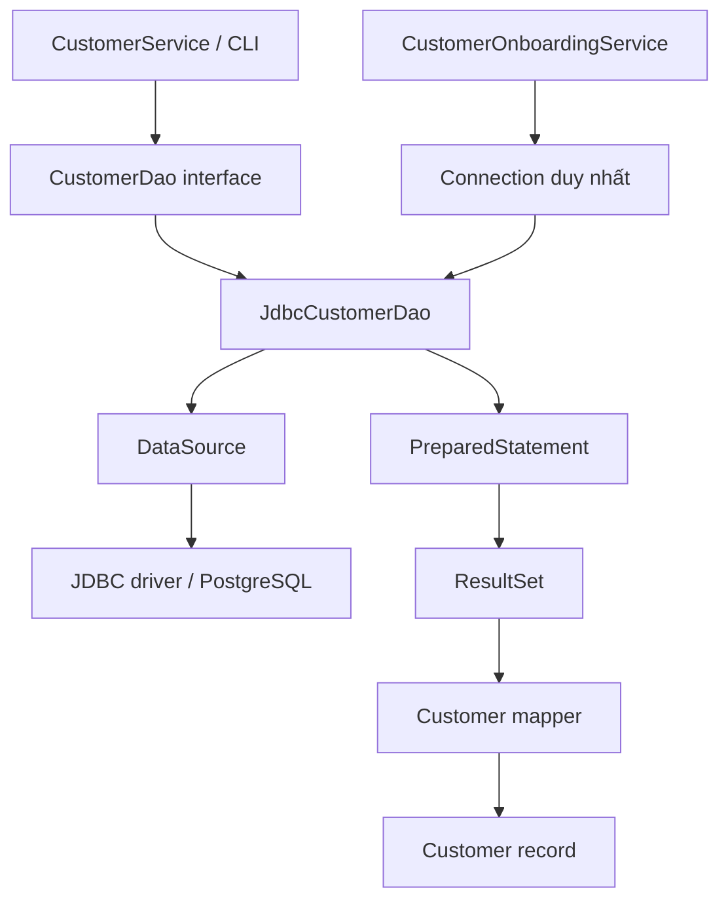

# Xây dựng DAO khách hàng bằng JDBC thuần

Một ứng dụng Java quản lý khách hàng cần thêm hồ sơ mới, tìm theo ID hoặc email, sửa thông tin, phân trang danh sách và xóa khách hàng. Nếu đặt SQL trực tiếp trong controller hay service, các lớp nghiệp vụ sẽ sớm phải xử lý lặp lại việc lấy `Connection`, bind tham số, duyệt `ResultSet` và giải phóng tài nguyên. **DAO (Data Access Object)** giúp gom những chi tiết này sau một hợp đồng rõ ràng.

Bài thực hành thuộc chương **Thực hành tổng hợp** của module **JDBC**. Ta sẽ xây dựng một **Customer DAO bằng JDBC thuần**, sử dụng `DataSource`, `PreparedStatement`, `ResultSet`, transaction JDBC, `getGeneratedKeys()` và các kiểu Java phù hợp. Không dùng JPA, Hibernate, `JdbcTemplate` hoặc Spring Data Repository: mục tiêu là hiểu đầy đủ những việc một DAO thực sự phải làm.

Bài chọn **Java 17+ và PostgreSQL** cho ví dụ có thể chạy trên database thật. Các API chính thuộc `java.sql` và `javax.sql`; cách cấu hình driver, DDL và câu phân trang có một số điểm đặc thù PostgreSQL được chỉ rõ. Không coi một bài lab JDBC là DAO đã sẵn sàng production nếu chưa kiểm thử với schema, driver, pool và yêu cầu nghiệp vụ thực tế.

## 1. Yêu cầu bài thực hành và tiêu chí hoàn thành

Giả sử hệ thống quản lý khách hàng có những chức năng:

1. **Tạo khách hàng:** nhận họ tên, email, số điện thoại có thể thiếu và hạn mức tín dụng; database sinh ID.
2. **Tìm theo ID:** trả đúng một khách hàng hoặc không có dữ liệu.
3. **Tìm theo email:** email phải có tính duy nhất, được chuẩn hóa theo quy ước của ứng dụng.
4. **Phân trang khách hàng đang hoạt động:** trả 0 đến N hàng theo thứ tự ổn định, không đọc toàn bộ bảng.
5. **Cập nhật:** thay đổi thông tin với kiểm tra phiên bản để tránh ghi đè âm thầm khi có nhiều người sửa.
6. **Xóa:** trả kết quả có xóa được đúng một khách hàng hay không.
7. **Thực hành transaction nhiều thao tác:** hai lần tạo khách hàng phải cùng commit hoặc cùng rollback.
8. **Kiểm thử driver thật:** xác minh dữ liệu NULL, số thập phân, khóa duy nhất, update count và rollback.

### Hợp đồng API trước khi viết SQL

| Phương thức | Kiểu trả về | Không có hàng | Tình huống lỗi |
|---|---|---|---|
| `create(draft)` | `long` | Không áp dụng | `SQLException` nếu INSERT không thành công/không lấy được ID |
| `findById(id)` | `Optional<Customer>` | `Optional.empty()` | `SQLException` nếu lỗi JDBC |
| `findByEmail(email)` | `Optional<Customer>` | `Optional.empty()` | Lỗi JDBC hoặc vi phạm tính duy nhất |
| `findActivePage(afterId, pageSize)` | `CustomerPage` | `items` rỗng | Lỗi SQL hoặc tham số không hợp lệ |
| `update(id, expectedVersion, changes, active)` | `boolean` | `false` khi không khớp ID/version | Lỗi JDBC hoặc constraint |
| `deleteById(id)` | `boolean` | `false` | Lỗi JDBC hoặc ràng buộc khóa ngoại |

**Nguyên tắc:** kết quả SQL hợp lệ có 0 hàng **không phải** lỗi truy cập database. Ngược lại, mất kết nối, sai cú pháp, timeout hay vi phạm constraint **không được** biến thành `Optional.empty()` hoặc `false` nếu hợp đồng không nói vậy.

### Sơ đồ các lớp



Ở đây `CustomerDao` là hợp đồng truy cập dữ liệu, `JdbcCustomerDao` là triển khai JDBC thuần, còn `CustomerOnboardingService` chịu trách nhiệm transaction khi nghiệp vụ gồm nhiều thao tác.

## 2. Chuẩn bị công nghệ và database

Môi trường tối thiểu:

- JDK 17 trở lên để dùng `record` và Java text blocks trong test.
- PostgreSQL ở môi trường phát triển/test; ví dụ minh họa có thể dùng PostgreSQL 16.
- JDBC driver **pgJDBC** trên classpath.
- Tài khoản database có quyền tạo bảng trong lab hoặc quyền CRUD với schema đã được migration chuẩn bị.
- Khi chạy kiểm thử: JUnit Jupiter và, nếu muốn database cô lập tự động, Testcontainers + container runtime.

`java.sql.Connection` và `javax.sql.DataSource` thuộc API Java; **driver PostgreSQL không nằm sẵn trong JDK**. Hãy khai báo dependency runtime/test đúng với hệ thống build đang dùng, chốt version qua dependency management của dự án. Ví dụ bên dưới sử dụng `org.postgresql.ds.PGSimpleDataSource` để chạy standalone, không yêu cầu một connection pool riêng.

### Tạo bảng `customers`

SQL dành cho PostgreSQL:

```sql
CREATE TABLE customers (
    id           BIGINT GENERATED BY DEFAULT AS IDENTITY PRIMARY KEY,
    full_name    VARCHAR(120) NOT NULL,
    email        VARCHAR(254) NOT NULL UNIQUE,
    phone        VARCHAR(32),
    credit_limit NUMERIC(14, 2) NOT NULL DEFAULT 0
                 CHECK (credit_limit >= 0),
    active       BOOLEAN NOT NULL DEFAULT TRUE,
    version      BIGINT NOT NULL DEFAULT 0
                 CHECK (version >= 0),
    created_at   TIMESTAMPTZ NOT NULL DEFAULT CURRENT_TIMESTAMP,
    CONSTRAINT chk_customer_email_lowercase
        CHECK (email = lower(email))
);

-- Tùy workload: hỗ trợ truy vấn danh sách khách hàng active.
CREATE INDEX idx_customers_active_id
    ON customers (id) WHERE active = TRUE;
```

Ý nghĩa một số cột:

| Cột | Kiểu | Hợp đồng |
|---|---|---|
| `id` | `BIGINT IDENTITY` | ID do database sinh; khóa chính |
| `full_name` | `VARCHAR(120) NOT NULL` | Họ tên bắt buộc |
| `email` | `VARCHAR(254) UNIQUE NOT NULL` | Một email chuẩn hóa ứng với tối đa một khách hàng |
| `phone` | `VARCHAR(32) NULL` | Cho phép SQL NULL |
| `credit_limit` | `NUMERIC(14,2)` | Dùng `BigDecimal`, không dùng `double` cho tiền |
| `active` | `BOOLEAN` | Chọn khách hàng đang hoạt động |
| `version` | `BIGINT` | Tăng lên sau mỗi UPDATE có kiểm tra phiên bản |
| `created_at` | `TIMESTAMPTZ` | Thời điểm tạo, do DB cấp |

Bảng chứa cả ràng buộc ứng dụng và ràng buộc database. Ví dụ, Java chuẩn hóa email thành chữ thường, còn `CHECK(email = lower(email))` giúp chặn một phần trường hợp ghi dữ liệu không qua Java. Đây là quy ước đơn giản cho lab; chính sách email thật có thể cần xét Unicode, tính phân biệt hoa/thường của local-part, collation và dữ liệu legacy.

Chỉ mục `idx_customers_active_id` là **giả thuyết tối ưu**, không bắt buộc cho tính đúng đắn. Với bảng nhỏ, PostgreSQL có thể không chọn index này; với production, đánh giá `EXPLAIN` và chi phí cập nhật index trước khi thêm.

## 3. Phân biệt model đọc và dữ liệu đầu vào

Tạo mới khách hàng **chưa có ID, version hoặc thời điểm tạo**. Do đó không nên yêu cầu caller tự điền những trường do database quản lý.

Ta định nghĩa hai kiểu:

- `CustomerDraft`: dữ liệu để tạo hoặc thay đổi thông tin có thể sửa.
- `Customer`: một hàng khách hàng đầy đủ đã được lưu.

### 3.1. `CustomerDraft.java` — xác thực sớm

```java
import java.math.BigDecimal;
import java.math.RoundingMode;
import java.util.Locale;

public record CustomerDraft(
        String fullName,
        String email,
        String phone,
        BigDecimal creditLimit) {

    public CustomerDraft {
        fullName = requireText(fullName, "fullName", 120);
        email = normalizeEmail(email);
        phone = normalizePhone(phone);

        if (creditLimit == null || creditLimit.signum() < 0) {
            throw new IllegalArgumentException(
                    "creditLimit phải là số không âm");
        }

        try {
            // Không được âm thầm làm tròn số tiền của người dùng.
            creditLimit = creditLimit.setScale(
                    2, RoundingMode.UNNECESSARY);
        } catch (ArithmeticException invalidScale) {
            throw new IllegalArgumentException(
                    "creditLimit phải có tối đa 2 chữ số thập phân",
                    invalidScale);
        }

        if (creditLimit.precision() > 14) {
            throw new IllegalArgumentException(
                    "creditLimit vượt NUMERIC(14,2)");
        }
    }

    private static String requireText(
            String value, String name, int maxLength) {

        if (value == null || value.isBlank()) {
            throw new IllegalArgumentException(
                    name + " không được rỗng");
        }

        String normalized = value.trim();
        if (normalized.length() > maxLength) {
            throw new IllegalArgumentException(
                    name + " vượt " + maxLength + " ký tự Java");
        }
        return normalized;
    }

    public static String normalizeEmail(String rawEmail) {
        String normalized = requireText(
                rawEmail, "email", 254).toLowerCase(Locale.ROOT);

        int at = normalized.indexOf('@');
        if (at <= 0 || at == normalized.length() - 1
                || normalized.indexOf('@', at + 1) >= 0
                || normalized.chars().anyMatch(Character::isWhitespace)) {
            throw new IllegalArgumentException(
                    "Định dạng email không hợp lệ");
        }

        return normalized;
    }

    private static String normalizePhone(String phone) {
        if (phone == null || phone.isBlank()) {
            return null;
        }

        String result = phone.trim();
        if (result.length() > 32) {
            throw new IllegalArgumentException("phone quá dài");
        }
        return result;
    }
}
```

Các kiểm tra này phục vụ ví dụ học tập, **không phải bộ kiểm tra email theo đầy đủ RFC**. `String.length()` đếm đơn vị UTF-16, còn `VARCHAR(n)` trong PostgreSQL theo độ dài ký tự của DB; với tên chứa ký tự Unicode ngoài BMP, cần kiểm thử chính sách độ dài thực tế. Database vẫn phải là nơi bảo vệ cuối cùng cho `UNIQUE`, `NOT NULL` và kiểu/precision.

Ví dụ:

```java
CustomerDraft draft = new CustomerDraft(
        "  Nguyễn Minh Anh  ",
        "ANH@example.test",
        null,
        new BigDecimal("250000.00"));

// draft.fullName(): "Nguyễn Minh Anh"
// draft.email(): "anh@example.test"
// draft.phone(): null
// draft.creditLimit(): 250000.00
```

Không dùng `double` tạo `BigDecimal` từ các phép tính tiền:

```java
// Nên dùng chuỗi khi cần số thập phân chính xác.
BigDecimal correct = new BigDecimal("120000.50");

// Tránh nếu muốn biểu diễn tiền chính xác:
BigDecimal fragile = new BigDecimal(0.1);
```

### 3.2. `Customer.java` — hàng đã ánh xạ

```java
import java.math.BigDecimal;
import java.time.OffsetDateTime;
import java.util.Objects;

public record Customer(
        long id,
        String fullName,
        String email,
        String phone,
        BigDecimal creditLimit,
        boolean active,
        long version,
        OffsetDateTime createdAt) {

    public Customer {
        if (id <= 0 || version < 0) {
            throw new IllegalArgumentException(
                    "ID hoặc version không hợp lệ");
        }
        Objects.requireNonNull(fullName, "fullName");
        Objects.requireNonNull(email, "email");
        Objects.requireNonNull(creditLimit, "creditLimit");
        Objects.requireNonNull(createdAt, "createdAt");
    }
}
```

Các `record` giúp model dễ đọc và không có setter thay đổi trạng thái tùy tiện. `phone` là `String` có thể bằng `null` vì dữ liệu SQL cho phép NULL. `OffsetDateTime` biểu diễn thời điểm có offset; với PostgreSQL `TIMESTAMPTZ`, điều quan trọng để so sánh giữa các môi trường thường là **`toInstant()`**, không phải giữ nguyên offset ban đầu.

## 4. Chọn hợp đồng trả về cho DAO

### 4.1. `CustomerPage.java`

```java
import java.util.List;
import java.util.Objects;

public record CustomerPage(
        List<Customer> items,
        boolean hasNext,
        long nextAfterId) {

    public CustomerPage {
        Objects.requireNonNull(items, "items");
        items = List.copyOf(items);

        if (nextAfterId < 0) {
            throw new IllegalArgumentException(
                    "nextAfterId không hợp lệ");
        }
    }
}
```

`items` là danh sách bất biến về cấu trúc; `hasNext` cho biết còn trang kế tiếp **theo trạng thái truy vấn hiện tại**; `nextAfterId` là khóa của khách hàng cuối cùng đã trả về hoặc mốc đầu vào nếu trang không có hàng.

### 4.2. `CustomerDao.java`

```java
import java.sql.SQLException;
import java.util.Optional;

public interface CustomerDao {

    long create(CustomerDraft draft) throws SQLException;

    Optional<Customer> findById(long id) throws SQLException;

    Optional<Customer> findByEmail(String email) throws SQLException;

    CustomerPage findActivePage(long afterId, int pageSize)
            throws SQLException;

    /**
     * true: có đúng một hàng được sửa với version kỳ vọng.
     * false: không có hàng khớp ID và version.
     *
     * false không phân biệt khách hàng đã bị xóa với
     * xung đột phiên bản; caller có thể đọc lại để xử lý.
     */
    boolean update(
            long id, long expectedVersion,
            CustomerDraft changes, boolean active)
            throws SQLException;

    boolean deleteById(long id) throws SQLException;
}
```

Ta đã quyết định rõ:

- **`findById` / `findByEmail` trả `Optional<Customer>`**, không trả `null`.
- **`findActivePage` trả `CustomerPage` có `items` rỗng**, không trả `null` và không trả `ResultSet` còn mở.
- **`update` trả `false`** khi `WHERE id = ? AND version = ?` không khớp; để phân biệt không tồn tại và stale version, service có thể đọc lại.
- **`deleteById` trả `false`** khi không có hàng cần xóa.
- **`SQLException` phải được giữ riêng**, không được biến thành `Optional.empty()` hoặc `false`.

## 5. Triển khai `JdbcCustomerDao` bằng JDBC thuần

Lớp triển khai sử dụng constructor injection của `DataSource` để dễ cấu hình và test. Không lưu `Connection` trong field của DAO: connection phải được mượn và đóng trong scope công việc để không bị chia sẻ giữa các request hoặc thread.

Đối với **mỗi method public độc lập**, DAO lấy một connection, thực hiện SQL bằng `PreparedStatement` rồi đóng `ResultSet`, `PreparedStatement` và `Connection` bằng `try-with-resources`. Đối với transaction nhiều bước, ta cung cấp một helper **nhận connection do caller sở hữu** và không đóng nó.

### 5.1. Toàn bộ `JdbcCustomerDao.java`

```java
import javax.sql.DataSource;
import java.sql.Connection;
import java.sql.PreparedStatement;
import java.sql.ResultSet;
import java.sql.SQLException;
import java.sql.Statement;
import java.sql.Types;
import java.math.BigDecimal;
import java.time.OffsetDateTime;
import java.util.ArrayList;
import java.util.List;
import java.util.Objects;
import java.util.Optional;

public final class JdbcCustomerDao implements CustomerDao {

    private static final String COLUMNS =
            "id, full_name, email, phone, credit_limit, " +
            "active, version, created_at";

    private final DataSource dataSource;

    public JdbcCustomerDao(DataSource dataSource) {
        this.dataSource =
                Objects.requireNonNull(dataSource, "dataSource");
    }

    @Override
    public long create(CustomerDraft draft) throws SQLException {
        try (Connection connection = dataSource.getConnection()) {
            return create(connection, draft);
        }
    }

    /**
     * Dành cho service đang sở hữu Connection/transaction.
     * Không đóng connection, không tự commit hoặc rollback.
     */
    long create(Connection connection, CustomerDraft draft)
            throws SQLException {

        Objects.requireNonNull(connection, "connection");
        Objects.requireNonNull(draft, "draft");

        String sql = "INSERT INTO customers " +
                "(full_name, email, phone, credit_limit) " +
                "VALUES (?, ?, ?, ?)";

        try (PreparedStatement ps = connection.prepareStatement(
                sql, Statement.RETURN_GENERATED_KEYS)) {

            ps.setString(1, draft.fullName());
            ps.setString(2, draft.email());
            setNullablePhone(ps, 3, draft.phone());
            ps.setBigDecimal(4, draft.creditLimit());

            int affected = ps.executeUpdate();
            if (affected != 1) {
                throw new SQLException(
                        "INSERT customers không tác động đúng 1 hàng");
            }

            try (ResultSet keys = ps.getGeneratedKeys()) {
                if (!keys.next()) {
                    throw new SQLException(
                            "Driver không trả generated customer ID");
                }

                long id = keys.getLong(1);
                if (keys.wasNull() || id <= 0) {
                    throw new SQLException(
                            "Generated customer ID không hợp lệ");
                }

                if (keys.next()) {
                    throw new SQLException(
                            "Driver trả nhiều hàng generated keys");
                }

                return id;
            }
        }
    }

    @Override
    public Optional<Customer> findById(long id)
            throws SQLException {

        requireId(id);

        try (Connection connection = dataSource.getConnection()) {
            return findById(connection, id);
        }
    }

    Optional<Customer> findById(Connection connection, long id)
            throws SQLException {

        requireId(id);

        String sql = "SELECT " + COLUMNS
                + " FROM customers WHERE id = ?";

        try (PreparedStatement ps = connection.prepareStatement(sql)) {
            ps.setLong(1, id);

            try (ResultSet rs = ps.executeQuery()) {
                return readAtMostOne(rs);
            }
        }
    }

    @Override
    public Optional<Customer> findByEmail(String email)
            throws SQLException {

        String normalizedEmail =
                CustomerDraft.normalizeEmail(email);

        String sql = "SELECT " + COLUMNS
                + " FROM customers WHERE email = ?";

        try (Connection connection = dataSource.getConnection();
             PreparedStatement ps = connection.prepareStatement(sql)) {

            ps.setString(1, normalizedEmail);

            try (ResultSet rs = ps.executeQuery()) {
                return readAtMostOne(rs);
            }
        }
    }

    @Override
    public CustomerPage findActivePage(
            long afterId, int pageSize) throws SQLException {

        if (afterId < 0 || pageSize < 1 || pageSize > 100) {
            throw new IllegalArgumentException(
                    "afterId >= 0 và pageSize thuộc [1,100]");
        }

        // PostgreSQL LIMIT ?; DBMS khác có thể dùng
        // FETCH FIRST hoặc cú pháp phân trang riêng.
        String sql = "SELECT " + COLUMNS +
                " FROM customers " +
                "WHERE active = TRUE AND id > ? " +
                "ORDER BY id ASC LIMIT ?";

        List<Customer> rows = new ArrayList<>();

        try (Connection connection = dataSource.getConnection();
             PreparedStatement ps = connection.prepareStatement(sql)) {

            ps.setLong(1, afterId);
            ps.setInt(2, pageSize + 1);

            try (ResultSet rs = ps.executeQuery()) {
                while (rs.next()) {
                    rows.add(mapCustomer(rs));
                }
            }
        }

        boolean hasNext = rows.size() > pageSize;
        int count = Math.min(rows.size(), pageSize);
        List<Customer> visible = rows.subList(0, count);

        long nextAfterId = visible.isEmpty()
                ? afterId
                : visible.get(visible.size() - 1).id();

        return new CustomerPage(visible, hasNext, nextAfterId);
    }

    @Override
    public boolean update(
            long id, long expectedVersion,
            CustomerDraft changes, boolean active)
            throws SQLException {

        requireId(id);
        if (expectedVersion < 0) {
            throw new IllegalArgumentException(
                    "expectedVersion không hợp lệ");
        }
        Objects.requireNonNull(changes, "changes");

        String sql = "UPDATE customers SET " +
                "full_name = ?, email = ?, phone = ?, " +
                "credit_limit = ?, active = ?, " +
                "version = version + 1 " +
                "WHERE id = ? AND version = ?";

        try (Connection connection = dataSource.getConnection();
             PreparedStatement ps = connection.prepareStatement(sql)) {

            ps.setString(1, changes.fullName());
            ps.setString(2, changes.email());
            setNullablePhone(ps, 3, changes.phone());
            ps.setBigDecimal(4, changes.creditLimit());
            ps.setBoolean(5, active);
            ps.setLong(6, id);
            ps.setLong(7, expectedVersion);

            int affected = ps.executeUpdate();
            return affectedExactlyZeroOrOne(affected, "UPDATE");
        }
    }

    @Override
    public boolean deleteById(long id) throws SQLException {
        requireId(id);

        String sql = "DELETE FROM customers WHERE id = ?";

        try (Connection connection = dataSource.getConnection();
             PreparedStatement ps = connection.prepareStatement(sql)) {

            ps.setLong(1, id);
            int affected = ps.executeUpdate();
            return affectedExactlyZeroOrOne(affected, "DELETE");
        }
    }

    private static void setNullablePhone(
            PreparedStatement ps, int position, String phone)
            throws SQLException {

        if (phone == null) {
            ps.setNull(position, Types.VARCHAR);
        } else {
            ps.setString(position, phone);
        }
    }

    private static Optional<Customer> readAtMostOne(ResultSet rs)
            throws SQLException {

        if (!rs.next()) {
            return Optional.empty();
        }

        Customer first = mapCustomer(rs);

        // Phát hiện trường hợp query hứa 0/1 mà trả 2+ hàng.
        if (rs.next()) {
            throw new SQLException(
                    "Truy vấn vi phạm hợp đồng tối đa một khách hàng");
        }

        return Optional.of(first);
    }

    private static Customer mapCustomer(ResultSet rs)
            throws SQLException {

        long id = rs.getLong("id");
        String name = rs.getString("full_name");
        String email = rs.getString("email");

        // getString trả null cho SQL NULL.
        String phone = rs.getString("phone");

        BigDecimal creditLimit =
                rs.getBigDecimal("credit_limit");
        boolean active = rs.getBoolean("active");
        long version = rs.getLong("version");

        OffsetDateTime createdAt =
                rs.getObject("created_at", OffsetDateTime.class);

        return new Customer(
                id, name, email, phone,
                creditLimit, active, version, createdAt);
    }

    private static boolean affectedExactlyZeroOrOne(
            int count, String operation) throws SQLException {

        if (count == 0) {
            return false;
        }
        if (count == 1) {
            return true;
        }
        throw new SQLException(
                operation + " tác động ngoài phạm vi 0/1 hàng: " + count);
    }

    private static void requireId(long id) {
        if (id <= 0) {
            throw new IllegalArgumentException(
                    "Customer ID phải dương");
        }
    }
}
```

Những đoạn mã trên là một lớp Java đầy đủ, cùng `Customer`, `CustomerDraft`, `CustomerPage` và `CustomerDao` trong cùng package lab. Nếu dự án sử dụng package, cần đặt các file trong cùng package hoặc import thích hợp. Các giá trị thời gian `OffsetDateTime` yêu cầu driver hỗ trợ typed `ResultSet.getObject(..., OffsetDateTime.class)`; pgJDBC với PostgreSQL `TIMESTAMPTZ` là một đường dùng phù hợp cần test.

### 5.2. Phân tích thao tác INSERT và generated keys

Phần quan trọng:

```java
try (PreparedStatement ps = connection.prepareStatement(
        sql, Statement.RETURN_GENERATED_KEYS)) {

    // Bind các giá trị ? theo đúng thứ tự.
    int affected = ps.executeUpdate();

    try (ResultSet keys = ps.getGeneratedKeys()) {
        if (!keys.next()) {
            throw new SQLException("Không có generated key");
        }
        long id = keys.getLong(1);
    }
}
```

`executeUpdate()` trả **số hàng chịu tác động**, **không phải ID**. Vì vậy ta dùng `getGeneratedKeys()`. Không phải driver nào cũng cung cấp generated keys giống nhau, đặc biệt với batch hoặc cấu trúc bảng phức tạp. Trên PostgreSQL có thể dùng cú pháp `INSERT ... RETURNING id` như một lựa chọn đặc thù, nhưng bài dùng API JDBC chuẩn để học cách yêu cầu khóa được sinh.

Mã DAO kỳ vọng cột khóa đầu tiên trong `ResultSet` của `getGeneratedKeys()` là ID do database sinh. Nếu driver/DDL trả nhiều trường khác, cần dùng nhãn cột hoặc danh sách generated columns cụ thể và kiểm thử trên driver đích. **Không lấy kết quả `getGeneratedKeys()` như một giả định không cần kiểm chứng.**

### 5.3. Tại sao `PreparedStatement` cần thiết?

Ví dụ:

```java
String sql =
        "SELECT id, full_name FROM customers WHERE email = ?";

try (PreparedStatement ps = connection.prepareStatement(sql)) {
    ps.setString(1, inputEmail);
    try (ResultSet rs = ps.executeQuery()) {
        // Map các hàng.
    }
}
```

Dùng placeholder `?` để bind **giá trị dữ liệu** thay vì nối một email vào SQL. Chuỗi chứa dấu nháy, dấu chấm phẩy hoặc `' OR 1=1 --` vẫn phải được hiểu là dữ liệu, không phải cú pháp SQL. Placeholder **không thay thế được tên bảng hoặc cột**; khi có identifier động, cần whitelist và quote theo DBMS, không thể bind nó như giá trị thường.

### 5.4. Khác biệt giữa “không có dữ liệu” và SQL NULL

- `findById(999)` trả `Optional.empty()` nếu `rs.next()` trả `false`.
- Nếu `id=1` tồn tại nhưng `phone IS NULL`, phương thức vẫn trả `Optional.of(customer)` và `customer.phone() == null`.
- `getBigDecimal("credit_limit")` trả số thập phân chính xác theo khả năng driver.
- Nếu một cột số nguyên **nullable**, `getLong(...)` có thể trả `0` khi SQL NULL; khi đó phải gọi `rs.wasNull()` ngay sau getter để biết giá trị vừa đọc có phải SQL NULL không. Trong schema bài này, `id`/`version` đều NOT NULL nên không cần `wasNull()` riêng.

Không biến lỗi đọc cột thành “khách hàng không tồn tại”. `SQLException` phải được chuyển tiếp hoặc dịch sang một ngoại lệ hạ tầng có nguyên nhân gốc.

## 6. Kết nối ứng dụng với PostgreSQL qua `DataSource`

`DataSource` là điểm mở rộng tự nhiên cho việc cấu hình connection và thay bằng pool sau này. Ví dụ standalone dùng pgJDBC:

```java
import javax.sql.DataSource;
import org.postgresql.ds.PGSimpleDataSource;

public final class CustomerDataSources {
    private CustomerDataSources() {}

    public static DataSource fromEnvironment() {
        String url = requireEnvironment("JDBC_URL");
        String user = requireEnvironment("JDBC_USER");
        String password = requireEnvironment("JDBC_PASSWORD");

        PGSimpleDataSource ds = new PGSimpleDataSource();
        ds.setURL(url);
        ds.setUser(user);
        ds.setPassword(password);
        return ds;
    }

    private static String requireEnvironment(String key) {
        String value = System.getenv(key);
        if (value == null || value.isBlank()) {
            throw new IllegalStateException(
                    "Thiếu biến môi trường " + key);
        }
        return value;
    }
}
```

Ví dụ giá trị `JDBC_URL` trỏ vào database lab:

```text
jdbc:postgresql://localhost:5432/customer_lab
```

Trong lab, tạo user với quyền đúng phạm vi và cung cấp biến môi trường ở công cụ chạy chương trình. **Không ghi password thật trực tiếp vào source code, commit vào repository, in ra log hoặc đưa lên màn hình chẩn đoán.**

`PGSimpleDataSource` là triển khai `DataSource` phía driver, **không phải connection pool**. Khi thay bằng HikariCP hoặc pool khác, `JdbcCustomerDao` không cần sửa nếu hợp đồng `DataSource` và trạng thái connection vẫn đúng. Việc cấu hình pool, reset transaction state và limit connection nằm ngoài lớp DAO.

### Chạy thử từ một lớp `Main`

```java
import javax.sql.DataSource;
import java.math.BigDecimal;
import java.sql.SQLException;
import java.util.Optional;

public final class CustomerDemo {
    public static void main(String[] args) throws SQLException {
        DataSource source =
                CustomerDataSources.fromEnvironment();

        CustomerDao customers = new JdbcCustomerDao(source);

        long id = customers.create(new CustomerDraft(
                "Trần Bảo Ngọc",
                "NGOC@example.test",
                null,
                new BigDecimal("150000.00")));

        Optional<Customer> created = customers.findById(id);
        created.ifPresent(c ->
                System.out.println(c.id() + " - " + c.email()));

        CustomerPage page =
                customers.findActivePage(0L, 20);

        for (Customer c : page.items()) {
            System.out.println(c.fullName());
        }
    }
}
```

Chương trình chỉ hoạt động khi **schema đã được tạo và pgJDBC được đặt trên classpath**. Nó không tự tạo bảng để tránh vô tình thực hiện DDL mỗi khi ứng dụng chạy. Trong dự án thật, dùng migration có version để quản lý schema và một user vận hành không nhất thiết có quyền tạo/xóa bảng.

## 7. Cập nhật có kiểm tra phiên bản (optimistic concurrency)

Nếu hai người cùng mở hồ sơ khách hàng version 4:

```text
Người A đọc Customer(id=10, version=4)
Người B đọc Customer(id=10, version=4)

A cập nhật với WHERE id=10 AND version=4
  -> 1 hàng; DB tăng version lên 5.

B cập nhật với WHERE id=10 AND version=4
  -> 0 hàng; không ghi đè bản sửa của A.
```

Đây là cách tránh một số tình huống **lost update** ở tầng DAO. Không nên viết:

```sql
UPDATE customers SET full_name = ?
WHERE id = ?;
```

nếu nghiệp vụ cần phát hiện xung đột khi người dùng đã đọc bản cũ. DAO của bài sử dụng:

```sql
UPDATE customers
SET full_name = ?,
    email = ?,
    phone = ?,
    credit_limit = ?,
    active = ?,
    version = version + 1
WHERE id = ? AND version = ?;
```

Nếu số hàng thay đổi là `1`, cập nhật thành công. Nếu bằng `0`, có thể là **ID không tồn tại** hoặc **version không còn khớp**. Hợp đồng `boolean` không phân biệt hai nguyên nhân; tầng service có thể đọc lại `findById` hoặc dùng kết quả giàu thông tin hơn, tùy yêu cầu.

Ví dụ:

```java
Customer original = customers.findById(id).orElseThrow();

CustomerDraft changes = new CustomerDraft(
        "Trần Bảo Ngọc",
        original.email(),
        "+84 900 123 456",
        original.creditLimit());

boolean updated = customers.update(
        original.id(),
        original.version(),
        changes,
        true);

if (!updated) {
    System.out.println(
            "Không tồn tại hoặc có người khác đã sửa bản ghi");
}
```

Code này có `CustomerDao customers` và `long id` lấy từ ví dụ trước. **Sau UPDATE thành công, object `original` vẫn là snapshot cũ**; cần đọc lại nếu muốn giá trị `version` mới. Cột `version` tăng trong cùng câu UPDATE giúp phép kiểm tra và ghi diễn ra nguyên tử ở DB.

Khi xảy ra lỗi `UNIQUE(email)`, database ném `SQLException`; DAO không tự coi nó là `false`. Với PostgreSQL, một unique violation thường có SQLSTATE `23505`, nhưng mã lỗi và thông điệp của các DBMS khác có thể khác. Chính sách trả lỗi cho người dùng nên được xây ở service/API, không hard-code status HTTP trong DAO.

## 8. Phân trang bằng keyset thay vì tải toàn bộ bảng

Giả sử ứng dụng cần hiển thị mỗi lần 20 khách hàng đang hoạt động. Query:

```sql
SELECT id, full_name, email, phone, credit_limit,
       active, version, created_at
FROM customers
WHERE active = TRUE AND id > ?
ORDER BY id ASC
LIMIT ?;
```

Repository luôn bind `pageSize + 1` hàng: một hàng dư dùng để xác định `hasNext` mà không chạy thêm `COUNT(*)`. Chỉ `pageSize` hàng đầu được trả trong `items`; `nextAfterId` lấy từ ID cuối của trang.

Ví dụ lặp qua các trang:

```java
long cursor = 0L;

while (true) {
    CustomerPage page =
            customers.findActivePage(cursor, 20);

    for (Customer customer : page.items()) {
        System.out.println(customer.id()
                + ": " + customer.email());
    }

    if (!page.hasNext()) {
        break;
    }
    cursor = page.nextAfterId();
}
```

Đây là ví dụ minh họa cách phân trang, **không khuyến khích một request HTTP tự động lặp hết mọi trang lớn**. Phân trang nên có điểm dừng rõ ràng theo yêu cầu UI hoặc API.

### Các giới hạn cần hiểu

- `ORDER BY id` bắt buộc để mốc `afterId` có ý nghĩa và thứ tự ổn định.
- `LIMIT ?` là cú pháp PostgreSQL; DBMS khác có thể dùng `FETCH FIRST` hoặc cơ chế riêng.
- Nếu dữ liệu bị thêm/xóa/chuyển `active` giữa hai request, các trang không phải một snapshot bất biến; keyset pagination có tính chất nhất quán khác với đọc trong một transaction snapshot duy nhất.
- Nếu UI muốn sắp theo `created_at` hoặc `full_name`, phải thiết kế cursor chứa **khóa sắp xếp tương ứng cộng tie-breaker ID**, không tái sử dụng mù `afterId`.
- Chỉ mục có thể tăng tốc, nhưng thêm index cần dựa trên `EXPLAIN` và workload, không dựa vào số lượng dòng của code Java.

Không nên gọi `Statement.setMaxRows(20)` rồi giả định nó có cùng kế hoạch với truy vấn phân trang ở database. `setFetchSize(...)` cũng là một gợi ý fetch, **không phải cơ chế giới hạn tổng số hàng trả về**.

## 9. Xóa vật lý hay ngừng kích hoạt khách hàng?

Bài lab dùng:

```sql
DELETE FROM customers WHERE id = ?;
```

DAO trả `true` khi một hàng đã bị xóa; `false` khi không có hàng khớp. Đây là **hard delete**. Trong ứng dụng có lịch sử giao dịch hoặc yêu cầu kiểm toán, xóa vật lý có thể không phù hợp, vì các bảng khác có thể tham chiếu khách hàng và dữ liệu thường cần được giữ.

Một lựa chọn là **soft delete/deactivation**:

```sql
UPDATE customers
SET active = FALSE,
    version = version + 1
WHERE id = ?
  AND version = ?
  AND active = TRUE;
```

Với cách này, `findActivePage` tự loại những khách hàng đã ngừng hoạt động. Nếu thay đổi thiết kế, cần nói rõ hợp đồng method tên `deleteById`; có thể dùng `deactivate(...)` thay vì để caller tưởng đã xóa dữ liệu vĩnh viễn.

Ngay cả với hard delete, foreign key có thể chặn lệnh xóa và driver trả `SQLException`. Không bắt mọi lỗi xóa rồi trả `false`; làm vậy sẽ che một vi phạm tính toàn vẹn dữ liệu.

## 10. Transaction nhiều bước: service sở hữu `Connection`

Các method public trong `JdbcCustomerDao` **mỗi lần tự lấy một connection**. Với hoạt động CRUD độc lập và `DataSource` cấu hình auto-commit đúng mong đợi, điều đó hợp lý.

Nhưng nếu muốn **tạo hai khách hàng như một đơn vị nguyên tử**, không nên gọi:

```java
// Không bảo đảm nguyên tử trên cùng transaction:
long firstId = dao.create(first);
long secondId = dao.create(second);
```

Mỗi lời gọi trên có thể mở **connection khác nhau và tự commit**. Nếu lần hai bị lỗi email trùng, lần một có thể đã được xác nhận.

### `CustomerOnboardingService.java` — một transaction cho hai INSERT

Ta đã cung cấp overload `JdbcCustomerDao.create(Connection, CustomerDraft)` có phạm vi package-private để service ở **cùng package** có thể tái sử dụng connection đang sở hữu.

```java
import javax.sql.DataSource;
import java.sql.Connection;
import java.sql.SQLException;
import java.util.List;
import java.util.Objects;

public final class CustomerOnboardingService {
    private final DataSource dataSource;
    private final JdbcCustomerDao dao;

    public CustomerOnboardingService(
            DataSource dataSource, JdbcCustomerDao dao) {

        this.dataSource =
                Objects.requireNonNull(dataSource, "dataSource");
        this.dao = Objects.requireNonNull(dao, "dao");
    }

    public List<Long> createPairAtomically(
            CustomerDraft first, CustomerDraft second)
            throws SQLException {

        Objects.requireNonNull(first, "first");
        Objects.requireNonNull(second, "second");

        try (Connection connection = dataSource.getConnection()) {
            // Service sở hữu Connection và biên transaction.
            connection.setAutoCommit(false);

            try {
                long firstId = dao.create(connection, first);
                long secondId = dao.create(connection, second);

                connection.commit();
                return List.of(firstId, secondId);

            } catch (SQLException | RuntimeException failure) {
                try {
                    connection.rollback();
                } catch (SQLException rollbackFailure) {
                    failure.addSuppressed(rollbackFailure);
                }
                throw failure;
            }
        }
    }
}
```

**Quyền sở hữu tài nguyên:**

- `CustomerOnboardingService` mở và đóng `Connection`, quyết định `commit()` hoặc `rollback()`.
- `JdbcCustomerDao.create(connection, ...)` chỉ đóng `PreparedStatement` và generated-key `ResultSet` mà nó tạo; **không đóng `Connection` của service** và không tự commit.
- Cả hai `INSERT` chạy trên **một connection**, do đó cùng một local JDBC transaction.
- `try-with-resources` ở service trả connection về driver/pool khi xong.

Nếu lần INSERT thứ hai vi phạm `UNIQUE(email)`, PostgreSQL đánh dấu transaction bị lỗi; service rollback hủy cả lần INSERT thứ nhất. **Không cần rollback riêng từng statement**.

### Nếu `commit()` hoặc `rollback()` thất bại

Một lỗi mạng tại thời điểm `commit()` có thể khiến phía Java **không biết chắc database đã commit hay chưa**. Lệnh rollback trong `catch` chỉ là cố gắng dọn trạng thái và không chứng minh commit đã thất bại về mặt nghiệp vụ. Trong hệ thống quan trọng, dùng mã tác vụ/idempotency key và truy vấn đối soát trước khi tự retry tạo dữ liệu.

Nếu `rollback()` cũng thất bại, connection có thể không còn an toàn để tái sử dụng. Pool và driver cần có cơ chế phát hiện/loại bỏ connection hỏng; DAO không nên gọi `setAutoCommit(true)` vô điều kiện sau rollback thất bại vì chuyển từ false sang true trên transaction còn tồn tại có thể **commit ngoài ý muốn**.

Ở ví dụ service trên, kết nối được đóng sau khi kết thúc scope, không được giữ để chạy thêm nghiệp vụ. Trong ứng dụng dùng transaction manager của Spring/JTA, cần để manager sở hữu transaction thay vì tự thay đổi `autoCommit` hoặc `commit` trong DAO.

## 11. Các lỗi thường gặp khi xây DAO JDBC thuần

| Sai lầm | Hậu quả | Cách thiết kế đúng |
|---|---|---|
| Nối email vào SQL bằng dấu nháy | SQL injection và lỗi escaping | `PreparedStatement` + bind `?` |
| Trả `null` khi không có hàng | Caller dễ `NullPointerException` | `Optional.empty()` cho truy vấn 0/1 |
| Catch `SQLException` rồi trả danh sách rỗng | Che sự cố DB thành “không có khách hàng” | Propagate/dịch lỗi hạ tầng có cause |
| Không đóng `ResultSet` hoặc `PreparedStatement` | Rò rỉ cursor và tài nguyên DB | `try-with-resources` |
| Lưu `Connection` ở field của singleton DAO | Trộn transaction giữa request/thread | Giữ `DataSource`, lấy connection theo scope |
| Mở connection mới cho mỗi bước của transaction tổng hợp | Không bảo đảm rollback cùng nhau | Một connection do service sở hữu |
| Gọi `commit()` trong mỗi method DAO con | Phá vỡ tính nguyên tử nghiệp vụ | Chuyển trách nhiệm transaction lên service |
| Dùng `double` cho tiền | Sai số nhị phân | `BigDecimal` + `NUMERIC/DECIMAL` |
| Không kiểm tra `getGeneratedKeys()` | Không phát hiện driver không trả ID | Kiểm tra `keys.next()`, validate ID |
| Giả định update count là ID | Sai hợp đồng JDBC | `executeUpdate()` là số hàng tác động |
| Không phân biệt SQL NULL và số 0 | Sai mô hình nullable primitive | `wasNull()` ngay sau getter nếu cần |
| UPDATE không có version | Dễ ghi đè sửa đổi đồng thời | Optimistic locking hoặc chiến lược khác |
| Dùng `SELECT *` trong mapper cố định | Dễ kéo cột thừa và phụ thuộc thứ tự | Chọn cột rõ ràng, đọc theo label |
| Dùng `ORDER BY` mặc định của DB | Trang thay đổi khó dự đoán | Sắp xếp tường minh và tie-breaker |
| Không giới hạn pageSize | Một request có thể tải quá nhiều hàng | Validate và dùng phân trang |
| Đặt auto-commit true để “dọn” transaction lỗi | Có thể commit dữ liệu đang bỏ dở | Rollback đúng trước, không reuse khi chưa rõ |
| Trộn JDBC URL/driver ở nhiều nơi | Khó test, khó đổi pool | Inject `DataSource` |

## 12. Kiểm thử DAO trên PostgreSQL thật

Unit test mapper thuần có ích, nhưng không chứng minh **SQL, schema, driver, generated keys và rollback** hoạt động đúng. Vì vậy, DAO nên có integration test với DBMS mục tiêu.

Để chạy ví dụ này cần các test dependencies:

- JUnit Jupiter.
- Testcontainers PostgreSQL và JUnit Jupiter integration.
- pgJDBC.
- Container runtime khả dụng và image PostgreSQL đã chọn.

Các version nên được chốt từ dependency management dự án; ví dụ dùng image `postgres:16-alpine` để minh họa, không khẳng định đây là image thích hợp cho mọi production system.

### 12.1. `JdbcCustomerDaoIT.java`

```java
import static org.junit.jupiter.api.Assertions.*;

import javax.sql.DataSource;
import java.math.BigDecimal;
import java.sql.Connection;
import java.sql.SQLException;
import java.sql.Statement;
import java.util.List;

import org.junit.jupiter.api.BeforeAll;
import org.junit.jupiter.api.BeforeEach;
import org.junit.jupiter.api.Test;
import org.postgresql.ds.PGSimpleDataSource;
import org.testcontainers.containers.PostgreSQLContainer;
import org.testcontainers.junit.jupiter.Container;
import org.testcontainers.junit.jupiter.Testcontainers;

@Testcontainers
class JdbcCustomerDaoIT {

    @Container
    static final PostgreSQLContainer<?> postgres =
            new PostgreSQLContainer<>("postgres:16-alpine");

    static DataSource dataSource;
    JdbcCustomerDao dao;

    @BeforeAll
    static void initializeSchema() throws SQLException {
        PGSimpleDataSource source = new PGSimpleDataSource();
        source.setURL(postgres.getJdbcUrl());
        source.setUser(postgres.getUsername());
        source.setPassword(postgres.getPassword());
        dataSource = source;

        try (Connection c = dataSource.getConnection();
             Statement st = c.createStatement()) {

            st.execute("""
                CREATE TABLE customers (
                    id BIGINT GENERATED BY DEFAULT AS IDENTITY PRIMARY KEY,
                    full_name VARCHAR(120) NOT NULL,
                    email VARCHAR(254) NOT NULL UNIQUE,
                    phone VARCHAR(32),
                    credit_limit NUMERIC(14,2) NOT NULL
                        CHECK (credit_limit >= 0),
                    active BOOLEAN NOT NULL DEFAULT TRUE,
                    version BIGINT NOT NULL DEFAULT 0,
                    created_at TIMESTAMPTZ NOT NULL
                        DEFAULT CURRENT_TIMESTAMP,
                    CONSTRAINT chk_customer_email_lowercase
                        CHECK (email = lower(email))
                )
                """);
        }
    }

    @BeforeEach
    void cleanData() throws SQLException {
        dao = new JdbcCustomerDao(dataSource);

        try (Connection c = dataSource.getConnection();
             Statement st = c.createStatement()) {

            st.execute("TRUNCATE TABLE customers RESTART IDENTITY");
        }
    }

    private static CustomerDraft draft(
            String name, String email, String phone) {

        return new CustomerDraft(
                name, email, phone, new BigDecimal("100.00"));
    }

    @Test
    void createAndFindByIdWithNullPhone() throws SQLException {
        long id = dao.create(draft(
                "  Nguyễn An  ", "AN@example.test", null));

        Customer actual = dao.findById(id).orElseThrow();

        assertEquals("Nguyễn An", actual.fullName());
        assertEquals("an@example.test", actual.email());
        assertNull(actual.phone());
        assertEquals(new BigDecimal("100.00"),
                actual.creditLimit());
        assertEquals(0L, actual.version());
        assertTrue(actual.active());
        assertNotNull(actual.createdAt());
    }

    @Test
    void missingCustomerIsNotSqlError() throws SQLException {
        assertTrue(dao.findById(999L).isEmpty());
        assertTrue(dao.findByEmail("none@example.test").isEmpty());
        assertFalse(dao.deleteById(999L));
    }

    @Test
    void emailMustBeUnique() throws SQLException {
        dao.create(draft("An", "same@example.test", null));

        SQLException error = assertThrows(
                SQLException.class,
                () -> dao.create(
                        draft("Binh", "SAME@example.test", null)));

        // PostgreSQL: unique_violation
        assertEquals("23505", error.getSQLState());
    }

    @Test
    void optimisticUpdateRejectsStaleVersion()
            throws SQLException {

        long id = dao.create(draft(
                "An", "an@example.test", null));
        Customer before = dao.findById(id).orElseThrow();

        assertTrue(dao.update(
                id, before.version(),
                draft("An Moi", "an@example.test", "0123456"),
                true));

        // Dùng version cũ cho lần sửa sau.
        assertFalse(dao.update(
                id, before.version(),
                draft("Ghi De", "an@example.test", null),
                true));

        Customer after = dao.findById(id).orElseThrow();
        assertEquals("An Moi", after.fullName());
        assertEquals(1L, after.version());
    }

    @Test
    void activeKeysetPageAndDelete() throws SQLException {
        long first = dao.create(draft(
                "A", "a@example.test", null));
        dao.create(draft(
                "B", "b@example.test", null));
        dao.create(draft(
                "C", "c@example.test", null));

        CustomerPage page1 = dao.findActivePage(0L, 2);
        assertEquals(2, page1.items().size());
        assertTrue(page1.hasNext());

        CustomerPage page2 =
                dao.findActivePage(page1.nextAfterId(), 2);
        assertEquals(1, page2.items().size());
        assertFalse(page2.hasNext());

        assertTrue(dao.deleteById(first));
        assertTrue(dao.findById(first).isEmpty());
        assertFalse(dao.deleteById(first));
    }

    @Test
    void secondInsertFailureRollsBackFirst()
            throws SQLException {

        CustomerOnboardingService service =
                new CustomerOnboardingService(dataSource, dao);

        SQLException error = assertThrows(
                SQLException.class,
                () -> service.createPairAtomically(
                        draft("A", "dup@example.test", null),
                        draft("B", "DUP@example.test", null)));

        assertEquals("23505", error.getSQLState());
        assertTrue(
                dao.findByEmail("dup@example.test").isEmpty());
    }

    @Test
    void transactionCommitsBothRows() throws SQLException {
        CustomerOnboardingService service =
                new CustomerOnboardingService(dataSource, dao);

        List<Long> ids = service.createPairAtomically(
                draft("A", "a@example.test", null),
                draft("B", "b@example.test", null));

        assertEquals(2, ids.size());
        assertTrue(dao.findById(ids.get(0)).isPresent());
        assertTrue(dao.findById(ids.get(1)).isPresent());
    }
}
```

**Lưu ý tổ chức test:** lớp này khởi động một PostgreSQL container cho cả lớp, tạo bảng một lần rồi `TRUNCATE` trước mỗi test. Khi chạy test song song hoặc chia sẻ database với nhiều suite, cần **schema/container độc lập** thay vì để các test cùng xóa bảng. Dự án thật nên chạy migration giống production, không duy trì hai phiên bản DDL khác nhau lâu dài.

Các assertion trực tiếp trên dữ liệu sau rollback đặc biệt có giá trị: chúng kiểm tra hành vi thật của transaction, không chỉ `verify(connection).rollback()` trên một mock. Trong môi trường có transaction manager/framework test tự rollback, phải tổ chức test sao cho không vô tình che lỗi transaction của service.

### 12.2. Những trường hợp bổ sung nên kiểm thử

| Trường hợp | Mục đích |
|---|---|
| Email chứa `' OR 1=1 --` | Xác minh query bind coi payload là dữ liệu, không thay cấu trúc SQL |
| `creditLimit = 0.00` và giá trị gần giới hạn | Xác minh precision/scale và constraint |
| Credit limit âm hoặc hơn 2 chữ số lẻ | Validation Java/DB không làm tròn âm thầm |
| Phone null và phone có Unicode | Phân biệt SQL NULL và giá trị thật |
| Truy vấn `findActivePage` không có hàng | Trả `items` rỗng, `hasNext=false` |
| Cập nhật cùng version bởi 2 luồng | Chỉ một UPDATE phù hợp được xác nhận |
| DELETE có foreign key tham chiếu | DB báo lỗi thay vì DAO trả `false` |
| Connection bị mất giữa truy vấn | DAO báo `SQLException` và đóng tài nguyên |
| Generated keys thiếu/bất thường | DAO phát hiện, không trả ID giả |
| Pool connection được tái sử dụng | Không rò rỉ trạng thái auto-commit, schema hoặc transaction |
| Kết quả commit chưa rõ | Không retry tạo khách hàng trùng mà thiếu đối soát |

Không nhất thiết mọi trường hợp cần một test unit riêng, nhưng các khác biệt **do driver/DBMS quyết định** phải được kiểm chứng ở ít nhất một integration suite trên công nghệ sẽ triển khai.

## 13. Phân biệt unit test mapper và integration test DAO

Để định vị lỗi nhanh, hãy phân chia:

| Loại test | Có database thật? | Kiểm tra được điều gì? |
|---|---|---|
| Unit test `CustomerDraft` | Không | Chuẩn hóa tên/email, phone, `BigDecimal` và validation |
| Unit test mapper với `ResultSet` giả | Không | Chọn tên cột, logic null, constructor |
| Integration test `JdbcCustomerDao` | Có | SQL thực, bind parameter, generated key, result mapping, constraint |
| Integration test transaction | Có | Hai câu lệnh cùng commit hoặc rollback, isolation/connection |
| Integration test với pool thật | Có, dùng pool | Borrow/return, trạng thái phiên, timeout và connection failure |

Một mock `PreparedStatement` có thể trả `executeUpdate()==1` vì test cấu hình nó như vậy; kết quả đó **không chứng minh** SQL thật có đúng cú pháp PostgreSQL hay bảng có khóa duy nhất. Ngược lại, integration test mỗi lần khởi động container để kiểm tra `CustomerDraft.normalizeEmail(...)` là quá tốn chi phí. Dùng mỗi loại test đúng nhiệm vụ.

## 14. Quản lý tài nguyên và hiệu năng cơ bản

### 14.1. Vì sao dùng `try-with-resources`?

`Connection`, `Statement`, `PreparedStatement` và `ResultSet` là tài nguyên có vòng đời. Khi xử lý lỗi SQL mà không đóng, pool có thể cạn connection và database có thể giữ cursor/transaction lâu.

Mẫu chuẩn ở method độc lập:

```java
try (Connection connection = dataSource.getConnection();
     PreparedStatement ps = connection.prepareStatement(sql)) {

    // Bind tham số và thực thi.

    try (ResultSet rs = ps.executeQuery()) {
        while (rs.next()) {
            // Ánh xạ thành object Java ngay trong scope.
        }
    }
}
```

Khi service sở hữu connection cho transaction nhiều bước, DAO **không đóng connection được truyền vào**; nó chỉ đóng statement và result set do chính DAO tạo. Phải phân biệt **quyền sở hữu connection** với việc chỉ được phép sử dụng nó.

### 14.2. Pool không sửa SQL chậm

Một pool có thể giảm thời gian mở kết nối vật lý, nhưng SQL không có chỉ mục phù hợp vẫn có thể tốn hàng giây. Đo riêng:

- Thời gian `DataSource.getConnection()`.
- Thời gian `executeQuery()/executeUpdate()`.
- Thời gian duyệt `rs.next()` và ánh xạ.
- Thời gian transaction đến `commit()/rollback()`.
- Số hàng đọc/trả và số lần query bị gọi.

Cần xem `EXPLAIN`, số hàng thực và lock wait trên DB khi có truy vấn chậm. Đừng tự tăng pool size nếu nhiều connection đang bị block bởi một transaction giữ khóa lâu.

### 14.3. `SELECT` cột cụ thể, không dùng `SELECT *` mặc định

`JdbcCustomerDao.COLUMNS` liệt kê rõ các cột cần cho `Customer`. Điều này giúp tránh trả thêm BLOB/cột nhạy cảm mà model không dùng và giảm phụ thuộc vào thứ tự cột. Khi schema thêm cột mới, mapper chỉ thay đổi khi model cần dữ liệu ấy.

### 14.4. Batch và khối lượng lớn

Nếu nhập hàng nghìn khách hàng, gọi `create(...)` liên tiếp với connection độc lập có thể tốn round trip và thiếu tính nguyên tử. Có thể xây một phương thức batch:

1. Mượn một connection và `setAutoCommit(false)`.
2. Tạo một `PreparedStatement` và bind từng `CustomerDraft`.
3. Gọi `addBatch()` cho mỗi bản ghi.
4. Gọi `executeBatch()` theo chunk.
5. Kiểm tra `BatchUpdateException`/update counts và generated keys theo driver.
6. `commit()` nếu tất cả hợp lệ; `rollback()` khi thất bại.

Không mặc định generated keys của batch có đủ hoặc đúng thứ tự giống insert từng hàng. PostgreSQL JDBC và các driver khác có đặc điểm riêng; cần integration test khi mở rộng DAO sang batch.

## 15. Không biến DAO thành tầng nghiệp vụ

DAO chịu trách nhiệm **ánh xạ dữ liệu và thực thi truy vấn**. Những quyết định như khách hàng có được cấp tín dụng hay không, được xóa vì lý do pháp lý hay không, hoặc có gửi email chào mừng không nên bị nhét vào một method SQL.

Một phân tách phù hợp:

```text
Controller / CLI
      |
      v
CustomerService
  - validation nghiệp vụ
  - quyền truy cập
  - quyết định transaction
  - xử lý xung đột phiên bản
      |
      v
CustomerDao
  - câu SQL tham số hóa
  - ánh xạ ResultSet
  - CRUD và số hàng tác động
      |
      v
DataSource / JDBC driver / PostgreSQL
```

Không có nghĩa DAO được bỏ qua validation input. DAO vẫn nên từ chối ID âm, pageSize nguy hiểm và object null để tránh gửi những lệnh vô nghĩa đến DB. Nhưng **chính sách nghiệp vụ** và **cách phản hồi HTTP/UI** thuộc tầng cao hơn.

Với ứng dụng nhiều tenant, chỉ thêm `tenant_id` vào bảng và WHERE nếu đã thiết kế nhất quán ở toàn bộ DAO, cùng ràng buộc/phân quyền DB. Không trông chờ một filter ở UI bảo vệ dữ liệu khi DAO vẫn cho phép tìm bằng ID của tenant khác.

## 16. Checklist nghiệm thu bài thực hành

Hãy đánh dấu khi đã chạy được trên database thử nghiệm:

- [ ] Schema `customers` được tạo bằng migration hoặc DDL lab; driver kết nối thành công.
- [ ] DAO dùng `DataSource` inject qua constructor, không giữ `Connection` ở field.
- [ ] Tất cả giá trị đầu vào SQL được bind bằng `PreparedStatement`.
- [ ] `create` dùng `executeUpdate()` và kiểm tra `getGeneratedKeys()` trả ID hợp lệ.
- [ ] `findById` và `findByEmail` phân biệt 0 hàng với 1 hàng và không trả `null`.
- [ ] `phone = SQL NULL` được ánh xạ thành Java `null` nhưng khách hàng vẫn tồn tại.
- [ ] `BigDecimal` giữ giá trị số chính xác, không dùng `double` làm biểu diễn tiền.
- [ ] `update` có `WHERE id=? AND version=?` và tăng version khi sửa thành công.
- [ ] `findActivePage` giới hạn pageSize, dùng thứ tự rõ ràng và xác định `hasNext`.
- [ ] `deleteById` trả `false` khi ID không tồn tại và báo lỗi riêng khi SQL thất bại.
- [ ] Mọi statement/result set/connection được đóng đúng quyền sở hữu.
- [ ] Hai câu INSERT trong onboarding dùng cùng `Connection`, rollback cùng nhau khi câu thứ hai lỗi.
- [ ] Integration test xác minh CRUD, unique email, page rỗng, stale version và transaction trên driver thật.
- [ ] Không dùng thông tin xác thực hard-code hay SQL text đã nội suy dữ liệu nhạy cảm trong log.

## 17. Bài tập mở rộng

**Bài 1 — Tìm kiếm theo tên:** viết `searchByNamePrefix(String prefix, int limit)` có xử lý đúng dấu `%` và `_` của `LIKE`. Phân biệt tìm theo *tiền tố literal* và cho phép người dùng chủ ý nhập wildcard; dùng `PreparedStatement` để bind pattern.

**Bài 2 — Soft delete:** thay `deleteById` bằng `deactivate(id, expectedVersion)`. Chứng minh khách hàng không còn xuất hiện trong `findActivePage` nhưng vẫn có thể được đọc bởi một API quản trị phù hợp.

**Bài 3 — Kết quả cập nhật giàu thông tin:** thay `boolean update(...)` bằng loại kết quả phân biệt `UPDATED`, `NOT_FOUND` và `VERSION_CONFLICT`. Cân nhắc race condition khi đọc kiểm tra sau một UPDATE 0 hàng.

**Bài 4 — Kiểm tra transaction:** thêm một lỗi cố tình xảy ra giữa hai thao tác cập nhật trên **cùng connection**, dùng connection khác xác minh rollback thực sự hủy toàn bộ thay đổi.

**Bài 5 — Batch import:** nhập 500 khách hàng bằng `addBatch()/executeBatch()` theo chunk, quản lý transaction và thử trường hợp email trùng. Phân tích tính nguyên tử khi driver báo `BatchUpdateException`.

**Bài 6 — Quan sát truy vấn:** đo thời gian lấy connection, thực thi SQL và ánh xạ result set. Dùng `EXPLAIN` so sánh kế hoạch phân trang có/không có partial index trong PostgreSQL khi bảng đủ lớn.

**Bài 7 — Tính portable:** thử triển khai trên DBMS thứ hai, ghi lại những phần cần thay: identity DDL, phân trang, generated keys, kiểu `TIMESTAMPTZ` và SQLSTATE. Giữ interface `CustomerDao` ổn định nếu hợp đồng nghiệp vụ không đổi.

## Tổng kết

Một DAO khách hàng bằng **JDBC thuần** không chỉ là lớp chứa vài câu `INSERT` và `SELECT`. Một triển khai đáng tin cậy cần thống nhất các phần: **hợp đồng trả về, ánh xạ kiểu dữ liệu, truy vấn tham số hóa, tài nguyên, transaction, đồng thời và kiểm thử driver thật**.

Các điểm quan trọng nhất của bài:

1. **`DataSource`** cung cấp connection, giúp DAO không phụ thuộc cách tạo kết nối vật lý.
2. **`PreparedStatement`** bind dữ liệu an toàn; không xây SQL bằng cách nối chuỗi đầu vào.
3. **`ResultSet`** phải được ánh xạ trong scope tài nguyên còn mở; SQL NULL khác với không có hàng.
4. **`Optional<Customer>`** mô tả 0/1 khách hàng, **`CustomerPage`** biểu diễn trang dữ liệu, còn `SQLException` biểu diễn lỗi truy cập dữ liệu.
5. **`getGeneratedKeys()`** dùng lấy ID sau INSERT, cần kiểm tra kết quả driver.
6. **Optimistic locking** với `version` giúp phát hiện ghi đè đồng thời.
7. **Transaction nhiều bước** phải dùng một connection và một nơi chịu trách nhiệm `commit()/rollback()`.
8. **Integration test PostgreSQL** là bằng chứng quan trọng rằng SQL, driver, ràng buộc và rollback thực sự hoạt động.

Sau bài thực hành này, bạn có thể bắt đầu từ một interface DAO rõ ràng, xây implementation JDBC dùng API chuẩn và có nền tảng để mở rộng sang connection pool, batch, stored procedure, giám sát hoặc tích hợp framework mà vẫn hiểu được những thao tác thực sự diễn ra phía database.
