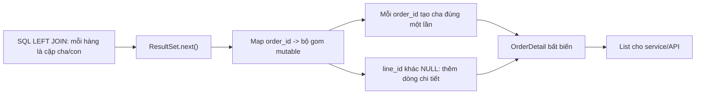
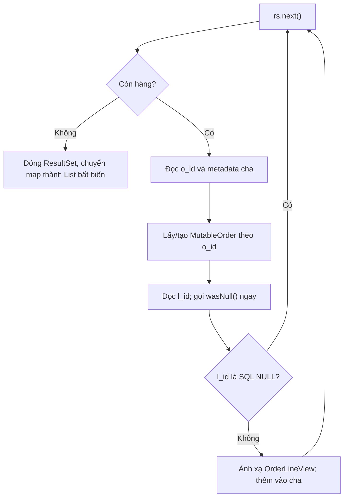

# Ánh xạ đơn hàng cùng danh sách chi tiết từ kết quả JOIN

## 1. Bài toán tổng hợp: một đơn hàng, nhiều dòng chi tiết

Trong **JDBC**, `ResultSet` là một tập **hàng SQL**, trong khi ứng dụng Java thường muốn một mô hình đối tượng **cha–con**: mỗi đơn hàng (*order*) chứa danh sách các dòng chi tiết (*order lines*). Một câu `JOIN` có thể trả đủ dữ liệu trong một lần gửi SQL, nhưng kết quả **không tự động biến thành cấu trúc đối tượng lồng nhau**.

Ví dụ đơn hàng `101` có hai sản phẩm, đơn `102` chưa có dòng sản phẩm và đơn `103` có một sản phẩm. Màn hình cần dữ liệu:

```text
OrderDetail(101, "DH-101", "Lan")
  ├── Line(1001, "SKU-A", 2, 12.50)
  └── Line(1002, "SKU-B", 1, 5.75)

OrderDetail(102, "DH-102", "Minh")
  └── []                                  <- đơn hợp lệ, chưa có chi tiết

OrderDetail(103, "DH-103", "Lan")
  └── Line(1003, "SKU-C", 3, 7.20)
```

Thế nhưng SQL `LEFT JOIN` trả về **bốn hàng**: thông tin đơn hàng `101` lặp lại hai lần và đơn `102` vẫn có một hàng với phần cột của bảng con bằng `NULL`. Người viết DAO phải thực hiện **gom nhóm** mà vẫn giữ đúng thứ tự, không tạo đơn trùng, không bỏ đơn có danh sách con rỗng, không thêm chi tiết giả và không làm mất tính chính xác của tiền.



Bài thực hành này kết hợp các kỹ năng JDBC: `DataSource`, `Connection`, `PreparedStatement`, SQL tham số hóa, `ResultSet`, `wasNull()`, ánh xạ `BigDecimal`, vòng đời tài nguyên, kiểm thử và phân trang. Chúng ta dùng **Java 17+** và **PostgreSQL** cho ví dụ chạy được; ý tưởng gom nhóm áp dụng cho nhiều DBMS quan hệ, còn cú pháp `LIMIT` và cách ánh xạ ngày giờ cần kiểm tra theo driver.

## 2. Mục tiêu và tiêu chí hoàn thành

Sau khi học và triển khai ví dụ, bạn có thể:

1. Thiết kế truy vấn `JOIN` trả một hàng cho mỗi cặp đơn hàng–dòng chi tiết.
2. Dùng `LEFT JOIN` để không làm mất đơn hàng chưa có sản phẩm.
3. Đọc đúng một `ResultSet` và dựng **một `OrderDetail` cho mỗi `order_id`**, cùng danh sách dòng riêng của đơn đó.
4. Phân biệt SQL `NULL` ở cột dòng chi tiết với giá trị số `0` của Java.
5. Bảo toàn `DECIMAL` dưới dạng `BigDecimal` và không dùng `double` cho tiền.
6. Dùng `PreparedStatement`, đóng tài nguyên đúng phạm vi và tránh N+1 queries.
7. Phân trang **đơn hàng cha trước khi JOIN**, không cắt mất một phần danh sách chi tiết.
8. Kiểm thử dữ liệu không có con, có nhiều con, trang rỗng, thứ tự, số tiền và concurrent update.

**Tiêu chí đầu ra:** truy vấn một trang có hai đơn `101` và `102` phải tạo **hai đối tượng `OrderDetail`**, với số dòng chi tiết lần lượt là `2` và `0`; không tạo ba đối tượng chỉ vì có ba hàng SQL sau JOIN.

## 3. Chuẩn bị schema và dữ liệu kiểm thử

Ta sử dụng ba bảng: khách hàng `shop_customers`, đơn hàng `shop_orders` và dòng hàng `shop_order_lines`. Quan hệ:

```text
shop_customers
  customer_id (PK)
       1
       |
       N
shop_orders
  order_id (PK)
       1
       |
       N
shop_order_lines
  line_id (PK), order_id (FK)
```

### 3.1. Tạo bảng

```sql
CREATE TABLE shop_customers (
    customer_id BIGINT PRIMARY KEY,
    full_name VARCHAR(120) NOT NULL
);

CREATE TABLE shop_orders (
    order_id BIGINT PRIMARY KEY,
    order_number VARCHAR(32) NOT NULL UNIQUE,
    customer_id BIGINT NOT NULL
        REFERENCES shop_customers(customer_id),
    order_status VARCHAR(24) NOT NULL,
    created_at TIMESTAMP NOT NULL
);

CREATE TABLE shop_order_lines (
    line_id BIGINT PRIMARY KEY,
    order_id BIGINT NOT NULL
        REFERENCES shop_orders(order_id),
    sku VARCHAR(64) NOT NULL,
    quantity INTEGER NOT NULL CHECK (quantity > 0),
    unit_price NUMERIC(18, 2) NOT NULL CHECK (unit_price >= 0)
);

CREATE INDEX idx_shop_lines_order_id_line_id
    ON shop_order_lines(order_id, line_id);
```

**Vì sao cần chỉ mục trên `(order_id, line_id)`?** Truy vấn sẽ tìm các dòng theo `order_id` và sắp xếp theo `line_id`. Chỉ mục này thường hữu ích, nhưng lựa chọn cuối cùng phụ thuộc kích thước bảng, mức chọn lọc và kế hoạch truy vấn thực tế (`EXPLAIN`).

### 3.2. Chèn dữ liệu mẫu

```sql
INSERT INTO shop_customers(customer_id, full_name)
VALUES (1, 'Lan'), (2, 'Minh');

INSERT INTO shop_orders(
    order_id, order_number, customer_id, order_status, created_at)
VALUES
    (101, 'DH-101', 1, 'PAID',
     TIMESTAMP '2026-04-01 09:00:00'),
    (102, 'DH-102', 2, 'NEW',
     TIMESTAMP '2026-04-02 10:00:00'),
    (103, 'DH-103', 1, 'PAID',
     TIMESTAMP '2026-04-03 11:00:00');

INSERT INTO shop_order_lines(
    line_id, order_id, sku, quantity, unit_price)
VALUES
    (1001, 101, 'SKU-A', 2, 12.50),
    (1002, 101, 'SKU-B', 1,  5.75),
    (1003, 103, 'SKU-C', 3,  7.20);
```

Đơn `102` **cố ý không có dòng con**. Đây là trường hợp thử bắt buộc để phát hiện lỗi dùng `INNER JOIN` hoặc ánh xạ sai `NULL`.

### 3.3. Tính kết quả mong đợi

| Đơn hàng | Khách | Dòng chi tiết | Tổng tiền từ các dòng |
| --- | --- | ---: | ---: |
| `101 / DH-101` | Lan | 2 | 30.75 |
| `102 / DH-102` | Minh | 0 | 0 |
| `103 / DH-103` | Lan | 1 | 21.60 |

Tổng tiền được tính bằng `quantity × unit_price` rồi cộng các dòng. Với `NUMERIC(18,2)`, phía Java cần giữ `BigDecimal`; dùng `double` sẽ có nguy cơ sai biểu diễn số thập phân khi cộng/trừ nhiều khoản.

## 4. Viết truy vấn `LEFT JOIN` và xác định hình dạng `ResultSet`

Truy vấn lấy một đơn:

```sql
SELECT
    o.order_id      AS o_id,
    o.order_number  AS o_number,
    o.order_status  AS o_status,
    o.created_at    AS o_created_at,
    c.full_name     AS customer_name,
    l.line_id       AS l_id,
    l.sku           AS l_sku,
    l.quantity      AS l_quantity,
    l.unit_price    AS l_unit_price
FROM shop_orders AS o
JOIN shop_customers AS c
    ON c.customer_id = o.customer_id
LEFT JOIN shop_order_lines AS l
    ON l.order_id = o.order_id
WHERE o.order_id = ?
ORDER BY o.order_id, l.line_id;
```

Phần `JOIN shop_customers` là `INNER JOIN` có chủ đích, vì `customer_id` ở đơn là `NOT NULL` và có khóa ngoại hợp lệ. Nhưng `LEFT JOIN shop_order_lines` là bắt buộc nếu cần giữ đơn **không có dòng chi tiết**.

**Tại sao đặt alias `o_id`, `l_id`?** Khi hai bảng cùng có cột `order_id`, dùng `rs.getLong("order_id")` dễ nhầm nếu câu SQL chọn tên cột trùng nhau. Alias phân biệt rõ **khóa cha** và **khóa con**, giúp mapper không phụ thuộc vị trí cột.

Kết quả trên cả ba đơn (`WHERE` được bỏ đi cho bảng minh họa):

| `o_id` | `o_number` | `customer_name` | `l_id` | `l_sku` | `l_quantity` | `l_unit_price` |
| ---: | --- | --- | ---: | --- | ---: | ---: |
| 101 | DH-101 | Lan | 1001 | SKU-A | 2 | 12.50 |
| 101 | DH-101 | Lan | 1002 | SKU-B | 1 | 5.75 |
| 102 | DH-102 | Minh | `NULL` | `NULL` | `NULL` | `NULL` |
| 103 | DH-103 | Lan | 1003 | SKU-C | 3 | 7.20 |

**Quy tắc then chốt:** một hàng SQL **không** tương đương một đơn hàng Java. Với `LEFT JOIN`:

- `o_id` là khóa cha và không `NULL` theo schema.
- `l_id` bằng `NULL` nghĩa là **không có dòng con** ở hàng đó.
- `l_id` khác `NULL` nghĩa là có một dòng con hợp lệ; các cột `l_quantity`, `l_unit_price` được ánh xạ cùng dòng đó.

## 5. Mô hình Java đích: một cha và danh sách con bất biến

Trong bài, đối tượng trả từ DAO là **read model / DTO**. Nó không phải entity ORM và không tự cập nhật database khi được thay đổi ở Java.

Ta dùng hai `record` (Java 17 trở lên):

```java
import java.math.BigDecimal;
import java.time.LocalDateTime;
import java.util.List;

public record OrderLineView(
        long id,
        String sku,
        int quantity,
        BigDecimal unitPrice) {

    public BigDecimal lineTotal() {
        return unitPrice.multiply(BigDecimal.valueOf(quantity));
    }
}

public record OrderDetail(
        long id,
        String number,
        String status,
        LocalDateTime createdAt,
        String customerName,
        List<OrderLineView> lines) {

    public OrderDetail {
        lines = List.copyOf(lines);
    }

    public BigDecimal total() {
        return lines.stream()
                .map(OrderLineView::lineTotal)
                .reduce(BigDecimal.ZERO, BigDecimal::add);
    }
}
```

**Lưu ý đóng gói Java:** đoạn trên minh họa hai type. Nếu đặt trong hai file `OrderLineView.java` và `OrderDetail.java` thì mỗi file có một `public record`; không để hai top-level public type trong cùng một file Java. Bên dưới, DAO tham chiếu hai type theo tên này.

`List.copyOf(lines)` giúp đầu ra không bị sửa nội dung bằng `add/remove` sau khi mapping. Chúng ta xây một cấu trúc **mutable tạm thời** trong lúc đọc `ResultSet` rồi chuyển sang đối tượng **bất biến** khi đóng tập kết quả. Cách này rõ ràng hơn việc gắn `List` mutable trực tiếp vào record trả về.

`LocalDateTime` tương ứng cột `TIMESTAMP` không kèm múi giờ trong ví dụ PostgreSQL. Nếu cần biểu diễn một mốc thời gian toàn cầu, hãy chọn kiểu SQL và Java phù hợp (ví dụ `TIMESTAMPTZ`/`OffsetDateTime` theo hỗ trợ driver) và thống nhất chính sách timezone. Không ngầm hiểu `LocalDateTime` có UTC offset.

## 6. Thuật toán ánh xạ một `ResultSet` thành nhiều `OrderDetail`

Ta cần một nơi lưu các cha đã gặp:

```java
Map<Long, MutableOrder> orders = new LinkedHashMap<>();
```

Trong đó:

- **Key** là `order_id`. Hai hàng SQL cùng `o_id = 101` phải trỏ về **cùng bộ gom**.
- **Value** là `MutableOrder` chứa metadata của cha và `List<OrderLineView>` đang xây.
- `LinkedHashMap` lưu thứ tự cha theo **lần xuất hiện đầu tiên** trong `ResultSet`, phù hợp với `ORDER BY o.order_id`.

Với mỗi hàng:

1. Đọc khóa cha và thuộc tính cha từ `ResultSet`.
2. Tìm `MutableOrder` theo `o_id`. Nếu chưa có, tạo một lần và đưa vào map.
3. Đọc `l_id` bằng `getLong` và gọi `wasNull()` **ngay sau getter đó**.
4. Nếu `l_id` là SQL `NULL`, **không thêm** dòng chi tiết.
5. Nếu `l_id` khác `NULL`, đọc `sku`, `quantity`, `unitPrice` và thêm một `OrderLineView` đúng đơn.
6. Sau khi đọc hết, chuyển từng bộ gom sang `OrderDetail` với danh sách đã được copy bất biến.



### Vì sao phải dùng `wasNull()`?

`ResultSet.getLong("l_id")` trả về kiểu nguyên thủy `long`. Khi giá trị SQL là `NULL`, getter kiểu nguyên thủy trả **0**; nếu không gọi `wasNull()`, mapper có thể nhầm “không có dòng con” thành dòng với `id = 0`.

```java
long lineId = rs.getLong("l_id");
boolean noLine = rs.wasNull(); // Phải kiểm tra NGAY sau getLong.

if (!noLine) {
    // Chỉ ánh xạ khi có dòng con.
}
```

Không đọc `rs.getString("l_sku")` hay getter khác **trước** khi gọi `wasNull()`, vì `wasNull()` phản ánh giá trị của **getter gần nhất**. Nếu khóa con là kiểu đối tượng và driver hỗ trợ, có thể dùng `rs.getObject("l_id", Long.class)` để nhận `null` trực tiếp; mẫu dùng `wasNull` để làm rõ quy tắc JDBC.

## 7. Ví dụ DAO JDBC hoàn chỉnh

Chúng ta viết một DAO **chỉ đọc** sử dụng `DataSource`. Nó cung cấp hai thao tác:

- `findById(orderId)`: lấy **một đơn** cùng toàn bộ dòng chi tiết.
- `findNextPage(lastSeenId, pageSize)`: lấy **một trang đơn** và danh sách chi tiết của từng đơn bằng **một câu SQL**, không N+1.

Để ví dụ tự chứa, phần dưới là file `OrderReadDao.java`. Hai record `OrderDetail` và `OrderLineView` ở mục 5 nằm trong hai file Java cùng package.

### 7.1. Triển khai DAO

```java
import java.math.BigDecimal;
import java.sql.Connection;
import java.sql.PreparedStatement;
import java.sql.ResultSet;
import java.sql.SQLException;
import java.time.LocalDateTime;
import java.util.ArrayList;
import java.util.HashSet;
import java.util.LinkedHashMap;
import java.util.List;
import java.util.Map;
import java.util.Objects;
import java.util.Optional;
import java.util.Set;
import javax.sql.DataSource;

public final class OrderReadDao {
    private static final int MAX_PAGE_SIZE = 100;

    private static final String ONE_ORDER_SQL = """
            SELECT
                o.order_id AS o_id,
                o.order_number AS o_number,
                o.order_status AS o_status,
                o.created_at AS o_created_at,
                c.full_name AS customer_name,
                l.line_id AS l_id,
                l.sku AS l_sku,
                l.quantity AS l_quantity,
                l.unit_price AS l_unit_price
            FROM shop_orders o
            JOIN shop_customers c
                ON c.customer_id = o.customer_id
            LEFT JOIN shop_order_lines l
                ON l.order_id = o.order_id
            WHERE o.order_id = ?
            ORDER BY o.order_id, l.line_id
            """;

    // Chọn trang đơn hàng TRƯỚC khi LEFT JOIN dòng chi tiết.
    private static final String PAGE_SQL = """
            WITH page AS (
                SELECT order_id
                FROM shop_orders
                WHERE order_id > ?
                ORDER BY order_id
                LIMIT ?
            )
            SELECT
                o.order_id AS o_id,
                o.order_number AS o_number,
                o.order_status AS o_status,
                o.created_at AS o_created_at,
                c.full_name AS customer_name,
                l.line_id AS l_id,
                l.sku AS l_sku,
                l.quantity AS l_quantity,
                l.unit_price AS l_unit_price
            FROM page p
            JOIN shop_orders o ON o.order_id = p.order_id
            JOIN shop_customers c
                ON c.customer_id = o.customer_id
            LEFT JOIN shop_order_lines l
                ON l.order_id = o.order_id
            ORDER BY o.order_id, l.line_id
            """;

    private final DataSource dataSource;

    public OrderReadDao(DataSource dataSource) {
        this.dataSource = Objects.requireNonNull(dataSource);
    }

    public Optional<OrderDetail> findById(long orderId)
            throws SQLException {
        if (orderId <= 0) {
            throw new IllegalArgumentException("orderId phải dương");
        }

        try (Connection c = dataSource.getConnection();
             PreparedStatement ps = c.prepareStatement(ONE_ORDER_SQL)) {
            ps.setLong(1, orderId);

            try (ResultSet rs = ps.executeQuery()) {
                List<OrderDetail> found = mapAll(rs);
                if (found.isEmpty()) {
                    return Optional.empty(); // Không có đơn.
                }
                if (found.size() != 1) {
                    throw new SQLException(
                            "Truy vấn theo khóa chính trả nhiều đơn");
                }
                return Optional.of(found.get(0));
            }
        }
    }

    public List<OrderDetail> findNextPage(
            long lastSeenId, int pageSize) throws SQLException {
        if (lastSeenId < 0
                || pageSize < 1
                || pageSize > MAX_PAGE_SIZE) {
            throw new IllegalArgumentException(
                    "lastSeenId/pageSize không hợp lệ");
        }

        try (Connection c = dataSource.getConnection();
             PreparedStatement ps = c.prepareStatement(PAGE_SQL)) {
            ps.setLong(1, lastSeenId);
            ps.setInt(2, pageSize);

            try (ResultSet rs = ps.executeQuery()) {
                return mapAll(rs);
            }
        }
    }

    private static List<OrderDetail> mapAll(ResultSet rs)
            throws SQLException {
        Map<Long, MutableOrder> grouped = new LinkedHashMap<>();

        while (rs.next()) {
            long orderId = rs.getLong("o_id");
            String number = rs.getString("o_number");
            String status = rs.getString("o_status");
            LocalDateTime createdAt = rs.getObject(
                    "o_created_at", LocalDateTime.class);
            String customerName = rs.getString("customer_name");

            MutableOrder target = grouped.get(orderId);
            if (target == null) {
                target = new MutableOrder(
                        orderId, number, status, createdAt, customerName);
                grouped.put(orderId, target);
            } else if (!target.sameHeader(
                    number, status, createdAt, customerName)) {
                throw new SQLException(
                        "Các hàng JOIN có metadata cha không nhất quán: "
                                + orderId);
            }

            long lineId = rs.getLong("l_id");
            if (rs.wasNull()) {
                // LEFT JOIN: đơn tồn tại nhưng không có dòng con.
                continue;
            }

            String sku = rs.getString("l_sku");
            int quantity = rs.getInt("l_quantity");
            if (rs.wasNull()) {
                throw new SQLException(
                        "Dòng chi tiết có quantity NULL: " + lineId);
            }
            BigDecimal unitPrice = rs.getBigDecimal("l_unit_price");
            if (sku == null || unitPrice == null) {
                throw new SQLException(
                        "Dòng chi tiết thiếu sku/price: " + lineId);
            }

            // Với JOIN đúng 1:N, một line_id không được lặp trong
            // cùng một đơn. Báo lỗi thay vì cộng trùng dữ liệu.
            target.addLine(new OrderLineView(
                    lineId, sku, quantity, unitPrice));
        }

        List<OrderDetail> result = new ArrayList<>(grouped.size());
        for (MutableOrder mutable : grouped.values()) {
            result.add(mutable.toDetail());
        }
        return List.copyOf(result);
    }

    // Bộ gom chỉ dùng trong lúc ResultSet còn mở.
    private static final class MutableOrder {
        private final long id;
        private final String number;
        private final String status;
        private final LocalDateTime createdAt;
        private final String customerName;
        private final List<OrderLineView> lines = new ArrayList<>();
        private final Set<Long> seenLineIds = new HashSet<>();

        private MutableOrder(
                long id, String number, String status,
                LocalDateTime createdAt, String customerName) {
            this.id = id;
            this.number = number;
            this.status = status;
            this.createdAt = createdAt;
            this.customerName = customerName;
        }

        private boolean sameHeader(
                String otherNumber, String otherStatus,
                LocalDateTime otherCreatedAt, String otherCustomer) {
            return Objects.equals(number, otherNumber)
                    && Objects.equals(status, otherStatus)
                    && Objects.equals(createdAt, otherCreatedAt)
                    && Objects.equals(customerName, otherCustomer);
        }

        private void addLine(OrderLineView line)
                throws SQLException {
            if (!seenLineIds.add(line.id())) {
                throw new SQLException(
                        "Dòng chi tiết bị lặp do JOIN: " + line.id());
            }
            lines.add(line);
        }

        private OrderDetail toDetail() {
            return new OrderDetail(
                    id, number, status, createdAt, customerName, lines);
        }
    }
}
```

### 7.2. Điều cần quan sát trong mã

**Không có truy vấn SQL bên trong vòng `while (rs.next())`.** Tất cả hàng cha và con được lấy từ một `JOIN`. Khi `o_id` trùng nhau, DAO tái sử dụng bộ gom cũ thay vì tạo một đối tượng đơn mới; chỉ có `OrderLineView` được thêm cho hàng có `l_id` thật.

`MutableOrder` được giữ **private** trong DAO và chỉ sống đến lúc mapping hoàn thành. Danh sách trả về có dạng `List<OrderDetail>` bất biến; không trả `ResultSet` ra khỏi phương thức khi `Connection` đã đóng.

Mã còn kiểm tra dữ liệu bất thường: metadata của cùng đơn thay đổi giữa các hàng, `quantity` hoặc `unit_price` bị `NULL`, hay `line_id` xuất hiện trùng trong một đơn. Với schema và truy vấn mẫu, các trường hợp đó không nên xảy ra; nếu xảy ra, báo lỗi rõ giúp phát hiện thay đổi JOIN hoặc schema.

**Vì sao có `seenLineIds`?** Nếu một người mở rộng truy vấn bằng cách JOIN thêm một bảng `1:N` khác, mỗi dòng hàng có thể xuất hiện nhiều lần do tích Descartes. Bộ phát hiện trùng ngăn DAO âm thầm nhân đôi tổng tiền. Nhưng đây là **cảnh báo**, không phải giải pháp tối ưu. Cần sửa SQL hoặc tách truy vấn thay vì dựa vào loại trùng sau JOIN.

**Lưu ý về thứ tự:** câu `ORDER BY o.order_id, l.line_id` làm các cha xuất hiện theo `order_id` và các con theo `line_id`. `LinkedHashMap` giữ thứ tự cha lúc đọc; `ArrayList` giữ thứ tự các dòng con. Không dựa vào thứ tự ngẫu nhiên của bảng khi SQL không có `ORDER BY`.

### 7.3. Gọi DAO

```java
OrderReadDao dao = new OrderReadDao(dataSource);

OrderDetail one = dao.findById(101L).orElseThrow();
System.out.println(one.number());       // DH-101
System.out.println(one.lines().size()); // 2
System.out.println(one.total());        // 30.75

OrderDetail noLines = dao.findById(102L).orElseThrow();
System.out.println(noLines.lines());    // []
System.out.println(noLines.total());    // 0

System.out.println(dao.findById(999L)); // Optional.empty

List<OrderDetail> firstPage = dao.findNextPage(0L, 2);
System.out.println(firstPage.size());   // 2 đơn: 101, 102
```

Đoạn gọi sử dụng `dataSource` đã được cấu hình. Chương trình CLI có thể tạo pool một lần ở startup rồi đóng pool khi kết thúc; ứng dụng web nên inject `DataSource` có vòng đời ứng dụng, không tạo pool mới mỗi request.

## 8. Vì sao không chỉ dùng `RowMapper<OrderDetail>` theo từng hàng?

Một `RowMapper<T>` thường biến **một hàng** thành **một đối tượng `T`**. Nếu áp dụng máy móc cho kết quả `LEFT JOIN` ở trên:

```java
// KHÔNG đúng cho 1:N nếu mỗi hàng tạo một OrderDetail riêng!
while (rs.next()) {
    OrderDetail order = new OrderDetail(
            rs.getLong("o_id"),
            rs.getString("o_number"),
            rs.getString("o_status"),
            rs.getObject("o_created_at", LocalDateTime.class),
            rs.getString("customer_name"),
            List.of(/* chỉ một line của hàng hiện tại */));
    result.add(order);
}
```

Đơn `101` sẽ xuất hiện **hai lần**; đơn `102` còn có nguy cơ bị gắn “dòng rỗng giả”. Cách đúng là **nhận thức cấu trúc một-nhiều** ở tầng mapping: gom theo khóa cha, rồi thêm các con.

Nếu sử dụng **Spring `JdbcTemplate`**, callback tương ứng với tình huống này thường là `ResultSetExtractor<List<OrderDetail>>` vì callback đó tự duyệt toàn `ResultSet` và trả về một cấu trúc tổng hợp. `RowMapper<OrderLineView>` vẫn hữu ích khi chỉ cần một danh sách các dòng chi tiết độc lập. Với JDBC thuần, `mapAll(ResultSet)` của ví dụ đã thực hiện vai trò tương tự extractor.

## 9. Lỗi phân trang nguy hiểm: `LIMIT` sau `JOIN` một-nhiều

Giả sử muốn trang có **hai đơn hàng**, một người viết:

```sql
-- SAI nếu mong LIMIT 2 nghĩa là 2 đơn hàng.
SELECT o.order_id, l.line_id
FROM shop_orders o
LEFT JOIN shop_order_lines l ON l.order_id = o.order_id
ORDER BY o.order_id, l.line_id
LIMIT 2;
```

Kết quả chỉ là hai hàng:

```text
o_id=101, l_id=1001
o_id=101, l_id=1002
```

Chương trình tưởng “trang có 2 đơn” nhưng thực tế chỉ có **đơn `101`**. Tệ hơn, nếu đơn `101` có ba dòng mà `LIMIT 2`, danh sách chi tiết của đơn đó bị **cắt dở**. Đây là lỗi **tính đúng đắn nghiệp vụ**, không chỉ hiệu năng.

### Phân trang cha trước, JOIN con sau

Truy vấn `PAGE_SQL` ở mục 7 giải quyết bằng CTE:

```sql
WITH page AS (
    SELECT order_id
    FROM shop_orders
    WHERE order_id > ?
    ORDER BY order_id
    LIMIT ?
)
SELECT o.order_id, o.order_number, l.line_id, l.sku
FROM page p
JOIN shop_orders o ON o.order_id = p.order_id
LEFT JOIN shop_order_lines l ON l.order_id = o.order_id
ORDER BY o.order_id, l.line_id;
```

`LIMIT ?` nằm **bên trong** bước chọn đơn cha. Nếu `pageSize = 2`, CTE chọn đúng các `order_id = 101, 102`; câu JOIN sau đó trả **ba hàng**, đủ hai dòng chi tiết của `101` và một hàng với chi tiết `NULL` của `102`. DAO gom thành **hai đơn đầy đủ**.

**Lưu ý:** phần SQL rút gọn trên cố ý không JOIN bảng khách và không chọn mọi cột; mã chạy đầy đủ dùng `PAGE_SQL` ở mục 7. Trên SQL Server/Oracle có cú pháp phân trang khác; phải điều chỉnh theo DBMS và thử với driver thật.

### Keyset pagination với `order_id`

Ở ví dụ, `order_id` là khóa duy nhất, tăng theo thứ tự lựa chọn. Để lấy trang tiếp theo:

```java
List<OrderDetail> page = dao.findNextPage(0L, 2);

long lastId = page.get(page.size() - 1).id(); // 102
List<OrderDetail> next = dao.findNextPage(lastId, 2);
// Trang tiếp theo gồm đơn 103.
```

Chỉ lấy `lastId` khi trang hiện tại không rỗng. Điều kiện `order_id > ?` giúp tránh `OFFSET` sâu, nhưng nó **không tự bảo đảm snapshot nhất quán** nếu bảng có thêm/xóa/sửa dữ liệu giữa hai lần gọi. Khi sắp xếp theo `created_at` không duy nhất, phải thêm khóa phụ (ví dụ `order_id`) và dùng predicate cursor tương ứng; không chỉ đổi `ORDER BY`.

## 10. So sánh chiến lược một `JOIN` với hai truy vấn theo nhóm

Ngoài cách một `LEFT JOIN`, ta có thể:

1. SELECT trang đơn cha.
2. SELECT toàn bộ dòng con thuộc trang bằng `WHERE order_id IN (?, ?, ...)`.
3. Gom các con theo `order_id` và gắn vào danh sách cha.

Ví dụ truy vấn con:

```sql
SELECT line_id, order_id, sku, quantity, unit_price
FROM shop_order_lines
WHERE order_id IN (?, ?)
ORDER BY order_id, line_id;
```

Các dấu `?` phải được sinh từ **số lượng ID có giới hạn**; giá trị ID luôn gán bằng `PreparedStatement.setLong(...)`. Không tạo `IN ()` khi trang rỗng, và không nối raw ID từ client vào SQL. Nếu danh sách rất lớn, có thể cần chia nhóm do giới hạn bind parameters của DBMS/driver.

| Tiêu chí | Một câu `JOIN` cha–con | Hai truy vấn cha và con theo nhóm |
| --- | --- | --- |
| Số SQL cho một trang không rỗng | Thường **1** | Thường **2** |
| Metadata đơn lặp lại trên mạng | Có: một bản cho mỗi dòng con | Không trong truy vấn con |
| Dễ phân trang cha | Cần chọn cha trước khi JOIN | Rất tự nhiên: SELECT trang cha |
| Ánh xạ | Gom các hàng JOIN bằng khóa cha | Tạo cha trước, map con theo FK |
| Câu SQL có nhiều quan hệ `1:N` | Có nguy cơ nhân số dòng mạnh | Có thể lấy từng quan hệ theo nhóm |
| Nhất quán cùng thời điểm | Một SQL có snapshot theo DBMS/isolation | Hai SQL có thể thấy hai trạng thái khác nhau |
| Khi phù hợp | Một quan hệ 1:N vừa phải, muốn một lượt SQL | Con rất nhiều, nhiều tập con hoặc cần kiểm soát kích thước kết quả |

**Không chọn chiến lược chỉ bằng số truy vấn.** Một JOIN tạo hàng triệu dòng lặp metadata có thể tốn mạng/bộ nhớ hơn hai truy vấn gọn. Ngược lại, N+1 (**1 truy vấn cha + 1 truy vấn con cho mỗi cha**) thường tạo quá nhiều round-trip và độ trễ lớn.

### Tránh “nhân dòng” khi JOIN nhiều danh sách con

Nếu mỗi đơn có `5` dòng hàng và `4` coupon, câu SQL JOIN **cả hai bảng con** có thể trả **20 hàng** cho một đơn do tích `5 × 4`. Lúc đó một `line_id` xuất hiện bốn lần, dễ bị cộng trùng tiền.

Các hướng xử lý:

- Tách từng tập con thành truy vấn theo nhóm.
- Dùng câu SQL tổng hợp riêng (`COUNT`, `SUM`) khi chỉ cần thống kê.
- Dùng subquery/CTE tiền tổng hợp hoặc JSON aggregation theo DBMS khi có lý do rõ ràng, nhưng kiểm tra `NULL`, thứ tự và tính portable.

**Không chỉ thêm `DISTINCT` rồi cho rằng đã sửa mô hình**: nó có thể che trùng ở một số cột nhưng vẫn làm thiếu dữ liệu hoặc tạo chi phí lớn.

## 11. Bảo vệ tính đúng đắn của dữ liệu ánh xạ

### 11.1. Dòng con rỗng và SQL `NULL`

Với `LEFT JOIN`, một đơn không có con **vẫn có một hàng cha**. Chỉ thêm dòng con khi `l_id` khác SQL `NULL`. Không dùng biểu thức như `if (lineId > 0)` làm phép kiểm tra null chung vì ID `0` có thể hợp lệ trong một schema khác; phải kiểm tra `wasNull()` hoặc getter object.

### 11.2. Cột có tên trùng nhau

`o.order_id` và `l.order_id` đều có thể xuất hiện trong `SELECT *`. Dùng `AS o_id`, `AS l_id`, truy vấn chọn **đúng cột** và getter theo alias thay vì `SELECT *`.

### 11.3. Kiểu số tiền

`unit_price NUMERIC(18,2)` được đọc bằng `rs.getBigDecimal`. Tổng:

\[
\operatorname{orderTotal}
= \sum_{\text{dòng hàng }i}
\left(\operatorname{unitPrice}_i \times \operatorname{quantity}_i\right)
\]

Không dùng `getDouble` rồi tạo `BigDecimal` từ số thực nhị phân; có thể đưa ra kết quả thập phân ngoài mong đợi. Nếu bài toán có thuế, giảm giá hoặc nhiều loại tiền, **quy tắc làm tròn và đồng tiền** là yêu cầu nghiệp vụ riêng, không tự suy từ `NUMERIC(18,2)`.

### 11.4. Thứ tự dòng

SQL không bảo đảm thứ tự nếu không có `ORDER BY`. Với đầu ra yêu cầu trình tự sản phẩm theo vị trí trong đơn, nên có cột `position` rõ ràng trong schema và `ORDER BY position, line_id`; `line_id` trong bài là thứ tự minh họa theo định danh, **không mặc định đại diện cho vị trí sản phẩm trong mọi ứng dụng**.

### 11.5. Khi thiếu FK hoặc dữ liệu bất thường

Một `INNER JOIN` khách có thể làm mất đơn hàng nếu dữ liệu vi phạm ràng buộc tham chiếu hoặc FK bị vô hiệu. Schema mẫu dùng `FOREIGN KEY`; trong hệ thống có dữ liệu legacy, hãy quyết định rõ có cần `LEFT JOIN` khách hay báo lỗi thiếu khách thay vì âm thầm bỏ đơn.

## 12. Connection, transaction và dữ liệu thay đổi đồng thời

`OrderReadDao` chỉ đọc, nên mỗi phương thức mượn một `Connection`, chạy một SQL, ánh xạ đầy đủ rồi đóng tài nguyên bằng `try-with-resources`. Trong môi trường có pool, `Connection.close()` thường trả handle về pool chứ không luôn đóng socket vật lý.

**Không trả `ResultSet` hoặc `Stream` phụ thuộc connection ra ngoài** khi DAO đã đóng connection. Nếu cần streaming dữ liệu khổng lồ, thiết kế scope riêng giữ connection mở trong toàn bộ thời gian tiêu thụ và có giới hạn thời gian/tài nguyên rõ ràng.

### Một SQL JOIN và snapshot

Trên PostgreSQL, một câu `SELECT` thông thường quan sát một snapshot theo mức cô lập giao dịch. Khi gom từ **một `ResultSet` của một câu SQL**, metadata cha và dòng con thuộc cùng kết quả truy vấn ấy. Nhưng điều này **không đồng nghĩa các lần gọi `findById` khác nhau hoặc các trang khác nhau** sẽ thấy một snapshot duy nhất.

Với hai truy vấn (cha rồi con), ngay cả trên **cùng một connection** ở PostgreSQL `READ COMMITTED`, transaction khác có thể commit thay đổi giữa hai lần SELECT. Nếu nghiệp vụ yêu cầu snapshot nhất quán qua nhiều truy vấn, phải dùng transaction với mức cô lập thích hợp (ví dụ `REPEATABLE READ` theo ngữ nghĩa PostgreSQL) hoặc cơ chế version/snapshot khác; không giả định chỉ dùng cùng connection là đủ.

### Khi đọc đồng thời với cập nhật

Một đơn có thể được thêm dòng trong lúc service xuất báo cáo. Cần xác định:

- Kết quả được chốt theo thời điểm truy vấn hay yêu cầu “mới nhất” tại lúc trả API?
- Trang 1 và trang 2 có cần cùng một snapshot?
- Đơn có thể bị xóa, chuyển trạng thái hoặc thay đổi giá khi đang đọc không?
- Việc hiển thị tổng tiền được tính từ giá ở dòng lúc tạo đơn hay từ bảng sản phẩm hiện tại?

Nếu phải tái hiện hóa đơn lịch sử, nên lưu **unit price đã chốt** trong `shop_order_lines` như schema mẫu, thay vì JOIN bảng sản phẩm để lấy giá hiện tại.

## 13. Hiệu năng và giới hạn tài nguyên

Với một trang `N` đơn và số dòng chi tiết `L_i` của từng đơn, số hàng `LEFT JOIN` trả ra gần:

\[
R = \sum_{i=1}^{N} \max(1, L_i)
\]

Tức là một đơn rỗng vẫn tạo một hàng SQL. Khi `L_i` lớn, **giới hạn `pageSize` ở số đơn cha không đồng nghĩa giới hạn tổng hàng JOIN**. Ví dụ 100 đơn × 1.000 dòng mỗi đơn có thể tạo 100.000 hàng kết quả và nhiều đối tượng Java.

Các biện pháp:

1. **Chặn kích thước trang** ở API/DAO, ví dụ tối đa 100 đơn trong bài.
2. Chỉ chọn những cột cần thiết; đừng kéo `CLOB/BLOB` hoặc mô tả sản phẩm rất lớn vào từng hàng JOIN.
3. Kiểm tra index theo `shop_order_lines(order_id, line_id)` và thứ tự khóa cha.
4. Cân nhắc phân trang dòng con **riêng** nếu một đơn có hàng chục nghìn dòng; không tự cắt dòng con khi API hứa trả toàn bộ.
5. Đo số hàng SQL trả, số đơn Java tạo, heap/GC, network bytes và thời gian giữ connection.
6. Sử dụng `setFetchSize(...)` nếu driver có chế độ tải theo lô phù hợp, nhưng nhớ đó **chỉ là gợi ý** và không làm giảm tổng số hàng.
7. Đặt timeout câu SQL/lock và hạn mức export phù hợp. Tránh dùng `Statement.setMaxRows(pageSize)` trực tiếp với JOIN một-nhiều vì nó có thể **cắt mất dòng chi tiết**.

```java
// Ví dụ tùy chọn trong phạm vi PreparedStatement đã chuẩn bị:
ps.setQueryTimeout(5); // 5 giây, không phải thời gian toàn HTTP request.
ps.setFetchSize(100);  // Gợi ý số hàng fetch, không phải tổng số dòng.
```

Trong pgJDBC, server-side cursor/fetch theo lô còn phụ thuộc `autoCommit` và kiểu `ResultSet`; không chỉ thêm một lệnh `setFetchSize` rồi khẳng định đang stream. Nếu cần bắt buộc giới hạn thời gian/memory, hãy kiểm thử trên đúng driver/DBMS và thiết kế ngân sách ở service.

## 14. Kiểm thử tích hợp trên dữ liệu mẫu

Với một `DataSource` trỏ tới test database chứa schema/dữ liệu mục 3, có thể dùng JUnit 5 để xác nhận các kết quả sau. Đây là ví dụ cấu trúc kiểm thử; `dataSource` được cung cấp bởi test fixture hoặc framework test của dự án.

```java
import static org.junit.jupiter.api.Assertions.*;

import java.math.BigDecimal;
import java.util.List;
import javax.sql.DataSource;
import org.junit.jupiter.api.Test;

class OrderReadDaoTest {
    private final DataSource dataSource = TestDatabase.dataSource();
    private final OrderReadDao dao = new OrderReadDao(dataSource);

    @Test
    void oneOrderHasTwoCorrectLines() throws Exception {
        OrderDetail order = dao.findById(101L).orElseThrow();

        assertEquals("DH-101", order.number());
        assertEquals("Lan", order.customerName());
        assertEquals(2, order.lines().size());
        assertEquals(List.of(1001L, 1002L),
                order.lines().stream().map(OrderLineView::id).toList());
        assertEquals(0, order.total().compareTo(
                new BigDecimal("30.75")));
    }

    @Test
    void emptyChildCollectionStillReturnsOrder() throws Exception {
        OrderDetail order = dao.findById(102L).orElseThrow();

        assertEquals("DH-102", order.number());
        assertTrue(order.lines().isEmpty());
        assertEquals(0, order.total().compareTo(BigDecimal.ZERO));
    }

    @Test
    void notFoundIsDifferentFromNoChildren() throws Exception {
        assertTrue(dao.findById(999L).isEmpty());
        assertTrue(dao.findById(102L).isPresent());
    }

    @Test
    void pageLimitAppliesToParents() throws Exception {
        List<OrderDetail> page = dao.findNextPage(0L, 2);

        assertEquals(List.of(101L, 102L),
                page.stream().map(OrderDetail::id).toList());
        assertEquals(2, page.get(0).lines().size());
        assertTrue(page.get(1).lines().isEmpty());

        List<OrderDetail> next = dao.findNextPage(102L, 2);
        assertEquals(List.of(103L),
                next.stream().map(OrderDetail::id).toList());
    }

    @Test
    void pageRejectsInvalidSize() {
        assertThrows(IllegalArgumentException.class,
                () -> dao.findNextPage(0L, 101));
    }
}
```

`TestDatabase.dataSource()` ở trên là **fixture do dự án test tự cung cấp**, không phải API của Java/JDBC. Có thể thay bằng `DataSource` được inject bởi Spring test, Testcontainers hoặc cấu hình test độc lập. Các test cần dữ liệu sạch/ổn định; nếu chạy chung DB test với các test khác, hãy reset fixture hoặc dùng transaction/isolated schema phù hợp để tránh kết quả phụ thuộc thứ tự chạy.

### Ma trận tình huống cần kiểm tra thêm

| Tình huống | Kết quả mong đợi |
| --- | --- |
| Đơn không tồn tại | `Optional.empty()` |
| Đơn có 0 dòng | `OrderDetail` tồn tại, `lines=[]` |
| Đơn có 1 hoặc nhiều dòng | Đúng số dòng, không trùng cha, thứ tự `line_id` đúng |
| Trang 2 đơn, đơn đầu có 2 dòng | Trả 2 đơn đầy đủ, không cắt dòng con |
| Trang cuối không còn đơn | Trả `List.of()` |
| Giá có thập phân, số lượng khác 1 | Tổng `BigDecimal` chính xác |
| Bảng con có dữ liệu `NULL` trái ràng buộc | Mapper phát hiện hợp đồng dữ liệu bị vi phạm |
| JOIN thêm bảng `1:N` làm lặp `line_id` | Mapper báo lỗi, buộc sửa câu JOIN |
| Đơn hàng thay đổi giữa hai lần gọi | Kết quả tuân theo isolation/snapshot đã chọn |
| Lỗi SQL/driver ở giữa quá trình đọc | Không trả tập dữ liệu thiếu như thành công; JDBC resources được đóng |
| Pool ít connection nhưng nhiều request đồng thời | Không leak handle; thời gian mượn/giữ kết nối được đo |

**Kiểm thử đơn vị một mapper bằng mock `ResultSet` không đủ** để xác minh `LEFT JOIN`, thứ tự hàng, kiểu PostgreSQL `NUMERIC/TIMESTAMP` và kế hoạch query. Hãy chạy integration test trên DBMS thật với dữ liệu có ít nhất một đơn nhiều dòng và một đơn không dòng.

## 15. Các lỗi thường gặp và cách sửa

| Sai lầm | Hậu quả | Cách khắc phục |
| --- | --- | --- |
| Mỗi hàng JOIN tạo một `OrderDetail` mới | Cha bị trùng theo số dòng con | Gom qua `Map<orderId, MutableOrder>` |
| Dùng `INNER JOIN` dòng chi tiết | Mất đơn chưa có con | `LEFT JOIN` và kiểm tra khóa con `NULL` |
| Không kiểm tra `wasNull()` ngay sau `getLong` | Tạo dòng con giả với ID `0` | Kiểm tra ngay, trước getter khác |
| Dùng `SELECT *` khi hai bảng trùng tên cột | Lấy nhầm `order_id`, map sai | Chọn cột cụ thể, đặt alias cha/con |
| Gọi `LIMIT 2` trực tiếp sau JOIN `1:N` | Trang chỉ có vài hàng JOIN, cắt dở chi tiết | Chọn trang cha trước trong CTE/subquery |
| Dùng `getDouble` cho `NUMERIC(18,2)` | Sai lệch số thập phân | `getBigDecimal` và quy tắc rounding rõ |
| Không có `ORDER BY` | Thứ tự cha/con không ổn định | Sắp xếp bằng khóa rõ ràng |
| Đọc dòng con trong vòng lặp bằng DAO riêng | N+1 queries, tăng round-trip | Một JOIN hoặc hai query theo nhóm `IN` |
| JOIN nhiều quan hệ `1:N` rồi âm thầm loại trùng | Cartesian explosion và tính tổng sai | Tách batch fetch, tổng hợp trước, báo lỗi lặp |
| Tạo danh sách con mutable rồi trả ra service | Service có thể sửa tập đã ánh xạ ngoài ý muốn | `List.copyOf` sau khi map xong |
| Trả `ResultSet` ra ngoài khi connection đã đóng | Cursor/statement không còn hợp lệ | Materialize DTO trong scope JDBC |
| Một `Connection` cho hai SELECT rồi mặc định cùng snapshot | Đọc hai trạng thái khác nhau ở `READ COMMITTED` | Xác định isolation/transaction phù hợp |
| `setMaxRows(pageSize)` trên JOIN một-nhiều | Cắt chi tiết của đơn cuối | Giới hạn đơn trong CTE, kiểm soát số dòng riêng |

## 16. Bài tập mở rộng

Từ schema và DAO mẫu, bạn có thể tự mở rộng theo các bước có thể kiểm chứng:

1. **Thêm trạng thái đơn**: lọc `order_status = ?` trong bước chọn cha; bind tham số thay vì nối raw status. Kiểm tra trang sau dùng cùng bộ lọc.
2. **Thêm tổng tiền SQL**: so sánh kết quả `SUM(l.quantity * l.unit_price)` từ DBMS với `OrderDetail.total()` và xử lý đơn không có dòng bằng `COALESCE`.
3. **Thêm nhiều sản phẩm ở đơn `103`**: xác nhận mapper tạo đúng một cha và nhiều dòng, trang cha vẫn không bị cắt.
4. **Thêm phí/giảm giá**: định nghĩa quy tắc làm tròn, trình tự áp dụng và tiền tệ; không suy total đơn giản đủ cho mọi hóa đơn.
5. **Tạo truy vấn hai bước**: lấy trang cha, truy vấn con theo `IN` và đo sự khác biệt về số SQL, row count, bytes và latency với JOIN.
6. **Thử lỗi JOIN nhiều tập con**: thêm bảng `shop_order_discounts`, quan sát số hàng nhân lên; sửa bằng truy vấn theo nhóm và kiểm tra `seenLineIds` không còn báo trùng.
7. **Áp dụng tenant scope**: thêm `tenant_id` và bảo đảm lọc ở bước chọn cha từ ngữ cảnh xác thực, có chỉ mục/ràng buộc phù hợp; không tin tenant ID do client tự khai.

Các bài mở rộng nên được kiểm tra bằng SQL thực trên test database và khẳng định **cả số câu SQL lẫn kết quả ánh xạ**. Số query ít hơn không có ý nghĩa nếu một đơn bị mất con hoặc tổng tiền bị tính trùng.

## 17. Checklist trước khi đưa vào ứng dụng

1. **Schema có khóa chính và khóa ngoại rõ ràng** cho cha/con; chỉ mục hỗ trợ JOIN, filter và thứ tự.
2. **SQL dùng `LEFT JOIN` khi con là tùy chọn**, cột cha/con có alias không nhập nhằng.
3. **Phân biệt hàng SQL với đối tượng miền**: một cha có thể xuất hiện trên nhiều hàng JOIN.
4. **Gom nhóm theo khóa cha** bằng `LinkedHashMap` hoặc cấu trúc thích hợp; kiểm tra dữ liệu cha nhất quán.
5. **Chỉ thêm con khi khóa con khác SQL `NULL`**, dùng `wasNull()` đúng thời điểm.
6. **Ánh xạ đúng kiểu dữ liệu**, nhất là `BigDecimal` cho `NUMERIC` và kiểu thời gian phù hợp.
7. **Không nhân dòng khi JOIN nhiều quan hệ `1:N`**; có phát hiện trùng và thiết kế lại khi cần.
8. **Giới hạn trang cha trước khi JOIN con**, không áp row cap trực tiếp làm thiếu dòng chi tiết.
9. **Tham số hóa giá trị SQL** qua `PreparedStatement` và dùng hạn mức input hợp lệ.
10. **Đóng `ResultSet`, `PreparedStatement` và `Connection`** bằng `try-with-resources`; không để cursor rò rỉ.
11. **Chọn transaction/isolation phù hợp** nếu cần snapshot nhất quán qua nhiều câu SQL hoặc nhiều trang.
12. **Đo và kiểm thử** số đơn, số con, trang rỗng, giá tiền, SQL count, bộ nhớ, query plan và concurrent updates trên DBMS thật.

**Ghi nhớ:** Để ánh xạ **đơn hàng cùng danh sách chi tiết từ kết quả JOIN** trong JDBC, hãy xem `ResultSet` là tập hàng cần **gom theo khóa cha**, chứ không phải danh sách đối tượng đơn sẵn có. Dùng `LEFT JOIN` để giữ cha không có con, kiểm tra `NULL` ở khóa con trước khi thêm dòng, giữ `BigDecimal` cho tiền và chuyển bộ gom mutable sang DTO bất biến. Khi phân trang, **chọn trang đơn hàng trước rồi JOIN chi tiết**; cách này vừa tránh N+1, vừa giữ trọn các dòng hàng của mỗi đơn trong phạm vi trang được trả về.
