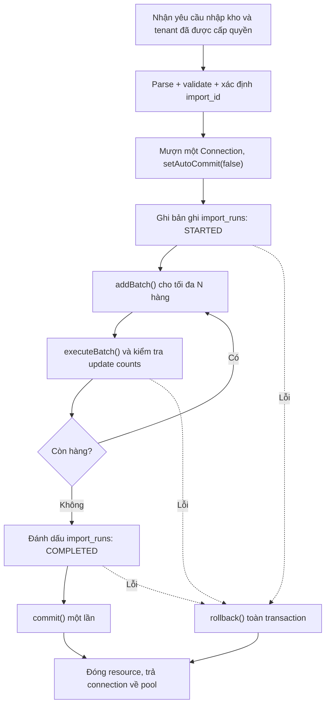
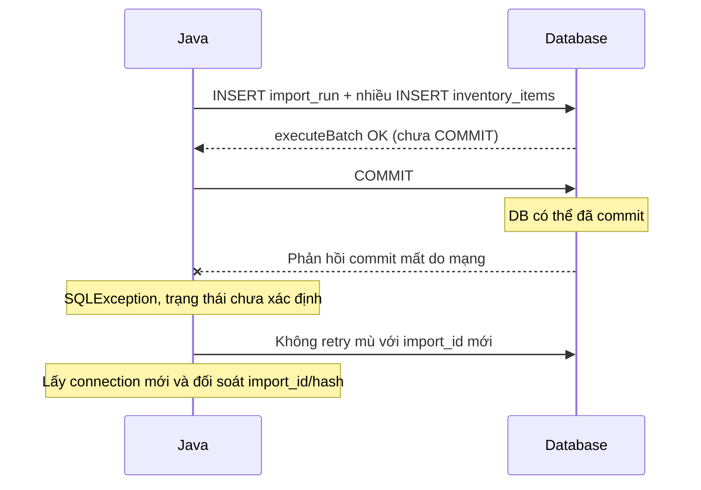

# Nhập dữ liệu theo batch với chính sách rollback rõ ràng

> **Chương:** Thực hành tổng hợp  
> **Phạm vi:** JDBC thuần trong Java 17+, dùng driver, `DataSource`, `Connection`, `PreparedStatement`, `ResultSet`, CRUD, transaction, batching, xử lý lỗi và đo hiệu năng. Phần kiểm thử tích hợp minh họa bằng PostgreSQL và Testcontainers; các hành vi cụ thể của driver/DBMS cần được xác nhận trên môi trường mục tiêu.

Một hệ thống kho nhận một tệp gồm 5.000 dòng sản phẩm. Mỗi dòng chứa mã SKU, số lượng tồn và đơn giá. Thay vì thực hiện 5.000 câu `INSERT` riêng biệt theo từng request tới database, ta dùng `PreparedStatement.addBatch()` và `executeBatch()` để giảm chi phí giao tiếp. Nhưng nếu dòng thứ 3.017 vi phạm khóa duy nhất sau khi ba batch đầu đã chạy thành công, dữ liệu nào được giữ lại?

Câu trả lời **không được phó mặc cho driver**. Batch chỉ là cách nhóm các lệnh để thực thi; **chính sách transaction và rollback mới quyết định phạm vi được phép giữ dữ liệu**.

Bài thực hành xây dựng một tính năng nhập kho có:

- Một `DataSource` cấp connection và một `PreparedStatement` tham số hóa.
- Nhập dữ liệu theo các nhóm (*chunk*) có số lượng hàng được giới hạn.
- **Một transaction duy nhất cho toàn bộ import** theo chính sách *all-or-nothing*: mọi hàng và trạng thái import cùng commit, hoặc cùng rollback.
- Xử lý `BatchUpdateException`, `getUpdateCounts()`, `SUCCESS_NO_INFO` và lỗi cleanup mà không hiểu nhầm về phần đã commit.
- Định danh lần nhập (`import_id`) và dấu vết nội dung (`payload_hash`) để đối soát khi kết quả `commit()` không rõ.
- Integration test dùng database thật để chứng minh **không có dữ liệu sót lại khi một batch ở giữa thất bại**.
- Phương án khác **commit từng chunk** khi nghiệp vụ chấp nhận thành công một phần và có checkpoint.

Sau bài này, người học phải **viết được cam kết nghiệp vụ trước khi tối ưu throughput**: all-or-nothing hay partial success, việc retry dựa trên điều kiện nào, và cách xác minh trạng thái cuối bằng một connection mới.

## 1. Phân biệt batching, transaction và chính sách nhập

Ba khái niệm này thường bị gộp nhầm:

| Khái niệm | Ý nghĩa | Điều nó không tự bảo đảm |
|---|---|---|
| **JDBC batch** | Gom nhiều bộ tham số SQL vào một lần gọi `executeBatch()` | Không tự tạo transaction cho toàn bộ tệp |
| **Chunk** | Một nhóm hàng nhỏ, ví dụ 200 hàng, được đưa vào batch | Không nhất thiết tương ứng một commit |
| **Transaction** | Một phạm vi thay đổi được xác nhận bởi `commit()` hoặc hoàn tác bởi `rollback()` | Không có giao dịch phân tán cho file/email/API bên ngoài chỉ vì JDBC commit |
| **All-or-nothing import** | Toàn bộ dữ liệu trong một import được commit hoặc rollback cùng nhau | Không đồng nghĩa batch đã thực thi xong là dữ liệu đã được commit |
| **Partial-success import** | Cho phép các chunk/hàng hợp lệ được commit dù một số khác thất bại | Không thể dùng cùng một rollback toàn tệp như all-or-nothing |
| **Idempotency** | Lặp lại cùng yêu cầu không tạo thêm dữ liệu ngoài ý muốn | Không được bảo đảm chỉ bởi `addBatch()` |

**Quy tắc của bài chính:** dù có 25 chunk, tất cả 25 chunk thuộc **một transaction JDBC** và chỉ có **một điểm commit** sau khi mọi hàng và metadata import hoàn tất.



`STARTED` trong sơ đồ được ghi **trong cùng transaction** với dữ liệu. Nếu import lỗi và rollback thành công, trạng thái `STARTED` cũng bị rollback. Điều này cố ý ngăn một bản import dở bị nhìn thấy như đã có dữ liệu được xác nhận.

### 1.1. Các trường hợp phải xác định rõ

| Tình huống | All-or-nothing | Commit từng chunk |
|---|---|---|
| Hàng thứ 301 vi phạm unique | Rollback cả 300 hàng trước đó và các thay đổi cùng transaction | Các chunk đã commit trước đó vẫn tồn tại |
| Batch 1 thành công, batch 2 lỗi | Rollback cả hai batch | Batch 1 có thể đã commit |
| Mất kết nối khi chưa commit | Cố rollback nếu có thể; không kết luận chắc chắn nếu connection hỏng | Đối soát các chunk đã commit bằng checkpoint |
| Mất phản hồi ngay `commit()` | **Chưa xác định được kết quả** từ phía client | Chưa xác định được kết quả của chunk đang commit |
| Retry cùng `import_id` | Kiểm tra trạng thái/hash trước khi bắt đầu lại | Dùng idempotency và checkpoint từng chunk |
| Báo tiến độ cho người dùng | Có thể báo “đã xử lý trong transaction”, **không nói đã lưu vĩnh viễn** trước commit | Chỉ tính “đã lưu” cho chunk được commit xác nhận |

Nếu người dùng cần một giao dịch không thể chứa hàng triệu dòng vì lock, WAL/redo, thời gian giữ connection hoặc dung lượng transaction, hãy chọn **chính sách nghiệp vụ khác** và ghi rõ thay đổi đó. Không tự thêm `commit()` sau mỗi `executeBatch()` rồi vẫn quảng cáo all-or-nothing.

## 2. Bài toán nhập kho và bất biến nghiệp vụ

Giả sử một tenant nhập danh mục tồn kho mới. Mỗi dòng:

| Trường đầu vào | Ví dụ | Quy tắc |
|---|---|---|
| `sku` | `SKU-1001` | Bắt buộc, không rỗng, tối đa 80 ký tự |
| `quantity` | `12` | Số nguyên không âm |
| `unitPrice` | `149000.00` | `BigDecimal` không âm, tối đa hai chữ số thập phân |
| `tenantId` | `tenant-A` | Do tầng authorization xác định, **không tin header tùy ý** |
| `importId` | `request-2026-001` | Định danh ổn định của một yêu cầu nhập |
| `payloadHash` | SHA-256 nội dung đã chuẩn hóa | Đối soát request cùng ID nhưng khác nội dung |

Bản thực hành là **create-only import**: một `sku` đã tồn tại trong cùng tenant được coi là xung đột. Không tự động cập nhật giá/tồn kho của sản phẩm cũ. Nếu muốn UPSERT, phải xác định chính sách overwrite, khóa, lịch sử thay đổi và cú pháp SQL theo DBMS riêng.

Các bất biến:

1. Một `(tenant_id, sku)` chỉ xuất hiện **một lần** trong bảng kho.
2. `quantity >= 0` và `unit_price >= 0` phải được database cưỡng chế bằng ràng buộc.
3. Mỗi bản ghi kho tham chiếu đến một `import_run` trong **cùng tenant**.
4. `import_runs.status = 'COMPLETED'` chỉ được commit sau khi tất cả hàng hợp lệ đã được ghi.
5. Một import lỗi không để lại hàng kho mới hoặc bản ghi trạng thái `STARTED` đã commit.
6. Mọi connection, statement và result set được đóng, kể cả khi SQL/rollback thất bại.

### 2.1. Schema PostgreSQL dùng cho bài thực hành

```sql
CREATE TABLE import_runs (
    tenant_id       VARCHAR(36) NOT NULL,
    import_id       VARCHAR(80) NOT NULL,
    payload_hash    CHAR(64) NOT NULL,
    status          VARCHAR(16) NOT NULL
                    CHECK (status IN ('STARTED', 'COMPLETED')),
    imported_count  INTEGER NOT NULL
                    CHECK (imported_count >= 0),
    PRIMARY KEY (tenant_id, import_id)
);

CREATE TABLE inventory_items (
    tenant_id       VARCHAR(36) NOT NULL,
    sku             VARCHAR(80) NOT NULL,
    quantity        INTEGER NOT NULL CHECK (quantity >= 0),
    unit_price      NUMERIC(12, 2) NOT NULL
                    CHECK (unit_price >= 0),
    import_id       VARCHAR(80) NOT NULL,
    PRIMARY KEY (tenant_id, sku),
    FOREIGN KEY (tenant_id, import_id)
        REFERENCES import_runs (tenant_id, import_id)
);

CREATE INDEX idx_inventory_by_import
    ON inventory_items (tenant_id, import_id);
```

DDL là ví dụ PostgreSQL, có thể chỉnh `NUMERIC`/`CHECK`/kiểu chuỗi để hỗ trợ database khác. **Đừng giả định mọi storage engine đều có transaction**: muốn rollback có ý nghĩa, tất cả bảng tham gia phải dùng engine có hỗ trợ transaction; với MySQL, chẳng hạn, thường dùng **InnoDB**.

Khóa ngoại ghép `(tenant_id, import_id)` bảo đảm một sản phẩm của tenant A không tham chiếu import của tenant B. Khóa chính `(tenant_id, import_id)` giúp chặn hai yêu cầu import cùng định danh nếu chúng tranh chấp đồng thời.

**Vì sao tạo bảng `import_runs` trước khi insert hàng?** Bảng kho có foreign key tới import; chương trình phải insert bản ghi import `STARTED` trong transaction trước, sau đó insert hàng, rồi update trạng thái `COMPLETED`. Mọi thứ cùng được commit một lần.

### 2.2. Hợp đồng trạng thái

```text
Trước transaction: chưa có import_id
    |
    v
INSERT import_runs(status = STARTED)
    |
    v
INSERT nhiều inventory_items theo batch
    |
    v
UPDATE import_runs(status = COMPLETED, imported_count = N)
    |
    v
COMMIT => cả bản ghi run và N sản phẩm xuất hiện cùng lúc

Nếu lỗi trước COMMIT:
ROLLBACK => không có run STARTED và không có các hàng mới
```

Ứng dụng khác không nên dùng `SELECT` thường để xem trạng thái `STARTED` trong lúc transaction chưa commit rồi coi đó là tiến độ công khai; mức nhìn thấy dữ liệu chưa commit còn tùy isolation và DBMS. Nếu cần hiển thị tiến độ real-time, hãy ghi nhận ở một kênh **không thuộc dữ liệu nghiệp vụ được commit** hoặc một cơ chế tracking khác, ghi rõ trạng thái `PROCESSING` là tiến độ xử lý chứ không phải dữ liệu đã lưu.

## 3. Thiết kế nhập theo batch trước khi viết code

Giả sử input có 1.050 hàng và `batchSize = 200`:

```text
Chunk 1: 200 hàng -> executeBatch()
Chunk 2: 200 hàng -> executeBatch()
Chunk 3: 200 hàng -> executeBatch()
Chunk 4: 200 hàng -> executeBatch()
Chunk 5: 200 hàng -> executeBatch()
Chunk 6:  50 hàng -> executeBatch()
                                  |
                                  v
                         update import_runs
                                  |
                                  v
                            commit() một lần
```

**Kích thước batch không phải kích thước transaction.** Sáu lần `executeBatch()` cùng sử dụng một connection với `autoCommit=false`, nên thay đổi mới chỉ nằm trong transaction chưa commit cho tới bước cuối.

Một batch quá nhỏ có nhiều round-trip; batch quá lớn có thể tăng bộ nhớ driver, SQL rewrite, network packet size, lock contention và khó chẩn đoán. Các giá trị `100`, `200` hoặc `500` chỉ là **điểm bắt đầu đo thử**, không có một giá trị tối ưu chung cho tất cả DBMS.

Mã phải xử lý cả batch cuối **chưa đủ `batchSize`**, kể cả chỉ còn một hàng.

### Quy tắc với đầu vào xấu

Ưu tiên kiểm tra những lỗi rẻ và rõ ràng **trước transaction**, như SKU rỗng, số lượng âm, giá null hoặc giá âm. Nhưng validation ở Java **không thay thế constraint database**. Hai request có thể cùng thấy SKU chưa tồn tại rồi cùng insert; chỉ UNIQUE constraint trên DBMS mới giải quyết race này.

Đối với import all-or-nothing, một dòng xấu đồng nghĩa **không import dòng nào**. Nếu yêu cầu là “bỏ qua những dòng lỗi”, đó là một **chính sách khác** và cần thiết kế bảng kết quả từng dòng/transaction chunk riêng.

## 4. Lưu ý về `autoCommit` và ranh giới transaction

Theo JDBC, một connection thông thường mặc định ở `autoCommit=true`. Khi đó nhiều statement hoặc batch có thể được commit theo cơ chế auto-commit của driver/database; **không được suy ra một lần `executeBatch()` là một transaction all-or-nothing**.

Để chủ động kiểm soát:

```java
try (Connection connection = dataSource.getConnection()) {
    connection.setAutoCommit(false);

    try {
        // insertImportRun(connection, ...);
        // executeBatch() nhiều lần;
        // markCompleted(connection, ...);
        connection.commit();

    } catch (SQLException | RuntimeException failure) {
        try {
            connection.rollback();
        } catch (SQLException rollbackFailure) {
            failure.addSuppressed(rollbackFailure);
        }
        throw failure;
    }
}
```

Đây là **khung** cho ý tưởng. Phiên bản đầy đủ sau sẽ kiểm tra trạng thái connection trước khi tắt auto-commit, có reset an toàn và xử lý `Error`/lỗi cleanup.

Ba quy tắc cần thuộc:

- **Một transaction gồm những thay đổi trên cùng một `Connection`.** Nếu DAO tự `dataSource.getConnection()` ở giữa use case, nó có thể tạo transaction khác.
- **`executeBatch()` không commit transaction** do ứng dụng đã tắt auto-commit. `commit()` mới là điểm xác nhận toàn bộ.
- **Không dùng `setAutoCommit(true)` để “dọn dẹp” khi rollback đã lỗi**: đổi từ false sang true khi transaction còn mở có thể gây commit các thay đổi chưa hoàn tất. Chỉ reset khi đã xác nhận transaction đã kết thúc.

Khi ứng dụng sử dụng Spring `@Transactional` hoặc JTA, transaction manager phải sở hữu ranh giới transaction. Ví dụ của bài này là **JDBC local transaction tự quản lý**, không dùng cho connection đang thuộc transaction framework.

## 5. Code Java 17 đầy đủ: `InventoryBatchImporter`

Lớp dưới đây không phụ thuộc Spring hoặc Testcontainers. Nó dùng `DataSource` và các API chuẩn của JDBC, còn dialect/schema cụ thể chỉ nằm ở câu SQL. Ví dụ giả định `DataSource` cấp connection bình thường ở `autoCommit=true` và bảng đã được tạo theo mục 2.

Đặt tại `src/main/java/edu/jdbc/batch/InventoryBatchImporter.java`:

```java
package edu.jdbc.batch;

import java.math.BigDecimal;
import java.math.RoundingMode;
import java.nio.ByteBuffer;
import java.nio.charset.StandardCharsets;
import java.security.MessageDigest;
import java.security.NoSuchAlgorithmException;
import java.sql.BatchUpdateException;
import java.sql.Connection;
import java.sql.PreparedStatement;
import java.sql.SQLException;
import java.sql.Statement;
import java.util.HashSet;
import java.util.HexFormat;
import java.util.List;
import java.util.Objects;
import java.util.Set;
import javax.sql.DataSource;

public final class InventoryBatchImporter {
    public record Row(
        String sku,
        int quantity,
        BigDecimal unitPrice
    ) {}

    public record ImportResult(
        String tenantId,
        String importId,
        int importedCount,
        String payloadHash
    ) {}

    private final DataSource dataSource;
    private final int batchSize;

    public InventoryBatchImporter(
            DataSource dataSource,
            int batchSize
    ) {
        this.dataSource = Objects.requireNonNull(dataSource);

        if (batchSize < 1 || batchSize > 1_000) {
            throw new IllegalArgumentException(
                "batchSize must be between 1 and 1000"
            );
        }
        this.batchSize = batchSize;
    }

    public ImportResult importAll(
            String authorizedTenantId,
            String importId,
            List<Row> incomingRows
    ) throws SQLException {

        validateIdentity(authorizedTenantId, importId);
        Objects.requireNonNull(incomingRows, "incomingRows");

        // Giới hạn input trong RAM của ví dụ. Tệp lớn hơn cần
        // parser streaming/chunk ở mục mở rộng.
        if (incomingRows.size() > 20_000) {
            throw new IllegalArgumentException(
                "This example accepts at most 20000 rows"
            );
        }

        List<Row> rows = List.copyOf(incomingRows);
        validateRows(rows);

        // Hash bao gồm thứ tự và nội dung canonical của từng hàng.
        // Dùng để đối soát cùng import_id, không thay thế authz.
        String payloadHash = hashRows(rows);

        try (Connection connection = dataSource.getConnection()) {
            boolean originalAutoCommit =
                connection.getAutoCommit();

            if (!originalAutoCommit) {
                throw new SQLException(
                    "Expected an idle auto-commit connection"
                );
            }

            connection.setAutoCommit(false);
            boolean transactionEnded = false;
            Throwable primaryFailure = null;

            try {
                insertImportRun(
                    connection,
                    authorizedTenantId,
                    importId,
                    payloadHash
                );

                insertBatches(
                    connection,
                    authorizedTenantId,
                    importId,
                    rows
                );

                markCompleted(
                    connection,
                    authorizedTenantId,
                    importId,
                    rows.size()
                );

                // Chỉ commit khi mọi batch và update status
                // đã thực thi thành công.
                connection.commit();
                transactionEnded = true;

                return new ImportResult(
                    authorizedTenantId,
                    importId,
                    rows.size(),
                    payloadHash
                );

            } catch (SQLException | RuntimeException | Error failure) {
                primaryFailure = failure;

                try {
                    connection.rollback();
                    transactionEnded = true;
                } catch (SQLException rollbackFailure) {
                    failure.addSuppressed(rollbackFailure);
                }

                // Không che lỗi gốc bằng lỗi rollback.
                throw failure;

            } finally {
                // Nếu rollback thất bại, có thể transaction
                // vẫn đang mở. Không bật auto-commit khi đó.
                if (transactionEnded) {
                    try {
                        connection.setAutoCommit(originalAutoCommit);
                    } catch (SQLException resetFailure) {
                        if (primaryFailure != null) {
                            primaryFailure.addSuppressed(resetFailure);
                        } else {
                            throw resetFailure;
                        }
                    }
                }
            }
        }
    }

    private static void validateIdentity(
            String tenantId,
            String importId
    ) {
        if (tenantId == null || tenantId.isBlank()
                || tenantId.length() > 36) {
            throw new IllegalArgumentException(
                "Invalid authorized tenant ID"
            );
        }

        if (importId == null || importId.isBlank()
                || importId.length() > 80) {
            throw new IllegalArgumentException(
                "Invalid import ID"
            );
        }
    }

    private static void validateRows(List<Row> rows) {
        Set<String> seenSkus = new HashSet<>();

        for (Row row : rows) {
            Objects.requireNonNull(row, "row");

            if (row.sku() == null || row.sku().isBlank()
                    || row.sku().length() > 80) {
                throw new IllegalArgumentException("Invalid SKU");
            }

            if (row.quantity() < 0) {
                throw new IllegalArgumentException(
                    "Negative quantity for " + row.sku()
                );
            }

            if (row.unitPrice() == null
                    || row.unitPrice().signum() < 0
                    || row.unitPrice().scale() > 2
                    || row.unitPrice().precision() > 12) {
                throw new IllegalArgumentException(
                    "Invalid price for " + row.sku()
                );
            }

            if (!seenSkus.add(row.sku())) {
                throw new IllegalArgumentException(
                    "Duplicate SKU in input: " + row.sku()
                );
            }
        }
    }

    private static String hashRows(List<Row> rows) {
        final MessageDigest digest;

        try {
            digest = MessageDigest.getInstance("SHA-256");
        } catch (NoSuchAlgorithmException impossible) {
            throw new IllegalStateException(
                "SHA-256 unavailable", impossible
            );
        }

        // Domain separation và row count tránh nhầm giữa
        // các phiên bản format canonical.
        updateString(digest, "inventory-v1");
        digest.update(ByteBuffer.allocate(Integer.BYTES)
            .putInt(rows.size()).array());

        for (Row row : rows) {
            updateString(digest, row.sku());
            digest.update(ByteBuffer.allocate(Integer.BYTES)
                .putInt(row.quantity()).array());

            String canonicalPrice = row.unitPrice()
                .setScale(2, RoundingMode.UNNECESSARY)
                .toPlainString();
            updateString(digest, canonicalPrice);
        }

        return HexFormat.of().formatHex(digest.digest());
    }

    private static void updateString(
            MessageDigest digest,
            String value
    ) {
        byte[] bytes = value.getBytes(StandardCharsets.UTF_8);

        // Length prefix giúp phân biệt các cặp giá trị
        // có chuỗi nối giống nhau.
        digest.update(ByteBuffer.allocate(Integer.BYTES)
            .putInt(bytes.length).array());
        digest.update(bytes);
    }

    private static void insertImportRun(
            Connection connection,
            String tenantId,
            String importId,
            String payloadHash
    ) throws SQLException {

        String sql = """
            INSERT INTO import_runs (
                tenant_id, import_id, payload_hash,
                status, imported_count
            ) VALUES (?, ?, ?, 'STARTED', 0)
            """;

        try (PreparedStatement statement =
                 connection.prepareStatement(sql)) {
            statement.setString(1, tenantId);
            statement.setString(2, importId);
            statement.setString(3, payloadHash);

            if (statement.executeUpdate() != 1) {
                throw new SQLException(
                    "Could not create import run"
                );
            }
        }
    }

    private void insertBatches(
            Connection connection,
            String tenantId,
            String importId,
            List<Row> rows
    ) throws SQLException {

        String sql = """
            INSERT INTO inventory_items (
                tenant_id, sku, quantity, unit_price, import_id
            ) VALUES (?, ?, ?, ?, ?)
            """;

        try (PreparedStatement statement =
                 connection.prepareStatement(sql)) {

            int pending = 0;

            for (Row row : rows) {
                statement.setString(1, tenantId);
                statement.setString(2, row.sku());
                statement.setInt(3, row.quantity());
                statement.setBigDecimal(4, row.unitPrice());
                statement.setString(5, importId);

                statement.addBatch();
                pending++;

                if (pending == batchSize) {
                    flushBatch(statement, pending);
                    pending = 0;
                }
            }

            if (pending > 0) {
                flushBatch(statement, pending);
            }
        }
    }

    private static void flushBatch(
            PreparedStatement statement,
            int expectedItems
    ) throws SQLException {

        final int[] counts;

        try {
            counts = statement.executeBatch();
        } catch (BatchUpdateException failure) {
            // KHÔNG tự suy ra các lệnh trước đã commit.
            // Caller phải rollback TOÀN transaction.
            throw failure;
        }

        if (counts.length != expectedItems) {
            throw new SQLException(
                "Unexpected batch count length: "
                + counts.length + " / " + expectedItems
            );
        }

        for (int i = 0; i < counts.length; i++) {
            int affected = counts[i];

            // SUCCESS_NO_INFO: driver xác nhận thành công
            // nhưng không cho biết số hàng cụ thể.
            if (affected == Statement.SUCCESS_NO_INFO) {
                continue;
            }

            // Với INSERT một hàng/bộ tham số, yêu cầu
            // một hàng bị ảnh hưởng khi driver trả counts cụ thể.
            if (affected != 1) {
                throw new SQLException(
                    "Unexpected update count at batch index "
                    + i + ": " + affected
                );
            }
        }

        // Thường executeBatch đã xử lý danh sách batch;
        // clearBatch() làm trạng thái tại ranh giới chunk rõ ràng.
        statement.clearBatch();
    }

    private static void markCompleted(
            Connection connection,
            String tenantId,
            String importId,
            int rowCount
    ) throws SQLException {

        String sql = """
            UPDATE import_runs
            SET status = 'COMPLETED',
                imported_count = ?
            WHERE tenant_id = ?
              AND import_id = ?
              AND status = 'STARTED'
            """;

        try (PreparedStatement statement =
                 connection.prepareStatement(sql)) {

            statement.setInt(1, rowCount);
            statement.setString(2, tenantId);
            statement.setString(3, importId);

            if (statement.executeUpdate() != 1) {
                throw new SQLException(
                    "Import run did not transition to COMPLETED"
                );
            }
        }
    }
}
```

### 5.1. Đoạn code trên dùng những API chuẩn nào?

| Thành phần | Trách nhiệm |
|---|---|
| `DataSource.getConnection()` | Lấy một connection để thực hiện toàn bộ import |
| `Connection.setAutoCommit(false)` | Tắt auto-commit trước mọi thay đổi của import |
| `PreparedStatement.setString/setInt/setBigDecimal()` | Bind giá trị theo vị trí, tránh SQL injection do nối giá trị |
| `PreparedStatement.addBatch()` | Đưa một bộ tham số vào batch hiện tại |
| `PreparedStatement.executeBatch()` | Yêu cầu driver thực thi các lệnh đã gom |
| `Statement.SUCCESS_NO_INFO` | Batch item thành công, nhưng số hàng bị ảnh hưởng không được driver cho biết |
| `Connection.commit()` | Xác nhận toàn import khi tất cả bước đã qua |
| `Connection.rollback()` | Cố hoàn tác toàn bộ thay đổi của transaction khi một bước lỗi |
| `Throwable.addSuppressed()` | Giữ lỗi rollback/reset phụ cùng với lỗi chính |
| `try-with-resources` | Đóng statement và connection trên mọi đường đi |

Mọi câu SQL được chạy trên **cùng connection**. Không có call `dataSource.getConnection()` ẩn bên trong `insertImportRun()`, `insertBatches()` hoặc `markCompleted()`.

### 5.2. Vì sao validate/hashing trước khi mở connection?

Hệ thống không nên giữ một connection quý giá trong pool chỉ để parse số, kiểm tra chuỗi trống hoặc tính checksum của 20.000 dòng trong Java. Các công việc thuần Java có thể thực hiện trước, giảm thời gian giữ connection. Tuy nhiên, **không có cách validate trước nào loại bỏ race của UNIQUE/FK trong DBMS**; lỗi ràng buộc vẫn phải được rollback.

Ví dụ chỉ giới hạn đầu vào 20.000 dòng để không ôm cả một tệp vô hạn vào `List`. Với import hàng triệu dòng, dùng parser streaming và batch có giới hạn; điều đó **không bắt buộc** commit theo từng chunk nếu database cho phép một transaction dài. Cần đánh đổi RAM của parser, durata transaction, lock và tài nguyên database.

### 5.3. Tại sao có `payload_hash`?

Hai lời gọi cùng `import_id` có thể là:

- Retry **đúng cùng dữ liệu** sau khi client mất phản hồi.
- Người dùng vô tình dùng lại import ID cho **dữ liệu khác**.
- Request trùng đang chạy đồng thời.

Một bản ghi `import_runs` chứa `payload_hash` giúp phân biệt “cùng yêu cầu” với “trùng ID nhưng khác nội dung” **sau khi đã xác minh quyền tenant**. Hash trong ví dụ được tính từ thứ tự hàng, SKU, số lượng và giá được chuẩn hóa về hai chữ số; nếu chương trình thay đổi quy tắc canonicalization, cần versioning tương ứng, nếu không hai producer có thể tính hash khác cho dữ liệu được coi là tương đương.

**Hash không phải chữ ký bảo mật.** Nó không chứng minh người gửi có quyền; authorization vẫn bắt buộc. Nếu input được parse từ CSV/JSON, phải định nghĩa canonicalization của dữ liệu nghiệp vụ **sau parse**, không chỉ hash những byte tệp vốn có thể khác dấu xuống dòng/encoding nhưng cùng nội dung.

## 6. Một `executeBatch()` có thể thành công một phần: đọc `BatchUpdateException` đúng cách

Nếu driver gặp lỗi khi thực thi batch, JDBC có thể ném `BatchUpdateException`. Nó cho biết thông tin **những câu lệnh đã được driver xử lý trước/tiếp sau lỗi**, nhưng thông tin đó không tự biểu thị transaction đã commit.

```java
try {
    int[] counts = statement.executeBatch();

} catch (BatchUpdateException ex) {
    int[] counts = ex.getUpdateCounts();

    for (int i = 0; i < counts.length; i++) {
        int count = counts[i];

        if (count == Statement.SUCCESS_NO_INFO) {
            // Driver báo thành công, không biết cụ thể số hàng.
        } else if (count == Statement.EXECUTE_FAILED) {
            // Driver báo item này thất bại trong một số chế độ.
        } else if (count >= 0) {
            // Driver báo số hàng bị ảnh hưởng.
        }
    }

    // Quan trọng: báo lỗi để transaction owner rollback,
    // KHÔNG commit các mục "thành công" từ counts.
    throw ex;
}
```

`statement` là `PreparedStatement` đang được quản lý bởi caller và ví dụ giả định import `java.sql.BatchUpdateException`/`java.sql.Statement`.

### 6.1. `getUpdateCounts()` có thể ngắn hoặc đầy đủ

Theo JDBC, khi một batch lỗi:

- Driver có thể **dừng** sau lệnh lỗi. Mảng counts có thể chỉ chứa kết quả cho những lệnh thực thi trước đó.
- Driver có thể **tiếp tục** các lệnh sau lệnh lỗi. Mảng counts có thể bao gồm kết quả mọi lệnh với mã `EXECUTE_FAILED` cho phần tử lỗi.
- Driver có thể báo `SUCCESS_NO_INFO` thay cho số hàng chính xác.
- Thông tin gốc có thể nằm trong `SQLException.getNextException()`, và `getErrorCode()/getSQLState()` phụ thuộc DBMS/driver.

**Không giả định `counts.length` chính là số hàng được commit.** Ngay cả những phần tử báo thành công vẫn đang ở trạng thái *uncommitted* nếu toàn bộ import đã được mở với `autoCommit=false`. Phải kiểm tra trạng thái transaction và commit/rollback cuối cùng.

### 6.2. Phân biệt các giá trị update count

| Giá trị | Ý nghĩa trong JDBC | Cách dùng với all-or-nothing |
|---|---|---|
| `0` | Statement không ảnh hưởng hàng nào | Với `INSERT` một hàng mỗi bộ tham số, xem là sai hợp đồng và rollback |
| `1` | Statement ảnh hưởng một hàng | Phù hợp với một `INSERT` thành công theo ví dụ |
| `2` hoặc số khác | Số hàng driver báo bị ảnh hưởng | Không chấp nhận với contract insert một hàng nếu driver trả count cụ thể khác 1 |
| `Statement.SUCCESS_NO_INFO`, thường `-2` | Thành công nhưng không có count cụ thể | Chấp nhận khi chỉ cần xác nhận driver báo thành công; xác minh cuối bằng hậu điều kiện |
| `Statement.EXECUTE_FAILED`, thường `-3` | Một item thất bại trong batch | Rollback toàn transaction |
| `BatchUpdateException` | Lỗi của batch | Không commit phần đã thực thi |

`SUCCESS_NO_INFO` không cho phép khẳng định số hàng thật sự bằng 1. Trong bài này số lượng dự kiến được xác định từ input, và **ràng buộc UNIQUE/FK** cùng verification sau commit giúp xác nhận bất biến. Với nghiệp vụ buộc chứng minh **mỗi item** làm thay đổi đúng một hàng, driver chỉ trả `SUCCESS_NO_INFO` chưa đủ; cân nhắc đọc lại dữ liệu hoặc thiết kế SQL khác phù hợp.

### 6.3. Log lỗi có ngữ cảnh nhưng không rò dữ liệu

Một helper kiểm tra chuỗi lỗi SQL:

```java
import java.sql.SQLException;

static void reportSqlError(SQLException failure) {
    for (SQLException current = failure;
         current != null;
         current = current.getNextException()) {

        System.err.printf(
            "SQL failure: state=%s vendorCode=%d%n",
            current.getSQLState(),
            current.getErrorCode()
        );
    }

    for (Throwable suppressed : failure.getSuppressed()) {
        System.err.println(
            "Cleanup failure: "
            + suppressed.getClass().getSimpleName()
        );
    }
}
```

Trong production, dùng logger có cấu trúc với `importId`, tenant đã được authorization, chunk index và correlation ID; **không log đầy đủ số tiền, tài liệu, dòng CSV nhạy cảm hoặc mật khẩu**. Nếu `getNextException()` có thể chứa chuỗi bất thường từ driver, giới hạn số phần tử được log.

**Đừng phân loại lỗi bằng chuỗi `getMessage()`.** PostgreSQL unique violation thường có SQLState `23505`; MySQL/MariaDB có thể trả `23000` với mã vendor `1062`. Trên nhiều DBMS, chiến lược nhận diện cần thử theo driver thật và không nên nuốt mọi lỗi SQL như “dữ liệu bị trùng”.

## 7. Không để lỗi rollback hoặc close che mất nguyên nhân chính

Khi một batch bị vi phạm ràng buộc, hệ thống có thể gặp chuỗi lỗi:

```text
Primary:
  BatchUpdateException (constraint violation)
    |
    v
Cleanup:
  rollback() thất bại vì network disconnect
    |
    v
Further cleanup:
  Connection.close() cũng thất bại
```

Đoạn sai:

```java
catch (SQLException original) {
    connection.rollback(); // Nếu rollback lỗi, original bị che.
    throw original;
}
```

Đoạn đúng hơn:

```java
catch (SQLException original) {
    try {
        connection.rollback();
    } catch (SQLException rollbackFailure) {
        original.addSuppressed(rollbackFailure);
    }
    throw original;
}
```

`try-with-resources` cũng gắn lỗi `close()` vào `getSuppressed()` của exception chính khi thân `try` đã lỗi. Trong `InventoryBatchImporter`, biến `primaryFailure` cho phép gắn lỗi reset nếu giao dịch đã kết thúc nhưng reset trạng thái thất bại.

**Một điểm quan trọng:** không nên tự động `setAutoCommit(true)` sau khi `rollback()` thất bại. JDBC có thể commit khi thay đổi auto-commit từ false sang true nếu transaction còn đang mở. Mã mẫu chỉ reset khi `transactionEnded` được đánh dấu sau một `commit()` hoặc `rollback()` thành công ở mức JDBC.

Nếu `connection.close()` thất bại sau khi commit đã thành công, caller có thể nhận exception dù **dữ liệu đã được lưu**. Vì vậy retry phải dựa trên **đối soát `import_id` và `payload_hash`**, không dựa duy nhất vào việc method trả exception hay không.

## 8. Rollback có giới hạn khi connection hỏng và commit không rõ kết quả

Chính sách nghiệp vụ cần phân biệt hai tình huống:

**Tình huống A — lỗi xảy ra trước commit, rollback được xác nhận:** khi toàn bộ hoạt động nằm trong transaction hỗ trợ rollback, sau `rollback()` thành công, các thay đổi của import đó không còn được commit. Đây là đường xử lý all-or-nothing thông thường.

**Tình huống B — connection hoặc commit lỗi, phản hồi không đầy đủ:** không thể từ một `SQLException` kết luận chắc chắn server đã hay chưa nhận `COMMIT`. Một nỗ lực rollback sau lỗi commit cũng **không tự chứng minh** commit trước đó chưa xảy ra.



### 8.1. Đối soát bằng connection mới

Một method kiểm tra trạng thái đã commit, dùng `DataSource` cấp connection mới:

```java
import java.sql.Connection;
import java.sql.PreparedStatement;
import java.sql.ResultSet;
import java.sql.SQLException;
import java.util.Optional;
import javax.sql.DataSource;

record ImportSnapshot(
    String status, String payloadHash, int importedCount
) {}

static Optional<ImportSnapshot> findImport(
        DataSource dataSource,
        String authorizedTenantId,
        String importId
) throws SQLException {

    String sql = """
        SELECT status, payload_hash, imported_count
        FROM import_runs
        WHERE tenant_id = ? AND import_id = ?
        """;

    try (Connection connection = dataSource.getConnection();
         PreparedStatement ps = connection.prepareStatement(sql)) {

        ps.setString(1, authorizedTenantId);
        ps.setString(2, importId);

        try (ResultSet rs = ps.executeQuery()) {
            if (!rs.next()) {
                return Optional.empty();
            }

            return Optional.of(new ImportSnapshot(
                rs.getString("status"),
                rs.getString("payload_hash"),
                rs.getInt("imported_count")
            ));
        }
    }
}
```

Quy trình quyết định sau khi có lỗi commit/close:

1. Đóng hoặc để pool loại connection đáng ngờ; **không chạy query đối soát trên cùng handle đã hỏng**.
2. Lấy connection mới và truy vấn theo **`tenant_id + import_id`** sau khi đã authorization.
3. Nếu thấy `COMPLETED` và hash/count đúng, đó là bằng chứng request đã được commit theo hợp đồng import.
4. Nếu thấy cùng ID nhưng hash **khác**, báo xung đột; không gộp hai payload khác nhau.
5. Nếu **không thấy** bản ghi, chưa chắc request cũ đã hoàn tất ở mọi hoàn cảnh: transaction đang chạy có thể chưa commit hoặc dữ liệu chưa visible theo isolation/replication.
6. Nếu quyết định retry, dùng **cùng import ID và cùng payload**, giới hạn số lần thử và backoff; unique constraint sẽ chặn hai commit tạo hai import run cùng ID.
7. Nếu tình trạng kéo dài/không rõ, báo trạng thái cần đối soát thay vì tuyên bố chắc chắn rollback.

**Không dùng replica có độ trễ làm nguồn xác nhận duy nhất ngay sau lỗi commit** nếu hệ thống replication không bảo đảm read-after-write. Chính sách đối soát có thể cần đọc primary/leader và chờ một khoảng được kiểm soát.

### 8.2. Idempotency không đồng nghĩa “bắt duplicate rồi trả thành công”

Khi insert `import_runs` trùng khóa, ứng dụng phải kiểm tra **đã có import cùng payload chưa** và trạng thái của nó. Không nên bắt mọi duplicate key rồi trả thành công, vì có thể người gọi đã tái sử dụng `import_id` cho tệp khác. Cần đối chiếu `payload_hash`/count và hậu điều kiện trong cùng tenant.

Các kiểm tra này phải dùng đúng database/transaction isolation; với hai request đồng thời, unique constraint có thể khiến một request phải chờ request kia commit/rollback. Phải đặt timeout và xử lý kết quả chờ có giới hạn thay vì retry vô hạn.

## 9. Minh họa bằng số liệu: một batch hỏng không nhất thiết phá tất cả ở driver

Giả sử `batchSize = 3` và có bảy SKU:

```text
Chunk 1: A, B, C          -> executeBatch() OK
Chunk 2: D, E, F          -> E trùng khóa UNIQUE
Chunk 3: G                -> chưa được gửi
```

Một số driver có thể báo mảng counts như:

```text
Chunk 2 driver variant 1:
  getUpdateCounts() = [1]                 (dừng ở E)

Chunk 2 driver variant 2:
  getUpdateCounts() = [1, -3, 1]          (tiếp tục F)

Các hình trên là ví dụ minh họa, không phải kết quả cam kết của
PostgreSQL JDBC, MySQL Connector/J hay một driver cụ thể.
```

Trong cả hai biến thể, policy **all-or-nothing** có cùng kết quả mong muốn: gọi `rollback()` của transaction, và sau đó A, B, C, D, E, F, G đều **không được ghi thêm** bởi yêu cầu nhập đó. Nếu trong database đã có một SKU E từ trước, nó **vẫn còn** sau rollback; rollback không được xóa dữ liệu đã commit của import khác.

### Test phải đọc dữ liệu, không chỉ kiểm tra gọi `rollback()`

Một unit test mock:

```java
verify(connection).rollback();
```

chỉ xác nhận method được gọi (khi có một mocking framework và mock phù hợp). Nó **không chứng minh các hàng đã bị hoàn tác**. Integration test cần mở connection mới và kiểm tra:

- Không có `import_runs` với import ID của lần nhập thất bại.
- Không có bất kỳ `inventory_items` nào được thêm từ lần nhập thất bại.
- Dữ liệu đã tồn tại trước đó vẫn được giữ nguyên.
- Không có connection bị giữ trong pool sau khi method thoát.

## 10. Kiểm thử tích hợp bằng PostgreSQL thật trong container

Mục này dùng Testcontainers và JUnit Jupiter để chạy test trên PostgreSQL thật. Đây là cơ chế đáng tin hơn mock khi kiểm tra transaction, unique constraint và lỗi giữa batch.

**Yêu cầu chạy thực hành:** JDK 17+, Maven/Gradle, Testcontainers 1.x tương ứng với package `org.testcontainers.containers.PostgreSQLContainer`, JUnit Jupiter và PostgreSQL JDBC driver, cùng Docker-compatible runtime được cấp quyền. Với Testcontainers 2.x, artifact/package có thể khác nên phải theo phiên bản project.

### 10.1. Khởi động container và tạo schema

Đặt ví dụ dưới tại `src/test/java/edu/jdbc/batch/InventoryBatchImporterTest.java` để Maven Surefire nhận dạng theo quy ước phổ biến khi chạy `mvn test`. Nếu dự án dùng tên `*IT.java` cho integration test thì cần cấu hình Maven Failsafe (thường chạy `mvn verify`) hoặc quy tắc phát hiện test tương ứng.

```java
package edu.jdbc.batch;

import static org.junit.jupiter.api.Assertions.*;

import java.math.BigDecimal;
import java.sql.Connection;
import java.sql.PreparedStatement;
import java.sql.ResultSet;
import java.sql.SQLException;
import java.sql.Statement;
import java.util.List;
import javax.sql.DataSource;

import org.junit.jupiter.api.BeforeAll;
import org.junit.jupiter.api.BeforeEach;
import org.junit.jupiter.api.Test;
import org.postgresql.ds.PGSimpleDataSource;
import org.testcontainers.containers.PostgreSQLContainer;
import org.testcontainers.junit.jupiter.Container;
import org.testcontainers.junit.jupiter.Testcontainers;

@Testcontainers
class InventoryBatchImporterTest {

    @Container
    static final PostgreSQLContainer<?> POSTGRES =
        new PostgreSQLContainer<>("postgres:16-alpine")
            .withDatabaseName("jdbc_batch_test")
            .withUsername("it_user")
            .withPassword("it_password");

    private static DataSource dataSource;
    private static InventoryBatchImporter importer;

    @BeforeAll
    static void createSchema() throws SQLException {
        PGSimpleDataSource source = new PGSimpleDataSource();
        source.setServerNames(
            new String[] { POSTGRES.getHost() }
        );
        source.setPortNumbers(
            new int[] { POSTGRES.getMappedPort(5432) }
        );
        source.setDatabaseName(POSTGRES.getDatabaseName());
        source.setUser(POSTGRES.getUsername());
        source.setPassword(POSTGRES.getPassword());

        dataSource = source;
        importer = new InventoryBatchImporter(dataSource, 2);

        try (Connection connection = dataSource.getConnection();
             Statement statement = connection.createStatement()) {

            statement.execute("""
                CREATE TABLE import_runs (
                    tenant_id VARCHAR(36) NOT NULL,
                    import_id VARCHAR(80) NOT NULL,
                    payload_hash CHAR(64) NOT NULL,
                    status VARCHAR(16) NOT NULL
                        CHECK (status IN ('STARTED', 'COMPLETED')),
                    imported_count INTEGER NOT NULL
                        CHECK (imported_count >= 0),
                    PRIMARY KEY (tenant_id, import_id)
                )
                """);

            statement.execute("""
                CREATE TABLE inventory_items (
                    tenant_id VARCHAR(36) NOT NULL,
                    sku VARCHAR(80) NOT NULL,
                    quantity INTEGER NOT NULL CHECK (quantity >= 0),
                    unit_price NUMERIC(12, 2) NOT NULL
                        CHECK (unit_price >= 0),
                    import_id VARCHAR(80) NOT NULL,
                    PRIMARY KEY (tenant_id, sku),
                    FOREIGN KEY (tenant_id, import_id)
                        REFERENCES import_runs (tenant_id, import_id)
                )
                """);
        }
    }

    @BeforeEach
    void resetFixture() throws SQLException {
        try (Connection connection = dataSource.getConnection();
             Statement statement = connection.createStatement()) {

            // Xóa bảng con trước bảng cha do FOREIGN KEY.
            statement.execute("DELETE FROM inventory_items");
            statement.execute("DELETE FROM import_runs");
        }
    }

    @Test
    void importsMultipleChunksThenCommitsOnce()
            throws SQLException {

        List<InventoryBatchImporter.Row> rows = List.of(
            row("P-1", 10, "1.00"),
            row("P-2", 20, "2.00"),
            row("P-3", 30, "3.00"),
            row("P-4", 40, "4.00"),
            row("P-5", 50, "5.00")
        );

        InventoryBatchImporter.ImportResult result =
            importer.importAll("tenant-A", "import-success", rows);

        assertEquals(5, result.importedCount());
        assertEquals(64, result.payloadHash().length());

        try (Connection verify = dataSource.getConnection()) {
            assertEquals(
                5L,
                countForImport(
                    verify, "tenant-A", "import-success"
                )
            );
            assertEquals(
                "COMPLETED",
                statusForImport(
                    verify, "tenant-A", "import-success"
                )
            );
        }
    }

    @Test
    void duplicateInSecondChunkRollsBackEarlierChunk()
            throws SQLException {

        seedExistingSku("tenant-A", "EXISTS");

        List<InventoryBatchImporter.Row> rows = List.of(
            row("NEW-1", 10, "10.00"),
            row("NEW-2", 20, "20.00"),
            row("EXISTS", 30, "30.00"),
            row("NEW-4", 40, "40.00")
        );

        SQLException failure = assertThrows(
            SQLException.class,
            () -> importer.importAll(
                "tenant-A", "import-failed", rows
            )
        );

        // Driver có thể bọc lỗi trong BatchUpdateException.
        // Không so message; kiểm tra hậu điều kiện dữ liệu.
        assertNotNull(failure);

        try (Connection verify = dataSource.getConnection()) {
            assertEquals(
                0L,
                countForImport(
                    verify, "tenant-A", "import-failed"
                )
            );
            assertNull(statusForImport(
                verify, "tenant-A", "import-failed"
            ));
            assertEquals(
                1L,
                countSku(verify, "tenant-A", "EXISTS")
            );
            assertEquals(
                0L,
                countSku(verify, "tenant-A", "NEW-1")
            );
        }
    }

    @Test
    void invalidInputIsRejectedBeforeAnyDatabaseWrite()
            throws SQLException {

        assertThrows(
            IllegalArgumentException.class,
            () -> importer.importAll(
                "tenant-A",
                "bad-input",
                List.of(row("SKU-NEG", -1, "9.00"))
            )
        );

        try (Connection verify = dataSource.getConnection()) {
            assertNull(statusForImport(
                verify, "tenant-A", "bad-input"
            ));
        }
    }

    @Test
    void sameImportIdCannotCreateSecondCommittedImport()
            throws SQLException {

        List<InventoryBatchImporter.Row> rows =
            List.of(row("SKU-1", 1, "10.00"));

        importer.importAll("tenant-A", "stable-id", rows);

        assertThrows(
            SQLException.class,
            () -> importer.importAll(
                "tenant-A", "stable-id", rows
            )
        );

        // Importer cố ý báo xung đột; tầng service có thể
        // đối soát hash để trả kết quả idempotent.
        try (Connection verify = dataSource.getConnection()) {
            assertEquals(
                1L,
                countForImport(verify, "tenant-A", "stable-id")
            );
            assertEquals(
                "COMPLETED",
                statusForImport(verify, "tenant-A", "stable-id")
            );
        }
    }

    private static InventoryBatchImporter.Row row(
            String sku, int quantity, String price
    ) {
        return new InventoryBatchImporter.Row(
            sku, quantity, new BigDecimal(price)
        );
    }

    private static void seedExistingSku(
            String tenantId,
            String sku
    ) throws SQLException {

        try (Connection connection = dataSource.getConnection()) {
            try (PreparedStatement run =
                     connection.prepareStatement("""
                         INSERT INTO import_runs (
                             tenant_id, import_id, payload_hash,
                             status, imported_count
                         ) VALUES (?, 'seed', ?, 'COMPLETED', 1)
                         """)) {
                run.setString(1, tenantId);
                run.setString(2, "0".repeat(64));
                run.executeUpdate();
            }

            try (PreparedStatement item =
                     connection.prepareStatement("""
                         INSERT INTO inventory_items (
                             tenant_id, sku, quantity,
                             unit_price, import_id
                         ) VALUES (?, ?, 7, 7.00, 'seed')
                         """)) {
                item.setString(1, tenantId);
                item.setString(2, sku);
                item.executeUpdate();
            }
        }
    }

    private static long countForImport(
            Connection connection, String tenantId, String importId
    ) throws SQLException {
        try (PreparedStatement statement =
                 connection.prepareStatement("""
                     SELECT COUNT(*)
                     FROM inventory_items
                     WHERE tenant_id = ? AND import_id = ?
                     """)) {

            statement.setString(1, tenantId);
            statement.setString(2, importId);

            try (ResultSet rs = statement.executeQuery()) {
                assertTrue(rs.next());
                return rs.getLong(1);
            }
        }
    }

    private static long countSku(
            Connection connection, String tenantId, String sku
    ) throws SQLException {
        try (PreparedStatement statement =
                 connection.prepareStatement("""
                     SELECT COUNT(*)
                     FROM inventory_items
                     WHERE tenant_id = ? AND sku = ?
                     """)) {

            statement.setString(1, tenantId);
            statement.setString(2, sku);

            try (ResultSet rs = statement.executeQuery()) {
                assertTrue(rs.next());
                return rs.getLong(1);
            }
        }
    }

    private static String statusForImport(
            Connection connection, String tenantId, String importId
    ) throws SQLException {
        try (PreparedStatement statement =
                 connection.prepareStatement("""
                     SELECT status FROM import_runs
                     WHERE tenant_id = ? AND import_id = ?
                     """)) {

            statement.setString(1, tenantId);
            statement.setString(2, importId);

            try (ResultSet rs = statement.executeQuery()) {
                return rs.next() ? rs.getString(1) : null;
            }
        }
    }
}
```

### 10.2. Tại sao test này chứng minh rollback chứ không chỉ mô phỏng?

Trong `duplicateInSecondChunkRollsBackEarlierChunk()`:

1. Fixture đã commit SKU `EXISTS` thuộc import `seed`.
2. Import mới dùng `batchSize=2`.
3. Batch thứ nhất chứa `NEW-1` và `NEW-2`; nếu không có lỗi, driver đã thực hiện các lệnh đó **trong transaction chưa commit**.
4. Batch thứ hai chứa `EXISTS` và `NEW-4`; `EXISTS` vi phạm `PRIMARY KEY (tenant_id, sku)`.
5. `importAll()` ném `SQLException` và cố rollback **toàn transaction**, không chỉ batch 2.
6. Test dùng connection mới để kiểm tra `NEW-1` không tồn tại, không có import run mới, nhưng `EXISTS` cũ vẫn còn.

Test kiểm chứng **hậu điều kiện trên database thật**. Nếu code vô tình commit sau batch đầu, test sẽ phát hiện `NEW-1` vẫn còn. Nếu rollback xóa nhầm seed đã commit, test cũng phát hiện.

**Lưu ý về PostgreSQL:** khi một câu SQL lỗi trong transaction, transaction có thể rơi vào trạng thái aborted và cần `ROLLBACK` trước khi tiếp tục. Đừng viết code duyệt các counts thành công rồi cố thực thi tiếp trên cùng transaction đã lỗi mà không rollback theo semantics DBMS.

### 10.3. Cô lập test và container

`@BeforeEach` xóa dữ liệu khi các test chạy **tuần tự trên cùng database test**. Nếu JUnit được cấu hình chạy song song, hai test cùng `DELETE` có thể làm lệch kết quả. Khi cần parallel, dùng schema/container riêng, dataset ID tách biệt và transaction lifecycle phù hợp; không chỉ thêm `Thread.sleep()` để che race.

`PGSimpleDataSource` không phải connection pool. Nó phù hợp kiểm tra SQL/transaction thuần. Nếu production dùng HikariCP, hãy có thêm test tích hợp pool thật để xác minh reset auto-commit, connection invalidation và acquisition timeout.

**Không dùng database development/production cho test xóa bảng hoặc cố ý gây lỗi batch.** Testcontainers phải lấy host/port động từ container, không fallback sang URL production khi Docker không chạy.

## 11. Khi muốn partial success: đổi chính sách, không “vá” rollback

Có ứng dụng import log, sự kiện hoặc dữ liệu từ đối tác cho phép một vài hàng lỗi nhưng vẫn muốn lưu hàng hợp lệ. Đây là một yêu cầu khác với all-or-nothing.

Ví dụ **chính sách commit từng chunk**:

```text
Chunk 1: 200 hàng -> executeBatch() -> commit() -> checkpoint 200
Chunk 2: 200 hàng -> executeBatch() -> commit() -> checkpoint 400
Chunk 3: lỗi -> rollback() CHỈ chunk 3
Chunk 4: tùy chính sách có thể tiếp tục hoặc dừng

Kết quả:
- Chunks 1–2 đã commit và không bị rollback bởi lỗi chunk 3.
- Trạng thái import tổng thể có thể là PARTIAL/FAILED.
- Retry phải biết chunk nào đã commit để không ghi lại dữ liệu.
```

**Không nên lấy mã `InventoryBatchImporter` rồi thêm `commit()` sau mỗi `flushBatch()` mà không thay contract**, vì:

- `import_runs` có thể vẫn mang `STARTED` trong database đã commit.
- Một rollback sau đó không thể hoàn tác các chunk đã commit trước.
- Những request đang đọc có thể thấy dữ liệu chưa hoàn chỉnh.
- Nếu retry, những SKU của chunk cũ sẽ đụng UNIQUE constraint hoặc bị ghi đè tùy SQL.
- “Import đã hoàn thành” không còn có nghĩa toàn bộ tệp được lưu.

Muốn partial success đúng nghĩa cần thiết kế **bảng trạng thái/checkpoint** riêng với transaction theo từng chunk.

### 11.1. Schema checkpoint gợi ý

```sql
CREATE TABLE import_chunks (
    tenant_id       VARCHAR(36) NOT NULL,
    import_id       VARCHAR(80) NOT NULL,
    chunk_no        INTEGER NOT NULL,
    payload_hash    CHAR(64) NOT NULL,
    status          VARCHAR(16) NOT NULL
                    CHECK (status IN ('COMPLETED', 'FAILED')),
    row_count       INTEGER NOT NULL CHECK (row_count >= 0),
    PRIMARY KEY (tenant_id, import_id, chunk_no)
);
```

Nếu chỉ ghi `COMPLETED` checkpoint **trong cùng transaction** với dữ liệu của chunk, một transaction đã commit được chứng minh bởi sự hiện diện của checkpoint tương ứng. Nếu chunk lỗi và rollback, không có checkpoint completed. Thông tin lỗi có thể được ghi **bằng một transaction riêng**, nhưng cần ghi rõ không sửa dữ liệu nghiệp vụ của chunk thất bại.

Một quy trình partial success:

1. Parse input thành các chunk có **số thứ tự ổn định**, lưu hash cho mỗi chunk.
2. Với từng chunk chưa được xác nhận `COMPLETED`, mượn một connection và mở transaction.
3. Trong transaction đó, ghi các hàng và checkpoint của **chính chunk**.
4. Nếu batch thành công, commit chunk; nếu lỗi, rollback chunk.
5. Sau mỗi commit được xác nhận, tăng tiến độ; nếu commit không rõ, đối soát bằng `(tenant_id, import_id, chunk_no)` và hash.
6. Kết thúc hoặc dừng theo chính sách: **fail-fast** khi chunk đầu tiên lỗi, hoặc **collect-errors** rồi tiếp tục các chunk tiếp theo sau khi đã đóng transaction lỗi.
7. Chỉ báo trạng thái tổng thể `COMPLETED` khi tất cả chunk đã đạt điều kiện hợp đồng.

**Một chunk lỗi trong PostgreSQL không được tiếp tục dùng cùng transaction đang aborted.** Nếu cần bỏ một hàng lỗi và tiếp tục, có thể thiết kế savepoint/câu SQL riêng, nhưng phải kiểm chứng `supportsSavepoints()` và semantics DBMS; không dựa vào `BatchUpdateException` để “giữ phần đã insert” trên một transaction lỗi mà không xử lý đúng savepoint.

### 11.2. Khi nào dùng savepoint?

JDBC có:

```java
Savepoint checkpoint = connection.setSavepoint();

try {
    executeOneChunk(connection);
} catch (SQLException failure) {
    connection.rollback(checkpoint);
    // Sau rollback tới savepoint, quyết định tiếp tục hay
    // dừng dựa trên contract và khả năng DBMS/driver.
}
```

Đây là **khung minh họa**, không phải chương trình đầy đủ. `setSavepoint()` cần một transaction hỗ trợ savepoint; `executeOneChunk()` và cleanup resources do caller xây dựng. Savepoint có thể giúp rollback một phần của **cùng transaction chưa commit**, nhưng:

- Không làm những chunk trước đó được **commit** nếu transaction tổng chưa commit.
- Không tạo isolation độc lập giữa các database connection.
- Không cho phép bỏ qua mọi loại lỗi nếu DBMS/driver không hỗ trợ savepoint cho tình huống đó.
- Một `BatchUpdateException` không phải lúc nào cũng chỉ ra một hàng duy nhất để retry an toàn.

Dùng savepoint khi nghiệp vụ chấp nhận bỏ qua phần lỗi nhưng vẫn muốn **một commit cuối**; dùng transaction riêng từng chunk khi cần **partial committed progress**. Hai chính sách này khác nhau và phải ghi rõ.

## 12. Tệp CSV lớn, bộ nhớ và hiệu năng

Mã chính dùng `List<Row>` để bài tập dễ hiểu và có thể validate toàn bộ trước transaction. Với file hàng triệu dòng, không nên đọc hết vào heap chỉ để đưa vào JDBC batch.

### 12.1. Parser streaming

Một pipeline thực tế có thể:

```text
File/InputStream
  -> parser CSV hỗ trợ quote, escape, encoding
  -> validate từng Row
  -> cập nhật hash/checksum theo chuẩn đã chọn
  -> addBatch() vào PreparedStatement
  -> executeBatch() sau N hàng
  -> commit() cuối import nếu policy all-or-nothing
```

Không dùng `String.split(",")` để parse CSV thực tế: cột chứa dấu phẩy, newline trong dấu nháy hoặc dấu nháy escape sẽ bị xử lý sai. Dùng thư viện parser CSV đáng tin cậy theo yêu cầu dữ liệu. **Giới hạn số cột, độ dài một trường, số hàng và tổng byte** để tránh dữ liệu bất thường tiêu tốn tài nguyên.

Nếu input là luồng chỉ đọc một lần, muốn retry **cùng payload** sau kết nối lỗi phải có nguồn replayable: lưu file trong staging có checksum/retention phù hợp hoặc đảm bảo message có thể được phát lại. Không retry giữa transaction trên một luồng đã tiêu thụ một phần mà không biết vị trí và nội dung.

### 12.2. Những chỗ chiếm bộ nhớ

| Nơi | Nguy cơ | Hướng kiểm soát |
|---|---|---|
| Parser CSV | Giữ cả file trong `List` hoặc một trường rất dài | Streaming parser, giới hạn cỡ trường và số hàng |
| Java validation | `HashSet` chứa mọi SKU để phát hiện trùng | Cân nhắc bounded staging và UNIQUE constraint; không cần giữ tất cả nếu dataset lớn |
| JDBC driver | Buffer tham số batch, rewrite câu SQL lớn | Batch size hợp lý, flush/clear, đo allocation |
| Database | Transaction dài, WAL/redo, index maintenance, lock | Đánh giá tốc độ, isolation, kích thước transaction |
| Logging | Ghi toàn bộ lỗi/tệp hoặc mọi hàng | Log tóm tắt, giới hạn dữ liệu nhạy cảm |
| HTTP client | Tải file chưa commit hoặc giữ response lâu | Upload staging, deadline và trạng thái rõ ràng |

Bản thân `executeBatch()` **không có nghĩa tất cả được xử lý mà không dùng RAM**. Driver có thể cần buffer batch trước khi gửi, và một transaction dài có thể khiến database giữ nhiều trạng thái hơn.

### 12.3. Chọn `batchSize` bằng phép đo

Một phép thử có kiểm soát:

| Kịch bản | Batch size | Phải đo |
|---|---:|---|
| A | 1 | Baseline giống vòng lặp nhiều statement |
| B | 50 | Throughput, p95 latency, số batch calls |
| C | 200 | Throughput, Java heap, pool occupancy |
| D | 500 | Thời gian commit, memory driver, lock/WAL |
| E | 1000 | Có vượt giới hạn packet/driver/DBMS không? |

Đảm bảo **cùng dataset, driver, DBMS, số hàng, transaction policy và ràng buộc**; không so sánh một bên `autoCommit=true` với bên kia all-or-nothing rồi quy mọi khác biệt cho batch size.

Quan sát cả:

- Thời gian parsing/validation, thời gian từ `executeBatch()` đầu đến cuối, và thời gian `commit()`.
- Số hàng thật sự được insert sau commit, không chỉ tổng counts.
- Peak heap, GC và độ lớn buffer driver.
- CPU/I/O/redo-WAL, lock wait và transaction duration ở DBMS.
- Số connection active/pending trong pool và ảnh hưởng tới request khác.
- Số lượng retry, tỉ lệ duplicate và nguyên nhân lỗi khi có dữ liệu thực tế.

Nếu batch rất lớn khiến DBMS timeout hoặc giữ lock quá lâu, giảm batch size **có thể giúp**, nhưng nếu transaction vẫn bao toàn bộ một import khổng lồ, vấn đề transaction dài có thể còn nguyên. Cần quyết định lại giới hạn input hoặc chính sách chunk commit theo yêu cầu nghiệp vụ.

## 13. Các tình huống lỗi và quyết định xử lý

| Lỗi | Giai đoạn | All-or-nothing phải làm gì? |
|---|---|---|
| SKU rỗng/số lượng âm/giá sai | Validation trước JDBC | Báo lỗi input; không bắt đầu transaction |
| Trùng SKU trong cùng tệp | Validation trước JDBC | Báo lỗi rõ ràng; không chạy SQL |
| SKU đã tồn tại trong DB | `executeBatch()` | Nhận lỗi constraint; rollback toàn transaction |
| Lỗi foreign key | `executeBatch()` | Rollback toàn transaction; kiểm tra tenant/import scope |
| Mất connection khi chạy batch | `executeBatch()` hoặc fetch phản hồi | Coi handle đáng ngờ; cố rollback/close; không tự kết luận trạng thái commit |
| Update count bất thường | Sau `executeBatch()` | Không commit; rollback và điều tra driver/SQL |
| Không update được trạng thái run | `markCompleted()` | Rollback cả hàng kho và import run |
| Rollback thất bại | Cleanup | Gắn suppressed, không bật auto-commit, báo pool/infra |
| Close thất bại sau commit | Cleanup sau `commit()` | Đối soát theo import ID; không mặc định dữ liệu mất |
| Commit mất phản hồi | `commit()` | Trạng thái **unknown**, dùng connection mới và idempotency để đối soát |
| Retry cùng import ID, cùng payload | `insertImportRun()` báo duplicate | Đọc trạng thái/hash đã commit trước khi quyết định |
| Retry cùng import ID, khác payload | Đối soát | Trả conflict; không ghi dữ liệu khác dưới cùng ID |
| DBMS hết dung lượng/transaction quá lớn | Batch/commit | Rollback khi có thể; cảnh báo vận hành, thay đổi tải/chính sách |
| Người dùng hủy giữa import | Trong luồng xử lý | Yêu cầu dừng, chủ transaction xử lý rollback; `cancel()` không tự bảo đảm rollback |
| Audit ngoài DB đã gửi email | Trước transaction hoàn tất | JDBC rollback không thu hồi email; dùng outbox/saga/compensation khi cần |

### Hủy và timeout không thể coi là rollback tự động

`Statement.setQueryTimeout()` và `Statement.cancel()` có thể yêu cầu driver hủy SQL, nhưng trạng thái transaction phụ thuộc DBMS và driver. `Future.cancel(true)` cũng không bảo đảm statement đã dừng trên server. Trong luồng nhập kho, thiết kế deadline, cancellation và cleanup ở tầng service, không để một task bị hủy nhưng tiếp tục giữ connection vô thời hạn.

Nếu `commit()` hoặc `rollback()` bị treo vì network, cần có network/socket timeout hoặc cơ chế invalidation/abort được driver/pool hỗ trợ và đã thử trên môi trường test. Không cố dùng một handle đã hỏng để tiếp tục import.

## 14. Tránh lỗi bảo mật và tính đúng đắn khi nhập batch

**Batch SQL tham số hóa không tự bảo đảm authorization.**

- `authorizedTenantId` phải đến từ principal/context đã được xác minh, không tin chuỗi tùy ý do client gửi.
- Mọi bảng, câu `INSERT`, `SELECT` đối soát và khóa ghép phải chứa tenant đúng phạm vi.
- `sku`, `quantity`, `unitPrice` là **giá trị** được bind bằng `PreparedStatement`; không nối chuỗi CSV vào SQL.
- Không dùng tên bảng/schema động từ tệp nhập. Nếu cần routing theo tenant, dùng registry/allowlist đáng tin cậy và DB role phù hợp.
- Có giới hạn kích thước file, số dòng, độ dài SKU, số lượng batch và số request đồng thời.
- Với CSV có cột văn bản được xuất lại ra spreadsheet, cần xem xét **formula injection** ở tầng xuất CSV; đó là vấn đề khác với SQL injection.
- Dữ liệu đã nhập cần được kiểm tra quyền, và API tra cứu trạng thái import không được tiết lộ run/hash của tenant khác.
- Nếu thay create-only bằng UPSERT, cần quyết định conflict target, thứ tự thắng giữa các bản ghi trùng, tính idempotent và khả năng cập nhật trái quyền.
- Nếu nhập bảng có nhiều entity liên quan, thứ tự batch phải phù hợp FK (bảng cha trước bảng con). Với all-or-nothing, **tất cả bảng liên quan dùng cùng transaction**.

### 14.1. Vì sao SQL rollback không rollback mọi việc?

Transaction JDBC chỉ bảo vệ các thay đổi trong database/connection tham gia transaction. Nó không tự hoàn tác:

- File đã ghi sang object storage.
- Email hoặc webhook đã gửi.
- Message đã publish sang broker.
- Một thao tác tới **DataSource thứ hai** với transaction độc lập.
- Ghi log ra hệ thống ngoài DB.

Nếu import cần đồng thời tạo file, database rows và gửi sự kiện, có thể dùng **staging + outbox pattern**: ghi bản ghi outbox cùng transaction với dữ liệu, chỉ có worker publish sau commit. Với hoạt động ngoài DB đã hoàn tất trước khi DB rollback, cần compensation hoặc quy trình xử lý lỗi riêng.

## 15. Kiểm thử sâu hơn: fault injection và bất biến nghiệp vụ

Các bài test thông thường chưa bao phủ tất cả lỗi bất đồng bộ. Bổ sung ma trận:

| Test | Cách gây lỗi | Điều phải xác nhận |
|---|---|---|
| Lỗi trước khi mở connection | SKU/giá không hợp lệ | Không có bản ghi run hoặc inventory |
| Lỗi đầu batch 1 | UNIQUE conflict ở hàng 1 | Rollback, giữ dữ liệu seed |
| Lỗi giữa batch 2 | UNIQUE conflict ở hàng 3 với `batchSize=2` | Không còn hàng từ batch 1 |
| Lỗi cuối batch cuối | Conflict tại hàng cuối | Không còn hàng từ mọi batch |
| Lỗi sau tất cả batch | Chặn `markCompleted()` bằng constraint/fault test | Không còn rows nếu rollback |
| Lỗi rollback | Fake/fault proxy làm `rollback()` ném SQLException | Original vẫn là primary, rollback nằm trong suppressed |
| Lỗi `close()` | Test double cho resource | Java suppressed semantics đúng |
| Hết connection pool | Giữ đủ connection trong pool test | Acquisition timeout có giới hạn, không treo vô hạn |
| Connection đứt trước commit | Fault proxy / restart DB test | Không khẳng định commit outcome khi thiếu bằng chứng |
| Mất phản hồi commit | Inject lỗi quanh commit | Đối soát theo import ID/hash trước retry |
| Retry đồng thời | Hai request cùng `import_id` | Không tạo hai import run đã commit |
| Hai tenant cùng SKU | Dùng cùng SKU với tenant khác nhau | Không báo false conflict nếu schema cho phép |
| Cùng import ID khác hash | Retry payload thay đổi | Conflict, không silently reuse |
| Hàng cuối không đầy batch | N = batchSize + 1 | Hàng cuối vẫn được insert |
| Test lại nhiều lần | Chạy suite theo thứ tự khác nhau | Fixture độc lập, không phụ thuộc state cũ |

**Phân loại lỗi ở test:** kiểm tra hậu điều kiện database sau commit/rollback, sau đó mới bổ sung assertion SQLState/vendor code theo target DBMS. Không kiểm tra nguyên văn message như `duplicate key value violates...`, vì thông báo có thể thay đổi.

Với PostgreSQL, test `BatchUpdateException` có thể có linked exceptions và mảng update counts khác theo driver/configuration. Việc output không giống một ví dụ trong bài **không có nghĩa** rollback sai; điều quan trọng là code không commit khi có bất kỳ item lỗi và trạng thái database sau rollback đáp ứng bất biến.

### 15.1. Tránh test “pass giả” do cùng connection

Khi xác nhận transaction đã commit hoặc rollback, **đọc lại trên connection mới** được mượn sau khi method import trả về/ném lỗi. Đọc dữ liệu trên connection còn đang trong transaction có thể thấy dữ liệu chưa commit của chính transaction và dẫn đến kết luận sai.

Nếu test dùng connection pool, connection được mượn sau có thể dùng lại physical session cũ; điều quan trọng là **transaction trước đó đã kết thúc và logical handle mới ở trạng thái hợp lệ**, không phải object identity của handle.

### 15.2. Chạy test trên nhiều DBMS

Một đoạn Java dùng `DataSource` và `PreparedStatement` vẫn có thể khác về:

- Hành vi `BatchUpdateException.getUpdateCounts()`.
- Việc rewrite batch, size giới hạn, generated keys.
- `DECIMAL` precision/scale và ràng buộc CHECK thực thi.
- SQLState khi vi phạm unique/FK.
- Transactional DDL và storage engine.
- Thời điểm phát hiện lỗi constraint hoặc rollback behavior.

Nếu sản phẩm tuyên bố hỗ trợ PostgreSQL và MySQL, hãy chạy **integration test cùng contract** trên cả hai engine, với migration/schema đúng target. Không dựa vào H2 giả lập để chứng minh lỗi giữa batch sẽ rollback giống production.

## 16. Khuyến nghị thiết kế khi dùng Spring hoặc framework

Bài chính dùng JDBC thuần để thấy rõ mọi bước. Nếu dùng Spring `JdbcTemplate` hoặc `NamedParameterJdbcTemplate`:

- Spring có thể hỗ trợ `batchUpdate()` và quản lý resource JDBC.
- Service sở hữu transaction bằng `@Transactional` với transaction manager đúng `DataSource`; repository không tự `commit()`.
- `DataAccessException` có thể bọc `BatchUpdateException`/`SQLException`; cần giữ nguyên cause và SQLState để chẩn đoán.
- Các DAO trong cùng use case phải tham gia **cùng transaction Spring**; không tự `dataSource.getConnection()` tạo connection độc lập rồi gọi `commit()`.
- `@Transactional` có rollback rules (unchecked thường rollback mặc định; checked exception cần cấu hình khi cần), không thể suy từ tên annotation rằng bất kỳ exception nào cũng rollback.
- Test rollback phải gọi service **qua Spring proxy/transaction mechanism**; tự `new Service(...)` không kích hoạt annotation.

**Cách tổ chức business contract không đổi:** tất cả hàng cùng commit hoặc cùng rollback; framework chỉ thay đổi cách kết nối/statement/transaction được quản lý.

## 17. Bài thực hành mở rộng

1. **Đọc contract:** mô tả sự khác biệt giữa batch, chunk và transaction. Giải thích vì sao sáu lần `executeBatch()` vẫn có thể cùng rollback.
2. **Tạo schema:** triển khai `import_runs` và `inventory_items` với khóa ghép, unique, CHECK và FK; kiểm tra một row không thể tham chiếu import của tenant khác.
3. **Viết nhập cơ bản:** tạo `InventoryBatchImporter`, nhập 5 hàng với `batchSize=2` và xác nhận có ba lần flush, chỉ một commit cuối.
4. **Kiểm thử rollback giữa tệp:** tạo seed `EXISTS`, đặt SKU đó ở batch 2. Dùng connection khác xác nhận các SKU của batch 1 không còn sau lỗi.
5. **Đọc update counts:** ghi nhận `counts[]` ở môi trường test khi insert thành công; thử lỗi unique và duyệt `BatchUpdateException.getUpdateCounts()`. Không đồng nhất counts với số hàng đã commit.
6. **Lỗi cleanup:** mô phỏng `rollback()` hoặc `close()` ném lỗi sau `executeBatch()` thất bại; xác minh lỗi gốc được giữ, lỗi cleanup được gắn suppressed.
7. **Commit unknown:** mô phỏng mất phản hồi lúc commit, dùng connection mới tra cứu `import_runs` theo tenant/import ID và đối chiếu hash/count trước khi quyết định retry.
8. **Input size:** thử 0, 1, 199, 200, 201 và 20.000 hàng; quan sát batch cuối, giới hạn input, thời gian và memory.
9. **Batch size benchmark:** chạy kích thước 1/50/200/500/1000 trên cùng dataset, ghi throughput, latency, peak heap và thời gian commit; không đổi transaction policy giữa các lần đo.
10. **SKU trùng trong input:** thử `SKU-X` xuất hiện hai lần trước khi mở connection và kiểm tra validation từ chối. Thảo luận ảnh hưởng của collation khi `sku-x` và `SKU-X` có thể được DBMS xem là trùng.
11. **Tạo bản streaming:** dùng parser CSV thực tế, không dùng `split(",")`, gom từng batch vào statement và lưu tệp nguồn ở staging có thể đọc lại khi cần retry.
12. **Chính sách partial success:** thiết kế bảng `import_chunks` và chuyển sang commit từng chunk. Xác định state `PARTIAL`, checkpoint và những trường hợp không thể rollback các chunk đã commit.
13. **Savepoint:** thử `Connection.setSavepoint()` để rollback một chunk trong transaction chung; phân biệt “bỏ chunk lỗi nhưng commit một lần” với “commit từng chunk”.
14. **Đa tenant:** chạy hai import có cùng SKU ở hai tenant khác nhau, chứng minh không đụng khóa của nhau và không đọc chéo trạng thái import.
15. **Tích hợp CI:** chạy test PostgreSQL Testcontainers trong CI với Docker-compatible runtime; pin driver/image theo chính sách dự án, không fallback sang database thật nếu container không khả dụng.

### Checklist trước khi triển khai tính năng import

- [ ] **Chính sách lỗi đã được viết ra:** all-or-nothing, fail-fast, partial success hay collect-errors.
- [ ] `batchSize` được giới hạn và có phép đo hiệu năng, không mặc định càng lớn càng tốt.
- [ ] Mọi statement của một import all-or-nothing dùng **cùng connection**.
- [ ] `setAutoCommit(false)` xảy ra trước mọi thay đổi được rollback.
- [ ] Chỉ **một `commit()` cuối** cho all-or-nothing, không commit từng chunk.
- [ ] Batch cuối không đầy vẫn được `executeBatch()`.
- [ ] `BatchUpdateException` không bị nuốt, counts được diễn giải đúng.
- [ ] Lỗi update count/constraint/SQL dẫn đến rollback toàn transaction.
- [ ] Lỗi rollback/close giữ nguyên primary exception qua `suppressed`.
- [ ] Không bật auto-commit khi rollback có thể chưa kết thúc.
- [ ] Import ID ổn định, hash/payload contract rõ, có đối soát commit unknown.
- [ ] Có UNIQUE/FK/CHECK và kiểm thử trên DBMS/storage engine hỗ trợ transaction.
- [ ] Tenant được authorization trước mọi SQL, khóa và truy vấn đối soát đều có tenant scope.
- [ ] Không giữ file khổng lồ trong RAM nếu nghiệp vụ cần import rất lớn.
- [ ] CSV được parse đúng quote/escape/encoding và có giới hạn input.
- [ ] Test với database thật xác minh trạng thái **sau rollback**, không chỉ mock call.
- [ ] Những hiệu ứng ngoài DB (file/email/event) có chính sách riêng, không giả định JDBC rollback thu hồi chúng.
- [ ] Timeout, connection pool, cancellation và cách phục hồi đều được thử trên driver mục tiêu.

**Tiêu chí hoàn thành:** người học xây dựng được một quy trình nhập dữ liệu JDBC theo batch có validation, schema/ràng buộc, `PreparedStatement.addBatch()`/`executeBatch()`, kiểm tra update counts và `BatchUpdateException`; đặt tất cả chunk vào **một transaction** với một lần `commit()` cuối và `rollback()` toàn bộ khi lỗi; bảo toàn primary exception khi cleanup thất bại; dùng import ID/hash để đối soát retry/commit không rõ kết quả; kiểm chứng bằng integration test cơ sở dữ liệu thật; đồng thời phân biệt chính xác all-or-nothing với commit từng chunk và checkpoint khi nghiệp vụ cho phép thành công một phần.
