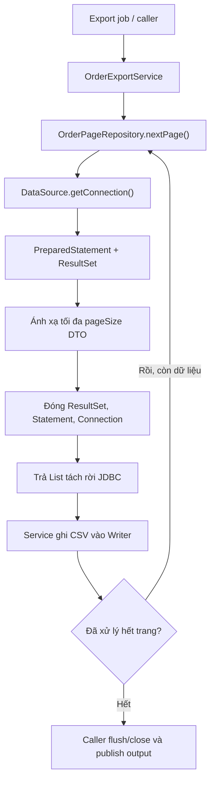
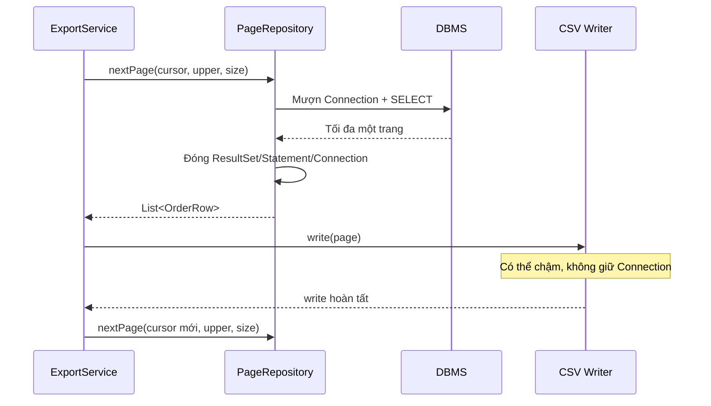

# Đọc danh sách lớn theo từng phần mà không rò rỉ kết nối

## Mục tiêu thực hành

Trong JDBC, `DataSource` cấp `Connection`, `PreparedStatement` thực thi SQL tham số hóa và `ResultSet` cho phép đọc các hàng truy vấn. Với vài chục bản ghi, việc ánh xạ toàn bộ kết quả thành một `List` thường đơn giản. Nhưng với **hàng trăm nghìn hoặc hàng triệu dòng**, cách làm thiếu kiểm soát dễ tạo hai vấn đề đối lập:

- **Giữ quá nhiều dữ liệu trong heap:** đọc toàn bộ `ResultSet` vào `List`/`Map`, dẫn đến áp lực bộ nhớ và GC, thậm chí `OutOfMemoryError`.
- **Giữ kết nối quá lâu hoặc làm rò rỉ:** đưa `ResultSet`/stream JDBC ra khỏi repository, quên đóng `Connection` khi exception, hoặc giữ cursor/transaction trong lúc ghi tệp hay chờ HTTP client chậm.

Trong bài thực hành tổng hợp này, chúng ta sẽ xây một quy trình **đọc đơn hàng theo từng trang, xuất CSV và trả lại connection cho pool ngay sau mỗi truy vấn**. Mã được chia theo trách nhiệm:

1. `OrderPageRepository` chỉ truy cập database và trả **DTO tách rời JDBC**.
2. `OrderExportService` chỉ điều phối các trang và ghi dữ liệu ra một `Writer` do caller sở hữu.
3. Tầng chạy job cấp `DataSource`, quản lý tệp đích, giới hạn số job đồng thời và theo dõi tiến độ.

Sau bài, bạn có thể:

- Áp dụng **keyset pagination** bằng `WHERE order_id > ?` và `ORDER BY order_id`.
- Giới hạn cả **số hàng trên mỗi trang** và số công việc đang thực thi.
- Giải thích chính xác ai sở hữu `Connection`, `PreparedStatement`, `ResultSet` và `Writer`.
- Dùng `try-with-resources` để trả connection trong cả đường thành công và khi lỗi.
- Phân biệt **cursor/transaction sống lâu** với **đọc một trang rồi đóng connection**.
- Kiểm thử các trường hợp không có dữ liệu, trang cuối ngắn, lỗi giữa quá trình xuất và connection pool nhỏ.
- Nhận diện các giới hạn về tính nhất quán của dữ liệu khi nhiều trang được đọc ở những transaction khác nhau.

## 1. Bài toán: xuất danh sách đơn hàng rất lớn

Giả sử dịch vụ quản trị cần xuất các đơn hàng vào CSV. Tập dữ liệu có thể lên tới vài triệu dòng. Mỗi đơn hàng có:

| Cột | Kiểu minh họa | Vai trò |
| --- | --- | --- |
| `order_id` | `BIGINT`, khóa chính | Cursor tiến trang |
| `customer_ref` | `VARCHAR(80)` | Mã khách hàng |
| `status` | `VARCHAR(30)` | Trạng thái đơn |
| `total_amount` | `DECIMAL(18,2)` | Giá trị đơn hàng |

Một schema minh họa cho **PostgreSQL 10+**:

```sql
CREATE TABLE export_orders (
    order_id BIGINT GENERATED BY DEFAULT AS IDENTITY PRIMARY KEY,
    customer_ref VARCHAR(80) NOT NULL,
    status VARCHAR(30) NOT NULL,
    total_amount DECIMAL(18, 2) NOT NULL
);

-- Dữ liệu thử nghiệm; ID dương, duy nhất, không sửa sau khi tạo.
INSERT INTO export_orders
    (customer_ref, status, total_amount)
VALUES
    ('KH-001', 'NEW', 125000.00),
    ('KH-002', 'PAID', 250000.50),
    ('KH-003', 'NEW',  78000.00),
    ('KH-004', 'DONE', 990000.00),
    ('KH-005', 'PAID', 420000.00);
```

Không chạy các câu DDL hoặc thao tác dọn dữ liệu thiếu điều kiện trong database sản xuất. Bảng và dữ liệu minh họa nên nằm trong một schema/database **chuyên dành cho thực hành**. Các DBMS khác dùng cú pháp identity khác nhau; phần Java bên dưới minh họa SQL phân trang có `LIMIT ?` của PostgreSQL/MySQL.

### 1.1. Yêu cầu chức năng và phi chức năng

| Yêu cầu | Điều kiện đạt |
| --- | --- |
| Lấy đủ các hàng trong phạm vi đã chọn | Không bỏ sót/đọc trùng do thuật toán phân trang khi khóa ổn định và nguồn dữ liệu không thay đổi |
| Không tải toàn bộ dữ liệu vào JVM | Mỗi truy vấn trả tối đa `pageSize` hàng |
| Không rò rỉ connection | Mọi lần mượn connection đều có đường đóng, kể cả khi SQL hoặc consumer lỗi |
| Không giữ connection khi consumer chậm | Repository đóng JDBC resources **trước** khi caller ghi trang ra CSV |
| Chống SQL injection ở dữ liệu động | `PreparedStatement` gắn các tham số `afterId`, `upperId`, `pageSize` |
| Thứ tự xác định | `ORDER BY order_id` trên khóa duy nhất |
| Có thể dừng khi lỗi | Ngoại lệ được truyền, tệp chưa hoàn tất không bị xem là thành công |
| Không chiếm hết pool | Giới hạn số job đồng thời, quan sát acquire/hold time |
| Biết giới hạn snapshot | Phân trang nhiều connection không mặc nhiên có cùng snapshot nhất quán |

**Phạm vi bài tập:** `order_id` là số dương, duy nhất, không được cập nhật; `customer_ref`/`status` không NULL; `total_amount` dùng `BigDecimal`. Đây là giả định cần ghi thành contract, không suy từ tên cột.

## 2. Phản ví dụ: cách làm tưởng đơn giản nhưng nguy hiểm

### 2.1. Đọc toàn bộ ResultSet vào bộ nhớ

```java
// PHẢN VÍ DỤ: không phù hợp dữ liệu rất lớn.
List<OrderRow> all = new ArrayList<>();

try (Connection c = dataSource.getConnection();
     PreparedStatement ps = c.prepareStatement(
         "SELECT order_id, customer_ref, status, total_amount "
       + "FROM export_orders ORDER BY order_id");
     ResultSet rs = ps.executeQuery()) {

    while (rs.next()) {
        all.add(mapRow(rs));
    }
}

writeCsv(all); // Heap vẫn giữ tất cả OrderRow.
```

`OrderRow`, `mapRow` và `writeCsv` ở đây là các hàm/kiểu giả định để minh họa. Dù code **đóng connection đúng**, nó vẫn có thể làm cạn heap nếu `all` chứa hàng triệu object, chuỗi và giá trị số.

### 2.2. Trả ResultSet ra ngoài khi Connection đã đóng

```java
// PHẢN VÍ DỤ: ResultSet bị ràng buộc vào Statement/Connection.
public ResultSet findOrdersUnsafe() throws SQLException {
    try (Connection c = dataSource.getConnection();
         PreparedStatement ps = c.prepareStatement(
             "SELECT order_id FROM export_orders")) {
        return ps.executeQuery();
    }
}
// Caller nhận ResultSet sau khi ps và c đã đóng.
```

Không nên sửa bằng cách **bỏ `close()`**: khi đó caller không có đủ reference hoặc hợp đồng rõ để trả statement/connection về pool. Một số driver có thể buffer kết quả và tình cờ cho phép đọc thêm trong tình huống cụ thể, nhưng **đó không phải lời hứa có thể dựa vào**.

### 2.3. Ghi dữ liệu ra mạng trong lúc giữ ResultSet sống

```java
// PHẢN VÍ DỤ: connection bị giữ theo tốc độ mạng.
try (Connection c = dataSource.getConnection();
     PreparedStatement ps = c.prepareStatement(
         "SELECT order_id, customer_ref FROM export_orders");
     ResultSet rs = ps.executeQuery()) {

    while (rs.next()) {
        sendToSlowHttpClient(rs.getLong(1), rs.getString(2));
    }
}
```

`sendToSlowHttpClient` là hàm giả định. Nếu một client nhận dữ liệu quá chậm, `Connection` vẫn được tính là **active** cho đến khi vòng lặp hoàn tất. Với 20 request xuất file và pool 10 connections, nhiều request khác có thể phải đợi hoặc gặp timeout, dù bản thân SQL khá nhanh.

## 3. Lựa chọn: phân trang theo khóa thay vì OFFSET sâu

Một phương án phân trang phổ biến là:

```sql
SELECT order_id, customer_ref, status, total_amount
  FROM export_orders
 ORDER BY order_id
 LIMIT ? OFFSET ?;
```

Khi `OFFSET` tăng rất lớn, DBMS có thể phải duyệt/loại bỏ nhiều hàng để lấy trang phía sau; chi phí thực tế phụ thuộc index và execution plan. Ngoài ra, nếu một hàng được chèn/xóa trước ranh giới giữa hai lần gọi, vị trí OFFSET có thể dịch chuyển làm trùng hoặc bỏ sót.

**Keyset pagination** dùng khóa cuối đã xử lý:

```sql
SELECT order_id, customer_ref, status, total_amount
  FROM export_orders
 WHERE order_id > ?
   AND order_id <= ?
 ORDER BY order_id
 LIMIT ?;
```

Ba tham số lần lượt là:

1. `afterId`: ID cuối đã xử lý xong.
2. `upperId`: ID cao nhất được chọn làm ranh giới đầu job.
3. `pageSize`: số hàng tối đa cần đọc trong trang.

Ví dụ với khóa `[10,20,30,40,50,60,70]` và `pageSize=3`:

| Lượt | `afterId` đầu lượt | Các ID đọc được | `afterId` lượt sau |
| --- | ---: | --- | ---: |
| 1 | 0 | 10, 20, 30 | 30 |
| 2 | 30 | 40, 50, 60 | 60 |
| 3 | 60 | 70 | 70 |
| 4 | 70 | Rỗng | Kết thúc |

Với cursor theo một ID bất biến, một lần chèn thêm hàng ID 15 sau khi đã xử lý 30 **không làm hàng 30 bị lặp** do dịch OFFSET. Tuy nhiên, hàng ID 15 mới commit muộn cũng **sẽ không được lấy ở các trang sau**. Thuật toán có thứ tự ổn định không đồng nghĩa snapshot đầy đủ tại một thời điểm.

### 3.1. Vì sao có upperId?

Một job export chạy lâu có thể gặp nhiều đơn hàng mới. Nếu không có điểm dừng, nó có thể tiếp tục đi theo các ID mới được thêm, khiến thời gian xử lý khó dự đoán. Ta lấy:

```sql
SELECT MAX(order_id) FROM export_orders;
```

lúc bắt đầu job, rồi chỉ đọc `order_id <= upperId`.

Đây là **high watermark theo khóa**, không phải snapshot transactional: một transaction khác có thể commit muộn hàng ID nhỏ hơn `upperId`; hàng cũ cũng có thể bị cập nhật/xóa. Muốn báo cáo tài chính nhất quán tại một thời điểm, cần cơ chế snapshot/isolation hoặc vật hóa một tập ID/dữ liệu bất biến phù hợp DBMS, chứ không chỉ `MAX(id)`.

### 3.2. Thứ tự và kiểu khóa

- `order_id` phải **duy nhất** để cursor không bỏ sót hàng có cùng giá trị sort.
- Nếu sort theo `created_at` không duy nhất, cần cursor gồm `(created_at, order_id)` và điều kiện tiến trang tương ứng.
- Nếu khóa bị thay đổi trong quá trình export, một hàng có thể xuất hiện lại hoặc biến mất khỏi phạm vi.
- Nếu cột sort có `NULL`, phải xác định quy tắc sắp xếp và so sánh phù hợp từng DBMS.
- Tạo index phù hợp với điều kiện `WHERE` và `ORDER BY`; khóa chính `order_id` thường có index hỗ trợ, nhưng vẫn nên xem execution plan.

## 4. Phân chia trách nhiệm và vòng đời tài nguyên

Ta dùng hai lớp với boundary rõ ràng.



| Thành phần | Sở hữu | Không sở hữu |
| --- | --- | --- |
| `OrderPageRepository` | Connection, statement, result set **mỗi lần truy vấn trang** | Writer/output, tình trạng job đã publish |
| `OrderExportService` | Cursor trang, thứ tự xuất, mapping từ DTO sang CSV | Connection sau khi repository trả về; việc đóng Writer |
| Caller/job | DataSource lifecycle theo runtime, Writer/tệp đích, quota và cleanup | ResultSet, statement bên trong repository |
| Connection pool | Connection vật lý, kiểm tra/reset session, giới hạn cấp kết nối | Quyết định nghiệp vụ đã xuất đủ dữ liệu |

**Mấu chốt:** thời gian `nextPage()` bao gồm lấy và trả connection. Thời gian ghi trang ra một `Writer` chậm xảy ra **sau** thời điểm connection được trả.

## 5. Xây OrderPageRepository bằng JDBC thuần

Ví dụ mã Java 17+ (sử dụng `record` và text block), tương thích với một `DataSource` JDBC mà ứng dụng cấp từ tầng bootstrap. Cú pháp SQL trong ví dụ dùng `LIMIT ?` như PostgreSQL/MySQL; với SQL Server hoặc Oracle, thay giới hạn bằng cú pháp của dialect và kiểm thử thứ tự bind.

### 5.1. Mã nguồn hoàn chỉnh

```java
import java.math.BigDecimal;
import java.sql.Connection;
import java.sql.PreparedStatement;
import java.sql.ResultSet;
import java.sql.SQLException;
import java.util.ArrayList;
import java.util.List;
import java.util.Objects;
import javax.sql.DataSource;

public final class OrderPageRepository {
    public static final int MAX_PAGE_SIZE = 500;

    public record OrderRow(
        long id,
        String customerRef,
        String status,
        BigDecimal totalAmount
    ) {}

    private final DataSource dataSource;

    public OrderPageRepository(DataSource dataSource) {
        this.dataSource = Objects.requireNonNull(dataSource);
    }

    /** High watermark lấy ở đầu job; không phải snapshot DBMS. */
    public long highestId() throws SQLException {
        String sql = "SELECT MAX(order_id) FROM export_orders";

        try (Connection c = dataSource.getConnection();
             PreparedStatement ps = c.prepareStatement(sql);
             ResultSet rs = ps.executeQuery()) {

            if (!rs.next()) {
                throw new SQLException("MAX() không trả hàng kết quả");
            }

            long maxId = rs.getLong(1);
            return rs.wasNull() ? 0L : maxId;
        }
    }

    /**
     * Đọc tối đa pageSize hàng thuộc (afterId, upperId].
     * Connection được đóng trước khi trả List DTO.
     */
    public List<OrderRow> nextPage(
            long afterId, long upperId, int pageSize)
            throws SQLException {

        if (afterId < 0 || upperId < 0 || afterId > upperId) {
            throw new IllegalArgumentException(
                "Cursor phải thỏa 0 <= afterId <= upperId"
            );
        }
        if (pageSize < 1 || pageSize > MAX_PAGE_SIZE) {
            throw new IllegalArgumentException(
                "pageSize phải nằm trong [1, "
                    + MAX_PAGE_SIZE + "]"
            );
        }
        if (afterId == upperId) {
            return List.of();
        }

        String sql = """
            SELECT order_id, customer_ref, status, total_amount
              FROM export_orders
             WHERE order_id > ?
               AND order_id <= ?
             ORDER BY order_id
             LIMIT ?
            """;

        List<OrderRow> page = new ArrayList<>(pageSize);

        try (Connection c = dataSource.getConnection();
             PreparedStatement ps = c.prepareStatement(sql)) {
            ps.setLong(1, afterId);
            ps.setLong(2, upperId);
            ps.setInt(3, pageSize);
            ps.setQueryTimeout(15);

            try (ResultSet rs = ps.executeQuery()) {
                while (rs.next()) {
                    long id = rs.getLong("order_id");
                    String customer =
                        rs.getString("customer_ref");
                    String status = rs.getString("status");
                    BigDecimal amount =
                        rs.getBigDecimal("total_amount");

                    // Theo schema, các cột này NOT NULL.
                    // Nếu dữ liệu/schema vi phạm contract,
                    // báo lỗi thay vì âm thầm xuất CSV sai.
                    if (customer == null || status == null
                            || amount == null) {
                        throw new SQLException(
                            "Thiếu dữ liệu ở order_id=" + id
                        );
                    }

                    page.add(new OrderRow(
                        id, customer, status, amount
                    ));
                }
            }
        }

        // Không có ResultSet/Connection trong các OrderRow.
        return List.copyOf(page);
    }
}
```

### 5.2. Vì sao đoạn mã này tránh rò rỉ connection?

Các lời gọi JDBC được đặt trong `try-with-resources`, nên:

1. Khi `executeQuery()` trả về thành công, `ResultSet` được đóng sau khi đọc xong.
2. Nếu `rs.next()` hoặc getter ném `SQLException`, Java vẫn cố đóng `ResultSet`.
3. Khi thoát khối chứa `PreparedStatement` và `Connection`, chúng cũng được đóng theo **thứ tự ngược lúc khai báo**.
4. Nếu `ResultSet.close()` hoặc `Connection.close()` lỗi trong lúc đang có lỗi chính, thông tin cleanup có thể nằm trong `Throwable.getSuppressed()`.
5. Với DataSource dùng connection pool, `Connection.close()` **thường trả logical connection về pool** thay vì hủy socket vật lý.

Không dùng `finally { c = null; }` để “giải phóng connection”: gán biến thành `null` không đóng tài nguyên. Cũng không trông chờ GC hoàn tất kịp để trả connection khi pool cạn.

### 5.3. Vì sao record trả về thật sự tách rời JDBC?

`OrderRow` ở đây chỉ chứa `long`, `String` và `BigDecimal`; nó **không** chứa `ResultSet`, `Blob`, `Clob`, `Array`, `InputStream` hoặc wrapper driver cần connection. Caller dùng DTO sau khi phương thức đã đóng tài nguyên là hợp lệ.

Tuy nhiên, một `record` chứa `byte[]` hoặc `List` mutable không tự động có tính bất biến sâu. Nếu schema thay `total_amount` bằng LOB cực lớn, hãy thiết kế một luồng sao chép/spool riêng, không nhét toàn bộ dữ liệu nhị phân vào mỗi trang và coi `pageSize` là giới hạn heap.

### 5.4. Kiểm soát dữ liệu SQL NULL

Schema minh họa yêu cầu `customer_ref`, `status` và `total_amount` không NULL. Code ném lỗi nếu nhận giá trị NULL cho một trong các cột này; đối với cột số dạng `long` có thể NULL, phải gọi `rs.wasNull()` ngay sau `getLong()`, hoặc dùng `getObject(..., Long.class)` khi driver hỗ trợ. Không để giá trị SQL `NULL` bị hiểu nhầm thành `0`.

## 6. Điều phối trang và ghi CSV sau khi đã đóng connection

Repository trả một `List<OrderRow>` độc lập. Tầng export chỉ tiến con trỏ **sau khi đã ghi thành công trang hiện tại**.

```java
import java.io.IOException;
import java.io.Writer;
import java.sql.SQLException;
import java.util.List;
import java.util.Objects;

public final class OrderExportService {
    private final OrderPageRepository repository;

    public OrderExportService(OrderPageRepository repository) {
        this.repository = Objects.requireNonNull(repository);
    }

    /**
     * Writer do caller sở hữu và phải close/flush.
     * Nếu lỗi, output có thể đã chứa dữ liệu một phần.
     */
    public long exportCsv(Writer output, int pageSize)
            throws SQLException, IOException {
        Objects.requireNonNull(output, "output");

        long upperId = repository.highestId();
        long afterId = 0L;
        long exportedRows = 0L;

        output.write(
            "order_id,customer_ref,status,total_amount\n"
        );

        while (afterId < upperId) {
            List<OrderPageRepository.OrderRow> page =
                repository.nextPage(afterId, upperId, pageSize);

            if (page.isEmpty()) {
                break;
            }

            // nextPage() đã đóng Connection trước khi trả về.
            // Ghi tệp chậm không chiếm connection JDBC.
            for (OrderPageRepository.OrderRow row : page) {
                output.write(row.id() + ","
                    + csvField(row.customerRef()) + ","
                    + csvField(row.status()) + ","
                    + row.totalAmount().toPlainString()
                    + "\n");
                exportedRows++;
            }

            // Chỉ tiến trang sau khi ghi xong tất cả hàng
            // của trang vào Writer theo contract đồng bộ.
            afterId = page.get(page.size() - 1).id();
        }

        return exportedRows;
    }

    private static String csvField(String text) {
        if (text == null) {
            return ""; // Chỉ dùng nếu chính sách cho phép NULL.
        }
        return "\"" + text.replace("\"", "\"\"") + "\"";
    }
}
```

Với dữ liệu CSV mở trong ứng dụng bảng tính, **CSV escaping không tự ngăn formula injection**: giá trị bắt đầu bằng các ký tự như `=`, `+`, `-`, `@` có thể cần chính sách bảo vệ riêng ở lớp xuất tệp, tùy định dạng và consumer. Ngoài ra, dùng dấu phẩy và ký tự xuống dòng như ví dụ cần được điều chỉnh nếu định dạng CSV của hệ thống có quy tắc khác.

### 6.1. Vì sao không đóng Writer trong service?

`Writer` do caller tạo và có thể là tệp, HTTP response hoặc bộ đệm chung. `OrderExportService` **không sở hữu** việc đóng Writer. Nó chỉ thực hiện các lời gọi `write(...)`; caller phải `flush()/close()` và chỉ công bố kết quả sau khi mọi bước hoàn tất.

Điều này tương tự quy tắc với connection: **tài nguyên do ai sở hữu thì tầng đó chịu trách nhiệm đóng**, trừ khi hợp đồng API chuyển quyền sở hữu rõ ràng.

### 6.2. Nếu consumer ném IOException?

Giả sử `output.write(...)` lỗi ở trang thứ 100. Tầng export sẽ dừng và ném `IOException`. **Không có ResultSet/Connection nào của trang đó còn mở**, vì `repository.nextPage()` đã trả dữ liệu hoàn chỉnh và đóng JDBC resources trước khi `output.write(...)` được gọi.

Tuy nhiên, 99 trang trước có thể **đã được ghi vào tệp hoặc gửi qua mạng**. JDBC `rollback()` không thể thu hồi byte đã gửi ra ngoài database. Cần đánh dấu job thất bại và không publish tệp dở dang như kết quả hợp lệ.

### 6.3. Không nhầm write() thành dữ liệu đã bền vững

`Writer.write(...)` thành công chỉ xác nhận lời gọi Java chưa báo lỗi; với `BufferedWriter`, byte có thể còn trong buffer. Ngay cả sau `flush()/close()`, mức bền vững trên đĩa/object storage phụ thuộc giao thức và hệ thống. Vì vậy, nếu triển khai checkpoint/retry sau crash, chỉ ghi checkpoint theo mức **đã được sink xác nhận** mà workflow yêu cầu, không chỉ sau khi đưa dữ liệu vào một queue chưa có ack.

## 7. Thực thi một job xuất file an toàn hơn

Để tránh để lại một tệp CSV chưa đầy đủ ở vị trí người dùng có thể tải, hãy xuất vào **tệp tạm** và chỉ chuyển sang tên đích sau khi Writer được đóng thành công.

```java
import java.io.IOException;
import java.io.Writer;
import java.nio.charset.StandardCharsets;
import java.nio.file.Files;
import java.nio.file.Path;
import java.sql.SQLException;
import java.util.Objects;

public final class OrderCsvPublisher {
    private final OrderExportService exportService;

    public OrderCsvPublisher(OrderExportService exportService) {
        this.exportService =
            Objects.requireNonNull(exportService);
    }

    public long publish(Path directory, Path target, int pageSize)
            throws SQLException, IOException {
        Objects.requireNonNull(directory);
        Objects.requireNonNull(target);

        // Caller phải xác minh directory/target nằm trong vùng
        // được cho phép; không dùng đường dẫn tùy ý từ user.
        Path temp = Files.createTempFile(
            directory, "orders-", ".part"
        );
        boolean published = false;

        try {
            long rowCount;
            try (Writer writer = Files.newBufferedWriter(
                    temp, StandardCharsets.UTF_8)) {
                rowCount = exportService.exportCsv(
                    writer, pageSize
                );
            }

            // Chỉ chuyển tên sau khi writer đã close thành công.
            // File move cùng filesystem có thể được thực hiện atomic
            // nếu hệ điều hành hỗ trợ; ví dụ này không tự cam kết atomic.
            Files.move(temp, target);
            published = true;
            return rowCount;
        } finally {
            if (!published) {
                Files.deleteIfExists(temp);
            }
        }
    }
}
```

**Điều kiện sử dụng:** directory/target là những đường dẫn đã được code tin cậy xác thực, không lấy thẳng từ input chưa kiểm tra để tránh path traversal. Trong hệ thống production, nên thêm chính sách không ghi đè tên file, quota, quyền tệp, mã hóa nếu chứa dữ liệu nhạy cảm, dọn file tạm sau crash và cơ chế công bố atomic (nếu cần và được filesystem hỗ trợ).

Ví dụ chỉ di chuyển tệp sau khi ghi xong. Nếu `Files.move()` báo lỗi, `finally` sẽ cố xóa file tạm. Nếu chính cleanup ném `IOException` thì lỗi đó có thể che nguyên nhân trước đó; hệ thống vận hành nên giữ lỗi chính và gắn cleanup error thành suppressed, cùng trạng thái job phù hợp.

**Tệp xuất hoàn chỉnh** không đồng nghĩa snapshot database nhất quán: trang đầu và trang cuối vẫn có thể đọc ở những thời điểm khác nhau. Nếu nghiệp vụ yêu cầu báo cáo “tại 10:00”, phải giải quyết consistency riêng.

## 8. Cấu hình DataSource và connection pool

Lớp repository chỉ nhận interface `DataSource`, không cần biết driver, URL hoặc password. Với ứng dụng server, nên cấp `DataSource` từ application container, dependency injection hoặc pool được cấu hình tại runtime.

Một ví dụ cấu hình tùy chọn dùng **HikariCP** (thư viện bên ngoài JDBC chuẩn):

```java
import com.zaxxer.hikari.HikariConfig;
import com.zaxxer.hikari.HikariDataSource;
import java.nio.file.Path;

public final class ExportRunner {
    public static void main(String[] args) throws Exception {
        HikariConfig config = new HikariConfig();
        config.setJdbcUrl(requiredEnv("APP_JDBC_URL"));
        config.setUsername(requiredEnv("APP_DB_USER"));
        config.setPassword(requiredEnv("APP_DB_PASSWORD"));
        config.setMaximumPoolSize(4);
        config.setConnectionTimeout(3_000);

        // Chỉ là ví dụ; TLS và driver phải được cấu hình
        // theo DBMS/driver cụ thể ở môi trường triển khai.
        try (HikariDataSource dataSource =
                 new HikariDataSource(config)) {
            OrderPageRepository repository =
                new OrderPageRepository(dataSource);
            OrderExportService export =
                new OrderExportService(repository);
            OrderCsvPublisher publisher =
                new OrderCsvPublisher(export);

            Path directory = Path.of(
                requiredEnv("APP_EXPORT_DIRECTORY")
            );
            Path target = directory.resolve("orders.csv");

            long rows = publisher.publish(
                directory, target, 200
            );
            System.out.println("Rows exported: " + rows);
        }
    }

    private static String requiredEnv(String name) {
        String value = System.getenv(name);
        if (value == null || value.isBlank()) {
            throw new IllegalStateException(
                "Thiếu cấu hình: " + name
            );
        }
        return value;
    }
}
```

**Điều kiện chạy:**

- Cài driver JDBC tương ứng DBMS và HikariCP vào classpath.
- Tạo schema `export_orders` trong **database thử nghiệm**.
- Đặt các biến môi trường cho JDBC URL, user, password và thư mục xuất, **không commit mật khẩu** vào source.
- Bảo đảm thư mục xuất tồn tại, có quyền ghi và được kiểm soát.
- Với PostgreSQL/MySQL, truy vấn `LIMIT ?` phù hợp; nếu dùng SQL Server/Oracle, thay bằng dialect đã kiểm thử.
- Bảo đảm service account chỉ có quyền đọc những bảng cần cho export.
- Kích thước pool `4` và `pageSize 200` chỉ là con số thực hành, **không phải cấu hình tối ưu mặc định**.

Đây là đường chạy ví dụ dành cho job đơn. Trong web server hiện có, **không khởi tạo HikariDataSource mới cho mỗi request**; dùng một pool được quản lý trong vòng đời ứng dụng và để dependency injection cấp cho repository. Khi ứng dụng dừng mới đóng pool theo vòng đời của runtime.

## 9. Ước lượng bộ nhớ, I/O và áp lực ngược

### 9.1. Giới hạn page size không phải giới hạn số byte cứng

Giả sử mỗi trang có 200 hàng. Nếu một DTO có dung lượng trung bình **0,8 KiB**, phần payload của một trang ước tính:

\[
M_{\mathrm{page}} \approx 200 \times 0.8\ \mathrm{KiB}
= 160\ \mathrm{KiB}
\]

Đây là ước tính; còn có overhead của `List`, `record`, `String`, `BigDecimal`, buffer của driver và output. Một trường văn bản có thể dài bất thường làm memory footprint tăng mạnh. Với BLOB/CLOB, phải có ngưỡng **theo byte** hoặc đường xử lý riêng, không chỉ `LIMIT 200`.

**Quan trọng:** ví dụ mỗi lúc chỉ giữ một page ở tầng export. Kích thước heap vì thế không tăng tuyến tính theo tổng số hàng, miễn là caller không tích lũy tất cả page vào một collection khác.

### 9.2. Backpressure tự nhiên theo từng trang



Vì gọi `nextPage()` tiếp theo **sau** khi ghi xong trang, producer không được phép đọc trước vô hạn. Đây là một dạng **backpressure đồng bộ theo trang**.

Nếu cần nén song song với đọc DB, có thể dùng `ArrayBlockingQueue<List<OrderRow>>` với dung lượng nhỏ, nhưng producer phải **đóng connection trước khi gọi `queue.put(page)`**. Queue đầy khiến producer dừng, không giữ connection trong lúc chờ consumer. Cần giới hạn cả số pipeline/job đồng thời: mỗi job có queue nhỏ vẫn có thể tạo tổng memory lớn nếu có hàng trăm job.

### 9.3. Giới hạn số job đồng thời

Một service có thể giữ một `Semaphore` chia sẻ để chặn hoặc từ chối job xuất mới. Ví dụ:

```java
import java.util.concurrent.Semaphore;
import java.util.concurrent.TimeUnit;

final class ExportAdmission {
    private final Semaphore slots = new Semaphore(2);

    void run(CheckedJob job) throws Exception {
        if (!slots.tryAcquire(2, TimeUnit.SECONDS)) {
            throw new IllegalStateException(
                "Quá nhiều export đồng thời"
            );
        }
        try {
            job.run();
        } finally {
            slots.release();
        }
    }

    @FunctionalInterface
    interface CheckedJob {
        void run() throws Exception;
    }
}
```

Đây là giới hạn **trên một instance**. Nếu có nhiều replica, tổng job và số connection từ các pool có thể vượt ngân sách DBMS. Tầng job scheduler hoặc admission toàn cụm cần phối hợp khi yêu cầu vận hành đòi giới hạn toàn hệ thống.

## 10. So sánh ba chiến lược đọc dữ liệu lớn

| Chiến lược | Vòng đời connection | Ưu điểm | Nhược điểm |
| --- | --- | --- | --- |
| Một `ResultSet` streaming dài | Giữ connection/cursor trong toàn bộ quá trình quét | Ít round trip, có thể thuận lợi cho snapshot/cursor | Consumer chậm làm giữ connection/transaction lâu |
| **Keyset pages + DTO** | Đóng connection sau mỗi trang, trước khi consumer xử lý | Tránh giữ pool khi sink chậm; bộ nhớ kiểm soát theo trang | Snapshot có thể thay đổi giữa trang; nhiều round trip |
| OFFSET pages | Cũng có thể đóng mỗi trang | Dễ cho UI muốn tới trang số N | OFFSET sâu có thể tốn chi phí; chèn/xóa làm dịch ranh giới |

Không có chiến lược nào thắng mọi tình huống. **Bài thực hành này chọn keyset pages** vì mục tiêu là vừa giới hạn bộ nhớ vừa không giữ connection qua một consumer chậm.

### 10.1. Khi nào một cursor dài vẫn hợp lý?

Một số báo cáo cần snapshot nhất quán tại thời điểm transaction đọc. Khi đó, giữ một connection/transaction trong toàn bộ lần quét có thể là lựa chọn có chủ đích. Tuy nhiên phải:

- Đo thời gian giữ connection và tác động lên pool.
- Xác minh driver thật sự streaming; `setFetchSize(...)` chỉ là **hint**, không phải giới hạn heap cứng.
- Kiểm tra DBMS có yêu cầu `autoCommit=false` để bật server-side cursor không.
- Đóng `ResultSet`/statement và kết thúc transaction **trước khi** trả connection.
- Giới hạn số cursor dài và đặt timeout.

**Giữ connection lâu vì yêu cầu nhất quán là quyết định thiết kế; quên `close()` là rò rỉ.** Hai vấn đề cần phân biệt khi đọc metrics.

### 10.2. Nếu cần nhất quán “snapshot tại một thời điểm”

Phân trang qua nhiều connection thường có nhiều snapshot khác nhau. Các lựa chọn phụ thuộc DBMS:

1. Đọc một snapshot qua transaction/cursor sống đủ lâu, chấp nhận giữ connection.
2. Chụp danh sách ID hoặc dữ liệu cần xuất sang bảng snapshot/job riêng, sau đó phân trang trên snapshot bất biến.
3. Dùng tính năng snapshot/as-of query/export do DBMS cung cấp (nếu có), theo chính sách retention của database.
4. Với event log bất biến, có thể định nghĩa high watermark và quy tắc chỉ xuất những sự kiện đã commit theo một biên ổn định.

Không coi `upperId = MAX(id)` tự động bảo đảm nhất quán snapshot. Các transaction còn hoạt động, cập nhật hoặc xóa hàng cũ có thể làm kết quả khác nhau giữa các page.

## 11. Transaction và quyền sở hữu Connection

Trong thiết kế hiện tại, mỗi `nextPage()` là một lần đọc ngắn và dùng connection riêng. Không có một transaction JDBC duy nhất cho toàn bộ export. Đó là lựa chọn để **trả connection sớm**, không phải lỗi tự thân.

Nếu nghiệp vụ khác cần nhiều SQL nguyên tử, cần service sở hữu connection và truyền nó vào các DAO tham gia transaction:

```java
try (Connection c = dataSource.getConnection()) {
    c.setAutoCommit(false);
    try {
        updateOrder(c, orderId);
        insertAudit(c, orderId);
    } catch (SQLException | RuntimeException failure) {
        try {
            c.rollback();
        } catch (SQLException rollbackError) {
            failure.addSuppressed(rollbackError);
        }
        throw failure;
    }
    c.commit();
}
```

`updateOrder` và `insertAudit` là phương thức ứng dụng giả định, phải dùng **cùng connection**. Với mô hình này DAO chỉ đóng statement/result set do mình tạo, **không đóng connection do service truyền xuống**.

Tránh:

- Giữ connection trong field singleton repository cho nhiều HTTP request dùng chung.
- Truyền cùng một `ResultSet` sang nhiều virtual threads hoặc sang consumer bất đồng bộ.
- Lưu connection trong session người dùng nhiều phút.
- Trả `Stream<T>` lười đọc từ JDBC nhưng không chuyển quyền ownership của connection/statement/result set rõ ràng.
- Gọi `setAutoCommit(true)` vô điều kiện trên transaction chưa biết đã kết thúc; thao tác này có thể làm commit những thay đổi còn treo tùy trạng thái JDBC.

Đối với transaction ghi, `SQLException` ngay tại `commit()` có thể tạo kết quả **chưa xác định** nếu mất mạng sau khi server commit. Bài xuất CSV chỉ đọc, nhưng cần phân biệt lỗi ghi file và lỗi commit khi mở rộng thành bài tích hợp CRUD.

## 12. Timeout, hủy tác vụ và lỗi giữa chừng

Một export lớn có thể dừng vì:

- Không lấy được `Connection` từ pool trong timeout.
- Query bị timeout hoặc server ngắt kết nối.
- `rs.next()`/getter ném `SQLException` khi đang đọc page.
- Kết quả chứa `NULL` hoặc kiểu không đúng contract.
- `Writer.write()` ném `IOException` do đĩa đầy hoặc HTTP client đã ngắt.
- Job hết deadline, bị cancel hoặc tiến trình dừng bất ngờ.

### 12.1. Timeout ở các tầng khác nhau

| Tầng | Ví dụ cơ chế | Giới hạn |
| --- | --- | --- |
| Chờ cấp connection | Acquisition timeout do pool cấu hình | Không giống thời gian thực thi SQL |
| Thực thi statement | `Statement.setQueryTimeout(seconds)` | Driver/DBMS hỗ trợ khác nhau; không phải deadline toàn job |
| Socket/network | Timeout theo driver hoặc `Connection.setNetworkTimeout(...)` nơi được hỗ trợ | Không làm Writer/HTTP sink tự dừng |
| Admission | `Semaphore.tryAcquire(timeout, unit)` | Không thay thế giới hạn số request ở tầng ingress |
| Tệp hoặc output | Deadline/timeout của sink | Không chứng minh DBMS query đã bị hủy |
| Job toàn cục | Deadline và cancel signal | Cần cleanup, checkpoint và chính sách retry |

Một `Thread.interrupt()` hoặc `Future.cancel(true)` không bảo đảm driver đang chặn trong JDBC dừng tức thời. Cần cấu hình query/network timeout và cơ chế cancellation phù hợp driver, bảo đảm resources vẫn được đóng khi tác vụ kết thúc.

### 12.2. Xử lý exception không được che lỗi gốc

`try-with-resources` sẽ cố đóng JDBC resources kể cả khi có exception. Nếu cleanup cũng lỗi, Java thường gắn lỗi cleanup vào `getSuppressed()`. Không nên có đoạn:

```java
catch (SQLException error) {
    return List.of(); // SAI: biến lỗi DB thành "không có dữ liệu".
}
```

Một trang rỗng là kết quả hợp lệ của truy vấn; mất connection, SQL sai hoặc timeout phải được truyền như lỗi có thể quan sát. Phân loại SQLState/vendor code khi xử lý vận hành, nhưng tránh log JDBC URL chứa password, dữ liệu riêng tư hoặc toàn bộ tham số truy vấn.

### 12.3. Tệp dở dang và checkpoint

Giả sử đã ghi xong 50 trang rồi ứng dụng crash ở trang 51. Có thể chọn:

- Xóa file tạm và chạy lại toàn bộ (đơn giản, phù hợp job vừa phải).
- Lưu trạng thái job + checkpoint theo `lastCommittedId`, chỉ sau khi phần output tương ứng được sink xác nhận bền vững.
- Xuất thành nhiều đoạn/tệp có định danh trang ổn định và gộp sau; dùng cơ chế idempotent để tránh ghi hai lần.

Nếu crash sau khi sink lưu trang nhưng **trước** khi checkpoint được cập nhật, trang có thể bị xuất lại khi retry. Do vậy, **keyset cursor không tự bảo đảm exactly-once**. Cần một giao thức checkpoint/commit nhất quán với sink hoặc khả năng loại bỏ trang trùng.

## 13. Kiểm thử tích hợp: không chỉ kiểm tra CSV có dữ liệu

Bài tập chỉ được xem là đạt khi dữ liệu đúng và không có connection bị bỏ quên. Việc thử trên database giả/mocked JDBC không đủ để kết luận driver thật hỗ trợ truy vấn, fetch/timeout và pooling như mong muốn.

### 13.1. Chuẩn bị môi trường kiểm thử

- Dùng **database/schema riêng**, không chạy test phá dữ liệu production.
- Tạo bảng `export_orders` và seed ít nhất 7 hàng ID dương, sắp xếp không liên tiếp cũng được.
- Cấu hình `DataSource` thử nghiệm bằng credential riêng, không hard-code secret.
- Nếu có pool, giới hạn pool nhỏ (ví dụ `maximumPoolSize=1` hoặc 2) để lỗi quên trả connection dễ lộ.
- Với test nhiều hàng, seed sao cho số hàng vượt `pageSize` để bắt lỗi chỉ đọc trang đầu.
- Đo và ghi driver version, DBMS version, isolation và pool config.
- Nếu test chạy song song, không sử dụng chung các hàng có thể bị sửa/xóa ngoài chủ đích.

### 13.2. Ma trận kiểm thử

| Kịch bản | Thao tác | Kỳ vọng |
| --- | --- | --- |
| Bảng rỗng | `highestId()` trên bảng không có hàng | Trả 0, export chỉ có header |
| Một hàng | Page size 200 | Một trang 1 hàng, không exception |
| Ít hơn một trang | 3 hàng, size 10 | Lấy đủ 3 hàng theo ID |
| Đúng bội số page size | 6 hàng, size 3 | Không lặp trang/hàng |
| Trang cuối ngắn | 7 hàng, size 3 | Các trang 3, 3, 1 |
| ID không liên tiếp | IDs 2, 10, 18 | Keyset vẫn tiến đúng |
| Unicode và dấu nháy | `customer_ref` chứa dấu tiếng Việt và ký tự CSV | Nội dung và escaping đúng |
| SQL NULL trái contract | Bảng test cho phép NULL hoặc dữ liệu lỗi | Repository phát hiện theo contract |
| Lỗi query giữa các trang | Mô phỏng DB/driver báo lỗi | Không trả danh sách rỗng giả |
| Lỗi Writer | Writer ném IOException | Job thất bại, connection đã trả |
| Client hủy export | Ngừng output khi job đang xử lý | Resources được đóng theo scope |
| Pool tối đa 1 connection | Xuất nhiều trang rồi mượn lại connection | Không cạn pool do connection leak |
| Writer rất chậm | Mỗi trang chờ nhiều giây | Không giữ active connection trong lúc chờ Writer |
| Concurrent insert/delete | Writer khác sửa dữ liệu giữa các trang | Ghi nhận hạn chế snapshot; không tuyên bố xuất đúng một thời điểm |
| Chạy nhiều job | Admission giới hạn và metrics | Không vượt ngân sách pool/DBMS |
| LOB hoặc chuỗi rất dài | Trang ít hàng nhưng nhiều byte | Có ngưỡng byte/spool thay vì OOM |

### 13.3. Ví dụ kiểm thử trang với JUnit 5

Giả sử database test **đã được reset riêng** và chứa chính xác các hàng theo `order_id`: 10, 20, 30, 40, 50, 60, 70; không có writer concurrent. Để truy vấn không phụ thuộc identity sequence, fixture có thể được tạo bởi migration/seed riêng đã kiểm tra trên DBMS thử nghiệm.

```java
import static org.junit.jupiter.api.Assertions.*;
import java.sql.SQLException;
import java.util.List;
import org.junit.jupiter.api.Test;

public final class OrderPageRepositoryIT {
    // TestDataSources là helper dự án phải triển khai.
    private final OrderPageRepository repository =
        new OrderPageRepository(TestDataSources.integration());

    @Test
    void readsAllSevenIdsInThreePages() throws SQLException {
        List<OrderPageRepository.OrderRow> first =
            repository.nextPage(0, 70, 3);
        List<OrderPageRepository.OrderRow> second =
            repository.nextPage(30, 70, 3);
        List<OrderPageRepository.OrderRow> third =
            repository.nextPage(60, 70, 3);

        assertEquals(List.of(10L, 20L, 30L),
            first.stream().map(OrderPageRepository.OrderRow::id)
                .toList());
        assertEquals(List.of(40L, 50L, 60L),
            second.stream().map(OrderPageRepository.OrderRow::id)
                .toList());
        assertEquals(List.of(70L),
            third.stream().map(OrderPageRepository.OrderRow::id)
                .toList());

        assertTrue(repository.nextPage(70, 70, 3).isEmpty());
    }
}
```

`TestDataSources.integration()` là **điểm nối hạ tầng thử nghiệm do dự án cung cấp**, không phải lớp JUnit/JDBC có sẵn. Test này cố ý dùng fixture **độc lập và không bị thay đổi** trong lúc chạy. Không dùng ID cứng trên database chia sẻ với nhiều test khác.

### 13.4. Ví dụ JUnit: lỗi consumer không làm mất connection

Có thể thiết kế test integration với **pool có max=1**, có ít nhất một hàng, và `Writer` luôn ném `IOException` khi ghi. Sau khi service phát sinh lỗi, gọi `getConnection()` thêm lần nữa phải thành công trong acquisition timeout.

```java
import static org.junit.jupiter.api.Assertions.*;
import java.io.IOException;
import java.io.Writer;
import java.sql.Connection;
import javax.sql.DataSource;
import org.junit.jupiter.api.Test;

final class OrderExportLeakIT {
    private final DataSource testDb =
        TestDataSources.singleConnectionPool();

    private final OrderExportService export =
        new OrderExportService(
            new OrderPageRepository(testDb)
        );

    @Test
    void writerFailureDoesNotRetainJdbcConnection() throws Exception {
        Writer failed = new Writer() {
            private int writeCalls;

            @Override
            public void write(char[] data, int offset, int length)
                    throws IOException {
                // Lần đầu ghi header thành công; lỗi ở dòng dữ
                // liệu đầu tiên, SAU khi nextPage() đã chạy.
                if (++writeCalls >= 2) {
                    throw new IOException("Mô phỏng lỗi tệp");
                }
            }

            @Override
            public void flush() {}

            @Override
            public void close() {}
        };

        assertThrows(IOException.class,
            () -> export.exportCsv(failed, 2));

        // Với pool max=1, nếu một Connection bị rò rỉ,
        // lần mượn tiếp theo thường sẽ timeout.
        try (Connection connection = testDb.getConnection()) {
            assertFalse(connection.isClosed());
        }
    }
}
```

`TestDataSources.singleConnectionPool()` cần được dự án cấu hình bằng **pool thật** có maximum 1 và acquisition timeout hữu hạn; hạ tầng test chịu trách nhiệm đóng pool cuối vòng đời. Database test phải chứa **ít nhất một hàng** để lần ghi thứ hai diễn ra. Writer trong ví dụ cố ý **ghi header thành công rồi ném lỗi ở dòng dữ liệu đầu tiên**, nghĩa là repository đã thực hiện một lần đọc trang và trả connection trước khi lỗi được kích hoạt. Muốn có bằng chứng mạnh hơn, thêm pool metrics hoặc proxy đếm từng lần mượn–trả, đồng thời thử lỗi ngay trong `executeQuery()`/`ResultSet.next()`; một ca test thành công không chứng minh tất cả nhánh đều không leak.

### 13.5. Bổ sung test lỗi nằm bên trong repository

Một lỗi khác phát sinh ngay trong `rs.next()` hoặc ánh xạ hàng, không phải lỗi Writer. Để kiểm thử nhánh này:

1. Dùng driver/test proxy có thể ném `SQLException` khi đọc hàng thứ hai.
2. Theo dõi `ResultSet.close()`, `PreparedStatement.close()` và `Connection.close()`.
3. Kỳ vọng repository **ném lỗi** và không trả một page thiếu bị giả thành page hợp lệ.
4. Sau đó thử mượn connection từ cùng pool và xác nhận có thể thực hiện SELECT đơn giản.
5. Kiểm tra suppressed exceptions nếu cleanup cũng bị lỗi.

Với pool production, quan sát `active connections` trở về baseline và `pending/acquisition timeout` không tích lũy. Metrics có độ trễ cập nhật; tránh assertion thời gian quá cứng gây flaky test.

## 14. Đo đạc trên tải lớn: phải đo toàn pipeline

Giả sử dữ liệu có 1 triệu hàng, `pageSize=200`. Số lượt truy vấn trang xấp xỉ:

\[
N_{\mathrm{pages}} = \left\lceil\frac{1\,000\,000}{200}\right\rceil
= 5\,000
\]

Một truy vấn `MAX(order_id)` và khoảng 5.000 lần đọc trang có thể đủ cho job, tùy khoảng trống ID và dữ liệu biến động. Đo thực tế để chọn page size; page quá nhỏ tạo nhiều round-trip, page quá lớn tăng heap và thời gian giữ connection mỗi lần đọc.

### 14.1. Chỉ số nên thu thập

| Chỉ số | Dùng để đánh giá |
| --- | --- |
| Số hàng đã đọc và đã xuất | Có tiến độ thật, có chênh lệch không? |
| Số trang đã hoàn tất | Có lặp hoặc kẹt ở một cursor? |
| Thời gian `nextPage()` p50/p95/p99 | Query/truy cập database chậm ở trang nào? |
| Số hàng và byte mỗi trang | Page size có thật sự bounded về bộ nhớ? |
| `active/idle/pending` của pool | Job có gây thiếu kết nối cho request khác không? |
| Thời gian chờ `getConnection()` | Pool contention hay DB không mở được connection? |
| Connection hold time | Có giữ connection qua output/network không? |
| Heap, GC pause | Có tích lũy DTO/queue không? |
| DB CPU/I/O, slow query, index usage | SQL keyset có dùng index không? |
| Writer/consumer throughput | Nút cổ chai nằm ở DB hay sink? |
| Job lỗi, retry, checkpoint | Kết quả có thể phục hồi mà không xuất trùng không? |

### 14.2. Tình huống p95 tăng nhưng pool có nhiều connection idle

Nếu `nextPage()` chậm nhưng pool còn idle, có thể bottleneck nằm ở **SQL, network, DB I/O hoặc locking**, không phải thiếu pool. Kiểm tra query plan và thống kê DBMS, đừng tăng `maximumPoolSize` chỉ vì export lâu.

Ngược lại, nếu query nhanh nhưng thời gian export rất lâu, consumer có thể là nút cổ chai. Phân trang bảo vệ connection pool, nhưng **không tự tăng băng thông đích**. Tăng số job xuất song song có thể chỉ làm sink quá tải hơn.

### 14.3. Kịch bản so sánh giả định

| Phương án | Heap | Connection hold | Độ phức tạp |
| --- | --- | --- | --- |
| `List` toàn bộ hàng | Có thể tăng theo tổng số hàng | Ngắn hơn khi tải xong, nhưng OOM risk | Đơn giản nhưng không phù hợp lớn |
| Cursor dài, ghi trực tiếp HTTP | Có thể thấp nếu driver streaming | Có thể bằng cả thời gian client tải | Khó kiểm soát pool khi consumer chậm |
| Keyset page 200, ghi đồng bộ | Bounded theo trang, chưa tính overhead | Ngắn theo từng query | Cần vòng lặp và quản lý snapshot |
| Keyset + queue hữu hạn | Bounded theo page × queue | Ngắn khi producer đóng trước enqueue | Thêm hủy task và phối hợp lỗi |
| Spool vào tệp/kho riêng | Có thể thấp | Phụ thuộc thời gian tạo spool | Cần quota, cleanup và publish |

Không dùng các mô tả này như benchmark định lượng. Hiệu năng phụ thuộc DBMS, driver, hạ tầng mạng, độ rộng hàng, index và tốc độ consumer thật.

## 15. Lỗi thường gặp và cách phòng tránh

| Sai lầm | Hậu quả | Cách sửa |
| --- | --- | --- |
| Dùng `SELECT *` và đưa hàng triệu object vào List | Heap tăng, GC/OOM | Chỉ chọn cột cần; đọc theo trang |
| Không có `ORDER BY` ổn định | Trang lặp hoặc bỏ sót | Keyset trên khóa duy nhất |
| Dùng `OFFSET` rất sâu cho mọi trang export | Nhiều row bị duyệt bỏ, latency tăng | Keyset/continuation cursor |
| Dùng `SELECT MAX(id)` như snapshot tuyệt đối | Có thể lệch khi transaction khác commit/sửa | Chọn isolation/snapshot khi cần |
| Đặt `Connection` làm field singleton của repository | Chia sẻ session/transaction giữa request | Mượn trong scope từng thao tác |
| Không đóng `ResultSet`/statement/connection khi lỗi | Pool cạn và cursor leak | `try-with-resources` |
| Trả `ResultSet` ra khỏi repository | Caller đọc resource đã đóng | Trả DTO tách rời |
| Ghi HTTP/tệp chậm trong scope chứa ResultSet | Connection hold tăng | Đóng connection trước khi consumer xử lý |
| Chỉ dùng `ps.setFetchSize(100)` | Driver vẫn có thể prefetch/buffer; không giới hạn tổng | Page SQL + memory/backpressure |
| Page size theo hàng nhưng có BLOB lớn | Một trang vẫn có thể rất lớn | Byte budget, LOB streaming/spool |
| Tăng pool vô hạn khi nhiều export | DBMS hết session/CPU/lock | Giới hạn job, đo ngân sách DB |
| Không truyền `SQLException` khi query lỗi | Trang rỗng giả làm job thành công | Propagate lỗi và đánh dấu job FAILED |
| Coi `Writer.write()` là đã publish bền vững | Tệp có thể dở dang/chưa flush | Temp file, close và publish an toàn |
| Lưu checkpoint trước khi sink xác nhận | Crash có thể mất trang | Checkpoint theo mức ack của đích |
| Retry export không kiểm tra output đã tạo | Có thể trùng file/trang | Job ID, idempotency và cleanup |
| Dùng query page theo input SQL nối chuỗi | SQL injection qua filter/sort | Bind value, whitelist identifier |
| Dùng cấu hình Postgres/MySQL cho mọi DBMS | Syntax `LIMIT ?` có thể lỗi | Dialect theo DBMS đã test |
| Test chỉ với 1 hàng | Không bắt lỗi phân trang sau | Seed số hàng lớn hơn page size |
| Kiểm tra chỉ happy path | Không phát hiện leak khi Writer/SQL lỗi | Inject lỗi và kiểm tra pool |
| Bỏ qua isolation/transaction behavior | Kết quả khác khi writer đồng thời | Ghi contract nhất quán cụ thể |

## 16. Bài luyện tập có đáp án

**Bài 1 — Trang cuối.** Bảng có 8 đơn, `pageSize=3`. Hãy liệt kê số hàng các trang phải trả nếu không có dữ liệu thay đổi.

*Đáp án:* 3, 3 và 2. Vòng lặp kết thúc sau khi `afterId` bằng ID lớn nhất trong phạm vi.

**Bài 2 — Vì sao List không phải lúc nào cũng sai?** Repository trả `List<OrderRow>` sau khi đóng connection. Điều này có rò rỉ JDBC không? Còn rủi ro gì?

*Đáp án:* Không phải rò rỉ nếu connection/statement/result set đều được đóng. Nhưng trả một danh sách **chứa toàn bộ hàng triệu dòng** vẫn có nguy cơ OOM. Cần giới hạn mỗi page.

**Bài 3 — Đóng Connection khi Writer chậm.** Trong thiết kế của bài, Writer mất 5 giây để ghi một trang. Connection của lần `nextPage()` có bị giữ thêm 5 giây không?

*Đáp án:* Không, vì repository đã đóng JDBC resources trước khi trả page. Đây là lợi ích chính khi tách trách nhiệm đọc DB và tiêu thụ DTO.

**Bài 4 — Tạo file chưa đầy đủ.** Job xuất 1.000 trang, lỗi ở trang 700. Có nên đưa file tạm lên trang download rồi coi là “thành công một phần” mặc định không?

*Đáp án:* Không, trừ khi nghiệp vụ và định dạng file **chủ động** cho phép partial results. Thông thường cần đánh dấu thất bại, không publish và dọn tệp tạm.

**Bài 5 — SQL NULL.** `getLong("order_id")` trả 0. Điều đó có đủ để khẳng định giá trị SQL là 0, không phải NULL không?

*Đáp án:* Chưa. Getter primitive có thể trả 0 cho SQL NULL; cần `wasNull()` ngay sau getter nếu schema cho phép NULL. Trong bài, khóa chính không NULL và dương theo contract.

**Bài 6 — High watermark.** Job lấy `MAX(order_id)=1000` rồi có transaction khác commit muộn hàng ID 900. Có chắc export là snapshot đúng thời điểm lấy max không?

*Đáp án:* Không. High watermark chỉ giới hạn ID cao nhất, không tạo snapshot nhất quán. Cần isolation/snapshot hoặc thiết kế log bất biến có biên commit nếu nghiệp vụ yêu cầu.

**Bài 7 — Rò rỉ trên đường lỗi.** `rs.getBigDecimal(...)` ném `SQLException` khi đọc trang thứ 25. Với `try-with-resources` của repository, điều gì xảy ra?

*Đáp án:* Exception được truyền lên; JVM cố đóng ResultSet, PreparedStatement và Connection. Không tự trả về page thiếu hoặc danh sách rỗng.

**Bài 8 — Pool max=1.** Sau khi một export gặp IOException, một test ngay lập tức lấy được connection từ pool max=1. Điều đó có chứng minh toàn bộ đường JDBC luôn không rò rỉ không?

*Đáp án:* Chỉ là bằng chứng tốt cho **đường đã được thực thi**; cần test cả lỗi trong `executeQuery()`, `rs.next()`, mapping, cancellation và các nhánh transaction.

**Bài 9 — Backpressure.** Consumer chậm nhưng producer lấy tất cả trang và đưa vào `ConcurrentLinkedQueue` không giới hạn. Đã giải quyết vấn đề heap chưa?

*Đáp án:* Chưa. Queue không giới hạn vẫn tích lũy page. Cần queue hữu hạn, giới hạn số producer/job và cơ chế chờ/từ chối khi đầy.

**Bài 10 — OFFSET và keyset.** Sau khi đọc ID 10,20,30 ở trang 1, có bản ghi ID 15 được chèn. Với keyset `WHERE order_id > 30`, trang kế có đọc lại ID 30 không?

*Đáp án:* Không, vì điều kiện `> 30` loại ID 30. Nhưng ID 15 mới thêm sẽ không xuất hiện ở trang kế, minh họa giới hạn snapshot.

**Bài 11 — JDBC driver khác.** Khi chuyển từ PostgreSQL sang SQL Server, có thể giữ nguyên câu `LIMIT ?` không?

*Đáp án:* Không. Cần dialect/cú pháp tương ứng, ví dụ `ORDER BY order_id OFFSET 0 ROWS FETCH NEXT ? ROWS ONLY`, và kiểm thử trên SQL Server thật.

**Bài 12 — Quản lý transaction.** Một transaction ghi đang được service sở hữu, DAO nhận `Connection` từ service. DAO có nên tự `commit()` và `close()` không?

*Đáp án:* Không, trừ khi service đã chuyển quyền sở hữu rõ. DAO chỉ đóng statement/result set do nó tạo; service quản lý commit/rollback và trả connection về pool.

## 17. Checklist hoàn thành bài thực hành

Trước khi bàn giao một job đọc dữ liệu lớn, kiểm tra:

- [ ] SQL có `ORDER BY` trên khóa duy nhất, ổn định và có index phù hợp.
- [ ] Các tham số động được bind bằng `PreparedStatement`, không nối chuỗi từ input.
- [ ] `pageSize` có min/max rõ ràng và có phương án với hàng có payload lớn.
- [ ] Từng `ResultSet`, `PreparedStatement` và `Connection` được đóng bằng `try-with-resources`.
- [ ] Không trả `ResultSet` hoặc lazy JDBC stream ra khỏi scope tài nguyên.
- [ ] DTO không chứa đối tượng JDBC/locator chưa được sao chép.
- [ ] Connection đã được trả **trước** khi consumer ghi tệp, gọi mạng hoặc xử lý chậm.
- [ ] Không có queue/job không giới hạn làm tích lũy bộ nhớ.
- [ ] Ngoại lệ SQL/IO được truyền và job lỗi không được công bố là hoàn tất.
- [ ] Có chính sách temp file, quyền truy cập, dọn dẹp và checkpoint sau xác nhận.
- [ ] Đã ghi rõ high watermark khác snapshot; chọn isolation theo yêu cầu nghiệp vụ.
- [ ] Có test nhiều trang, trang cuối ngắn, bảng rỗng, lỗi SQL, lỗi Writer và pool nhỏ.
- [ ] Theo dõi connection active/pending, acquire/hold time, heap, throughput và lỗi.
- [ ] Cấu hình DataSource, driver, TLS và credential được cung cấp ở runtime.
- [ ] Không chạy bài thử tải hoặc xóa fixture lên production.

## Kết luận

**Đọc danh sách lớn theo từng phần mà không rò rỉ kết nối là bài thực hành kết hợp SQL, JDBC resource lifecycle, thiết kế API và kiểm soát áp lực ngược.** Giải pháp keyset pagination trong bài dùng `WHERE order_id > ?`, `ORDER BY order_id` và giới hạn trang; `OrderPageRepository` ánh xạ từng hàng từ `ResultSet` sang DTO rồi đóng `Connection` trong `try-with-resources`. `OrderExportService` xử lý một trang đã tách rời JDBC trước khi yêu cầu trang tiếp theo, nên Writer chậm không giữ pool. Kết hợp với giới hạn job đồng thời, timeout, tệp tạm, checkpoint đúng mức xác nhận và integration test trên driver/DBMS thật, hệ thống có thể xuất dữ liệu lớn mà không tích lũy toàn bộ hàng trong heap hoặc bỏ quên connection. Cuối cùng, phải phân biệt **đọc tuần tự an toàn** với **snapshot nhất quán tuyệt đối**: high watermark và keyset là cơ chế tiến trang, còn độ nhất quán nghiệp vụ cần được thiết kế và kiểm chứng riêng.
