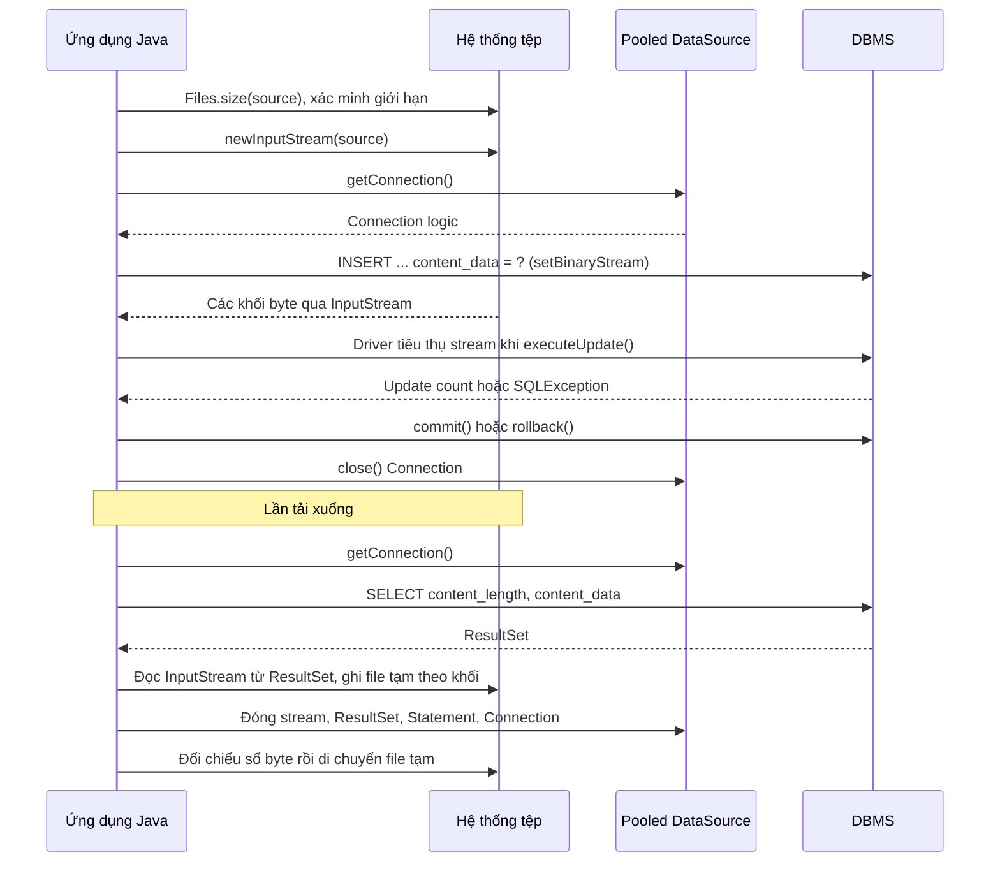

# Lưu và đọc tài liệu lớn bằng luồng dữ liệu trong JDBC

Một hệ thống quản lý hồ sơ có thể cần lưu hợp đồng PDF, bản scan, ảnh hoặc văn bản nhiều megabyte. Nếu ứng dụng Java luôn gọi `Files.readAllBytes(...)` rồi truyền mảng `byte[]` vào `PreparedStatement`, hoặc gọi `ResultSet.getBytes(...)` rồi giữ toàn bộ nội dung trong heap trước khi gửi cho người dùng, vài request đồng thời có thể gây áp lực bộ nhớ và làm connection pool bị chiếm lâu.

**JDBC** cung cấp cách truyền dữ liệu lớn qua **luồng**: `InputStream`/`OutputStream` cho dữ liệu nhị phân và `Reader`/`Writer` cho văn bản. Với `PreparedStatement`, ta có `setBinaryStream(...)` và `setCharacterStream(...)`; với `ResultSet`, ta có `getBinaryStream(...)` và `getCharacterStream(...)`. Các API này giúp viết mã xử lý từng khối nhỏ, nhưng **không bảo đảm mọi JDBC driver sẽ truyền LOB giữa JVM và DBMS theo luồng, không đệm toàn bộ**.

Bài thuộc chương **Thực hành tổng hợp** của module **JDBC**. Mục tiêu là xây một quy trình tương đối hoàn chỉnh: **tệp nguồn → JDBC → BLOB trong database → JDBC → tệp đích**, bổ sung biến thể **CLOB/văn bản**, quản lý `DataSource`, SQL tham số hóa, transaction, tài nguyên, timeout, kiểm tra toàn vẹn và các giới hạn của từng DBMS.

> **Mục tiêu thực hành:** Lưu và đọc lại một tài liệu đủ lớn mà mã ứng dụng không tạo một `byte[]` chứa toàn bộ tài liệu; đóng đúng `InputStream`, `ResultSet`, `PreparedStatement` và `Connection`; rollback khi upload lỗi; không để file tải về bị coi là hoàn chỉnh nếu mới ghi được một phần.

## 1. Bài toán và tiêu chí hoàn thành

Giả sử một ứng dụng nội bộ cần lưu tài liệu theo ID. Mỗi tài liệu có metadata và nội dung:

| Trường | Ý nghĩa | Kiểm tra tối thiểu |
|---|---|---|
| `document_id` | ID định danh tài liệu. | Dương, duy nhất. |
| `file_name` | Tên hiển thị gốc của tài liệu. | Không rỗng; không dùng trực tiếp làm đường dẫn lưu trên server. |
| `content_type` | Kiểu MIME dự kiến, ví dụ `application/pdf`. | Có giới hạn chiều dài; không được coi là chứng cứ file an toàn. |
| `content_length` | Độ dài nội dung tính bằng **byte**. | Không âm, nhỏ hơn giới hạn ứng dụng/DBMS. |
| `content_data` | Nội dung nhị phân. | Có thể đọc lại chính xác từng byte. |

Quy trình mong đợi:

1. Kiểm tra đầu vào và kích thước tệp trước khi mượn kết nối DB.
2. Mở luồng nguồn và tạo `PreparedStatement` có placeholder `?`.
3. Gọi `setBinaryStream(...)` để cung cấp dữ liệu BLOB cho lệnh `INSERT`.
4. Kết thúc transaction bằng `commit()` khi thành công hoặc cố `rollback()` khi lỗi.
5. Trả `Connection` về pool bằng `close()`.
6. Truy vấn BLOB theo ID, đọc `ResultSet.getBinaryStream(...)` khi `ResultSet` vẫn mở.
7. Ghi dữ liệu ra một tệp tạm theo khối nhỏ; xác minh tổng byte, đóng tài nguyên rồi mới chuyển thành tệp đích.
8. Kiểm thử nội dung tải lên và tải xuống **khớp byte-for-byte**, kể cả khi tài liệu lớn.

Các tiêu chí trên tập trung vào **quản lý bộ nhớ ở mã ứng dụng**. Để xác minh driver thật sự streaming, còn cần đo heap, network, DBMS và cấu hình driver thực tế.

## 2. Phân biệt BLOB, CLOB, luồng nhị phân và luồng ký tự

| Dữ liệu | SQL thường dùng | API ghi JDBC | API đọc JDBC | Đơn vị cần hiểu |
|---|---|---|---|---|
| PDF, ảnh, ZIP, dữ liệu bất kỳ | `BLOB` hoặc binary-large-value tương đương | `setBinaryStream(index, InputStream, length)` | `getBinaryStream(column)` | **Byte**, không phải ký tự. |
| Tài liệu văn bản Unicode | `CLOB`, `NCLOB`, `TEXT` hoặc kiểu tương đương | `setCharacterStream(index, Reader)` / `setNCharacterStream(...)` | `getCharacterStream(column)` / `getNCharacterStream(...)` | **Ký tự** do `Reader` cung cấp, không phải số byte UTF-8 trên đĩa. |
| Giá trị BLOB đã vật thể hóa | `BLOB` | `setBlob(...)` hoặc `Blob` từ driver | `getBlob(column)` rồi `Blob.getBinaryStream()` | Có vòng đời **LOB locator**/resource riêng. |
| Văn bản nhỏ | `VARCHAR` / `NVARCHAR` | `setString(...)` | `getString(...)` | Thường phù hợp khi nội dung thật sự nhỏ. |

**Quy tắc chọn API:** Nếu tài liệu là **tệp byte** cần giữ nguyên chính xác (PDF, PNG, DOCX, ZIP...), hãy dùng **BLOB và binary stream**. Nếu dữ liệu là **văn bản** cần truy vấn/chuyển mã như văn bản, cân nhắc **CLOB/NCLOB hoặc TEXT và character stream** theo DBMS. Không chuyển PDF sang `String` rồi lưu trong `CLOB`; các byte không phải văn bản hợp lệ có thể bị thay đổi khi decode/encode.

### Vì sao `getBytes` có thể là vấn đề?

```java
byte[] all = rs.getBytes("content_data"); // Toàn bộ nội dung trong byte[].
```

Với một BLOB hàng trăm MB, đoạn trên có thể cấp phát một mảng rất lớn. Nếu nhiều request chạy cùng lúc, áp lực heap/GC tăng. Tương tự:

```java
byte[] all = java.nio.file.Files.readAllBytes(source);
ps.setBytes(1, all);
```

Thay bằng một `InputStream` và xử lý từng khối nhỏ giúp **mã của chúng ta** không bắt buộc phải giữ mảng chứa toàn bộ tài liệu. Tuy nhiên, một JDBC driver có thể tự đệm nội dung trước khi gửi hoặc nhận; **không suy ra mức heap thực tế chỉ từ việc thấy `setBinaryStream`/`getBinaryStream`**.

## 3. Lược đồ minh họa và khác biệt DBMS

Để tập trung vào JDBC, đầu tiên dùng một schema kiểu SQL tổng quát, phù hợp với **H2** và những DBMS có `BLOB`:

```sql
CREATE TABLE stored_document (
    document_id BIGINT PRIMARY KEY,
    file_name VARCHAR(255) NOT NULL,
    content_type VARCHAR(127) NOT NULL,
    content_length BIGINT NOT NULL,
    content_data BLOB NOT NULL,
    CONSTRAINT ck_stored_document_size CHECK (content_length >= 0)
);
```

Đây là **DDL minh họa cho bài thực hành**, không phải migration portable chạy nguyên văn trên mọi hệ. Kiểu lưu binary-large-value thay đổi:

| DBMS | Kiểu lưu binary lớn thường gặp | Ghi chú |
|---|---|---|
| PostgreSQL | `BYTEA`; hoặc cơ chế Large Object riêng | `BYTEA` không giống API Large Object OID/locator; loại và kích thước rất lớn có giới hạn riêng. |
| MySQL | `BLOB`, `MEDIUMBLOB`, `LONGBLOB` | `BLOB` thông thường có giới hạn kích thước nhỏ hơn `LONGBLOB`; chọn theo yêu cầu và cấu hình máy chủ. |
| SQL Server | `VARBINARY(MAX)` | Không dùng `IMAGE` đã lỗi thời cho thiết kế mới. |
| Oracle | `BLOB` | Cơ chế locator, driver và transaction có đặc điểm riêng. |
| H2 trong bài thử | `BLOB` | Thích hợp cho bài kiểm thử API nhanh; không thay thế DBMS đích. |

Trong một dự án có migration, cần cung cấp DDL đúng dialect, bảo đảm `content_length` phù hợp dung lượng thực sự được ghi và kiểm tra giới hạn kích thước của DBMS/driver. Một tài liệu dài 20 MB không nên ghi vào kiểu MySQL `BLOB` thông thường rồi kỳ vọng tự mở rộng thành `LONGBLOB`.

### Có nên lưu SHA-256 ngay trong bảng?

Với hệ thống cần đối soát hoặc phát hiện nội dung bị thay đổi, có thể bổ sung `sha256` dạng 32 byte nhị phân hoặc 64 ký tự hex. Tuy nhiên, **hash phải được tính từ đúng các byte đã dùng để ghi** và lưu nhất quán trong cùng transaction. Ví dụ chính dưới đây dùng phép so sánh hash trong **kiểm thử tải xuống** để giữ code dễ học; phần mở rộng sẽ chỉ ra cách đưa checksum vào mô hình dữ liệu.

**Không coi SHA-256 là cơ chế mã hóa, chữ ký số hoặc phần mềm quét mã độc.** Hash dùng để đối chiếu toàn vẹn, không tự chứng minh nguồn gốc hoặc an toàn của tài liệu.

## 4. Sơ đồ luồng tải lên và tải xuống



**Điểm quan trọng về vòng đời:** stream lấy từ `ResultSet` có thể phụ thuộc **cursor, connection hoặc transaction đang mở**. Không thể lấy stream, trả `Connection` về pool rồi mới đọc stream ở thread khác. Ngược lại, khi truyền file vào `PreparedStatement`, stream nguồn phải còn mở trong lúc driver thực thi câu lệnh.

## 5. Mẫu DAO hoàn chỉnh cho tài liệu nhị phân

Ví dụ sau sử dụng các API Java/JDBC tiêu chuẩn và **không phụ thuộc framework**. Giả định đã có một `DataSource` nối tới database chứa bảng `stored_document` đúng dialect. Java 11+ được dùng để tiện thực hành; mã không sử dụng các API dành riêng cho một thư viện pooling.

### 5.1. Lưu BLOB qua InputStream, có transaction

```java
import java.io.FileNotFoundException;
import java.io.IOException;
import java.io.InputStream;
import java.io.OutputStream;
import java.nio.file.FileAlreadyExistsException;
import java.nio.file.Files;
import java.nio.file.Path;
import java.nio.file.StandardOpenOption;
import java.sql.Connection;
import java.sql.PreparedStatement;
import java.sql.ResultSet;
import java.sql.SQLException;
import java.util.Objects;
import javax.sql.DataSource;

public final class LargeDocumentRepository {

    // Giới hạn minh họa: 512 MiB. Phải đối chiếu với giới hạn
    // thật của DBMS, driver, proxy, request và chính sách ứng dụng.
    private static final long MAX_UPLOAD_BYTES = 512L * 1024 * 1024;

    private static final String INSERT_SQL =
            "INSERT INTO stored_document "
            + "(document_id, file_name, content_type, "
            + "content_length, content_data) "
            + "VALUES (?, ?, ?, ?, ?)";

    private static final String READ_SQL =
            "SELECT content_length, content_data "
            + "FROM stored_document WHERE document_id = ?";

    private final DataSource dataSource;

    public LargeDocumentRepository(DataSource dataSource) {
        this.dataSource = Objects.requireNonNull(dataSource, "dataSource");
    }

    public void upload(
            long documentId,
            Path source,
            String contentType
    ) throws SQLException, IOException {
        Objects.requireNonNull(source, "source");
        Objects.requireNonNull(contentType, "contentType");

        if (documentId <= 0) {
            throw new IllegalArgumentException("documentId phải dương");
        }
        if (contentType.isBlank() || contentType.length() > 127) {
            throw new IllegalArgumentException("contentType không hợp lệ");
        }
        if (!Files.isRegularFile(source)) {
            throw new FileNotFoundException("Không phải tệp nguồn thông thường");
        }

        long length = Files.size(source);
        if (length > MAX_UPLOAD_BYTES) {
            throw new IllegalArgumentException("Tệp vượt giới hạn ứng dụng");
        }

        Path baseName = source.getFileName();
        if (baseName == null || baseName.toString().isBlank()
                || baseName.toString().length() > 255) {
            throw new IllegalArgumentException("Tên tệp không hợp lệ");
        }

        // Mở file sau khi kiểm tra, trước lúc mượn Connection.
        try (InputStream fileInput = Files.newInputStream(source);
             Connection connection = dataSource.getConnection()) {

            connection.setAutoCommit(false);
            try {
                try (PreparedStatement ps =
                             connection.prepareStatement(INSERT_SQL)) {

                    ps.setLong(1, documentId);
                    ps.setString(2, baseName.toString());
                    ps.setString(3, contentType);
                    ps.setLong(4, length);

                    // Đơn vị length là BYTE, không phải ký tự.
                    ps.setBinaryStream(5, fileInput, length);

                    if (ps.executeUpdate() != 1) {
                        throw new SQLException("INSERT không tạo đúng một hàng");
                    }
                }

                // Commit sau khi Statement đã tiêu thụ xong InputStream.
                connection.commit();

            } catch (SQLException | RuntimeException failure) {
                try {
                    connection.rollback();
                } catch (SQLException rollbackError) {
                    failure.addSuppressed(rollbackError);
                }
                throw failure;
            }
        }
    }

    public void download(long documentId, Path target)
            throws SQLException, IOException {
        Objects.requireNonNull(target, "target");

        if (documentId <= 0) {
            throw new IllegalArgumentException("documentId phải dương");
        }

        Path destination = target.toAbsolutePath();
        Path parent = destination.getParent();

        if (parent == null || !Files.isDirectory(parent)) {
            throw new IOException("Thư mục đích không tồn tại");
        }
        if (Files.exists(destination)) {
            throw new FileAlreadyExistsException(destination.toString());
        }

        // Tệp tạm cùng thư mục để tránh công bố file tải dở.
        Path temporary = Files.createTempFile(
                parent, "jdbc-document-", ".part");

        try {
            long copied;

            try (Connection connection = dataSource.getConnection();
                 PreparedStatement ps =
                         connection.prepareStatement(READ_SQL)) {

                ps.setLong(1, documentId);

                try (ResultSet rs = ps.executeQuery()) {
                    if (!rs.next()) {
                        throw new FileNotFoundException(
                                "Không tìm thấy tài liệu " + documentId);
                    }

                    long expectedLength = rs.getLong("content_length");
                    if (expectedLength < 0) {
                        throw new SQLException("content_length không hợp lệ");
                    }

                    InputStream content =
                            rs.getBinaryStream("content_data");
                    if (content == null) {
                        throw new SQLException("content_data không được NULL");
                    }

                    try (InputStream input = content;
                         OutputStream output = Files.newOutputStream(
                                 temporary,
                                 StandardOpenOption.WRITE,
                                 StandardOpenOption.TRUNCATE_EXISTING)) {

                        byte[] buffer = new byte[64 * 1024];
                        copied = 0;
                        int n;

                        while ((n = input.read(buffer)) != -1) {
                            output.write(buffer, 0, n);
                            copied += n;
                        }
                    }

                    if (copied != expectedLength) {
                        throw new SQLException(
                                "Số byte đọc khác content_length: "
                                + copied + " != " + expectedLength);
                    }
                }
            }

            // Không dùng REPLACE_EXISTING: không ghi đè tệp có sẵn.
            // Files.move không bảo đảm atomic trên mọi file system.
            Files.move(temporary, destination);

        } finally {
            // Nếu SELECT/stream/move lỗi, xóa tệp dở.
            Files.deleteIfExists(temporary);
        }
    }
}
```

**Ý nghĩa của mẫu này:**

- `Files.size(source)` đo byte để truyền đúng `long length` cho `setBinaryStream`.
- `PreparedStatement` dùng `?` cho tất cả giá trị; metadata không nối vào SQL.
- Tệp nguồn và connection có phạm vi sống rõ ràng; `InputStream` không bị đóng trước `executeUpdate()`.
- Tác vụ ghi được bao trong transaction; nếu `executeUpdate()` hoặc một bước JDBC bên trong ném `SQLException`, mã cố `rollback()` trước khi trả connection.
- Tải xuống đọc **64 KiB mỗi vòng**, không cần cấp phát mảng có kích thước bằng toàn bộ BLOB.
- File tải xuống được ghi vào tệp tạm. Chỉ sau khi copy hoàn tất, số byte khớp và các resource đã đóng thì mới di chuyển tệp sang đường dẫn đích.
- Nếu không tìm thấy ID, mã ném `FileNotFoundException` thuộc `IOException`. Đó là chính sách của ví dụ; ứng dụng có thể định nghĩa ngoại lệ domain riêng.
- `Files.move(...)` không có `REPLACE_EXISTING`; theo hợp đồng thông thường sẽ báo lỗi nếu tệp đích đã tồn tại. **Không có bảo đảm atomic tuyệt đối** chỉ từ lời gọi này. Khi yêu cầu xuất bản file nguyên tử trên từng filesystem, cần thiết kế hỗ trợ `ATOMIC_MOVE`/fallback và xử lý cạnh tranh riêng.

### 5.2. Cách gọi từ tầng ứng dụng

```java
LargeDocumentRepository repository =
        new LargeDocumentRepository(dataSource);

Path source = Path.of("test-data", "contract.pdf");
repository.upload(101L, source, "application/pdf");

Path output = Path.of("test-output", "contract-copy.pdf");
repository.download(101L, output);
```

Đây là đoạn minh họa, giả định thư mục `test-data` và `test-output` đã tồn tại, `dataSource` đã cấu hình và database có bảng đúng schema. Nếu chạy upload hai lần cùng `documentId=101`, khóa chính sẽ từ chối lần thứ hai; hành vi “ghi đè nội dung hiện có” phải được thiết kế như một **thao tác cập nhật riêng**, không tự suy từ `INSERT`.

### 5.3. Những giới hạn cần biết trước khi dùng production

Mẫu là nền tảng thực hành, **chưa phải hệ thống upload public hoàn chỉnh**:

1. **Tệp nguồn có thể bị sửa khi đang đọc.** `Files.size` và `Files.newInputStream` không khóa file hoặc bảo đảm cùng snapshot. Driver có thể từ chối độ dài không khớp, hoặc dữ liệu đã đổi trong lúc upload. Với nguồn không tin cậy, hãy dùng tệp staging có quyền truy cập chặt chẽ, chốt nội dung và kiểm tra checksum.
2. **`contentType` không được xác thực từ nội dung.** Giá trị `application/pdf` chỉ là metadata. Cần kiểm tra MIME/signature và thực hiện quét an toàn theo chính sách nếu tệp đến từ người dùng.
3. **Không có kiểm soát đường dẫn từ HTTP request.** Tầng service phải chọn đường dẫn được phép; không nối trực tiếp tên file do client gửi vào thư mục đích.
4. **Không có cơ chế hủy upload theo deadline hoặc phục hồi từ giữa file.** Nếu đường truyền bị đứt giữa chừng, cần thiết kế retry/idempotency riêng.
5. **JDBC driver có thể đệm toàn bộ BLOB.** Hãy đo heap, thời gian thực thi và tài nguyên DBMS.
6. **Kích thước tối đa ở code không thay thế giới hạn DB.** Một cột hoặc driver có thể không hỗ trợ BLOB lớn đến 512 MiB.
7. **`commit()` có thể thất bại trong tình trạng không rõ kết quả.** Không tự thử lại `INSERT` vô hạn khi có lỗi mạng tại thời điểm commit.

## 6. Tại sao stream phải sống cùng ResultSet và Connection?

Phản ví dụ:

```java
InputStream content;

try (Connection connection = dataSource.getConnection();
     PreparedStatement ps = connection.prepareStatement(
             "SELECT content_data FROM stored_document WHERE document_id = ?")) {

    ps.setLong(1, 101L);

    try (ResultSet rs = ps.executeQuery()) {
        rs.next();
        content = rs.getBinaryStream(1);
    }
}

// Sai: ResultSet/Statement/Connection đã đóng.
// Đọc content ở đây có thể thất bại hoặc dùng resource hết vòng đời.
content.transferTo(output);
```

Với những driver dùng server-side cursor/LOB locator, stream chỉ còn hợp lệ khi kết quả và transaction/connection của nó còn mở. Ngay cả nếu một driver đã tải nội dung vào RAM khiến đoạn trên tình cờ hoạt động, ứng dụng vẫn **không được phụ thuộc hành vi đó**.

**Cách đúng:** đọc stream và ghi đích **bên trong** phạm vi `ResultSet` còn mở, sau đó đóng theo thứ tự ngược:

```text
Mở Connection
  Mở PreparedStatement
    executeQuery()
      Mở ResultSet
        getBinaryStream()
          Đọc InputStream và ghi OutputStream cho tới EOF
          Đóng InputStream, OutputStream
      Đóng ResultSet
  Đóng PreparedStatement
Đóng Connection (trả pool nếu DataSource có pool)
```

Lưu ý `InputStream` có thể cung cấp nhiều byte theo từng lần `read`, bao gồm cả số byte nhỏ hơn độ dài buffer. Không viết vòng lặp giả định mỗi `read(buffer)` luôn trả đúng 64 KiB; dùng giá trị `n` trả về để ghi chính xác `buffer[0..n)`.

### Với BLOB locator

Một cách khác là:

```java
java.sql.Blob blob = rs.getBlob("content_data");

if (blob != null) {
    try {
        try (InputStream input = blob.getBinaryStream()) {
            // Đọc theo khối khi ResultSet/Connection còn hợp lệ.
        }
    } finally {
        blob.free(); // Giải phóng locator/resource khi driver hỗ trợ.
    }
}
```

`Blob` có thể là locator tham chiếu tài nguyên DB, không phải luôn là một mảng byte nằm sẵn trong JVM. `Blob.free()` là thao tác quản lý tài nguyên riêng; **đừng gọi `free()` trước khi hoàn tất đọc stream**. Khả năng locator sống qua commit, rollback hoặc close phụ thuộc driver/DBMS; không nên tách nó khỏi vòng đời JDBC một cách mù quáng.

## 7. Transaction, auto-commit và rollback với tài liệu lớn

Một `INSERT BLOB` có thể tốn thời gian lâu hơn DML thông thường, nhất là khi dữ liệu hàng trăm MB. Nếu ứng dụng cần lưu cả metadata và nội dung một cách nguyên tử, phải có hợp đồng transaction rõ.

Trong `upload` ở phần 5:

```java
connection.setAutoCommit(false);

try {
    // PreparedStatement.setBinaryStream(...), executeUpdate().
    connection.commit();
} catch (SQLException | RuntimeException ex) {
    try {
        connection.rollback();
    } catch (SQLException rollbackError) {
        ex.addSuppressed(rollbackError);
    }
    throw ex;
}
```

Khi transaction thất bại bình thường, `rollback()` giúp hủy thay đổi chưa commit. Khi **lỗi mạng/connection hỏng**, rollback cũng có thể thất bại, và DBMS có thể đã thực hiện một phần công việc chưa xác nhận. Đặc biệt, **nếu `commit()` gửi đi nhưng phản hồi bị mất**, ứng dụng có thể không biết liệu document đã được lưu chưa.

Chiến lược nghiệp vụ phù hợp có thể là:

- Dùng `document_id` hoặc idempotency key duy nhất, không tạo thêm ID mới khi retry cùng một yêu cầu.
- Sau lỗi commit không rõ trạng thái, **đối soát bản ghi và checksum** trước khi gửi lại.
- Nếu cập nhật nội dung đã có, cần version/checksum hoặc optimistic locking để tránh ghi đè thay đổi đồng thời.
- Không giữ transaction mở trong lúc upload file từ người dùng qua mạng nếu có thể **staging file** trước rồi mới bắt đầu giao dịch DB.

### Tại sao không giữ Connection từ khi HTTP upload bắt đầu?

Giả sử client truyền 300 MB qua mạng chậm. Nếu service mượn `Connection` rồi chờ toàn bộ HTTP body, connection pool bị chiếm trong suốt thời gian truyền dù chưa chạy SQL. Thiết kế tốt hơn có thể là:

```text
Client --HTTP upload--> vùng staging được kiểm soát
                          │
                          ├─ kiểm tra dung lượng, MIME, checksum, quyền
                          │
                          ▼
                   Mượn JDBC Connection
                          │
                          ▼
                   setBinaryStream từ staging
                          │
                          ▼
                   commit/rollback và trả Connection
                          │
                          ▼
                   Dọn staging theo chính sách
```

Ngay cả khi đã staging, **thời gian DB driver tiêu thụ BLOB** vẫn nằm trong thời gian giữ connection. Không thể loại bỏ chi phí đó bằng việc đóng connection trước khi `executeUpdate()` hoàn tất.

### Có cần tắt auto-commit khi chỉ SELECT BLOB?

Không có quy tắc portable tuyệt đối. Đọc một BLOB bằng `SELECT` có thể hoạt động với auto-commit mặc định, nhưng một số cơ chế **cursor/large object của driver** yêu cầu transaction mở. Ví dụ PostgreSQL Large Object API khác `BYTEA` và có yêu cầu transaction riêng. Khi chọn chế độ cụ thể, phải đối chiếu tài liệu driver và kiểm thử trên DBMS thực; không tự bật/tắt auto-commit chỉ vì kích thước dữ liệu lớn.

## 8. Văn bản lớn: CLOB, Reader và Writer

Với tài liệu thực sự là văn bản — ví dụ điều khoản hợp đồng, nội dung biên bản hoặc một bản log UTF-8 dài — ta có thể dùng luồng ký tự.

### 8.1. Schema minh họa

```sql
CREATE TABLE stored_text (
    text_id BIGINT PRIMARY KEY,
    title VARCHAR(255) NOT NULL,
    body CLOB NOT NULL
);
```

Tương tự `BLOB`, `CLOB` không có cú pháp/semantics giống nhau trên mọi DBMS:

- PostgreSQL thường dùng `TEXT`.
- MySQL dùng `TEXT`/`LONGTEXT` với charset như `utf8mb4`.
- SQL Server dùng `NVARCHAR(MAX)` cho dữ liệu Unicode dài trong nhiều trường hợp.
- Oracle dùng `CLOB` hoặc `NCLOB` tùy character set và yêu cầu.

**Không tự coi `CLOB` và `NVARCHAR(MAX)` là đồng nhất về giới hạn và cách streaming** chỉ vì đều chứa văn bản. Hãy kiểm tra driver, encoding, Unicode, collation và kiểu SQL thực tế.

### 8.2. Lưu nội dung UTF-8 từ file với setCharacterStream

```java
import java.io.IOException;
import java.io.Reader;
import java.nio.charset.StandardCharsets;
import java.nio.file.Files;
import java.nio.file.Path;
import java.sql.Connection;
import java.sql.PreparedStatement;
import java.sql.SQLException;
import javax.sql.DataSource;

public static void saveText(
        DataSource dataSource,
        long id,
        String title,
        Path textFile
) throws IOException, SQLException {

    String sql = "INSERT INTO stored_text "
            + "(text_id, title, body) VALUES (?, ?, ?)";

    try (Reader reader = Files.newBufferedReader(
                 textFile, StandardCharsets.UTF_8);
         Connection connection = dataSource.getConnection()) {

        connection.setAutoCommit(false);

        try {
            try (PreparedStatement ps =
                         connection.prepareStatement(sql)) {

                ps.setLong(1, id);
                ps.setString(2, title);

                // Không truyền Files.size(textFile) làm số ký tự.
                // Overload này không yêu cầu biết trước chiều dài.
                ps.setCharacterStream(3, reader);

                if (ps.executeUpdate() != 1) {
                    throw new SQLException("Không lưu được stored_text");
                }
            }

            connection.commit();

        } catch (SQLException | RuntimeException failure) {
            try {
                connection.rollback();
            } catch (SQLException rollbackError) {
                failure.addSuppressed(rollbackError);
            }
            throw failure;
        }
    }
}
```

Mã trên dùng overload `setCharacterStream(int, Reader)` của JDBC 4.x. **Driver có thể không hỗ trợ tốt overload không truyền chiều dài**, hoặc có hành vi buffering khác. Khi dùng overload có `long length`, độ dài là **số ký tự được cung cấp bởi Reader**, không phải byte UTF-8 trên filesystem.

Ví dụ:

```java
String text = "Tiếng Việt và emoji 📄";
long bytes = text.getBytes(StandardCharsets.UTF_8).length;
int utf16Units = text.length();

// bytes và utf16Units không nhất thiết bằng nhau.
```

Nếu ứng dụng cần truyền chiều dài ký tự cho driver, phải tính theo hợp đồng `Reader` và driver (có thể cần pass đọc trước hoặc staging có độ dài đã xác định). Đừng truyền `Files.size(textFile)` vào `setCharacterStream(..., long)`; với tiếng Việt/emoji, giá trị đó có thể khác độ dài luồng ký tự.

### 8.3. Đọc CLOB ra UTF-8 bằng getCharacterStream

```java
import java.io.Reader;
import java.io.Writer;
import java.io.IOException;
import java.nio.charset.StandardCharsets;
import java.nio.file.Files;
import java.nio.file.Path;
import java.nio.file.StandardOpenOption;
import java.sql.Connection;
import java.sql.PreparedStatement;
import java.sql.ResultSet;
import java.sql.SQLException;
import javax.sql.DataSource;

public static void exportText(
        DataSource dataSource,
        long id,
        Path target
) throws SQLException, IOException {
    String sql = "SELECT body FROM stored_text WHERE text_id = ?";

    try (Connection connection = dataSource.getConnection();
         PreparedStatement ps = connection.prepareStatement(sql)) {

        ps.setLong(1, id);

        try (ResultSet rs = ps.executeQuery()) {
            if (!rs.next()) {
                throw new java.io.FileNotFoundException(
                        "Không tìm thấy stored_text " + id);
            }

            Reader body = rs.getCharacterStream("body");
            if (body == null) {
                throw new SQLException("body không được NULL");
            }

            try (Reader reader = body;
                 Writer writer = Files.newBufferedWriter(
                         target,
                         StandardCharsets.UTF_8,
                         StandardOpenOption.CREATE_NEW,
                         StandardOpenOption.WRITE)) {

                char[] buffer = new char[8192];
                int n;

                while ((n = reader.read(buffer)) != -1) {
                    writer.write(buffer, 0, n);
                }
            }
        }
    }
}
```

Hàm này minh họa **luồng ký tự** và bảo vệ không ghi đè bằng `CREATE_NEW`, nhưng nếu một lỗi xảy ra giữa chừng, tệp đích có thể tồn tại với nội dung dở dang. Với production, nên áp dụng **mô hình file tạm + dọn trên lỗi + publish sau kiểm tra** tương tự `download` nhị phân ở phần 5.

### 8.4. Unicode và NCLOB

Một số DBMS phân biệt `CLOB` với `NCLOB`/national character types. JDBC có `setNCharacterStream(...)`, `getNCharacterStream(...)` và `NClob`. Điều này **không** có nghĩa dữ liệu tiếng Việt phải luôn dùng `NCLOB`: có DBMS hỗ trợ Unicode trực tiếp trong `TEXT`/`CLOB` theo charset thích hợp. Cần xem encoding thực tế, hỗ trợ của driver và kiểu cột trước khi chọn.

**Quy tắc thực hành:** PDF, hình ảnh và tệp byte không giải mã → binary stream. Nội dung văn bản đã xác định encoding và cần xử lý ký tự → character stream. Nếu chỉ bảo quản “tệp .txt nguyên gốc”, kể cả BOM và thứ tự byte, **BLOB vẫn là lựa chọn phù hợp hơn** nếu mục tiêu là round-trip byte-for-byte.

## 9. Buffered streams, kích thước bộ đệm và hiệu năng

Trong `download`, vòng đọc dùng:

```java
byte[] buffer = new byte[64 * 1024];

int n;
while ((n = input.read(buffer)) != -1) {
    output.write(buffer, 0, n);
}
```

Bộ đệm **64 KiB** chỉ là giá trị để thực hành, không phải tối ưu mặc định cho mọi DBMS. Khi chọn kích thước:

| Bộ đệm | Ưu điểm tiềm năng | Đánh đổi |
|---|---|---|
| Rất nhỏ, ví dụ 1 KiB | Cấp phát từng buffer thấp. | Nhiều lượt gọi `read/write` hơn, tăng overhead Java/I/O. |
| Trung bình, ví dụ 32–128 KiB | Thường là điểm xuất phát hợp lý để benchmark. | Cần đo hiệu năng driver và số tác vụ đồng thời. |
| Rất lớn, vài MiB | Có thể giảm số lần lặp trong một số môi trường. | Bộ nhớ tăng theo số download/upload đồng thời, không chắc tăng throughput. |

**Không đồng nhất Java buffer với network packet hoặc fetchSize JDBC.** Driver có thể tự gom/tách dữ liệu theo giao thức DBMS. `Statement.setFetchSize(...)` gợi ý số **hàng** cho `ResultSet`, không phải kích thước khối byte của BLOB. Nếu chỉ truy vấn một hàng chứa BLOB 500 MB, `setFetchSize(1)` không bảo đảm chỉ 1 KB hoặc 64 KB được đưa vào bộ nhớ.

### Tại sao không đọc tất cả rồi xử lý ở cuối?

Ví dụ phản tác dụng:

```java
java.io.ByteArrayOutputStream all =
        new java.io.ByteArrayOutputStream();

input.transferTo(all);
byte[] bytes = all.toByteArray();
```

Đây vẫn là **gom toàn bộ dữ liệu trong bộ nhớ**, dù API `InputStream` trông giống streaming. Với file lớn, hãy truyền vào `OutputStream` hữu hạn hoặc tiêu thụ theo các khối, không dồn vào `ByteArrayOutputStream`/`StringBuilder` vô giới hạn.

### Nút thắt không chỉ ở JVM

Hiệu năng BLOB còn phụ thuộc:

- Kích thước tối đa của kiểu cột và cấu hình DBMS.
- Tốc độ đĩa của storage chứa database và tệp đích.
- Băng thông/RTT mạng giữa ứng dụng và DBMS.
- Chi phí transaction log, redo/undo và replication khi ghi LOB.
- Số lượng request cùng truyền dữ liệu lớn và connection pool size.
- Khả năng driver streaming thực sự hoặc buffering nội bộ.
- `commit()`/`rollback()` sau thao tác lớn.
- Chính sách antivirus, encryption, checksum, cache hoặc proxy ở tầng ứng dụng.

Đừng tăng connection pool size vô hạn khi tải BLOB làm DBMS nghẽn disk/network; có thể cần một **giới hạn concurrency** riêng cho upload/download lớn.

## 10. Query timeout, hủy và kiểm soát transaction dài

Có thể thêm query timeout:

```java
try (PreparedStatement ps = connection.prepareStatement(INSERT_SQL)) {
    ps.setQueryTimeout(30); // Giây.
    // setBinaryStream(...), executeUpdate()...
}
```

Nhưng **`setQueryTimeout(30)` không bảo đảm toàn bộ việc đọc InputStream, chuyển dữ liệu, `ResultSet.next()`, ghi file đích và `commit()` kết thúc trong 30 giây**. Phạm vi và khả năng hủy của statement phụ thuộc driver/DBMS.

Khi một tác vụ truyền dữ liệu lớn cần deadline:

1. Quy định **giới hạn dung lượng tệp** trước khi bắt đầu.
2. Đặt timeout phù hợp cho request/upload HTTP, pool acquisition, mạng và query theo từng lớp.
3. Cho phép người dùng hủy nếu có khả năng điều phối `Statement.cancel()` một cách an toàn và driver hỗ trợ.
4. Khi hủy hoặc statement lỗi trong transaction ghi, **không commit theo đường thành công**; cố rollback.
5. Không coi `Thread.interrupt()` là bảo đảm câu SQL phía DB đã dừng.
6. Theo dõi kết quả commit chưa xác định và tránh retry thao tác ghi có tác dụng phụ một cách mù quáng.

**Một tác vụ sao chép tài liệu lớn có thể giữ connection lâu dù SQL không phức tạp**. Vì vậy, đo **connection hold time** riêng với thời gian tạo file tạm, chạy SQL, đọc LOB và ghi đích.

## 11. Tính checksum theo luồng để xác minh dữ liệu

Để kiểm tra round-trip, dùng **SHA-256** mà không nạp cả file vào heap:

```java
import java.io.IOException;
import java.io.InputStream;
import java.nio.file.Files;
import java.nio.file.Path;
import java.security.DigestInputStream;
import java.security.MessageDigest;
import java.security.NoSuchAlgorithmException;

public static byte[] sha256(Path file)
        throws IOException, NoSuchAlgorithmException {

    MessageDigest digest = MessageDigest.getInstance("SHA-256");

    try (InputStream input = new DigestInputStream(
            Files.newInputStream(file), digest)) {

        byte[] buffer = new byte[64 * 1024];
        while (input.read(buffer) != -1) {
            // DigestInputStream cập nhật digest khi byte được đọc.
        }
    }
    return digest.digest();
}
```

So sánh:

```java
import java.util.Arrays;

if (!Arrays.equals(sha256(source), sha256(downloaded))) {
    throw new IllegalStateException("Nội dung không khớp SHA-256");
}
```

Với test có dữ liệu đầu vào và đầu ra xác định, đây là kiểm tra toàn vẹn thực tế mà **không cấp phát mảng chứa toàn bộ file**. Cần phân biệt:

- `Files.size(source) == Files.size(target)` chỉ chứng minh **cùng độ dài**, chưa chứng minh cùng nội dung.
- SHA-256 giống nhau cho hai file là bằng chứng rất mạnh rằng nội dung giống nhau trong bối cảnh kiểm thử thông thường, nhưng vẫn **không phải chữ ký số**.
- Nếu hệ thống lưu checksum trong database, cần thống nhất checksum của **tệp staging đã được chốt** và nội dung thực sự được ghi, tránh TOCTOU khi file nguồn thay đổi.
- Nếu dữ liệu cần chống sửa trái phép hoặc xác thực nguồn gốc, xem xét chữ ký/MAC, phân quyền và lưu trữ an toàn riêng.

## 12. Kiểm thử tích hợp trên H2 với tệp đủ lớn

Một bài thực hành JDBC nên chứng minh bằng dữ liệu thật, không chỉ mock `InputStream`. Với Java, JUnit 5 và H2, ta có thể tạo database in-memory để kiểm tra code. H2 giúp chạy nhanh nhưng **không thay thế kiểm thử trên DBMS và driver đích**.

Ví dụ JUnit 5 sau minh họa một test với tệp ~8 MiB được sinh **theo khối**, kiểm tra round-trip SHA-256 và kích thước. Các dependency JUnit Jupiter và H2 phải được dự án khai báo trong phạm vi test.

```java
import static org.junit.jupiter.api.Assertions.assertArrayEquals;
import static org.junit.jupiter.api.Assertions.assertEquals;

import java.io.OutputStream;
import java.nio.file.Files;
import java.nio.file.Path;
import java.sql.Connection;
import java.sql.Statement;
import java.util.Random;
import java.util.UUID;

import org.h2.jdbcx.JdbcDataSource;
import org.junit.jupiter.api.Test;
import org.junit.jupiter.api.io.TempDir;

class LargeDocumentRepositoryTest {

    @Test
    void uploadThenDownloadPreservesBytes(@TempDir Path directory)
            throws Exception {

        String name = "jdbc_blob_"
                + UUID.randomUUID().toString().replace("-", "");

        JdbcDataSource dataSource = new JdbcDataSource();
        dataSource.setURL("jdbc:h2:mem:" + name);
        dataSource.setUser("sa");
        dataSource.setPassword("");

        // Giữ H2 named in-memory database tồn tại tới hết test.
        try (Connection anchor = dataSource.getConnection();
             Statement schema = anchor.createStatement()) {

            schema.executeUpdate(
                    "CREATE TABLE stored_document ("
                    + "document_id BIGINT PRIMARY KEY, "
                    + "file_name VARCHAR(255) NOT NULL, "
                    + "content_type VARCHAR(127) NOT NULL, "
                    + "content_length BIGINT NOT NULL, "
                    + "content_data BLOB NOT NULL, "
                    + "CONSTRAINT ck_size CHECK (content_length >= 0))");

            Path source = directory.resolve("source.bin");
            Path copied = directory.resolve("copied.bin");

            // Sinh 8 MiB bằng các buffer nhỏ; không cấp phát 8 MiB một lần.
            Random random = new Random(2026L);
            byte[] block = new byte[64 * 1024];

            try (OutputStream output = Files.newOutputStream(source)) {
                for (int i = 0; i < 128; i++) {
                    random.nextBytes(block);
                    output.write(block);
                }
            }

            LargeDocumentRepository repository =
                    new LargeDocumentRepository(dataSource);

            repository.upload(
                    101L, source, "application/octet-stream");
            repository.download(101L, copied);

            assertEquals(Files.size(source), Files.size(copied));
            assertArrayEquals(sha256(source), sha256(copied));
        }
    }
}
```

Đoạn test gọi hàm `sha256(Path)` từ phần 11; khi tách thành file Java, cần đặt helper ở class tiện ích thích hợp và gọi đúng tên lớp. Dữ liệu ngẫu nhiên có **seed cố định** để bài test tái lập được. H2 in-memory có tên sẽ giữ database khi `anchor` còn mở; sau khi `anchor` đóng và các kết nối DAO đã đóng, database có thể được giải phóng.

**Điều được test xác nhận:** Repository gửi/nhận BLOB đầy đủ qua H2; file được giữ byte-for-byte; mã đọc không bắt buộc nạp toàn bộ nội dung vào một `byte[]`.

**Điều chưa được test xác nhận:** driver PostgreSQL/MySQL/SQL Server/Oracle có streaming thực hay không; memory peak trên JVM thật; khả năng truyền vài GB; network timeout khi DB mất kết nối; chi phí LOB storage, replication và transaction log.

### Thêm các trường hợp test âm

| Test | Cách dựng tình huống | Kỳ vọng |
|---|---|---|
| Không có document ID | Gọi `download` với ID chưa được chèn. | Báo “không tìm thấy”; không công bố file đích hoàn chỉnh. |
| Tệp nguồn không tồn tại | Gọi `upload` với `Path` sai. | `IOException` trước khi bắt đầu ghi DB. |
| Vượt giới hạn | Tệp nguồn có kích thước lớn hơn `MAX_UPLOAD_BYTES`. | Từ chối sớm; không thực hiện `INSERT`. |
| Trùng ID | Gọi `upload` hai lần cùng ID. | Lần hai lỗi khóa chính; nội dung bản ghi đầu không bị âm thầm thay. |
| Đích đã có file | Gọi `download` tới đường dẫn tồn tại. | `FileAlreadyExistsException` hoặc lỗi tương đương; không ghi đè. |
| Lỗi đọc nguồn giữa chừng | Dùng luồng lỗi có kiểm soát trong test driver hoặc file staging bị cắt. | Không commit thành công; ghi nhận exception, rollback nếu cần. |
| Tài liệu rỗng | File có `Files.size=0`. | Nếu DB/driver cho phép BLOB rỗng, upload/download ra file 0 byte. |
| Metadata độ dài sai | Chỉ trong DB test, cố sửa `content_length` khác payload. | `download` phát hiện mismatch và dọn file tạm. |
| Nhiều download đồng thời | Chạy các ID/file đích độc lập. | Không chia sẻ `Connection`/`ResultSet` giữa thread; pool hoạt động ổn định. |
| CLOB Unicode | Ghi/đọc văn bản có tiếng Việt và emoji. | Nội dung ký tự đúng; byte output UTF-8 phù hợp. |

### Đo bộ nhớ và thời gian, không chỉ assert kết quả

Trong kiểm thử hiệu năng, thử vài kích thước như **1 MiB, 16 MiB, 128 MiB** tùy giới hạn môi trường và đo:

- Heap peak, GC pause trong upload/download.
- Thời gian `getConnection()`, `executeUpdate()`, `executeQuery()` và đọc `InputStream`.
- Số byte đọc/ghi thực tế.
- Connection hold time và số kết nối chờ trong pool.
- Ảnh hưởng concurrency (1, 4, 8 tác vụ), không chỉ một tác vụ đơn.
- Thời gian `commit()/rollback()` và kích thước transaction log nếu DBMS cung cấp.
- Số lượt truyền mạng hoặc buffering của driver khi có công cụ giám sát phù hợp.

**Không dùng database sản xuất để chạy test tải file lớn hoặc chủ động làm lỗi kết nối**. Dùng DB test/container và dọn dữ liệu sau khi xong.

## 13. Bảo mật khi lưu và phát tài liệu

Lưu tài liệu lớn bằng JDBC là thao tác I/O, nhưng nếu nguồn là tệp do người dùng gửi, còn có nhiều rủi ro bảo mật.

### Tên file và đường dẫn

Tên file trong metadata là **tên hiển thị**, không phải đường dẫn tin cậy để đọc/ghi trên server. Nếu client cung cấp `../../secret.txt`, không được nối trực tiếp vào thư mục lưu trữ hoặc cho phép file đích trỏ ra khỏi vùng được phép.

Một tầng HTTP phù hợp nên:

1. Chọn **thư mục staging được quản lý** và tên file ngẫu nhiên do server sinh.
2. Không tin đường dẫn hoặc extension do client gửi.
3. Chuẩn hóa và kiểm tra đường dẫn đích nằm trong vùng cho phép; quan tâm cả symlink và race khi có tác nhân không tin cậy.
4. Quy định quyền truy cập, dung lượng, loại file và thời gian giữ staging.
5. Chỉ cung cấp nội dung cho người dùng đã được xác thực/phân quyền với đúng document ID.

DAO `LargeDocumentRepository` chỉ nên nhận `Path` đã được **tầng gọi kiểm soát**, không tự trở thành endpoint nhận đường dẫn tùy ý từ người dùng.

### MIME, nội dung độc hại và cách phát file

- `content_type` từ request có thể bị giả mạo. Kiểm tra signature của tệp, định dạng, chính sách bảo mật và quét mã độc khi cần.
- Khi trả download HTTP, thiết lập `Content-Type` và `Content-Disposition` có kiểm soát. Không dùng tên file từ DB trực tiếp trong header mà thiếu xử lý/escaping phù hợp.
- Không cho trình duyệt tự render tài liệu HTML/SVG không tin cậy trong cùng origin với ứng dụng khi chính sách bảo mật không cho phép.
- Giới hạn dung lượng, số upload đồng thời và tốc độ nếu hệ thống mở cho nhiều client.
- Mã hóa khi truyền và lưu trữ theo yêu cầu; phân quyền database và giảm log dữ liệu nhạy cảm.

**Không log nội dung BLOB/CLOB** hoặc dump byte/chuỗi lớn để chẩn đoán. Ghi document ID, kích thước, duration, SQLState, mã lỗi driver và trace ID nếu cần.

## 14. Khi nào nên lưu BLOB trong database, khi nào nên dùng object storage?

JDBC hỗ trợ LOB không có nghĩa **mọi loại tài liệu lớn đều nên lưu trực tiếp trong database**.

| Tiêu chí | BLOB trong DB | Object storage / file service + metadata DB |
|---|---|---|
| Tính nguyên tử với metadata | Có thể dùng transaction cục bộ khi metadata và BLOB cùng DB. | DB và object store không có transaction JDBC chung; cần quy trình phối hợp. |
| Sao lưu và phục hồi | Tệp nằm trong backup/replication của DB, có thể làm backup lớn. | Có cơ chế lifecycle/versioning và backup riêng cho object. |
| Chi phí IO/log | Có thể tăng log, replica lag và storage của database. | Thường thiết kế để phục vụ đối tượng lớn; chi phí và latency tùy dịch vụ. |
| SQL truy vấn metadata | Thuận tiện khi mọi thứ cùng DB. | Metadata vẫn ở DB, nội dung lấy qua object key/URI được quản lý. |
| File rất lớn/nhiều concurrent download | Có thể tạo áp lực DB connection và băng thông. | Thường thuận lợi hơn cho tải file quy mô lớn, CDN/range request nếu hỗ trợ. |
| Quyền truy cập và bảo mật | Dựa vào quyền DB và tầng ứng dụng. | Cần quản lý bucket/object permissions và URL truy cập. |
| Tính nhất quán khi upload thất bại | Transaction DB dễ hiểu hơn ở phạm vi một DB. | Cần trạng thái “pending/committed”, cleanup orphan và idempotency. |

**Không có đáp án chung:** tài liệu vừa phải, cần transaction chặt với dữ liệu quan hệ có thể phù hợp với BLOB. Hệ thống nhiều file lớn, tải xuống thường xuyên hoặc cần CDN có thể phù hợp hơn với object storage. Quyết định cần đo chi phí DB/backup, SLA, security và hạ tầng thực tế.

### Nếu dùng object storage, JDBC vẫn có vai trò

Một thiết kế có thể chỉ lưu:

```sql
CREATE TABLE document_metadata (
    document_id BIGINT PRIMARY KEY,
    object_key VARCHAR(255) NOT NULL UNIQUE,
    content_type VARCHAR(127) NOT NULL,
    content_length BIGINT NOT NULL,
    sha256_hex CHAR(64) NOT NULL,
    status VARCHAR(20) NOT NULL
);
```

Nội dung file được lưu ở object storage và DB lưu object key, checksum, trạng thái. Khi upload thất bại giữa hai hệ, ứng dụng phải có cơ chế **outbox/saga/cleanup** chứ không giả định `Connection.rollback()` xóa được object đã tải lên. Đây là phương án kiến trúc khác với mục tiêu thực hành BLOB trong bài.

## 15. Những lỗi phổ biến khi làm việc với LOB

| Sai lầm | Hậu quả | Cách khắc phục |
|---|---|---|
| `Files.readAllBytes` trước khi gọi JDBC | Tải toàn bộ file vào heap. | Dùng `InputStream` + `setBinaryStream`. |
| `rs.getBytes("content_data")` cho file rất lớn | Mảng byte lớn, tăng GC/OOM. | Dùng `getBinaryStream` khi driver hỗ trợ. |
| Đóng `InputStream` trước `executeUpdate()` | Driver không còn dữ liệu để đọc. | Giữ input mở tới khi thực thi hoàn tất. |
| Trả `InputStream` lấy từ ResultSet ra ngoài DAO đã đóng connection | Stream có thể vô hiệu hoặc phụ thuộc tài nguyên hết vòng đời. | Tiêu thụ stream khi ResultSet/Connection còn mở. |
| Dùng `setCharacterStream` để lưu PDF | Decode/encode nhầm byte thành ký tự, mất tính toàn vẹn. | PDF dùng binary stream và BLOB. |
| Truyền `Files.size` làm độ dài character stream | Byte UTF-8 khác số ký tự, dễ cắt dữ liệu hoặc lỗi. | Dùng overload không length hoặc tính đúng độ dài Reader. |
| Gọi `setBinaryStream` và nghĩ driver chắc chắn không đệm nội dung | Heap thực tế có thể tăng do driver. | Benchmark và xác minh driver/DBMS. |
| Quên `Blob.free()` khi dùng locator | Tài nguyên LOB có thể tồn tại lâu hơn cần thiết. | Dùng stream trong phạm vi locator và free sau khi đọc. |
| Dùng kiểu SQL `BLOB` giống hệt trên mọi DBMS | DDL không portable; giới hạn kích thước khác nhau. | Dùng migration theo dialect, test trên DBMS đích. |
| Dùng MySQL `BLOB` cho tệp hàng chục MB | Có thể vượt giới hạn cột. | Chọn `MEDIUMBLOB/LONGBLOB` thích hợp và test. |
| Không rollback khi upload bị lỗi | Có thể để transaction dở dang hoặc dữ liệu không nhất quán. | `commit/rollback` rõ ràng, xử lý lỗi rollback. |
| Tưởng mất phản hồi `commit()` nghĩa là DB chưa ghi | Retry có thể trùng tác dụng hoặc ghi đè. | Idempotency + checksum/đối soát. |
| Ghi download trực tiếp tới file đích rồi lỗi giữa chừng | File đích có nội dung dở, có thể bị dùng nhầm. | Ghi file tạm, kiểm tra, rồi publish. |
| Chỉ so `content_length` để chứng minh file giống nhau | Hai tệp cùng kích thước vẫn có thể khác byte. | Tính checksum theo luồng, test đối chiếu. |
| Mượn Connection từ đầu request HTTP upload chậm | Chiếm slot pool khi chưa cần SQL. | Staging file trước, mượn connection khi làm DB. |
| Dùng `setQueryTimeout` và nghĩ bao hết upload/download | Timeout không bảo đảm mọi giai đoạn I/O và commit. | Deadline nhiều tầng, đo thời gian thực. |
| Dùng fileName của client làm đường dẫn trực tiếp | Path traversal, ghi đè file, rò rỉ tài nguyên. | Server chọn đường dẫn/tên file, kiểm tra quyền. |
| Chạy benchmark LOB trên DB production | Tốn log/storage/băng thông và ảnh hưởng khách hàng. | Dùng DB test và giới hạn tải. |

## 16. Bài tập thực hành nâng cao

### Bài 1 — Upload và download một PDF

1. Dựng bảng `stored_document` trên DB test tương thích BLOB.
2. Dùng một file PDF thử nghiệm do bạn được phép sử dụng.
3. Gọi `upload` bằng `InputStream`, rồi `download` ra tệp khác.
4. Kiểm tra `Files.size` và SHA-256 của hai file.
5. Quan sát heap và active connections khi tăng kích thước file.

**Đạt yêu cầu khi:** cả hai file có nội dung khớp và không có file tạm/tài nguyên JDBC còn sót sau khi phương thức kết thúc.

### Bài 2 — Ném lỗi giữa quá trình đọc stream

Tạo một `InputStream` kiểm thử tự ném `IOException` sau khi phát ra một số byte; sửa DAO nhận stream theo hợp đồng rõ ràng hoặc dùng nguồn staging bị lỗi có kiểm soát. Kiểm tra:

- Statement không được báo thành công giả.
- Transaction được cố rollback.
- Tài nguyên được đóng.
- Không có tài liệu mới bị commit nếu rollback thành công.

Lưu ý: JDBC driver có thể bọc lỗi đọc stream thành `SQLException`; test cần ghi nhận cause và SQLState, không chỉ assert một lớp ngoại lệ cụ thể trên mọi driver.

### Bài 3 — Tải về khi mất kết nối

Trong DB test, tạo điều kiện driver mất kết nối trong lúc đọc BLOB nếu công cụ kiểm thử hỗ trợ. Quan sát lỗi và kiểm tra tệp `.part` bị dọn. **Không** dùng DB sản xuất hoặc mạng dùng chung để chủ động cắt kết nối.

### Bài 4 — CLOB Unicode

1. Tạo tệp UTF-8 chứa tiếng Việt, ký tự xuống dòng, emoji và các đoạn văn dài.
2. Gọi `saveText(...)` và `exportText(...)`.
3. So sánh văn bản sau khi đọc lại.
4. So sánh `Files.size` với số ký tự và giải thích vì sao hai con số không tương đương.

### Bài 5 — Thay đổi source khi đang upload

Trong test cách ly, thay đổi file staging khi một luồng khác đang đọc. Ghi nhận trường hợp độ dài không khớp, checksum sai hoặc driver báo lỗi. Đề xuất giải pháp staging bất biến, hash/size được chốt và cơ chế quyền không cho sửa file trong lúc upload.

### Bài 6 — Lưu checksum cùng BLOB

1. Bổ sung cột checksum trong migration test.
2. Tính SHA-256 của file staging được chốt.
3. Lưu checksum và BLOB trong **cùng transaction**.
4. Tải BLOB xuống, tính checksum theo luồng và so với giá trị đã lưu.
5. Khi có lỗi commit không rõ trạng thái, dùng `document_id`/hash để đối soát trước retry.

### Bài 7 — Đồng thời và pool saturation

Tạo vài request download độc lập trên DB test; mỗi request giữ riêng connection, statement, result set và output path. Đo connection hold time, DB network throughput và heap. Giới hạn concurrency rồi so sánh với việc chỉ tăng pool size.

### Bài 8 — So sánh BLOB với object storage

Thiết kế hai phương án cho một hệ thống lưu 100.000 file. So sánh backup, transaction, mã hóa, chi phí query metadata, concurrency, lưu object key/checksum và xử lý file “orphan” khi DB insert thất bại. Không cần triển khai object storage thật để trả lời, nhưng phải giải thích vì sao rollback JDBC không rollback được hệ bên ngoài.

## 17. Câu hỏi tự kiểm tra

**1. Vì sao `setBinaryStream` thường phù hợp hơn `setBytes` khi lưu tài liệu lớn?**

Vì ứng dụng có thể cung cấp dữ liệu từ `InputStream` theo khối mà không cần một `byte[]` chứa toàn bộ tài liệu. Tuy nhiên, driver vẫn có thể đệm nội dung; phải đo thực tế.

**2. BLOB và CLOB khác nhau ở ý nghĩa nào?**

BLOB chứa **byte nhị phân**, CLOB chứa **dữ liệu ký tự** theo cơ chế DBMS. PDF/ảnh/ZIP cần bảo toàn byte thường dùng BLOB; văn bản cần xử lý Unicode có thể dùng CLOB/TEXT.

**3. Vì sao không đọc `InputStream` từ `ResultSet` sau khi đóng `Connection`?**

Vì stream có thể phụ thuộc cursor/locator/transaction và connection đang mở. Đọc stream trong vòng đời của ResultSet và đóng trước khi trả connection.

**4. `setCharacterStream(index, reader, length)` nhận số byte UTF-8 hay số ký tự?**

Nhận độ dài **ký tự** theo hợp đồng của luồng `Reader`, không phải số byte trên disk. Không dùng `Files.size(textFile)` làm độ dài ký tự.

**5. Tại sao cần lưu `content_length` và kiểm tra số byte tải xuống?**

Để phát hiện những kết quả bị cắt hoặc metadata sai. Nhưng cùng độ dài vẫn chưa chứng minh nội dung giống nhau; checksum giúp kiểm tra mạnh hơn.

**6. Query timeout 30 giây có bảo đảm toàn bộ download hoàn tất trước 30 giây không?**

Không. Thời gian duyệt ResultSet/đọc BLOB/ghi file và commit có thể không nằm trong phạm vi cùng bộ timeout tùy driver.

**7. Vì sao upload cần idempotency khi kết nối mất lúc commit?**

Vì DBMS có thể đã commit nhưng ứng dụng không nhận phản hồi. Retry mù có thể tạo tác dụng phụ lặp lại; cần kiểm tra document ID/checksum trước khi thử lại.

**8. Nếu một file rỗng có độ dài 0, nó có phải SQL NULL không?**

Không. Một BLOB rỗng và SQL `NULL` là hai trạng thái khác nhau. Ví dụ schema dùng `NOT NULL` và cần test driver cho phép BLOB 0 byte.

**9. Tại sao nên ghi file tải xuống vào tệp tạm?**

Nếu kết nối hoặc ghi đĩa lỗi giữa chừng, một tệp đích ghi trực tiếp có thể trông như đã hoàn thành dù chứa nội dung dở. Tệp tạm cho phép kiểm tra trước khi công bố.

**10. Dùng `setFetchSize(1)` có bảo đảm chỉ tải một phần rất nhỏ của BLOB không?**

Không. `fetchSize` gợi ý số **hàng** ResultSet được lấy theo đợt; nó không quy định chunk size của một giá trị BLOB lớn.

**11. Vì sao không thể dùng `Connection.rollback()` để xóa đối tượng đã upload lên object storage?**

Vì transaction JDBC chỉ quản lý tài nguyên thuộc database/transaction của nó, không tự điều phối một hệ thống lưu object bên ngoài.

## 18. Checklist triển khai

- Đã phân biệt tài liệu nhị phân cần giữ nguyên byte với văn bản cần chuyển mã?
- DDL cho BLOB/CLOB đã đúng DBMS và giới hạn dung lượng thực tế; không giả định một kiểu `BLOB` portable trên mọi hệ?
- Có giới hạn kích thước, xác thực nguồn, kiểm tra MIME, quyền và file path trước khi thao tác JDBC?
- `PreparedStatement` dùng placeholder `?` và `setBinaryStream`/`setCharacterStream` đúng thứ tự, đúng đơn vị độ dài?
- Stream nguồn có sống tới khi `executeUpdate()` hoàn tất, rồi được đóng trên cả đường thành công/lỗi?
- Khi đọc, `ResultSet` và `Connection` có còn mở trong suốt lúc tiêu thụ `getBinaryStream`/`getCharacterStream`?
- Có tránh `Files.readAllBytes`, `ResultSet.getBytes` hoặc `ByteArrayOutputStream` vô giới hạn cho tài liệu lớn?
- Có `try-with-resources` cho `InputStream/Reader/OutputStream/Writer`, `ResultSet`, statement và connection?
- Với thao tác ghi nhiều bước, có `commit/rollback` rõ ràng và xử lý lỗi rollback/commit chưa xác định?
- Download có ghi file tạm, kiểm tra kích thước/checksum và dọn khi thất bại?
- Có giới hạn request concurrency và theo dõi heap, GC, connection hold time, pool active/pending và DBMS I/O?
- Có kiểm thử dữ liệu nhỏ, rỗng, lớn, Unicode, trùng ID, sai độ dài, lỗi stream và lỗi mạng?
- Đã xác minh driver thực tế có streaming không, hay âm thầm buffer toàn bộ LOB?
- Đã cân nhắc object storage nếu tài liệu quá lớn hoặc tải xuống quá nhiều cho khả năng DBMS?
- Dữ liệu nhạy cảm có được bảo vệ bằng phân quyền, mã hóa phù hợp và không log nội dung?

**Ghi nhớ:** Muốn **lưu và đọc tài liệu lớn bằng JDBC**, hãy dùng `PreparedStatement.setBinaryStream(...)` hoặc `setCharacterStream(...)` để truyền nội dung từ `InputStream`/`Reader`; dùng `ResultSet.getBinaryStream(...)` hoặc `getCharacterStream(...)` để nhận lại dữ liệu theo luồng trong khi connection còn mở. Đóng tài nguyên theo đúng vòng đời, dùng transaction và rollback rõ ràng, kiểm tra số byte/checksum, xuất file an toàn qua vùng tạm và đo hành vi driver thật. **Streaming là cách xử lý dữ liệu có kiểm soát, không phải lời hứa mọi JDBC driver sẽ luôn dùng bộ nhớ hằng số.**
