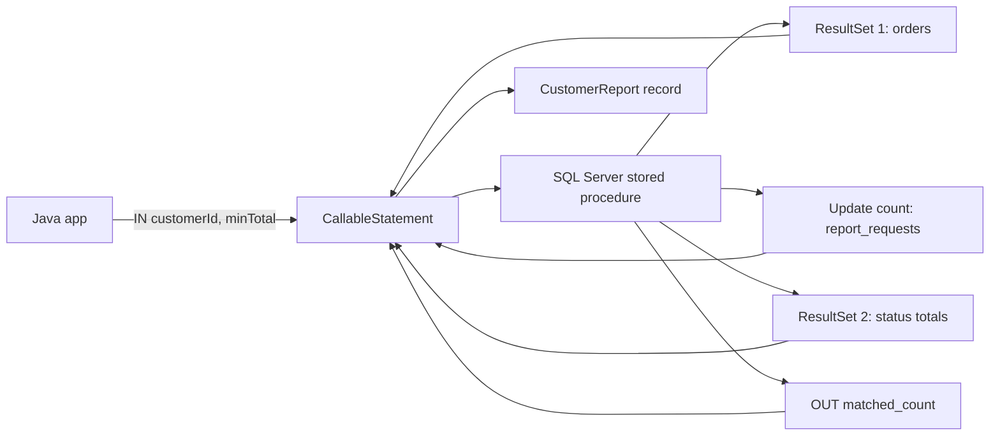
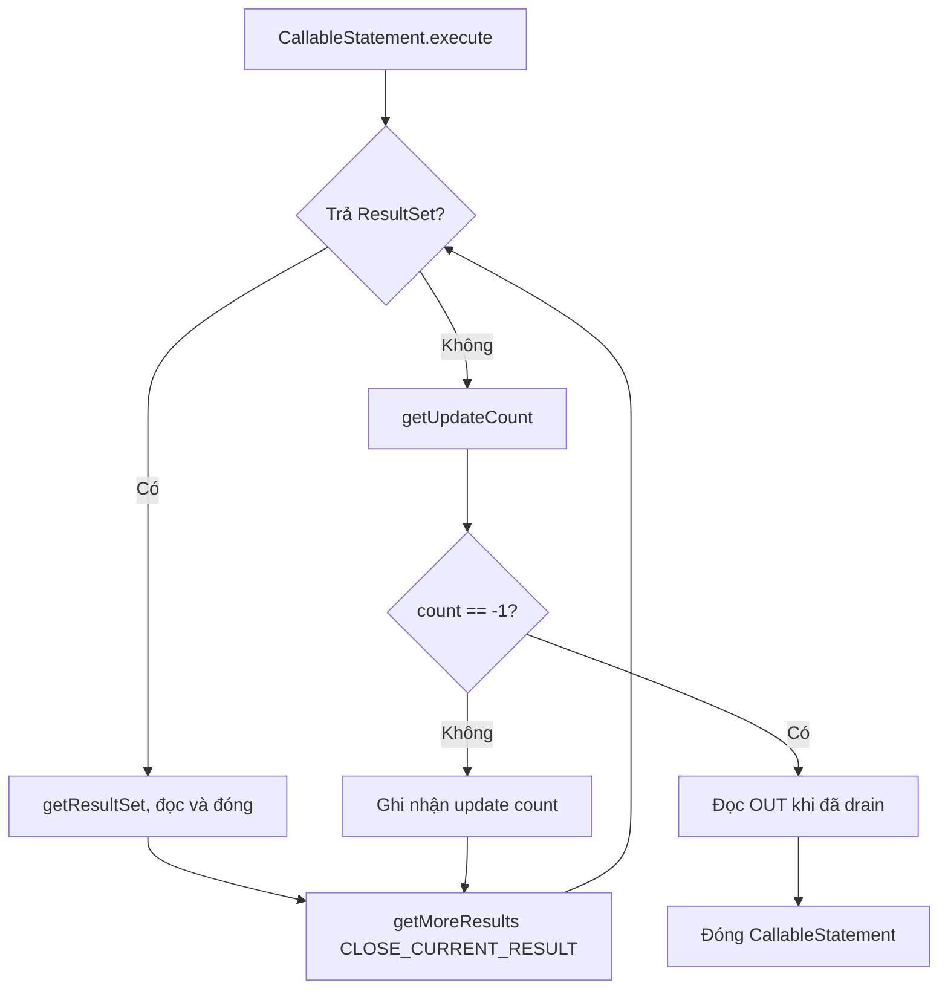

# Gọi thủ tục có tham số IN, OUT và nhiều kết quả

Khi một nghiệp vụ cần **gửi dữ liệu vào cơ sở dữ liệu, nhận giá trị tính toán trở lại và đọc nhiều tập kết quả**, câu lệnh `SELECT` thông thường chưa chắc là giao diện phù hợp nhất. Một stored procedure có thể nhận tham số **IN**, trả tham số **OUT**, thực hiện `INSERT`/`UPDATE`, đồng thời gửi một hoặc nhiều `ResultSet` về ứng dụng. Trong **JDBC**, API trung tâm cho trường hợp này là `java.sql.CallableStatement`.

Chủ đề này thuộc chương **Thực hành tổng hợp** của module **JDBC**: sử dụng driver và `DataSource` để có `Connection`; bind tham số SQL an toàn; xử lý kết quả qua `ResultSet`; quản lý CRUD, transaction và nhiều kết quả; xử lý lỗi/timeout và giải phóng tài nguyên theo các API chuẩn. Điểm khó nhất thường không phải câu lệnh `CALL` mà là **hiểu đúng chuỗi kết quả**: lần gọi đầu tiên có thể trả một result set, một update count hoặc không có kết quả; các kết quả tiếp theo phải được lấy bằng `getMoreResults()`; tham số `OUT` có thể chỉ sẵn sàng sau khi đã tiêu thụ hết các kết quả.

Bài dùng một bài thực hành xuyên suốt trên **Microsoft SQL Server** (T-SQL và Microsoft JDBC Driver). Các API Java như `CallableStatement`, `Types`, `Statement` và `ResultSet` là API JDBC chuẩn, nhưng **cú pháp tạo thủ tục, cách truyền `OUT`, thứ tự và số lượng kết quả, cũng như hỗ trợ nhiều result sets phụ thuộc DB/driver/phiên bản**. Không sao chép nguyên SQL Server DDL để chạy trên PostgreSQL, Oracle hay MySQL mà không điều chỉnh.

## 1. Kết quả cần đạt sau bài thực hành

Sau khi hoàn thành, bạn có thể:

1. Phân biệt tham số `IN`, `OUT` và `INOUT` với result set, update count và return status của procedure.
2. Viết `CallableStatement` có cú pháp JDBC escape `{call ...}`, bind tham số bằng `setXxx()` và khai báo `OUT` bằng `registerOutParameter()`.
3. Dùng `execute()` để lấy kết quả đầu, rồi luân phiên `getResultSet()`, `getUpdateCount()` và `getMoreResults()` cho đến khi kết thúc.
4. Đọc một hoặc nhiều `ResultSet` với mapper riêng, kiểm tra số lượng/khuôn dạng cột, xử lý `NULL` và đóng ngay từng kết quả.
5. Đọc tham số `OUT` **sau khi tất cả kết quả đã được xử lý**, kiểm tra `wasNull()` và giữ statement còn mở.
6. Đặt toàn bộ lời gọi trong ranh giới transaction rõ ràng, `commit()/rollback()` phù hợp và `try-with-resources` cho `Connection`, `CallableStatement`, `ResultSet`.
7. Phân loại những failure mode thường gặp: không hỗ trợ stored procedure, sai vị trí/thứ tự tham số, sai kiểu OUT, bất ngờ có thêm kết quả, lỗi khi fetch, timeout hoặc commit không rõ kết quả.

**Đầu ra bài tập:** một Java method trả về record `CustomerReport` thuần Java chứa danh sách đơn hàng, tổng hợp theo trạng thái, số đơn thỏa điều kiện từ tham số `OUT` và các update count được driver báo. Sau khi method trả về, không còn `ResultSet` hoặc `Connection` nào thuộc lời gọi bị giữ mở.

## 2. Năm khái niệm rất dễ bị nhầm

| Khái niệm | Mục đích | JDBC API tương ứng |
| --- | --- | --- |
| `IN` | Gửi giá trị Java vào thủ tục | `setLong(index, value)`, `setBigDecimal(...)`, `setString(...)` |
| `OUT` | Nhận một giá trị scalar/SQL type mà thủ tục ghi ra | `registerOutParameter(index, Types.X)` rồi `getXxx(index)` |
| `INOUT` | Một vị trí vừa nhận giá trị ban đầu vừa trả giá trị mới | **Cùng một chỉ số**: `setXxx()` và `registerOutParameter()` |
| `ResultSet` | Một bảng kết quả gồm nhiều hàng/cột mà thủ tục trả ra | `execute()`, `getResultSet()`, `ResultSet.next()/getXxx()` |
| **Update count** | Số hàng bị ảnh hưởng được driver báo sau một lệnh DML | `getUpdateCount()` hoặc `getLargeUpdateCount()` |

Ngoài ra, **giá trị trả về của function** hoặc **return status code của một procedure** (trong một số DB) không phải tham số `OUT` có tên của procedure. Cú pháp escape cho function thường có dạng:

```java
// Function trả một giá trị; dấu ? đầu tiên là vị trí return.
String functionCall = "{? = call calculate_tax(?)}";

// Procedure có 3 vị trí tham số; không có dấu ? return đứng đầu.
String procedureCall = "{call dbo.usp_customer_report(?, ?, ?)}";
```

Đối với SQL Server, cú pháp nhận **return status** của stored procedure cũng có thể dùng dạng có `? = call ...`, nhưng đó là **hợp đồng riêng với return status**, không phải ví dụ của `OUT` trong bài. Không gộp ba loại giá trị này thành một và tăng/giảm chỉ số tham số sai.

## 3. Kịch bản thực hành: báo cáo đơn hàng của khách

Ứng dụng cần lấy báo cáo các đơn hàng của một khách có tổng tiền tối thiểu:

- **IN #1 — `customer_id`:** mã khách, kiểu `BIGINT`.
- **IN #2 — `min_total`:** ngưỡng tổng tiền, kiểu `DECIMAL(18,2)`.
- **OUT #3 — `matched_count`:** tổng số đơn thỏa điều kiện, kiểu `BIGINT`.
- **Result set thứ nhất:** chi tiết những đơn thỏa điều kiện.
- **Update count:** thủ tục ghi một dòng vào bảng `report_requests` để minh họa DML trong thủ tục.
- **Result set thứ hai:** tổng hợp số đơn và tổng tiền theo `status`.

Sơ đồ dữ liệu và luồng:



**Điểm thực tế:** việc ghi một `report_requests` ở đây nhằm minh họa update count. Một hệ thống chỉ đọc báo cáo có thể không cần tác động ghi này; trường hợp đó thủ tục chỉ trả các result sets và `OUT`. Ở môi trường production, một bản ghi audit/báo cáo ghi trong DB cần được thiết kế theo quyền truy cập, retention và idempotency phù hợp.

## 4. Chuẩn bị schema và dữ liệu trên SQL Server

Các câu sau là **T-SQL dành cho SQL Server**, không phải SQL có thể di chuyển nguyên văn. Chạy trên database **thử nghiệm**, với role có quyền tạo bảng và thủ tục.

```sql
CREATE TABLE dbo.customers (
    customer_id BIGINT NOT NULL PRIMARY KEY,
    full_name NVARCHAR(120) NOT NULL
);

CREATE TABLE dbo.orders (
    order_id BIGINT NOT NULL PRIMARY KEY,
    customer_id BIGINT NOT NULL,
    total_amount DECIMAL(18, 2) NOT NULL,
    status VARCHAR(20) NOT NULL,
    CONSTRAINT fk_orders_customers
        FOREIGN KEY (customer_id)
        REFERENCES dbo.customers(customer_id),
    CONSTRAINT chk_orders_total
        CHECK (total_amount >= 0)
);

CREATE INDEX ix_orders_customer_id
    ON dbo.orders(customer_id, order_id);

CREATE TABLE dbo.report_requests (
    report_request_id BIGINT IDENTITY(1, 1) PRIMARY KEY,
    customer_id BIGINT NOT NULL
        REFERENCES dbo.customers(customer_id),
    requested_at DATETIME2 NOT NULL
        DEFAULT SYSUTCDATETIME()
);

INSERT INTO dbo.customers (customer_id, full_name)
VALUES (101, N'Khách thử nghiệm'), (102, N'Khách khác');

INSERT INTO dbo.orders
        (order_id, customer_id, total_amount, status)
VALUES
        (1001, 101, 150.00, 'PAID'),
        (1002, 101, 250.00, 'PENDING'),
        (1003, 101, 25.00, 'PAID'),
        (1004, 102, 500.00, 'PAID');
```

Để test với khách `101` và ngưỡng `100.00`, dự kiến **hai đơn thỏa điều kiện** (`1001` và `1002`); tổng hợp gồm hai trạng thái `PAID` và `PENDING`. Không dùng dữ liệu người thật trong log hay fixture kiểm thử.

Tên bảng/cột và ràng buộc được giữ đơn giản để tập trung vào JDBC. Trong hệ thống thực tế, có thể cần index khác, chính sách phân quyền, chọn isolation level và cách xử lý dữ liệu thay đổi giữa các truy vấn.

## 5. Tạo stored procedure có IN, OUT và nhiều kết quả

Thủ tục minh họa:

```sql
CREATE OR ALTER PROCEDURE dbo.usp_customer_report
    @customer_id BIGINT,
    @min_total DECIMAL(18, 2),
    @matched_count BIGINT OUTPUT
AS
BEGIN
    SET NOCOUNT OFF; -- Minh họa update count cho INSERT.

    IF @min_total < 0
        THROW 50001, 'min_total must be nonnegative', 1;

    IF NOT EXISTS (
        SELECT 1 FROM dbo.customers WHERE customer_id = @customer_id
    )
        THROW 50002, 'customer not found', 1;

    -- ResultSet #1: danh sách đơn hàng.
    SELECT order_id, total_amount, status
    FROM dbo.orders
    WHERE customer_id = @customer_id
      AND total_amount >= @min_total
    ORDER BY order_id;

    -- Tác động ghi: có thể tạo một update count.
    INSERT INTO dbo.report_requests (customer_id)
    VALUES (@customer_id);

    -- ResultSet #2: tổng hợp theo trạng thái.
    SELECT status,
           COUNT_BIG(*) AS order_count,
           SUM(total_amount) AS total_by_status
    FROM dbo.orders
    WHERE customer_id = @customer_id
      AND total_amount >= @min_total
    GROUP BY status
    ORDER BY status;

    -- OUT parameter (không tạo thêm SELECT result set).
    SELECT @matched_count = COUNT_BIG(*)
    FROM dbo.orders
    WHERE customer_id = @customer_id
      AND total_amount >= @min_total;
END;
```

Trong SQL Server Management Studio hoặc công cụ hỗ trợ T-SQL batches, có thể cần đặt `GO` **trên một dòng riêng trước và/hoặc sau `CREATE OR ALTER PROCEDURE`**. `GO` là dấu phân tách batch ở công cụ SQL Server, **không phải lệnh T-SQL gửi trực tiếp qua `PreparedStatement`**. Khi chạy migration, dùng cú pháp batch mà công cụ migration hỗ trợ.

Các điểm cần quan sát:

- Hai câu `SELECT` trả về **hai result sets**; câu `SELECT @matched_count = ...` chỉ gán biến, không cố ý trả một result set thứ ba.
- `INSERT` có thể tạo một **update count**, vì `SET NOCOUNT OFF`. Số lượng/vị trí update counts được JDBC thấy có thể phụ thuộc **driver và cấu hình**, vì vậy Java **không được giả định luôn có đúng một update count nằm giữa hai result sets**.
- `@matched_count BIGINT OUTPUT` có kiểu `BIGINT`; JDBC phải gọi `registerOutParameter(3, Types.BIGINT)` trước khi `execute()`.
- Câu `THROW` báo lỗi cho trường hợp đầu vào không hợp lệ hoặc khách không tồn tại; ứng dụng không được chuyển lỗi này thành “không có đơn hàng” một cách tùy tiện.
- Báo cáo thực hiện nhiều câu `SELECT`. Dưới isolation mặc định, các câu có thể quan sát trạng thái dữ liệu khác nhau nếu giao dịch khác đang ghi. Nếu cần **snapshot nhất quán tuyệt đối**, phải thiết kế isolation/snapshot phù hợp với SQL Server và kiểm thử thật.

## 6. Cú pháp JDBC CALL và thứ tự bind tham số

`Connection.prepareCall(...)` tạo `CallableStatement`:

```java
import java.sql.CallableStatement;
import java.sql.Connection;
import java.sql.Types;
import java.math.BigDecimal;

String callSql = "{call dbo.usp_customer_report(?, ?, ?)}";

try (CallableStatement call = con.prepareCall(callSql)) {
    call.setLong(1, 101L);                    // IN customer_id
    call.setBigDecimal(2, new BigDecimal("100.00")); // IN min_total
    call.registerOutParameter(3, Types.BIGINT);     // OUT matched_count
    call.setQueryTimeout(30);

    boolean firstIsResultSet = call.execute();
    // Phải xử lý toàn bộ result set/update count; không đọc OUT vội.
}
```

Ví dụ được đặt trong một scope đã có `Connection con` hợp lệ và transaction owner sẽ quản lý connection. Đừng chỉ chạy phần trên rồi bỏ qua xử lý kết quả nếu thủ tục trả nhiều kết quả.

**Chỉ số JDBC bắt đầu từ 1**, không phải 0. Nếu thêm return status dạng `{? = call ...}`, chỉ số các tham số còn lại sẽ thay đổi. Cũng không thể dùng dấu `?` để bind **tên thủ tục**; tên procedure phải được lấy từ allowlist/configuration đáng tin cậy, không nối trực tiếp input người dùng vào SQL.

Các lưu ý về kiểu:

- `setBigDecimal()` phù hợp tiền tệ/`DECIMAL` hơn `setDouble()` vì không dựa trên biểu diễn nhị phân xấp xỉ.
- Kiểu của tham số `OUT` khi register phải tương thích kiểu SQL thật; ví dụ `Types.BIGINT`, `Types.INTEGER`, `Types.DECIMAL`, `Types.VARCHAR`, `Types.TIMESTAMP`.
- Với `OUT DECIMAL` có scale, một số driver cần overload `registerOutParameter(index, sqlType, scale)`; kiểm tra hợp đồng driver.
- `setNull(index, Types.X)` phù hợp cho `IN` có giá trị SQL `NULL`; dùng `null` trực tiếp với một số overload hoặc truyền kiểu sai có thể không được driver chấp nhận.
- Một tham số `INOUT` cần **vừa bind đầu vào vừa register đầu ra ở cùng vị trí**. Không tạo hai dấu `?` riêng chỉ vì nó có hai chiều.

## 7. Tại sao dùng execute(), không chỉ executeQuery()?

`CallableStatement` kế thừa `PreparedStatement` và `Statement`. Khi thủ tục có **nhiều kết quả**, phương thức tổng quát phù hợp nhất là `execute()`:

```java
boolean hasResultSet = call.execute();
```

Giá trị trả về:

- `true`: **kết quả đầu tiên** là một `ResultSet`; gọi `call.getResultSet()`.
- `false`: kết quả đầu tiên **không phải `ResultSet`**. Có thể đó là **update count** hoặc **không có kết quả**; gọi `call.getUpdateCount()` để phân biệt.

Không được viết:

```java
if (!call.execute()) {
    throw new SQLException("Thủ tục thất bại"); // SAI.
}
```

`execute() == false` không phải dấu hiệu lỗi. Nó chỉ nói kết quả đầu tiên không phải result set. Một procedure hợp lệ có thể bắt đầu bằng `INSERT`/`UPDATE` hoặc chỉ trả tham số `OUT`.

Tương tự, `executeQuery()` thường phù hợp với một truy vấn dự kiến trả **một** result set; `executeUpdate()` phù hợp khi chỉ quan tâm update count. Với một procedure có **nhiều result sets, update counts và OUT** như bài này, `execute()` và vòng lặp duyệt kết quả là cách rõ ràng hơn, tránh phụ thuộc vào việc driver chọn kết quả nào làm kết quả đầu.

## 8. Thuật toán duyệt toàn bộ các kết quả

Thuật toán JDBC tổng quát:

```text
hasResultSet = callable.execute()

loop:
    if hasResultSet:
        rs = callable.getResultSet()
        consume rs completely (hoặc dừng có chủ đích và close rs)
    else:
        updateCount = callable.getUpdateCount()
        if updateCount == -1:
            break      // Không còn result set và không còn update count.
        record(updateCount)

    hasResultSet = callable.getMoreResults(CLOSE_CURRENT_RESULT)

// Sau khi duyệt hết kết quả và giữ CallableStatement mở:
outValue = callable.getLong(outIndex)
if callable.wasNull(): xử lý SQL NULL
```

Sơ đồ quyết định:



**Điểm mấu chốt:** `getMoreResults()` trả `false` **chưa chứng minh đã hết tất cả kết quả**. Sau `false` vẫn phải gọi `getUpdateCount()`; nếu trả một số không âm, đó là một update count, và sau nó vẫn có thể còn result set khác. Điều kiện dừng là **không có result set và `getUpdateCount() == -1`**.

`Statement.CLOSE_CURRENT_RESULT` yêu cầu đóng result set hiện tại trước khi chuyển sang kết quả tiếp theo (nếu driver hỗ trợ). `getMoreResults()` không tham số cũng có ngữ nghĩa đóng current result theo hợp đồng JDBC. `KEEP_CURRENT_RESULT` dành cho trường hợp phải giữ nhiều result sets mở đồng thời nhưng không phải driver nào cũng hỗ trợ và có thể giữ nhiều tài nguyên DB; phần lớn ứng dụng nên **đọc và đóng từng result set ngay**.

## 9. Mẫu Java hoàn chỉnh: gọi thủ tục và trả DTO thuần

Đây là lớp Java 17+ chứa một lời gọi dùng `DataSource`, `CallableStatement`, mapper và transaction. Nó:

- Validate đầu vào **trước** khi mượn connection.
- Bind cả hai tham số `IN` và register `OUT`.
- Duyệt hai result sets và các update counts **không giả định update count ở vị trí cố định**.
- Đóng từng `ResultSet` bằng `try-with-resources` trước khi chuyển kết quả.
- Đọc `OUT` **sau khi đã duyệt hết**, nhưng **trước khi đóng callable**.
- Commit khi toàn bộ xử lý thành công; rollback khi thất bại; bảo toàn lỗi cleanup.
- Trả các record/list Java độc lập với connection.

```java
import java.math.BigDecimal;
import java.sql.CallableStatement;
import java.sql.Connection;
import java.sql.ResultSet;
import java.sql.SQLException;
import java.sql.Statement;
import java.sql.Types;
import java.util.ArrayList;
import java.util.List;
import java.util.Objects;
import javax.sql.DataSource;

public final class CustomerReportDao {
    private static final String CALL =
            "{call dbo.usp_customer_report(?, ?, ?)}";

    public record OrderLine(
            long orderId, BigDecimal totalAmount, String status) {}

    public record StatusTotal(
            String status, long orderCount, BigDecimal totalAmount) {}

    public record CustomerReport(
            List<OrderLine> orders,
            List<StatusTotal> byStatus,
            long matchedCount,
            List<Integer> updateCounts) {}

    public static final class CommitOutcomeUnknown
            extends RuntimeException {
        public CommitOutcomeUnknown(SQLException cause) {
            super("Không xác định kết quả commit của procedure", cause);
        }
    }

    private final DataSource source;

    public CustomerReportDao(DataSource source) {
        this.source = Objects.requireNonNull(source);
    }

    public CustomerReport run(long customerId, BigDecimal minTotal)
            throws SQLException {

        Objects.requireNonNull(minTotal, "minTotal");
        if (customerId <= 0 || minTotal.signum() < 0) {
            throw new IllegalArgumentException(
                    "customerId phải dương, minTotal phải không âm");
        }

        try (Connection con = source.getConnection()) {
            boolean oldAutoCommit = con.getAutoCommit();
            boolean txStarted = false;
            boolean txEnded = false;
            Throwable primaryFailure = null;

            try {
                con.setAutoCommit(false);
                txStarted = true;

                CustomerReport report;
                try (CallableStatement call = con.prepareCall(CALL)) {
                    call.setLong(1, customerId);
                    call.setBigDecimal(2, minTotal);
                    call.registerOutParameter(3, Types.BIGINT);
                    call.setQueryTimeout(30);

                    report = readAllResults(call);
                }

                try {
                    con.commit();
                    txEnded = true;
                } catch (SQLException commitFailure) {
                    // Commit có thể đã hoàn thành ở server.
                    throw new CommitOutcomeUnknown(commitFailure);
                }
                return report;

            } catch (SQLException | RuntimeException | Error failure) {
                primaryFailure = failure;
                if (txStarted && !txEnded) {
                    try {
                        con.rollback();
                        txEnded = true;
                    } catch (SQLException | RuntimeException | Error rollbackFailure) {
                        if (rollbackFailure != failure) {
                            failure.addSuppressed(rollbackFailure);
                        }
                    }
                }
                throw failure;
            } finally {
                // Không tự bật autoCommit=true nếu rollback thất bại.
                if (txStarted && txEnded) {
                    try {
                        con.setAutoCommit(oldAutoCommit);
                    } catch (SQLException | RuntimeException | Error resetFailure) {
                        if (primaryFailure != null) {
                            if (resetFailure != primaryFailure) {
                                primaryFailure.addSuppressed(resetFailure);
                            }
                        } else {
                            throw resetFailure;
                        }
                    }
                }
            }
        }
    }

    private static CustomerReport readAllResults(CallableStatement call)
            throws SQLException {

        List<OrderLine> orders = new ArrayList<>();
        List<StatusTotal> totals = new ArrayList<>();
        List<Integer> counts = new ArrayList<>();

        int resultSetIndex = 0;
        boolean hasResultSet = call.execute();

        while (true) {
            if (hasResultSet) {
                ResultSet current = call.getResultSet();
                if (current == null) {
                    throw new SQLException(
                            "Driver báo ResultSet nhưng không cung cấp nó");
                }

                try (ResultSet rs = current) {
                    switch (resultSetIndex) {
                        case 0 -> readOrderLines(rs, orders);
                        case 1 -> readStatusTotals(rs, totals);
                        default -> throw new SQLException(
                                "Procedure trả thêm ResultSet ngoài hợp đồng");
                    }
                }
                resultSetIndex++;
            } else {
                int count = call.getUpdateCount();
                if (count == -1) {
                    break;
                }
                counts.add(count);
            }

            hasResultSet =
                    call.getMoreResults(Statement.CLOSE_CURRENT_RESULT);
        }

        if (resultSetIndex != 2) {
            throw new SQLException(
                    "Cần đúng hai ResultSet; nhận " + resultSetIndex);
        }

        // SQL Server: đọc OUT sau khi đã duyệt đủ các kết quả.
        long matchedCount = call.getLong(3);
        if (call.wasNull()) {
            throw new SQLException("matched_count OUT bất ngờ là NULL");
        }
        if (matchedCount < 0) {
            throw new SQLException("matched_count OUT không hợp lệ");
        }
        return new CustomerReport(
                List.copyOf(orders),
                List.copyOf(totals),
                matchedCount,
                List.copyOf(counts));
    }

    private static void readOrderLines(
            ResultSet rs, List<OrderLine> target) throws SQLException {
        while (rs.next()) {
            long id = rs.getLong("order_id");
            if (rs.wasNull()) {
                throw new SQLException("order_id bất ngờ NULL");
            }
            BigDecimal amount = rs.getBigDecimal("total_amount");
            String status = rs.getString("status");
            if (amount == null || status == null) {
                throw new SQLException("Đơn hàng thiếu cột NOT NULL");
            }
            target.add(new OrderLine(id, amount, status));
        }
    }

    private static void readStatusTotals(
            ResultSet rs, List<StatusTotal> target) throws SQLException {
        while (rs.next()) {
            String status = rs.getString("status");
            long count = rs.getLong("order_count");
            if (rs.wasNull()) {
                throw new SQLException("order_count bất ngờ NULL");
            }
            BigDecimal amount = rs.getBigDecimal("total_by_status");
            if (status == null || amount == null) {
                throw new SQLException("Tổng hợp theo status thiếu dữ liệu");
            }
            target.add(new StatusTotal(status, count, amount));
        }
    }
}
```

### Sử dụng từ tầng service

```java
import java.math.BigDecimal;

CustomerReportDao dao = new CustomerReportDao(dataSource);
CustomerReportDao.CustomerReport report =
        dao.run(101L, new BigDecimal("100.00"));

System.out.println("OUT matchedCount = " + report.matchedCount());
System.out.println("Số dòng orders = " + report.orders().size());
System.out.println("Số nhóm status = " + report.byStatus().size());
System.out.println("Số update counts được báo = "
        + report.updateCounts().size());
```

`dataSource` là `javax.sql.DataSource` đã được cấu hình và truyền từ application bootstrap/DI, không phải một pool được tạo trong mỗi lời gọi. Với dữ liệu mẫu ổn định ở mục 4, `matchedCount = 2`, `orders.size() = 2`, `byStatus.size() = 2`; số update counts ghi nhận **không được cứng mã hóa** vì có thể thay đổi theo driver/cấu hình.

Đây là mẫu giảng dạy tập trung vào JDBC. Với báo cáo cực lớn, việc tạo `List` chứa mọi đơn vẫn có nguy cơ tốn bộ nhớ; cân nhắc phân trang, callback streaming đồng bộ trong scope JDBC hoặc dữ liệu tổng hợp phía server, nhưng giữ nguyên quy tắc đóng từng result set.

## 10. Diễn giải vòng lặp trong readAllResults

Điểm thường gây lỗi nhất nằm ở vài dòng:

```java
boolean hasResultSet = call.execute();
while (true) {
    if (hasResultSet) {
        try (ResultSet rs = call.getResultSet()) {
            // Consume ResultSet theo đúng schema.
        }
    } else {
        int count = call.getUpdateCount();
        if (count == -1) {
            break;
        }
        // count là số hàng được driver báo, có thể bằng 0.
    }
    hasResultSet = call.getMoreResults(Statement.CLOSE_CURRENT_RESULT);
}
```

**Ba chi tiết phải giữ nguyên:**

1. **Update count bằng 0 vẫn là một kết quả hợp lệ.** Không viết `if (count <= 0) break;`. Chỉ `-1` (khi không có result set hiện tại) báo đã hết chuỗi kết quả.
2. `getMoreResults() == false` **không đủ để dừng**; có thể kết quả kế tiếp là một update count. Cần quay lại vòng lặp để gọi `getUpdateCount()`.
3. `call.getResultSet()` trả tài nguyên JDBC phải được đóng. Chỉ đóng một result set **sau khi đã xử lý xong** (hoặc chấp nhận dừng sớm và bỏ phần dữ liệu còn lại theo chính sách). Không gọi `getMoreResults()` rồi cố tiếp tục `next()` trên result set đã đóng.

Ví dụ chuỗi kết quả mà caller có thể thấy:

```text
execute()                      -> true   -> ResultSet #1
getMoreResults()               -> false  -> getUpdateCount() = 1
getMoreResults()               -> true   -> ResultSet #2
getMoreResults()               -> false  -> getUpdateCount() = -1
getLong(OUT index 3)           -> matched_count = 2
```

**Đây là một chuỗi minh họa**, không phải thứ tự bắt buộc của mọi driver. SQL Server có thể gửi thêm hoặc lọc update counts tùy cấu hình; ứng dụng không nên suy số thứ tự result set từ tổng số kết quả (vì update counts cũng xen vào).

## 11. OUT, SQL NULL và thời điểm đọc giá trị

Trong JDBC, việc register tham số `OUT` là bắt buộc đối với các giá trị đầu ra theo vị trí:

```java
call.registerOutParameter(3, Types.BIGINT);
call.execute();
// ... consume all result sets and update counts ...
long matchedCount = call.getLong(3);
boolean outWasNull = call.wasNull();
```

`getLong()` trả kiểu nguyên thủy `long`; khi giá trị SQL là `NULL` nó có thể trả 0, do đó **phải gọi `wasNull()` ngay sau getter** nếu cần phân biệt `NULL` và giá trị 0 hợp lệ. Với `OUT VARCHAR`, `getString()` có thể trả `null` trực tiếp; với `DECIMAL`, `getBigDecimal()` trả `BigDecimal` hoặc `null`.

Một số driver/procedure yêu cầu caller **đọc hết mọi result sets và update counts trước khi lấy OUT parameters**. Ví dụ này tuân theo nguyên tắc đó để tránh gián đoạn kết quả hoặc lỗi driver, thay vì dựa vào việc một driver cụ thể có thể trả OUT sớm. **Giữ `CallableStatement` mở** tới lúc gọi `getLong(3)`, sau đó mới đóng bằng `try-with-resources`.

Nếu thủ tục được sửa để `@matched_count` không được gán, chính sách cần nêu rõ kết quả `NULL` có hợp lệ hay không. Trong ví dụ số lượng thỏa điều kiện luôn phải có giá trị không âm nên mapper ném lỗi khi `OUT IS NULL`. Không tự đổi `NULL` thành 0 cho mọi trường hợp mà chưa hiểu ngữ nghĩa.

## 12. INOUT: một tham số đi và về cùng một vị trí

Ngoài `IN` và `OUT`, nhiều hệ quản trị hỗ trợ tham số **INOUT**. Ví dụ riêng trên SQL Server: truyền một số tiền và nhận lại số tiền sau giảm 10%.

```sql
CREATE OR ALTER PROCEDURE dbo.usp_apply_discount
    @amount DECIMAL(18, 2) OUTPUT
AS
BEGIN
    SET NOCOUNT ON;
    SET @amount = CAST(
        ROUND(@amount * CAST(0.90 AS DECIMAL(3, 2)), 2)
        AS DECIMAL(18, 2));
END;
```

Với cú pháp của SQL Server, tham số khai báo `OUTPUT` có thể được sử dụng làm **giá trị đầu vào ban đầu và đầu ra** khi caller truyền biến và dùng `OUTPUT`. JDBC:

```java
import java.math.BigDecimal;
import java.sql.CallableStatement;
import java.sql.Connection;
import java.sql.Types;

try (Connection con = dataSource.getConnection();
     CallableStatement call =
             con.prepareCall("{call dbo.usp_apply_discount(?)}")) {

    call.setBigDecimal(1, new BigDecimal("150.00"));  // IN
    call.registerOutParameter(1, Types.DECIMAL, 2);  // OUT cùng index
    call.execute();

    BigDecimal discounted = call.getBigDecimal(1);
    if (discounted == null) {
        throw new SQLException("amount INOUT bất ngờ NULL");
    }
    System.out.println(discounted); // 135.00 với dữ liệu minh họa.
}
```

Đoạn code cần thêm import `java.sql.SQLException` tương ứng. Thủ tục trên **không cố ý trả nhiều result sets**; với procedure có kết quả bổ sung, cần tiếp tục duyệt `getMoreResults()/getUpdateCount()` trước khi lấy OUT như bài chính.

**Phân biệt:** hai chiều của `INOUT` là cùng **vị trí tham số**, không phải “IN #1 và OUT #2”. Một số DB dùng cú pháp `IN OUT` trong phần khai báo procedure, một số dùng tham số `OUTPUT`; thay đổi SQL theo vendor chứ không thay đổi nguyên tắc JDBC `setXxx + registerOutParameter`.

## 13. Transaction: thao tác đọc nhiều kết quả có thể vẫn ghi dữ liệu

Vì thủ tục `usp_customer_report` thực hiện `INSERT report_requests`, lời gọi **không thuần đọc**, dù hai kết quả chính là các `SELECT`.

Nếu chạy ở `autoCommit=true` theo cấu hình driver/DB, không nên dựa vào giả định “nếu Java đọc result set thứ hai lỗi thì mọi câu lệnh trước đó tự rollback”. Trong mẫu ở mục 9, caller:

1. Mượn một `Connection` từ `DataSource`.
2. Chuyển `autoCommit=false` và giữ nguyên một transaction cho toàn lời gọi.
3. Gọi thủ tục, đọc các result sets, update counts và tham số `OUT`.
4. Đóng `CallableStatement`; sau khi toàn bộ việc xử lý thành công mới gọi `commit()`.
5. Nếu thất bại trước khi commit hoàn tất, thử `rollback()`, sau đó dọn và trả logical connection về pool.

Nếu `commit()` ném lỗi mất kết nối, **kết quả transaction có thể không xác định**: database có thể đã commit nhưng client chưa nhận xác nhận. Mã mẫu báo `CommitOutcomeUnknown` để caller không tự động retry và ghi thêm bản ghi `report_requests`. Một thiết kế cần retry an toàn nên có **request ID/idempotency key ổn định**, có constraint phù hợp và đường đối soát kết quả.

### Giới hạn cần hiểu của transaction helper trong ví dụ

- Nếu `rollback()` thất bại, không bật lại `autoCommit=true` vì hành vi này có thể tác động tới transaction chưa được kết thúc an toàn. Connection pool cần kiểm chứng cơ chế loại bỏ physical connection nghi hỏng.
- Nếu `setAutoCommit(false)` thất bại sau khi driver đã thay đổi một phần trạng thái, `txStarted` có thể chưa bật dù connection không hoàn toàn lành; trường hợp này cần chính sách của pool/driver và thử nghiệm thật.
- Nếu `commit()` thành công nhưng `setAutoCommit(oldAutoCommit)` hoặc `Connection.close()` thất bại, caller vẫn có thể nhận ngoại lệ dù dữ liệu đã commit. Không suy luận “exception = database chắc chắn chưa ghi”.
- `try-with-resources` bảo đảm Java thử đóng các tài nguyên đã khởi tạo. Nó không chứng minh DB đã giải phóng mọi cursor ngay lập tức hoặc session hoàn toàn khỏe sau lỗi mạng.
- Mẫu có thể được thay bằng transaction manager của framework, **nhưng các adapter phải cùng dùng connection được gắn với transaction**, không tự borrow hai connection khác nhau cho một nghiệp vụ nguyên tử.

## 14. Khi kết quả không đúng hợp đồng

Thủ tục là một **giao diện** giữa tầng Java và DB. Để tránh lỗi âm thầm, cần kiểm tra:

| Dấu hiệu | Nguyên nhân có thể | Hướng xử lý |
| --- | --- | --- |
| Không có ResultSet #1 | Procedure thay đổi, driver không hỗ trợ hoặc SQL bên trong không chạy nhánh tương ứng | Đánh dấu lỗi hợp đồng, không trả danh sách rỗng giả |
| Có ResultSet #3 bất ngờ | Ai đó thêm `SELECT` phục vụ debug trong procedure | Kiểm tra lại interface và test hồi quy |
| ResultSet #1 thiếu `order_id` | Thay tên cột/alias hoặc projection | Gắn contract test theo `ResultSetMetaData` |
| `getUpdateCount() == 0` | DML hợp lệ nhưng không tác động hàng | Không coi 0 là kết thúc chuỗi |
| `getUpdateCount() == -1` và không có ResultSet | Hết kết quả ở thời điểm này | Mới được thoát vòng lặp |
| `getMoreResults() == false` | Có thể là update count tiếp theo | Luôn kiểm tra `getUpdateCount()` |
| `OUT` trả SQL NULL | Procedure không gán đầu ra hoặc cho phép NULL | Dùng `wasNull()`; xử lý theo hợp đồng |
| Kiểu OUT không tương thích | `registerOutParameter` sai `Types`, thay DDL | Đồng bộ mã Java/SQL và test driver |
| `SQLException` khi đang fetch | Network/cursor/query/DB error | Dọn tài nguyên, rollback nếu cần, giữ lỗi |
| Thủ tục ghi DML rồi trả lỗi ở kết quả sau | Transaction đang có thay đổi chưa commit | Xử lý rollback/đối soát, không nuốt lỗi |

**Không đặt `SELECT 'debug' AS message` trong procedure production** mà không cập nhật hợp đồng. Với `CallableStatement` đọc theo thứ tự result set, một câu `SELECT` thêm vào có thể khiến Java map nhầm bảng chi tiết thành bảng tổng hợp. Nếu phải thay đổi interface, nên version hóa procedure hoặc giữ backward compatibility và có test phát hiện drift.

### Dùng ResultSetMetaData để bảo vệ contract

`ResultSetMetaData` cho biết số cột, tên nhãn/kiểu và các đặc tính khác:

```java
import java.sql.ResultSet;
import java.sql.ResultSetMetaData;
import java.sql.SQLException;

public static void requireColumns(
        ResultSet rs, String... requiredLabels) throws SQLException {

    ResultSetMetaData meta = rs.getMetaData();
    java.util.Set<String> available = new java.util.HashSet<>();
    for (int i = 1; i <= meta.getColumnCount(); i++) {
        available.add(meta.getColumnLabel(i)
                .toLowerCase(java.util.Locale.ROOT));
    }
    for (String label : requiredLabels) {
        if (!available.contains(
                label.toLowerCase(java.util.Locale.ROOT))) {
            throw new SQLException(
                    "ResultSet thiếu cột bắt buộc của hợp đồng");
        }
    }
}
```

Đặt helper vào một utility class có phương thức `static`; gọi trước `readOrderLines(...)` hoặc `readStatusTotals(...)` để phát hiện thay đổi projection sớm. Đoạn code kiểm tra **tên cột**, chưa kiểm tra kiểu SQL, nullability hay thứ tự; nếu cần contract nghiêm ngặt, mở rộng test theo `meta.getColumnType(i)` và dữ liệu mẫu.

Không nên log nguyên tất cả tên bảng/cột do hệ thống DB trả khi chúng có thể được xem là metadata nhạy cảm. Ứng dụng cần ghi query ID và thông tin “schema contract failed” để điều tra.

## 15. Cập nhật dữ liệu qua procedure: tránh coi update count là commit

Trong vòng lặp, `getUpdateCount()` trả số hàng tác động mà driver đang báo cho **một kết quả DML**. Có thể gặp các trường hợp:

- `0`: một DML đã chạy nhưng không thay đổi hàng nào.
- Số dương: số hàng tác động theo thông tin driver.
- `-1`: không có update count đang chờ nếu kết quả hiện tại không là result set.
- Với quy mô rất lớn, có thể dùng `getLargeUpdateCount()` để tránh giới hạn `int`, nếu driver/phiên bản hỗ trợ đầy đủ.

Đừng cộng mọi update count rồi khẳng định đây là số hàng “đã commit”. Một procedure có thể gồm nhiều `INSERT/UPDATE/DELETE` trên các bảng khác nhau, trả những count từ trigger, bị cấu hình `NOCOUNT` che đi, hoặc bị rollback sau đó. Tập `updateCounts` trong `CustomerReport` là **thông tin chẩn đoán**, không phải một chứng thư bảo đảm trạng thái dữ liệu.

Nếu nghiệp vụ cần biết chính xác một lệnh đã tác động bao nhiêu hàng, đáng tin cậy hơn là định nghĩa một **tham số `OUT` riêng** cho count đó hoặc một result set có schema cố định, đồng thời xác nhận transaction thành công. Đừng dựa vào “update count thứ hai” vì driver có thể thay cách hiển thị các kết quả phụ.

## 16. Timeout, cancellation và tài nguyên dài hạn

Các lời gọi stored procedure có thể chạy lâu, thậm chí trả các result sets khổng lồ:

- `call.setQueryTimeout(30)` đặt timeout thực thi ở đơn vị **giây** theo hỗ trợ của driver. Không mặc định thời gian này bao trùm mọi lần fetch `rs.next()`, callback xử lý hàng và serialize response.
- `Statement.cancel()` là lời yêu cầu hủy statement; nó không bảo đảm SQL dừng ngay hoặc transaction tự rollback. Trong thiết kế có luồng hủy độc lập, xác định owner của `Connection` và `CallableStatement` trước khi cho phép gọi `cancel()`.
- `call.setFetchSize(n)` là hint cho driver; không bảo đảm chỉ tải đúng `n` hàng hoặc tự giới hạn kết quả trên server.
- `Connection.setNetworkTimeout(...)` và các socket timeout của driver có phạm vi khác query timeout; cần cấu hình theo driver/pool và trả lại trạng thái connection đúng khi dùng pool.
- Nếu dữ liệu lớn và caller chỉ cần một phần, thay đổi **hợp đồng procedure**: nhận giới hạn hoặc checkpoint ở `IN` và dùng truy vấn phân trang trong DB. Đọc 10 hàng rồi `break` ở Java có thể để driver/DB đã tính hoặc đệm nhiều hàng khác.

Khi trả bản ghi cho HTTP stream, không giữ result set trong một object sống ngoài scope JDBC. Nếu client ngắt kết nối, worker cần biết để dừng đọc và đóng `ResultSet`/`CallableStatement`/`Connection`; không chỉ dừng viết ra network mà tiếp tục lấy dữ liệu vô hạn.

Trong ví dụ mục 9, kết quả được gom vào `List` nên phù hợp với **bài thực hành và lượng dữ liệu giới hạn**. Trong ứng dụng sản xuất với hàng triệu đơn, đo memory và thời gian giữ connection, cân nhắc phân trang hoặc callback visitor theo từng result set, đồng thời giữ đúng ranh giới transaction.

## 17. Cảnh báo và lỗi: lấy mã kỹ thuật nhưng không rò rỉ dữ liệu

JDBC cung cấp `SQLWarning`, `SQLException`, `getSQLState()`, `getErrorCode()`, `getNextException()` và `getSuppressed()`. Khi thủ tục thất bại, những thông tin này thường giúp phân biệt lỗi kiểu dữ liệu, lỗi connection, constraint hoặc timeout.

```java
import java.sql.SQLException;
import java.util.logging.Level;
import java.util.logging.Logger;

public static void recordError(
        Logger log, String queryId, SQLException failure) {
    String state = failure.getSQLState();
    if (state == null || !state.matches("[A-Za-z0-9]{5}")) {
        state = "UNKNOWN";
    }
    log.log(Level.WARNING,
            "event=jdbc.call.failed query_id={0} sql_state={1} "
                    + "vendor_code={2}",
            new Object[] {queryId, state, failure.getErrorCode()});
}
```

Ví dụ đặt trong class utility; `queryId` phải là hằng số từ code, ví dụ `customer-report.v1`, **không phải SQL hay input tự do của người dùng**. Không tự động ghi `CallableStatement.toString()`, raw `SQLException.getMessage()` hoặc toàn bộ chain exception vào log công khai: một số driver có thể đưa giá trị tham số và dữ liệu nhạy cảm vào đó.

Phải giữ nguyên exception trong control flow để transaction owner xử lý rollback và để tầng chẩn đoán có quyền kiểm tra `getNextException()`, cause và suppressed. **Đã log lỗi không đồng nghĩa có thể nuốt lỗi rồi trả báo cáo rỗng.**

Với warning, đọc `call.getWarnings()` khi statement còn mở, dùng `getNextWarning()`/`getNextException()` theo hợp đồng và duyệt có giới hạn. Warning không mặc định làm procedure thất bại, nhưng cũng có thể chỉ ra dữ liệu bị biến đổi hoặc tính năng driver bị hạ cấp. **Thu thập đúng lúc**, vì warning có thể bị xóa khi thực hiện lệnh tiếp theo hoặc khi đóng statement.

## 18. Tính di động giữa các hệ quản trị

API `CallableStatement` là chung, nhưng stored procedure không có hành vi hoàn toàn đồng nhất:

| Hệ quản trị | Điểm cần xác minh |
| --- | --- |
| **SQL Server** | T-SQL `OUTPUT`, `SET NOCOUNT`, nhiều `SELECT`/DML counts, return status và driver property có thể ảnh hưởng update counts |
| **PostgreSQL** | `CALL`, procedure/function và tham số đầu ra có semantics khác; refcursor và result set cần tuân theo khả năng phiên bản PostgreSQL JDBC driver |
| **Oracle** | PL/SQL procedure, `OUT` và `REF CURSOR`, implicit results qua cơ chế riêng; có thể dùng `Types.REF_CURSOR` khi driver hỗ trợ |
| **MySQL/MariaDB** | `CALL`, `IN/OUT/INOUT`, nhiều result sets và cú pháp/kết quả phụ thuộc driver/configuration |
| **H2 hoặc DB nhúng** | Tốt để test một phần API nhưng không chứng minh contract nhiều kết quả và OUT giống production DB |

`DatabaseMetaData` có một số phép kiểm tra khả năng:

```java
import java.sql.Connection;
import java.sql.DatabaseMetaData;

try (Connection con = dataSource.getConnection()) {
    DatabaseMetaData meta = con.getMetaData();
    boolean supportsProcs = meta.supportsStoredProcedures();
    boolean supportsMultiple = meta.supportsMultipleResultSets();
    boolean supportsKeptOpen = meta.supportsMultipleOpenResults();
    // Ghi cấu hình/capability cho hệ thống; không suy ra mọi thủ tục đều chạy.
}
```

Các flags này là **tín hiệu**, không bảo đảm driver hỗ trợ mọi kiểu `OUT`/result set/return status hoặc cùng cú pháp `CALL`. Kiểm thử một thủ tục tối thiểu **trên đúng DB và driver sẽ triển khai** vẫn là yêu cầu quan trọng.

### REF_CURSOR khác với hai result sets tuần tự

Một `OUT REF_CURSOR` (khi DB/driver hỗ trợ) là **tham số đầu ra chứa handle/giá trị cursor**. Nó khác với việc procedure tự phát hai `SELECT` mà `getMoreResults()` duyệt. Mẫu có tính minh họa:

```java
// Chỉ áp dụng khi DB/driver hỗ trợ REF_CURSOR theo JDBC.
call.registerOutParameter(2, Types.REF_CURSOR);
call.execute();
// Xử lý những kết quả thông thường trước nếu thủ tục có trả thêm.
Object cursor = call.getObject(2);
if (cursor instanceof ResultSet rs) {
    try (rs) {
        while (rs.next()) {
            // Đọc cursor theo contract của vendor.
        }
    }
}
```

Đừng dùng `Types.REF` thay `Types.REF_CURSOR`: SQL `REF` là tham chiếu tới đối tượng có cấu trúc, không phải cursor. Một số driver/DB cần cách đăng ký/lấy cursor riêng và connection phải còn mở trong khi tiêu thụ cursor. **Không coi đoạn code này là ví dụ chạy được trên mọi DB**.

## 19. Kiểm thử tích hợp từng trạng thái của procedure

Đối với thủ tục nhiều kết quả, **unit test với mock không đủ** để chứng minh thứ tự kết quả hoặc hành vi `OUT` của driver. Nên chạy integration test với SQL Server thử nghiệm, Microsoft JDBC Driver và `DataSource`/pool cấu hình như môi trường thật.

| Ca kiểm thử | Kỳ vọng |
| --- | --- |
| Khách `101`, ngưỡng `100.00` | Có hai OrderLine, hai nhóm status, `OUT matchedCount=2` |
| Khách `101`, ngưỡng `9999` | ResultSet #1 rỗng, #2 rỗng, `OUT=0`; **vẫn nhận đúng hai ResultSet** |
| Khách không tồn tại | Procedure ném lỗi, Java rollback và không trả báo cáo giả |
| `minTotal < 0` | Java validate sớm, không mượn connection; DB cũng chặn qua THROW nếu gọi trực tiếp |
| `OUT` trả `NULL` hoặc sai kiểu qua procedure test riêng | Mapper phát hiện, không lẫn `NULL` với số 0 |
| Procedure thay đổi thêm `SELECT` thứ ba | Contract test báo lỗi, không map nhầm |
| `SET NOCOUNT OFF` | Quan sát update counts mà driver thực sự báo; không giả định cố định |
| `SET NOCOUNT ON` ở biến thể test | Đọc hai result sets và OUT vẫn đúng dù thiếu DML counts |
| Lỗi khi đọc ResultSet thứ hai | ResultSet/statement/connection đóng, transaction rollback theo policy |
| Lỗi `CallableStatement.close()` | Không commit phần tác động ghi; lỗi cleanup được báo |
| `commit()` ném lỗi sau khi server đã xử lý | Báo outcome không chắc chắn; không retry `INSERT` mù |
| Hai request cùng chạy thủ tục | Mỗi request có `CallableStatement`/connection riêng, kết quả đúng theo isolation |
| Pool chạm giới hạn khi nhiều call lỗi | Connection được trả/loại đúng, không cạn pool sau lỗi |
| Driver nâng cấp | Vẫn nhận đúng contract của IN/OUT/multiple resultsets, cập nhật benchmark |

### Kiểm thử sự thay đổi theo NOCOUNT

Trên SQL Server, thử đặt `SET NOCOUNT ON` trong biến thể thủ tục test. Khi đó nhiều count từ statement DML không còn xuất hiện như trước. Nếu Java vô tình dừng vòng lặp ngay khi `getMoreResults() == false`, nó có thể bỏ result set thứ hai ở cấu hình `NOCOUNT OFF` hoặc xử lý sai khi thay đổi. Ngược lại, code đúng ở mục 9 đọc các result sets theo thứ tự mà không gắn kỳ vọng với số update counts.

**Không test bằng cách cố ý làm hỏng production database**. Dùng schema/DB tách biệt, data fixture giả, transaction được rollback sau test hoặc reset dữ liệu giữa các ca. Vì thủ tục có `INSERT report_requests`, các test cần cô lập/kiểm tra số dòng tăng và không để trạng thái của test trước ảnh hưởng test sau.

### Test contract tối thiểu bằng JUnit 5

```java
import static org.junit.jupiter.api.Assertions.*;

import java.math.BigDecimal;
import org.junit.jupiter.api.Test;

class CustomerReportDaoIT {
    private final CustomerReportDao dao =
            new CustomerReportDao(TestDataSources.sqlServer());

    @Test
    void readsInOutAndTwoResultSets() throws Exception {
        var report = dao.run(101L, new BigDecimal("100.00"));

        assertEquals(2L, report.matchedCount());
        assertEquals(2, report.orders().size());
        assertEquals(2, report.byStatus().size());
        assertEquals(1001L, report.orders().get(0).orderId());
        assertEquals(new BigDecimal("150.00"),
                report.orders().get(0).totalAmount());
        // Không assert đúng số update counts: phụ thuộc driver.
    }
}
```

`TestDataSources.sqlServer()` là **fixture placeholder do dự án test phải triển khai**, không phải lớp có sẵn trong JDK. Test cần chạy trên DB SQL Server đã nạp schema/dữ liệu mục 4, có procedure mục 5 và được cô lập dữ liệu/transaction. Ví dụ này thể hiện các assertion cần có; không phải mã độc lập có thể chạy khi chưa cấu hình test infrastructure.

Để kiểm tra resource cleanup, thêm test với datasource/pool thực: sau khi gọi DAO hoặc cố tình gây SQL lỗi, quan sát số connection đang được borrow giảm và vẫn có thể mượn connection khác. Với lỗi `ResultSet.next()`/`close()` khó gây trên DB thật, bổ sung unit test bằng mock/proxy để xác nhận `try-with-resources` vẫn thử đóng tất cả tài nguyên, giữ primary/suppressed exceptions.

## 20. Những phản mẫu dễ xuất hiện khi gọi thủ tục

| Phản mẫu | Vì sao sai hoặc rủi ro | Cách sửa |
| --- | --- | --- |
| Gọi `executeQuery()` cho procedure có nhiều result sets và DML | Có thể chỉ thấy một kết quả hoặc lỗi theo driver | Dùng `execute()` và duyệt toàn bộ |
| `if (!call.execute()) throw ...` | `false` có thể là update count, không phải thất bại | Kiểm tra `getUpdateCount()` |
| `getMoreResults() == false` thì break luôn | Có thể còn update count rồi đến result set khác | Chỉ dừng khi `getUpdateCount() == -1` |
| Bỏ qua update count bằng 0 | 0 vẫn là một kết quả DML hợp lệ | Phân biệt 0 với -1 |
| Gọi `getLong(OUT)` trước khi drain | Một số driver cần hoàn tất result streams trước | Lấy OUT sau vòng lặp |
| Quên `registerOutParameter()` | Driver không biết kiểu/chiều của OUT | Register trước `execute` |
| Dùng chỉ số 0 hoặc nhầm vị trí return status | JDBC index bắt đầu 1; return có thể chiếm thêm vị trí | Kiểm tra call signature |
| Coi `OUT=0` là `NULL` | Getter primitive có thể trả 0 khi SQL NULL | Gọi `wasNull()` |
| Tạo một DTO chứa ResultSet để trả service | Cursor sống quá scope, dễ leak connection | Map thành record/list thuần Java |
| Không đóng từng ResultSet | Giữ cursor/server resources không cần thiết | `try-with-resources` cho mọi ResultSet |
| Giả định update counts cố định bất kể NOCOUNT/driver | Nhầm index và số lượng kết quả | Xem counts là dữ liệu tùy hỗ trợ |
| Thêm `SELECT` debug trong procedure | Phá contract nhiều ResultSet | Log server an toàn, version hóa interface |
| Để DAO tự dùng nhiều connection cho một procedure logic | Mất atomicity | Một connection/transaction owner |
| Retry sau `commit()` timeout | Có thể tạo thêm bản ghi audit/trùng nghiệp vụ | Idempotency key và đối soát |
| Dùng SQL Server syntax như SQL chung | DB khác có CALL/OUT/REF_CURSOR khác | Viết adapter/test riêng theo DB |
| Log SQL đầy đủ, `call.toString()` hoặc dữ liệu đầu vào | Có thể lộ PII/secret | Query ID, SQLState, duration |
| Dùng `KEEP_CURRENT_RESULT` không cần thiết | Giữ nhiều cursor, tăng áp lực pool/memory | Đọc và đóng từng result set |

## 21. Bài tập thực hành mở rộng

**Bài 1 — Điền vòng lặp còn thiếu.** Cho một procedure trả: update count 0 → ResultSet A → update count 2 → ResultSet B → OUT. Viết đầy đủ vòng lặp `execute/getUpdateCount/getMoreResults`; chỉ ra vì sao cả lần `false` đầu và update count 0 đều chưa được phép kết thúc.

**Bài 2 — IN, OUT, INOUT.** Viết một stored procedure nhận `@product_id` (IN), `@discount_percent` (INOUT) và `@final_price` (OUT). Trong JDBC, đăng ký/đặt tham số ở đúng index và xử lý `NULL` với getter tương ứng.

**Bài 3 — Đổi schema result set.** Chỉnh procedure báo cáo để trả thêm `currency` hoặc đổi alias `total_by_status`. Viết contract test dùng `ResultSetMetaData` phát hiện thay đổi. Thảo luận cách version hóa procedure để không phá caller cũ.

**Bài 4 — Lỗi ở result set thứ hai.** Giả lập `rs.next()` ném `SQLException` sau khi đã đọc xong result set đầu và `INSERT` đã chạy. Chứng minh transaction rollback, mọi resource đóng; nếu `close()` cũng lỗi thì exception nào là primary và exception nào bị suppressed?

**Bài 5 — NOCOUNT và update count.** Trên SQL Server test, thử `SET NOCOUNT ON`/`OFF` trong procedure, ghi nhận updateCounts. Giải thích vì sao không nên dùng `updateCounts.get(0)` làm số bản ghi nghiệp vụ chính xác của mọi driver.

**Bài 6 — Ref cursor.** Trên DB/driver hỗ trợ `Types.REF_CURSOR`, xây dựng một thủ tục OUT cursor và đọc `ResultSet` của cursor. So sánh việc mở/đóng cursor OUT với việc lấy hai result sets tuần tự bằng `getMoreResults()`.

**Bài 7 — Timeout và idempotency.** Một client gửi procedure ghi audit, `commit()` trả lỗi kết nối. Thiết kế request ID duy nhất ở DB và API tra cứu kết quả; không retry bằng request ID mới. Xác định log/metrics không chứa bind parameters.

**Bài 8 — Hiệu năng.** Tạo nhiều đơn trên DB thử nghiệm rồi đo thời gian thực thi procedure, thời gian tiêu thụ từng result set, connection usage duration, memory và số result sets. Đề xuất phân trang/aggregate cho tình huống một khách có hàng triệu đơn.

## 22. Checklist trước khi dùng CallableStatement trong production

- [ ] Đã xác nhận chính xác DB, driver/phiên bản, syntax procedure và thứ tự IN/OUT/INOUT?
- [ ] Dùng `{call ...}` hoặc cú pháp driver hỗ trợ; không trộn return status với OUT parameter?
- [ ] Bind IN bằng `setXxx()` và register OUT bằng `registerOutParameter()` **trước `execute()`**?
- [ ] Nếu có INOUT, dùng cùng một index cho cả set và register?
- [ ] Có nhiều kết quả thì dùng `execute()`, không coi `false` là lỗi?
- [ ] Duyệt `getResultSet()/getUpdateCount()/getMoreResults()` cho đến khi **không còn cả ResultSet lẫn update count**?
- [ ] Phân biệt `getUpdateCount() == 0` với `-1`; không dựa vào số lượng update counts cố định?
- [ ] Đóng từng ResultSet trước khi chuyển tiếp; giữ CallableStatement mở tới lúc lấy OUT?
- [ ] Dùng `getXxx(OUT)` đúng kiểu và `wasNull()` khi getter primitive có thể che SQL NULL?
- [ ] Có mapper/schema contract test cho **từng** ResultSet, đặc biệt khi procedure thay đổi projection?
- [ ] Mọi statement/result set/connection được quản lý bằng `try-with-resources` theo ownership rõ?
- [ ] Thủ tục có DML thì có transaction boundary, commit/rollback và xử lý commit không rõ kết quả?
- [ ] Không tự động retry procedure ghi khi thiếu idempotency key/đối soát?
- [ ] Có query timeout, hủy có kiểm soát và chiến lược phân trang/streaming cho kết quả lớn?
- [ ] Không log giá trị bind/PII, `CallableStatement.toString()` hoặc raw exception message?
- [ ] Đã thử với DB/driver thật, cả kết quả rỗng, nhiều result sets, NOCOUNT, OUT NULL, lỗi/timeout?
- [ ] Pool được ứng dụng/container sở hữu, không tự shutdown pool trong từng DAO?

**Kết luận:** `CallableStatement` cho phép Java giao tiếp với stored procedure bằng tham số `IN`, `OUT` và `INOUT`, đồng thời nhận **nhiều result sets và update counts**. Khác biệt quyết định của bài thực hành là **không dừng khi `execute()` hoặc `getMoreResults()` trả `false`**, mà kiểm tra `getUpdateCount()` và chỉ kết thúc khi chuỗi kết quả thực sự cạn. Sau đó mới lấy `OUT`, xác nhận `NULL`, quản lý commit/rollback và đóng toàn bộ JDBC resources. Khi kèm contract test theo DB/driver thật, phần tích hợp sẽ đáng tin cậy ngay cả khi thủ tục ngày càng phức tạp.
