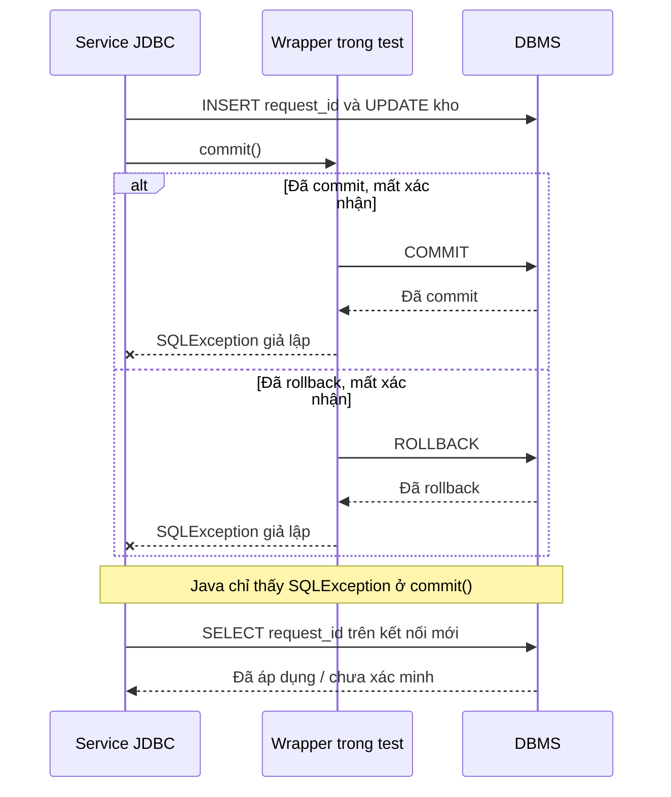
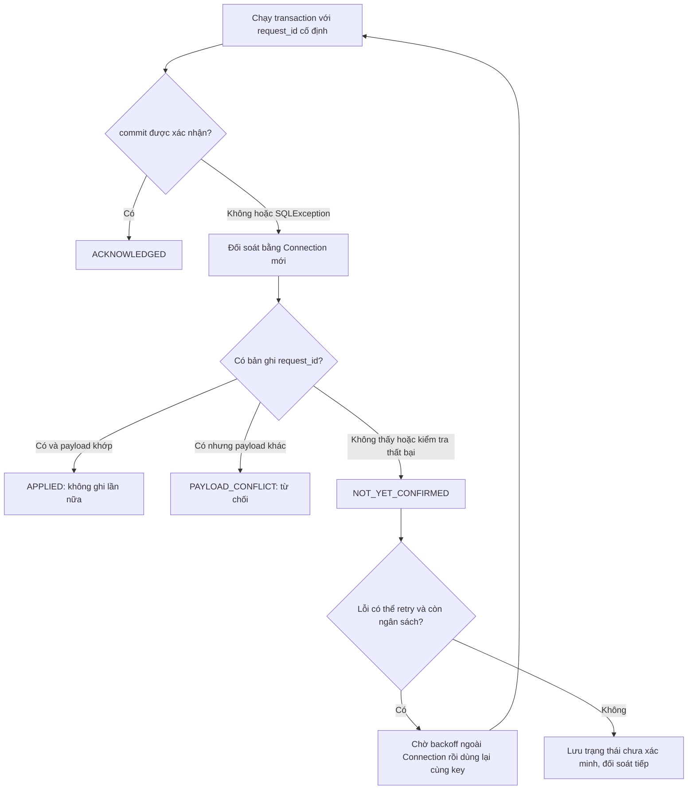
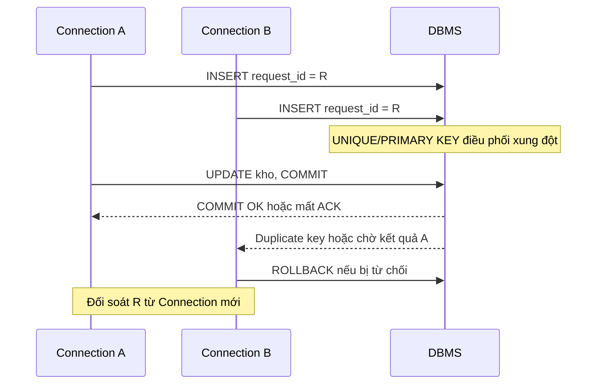

# Mô phỏng timeout và kết quả commit chưa xác định

**Bối cảnh:** Một dịch vụ Java dùng **JDBC** ghi nhận yêu cầu đặt giữ hàng trong kho. Ứng dụng đã gửi các câu `INSERT`/`UPDATE` qua `PreparedStatement`, sau đó gọi `Connection.commit()`. Đúng lúc ấy, kết nối bị lỗi hoặc phản hồi xác nhận không đến. Java nhận `SQLException`, nhưng phía DBMS có thể **đã commit** hoặc **đã rollback**. Nếu service tự động chạy lại thao tác `UPDATE inventory SET available = available - ?`, hàng có thể bị trừ hai lần.

Bài thuộc chương **Thực hành tổng hợp** của module **JDBC**. Bạn sẽ thực hiện một phòng thí nghiệm (*lab*) tích hợp `DataSource`, `Connection`, `PreparedStatement`, `ResultSet`, transaction, ràng buộc duy nhất, kiểm thử bằng hai kết nối và mô phỏng lỗi có kiểm soát. Điểm đặc biệt là **hai lần thử đều báo lỗi như nhau ở vị trí `commit()` nhưng cơ sở dữ liệu có hai trạng thái cuối khác nhau**:

- **Commit thật sự hoàn tất, phản hồi bị mất:** DB đã trừ kho; Java không nhận được xác nhận.
- **Rollback thật sự hoàn tất, phản hồi bị mất:** DB chưa trừ kho; Java cũng không nhận được xác nhận.

Ta xây hai kịch bản **có thể lặp lại được** bằng một wrapper `Connection` dùng trong test. Sau đó, một lần đọc mới trên DB primary sẽ giúp đối soát. Nếu chưa thấy bản ghi yêu cầu, vẫn phải ghi nhận rằng kết quả **chưa được xác minh**, không suy luận chỉ từ ngoại lệ.

> **Mục tiêu an toàn:** Mỗi ý định nghiệp vụ dùng một `request_id` cố định. `request_id` được ghi cùng thao tác trừ kho trong **một transaction**, dưới ràng buộc `PRIMARY KEY`. Retry dùng lại cùng khóa và payload, có giới hạn và kiểm tra lại trước khi xác nhận. Thí nghiệm không tự nhận mô phỏng được mọi chi tiết lỗi mạng thật của driver/DBMS.

## 1. Mục tiêu và tiêu chí hoàn thành

Sau bài thực hành, bạn cần có khả năng:

1. Phân biệt **timeout khi chờ/thi hành SQL** với **commit không rõ kết quả**, không đánh đồng lỗi `SQLException` và rollback thành công.
2. Sử dụng `autoCommit=false`, `commit()`, `rollback()` và `try-with-resources` để quản lý đơn vị ghi gồm nhiều statement.
3. Tiêm lỗi có kiểm soát tại ranh giới `Connection.commit()`, tạo **hai sự thật phía DB** cho **cùng một lỗi phía client**.
4. Thiết kế `request_id` và `PRIMARY KEY` để không lặp lại hiệu ứng cộng dồn khi retry.
5. Dùng `DataSource` lấy **kết nối mới đến nguồn đọc nhất quán** để phân biệt `APPLIED`, `PAYLOAD_CONFLICT` và `NOT_YET_CONFIRMED`.
6. Viết integration test chứng minh số hàng và tồn kho sau commit/rollback, kể cả tình huống chạy lại cùng khóa.
7. Biết giới hạn của mô phỏng in-process so với lỗi thực tế khi mạng rớt, tiến trình Java bị kill hoặc DBMS failover.

### Những điều *không* được kết luận từ thí nghiệm

| Quan sát | Kết luận hợp lệ | Kết luận sai |
| --- | --- | --- |
| `commit()` trả thành công. | Driver đã xác nhận transaction hoàn tất. | Mọi API/email bên ngoài cũng thành công. |
| `commit()` ném `SQLException`. | Ứng dụng thiếu một xác nhận commit đáng tin. | DB nhất định đã rollback. |
| `rollback()` thành công **trước khi từng gọi commit**. | Thay đổi transactional chưa commit đã được hoàn tác. | Các tác động bên ngoài DB cũng được hoàn tác. |
| Đọc mới thấy bản ghi `request_id` cùng payload. | Với thiết kế cùng transaction bên dưới, thao tác đã được áp dụng. | Được phép thực hiện lại thao tác ghi. |
| Đọc mới **chưa thấy** `request_id`. | Chưa có bằng chứng bản ghi đã commit tại thời điểm đọc. | Transaction đầu tiên chắc chắn đã kết thúc thất bại. |
| Retry đụng `PRIMARY KEY`. | Không thể thêm thêm một hàng cùng khóa được DB chấp nhận. | Có thể bỏ qua việc kiểm tra payload hoặc kết quả nghiệp vụ. |

## 2. Chuẩn bị môi trường, cơ sở dữ liệu và dữ liệu mẫu

**Yêu cầu:** JDK 11 trở lên, JDBC driver đúng DBMS, một `DataSource` trỏ đến **DB dành riêng cho kiểm thử**, tài khoản có quyền tạo bảng/chèn/sửa/đọc, và một cơ chế tạo `DataSource` từ cấu hình môi trường của dự án. Có thể sử dụng PostgreSQL hoặc một hệ quản trị quan hệ khác hỗ trợ transaction và ràng buộc khóa chính. Mã lab chỉ gọi **API JDBC chuẩn**, nhưng DDL có thể cần chỉnh nhẹ theo DBMS.

> **Không dùng database production.** Bài có thao tác xóa fixture và mô phỏng lỗi giao dịch. Với pool, phải kiểm tra chính sách rollback/evict khi kết nối lỗi; để quan sát dễ nhất, có thể dùng `DataSource` không pool trong lab đầu tiên. Khi dùng DB container, tránh coi hành vi của một DB in-memory là bằng chứng thay thế cho engine production.

Lược đồ:

```sql
CREATE TABLE lab_inventory (
    sku BIGINT PRIMARY KEY,
    available INTEGER NOT NULL CHECK (available >= 0)
);

CREATE TABLE lab_reservations (
    request_id VARCHAR(100) PRIMARY KEY,
    sku BIGINT NOT NULL,
    quantity INTEGER NOT NULL CHECK (quantity > 0),
    FOREIGN KEY (sku) REFERENCES lab_inventory(sku)
);

INSERT INTO lab_inventory (sku, available)
VALUES (101, 10);
```

`lab_inventory` biểu diễn số hàng đang có. `lab_reservations` vừa lưu yêu cầu thành công, vừa đóng vai trò **dấu vết idempotency**. Hợp đồng của bài:

- Một yêu cầu duy nhất có `request_id`, `sku` và `quantity` xác định.
- Trong **cùng transaction**, thêm `request_id` rồi trừ `quantity` khỏi `available` nếu còn đủ hàng.
- Nếu bước trừ kho thất bại, **toàn transaction** rollback, bao gồm bản ghi `request_id`.
- Nếu transaction đã commit, bản ghi `request_id` và thay đổi kho **cùng tồn tại**.
- Khi hai yêu cầu dùng cùng `request_id`, chỉ một transaction được phép commit việc tạo khóa đó. Bất kỳ lần thử tiếp theo phải **đối soát**, không tự trừ kho.

**Fixture cho mỗi test**, chạy trong một DB/schema chỉ riêng test sở hữu, không chạy song song với test khác:

```sql
DELETE FROM lab_reservations;
UPDATE lab_inventory SET available = 10 WHERE sku = 101;
```

Hai lệnh reset nên nằm trong **một transaction setup** rồi commit trước khi bắt đầu test. Bảng `lab_inventory` đã được seed sẵn một hàng `sku=101`; nếu tạo schema mới cho từng lượt test, cần insert hàng seed đó trước. Khi fixture có nhiều SKU, đừng xóa dữ liệu của test khác.

## 3. Lịch sự kiện của hai kết quả commit không xác định

Mô phỏng bằng wrapper trên `Connection.commit()`: nó gọi xuống kết nối DB thực, sau đó cố tình ném `SQLException` cho code nghiệp vụ. Vì exception phát ra **cùng vị trí**, service không thể xác nhận thành công chỉ bằng việc bắt lỗi.



Trong lỗi mạng thật, driver có thể chưa gửi commit, đang gửi, DB đã commit, DB đã rollback, hoặc kết nối bị cắt **trước khi biết kết quả**. Wrapper của bài chỉ tạo ra **hai trạng thái đã biết từ phía test** một cách tất định; ứng dụng nghiệp vụ **không được sử dụng thông tin nội bộ của wrapper** để quyết định retry.

| Chế độ thử | Wrapper làm gì khi service gọi `commit()`? | DB sau lần thử thứ nhất | Kết quả Java thấy |
| --- | --- | --- | --- |
| `NONE` | Thực thi `commit()` bình thường. | Giảm `10 → 7`; lưu request. | Xác nhận thành công. |
| `COMMIT_THEN_THROW` | Commit thật rồi ném lỗi mô phỏng mất phản hồi. | Giảm `10 → 7`; lưu request. | **UNKNOWN**. |
| `ROLLBACK_THEN_THROW` | Rollback thật rồi ném lỗi mô phỏng mất phản hồi. | Vẫn `10`; không có request. | **UNKNOWN**. |

**Vì sao cố ý rollback trong chế độ thứ ba?** Để không phụ thuộc DBMS sẽ làm gì khi đóng một connection còn transaction mở, đồng thời chứng minh cùng biểu hiện lỗi ở `commit()` có thể đi kèm **hai trạng thái cuối hoàn toàn khác nhau**. Đây là giả lập kiểm thử hợp đồng ở lớp ứng dụng, **không phải** mô phỏng chính xác từng gói tin TCP.

## 4. Thiết kế mã: hành vi ứng dụng tách khỏi điểm tiêm lỗi

Ta cần ba thành phần:

1. **`CommitFaultProxy`:** một proxy JDK chỉ đánh chặn `commit()`, giữ nguyên các lời gọi JDBC khác, tùy chế độ trả kết quả bình thường hoặc ném `SQLException` sau commit/rollback thật.
2. **`ReservationLab`:** dùng `Connection` để ghi bản ghi yêu cầu và trừ kho trong một transaction; trả về trạng thái **`ACKNOWLEDGED`**, **`ROLLED_BACK_BEFORE_COMMIT`** hoặc **`UNKNOWN`**.
3. **`verify(...)`:** mở **kết nối khác** để đọc dấu vết đã commit theo `request_id` và so sánh `sku`/`quantity`; từ đó trả **`APPLIED`**, **`PAYLOAD_CONFLICT`** hoặc **`NOT_YET_CONFIRMED`**.

Sơ đồ quyết định:



**Đừng xem `NOT_YET_CONFIRMED` là “đã thất bại”.** Trong hệ thống thật, transaction cũ có thể vẫn đang xử lý hoặc dữ liệu chưa xuất hiện vì đọc từ replica trễ/snapshot cũ. Khóa `PRIMARY KEY` và việc giữ **nguyên `request_id`** bảo vệ retry đồng thời; giới hạn số lần và backoff giúp không làm DB quá tải.

## 5. Mã Java: CommitFaultProxy mô phỏng mất xác nhận

Proxy dùng `java.lang.reflect.Proxy` và `InvocationTargetException` để ủy quyền cho `Connection` thật. Nó chỉ thay đổi hành vi `commit()`; các phương thức khác, kể cả `close()`, được gọi trên kết nối thật.

```java
// CommitFaultProxy.java
import java.lang.reflect.InvocationTargetException;
import java.lang.reflect.Proxy;
import java.sql.Connection;
import java.sql.SQLException;
import java.util.Objects;

public final class CommitFaultProxy {
    public enum Mode {
        NONE,
        COMMIT_THEN_THROW,
        ROLLBACK_THEN_THROW
    }

    private CommitFaultProxy() {
    }

    public static Connection wrap(Connection physical, Mode mode) {
        Objects.requireNonNull(physical);
        Objects.requireNonNull(mode);

        return (Connection) Proxy.newProxyInstance(
                Connection.class.getClassLoader(),
                new Class<?>[] {Connection.class},
                (proxy, method, args) -> {
                    if ("commit".equals(method.getName())
                            && method.getParameterCount() == 0) {
                        switch (mode) {
                            case COMMIT_THEN_THROW:
                                physical.commit();
                                throw lostReply();
                            case ROLLBACK_THEN_THROW:
                                physical.rollback();
                                throw lostReply();
                            case NONE:
                                physical.commit();
                                return null;
                            default:
                                throw new AssertionError("Fault mode lạ");
                        }
                    }

                    try {
                        return method.invoke(physical, args);
                    } catch (InvocationTargetException failure) {
                        // Không biến SQLException thành lỗi reflection.
                        throw failure.getCause();
                    }
                });
    }

    private static SQLException lostReply() {
        // 08S01 ở đây CHỈ để mô phỏng sự cố truyền thông.
        // Không giả định mọi driver thật đều trả SQLState này.
        return new SQLException(
                "SIMULATED: mất phản hồi tại commit()",
                "08S01");
    }
}
```

**Tuyệt đối không dùng proxy tiêm lỗi này trong production.** Nó chỉ phục vụ lab; không thay thế proxy mạng, công cụ fault injection DBMS, test failover hoặc kill process. `ROLLBACK_THEN_THROW` cố tình rollback **trong wrapper**, nhưng service ở tầng trên **không biết** điều đó. Tương tự, `COMMIT_THEN_THROW` đã commit thật nhưng service chỉ nhận `SQLException`.

**Một chi tiết JDBC quan trọng:** Phản hồi của `Connection.commit()` **không phải bản ghi nghiệp vụ**. Nếu phản hồi bị mất, không thể đọc một cờ nào đó trên chính `Connection` cũ để chứng minh chắc chắn đã commit; phải dùng hợp đồng dữ liệu (idempotency key) và truy vấn đối soát thích hợp.

## 6. Mã Java: giao dịch ghi có khóa idempotency

Lớp sau sử dụng:

- Một `DataSource` để mở connection cho lần thử; nguồn này phải trỏ tới **cùng DB primary** mà ta sẽ dùng để đối soát.
- Hai `PreparedStatement` trong **một transaction**: chèn `request_id`, rồi cập nhật tồn kho.
- Biến `commitStarted` để phân biệt lỗi **trước commit** và lỗi **từ lúc gọi commit**.
- `rollback()` được cố gắng khi lỗi xảy ra trước commit; nếu rollback thất bại, trạng thái là `UNKNOWN`.
- Không ép `setAutoCommit(true)` khi transaction chưa rõ kết quả.

```java
// ReservationLab.java
import java.sql.Connection;
import java.sql.PreparedStatement;
import java.sql.ResultSet;
import java.sql.SQLException;
import java.util.Objects;
import javax.sql.DataSource;

public final class ReservationLab {
    private final DataSource primary;

    public ReservationLab(DataSource primary) {
        this.primary = Objects.requireNonNull(primary);
    }

    public enum AttemptState {
        ACKNOWLEDGED,
        ROLLED_BACK_BEFORE_COMMIT,
        UNKNOWN
    }

    public enum Verification {
        APPLIED,
        PAYLOAD_CONFLICT,
        NOT_YET_CONFIRMED
    }

    public static final class Request {
        public final String requestId;
        public final long sku;
        public final int quantity;

        public Request(String requestId, long sku, int quantity) {
            if (requestId == null || requestId.isEmpty()
                    || requestId.length() > 100
                    || sku <= 0 || quantity <= 0) {
                throw new IllegalArgumentException(
                        "request_id, sku hoặc quantity không hợp lệ");
            }
            this.requestId = requestId;
            this.sku = sku;
            this.quantity = quantity;
        }
    }

    public static final class Attempt {
        public final AttemptState state;
        public final SQLException failure;

        Attempt(AttemptState state, SQLException failure) {
            this.state = state;
            this.failure = failure;
        }
    }

    public Attempt reserve(
            Request request, CommitFaultProxy.Mode fault)
            throws SQLException {
        Objects.requireNonNull(request);
        Objects.requireNonNull(fault);

        // Chỉ dùng wrapper này để test; không đưa vào môi trường thật.
        try (Connection c =
                     CommitFaultProxy.wrap(primary.getConnection(), fault)) {
            if (!c.getAutoCommit()) {
                throw new SQLException(
                        "Lab yêu cầu autoCommit=true ban đầu");
            }
            c.setAutoCommit(false);

            boolean commitStarted = false;
            boolean safelyEnded = false;
            SQLException originalError = null;
            try {
                insertRequest(c, request);
                debitInventory(c, request);

                commitStarted = true;
                c.commit(); // Fault proxy có thể ném lỗi sau COMMIT/ROLLBACK.
                safelyEnded = true;
                return new Attempt(AttemptState.ACKNOWLEDGED, null);
            } catch (SQLException failure) {
                originalError = failure;
                if (!commitStarted) {
                    try {
                        c.rollback();
                        safelyEnded = true;
                        return new Attempt(
                                AttemptState.ROLLED_BACK_BEFORE_COMMIT,
                                failure);
                    } catch (SQLException rollbackError) {
                        failure.addSuppressed(rollbackError);
                    }
                }
                // Đã gọi commit hoặc rollback thất bại:
                // không tự kết luận DB đã/ chưa commit.
                return new Attempt(AttemptState.UNKNOWN, failure);
            } finally {
                if (safelyEnded) {
                    try {
                        c.setAutoCommit(true);
                    } catch (SQLException resetError) {
                        if (originalError != null) {
                            originalError.addSuppressed(resetError);
                        } else {
                            throw resetError;
                        }
                    }
                }
                // Với UNKNOWN, không ép autoCommit=true; connection phải
                // được pool/driver reset hoặc loại bỏ an toàn lúc close().
            }
        }
    }

    private static void insertRequest(Connection c, Request request)
            throws SQLException {
        String sql = "INSERT INTO lab_reservations "
                   + "(request_id, sku, quantity) VALUES (?, ?, ?)";
        try (PreparedStatement ps = c.prepareStatement(sql)) {
            ps.setString(1, request.requestId);
            ps.setLong(2, request.sku);
            ps.setInt(3, request.quantity);
            ps.setQueryTimeout(5);
            if (ps.executeUpdate() != 1) {
                throw new SQLException("Không ghi nhận request_id");
            }
        }
    }

    private static void debitInventory(Connection c, Request request)
            throws SQLException {
        String sql = "UPDATE lab_inventory "
                   + "SET available = available - ? "
                   + "WHERE sku = ? AND available >= ?";
        try (PreparedStatement ps = c.prepareStatement(sql)) {
            ps.setInt(1, request.quantity);
            ps.setLong(2, request.sku);
            ps.setInt(3, request.quantity);
            ps.setQueryTimeout(5);
            if (ps.executeUpdate() != 1) {
                // Lab dùng SQLException để đơn giản; production nên
                // phân biệt lỗi nghiệp vụ không đủ tồn kho với timeout.
                throw new SQLException("SKU không tồn tại hoặc không đủ kho");
            }
        }
    }

    public Verification verify(Request request) throws SQLException {
        Objects.requireNonNull(request);
        String sql = "SELECT sku, quantity "
                   + "FROM lab_reservations WHERE request_id = ?";

        // Lần đọc mới tới primary, không dùng lại transaction/snapshot cũ.
        try (Connection c = primary.getConnection()) {
            if (!c.getAutoCommit()) {
                throw new SQLException(
                        "Đối soát phải dùng lần đọc độc lập mới");
            }
            try (PreparedStatement ps = c.prepareStatement(sql)) {
                ps.setString(1, request.requestId);
                ps.setQueryTimeout(5);
                try (ResultSet rs = ps.executeQuery()) {
                    if (!rs.next()) {
                        return Verification.NOT_YET_CONFIRMED;
                    }
                    if (rs.getLong("sku") != request.sku
                            || rs.getInt("quantity") != request.quantity) {
                        return Verification.PAYLOAD_CONFLICT;
                    }
                    return Verification.APPLIED;
                }
            }
        }
    }

    public int available(long sku) throws SQLException {
        String sql = "SELECT available FROM lab_inventory WHERE sku = ?";
        try (Connection c = primary.getConnection();
             PreparedStatement ps = c.prepareStatement(sql)) {
            ps.setLong(1, sku);
            try (ResultSet rs = ps.executeQuery()) {
                if (!rs.next()) {
                    throw new SQLException("SKU không tồn tại");
                }
                return rs.getInt(1);
            }
        }
    }
}
```

**Lưu ý về tính đúng đắn:**

1. `request_id` được ghi **trước** `UPDATE` và được commit **cùng** `UPDATE`. Vì vậy khi một kết nối mới nhìn thấy bản ghi request đã commit, thao tác trừ kho tương ứng cũng đã nằm trong transaction đó.
2. `PRIMARY KEY (request_id)` là cơ chế DBMS chống trùng ngay cả khi hai kết nối retry đồng thời. Một lần `SELECT` trước `INSERT` **không** thay thế ràng buộc duy nhất.
3. Sau lần thử thứ nhất đã commit, lần retry cùng khóa sẽ gặp lỗi unique tại `INSERT`. `reserve()` có thể trả `ROLLED_BACK_BEFORE_COMMIT` cho **lần thử lại**, nhưng **không có nghĩa lần thử trước chưa thành công**. Phải đối soát sau lỗi.
4. `executeUpdate() == 1` chỉ xác nhận statement có một hàng tác động; khi `autoCommit=false`, **chưa** chứng minh toàn bộ transaction đã commit.
5. `setQueryTimeout(5)` thuộc statement và có hỗ trợ tùy driver, không tự bảo đảm `commit()`/mạng/timeout của cả request được giới hạn trong 5 giây.
6. `Connection.close()` của pool không phải chứng cứ giao dịch đã rollback. Sau lỗi commit **thật**, production cần chính sách pool/driver **không tái sử dụng một session không rõ trạng thái**, có thể buộc loại connection vật lý. Trong lab, hai chế độ giả lập đều đã thực sự commit hoặc rollback trước khi ném lỗi, nên trạng thái thật có thể kiểm tra được.
7. Ví dụ giả định `DataSource` trả connection ban đầu ở `autoCommit=true`. Khi framework có transaction manager sở hữu connection, không tự đổi chế độ như mã lab; hãy để manager quản lý ranh giới transaction và dùng fault injection phù hợp tại lớp đó.

### Các lỗi có thể phát sinh *ngoài* nhánh bắt `SQLException`

Nếu `getConnection()` thất bại, `setAutoCommit(false)` thất bại, hoặc `close()` của `Connection` ném lỗi sau khi trả kết quả, phương thức `reserve()` có thể ném `SQLException` trực tiếp. **Tầng điều phối phải đối soát cả các lỗi không có `Attempt` trả về**; không mặc định chúng đều tương ứng với rollback. Một lỗi xảy ra **trước bất kỳ statement nào** thì không tạo thay đổi của lần thử đó, nhưng xử lý chung cần xét toàn bộ chuỗi thao tác trước đó.

## 7. Chạy ba kịch bản và đọc lại dữ liệu

Giả định fixture đã reset `available=10` và bảng `lab_reservations` không chứa yêu cầu `R-1001`. `dataSource` là nguồn DB test vừa khởi tạo:

```java
ReservationLab lab = new ReservationLab(dataSource);
ReservationLab.Request request =
        new ReservationLab.Request("R-1001", 101L, 3);

ReservationLab.Attempt attempt = lab.reserve(
        request, CommitFaultProxy.Mode.COMMIT_THEN_THROW);

System.out.println(attempt.state);       // UNKNOWN
System.out.println(lab.verify(request)); // APPLIED
System.out.println(lab.available(101L)); // 7
```

**Kịch bản A – commit xong nhưng báo lỗi:**

- Lệnh `INSERT request_id='R-1001'` được thực hiện.
- Lệnh `UPDATE` trừ `3` sản phẩm từ `10` còn `7`.
- Wrapper gọi `COMMIT` thật rồi ném `SQLException` giả lập.
- Service trả `UNKNOWN` vì **không có ACK**, nhưng `verify()` bằng kết nối mới thấy `APPLIED`.
- **Không gửi lại thao tác trừ kho**: trạng thái phía DB đã được xác nhận.

**Kịch bản B – rollback xong nhưng báo cùng lỗi** (phải reset fixture trước):

```java
ReservationLab.Attempt attempt = lab.reserve(
        request, CommitFaultProxy.Mode.ROLLBACK_THEN_THROW);

System.out.println(attempt.state);       // UNKNOWN
System.out.println(lab.verify(request)); // NOT_YET_CONFIRMED
System.out.println(lab.available(101L)); // 10
```

Ở đây `verify()` không thấy request. Người **viết wrapper** biết transaction đã rollback, nhưng **service không được mặc định biết**. Trong một lỗi mạng thật, trạng thái `NOT_YET_CONFIRMED` có thể do một transaction còn đang chờ commit hoặc một lần đọc không đủ nhất quán. Vì thế, chỉ retry cùng `request_id` nếu thuộc loại lỗi có thể thử lại và còn ngân sách retry.

**Kịch bản C – không tiêm lỗi** (reset fixture trước):

```java
ReservationLab.Attempt attempt = lab.reserve(
        request, CommitFaultProxy.Mode.NONE);

System.out.println(attempt.state);       // ACKNOWLEDGED
System.out.println(lab.verify(request)); // APPLIED
System.out.println(lab.available(101L)); // 7
```

Khi chỉ quan sát dữ liệu DB cuối cùng, A và C đều thành công. Sự khác nhau nằm ở **thông tin xác nhận mà service nhận được**. Chính vì thế, dữ liệu nghiệp vụ phải cho phép **đối soát sau lỗi**.

### Thực hành bổ sung: gây timeout ở câu UPDATE đang chờ khóa

Ba kịch bản trên mô phỏng **mất xác nhận tại `commit()`**. Để không nhầm với **timeout của statement**, hãy làm một thử nghiệm riêng: connection A mở transaction, cập nhật hàng kho `sku=101` nhưng **chưa commit**; connection B cố cập nhật cùng hàng và đặt `setQueryTimeout(2)`. Với DBMS dùng khóa hàng cho `UPDATE`, B thường phải chờ A. B có thể nhận `SQLTimeoutException`, một `SQLException`/SQLState khác do DB lock timeout, hoặc chờ lâu hơn nếu driver không thực hiện query timeout đúng như kỳ vọng.

Đoạn Java thử nghiệm độc lập:

```java
// LockTimeoutProbe.java — chạy với database/schema test riêng.
import java.sql.Connection;
import java.sql.PreparedStatement;
import java.sql.SQLException;
import java.util.concurrent.ExecutorService;
import java.util.concurrent.Executors;
import java.util.concurrent.Future;
import java.util.concurrent.TimeUnit;
import java.util.concurrent.TimeoutException;
import javax.sql.DataSource;

public final class LockTimeoutProbe {
    public static String run(DataSource source) throws Exception {
        ExecutorService executor = Executors.newSingleThreadExecutor();
        try (Connection holder = source.getConnection()) {
            if (!holder.getAutoCommit()) {
                throw new SQLException("Yêu cầu autoCommit=true");
            }
            holder.setAutoCommit(false);
            try {
                // A giữ một bản cập nhật chưa commit trên sku=101.
                try (PreparedStatement a = holder.prepareStatement(
                        "UPDATE lab_inventory "
                        + "SET available = available - 1 WHERE sku = ?")) {
                    a.setLong(1, 101L);
                    if (a.executeUpdate() != 1) {
                        throw new SQLException("Thiếu SKU fixture");
                    }
                }

                // B có connection/transaction riêng, chạy ở worker khác.
                Future<String> contender = executor.submit(() -> {
                    try (Connection b = source.getConnection()) {
                        if (!b.getAutoCommit()) {
                            throw new SQLException(
                                    "B cần autoCommit=true ban đầu");
                        }
                        b.setAutoCommit(false);
                        try {
                            try (PreparedStatement ps = b.prepareStatement(
                                    "UPDATE lab_inventory "
                                    + "SET available = available - 1 "
                                    + "WHERE sku = ?")) {
                                ps.setLong(1, 101L);
                                ps.setQueryTimeout(2); // Giây.
                                ps.executeUpdate();
                                return "EXECUTED";
                            }
                        } catch (SQLException e) {
                            return "SQL_ERROR:" + e.getSQLState();
                        } finally {
                            b.rollback(); // Không giữ thay đổi từ B.
                        }
                    }
                });

                try {
                    return contender.get(5, TimeUnit.SECONDS);
                } catch (TimeoutException e) {
                    contender.cancel(true);
                    return "TEST_DEADLINE_EXCEEDED";
                }
            } finally {
                holder.rollback(); // Giải phóng khóa A; trả kho về 10.
            }
        } finally {
            executor.shutdownNow();
        }
    }
}
```

**Phân tích kết quả:** `SQL_ERROR:<state>` nghĩa là JDBC/DBMS báo một lỗi khi B chờ hoặc cập nhật; phải xem lớp ngoại lệ và SQLState cụ thể mới phân loại được `SQLTimeoutException`, lock timeout hay lỗi khác. `EXECUTED` có thể xảy ra trên engine/cấu hình không khóa như giả định hoặc khi giới hạn thời gian không được áp dụng. `TEST_DEADLINE_EXCEEDED` chỉ là **deadline của phép thử ở thread Java**: `Future.cancel(true)` **không bảo đảm hủy ngay câu SQL trong driver**. Sau khi A rollback, B có thể mới được giải phóng và kết thúc; chỉ tái sử dụng fixture khi worker đã dừng/connection đã được thu hồi an toàn. Không chạy kiểm thử này song song với các test dùng cùng SKU.

Pool phải cấp **ít nhất hai connection đồng thời**; nếu không, B có thể chờ `getConnection()` chứ chưa hề chờ khóa DB. Với DBMS/driver không hỗ trợ query timeout tin cậy, cấu hình thêm **DB-side lock timeout** trong môi trường test để tránh treo. Quan trọng nhất: **timeout statement ở B không nói gì về trạng thái transaction của A**. Và nếu B đã bắt đầu `commit()` rồi mất xác nhận, lại phải áp dụng quy trình đối soát idempotency đã thực hành ở các mục trên.

## 8. Retry cùng khóa, xung đột payload và kết quả mong đợi

### Thử lại sau khi commit thật sự thành công

Sau kịch bản A, **không reset fixture** mà chạy lại với cùng `request_id`:

```java
ReservationLab.Attempt second = lab.reserve(
        request, CommitFaultProxy.Mode.NONE);

// PRIMARY KEY ngăn chèn cùng request_id lần thứ hai:
System.out.println(second.state);        // ROLLED_BACK_BEFORE_COMMIT
System.out.println(lab.verify(request)); // APPLIED
System.out.println(lab.available(101L)); // Vẫn 7, không thành 4.
```

`ROLLED_BACK_BEFORE_COMMIT` mô tả transaction **của lần thứ hai** đã rollback sau lỗi trùng khóa. Nó **không** có nghĩa nghiệp vụ chưa từng được thực hiện. Khi `verify() == APPLIED`, service có thể trả **kết quả thành công đã tồn tại** theo hợp đồng idempotency, không gửi thêm `UPDATE`.

### Dùng cùng khóa nhưng payload khác

Sau khi yêu cầu `R-1001` với `quantity=3` đã commit, một client lại sử dụng `R-1001` cho `quantity=4`:

```java
ReservationLab.Request different =
        new ReservationLab.Request("R-1001", 101L, 4);

System.out.println(lab.verify(different)); // PAYLOAD_CONFLICT
```

Trong hệ thống thật, **từ chối** trường hợp này bằng lỗi hợp đồng API (ví dụ HTTP 409 với mã lỗi nghiệp vụ). Không lặng lẽ coi đây là thành công, cũng không tự động thay quantity ở bản ghi cũ. Với hệ thống đa tenant, khóa idempotency phải gắn với tenant/người dùng và endpoint nghiệp vụ, ví dụ unique key `(tenant_id, request_id)`; mã lab chỉ dùng một namespace để bài dễ hiểu.

### Bảng kết quả cần ghi vào báo cáo thực hành

| Kịch bản (sau mỗi lần reset thích hợp) | Lần gọi đầu | `verify()` | Kho còn lại | Ghi thêm cùng key? |
| --- | --- | --- | ---: | --- |
| `NONE` | `ACKNOWLEDGED` | `APPLIED` | `7` | **Không**. |
| `COMMIT_THEN_THROW` | `UNKNOWN` | `APPLIED` | `7` | **Không**. |
| `ROLLBACK_THEN_THROW` | `UNKNOWN` | `NOT_YET_CONFIRMED` | `10` | Có thể retry **cùng key** theo chính sách. |
| Retry cùng key **sau COMMIT_THEN_THROW** | `ROLLED_BACK_BEFORE_COMMIT` | `APPLIED` | `7` | **Không**. |
| Dùng cùng key nhưng `quantity` khác | Không được ghi tiếp. | `PAYLOAD_CONFLICT` | `7` | **Từ chối**. |

## 9. Kiểm thử tích hợp tự động bằng JUnit 5

Một bài thực hành về transaction phải chạy trên DBMS có transaction thật. Với JUnit Jupiter, thiết lập `testDataSource` trỏ tới DB test, tạo schema một lần, rồi gọi `resetFixture()` trước từng test. **Không chạy các test dùng cùng `sku=101` song song**. Đoạn test dưới đây có fixture SQL đủ rõ để bạn hiện thực trên DBMS mục tiêu.

```java
// CommitOutcomeIT.java — ví dụ JUnit Jupiter.
import static org.junit.jupiter.api.Assertions.assertEquals;
import static org.junit.jupiter.api.Assertions.assertNotNull;

import java.sql.Connection;
import java.sql.PreparedStatement;
import java.sql.SQLException;
import javax.sql.DataSource;
import org.junit.jupiter.api.BeforeEach;
import org.junit.jupiter.api.Test;

class CommitOutcomeIT {
    // Được cấp bởi test configuration/extension, KHÔNG phải null khi chạy.
    private DataSource testDataSource;

    @BeforeEach
    void resetFixture() throws SQLException {
        try (Connection c = testDataSource.getConnection()) {
            if (!c.getAutoCommit()) {
                throw new SQLException("Fixture yêu cầu autoCommit=true");
            }
            c.setAutoCommit(false);
            boolean ended = false;
            boolean commitStarted = false;
            try {
                try (PreparedStatement ps = c.prepareStatement(
                        "DELETE FROM lab_reservations")) {
                    ps.executeUpdate();
                }
                try (PreparedStatement ps = c.prepareStatement(
                        "UPDATE lab_inventory SET available = 10 "
                        + "WHERE sku = 101")) {
                    if (ps.executeUpdate() != 1) {
                        throw new SQLException(
                                "Chưa seed lab_inventory sku=101");
                    }
                }
                commitStarted = true;
                c.commit();
                ended = true;
            } catch (SQLException failure) {
                if (!commitStarted) {
                    try {
                        c.rollback();
                        ended = true;
                    } catch (SQLException rollbackFailure) {
                        failure.addSuppressed(rollbackFailure);
                    }
                }
                // Nếu commit đã được gọi và lỗi: fixture chưa đáng tin,
                // dừng test, không dùng rollback để kết luận chưa commit.
                throw failure;
            } finally {
                if (ended) {
                    c.setAutoCommit(true);
                }
            }
        }
    }

    private static ReservationLab.Request request() {
        return new ReservationLab.Request("R-1001", 101L, 3);
    }

    @Test
    void commitSucceededButReplyLost() throws Exception {
        ReservationLab lab = new ReservationLab(testDataSource);
        ReservationLab.Attempt first = lab.reserve(
                request(), CommitFaultProxy.Mode.COMMIT_THEN_THROW);

        assertEquals(ReservationLab.AttemptState.UNKNOWN, first.state);
        assertNotNull(first.failure);
        assertEquals(ReservationLab.Verification.APPLIED,
                lab.verify(request()));
        assertEquals(7, lab.available(101L));
    }

    @Test
    void rollbackSucceededButReplyLost() throws Exception {
        ReservationLab lab = new ReservationLab(testDataSource);
        ReservationLab.Attempt first = lab.reserve(
                request(), CommitFaultProxy.Mode.ROLLBACK_THEN_THROW);

        assertEquals(ReservationLab.AttemptState.UNKNOWN, first.state);
        assertEquals(ReservationLab.Verification.NOT_YET_CONFIRMED,
                lab.verify(request()));
        assertEquals(10, lab.available(101L));

        // Trường hợp đã biết tại lab là rollback: thử lại cùng key.
        ReservationLab.Attempt second = lab.reserve(
                request(), CommitFaultProxy.Mode.NONE);
        assertEquals(ReservationLab.AttemptState.ACKNOWLEDGED,
                second.state);
        assertEquals(7, lab.available(101L));
    }

    @Test
    void sameKeyNeverDebitsTwice() throws Exception {
        ReservationLab lab = new ReservationLab(testDataSource);
        lab.reserve(request(), CommitFaultProxy.Mode.COMMIT_THEN_THROW);

        ReservationLab.Attempt retry = lab.reserve(
                request(), CommitFaultProxy.Mode.NONE);
        assertEquals(
                ReservationLab.AttemptState.ROLLED_BACK_BEFORE_COMMIT,
                retry.state);
        assertEquals(ReservationLab.Verification.APPLIED,
                lab.verify(request()));
        assertEquals(7, lab.available(101L));
    }

    @Test
    void sameKeyDifferentPayloadIsConflict() throws Exception {
        ReservationLab lab = new ReservationLab(testDataSource);
        lab.reserve(request(), CommitFaultProxy.Mode.NONE);

        ReservationLab.Request altered =
                new ReservationLab.Request("R-1001", 101L, 4);
        assertEquals(ReservationLab.Verification.PAYLOAD_CONFLICT,
                lab.verify(altered));
        assertEquals(7, lab.available(101L));
    }
}
```

**Điều kiện để chạy:**

- Đặt các file `CommitFaultProxy.java`, `ReservationLab.java` và `CommitOutcomeIT.java` trong package phù hợp; thêm dependency JUnit 5 và JDBC driver. Các lớp `public` phải ở file `.java` riêng.
- Khởi tạo `testDataSource` **trước** `@BeforeEach` bằng fixture/extension của dự án; trường `null` trong ví dụ không tự khởi tạo được.
- Tạo bảng và seed `sku=101` trước suite, dùng DB test riêng và chạy các test này tuần tự; reset fixture đã commit trước khi test mở connection.
- Nếu chạy trên SQL Server, PostgreSQL, MySQL hoặc Oracle, kiểm tra DDL/transaction/driver theo môi trường. Không xem test in-memory thành bằng chứng cho network failure/commit ambiguity của DBMS sản phẩm.
- Đây là **integration test có lỗi mô phỏng**, chưa phải test mất mạng thật. Nó kiểm tra **logic xử lý `UNKNOWN`** của service và các ràng buộc dữ liệu, không xác nhận driver sẽ trả cùng SQLState trong mọi sự cố.

## 10. Biến bài thực hành thành chiến lược retry hữu hạn

Trong lab, biết `ROLLBACK_THEN_THROW` chắc chắn rollback vì ta đã viết wrapper. **Trong ứng dụng thật không được dùng thông tin ấy**. Thuật toán dưới đây cố ý **không** gọi retry khi thấy `UNKNOWN` mà chưa đối soát:

```text
requestId được tạo một lần ở điểm bắt đầu ý định nghiệp vụ.
payload = {sku, quantity}, cố định qua mọi attempt.

attempt = reserve(requestId, payload)
if được xác nhận commit:
    trả SUCCESS
else:
    verify(requestId, payload) bằng Connection mới tới primary
    nếu APPLIED:
        trả SUCCESS_ALREADY_APPLIED, KHÔNG ghi tiếp
    nếu PAYLOAD_CONFLICT:
        từ chối, không retry
    nếu NOT_YET_CONFIRMED hoặc việc verify cũng thất bại:
        nếu lỗi được phân loại có thể thử lại và còn ngân sách:
            chờ backoff có jitter ở NGOÀI transaction/Connection
            thực hiện lại với CHÍNH requestId và payload cũ
        nếu không:
            trả/ghi nhận UNKNOWN, lên lịch đối soát sau
```

**Các điều kiện bắt buộc trước khi tự động retry:**

1. Không retry mọi `SQLException`. Vi phạm dữ liệu cố định, không đủ hàng, sai quyền hay SQL lỗi cú pháp cần kết thúc theo hợp đồng nghiệp vụ; deadlock/serialization failure cần rollback/retry **toàn transaction**.
2. Retry **cùng key và cùng payload**. Tạo key mới nghĩa là yêu cầu nghiệp vụ mới, có thể trừ kho lần hai.
3. `PRIMARY KEY`/`UNIQUE` phải có hiệu lực ở **DBMS**, không chỉ trong code. Nếu transaction cũ vẫn đang chạy, một lần `INSERT` cùng khóa có thể chờ, timeout hoặc gặp duplicate sau khi transaction cũ commit; điều đó **không** vi phạm idempotency.
4. `verify()` cần đọc **nguồn nhất quán**, thường là DB primary với một lượt đọc mới. Read replica trễ hoặc snapshot transaction cũ có thể trả “không thấy” dù commit đã xảy ra.
5. Giới hạn **số lần**, **tổng deadline**, **số request đồng thời** và khoảng backoff; không ngủ trong lúc giữ `Connection`. Đo timeout, số lần verify, tỷ lệ `UNKNOWN` và số yêu cầu cuối cùng được đối soát.
6. Chỉ xóa/làm hết hạn bản ghi idempotency sau **cửa sổ retry đã được định nghĩa**, nếu không request cũ có thể được áp dụng lại sau khi key biến mất.
7. Nếu một request gửi email hoặc gọi API thanh toán, DB transaction không bao bọc side effect đó; cân nhắc **transactional outbox** và idempotency/deduplication của hệ thống nhận.

Trong production, nên phân biệt rõ các kết quả `SUCCESS`, `BUSINESS_REJECTED`, `DUPLICATE_SAME_REQUEST`, `CONFLICTING_PAYLOAD` và `UNKNOWN_OUTCOME`. Đừng biến mọi lỗi `INSERT` (bao gồm timeout kết nối) thành một mã “request đã tồn tại” hoặc mọi lỗi `UPDATE` thành “không đủ hàng”.

## 11. Nâng độ khó: kiểm thử đồng thời và các điểm lỗi khác

Sau khi ba chế độ cơ bản đều đạt, có thể mở rộng bài:

| Bài mở rộng | Cách gây lỗi có kiểm soát | Bất biến phải giữ |
| --- | --- | --- |
| **Hai request cùng key** | Dùng hai `Connection` độc lập và `CountDownLatch` để cùng cố `INSERT request_id`. | Tối đa một transaction được commit thao tác trừ kho cho key đó. |
| **Mất phản hồi sau khi commit** | Chế độ `COMMIT_THEN_THROW`. | Đối soát `APPLIED`, tồn kho chỉ giảm một lần. |
| **Lỗi SQL trước commit** | Tiêm `SQLException` sau `INSERT` nhưng trước `UPDATE` hoặc tạo thiếu hàng có điều kiện. | Rollback được xác nhận; không để lại request marker nửa chừng. |
| **Rollback thất bại** | Stub/proxy khiến cả statement và `rollback()` lỗi. | Phải trả `UNKNOWN`, không khẳng định dữ liệu đã rollback. |
| **Network timeout thật** | Dùng proxy mạng thử nghiệm hoặc cơ chế fault injection của DBMS. | Tầng ứng dụng không retry mù; pool loại connection không đáng tin. |
| **Failover quanh commit** | Trong môi trường test, chuyển đổi DB primary theo công cụ của hạ tầng. | Đối soát qua primary mới; hiểu giới hạn durability và replication của hệ thống. |
| **Đối soát qua replica trễ** | Cố ý đọc qua replica/nguồn có độ trễ. | Không kết luận `NOT_YET_CONFIRMED` là rollback. |
| **Nhiều attempt nhưng service restart** | Lưu `request_id`/trạng thái điều phối bền vững và restart process giữa các lần. | Retry vẫn dùng đúng key, không phụ thuộc bộ nhớ tiến trình. |

### Kịch bản hai Connection cùng khóa



Đây là **một lịch minh họa**. Trên DBMS thật, B có thể bị chờ khóa khi A chưa commit, và A/B có thể thắng theo thứ tự khác nhau; không viết test trông đợi chính xác thread nào thắng. Dùng `CountDownLatch` để xác nhận cả hai đã bắt đầu theo lịch muốn kiểm tra, nhưng đừng giữ hai transaction cùng chờ nhau vô hạn; dùng giới hạn thời gian và cleanup trong `finally`.

## 12. Quan sát vận hành và xử lý sự cố

Một lần thử cần ghi lại đủ thông tin để đối chiếu mà không để lộ dữ liệu nhạy cảm:

```text
operation=inventory.reserve
attempt=1
outcome=UNKNOWN
phase=commit
sql_state=08S01          # Trong lab: giả lập, không là chuẩn chung
reconcile=APPLIED
elapsed_ms=...
trace_id=...             # Chỉ ở log/trace theo quyền truy cập
```

Trong production, `request_id` có thể được dùng để điều tra nhưng không nên đặt từng request ID thành **label của histogram** vì cardinality quá lớn. Chỉ dùng nhãn metrics ổn định như `operation`, `outcome` và `phase`; giữ ID ở log/trace có kiểm soát truy cập. Không ghi bí mật kết nối, token, payload thanh toán hoặc SQL đã nội suy dữ liệu nhạy cảm.

**Theo dõi ít nhất:** số attempt, số lỗi trước commit, số lỗi commit chưa rõ, số lần verify, tỷ lệ `APPLIED` sau lỗi, số `PAYLOAD_CONFLICT`, tỷ lệ `NOT_YET_CONFIRMED` tồn đọng, thời gian đối soát và số lần retry. Nếu nhiều request cùng gặp lỗi commit, hãy kiểm tra DBMS/network/pool/driver thay vì chỉ tăng số lần retry làm tải nặng hơn.

## 13. Các lỗi thiết kế thường gặp

| Sai lầm | Vì sao sai | Cách làm đúng |
| --- | --- | --- |
| Bắt lỗi `commit()` rồi coi transaction chắc chắn rollback. | DB có thể đã commit, chỉ mất xác nhận. | Trả `UNKNOWN` và đối soát key. |
| Gọi `rollback()` sau lỗi commit rồi coi là bằng chứng chưa ghi. | Không thể hoàn tác commit đã hoàn tất trước đó. | Phân biệt mốc gọi commit, dùng kết nối mới để đọc lại. |
| Retry với `request_id` mới. | Vượt qua unique key và có thể ghi lại lần nữa. | Giữ nguyên định danh ý định nghiệp vụ. |
| Ghi request marker và cập nhật kho trong hai transaction. | Marker có thể tồn tại mà kho chưa trừ, hoặc ngược lại. | Đặt cả hai trong cùng transaction. |
| Chỉ `SELECT` kiểm tra key trước khi `INSERT`. | Hai transaction có thể cùng thấy key chưa tồn tại. | Unique constraint tại DBMS. |
| Không so sánh `sku`/`quantity` khi verify. | Một key cũ có thể bị dùng cho yêu cầu khác. | Từ chối `PAYLOAD_CONFLICT`. |
| Thấy `NOT_YET_CONFIRMED` là tạo request mới ngay. | Giao dịch cũ có thể vẫn đang chạy. | Cùng key, bounded retry, hoặc tiếp tục đối soát. |
| Đọc từ read replica lag rồi kết luận không ghi. | Replica có thể chưa nhận commit. | Đọc primary/nguồn nhất quán. |
| Dùng wrapper giả lập làm bằng chứng driver đã chịu lỗi mạng thật. | Wrapper không tái tạo TCP timeout, kill process, failover. | Thêm fault injection hệ thống trên DBMS/driver thật. |
| Đưa connection lỗi chưa rõ trở lại pool mà không kiểm tra. | Session có thể đang mở transaction hoặc hỏng. | Cấu hình và kiểm thử pool evict/reset. |
| Retry mọi `SQLException` kể cả lỗi nghiệp vụ. | Quá tải và lặp vô ích. | Phân loại transient/permanent và quyền retry theo idempotency. |
| Giữ `Connection` trong lúc backoff. | Cạn pool và giữ khóa lâu hơn. | Đóng/loại connection phù hợp, backoff ở bên ngoài. |

## 14. Bài tập thực hành và câu hỏi phản biện

**Tình huống A:** Ban đầu kho SKU `101` có `10`. Request `R-2001` đặt `3` sản phẩm. `commit()` ném `SQLException`. Query đối soát trên primary thấy `R-2001` với `sku=101` và `quantity=3`, kho còn `7`.

1. Có nên chạy lại `UPDATE available = available - 3`? Vì sao?
2. Service nên trả kết quả nào khi đã xác minh marker và payload khớp?
3. Nếu một lần retry đã lỡ chạy `INSERT R-2001` và bị trùng khóa, kết quả ấy có chứng minh lần đầu thất bại không?

**Tình huống B:** Cùng trạng thái đầu, request `R-2002` gặp lỗi commit; đọc mới chưa thấy `R-2002` và kho vẫn là `10`.

4. Vì sao không thể kết luận chắc transaction đầu chưa từng commit trong **mọi** điều kiện lỗi mạng thực tế?
5. Nếu cần retry, dùng cùng `R-2002` hay sinh key mới? Cần thêm những giới hạn nào?
6. Nếu trong lúc retry một transaction cũ vẫn chạy, unique constraint giúp ngăn lỗi gì?

**Tình huống C:** Sau khi `R-2003` với `quantity=3` thành công, client gửi lại `R-2003` với `quantity=5`.

7. Trả thành công theo request cũ hay báo xung đột? Cần kiểm tra những trường nào ngoài `request_id`?
8. Nếu DB transaction đã commit nhưng email xác nhận gửi hai lần sau retry, lược đồ lab đã giải quyết được vấn đề này chưa?
9. Mở rộng kiểm thử để mô phỏng rollback thất bại và hai `Connection` đồng thời. Bạn sẽ assert **bất biến dữ liệu** nào, thay vì assert thread cụ thể thắng?

**Đáp án định hướng:**

1. **Không**. Marker đã commit cùng UPDATE; gửi lại sẽ trừ hai lần nếu không được chặn.
2. **`APPLIED`/thành công đã có** theo hợp đồng idempotency; không phát sinh ghi mới.
3. Không. Duplicate xảy ra ở **lần retry**, có thể vì lần đầu đã commit.
4. Transaction có thể còn đang chạy, kết nối đọc có thể không đủ nhất quán, hoặc phản hồi/replication bị trễ. “Không thấy” không bằng “chắc chắn rollback”.
5. Dùng **cùng `R-2002`**, cùng payload; giới hạn số lần/tổng deadline, backoff có jitter, giới hạn đồng thời và đối soát tiếp.
6. Unique constraint ngăn cả hai transaction cùng commit **hai hàng cho một key**, kể cả khi chúng cùng bắt đầu lúc key chưa thấy.
7. Báo **`PAYLOAD_CONFLICT`**; kiểm tra SKU, quantity, tenant/chủ thể và loại nghiệp vụ nếu hệ thống có các chiều đó.
8. Chưa. Transaction DB không bao bọc email. Dùng outbox và idempotency/deduplication của bên gửi/nhận phù hợp.
9. Không để request marker thiếu thay đổi kho, không giảm tồn kho quá một lần cho cùng key, không có giá trị âm, cleanup transaction/kết nối và cho phép chọn bất kỳ worker thắng nào.

## 15. Checklist nộp bài lab

| Hạng mục | Kết quả cần chứng minh |
| --- | --- |
| Schema/fixture | Có `PRIMARY KEY request_id`, tồn kho ban đầu `10`, dữ liệu test độc lập. |
| Transaction | `INSERT request_id` và `UPDATE inventory` cùng transaction. |
| Fault injection | `COMMIT_THEN_THROW` và `ROLLBACK_THEN_THROW` đều khiến service thấy `UNKNOWN`. |
| Đối soát | Commit thật → `APPLIED`; rollback thật → `NOT_YET_CONFIRMED`. |
| Retry không trùng | Sau commit thật, retry **cùng key** không làm kho từ `7` giảm thành `4`. |
| Payload mismatch | Cùng key nhưng quantity khác → `PAYLOAD_CONFLICT`. |
| Cleanup | Các `Connection`, `PreparedStatement`, `ResultSet` được đóng; transaction đã kết thúc hoặc connection lỗi được xử lý an toàn. |
| Test ổn định | JUnit chạy trên DBMS hỗ trợ transaction, fixture reset trước mỗi test, không chia sẻ hàng với test song song. |
| Giới hạn được ghi rõ | Mô phỏng không thay cho test timeout mạng/driver/DB failover thật. |

**Ghi nhớ:** Trong **JDBC**, một `SQLException` tại `Connection.commit()` có thể che giấu **thành công đã commit** hoặc **thất bại đã rollback**. Muốn xử lý đúng, cần một đơn vị ghi nguyên tử, `request_id` bất biến với `PRIMARY KEY`, **đối soát bằng kết nối mới đến nguồn nhất quán**, so sánh payload và chỉ retry hữu hạn với **cùng khóa**. Lab dùng proxy để mô phỏng hai kết quả trái ngược một cách tất định; hệ thống production phải kiểm thử thêm timeout, kết nối lỗi, pool eviction, crash/failover và idempotency cho cả các hiệu ứng ngoài DB.
