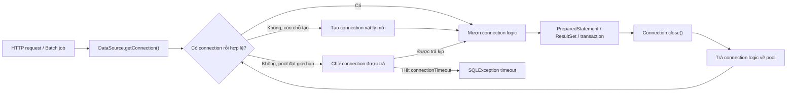
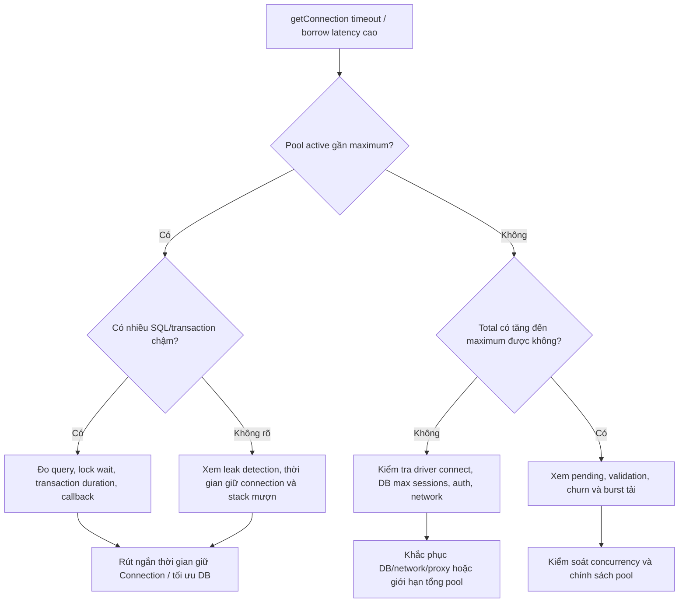

# Cấu hình pool và chẩn đoán tình huống cạn kết nối trong JDBC

## 1. Bối cảnh bài thực hành: API chậm dù câu SQL rất đơn giản

Một dịch vụ Java xử lý yêu cầu đọc đơn hàng bằng `DataSource`, `Connection`, `PreparedStatement` và `ResultSet`. Ở môi trường phát triển, API thường phản hồi trong vài chục mili giây. Khi lên môi trường có nhiều người dùng, lỗi bắt đầu xuất hiện:

```text
Không lấy được kết nối JDBC trong thời hạn cấu hình.
Pool: active=10, idle=0, total=10, waiting=27
```

Đây là **tình huống cạn kết nối của connection pool**: các lời gọi cần `getConnection()` không nhận được connection khả dụng trước khi hết thời hạn chờ. Nó **không đồng nghĩa** database đã hết connection, driver bị lỗi hoặc chính câu `SELECT` vừa được thực thi chậm; nhiều request có thể còn chưa nhận được `Connection` để chạy SQL.

Trong chương **Thực hành tổng hợp** của module **JDBC**, bài học này kết hợp các phần đã biết: driver, `DataSource`, `PreparedStatement`, `ResultSet`, SQL tham số hóa, CRUD, transaction, batching, quản lý lỗi và hiệu năng. Trọng tâm là triển khai pool một cách có chủ đích, tạo tình huống cạn pool an toàn trong môi trường kiểm thử, thu thập bằng chứng và sửa đúng nguyên nhân.

**Sau bài học, bạn có thể:**

1. Giải thích vòng đời connection logic và connection vật lý khi dùng pool.
2. Cấu hình pool bằng các tham số có đơn vị, giới hạn và ý nghĩa rõ ràng.
3. Phân biệt pool acquisition timeout với login/connect, query và network timeout.
4. Tái hiện tình huống pool hết connection bằng chương trình Java nhỏ, không phá database.
5. Đọc các chỉ số active/idle/total/pending và xác định leak, SQL chậm, transaction dài, burst tải hay lỗi mở connection mới.
6. Đối chiếu trạng thái pool với PostgreSQL `pg_stat_activity` theo quyền được cấp.
7. Viết repository và transaction không rò connection kể cả khi có `SQLException`.
8. Thiết kế phép thử hồi quy, monitoring và kế hoạch tối ưu pool dựa trên tải đại diện.

> **Nguyên tắc:** “Tăng `maximumPoolSize`” không phải câu trả lời mặc định cho lỗi cạn pool. Cần tìm ra vì sao connection bị giữ lâu hoặc vì sao pool không tạo được kết nối mới, rồi cân đối tổng số connection với khả năng thực tế của database.

## 2. Connection pool hoạt động ra sao?

### 2.1. Không có pool và có pool

Với cách tạo kết nối vật lý mỗi lần gọi, một request có thể thực hiện:

```text
Request -> mở TCP/TLS + đăng nhập DB -> chạy SQL -> đóng kết nối vật lý
```

Với connection pool:



`DataSource.getConnection()` trả về một `Connection` **logic** mà ứng dụng sử dụng thông qua hợp đồng JDBC. Với pool phổ biến, `connection.close()` trả connection về pool để tái sử dụng thay vì nhất thiết đóng kết nối TCP tới database. Vòng đời physical connection do pool quản lý: kiểm tra sức khỏe, hết tuổi, lỗi kết nối hoặc đóng pool.

**Hệ quả:** nếu repository quên gọi `close()`, pool có thể coi connection vẫn đang được mượn dù câu SQL đã hoàn tất; khi tất cả connection bị giữ, request tiếp theo sẽ phải chờ hoặc timeout.

### 2.2. Các trạng thái cần phân biệt

| Chỉ số | Ý nghĩa thực tế |
|---|---|
| **Active** | Số connection đang được mượn/đang sử dụng theo pool |
| **Idle** | Số connection hiện khả dụng trong pool |
| **Total** | Số connection vật lý mà pool đang quản lý (gồm active + idle ở một thời điểm ổn định) |
| **Pending / Waiting** | Số thread/caller đang chờ mượn connection |
| **Maximum pool size** | Số connection tối đa pool quản lý theo cấu hình |
| **Connection acquisition latency** | Thời gian từ trước `getConnection()` tới khi nhận connection hoặc lỗi |
| **Connection usage / held time** | Thời gian connection bị giữ giữa lúc mượn và lúc `close()` |

Số đo là **ảnh chụp tại một thời điểm**, có thể thay đổi giữa các lần đọc; không yêu cầu các chỉ số lấy qua nhiều API ở các thời điểm khác nhau phải tạo thành một phương trình chính xác.

Cạn pool thường có dấu hiệu `active ≈ maximumPoolSize`, `idle = 0` và `pending > 0`. Nhưng nếu `total` vẫn nhỏ hơn maximum trong khi nhiều caller chờ, cần điều tra **khả năng tạo connection mới** (DB không sẵn sàng, giới hạn kết nối, mạng, xác thực, validation) thay vì quy mọi nguyên nhân là leak.

### 2.3. “Pool cạn” khác “Database hết connection”

Hai hiện tượng có thể liên quan nhưng không đồng nhất:

- **Pool của ứng dụng cạn:** ví dụ pool tối đa 10, cả 10 connection đang được mượn, trong khi DB có thể vẫn còn khả năng nhận thêm connection từ ứng dụng khác.
- **Database đạt giới hạn session/connection:** DB không nhận thêm phiên mới; pool có thể đang ở mức `total < maximumPoolSize` nhưng không mở rộng được.
- **Pool timeout do kết nối mới bị treo:** không tạo được connection mới kịp thời vì DNS/TCP/TLS/auth hoặc DB đang quá tải.
- **Timeout bởi pool của proxy trung gian:** một số kiến trúc còn có PgBouncer hoặc DB proxy với giới hạn riêng.

Vì vậy, phải quan sát **cả ứng dụng/pool và DB**.

## 3. Chọn công cụ thực hành và giới hạn môi trường

Bài sử dụng:

- Java 17+ và API JDBC chuẩn (`javax.sql.DataSource`, `java.sql.Connection`, `PreparedStatement`, `ResultSet`).
- **HikariCP** để minh họa một connection pool cụ thể. `HikariConfig`, `HikariDataSource` và `HikariPoolMXBean` thuộc thư viện HikariCP, **không thuộc Java SE/JDBC chuẩn**.
- **PostgreSQL** làm DB minh họa; SQL `pg_stat_activity` ở phần chẩn đoán là đặc thù PostgreSQL.
- JUnit 5 ở phần kiểm thử nếu dự án có dependency test; các ví dụ Java khác chỉ cần HikariCP và JDBC driver tương ứng.

Nếu dự án dùng Oracle JDBC, MySQL Connector/J, SQL Server JDBC hoặc pool khác, giữ nguyên nguyên tắc JDBC nhưng **đổi cấu hình driver, cách đo pool và SQL chẩn đoán DB** theo sản phẩm thực tế. Không dùng các thuộc tính HikariCP như thể chúng có trong mọi `DataSource`.

### 3.1. Chuẩn bị môi trường riêng

Chỉ thực hành trên database và pool **dành cho kiểm thử**. Cần một JDBC URL có thể kết nối, tài khoản DB được cấp quyền phù hợp, cùng các biến môi trường (đặt bên ngoài source):

```text
LAB_JDBC_URL=jdbc:postgresql://localhost:5432/jdbc_lab
LAB_DB_USER=lab_user
LAB_DB_PASSWORD=<giá trị bí mật được cấp qua môi trường>
```

Dòng password trên là **ký hiệu**, không phải thông tin đăng nhập thật. Không commit credentials vào repository hoặc in URL chứa secret vào log.

Trong dự án Maven/Gradle, thêm dependency **HikariCP** và **PostgreSQL JDBC driver** ở phiên bản tương thích với JDK/môi trường. Không hardcode một phiên bản bất kỳ từ tài liệu học tập như một khuyến nghị bảo mật lâu dài; chọn và khóa phiên bản đã được kiểm chứng theo quy trình dependency của dự án.

Khi dùng JPMS, cần xem module name/automatic module của các thư viện ngoài JDK; những đoạn code bên dưới giả định project đã cấu hình build và classpath/module path phù hợp.

## 4. Cấu hình pool: tham số quan trọng và đơn vị

### 4.1. Cấu hình HikariCP minh họa

```java
import com.zaxxer.hikari.HikariConfig;
import com.zaxxer.hikari.HikariDataSource;

public final class LabPoolFactory {
    private LabPoolFactory() {}

    public static HikariDataSource create(
            int maxPoolSize, long borrowTimeoutMs
    ) {
        if (maxPoolSize < 1 || borrowTimeoutMs < 250) {
            throw new IllegalArgumentException(
                    "Giới hạn pool/timeout không hợp lệ");
        }

        HikariConfig cfg = new HikariConfig();

        cfg.setPoolName("jdbc-lab-pool");
        cfg.setJdbcUrl(requiredEnv("LAB_JDBC_URL"));
        cfg.setUsername(requiredEnv("LAB_DB_USER"));
        cfg.setPassword(requiredEnv("LAB_DB_PASSWORD"));

        cfg.setMaximumPoolSize(maxPoolSize);
        cfg.setMinimumIdle(0);

        // Mili giây: chờ lấy Connection từ HikariCP.
        cfg.setConnectionTimeout(borrowTimeoutMs);

        // Phải nhỏ hơn connectionTimeout trong cấu hình này.
        cfg.setValidationTimeout(500);

        cfg.setIdleTimeout(600_000);
        cfg.setMaxLifetime(1_800_000);

        // 0 = tắt leak-detection warning trong lab cơ bản.
        cfg.setLeakDetectionThreshold(0);

        return new HikariDataSource(cfg);
    }

    private static String requiredEnv(String name) {
        String value = System.getenv(name);
        if (value == null || value.isBlank()) {
            throw new IllegalStateException(
                    "Thiếu biến môi trường: " + name);
        }
        return value;
    }
}
```

**Điều kiện của ví dụ:** sử dụng `borrowTimeoutMs` lớn hơn `500` khi gọi `create(...)`, vì validation timeout trong cấu hình này bằng 500 ms và phải nhỏ hơn connection timeout; các ví dụ sau dùng 1.200 hoặc 2.000 ms. Nếu chuyển sang tham số ngắn hơn, cần giảm validation timeout tương ứng nhưng vẫn tuân thủ giới hạn của HikariCP.

`HikariDataSource` sở hữu pool và phải được **đóng khi ứng dụng/lab kết thúc**, không tạo rồi đóng một `HikariDataSource` mới mỗi lần xử lý request.

### 4.2. Ý nghĩa từng tham số

| Thuộc tính HikariCP | Ví dụ | Đơn vị và lưu ý |
|---|---:|---|
| `maximumPoolSize` | 10 | Số connection tối đa; không phải số request/giây |
| `minimumIdle` | 2 | Mục tiêu số connection rỗi; 0 cho phép pool thu hẹp, không làm pool “vô hiệu” |
| `connectionTimeout` | 2.000 | **Mili giây** chờ mượn connection; hết hạn có thể ném `SQLTransientConnectionException` |
| `validationTimeout` | 1.000 | **Mili giây** giới hạn kiểm tra độ sống của connection; cần nhỏ hơn connection timeout |
| `idleTimeout` | 600.000 | **Mili giây** trước khi connection rỗi vượt nhu cầu bị xét nghỉ; chịu điều kiện `minimumIdle` |
| `maxLifetime` | 1.800.000 | **Mili giây** tuổi thọ dự kiến tối đa của connection vật lý; connection đang được sử dụng không bị tự ép đóng giữa chừng chỉ vì hết tuổi |
| `leakDetectionThreshold` | 15.000 | **Mili giây** giữ connection trước khi phát cảnh báo nghi leak nếu bật; 0 để tắt |
| `poolName` | `orders-pool` | Tên ổn định để phân biệt pool trong log/metric |
| `autoCommit` | `true` (tùy thiết lập) | Trạng thái mặc định khi pool bàn giao connection; phải nhất quán với transaction manager |

Những giá trị ở bảng là **ví dụ thiết kế**, không phải cấu hình tối ưu cho mọi workload. Trong mã lab, `minimumIdle=0` giúp minh họa số lượng connection được tạo theo nhu cầu; với production, lựa chọn `minimumIdle` cần dựa trên mục tiêu phục hồi sau idle và chi phí mở connection.

Hai lưu ý dễ sai:

1. Khi `minimumIdle` bằng `maximumPoolSize`, `idleTimeout` không còn giúp thu hẹp số connection rỗi theo cách thường kỳ vọng. Đừng chỉnh idle timeout và ngạc nhiên khi pool vẫn duy trì đủ số connection theo mục tiêu minimum idle.
2. `maxLifetime` nên được cân nhắc theo timeout của DB/proxy/network; nó không phải deadline cho một giao dịch dài đang giữ connection, cũng không tự giải phóng connection bị leak.

### 4.3. Tách pool timeout khỏi login, SQL và network timeout

| Khoảng chờ | Cơ chế | Đơn vị |
|---|---|---|
| Mượn connection từ **HikariCP** | `HikariConfig.setConnectionTimeout(long)` | **Mili giây** |
| Thiết lập kết nối qua `DataSource` | `DataSource.setLoginTimeout(int)` | **Giây** |
| Connect/socket ở JDBC driver | Thuộc tính riêng của driver | Theo tài liệu driver |
| Thực thi SQL | `Statement.setQueryTimeout(int)` | **Giây** |
| Một số hoạt động mạng trên connection | `Connection.setNetworkTimeout(Executor, int)` | **Mili giây** |
| Deadline của API/job | Gateway/framework/ứng dụng | Theo API tương ứng |

Tên “connection timeout” trong nhiều cấu hình là nguồn gây nhầm. Với HikariCP, `connectionTimeout` biểu diễn **thời gian đợi để lấy connection từ pool**; không nên mặc định đồng nhất nó với driver TCP connect timeout. Tùy tình huống, nó có thể bao gồm thời gian chờ khi pool đang cố tạo/kiểm tra connection, nhưng không thay thế mọi timeout của network/driver.

Ví dụ: nếu connection đã được cấp, `ps.executeQuery()` treo 30 giây, `connectionTimeout=2_000` **không tự hủy câu SQL**. Khi request timeout ở `getConnection()`, `setQueryTimeout(5)` cũng **không thể cứu** vì chưa có statement.

## 5. Repository mẫu: mượn và trả connection đúng vòng đời

Giả sử có bảng đơn hàng:

```sql
CREATE TABLE lab_orders (
    order_id BIGINT PRIMARY KEY,
    status VARCHAR(20) NOT NULL,
    total_amount NUMERIC(14, 2) NOT NULL
);

INSERT INTO lab_orders(order_id, status, total_amount)
VALUES
    (101, 'PENDING', 250000.00),
    (102, 'PAID', 120000.00);
```

SQL này phù hợp ví dụ PostgreSQL; nếu chạy lại cùng fixture, cần reset dữ liệu hoặc dùng schema riêng để không đụng ràng buộc khóa chính.

Một repository sử dụng `DataSource` theo đúng vòng đời:

```java
import javax.sql.DataSource;
import java.math.BigDecimal;
import java.sql.Connection;
import java.sql.PreparedStatement;
import java.sql.ResultSet;
import java.sql.SQLException;
import java.util.Objects;
import java.util.Optional;

public final class OrderRepository {
    public record OrderRow(
            long id, String status, BigDecimal totalAmount
    ) {}

    private final DataSource dataSource;

    public OrderRepository(DataSource dataSource) {
        this.dataSource = Objects.requireNonNull(dataSource);
    }

    public Optional<OrderRow> findById(long id)
            throws SQLException {
        String sql = """
                SELECT order_id, status, total_amount
                FROM lab_orders
                WHERE order_id = ?
                """;

        try (Connection connection = dataSource.getConnection();
             PreparedStatement ps =
                     connection.prepareStatement(sql)) {
            ps.setLong(1, id);
            ps.setQueryTimeout(5); // 5 GIÂY, không phải 5 ms.

            try (ResultSet rs = ps.executeQuery()) {
                if (!rs.next()) {
                    return Optional.empty();
                }

                long orderId = rs.getLong("order_id");
                if (rs.wasNull()) {
                    throw new SQLException(
                            "order_id không được NULL");
                }

                String status = rs.getString("status");
                BigDecimal amount =
                        rs.getBigDecimal("total_amount");

                if (status == null || amount == null) {
                    throw new SQLException(
                            "Thiếu dữ liệu đơn hàng bắt buộc");
                }

                return Optional.of(
                        new OrderRow(orderId, status, amount));
            }
        }
    }
}
```

**Những gì ví dụ bảo đảm:**

- `PreparedStatement` bind ID bằng `?` và `setLong`, không nối input vào SQL.
- `ResultSet` và `PreparedStatement` được đóng trước khi đóng `Connection`.
- `try-with-resources` giải phóng connection ngay cả khi mapper hoặc SQL ném `SQLException`.
- Repository trả về record chứa dữ liệu, không trả `ResultSet` còn phụ thuộc connection.
- `setQueryTimeout(5)` là giới hạn riêng của statement theo hỗ trợ driver, không phải giới hạn thời gian mượn pool.
- `OrderRepository` không quản lý pool lifecycle; tầng khởi tạo ứng dụng làm việc đó.

Nếu một service cần nhiều thao tác nằm **trong cùng transaction**, không để mỗi repository tự gọi `getConnection()` mà nghĩ rằng các thao tác đều thuộc một giao dịch. Khi đó service phải sở hữu một `Connection`, truyền cho các DAO phù hợp và quyết định commit/rollback.

## 6. Tái hiện cạn pool một cách xác định

Phần thực hành cốt lõi: tạo một pool có **tối đa hai connection** và cố tình giữ cả hai, rồi yêu cầu connection thứ ba.

### 6.1. Chương trình Java mô phỏng

```java
import com.zaxxer.hikari.HikariDataSource;
import com.zaxxer.hikari.HikariPoolMXBean;
import java.sql.Connection;
import java.sql.SQLException;
import java.sql.SQLTransientConnectionException;
import java.util.concurrent.TimeUnit;

public final class ExhaustionLab {
    public static void main(String[] args) throws SQLException {
        try (HikariDataSource pool =
                     LabPoolFactory.create(2, 1_200)) {
            // Bảo đảm DB thử nghiệm đang hoạt động trước khi
            // diễn giải một lỗi getConnection là pool cạn.
            try (Connection sanity = pool.getConnection()) {
                if (!sanity.isValid(1)) {
                    throw new SQLException(
                            "DB test chưa sẵn sàng");
                }
            }

            try (Connection first = pool.getConnection();
                 Connection second = pool.getConnection()) {
                // Đã giữ đủ 2/2 connection. Không có connection
                // rỗi để cấp cho yêu cầu thứ ba.
                snapshot(pool, "đang giữ 2 connections");

                long started = System.nanoTime();

                try (Connection unexpected = pool.getConnection()) {
                    throw new AssertionError(
                            "Vẫn lấy được connection thứ ba");
                } catch (SQLTransientConnectionException expected) {
                    long elapsedMs = TimeUnit.NANOSECONDS.toMillis(
                            System.nanoTime() - started);
                    System.out.printf(
                            "getConnection bị timeout sau ~%d ms, "
                            + "errorType=%s, sqlState=%s%n",
                            elapsedMs,
                            expected.getClass().getSimpleName(),
                            expected.getSQLState());
                }
            }

            // first/second đã được trả về pool, không rò kết nối.
            try (Connection recovered = pool.getConnection()) {
                System.out.println(
                        "Đã mượn lại connection sau khi giải phóng");
                snapshot(pool, "đã phục hồi");
            }
        } // Đóng pool khi chương trình lab kết thúc.
    }

    private static void snapshot(
            HikariDataSource pool, String phase
    ) {
        HikariPoolMXBean mx = pool.getHikariPoolMXBean();

        System.out.printf(
                "%s: active=%d idle=%d total=%d waiting=%d%n",
                phase,
                mx.getActiveConnections(),
                mx.getIdleConnections(),
                mx.getTotalConnections(),
                mx.getThreadsAwaitingConnection());
    }
}
```

**Điều kiện để tái hiện chính xác:** chỉ chạy trên **một pool lab riêng**, không có thread khác đang mượn connection của pool ấy; database test phải hoạt động và cho phép ít nhất hai kết nối. `LabPoolFactory.create(2, 1_200)` đặt maximum=2 và thời gian chờ mượn bằng 1.200 ms.

### 6.2. Kết quả dự kiến

Khi hai connection đang được giữ, snapshot thường có hình dạng:

```text
đang giữ 2 connections: active=2 idle=0 total=2 waiting=0
getConnection bị timeout sau ~1200 ms, errorType=SQLTransientConnectionException
Đã mượn lại connection sau khi giải phóng
```

Các số trên là **kỳ vọng minh họa**, không phải kết quả chạy thực tế. Thời gian có thể lệch do scheduler/GC, và `waiting=0` là hợp lý ở lúc chụp **trước khi** thử mượn connection thứ ba. Trong một thử nghiệm có thread thứ ba chờ đồng thời, chỉ số pending/waiting có thể tăng trong khoảng chờ.

**Điểm quan trọng:** thử nghiệm không dùng `Thread.sleep()` giữ connection trong hàng phút, không khóa bảng và không làm nghẽn server DB. Hai connection được giữ bằng scope `try-with-resources` rồi tự động trả. Thao tác mượn thứ ba timeout là hành vi có chủ đích và **không phải bằng chứng đã có leak**.

Nếu bài lab thất bại ngay ở bước mượn connection thứ nhất/thứ hai, **không** kết luận đó là pool exhaustion: phải chẩn đoán URL, credentials, DB availability, giới hạn DB và network trước.

## 7. Quan sát chỉ số khi có nhiều request đồng thời

Khi traffic thực, một snapshot hiếm hoi không đủ. Nên kết hợp time series, log và trace:

| Chỉ số | Kỳ vọng khỏe mạnh | Dấu hiệu đáng điều tra |
|---|---|---|
| Active connections | Có tăng khi tải tăng, giảm sau xử lý | Luôn sát maximum kể cả khi ít request |
| Idle connections | Có sẵn tùy chính sách minimum idle | Về 0 kéo dài khi có nhiều borrower |
| Pending threads | Thường thấp/0 ngoài burst | Tăng liên tục, timeout nhiều |
| Acquisition time p95/p99 | Phù hợp SLA request | Tăng mạnh trước cả lúc SQL bắt đầu |
| Connection held duration | Gần thời gian thao tác DB cần thiết | Có đuôi dài do callback/HTTP/transaction |
| SQL execute/consume time | Ổn định theo workload | Tăng cùng lock wait hoặc full scan |
| Pool timeout count | Rất thấp trong tải dự kiến | Gia tăng khi burst/concurrency |
| DB active sessions | Trong giới hạn và có tiến độ | Session chờ khóa hoặc idle-in-transaction lâu |
| Connection creation failures | Hiếm | Nhiều lỗi connect/auth/DB max sessions |

Với HikariCP, có thể lấy `HikariPoolMXBean` cho các **giá trị tức thời** như mã `snapshot(...)`. Production thường dùng Micrometer, JMX hoặc công cụ monitoring đã tích hợp để thu thập histogram/thời gian và hiển thị p95/p99.

Không đặt `requestId`, `connectionId` hoặc `transactionId` làm nhãn metrics: đây là các giá trị có cardinality rất cao. Dùng những nhãn hữu hạn như `pool`, `operation`, `outcome` và `db.system`. Mã tương quan chi tiết nên nằm trong logs/traces theo chính sách bảo mật.

### 7.1. Tách phép đo acquire khỏi execute

```java
import java.sql.Connection;
import java.sql.SQLException;
import java.util.concurrent.TimeUnit;
import javax.sql.DataSource;

static void probeBorrow(DataSource dataSource) throws SQLException {
    long started = System.nanoTime();

    try (Connection connection = dataSource.getConnection()) {
        long borrowedMs = TimeUnit.NANOSECONDS.toMillis(
                System.nanoTime() - started);
        System.out.println(
                "acquireDurationMs=" + borrowedMs);

        // Các câu SQL đo ở pha riêng.
    } catch (SQLException failure) {
        long failedMs = TimeUnit.NANOSECONDS.toMillis(
                System.nanoTime() - started);

        System.err.printf(
                "acquireFailedMs=%d type=%s state=%s code=%d%n",
                failedMs,
                failure.getClass().getSimpleName(),
                failure.getSQLState(),
                failure.getErrorCode());
        throw failure;
    }
}
```

Đây là phương thức minh họa trong lớp Java có sẵn import. Ở production nên dùng logger/metrics, ghi `SQLException.getSQLState()` và vendor code, không ghi password hay URL chứa credentials. `System.nanoTime()` phù hợp để đo thời gian trôi qua; không dùng `System.currentTimeMillis()` như đồng hồ monotonic cho latency.

Một request có thể bị chậm ở `getConnection()` **dù query của chính request đó chưa từng bắt đầu**. Nếu chỉ đo `executeQuery()`, đội vận hành sẽ bỏ sót nút thắt pool.

## 8. Phân biệt năm nguyên nhân dẫn đến pool exhaustion

### 8.1. Nguyên nhân A — Rò connection do quên close

Dấu hiệu thường gặp:

- Active connections tăng dần theo số request, ít khi giảm sau khi traffic đã dừng.
- Không có SQL đang chạy tương ứng với một số connection được ứng dụng giữ.
- Connection usage/held duration rất dài, có thể có cảnh báo leak detection.
- Sau một thời gian, pool đạt maximum và borrower mới bị timeout.

Mã sai:

```java
Connection connection = dataSource.getConnection();
PreparedStatement ps =
        connection.prepareStatement("SELECT status FROM lab_orders");
ResultSet rs = ps.executeQuery();

while (rs.next()) {
    consume(rs);
}

// Quên đóng ResultSet, Statement và Connection.
// Khi một getter/callback ném exception, leak càng dễ xảy ra.
```

Mã đúng:

```java
try (Connection connection = dataSource.getConnection();
     PreparedStatement ps = connection.prepareStatement(
             "SELECT status FROM lab_orders");
     ResultSet rs = ps.executeQuery()) {
    while (rs.next()) {
        consume(rs);
    }
}
```

`consume(...)` là hàm ứng dụng cung cấp, không phải API JDBC. Lưu ý đóng statement thường kéo theo đóng result set do nó tạo, nhưng nên biểu diễn ownership rõ ràng bằng `try-with-resources`, nhất là khi lỗi xảy ra giữa lúc map hàng.

**Không kết luận leak chỉ từ một cảnh báo giữ connection lâu.** Một export lớn hoặc giao dịch phải chờ lock cũng có thể giữ connection lâu hợp lệ theo thiết kế (dù cần tối ưu). Leak detection đưa ra dấu hiệu và stack trace tại điểm mượn connection, **không tự giải phóng connection** và không chứng minh lỗi 100%.

### 8.2. Nguyên nhân B — Câu SQL chậm hoặc chờ khóa

Một truy vấn không có index thích hợp, trả quá nhiều hàng hoặc đang chờ transaction khác giữ lock có thể khiến connection bị chiếm dụng lâu. Pool cạn là **hệ quả**, không phải nguyên nhân ban đầu.

Ví dụ diễn biến:

```text
Pool maximum = 10
10 request cùng chạy UPDATE bị chờ lock trong 20 giây
    -> active=10, idle=0
Request thứ 11 gọi getConnection()
    -> chờ 2 giây
    -> pool timeout
```

Chỉ tăng pool từ 10 lên 30 có thể tạo thêm các transaction chờ khóa, làm database chậm hơn. Cần xem execution plan, lock waits, index, thứ tự cập nhật, kích thước transaction, timeout và mức đồng thời.

### 8.3. Nguyên nhân C — Giữ connection trong lúc làm việc ngoài DB

Mẫu sai:

```java
try (Connection connection = dataSource.getConnection()) {
    String payload = slowRemoteHttpCall(); // Chờ dịch vụ khác.
    validatePayload(payload);
    updateDatabase(connection, payload);
}
```

Trong ví dụ này, `slowRemoteHttpCall`, `validatePayload` và `updateDatabase` là hàm do ứng dụng định nghĩa. Dù database xử lý `UPDATE` chỉ 10 ms, connection có thể bị giữ nhiều giây vì HTTP.

Nếu không cần transaction DB trong lúc gọi API ngoài, nên chuyển công việc bên ngoài **trước khi mượn connection**:

```java
String payload = slowRemoteHttpCall();
validatePayload(payload);

try (Connection connection = dataSource.getConnection()) {
    updateDatabase(connection, payload);
}
```

Không có cách sắp xếp đơn giản nào cho phép rollback cả HTTP và JDBC trong một transaction DB thông thường. Nếu cần đảm bảo nhất quán xuyên hệ thống, thiết kế outbox, saga hoặc cơ chế nghiệp vụ phù hợp.

### 8.4. Nguyên nhân D — Tải đồng thời tăng đột biến

Nếu số request đồng thời lớn hơn số connection sẵn có và mỗi request cần DB, hàng đợi borrow tăng ngay cả khi không có leak. Điều này có thể là:

- Burst người dùng/cron chạy cùng thời điểm.
- Quá nhiều worker/thread có thể đồng thời đòi connection.
- Một transaction dài hơn do dữ liệu lớn hoặc lock wait.
- Connection pool quá nhỏ so với lượng công việc thực sự cần xử lý song song.

Cách khắc phục có thể là hạn chế concurrency, cân bằng tải/queue, giảm thời gian giữ connection, caching hợp lý hoặc điều chỉnh kích thước pool **sau khi đo năng lực DB**.

### 8.5. Nguyên nhân E — Pool không mở được connection mới

Các chỉ số gợi ý:

```text
maxPoolSize = 20
total = 4
active = 4
idle = 0
waiting = 15
```

Nếu pool còn được phép mở connection nhưng không thể tăng `total`, cần điều tra:

- PostgreSQL/MySQL/SQL Server đã đạt giới hạn session.
- Kết nối TCP bị từ chối, DNS sai, firewall/drop packets, TLS lỗi.
- Credentials sai, quyền DB bị thu hồi hoặc password rotation chưa cập nhật.
- Proxy/DB gateway từ chối hoặc chậm.
- Connection validation không đạt, pool liên tục loại connection hỏng.
- Startup/scale-out tạo quá nhiều pool cùng lúc gây connection storm.

Một sự cố như vậy không được sửa bằng cách nâng `maximumPoolSize`; nó có thể làm nhiều thread hơn chờ kết nối không thể tạo.

## 9. Chẩn đoán theo cây quyết định



Không bắt buộc mọi trường hợp đi theo nhánh duy nhất. Ví dụ, query chậm làm pool active cao **đồng thời** pool cần mở thêm connection nhưng DB đã đạt giới hạn. Cây quyết định dùng để sắp xếp **thứ tự thu thập bằng chứng**, không thay thế điều tra hiện trường.

### 9.1. Bảng phân biệt triệu chứng

| Quan sát | Giả thuyết ưu tiên | Bằng chứng cần thêm |
|---|---|---|
| Active chạm max, idle=0, waiting tăng | Pool hết connection để cấp | Held-duration, query latency, concurrency |
| Active không giảm sau khi traffic dừng | Leak hoặc công việc/transaction còn treo | Borrow stacks, thread dump, DB sessions |
| Active cao, DB có nhiều lock waits | SQL/transaction chờ khóa | `pg_stat_activity`, DB lock metrics, transaction owner |
| Total thấp hơn max, create failure cao | Không mở được connection | DB logs, connect timeout, auth, max connections |
| Acquisition p99 cao nhưng SQL p99 thấp | Pool contention/connection setup | Pool waiting, create latency, tổng số client |
| Cả acquire và SQL p99 cao | DB saturation kéo dài held-time | CPU/I/O/lock/active queries, pool metrics |
| Lỗi chỉ ở lúc scale-out | Tổng pool tăng quá nhanh | Replica count × maximumPoolSize, DB/proxy capacity |
| Cảnh báo leak nhưng sau đó connection được trả | Connection giữ lâu, chưa chắc leak | Traces của business operation và DB wait |
| Sau restart app hết lỗi tạm thời | Có thể reset leak/churn/sessions | Theo dõi xu hướng quay lại, không coi restart là sửa tận gốc |

## 10. Kiểm tra phía PostgreSQL

Dữ liệu phía pool nói connection đang được **mượn**, nhưng không nhất thiết giải thích server đang làm gì. Với PostgreSQL, có thể dùng `pg_stat_activity` trong môi trường chẩn đoán được cấp quyền.

### 10.1. Đếm phiên theo ứng dụng và trạng thái

```sql
SELECT application_name,
       state,
       wait_event_type,
       COUNT(*) AS sessions
FROM pg_stat_activity
WHERE datname = current_database()
GROUP BY application_name, state, wait_event_type
ORDER BY sessions DESC;
```

Gợi ý diễn giải:

- `active` ở phía PostgreSQL nghĩa là phiên đang thực thi câu lệnh hoặc xử lý hoạt động tại server; **không đồng nhất** với `active` của pool (đang được mượn ở Java).
- `idle` phía DB có thể tương ứng connection vật lý đang rỗi trong pool **hoặc** connection đang bị Java mượn nhưng chưa gửi SQL.
- `idle in transaction` đáng điều tra khi tồn tại lâu: transaction còn mở nhưng hiện không chạy câu SQL, có thể giữ snapshot/lock hoặc gây vấn đề vacuum/MVCC.
- `wait_event_type` có thể chỉ ra lock/I/O/client hoặc loại chờ khác; phải xem cùng trạng thái và truy vấn/transaction liên quan.

### 10.2. Xem transaction lâu và sự kiện chờ

```sql
SELECT pid,
       application_name,
       state,
       wait_event_type,
       wait_event,
       NOW() - xact_start AS transaction_age,
       NOW() - query_start AS query_age
FROM pg_stat_activity
WHERE datname = current_database()
  AND pid <> pg_backend_pid()
ORDER BY xact_start NULLS LAST;
```

`xact_start` có thể `NULL` khi không có transaction đang hoạt động. `query_start` và các cột hiển thị khác không luôn có nghĩa “query đang chạy liên tục” nếu session đang idle. Quyền nhìn thấy hoạt động của các user khác phụ thuộc phiên bản PostgreSQL và role; có thể cần role giám sát phù hợp.

**Không in toàn bộ SQL text/parameter nhạy cảm** chỉ để gắn log ứng dụng. Để đối chiếu, ưu tiên application name ổn định, thời gian, loại thao tác, query fingerprint và trace/correlation context phù hợp.

### 10.3. Kiểm tra giới hạn kết nối phía DB

```sql
SHOW max_connections;
```

Không nên lấy `max_connections` rồi chia đều trực tiếp cho từng replica mà không xét:

- Quyền connection dành cho role quản trị/dự phòng.
- DB proxy, monitoring, migration và các ứng dụng khác.
- Chi phí tài nguyên cho mỗi session; database có thể quá tải **trước khi** đạt cấu hình tối đa.
- Số replica ứng dụng đang/chuẩn bị chạy khi auto-scale.
- Connection cho batch jobs, admin tooling và failover.

Nếu sử dụng DB khác, thay các câu SQL chẩn đoán bằng cơ chế monitoring tương ứng; `pg_stat_activity` và `SHOW max_connections` không phải câu SQL JDBC chung.

## 11. Leak detection: bật đúng mục đích, không nhầm với giới hạn sử dụng

HikariCP có cấu hình `leakDetectionThreshold` để cảnh báo khi connection bị mượn quá thời gian ngưỡng:

```java
HikariConfig cfg = new HikariConfig();
// ... cấu hình connection, pool size và các timeout khác ...
cfg.setLeakDetectionThreshold(15_000);
```

Đây là cấu hình **HikariCP**; threshold tính bằng mili giây. Giá trị 0 tắt cảnh báo, còn giá trị dương phải phù hợp giới hạn cấu hình của phiên bản HikariCP.

Cần hiểu:

1. **Cảnh báo không có nghĩa đã chứng minh leak.** Một giao dịch dài có chủ đích cũng có thể vượt ngưỡng.
2. **Cảnh báo không tự trả connection về pool.** Caller vẫn phải đóng connection hoặc xử lý lỗi.
3. **Stack trace chỉ điểm mượn connection**, giúp tìm code path cần điều tra; nó không nói câu SQL nào chậm trừ khi kết hợp tracing/log DB.
4. Một số driver, proxy hoặc pool có hành vi reset state riêng; phải quan sát qua cả code và DB.
5. Bật ngưỡng quá thấp trên workload quét dữ liệu lớn có thể tạo nhiều cảnh báo nhiễu, che lỗi thật.

Trong kịch bản cạn pool mục 6, hai connection được giữ **cố ý** và đã được trả, nên không phải leak. Dùng cảnh báo như một **dấu hiệu điều tra**, không coi tên “leak detection” là một oracle tuyệt đối.

## 12. Transaction dài và nhánh lỗi làm connection bị giữ

### 12.1. Transaction sở hữu Connection đến khi commit/rollback

Với nghiệp vụ nhiều bước, ranh giới nên rõ:

```text
getConnection()
    |
setAutoCommit(false)
    |
PreparedStatement.UPDATE
    |
PreparedStatement.INSERT
    |
commit() hoặc rollback()    <-- kết thúc transaction
    |
close()                     <-- trả connection về pool
```

Nếu `ResultSet` cần server cursor trong transaction, connection và transaction phải được duy trì tới lúc đã **tiêu thụ xong** hàng. Đổi lại, một truy vấn xuất hàng triệu bản ghi có thể giữ connection rất lâu; cân nhắc keyset pagination hoặc tách thành chunk transaction khi nghiệp vụ cho phép.

### 12.2. Ví dụ cập nhật hai thao tác trong một transaction

```java
import javax.sql.DataSource;
import java.sql.Connection;
import java.sql.PreparedStatement;
import java.sql.SQLException;

public final class OrderPaymentService {
    private final DataSource dataSource;

    public OrderPaymentService(DataSource dataSource) {
        this.dataSource = dataSource;
    }

    public void markPaid(long orderId) throws SQLException {
        try (Connection connection = dataSource.getConnection()) {
            if (!connection.getAutoCommit()) {
                throw new SQLException(
                        "Cần transaction owner theo cấu hình pool");
            }

            connection.setAutoCommit(false);

            try {
                int changed;

                try (PreparedStatement update =
                             connection.prepareStatement(
                                """
                                UPDATE lab_orders
                                SET status = 'PAID'
                                WHERE order_id = ?
                                  AND status = 'PENDING'
                                """)) {
                    update.setLong(1, orderId);
                    changed = update.executeUpdate();
                }

                if (changed != 1) {
                    throw new SQLException(
                            "Không tìm thấy đúng một đơn PENDING");
                }

                // Ở dự án thật, có thể còn INSERT audit,
                // UPDATE inventory hoặc câu SQL khác dùng
                // cùng Connection trong transaction này.

                connection.commit();
            } catch (SQLException | RuntimeException | Error failure) {
                try {
                    connection.rollback();
                } catch (SQLException rollbackFailure) {
                    failure.addSuppressed(rollbackFailure);
                }
                throw failure;
            }
            // Connection sẽ được close/trả về pool.
        }
    }
}
```

Đây là ví dụ JDBC trực tiếp, giả định pool cấp connection mới ở `autoCommit=true` và pool/framework có chính sách reset trạng thái khi connection trả về. Với transaction manager của Spring hoặc Jakarta EE, không tự mở transaction thứ hai hoặc thay auto-commit ngoài chủ sở hữu.

Nếu `commit()` báo lỗi do mất kết nối, kết quả commit có thể chưa chắc chắn. Việc cố rollback sau đó không chứng minh chắc transaction đã được hoàn tác. Với thao tác có tác động nghiệp vụ quan trọng cần idempotency/đối soát, không retry mù.

Nếu rollback cũng thất bại, cần giữ nguyên nhân ban đầu và **không bật auto-commit khi transaction còn chưa được giải quyết** chỉ để khôi phục trạng thái. Pool/driver cần xử lý connection không rõ trạng thái theo chính sách an toàn.

### 12.3. Lỗi mapping ResultSet cũng phải giải phóng connection

Rò connection không chỉ xảy ra ở đường thành công. Nếu `rs.getBigDecimal(...)` hoặc code ánh xạ Java ném exception ở hàng thứ 10.000, `try-with-resources` vẫn phải đóng `ResultSet`, statement và connection.

Nếu code trả một `Stream` lười hoặc `ResultSet` ra ngoài khối `try`, tài nguyên có thể đã đóng trước khi caller duyệt. Nếu không đóng, chúng có thể giữ connection vô hạn. Thiết kế callback tiêu thụ đồng bộ trong scope đang mở hoặc trả DTO đã tách khỏi JDBC an toàn hơn.

## 13. Tại sao tăng maximumPoolSize có thể làm sự cố nặng hơn?

### 13.1. Kích thước pool phải phù hợp năng lực DB

Một số cách suy nghĩ sai:

- “Có 200 thread HTTP, vậy phải có 200 connection.”
- “DB cho phép 500 sessions thì mỗi replica có thể dùng 500 connection.”
- “Connection pool càng lớn càng nhanh.”
- “Cứ tăng pool đến khi hết timeout, không cần tìm SQL chậm.”

Database không có năng lực xử lý vô hạn. Quá nhiều connection đồng thời có thể tăng tranh chấp CPU, I/O, bộ nhớ, lock và context switching. Số connection tối ưu phụ thuộc workload, không chỉ số CPU hoặc số người dùng.

Một ước tính khởi đầu có thể dùng **Little’s Law**:

\[
L = \lambda \times W
\]

Trong đó:

- \(L\) là số công việc đang đồng thời giữ connection trung bình ở trạng thái ổn định.
- \(\lambda\) là tốc độ công việc cần DB (lượt/giây).
- \(W\) là thời gian giữ connection trung bình (giây).

Ví dụ minh họa: **100 lượt mượn connection/giây**, mỗi lượt giữ trung bình **0,06 giây** thì mức đồng thời trung bình tương ứng khoảng **6 connection**. Đây **không phải** lý do đặt `maximumPoolSize=6` ngay: burst, p95/p99, transaction dài, batch, retry, DB capacity và mức an toàn cần được đo thêm.

Điểm mạnh của công thức là cho thấy vì sao **giảm held-time** làm giảm nhu cầu connection mà không nhất thiết phải tăng pool.

### 13.2. Tính tổng connection qua các replica

Nếu ứng dụng chạy 4 replica, mỗi replica có pool tối đa 20 connection, mức kết nối tiềm năng của riêng nhóm ứng dụng đó là:

```text
4 replicas × 20 connections/replica = 80 connections
```

Còn phải cộng pool của worker, service khác, migration, dashboard và kết nối quản trị, đồng thời để dung lượng dự phòng theo chính sách DB.

Khi số replica tăng gấp đôi, tổng connection tiềm năng cũng có thể tăng theo, dù cấu hình một replica không đổi. **Auto-scaling cần được tính trong connection budget**.

### 13.3. Các phép đo trước khi chỉnh pool

Trước khi điều chỉnh `maximumPoolSize`, thu thập:

1. Throughput thực và độ đồng thời theo thời gian, kể cả giờ cao điểm.
2. Acquisition latency p50/p95/p99, số borrower timeout.
3. Connection held-time trung bình và phân vị, transaction duration.
4. Độ trễ SQL, lock wait, CPU/I/O DB và query plan.
5. Số session DB theo app/replica, giới hạn DB và proxy.
6. Concurrency của các batch job và request web.
7. Tỷ lệ retry và khả năng lỗi DB khi tạo nhiều connection cùng lúc.
8. Kết quả thử tải với ít nhất hai kích thước pool trên dataset đại diện.

Nếu tăng pool làm p99 chậm hơn hoặc tỷ lệ DB timeout tăng, đó không phải tối ưu thành công dù pool waiting giảm.

## 14. Timeout, cancellation và phục hồi sau khi cạn pool

### 14.1. Chọn timeout theo deadline của request

Ví dụ API có deadline tổng thể 3 giây; nếu cho phép borrower chờ pool 10 giây, request có thể đã quá hạn trước khi vào DB.

Một ngân sách minh họa:

| Pha | Cơ chế | Ngân sách ví dụ |
|---|---|---:|
| Chờ pool | HikariCP `connectionTimeout` | 500 ms |
| SQL chính | `setQueryTimeout` và giới hạn DB/driver | 1 giây |
| Mapping và ứng dụng | Deadline request | 1 giây |
| Dự phòng/cleanup | Deadline request | 500 ms |

Các giá trị chỉ minh họa; các pha có thể chồng lấp, query timeout không nhất thiết bao trùm toàn bộ fetch, và deadline nên được truyền qua các tầng có khả năng hủy. **Không cộng cứng timeout như thể mỗi cơ chế bảo đảm ngắt chính xác đúng thời điểm.**

### 14.2. Hết thời gian mượn pool không đồng nghĩa transaction đã chạy

Nếu `getConnection()` thất bại **trước khi có connection**, code gọi chưa thể gửi SQL qua connection đó. Nhưng với một request đã thực hiện các thao tác DB ở bước khác, không thể từ lỗi mượn pool mới mà suy ra mọi hoạt động trước đó chưa commit.

Với lỗi khi `executeUpdate()` hoặc `commit()` đang chạy, trạng thái thực thi/commit có thể không rõ. Retry phải dựa vào hợp đồng idempotency và transaction outcome, không chỉ subclass của `SQLException`.

### 14.3. Cancellation không phải lệnh “giải phóng mọi connection”

`Statement.cancel()` yêu cầu driver hủy statement, nhưng việc hủy có được thực hiện ngay không phụ thuộc driver/DB. Ngắt Java thread, hủy `Future` hoặc hủy HTTP request **không đảm bảo** JDBC I/O đang chờ được ngắt ngay.

Ứng dụng vẫn cần `try-with-resources` và chủ sở hữu transaction đảm bảo rollback/cleanup. Trong sự cố pool cạn, không nên giết các DB session hàng loạt khi chưa xác định owner và ảnh hưởng nghiệp vụ; đó là thao tác vận hành có thể làm mất công việc đang xử lý hoặc tạo outcome khó đối soát.

## 15. Tách lỗi pool exhaustion khỏi lỗi SQL bằng thông tin chẩn đoán

Một đoạn chẩn đoán có thể phân loại theo **giai đoạn** và exception:

```java
import java.sql.SQLException;
import java.sql.SQLTransientConnectionException;

static void reportAcquireFailure(SQLException failure) {
    String category =
            failure instanceof SQLTransientConnectionException
                    ? "transient_connection"
                    : "sql_exception";

    System.err.printf(
            "phase=connection_acquire category=%s "
            + "sqlState=%s vendorCode=%d type=%s%n",
            category,
            failure.getSQLState(),
            failure.getErrorCode(),
            failure.getClass().getName());
}
```

**Không giả định** mọi pool/driver đều ném chính `SQLTransientConnectionException` cho mọi lỗi mượn connection. HikariCP thường dùng subclass đó khi chờ pool hết hạn, nhưng lỗi authentication, connect, validation hoặc datasource configuration có thể được báo bằng loại/chuỗi lỗi khác.

Đối với logging thực tế, nên ghi:

- Tên pool và operation ổn định (ví dụ `orders.read_one`).
- Pha lỗi: `connection.acquire`, `statement.execute`, `result.consume`, `transaction.commit`.
- Thời gian chờ đã trôi qua.
- `SQLException.getSQLState()`, `getErrorCode()`, `getNextException()`, nguyên nhân và suppressed exceptions khi có.
- Active/idle/total/pending gần thời điểm lỗi.
- Request/trace ID đã được hệ thống xác thực, không dùng chúng làm metric label.
- DB instance/proxy liên quan, nếu không tiết lộ thông tin hạ tầng nhạy cảm.

Không log JDBC URL chứa mật khẩu, toàn bộ tham số SQL, token hoặc thông tin khách hàng. Một dòng “Connection is not available” chỉ là **dấu hiệu khởi đầu**, không phải kết luận root cause.

## 16. Thực hành chẩn đoán theo bốn tình huống

### 16.1. Tình huống 1 — Pool bị giữ hết connection nhưng vẫn khỏe

**Thiết lập:** `maximumPoolSize=2`, `connectionTimeout=1_200 ms`, giữ hai connection bằng scope thử nghiệm.

**Quan sát mong đợi:** `active=2`, `idle=0`, mượn connection thứ ba timeout, sau khi đóng hai connection thì việc mượn tiếp thành công.

**Kết luận:** pool đang thực thi giới hạn; chưa đủ bằng chứng về leak/DB failure.

### 16.2. Tình huống 2 — Repository cố ý rò connection

**Thiết lập:** trong test cô lập, viết một phương thức mượn connection mà không đóng; gọi lặp tới khi đạt maximum, rồi thử mượn tiếp.

**Quan sát:** active tăng và không trở về idle sau khi các thao tác SQL kết thúc. Leak detection có thể phát cảnh báo khi ngưỡng được bật, nhưng cảnh báo không tự đóng connection.

**Hướng sửa:** xác định điểm mượn từ stack; chuyển sang `try-with-resources` hoặc thiết kế owner chịu trách nhiệm đóng theo hợp đồng; xác nhận bằng integration test sau sửa. Không đưa đoạn cố tình leak vào production.

### 16.3. Tình huống 3 — Query chậm giữ connection

**Thiết lập:** dùng query chậm có kiểm soát hoặc lock test trong **database lab**. Ví dụ PostgreSQL có hàm `pg_sleep`, chỉ dùng khi được phép và giới hạn thời gian/đồng thời; không chạy test khóa chờ trên môi trường chung.

**Quan sát:** active cao, DB hiển thị SQL hoặc wait event tương ứng, connection held-time gần thời gian query/transaction.

**Hướng sửa:** đo SQL/lock, index, transaction scope, timeout và concurrency. Một query chậm trả ít hàng có thể vẫn giữ connection lâu; việc thêm connection chưa giải quyết chi phí của query ấy.

### 16.4. Tình huống 4 — Database không nhận thêm connection

**Thiết lập:** trong test chuyên biệt, hạn chế quota kết nối hoặc mô phỏng kết nối DB lỗi mà không tác động hệ thống khác.

**Quan sát:** pool có thể chưa đạt maximum, pending tăng, log pool/driver có lỗi tạo connection, phía DB có thông tin từ chối/quota.

**Hướng sửa:** kiểm tra DB max sessions, tổng budget qua replica, credentials, mạng/proxy, thời hạn connect và trạng thái failover. Không giải quyết bằng cách giảm query timeout hoặc chỉ tăng HikariCP maximum.

## 17. Kiểm thử tích hợp để khóa hành vi mong muốn

Một bộ test ổn định cần DB đang hoạt động, fixture riêng và pool mới cho mỗi suite/test phù hợp. Những phép thử **cạn pool** nên dùng connection timeout tương đối ngắn nhưng chừa dung sai theo scheduler.

### 17.1. Ví dụ JUnit 5: cạn pool rồi phục hồi

```java
import com.zaxxer.hikari.HikariDataSource;
import java.sql.Connection;
import java.sql.SQLException;
import java.sql.SQLTransientConnectionException;
import org.junit.jupiter.api.Test;
import static org.junit.jupiter.api.Assertions.*;

class PoolExhaustionIntegrationTest {
    @Test
    void borrowTimeoutThenPoolRecovers() throws SQLException {
        try (HikariDataSource pool =
                     LabPoolFactory.create(2, 1_200)) {
            try (Connection first = pool.getConnection();
                 Connection second = pool.getConnection()) {

                assertEquals(
                        2,
                        pool.getHikariPoolMXBean()
                                .getActiveConnections());

                assertThrows(
                        SQLTransientConnectionException.class,
                        () -> {
                            // Nếu pool bất ngờ cấp connection,
                            // vẫn đóng nó trước khi fail test.
                            try (Connection unexpected =
                                         pool.getConnection()) {
                                fail("Pool không được cấp connection thứ ba");
                            }
                        });
            }

            // Sau khi hai borrower trả connection, pool phải
            // tiếp tục cấp được connection mới.
            try (Connection recovered = pool.getConnection()) {
                assertNotNull(recovered);
                assertFalse(recovered.isClosed());
            }
        }
    }
}
```

Mục đích của test này là chứng minh **Hikari pool giới hạn hai connection** dưới điều kiện lab ổn định. Trong hệ thống có nhiều loại pool, loại exception có thể khác, vì vậy assertion cụ thể là hợp đồng của **HikariCP + cấu hình trong bài**, không phải yêu cầu tất cả JDBC DataSource phải ném cùng subclass.

Nếu database không sẵn sàng, test cần được phân loại là **lỗi fixture/connectivity**, không báo nhầm là bài thử pool exhaustion thành công. Test này không thay thế một phép thử tải thực tế với nhiều borrower.

### 17.2. Ma trận kiểm thử bổ sung

| Case | Hành động | Kỳ vọng |
|---|---|---|
| Pool khỏe | Mượn, chạy `SELECT 1` hoặc query fixture, đóng | Connection được trả và có thể mượn lại |
| Pool đạt maximum | Giữ đúng N connection, đòi N+1 | Borrower chờ rồi timeout theo chính sách pool |
| Pool phục hồi | Trả một connection | Caller mới lấy được connection |
| SQL query lỗi | `PreparedStatement` ném `SQLException` | Resources đóng, không giữ active vô hạn |
| Getter/mapper lỗi | Ném exception trong vòng `ResultSet.next()` | ResultSet/statement/connection đóng |
| Transaction lỗi | Một thao tác ghi lỗi giữa transaction | Rollback được thử; connection dọn theo owner |
| Rollback lỗi | Fault injection test | Lỗi thứ cấp được gắn vào exception ban đầu |
| Commit outcome chưa rõ | Mất mạng quanh commit | Không retry ghi mù; đối soát nghiệp vụ |
| Leak có chủ đích | Quên đóng một Connection trong test cô lập | Active không giảm; cảnh báo theo ngưỡng nếu bật |
| Query chậm | Thao tác có độ trễ kiểm soát | Connection held-time tăng tương ứng |
| External HTTP chậm | Gọi ngoài DB trong/ngoài scope Connection | Bản đúng không giữ connection khi chưa cần |
| DB connect lỗi | Sai endpoint hoặc DB hạn chế connection ở lab | Phân loại là connect/creation failure |
| Burst nhiều thread | Tăng caller đồng thời vượt maximum | Quan sát pending, p95/p99 borrow và timeout |
| Replica scale-out | Tính nhiều pool cùng lúc | Tổng kết nối không vượt budget dự kiến |
| Leak detection | Bật/tắt ngưỡng thích hợp | Không coi mọi cảnh báo là leak chắc chắn |
| Pool shutdown | Đóng HikariDataSource cuối lifecycle | Không còn tạo borrower qua pool đã đóng |
| Metric labels | Nhiều request ID khác nhau | Series không tăng theo requestId |
| Stress lâu | Tải liên tục trên môi trường thử | Không có active connections bị giữ mãi sau khi load dừng |

**Unit test** với mock có thể xác minh repository gọi `close()` trong các nhánh và đúng thứ tự setter của `PreparedStatement`. Nhưng nó không chứng minh pool thật giữ/trả connection, không chứng minh DB có lock wait và không xác minh timeout của HikariCP. Những hành vi đó cần **integration test**.

### 17.3. Đánh giá độ ổn định của test

- Không assert timeout phải xảy ra chính xác ở 1.200 ms tới từng mili giây.
- Bảo đảm connection thứ nhất/thứ hai **đã mượn thành công trước** khi thử borrower thứ ba.
- Không chạy nhiều suite chia sẻ cùng pool lab và database quota mà không cách ly.
- Tránh dùng `Thread.sleep` như cách đồng bộ chính giữa nhiều thread; ưu tiên `CountDownLatch`/`CyclicBarrier` khi cần tái hiện chờ đồng thời.
- Luôn đóng connection, statement, result set và pool khi test hoàn tất/khi fail.
- Không cố làm cạn hoặc chặn kết nối của một database production.

## 18. Quy trình xử lý sự cố vận hành từ dấu hiệu đến khắc phục

Khi nhận alert về pool exhaustion, thực hiện theo trình tự:

### Bước 1 — Xác nhận phạm vi và ảnh hưởng

Xác định pool nào, service/replica nào, thời điểm bắt đầu, số request timeout, tỉ lệ lỗi và request deadline. Nếu chỉ một pool cho database báo cáo bị cạn, không mặc định tất cả database đang hỏng.

### Bước 2 — Thu thập ảnh chụp và xu hướng

Lấy active/idle/total/pending, p95/p99 acquisition, held-time, create failure và các log pool. So sánh trước/sau khi có burst, không chỉ xem một snapshot ở đỉnh tải.

### Bước 3 — Tách lỗi mượn pool và lỗi chạy SQL

Nếu thời gian bị mất trước `getConnection()`, ưu tiên borrower/pool/connection setup. Nếu request lấy connection nhanh nhưng treo ở SQL, ưu tiên query/DB lock/fetch. Cả hai có thể gây ra nhau; cần đo từng pha.

### Bước 4 — Đối chiếu DB

Kiểm tra số phiên, lock wait, transaction lâu, tài nguyên DB, cấu hình max sessions và proxy. Với PostgreSQL dùng `pg_stat_activity` nếu được cấp quyền. Không truy xuất dữ liệu cá nhân hay SQL text nhạy cảm ngoài quyền cần thiết.

### Bước 5 — Xác minh leak hoặc connection bị giữ lâu

Đối chiếu stack mượn connection, phân bố held-time, repository code, xử lý exception, transaction scope và những I/O ngoài DB đang diễn ra trong lúc connection được giữ.

### Bước 6 — Áp dụng thay đổi có mục tiêu

- **Leak:** sửa `close`, ownership và nhánh exception.
- **SQL chậm:** tối ưu index/query và lock/transaction.
- **External I/O:** tách khỏi scope Connection khi nghiệp vụ cho phép.
- **Burst:** giới hạn concurrency/backpressure, queue, timeout phù hợp.
- **DB không nhận connection:** xử lý giới hạn tổng, network/proxy/auth và kiến trúc pooling.
- **Pool size không phù hợp:** điều chỉnh sau khi có dữ liệu đo và connection budget.

### Bước 7 — Kiểm chứng bằng tải đại diện

So sánh trước/sau với cùng dataset, số replica, arrival rate, query mix và điều kiện DB. Đánh giá cả p95/p99, throughput, error rate, pool waiting và DB resource usage; không chỉ xem thông báo timeout đã giảm.

### Bước 8 — Đặt cơ chế phòng ngừa

Thiết lập dashboards/alert, review transaction ownership, kiểm thử nhánh exception, kiểm soát batch jobs và giới hạn pool theo replica. Lưu runbook giải thích cách phân biệt pool cạn, DB max connections và driver/network failure.

## 19. Những anti-pattern cần tránh

| Anti-pattern | Tại sao nguy hiểm | Thay thế |
|---|---|---|
| Tạo `new HikariDataSource` cho mỗi request | Tạo nhiều pool, bùng connection và thiếu cleanup | Một pool theo lifecycle ứng dụng/DB |
| Không đóng `Connection` trong exception path | Rò connection tới lúc pool cạn | `try-with-resources`/owner rõ ràng |
| Đóng chỉ `Statement` và quên `Connection` | Pool vẫn coi connection đang được mượn | Đóng tất cả resources theo ownership |
| Giữ `Connection` khi gọi HTTP API khác | Pool bận dù DB không xử lý gì | Dời I/O ngoài DB ra trước/sau |
| Commit/rollback trong repository khi caller sở hữu transaction | Phá ranh giới transaction, có thể đóng cursor của caller | Một transaction owner duy nhất |
| Giữ `ResultSet` lười qua scope của connection | Rò kết nối hoặc đọc dữ liệu đã đóng | Callback đồng bộ, DTO hoặc AutoCloseable owner |
| Nhầm `connectionTimeout` của Hikari với `setQueryTimeout` | Không giới hạn đúng pha gây chậm | Đặt timeout riêng từng pha |
| Chỉ tăng maximumPoolSize | Có thể làm DB/lock/CPU nặng hơn | Đo held-time, DB capacity và tải |
| Set `minimumIdle=maximumPoolSize` rồi kỳ vọng idleTimeout thu hẹp pool | Pool duy trì mục tiêu idle | Hiểu tương tác minimum idle/idle timeout |
| Xem leak warning là bằng chứng leak tuyệt đối | Có thể cảnh báo false positive cho job dài | Đối chiếu held-time, SQL, stack |
| Tăng leak threshold để “sửa lỗi” | Chỉ che cảnh báo | Sửa code hoặc rút ngắn transaction |
| Log credentials và câu SQL có literal | Rò dữ liệu | Redaction, tên operation và SQLState |
| Dùng requestId làm label metric | Cardinality bùng nổ | Label hữu hạn; ID nằm trong log/trace |
| Dùng `pg_stat_activity` mà không phân biệt active DB với active pool | Chẩn đoán sai | So sánh state DB với borrow state Java |
| Retry getConnection vô hạn | Tăng số thread chờ và áp lực lên DB | Deadline, backoff và số lần thử có giới hạn |
| Restart app là giải pháp cuối cùng | Chỉ reset triệu chứng, leak/quá tải sẽ trở lại | Điều tra nguyên nhân, kiểm thử sửa lỗi |

## 20. Bài tập tổng hợp

### Bài 1 — Tự tái hiện và đo pool timeout

1. Chuẩn bị PostgreSQL lab và set ba biến môi trường của `LabPoolFactory`.
2. Chạy `ExhaustionLab` với `maximumPoolSize=2`, `connectionTimeout=1_200`.
3. Ghi số active/idle/total trước khi giữ kết nối, khi giữ hai kết nối và sau khi giải phóng.
4. Chụp loại `SQLException` và khoảng thời gian thực tế của `getConnection()` thứ ba.
5. Giải thích vì sao `waiting=0` trong snapshot trước lần mượn thứ ba không mâu thuẫn với việc borrower sau đó timeout.
6. Thử đổi maximum thành 3 rồi giữ 3 connection; không thay đổi kết luận về đơn vị timeout.

### Bài 2 — Phát hiện leak bằng integration test

1. Tạo một repository sai có đường đi không đóng Connection sau exception.
2. Chạy nhiều request trong test cô lập tới khi pool active đạt maximum.
3. Bật leak detection với threshold phù hợp, thu stack trace điểm mượn.
4. Sửa code sang `try-with-resources`, chạy lại cùng workload và chứng minh active giảm sau khi các request kết thúc.
5. Ghi rõ cảnh báo leak chỉ là **dấu hiệu**, không thay cho assertion tài nguyên được trả.

### Bài 3 — Phân biệt SQL chậm và pool thiếu connection

1. Đo acquisition time và query time của `OrderRepository.findById` trên fixture nhỏ.
2. Tạo một tình huống query/lock chậm có kiểm soát trên DB thử nghiệm.
3. Quan sát active/idle/pending cùng `pg_stat_activity` và transaction age.
4. Đề xuất cải thiện SQL/index/transaction trước khi thay maximum pool size.
5. So sánh p95/p99 của acquisition và SQL trong hai tình huống.

### Bài 4 — Thiết kế connection budget khi scale-out

Giả sử hệ thống có ba loại workload:

- API đọc đơn hàng, nhiều request ngắn.
- Service thanh toán, transaction ghi cần nhất quán.
- Job xuất báo cáo, truy vấn lớn và kết nối bị giữ lâu.

Hãy thiết kế pool/lane hoặc cơ chế hạn chế concurrency phù hợp, xác định tổng connection tiềm năng qua tất cả replica, giữ dự phòng cho DB/proxy và tính tác động khi scale-out. Đo lại sau khi điều chỉnh thay vì dựa vào số thread HTTP.

### Bài 5 — Viết runbook sự cố

Chuẩn bị bảng chẩn đoán cho ba thông điệp:

```text
A. Pool active=max, idle=0, pending tăng.
B. Pool total<max, không tạo được physical connection.
C. Pool active tăng nhưng DB có nhiều session idle in transaction.
```

Với từng trường hợp, viết nguyên nhân có thể, bằng chứng cần lấy, việc không nên làm, và cách khôi phục có kiểm chứng. Bổ sung trường hợp commit outcome unknown: xử lý retry bằng idempotency, không báo “rollback chắc chắn” nếu chỉ dựa vào exception.

## 21. Checklist triển khai và ghi nhớ

Trước khi đưa pool vào một dịch vụ JDBC thật:

- **Chọn đúng DataSource/driver/pool** và quản lý vòng đời pool ở cấp ứng dụng, không tạo pool theo request.
- **Hiểu đơn vị:** Hikari `connectionTimeout` tính bằng **ms**; JDBC `setLoginTimeout` và `setQueryTimeout` tính bằng **giây**.
- **Giữ ownership rõ ràng:** `Connection` phải được đóng/trả pool kể cả khi SQL, mapper, transaction hoặc callback thất bại.
- **Không dùng pool size để che SQL chậm hoặc connection leak**. Theo dõi active/idle/total/pending, held-time, acquire p95/p99 và lỗi tạo connection.
- **Phân biệt pool exhaustion với database connection limit** qua metrics hai phía, query DB và logs của driver/proxy.
- **Không giữ transaction/connection lâu ngoài nhu cầu nghiệp vụ**, nhất là khi chờ HTTP, I/O hoặc xuất dữ liệu lớn.
- **Thiết kế transaction một chủ sở hữu**; commit/rollback trước khi trả connection về pool, xử lý outcome chưa rõ và lỗi cleanup cẩn thận.
- **Tính tổng kết nối trên mọi replica và service**; chỉ tăng maximum sau khi xác minh DB có năng lực và benchmark không suy giảm.
- **Tự tái hiện pool timeout trên môi trường cô lập**; không làm cạn pool hay ngắt session của production để kiểm thử.
- **Ghi log có ngữ cảnh nhưng bảo mật**, không đưa secrets/PII vào logs hoặc nhãn metric.
- **Viết integration tests và runbook** cho cạn pool, leak, query/lock chậm, lỗi connect, rollback và hồi phục sau khi trả connection.

**Kết luận:** cấu hình pool chỉ là phần đầu của vận hành JDBC. Một ứng dụng khỏe mạnh cần **giữ connection trong đúng khoảng thời gian cần thiết, đo được lý do chờ và chẩn đoán đúng tầng đang tắc**. Pool exhaustion là một triệu chứng có thể xuất phát từ code Java, transaction SQL, driver, mạng hoặc giới hạn database; chỉ khi tìm được nguyên nhân, bạn mới nên thay kích thước pool hoặc chiến lược xử lý tải.
