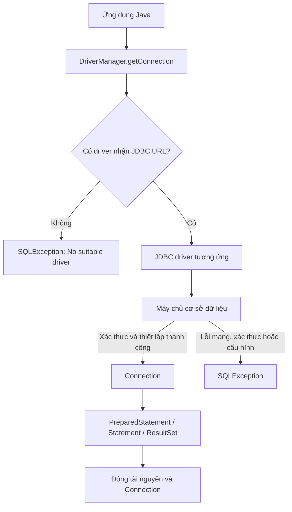

# Mở kết nối bằng `DriverManager` trong JDBC

`DriverManager` là điểm vào đơn giản nhất để một chương trình Java mở kết nối đến cơ sở dữ liệu quan hệ thông qua **Java Database Connectivity (JDBC)**. Lớp `java.sql.DriverManager` tiếp nhận một JDBC URL cùng thông tin xác thực, tìm JDBC driver thích hợp rồi trả về đối tượng `java.sql.Connection`. Từ kết nối này, ứng dụng có thể thực thi SQL, quản lý giao dịch và truy xuất kết quả.

Trong phạm vi quản lý kết nối, điều quan trọng không chỉ là gọi được `getConnection()`, mà còn là biết driver được tìm như thế nào, cung cấp cấu hình ra sao, xác định lỗi kết nối và đóng tài nguyên đúng lúc.

## 1. Vai trò của `DriverManager` trong JDBC

Một ứng dụng Java không tự nói giao thức riêng của PostgreSQL, MySQL hoặc một hệ quản trị quan hệ khác. **JDBC API** cung cấp các kiểu và phương thức chung; **JDBC driver** của từng hệ cơ sở dữ liệu chuyển lời gọi JDBC thành giao tiếp mà hệ đó hiểu.



Các thành phần chính:

| Thành phần | Trách nhiệm |
| --- | --- |
| `DriverManager` | Quản lý các driver JDBC được đăng ký và tìm driver phù hợp với URL khi mở kết nối. |
| `Driver` | Hiện thực JDBC do nhà cung cấp cơ sở dữ liệu phát hành; hiểu URL và giao thức của hệ đó. |
| JDBC URL | Chỉ ra kiểu driver và địa chỉ hoặc dữ liệu đích, theo cú pháp riêng của driver. |
| `Connection` | Biểu diễn phiên làm việc với cơ sở dữ liệu; dùng để tạo câu lệnh, quản lý transaction và đóng kết nối. |
| `SQLException` | Thông báo lỗi phát sinh trong quá trình thiết lập hoặc sử dụng kết nối. |

`DriverManager` thuộc gói `java.sql`, có sẵn trong Java. Tuy nhiên, **JDBC driver của cơ sở dữ liệu thường phải được thêm riêng vào dependency/runtime classpath**; chỉ có JDK là chưa đủ để kết nối PostgreSQL hay MySQL.

## 2. Chuẩn bị trước khi gọi `getConnection()`

Để thử mở kết nối đến một cơ sở dữ liệu chạy trên máy chủ, cần có:

1. Máy chủ cơ sở dữ liệu đang hoạt động và cho phép ứng dụng truy cập qua mạng.
2. Tên cơ sở dữ liệu (hoặc cấu hình đích tương đương), host và port chính xác.
3. Tài khoản có quyền kết nối, cùng phương thức xác thực phù hợp.
4. JDBC driver đúng loại, có mặt khi chương trình **chạy**; dependency chỉ xuất hiện lúc biên dịch vẫn có thể dẫn đến lỗi runtime.
5. JDBC URL tuân theo cú pháp của driver đó.

Ví dụ một số JDBC URL thường gặp:

| Hệ cơ sở dữ liệu | Ví dụ JDBC URL | Ghi chú |
| --- | --- | --- |
| PostgreSQL | `jdbc:postgresql://localhost:5432/appdb` | `5432` là cổng mặc định thường dùng của PostgreSQL. |
| MySQL | `jdbc:mysql://localhost:3306/appdb` | `3306` là cổng mặc định thường dùng của MySQL. |
| H2 trong bộ nhớ | `jdbc:h2:mem:testdb` | Cần H2 JDBC driver; dữ liệu thường tồn tại trong vòng đời database in-memory. |
| SQLite | `jdbc:sqlite:./data/app.db` | Driver SQLite thường làm việc với tệp cục bộ thay vì máy chủ TCP. |

Tiền tố `jdbc:` là quy ước chung. **Phần URL còn lại không có một định dạng host/port/database bắt buộc cho mọi hệ**: mỗi driver định nghĩa cú pháp, tham số và giá trị mặc định riêng. Không nên lấy URL của driver này rồi chỉ thay tên cơ sở dữ liệu để dùng với driver khác.

Ví dụ với PostgreSQL, có thể thêm JDBC driver qua Maven bằng tọa độ `org.postgresql:postgresql` hoặc qua Gradle bằng dependency cùng tọa độ và phiên bản phù hợp với dự án. Khi chạy, cần bảo đảm thư viện thật sự có mặt trên runtime classpath/module path. Mã Java bên dưới dùng JDBC API chuẩn và không cần import lớp PostgreSQL cụ thể.

## 3. Ba cách gọi `DriverManager.getConnection()`

`DriverManager` cung cấp ba overload phổ biến:

```java
// Thông tin kết nối nằm trong URL hoặc được driver suy ra từ cấu hình.
Connection c1 = DriverManager.getConnection(url);

// URL, tên người dùng và mật khẩu được truyền thành tham số riêng.
Connection c2 = DriverManager.getConnection(url, username, password);

// Thuộc tính kết nối được tập hợp vào một đối tượng Properties.
Connection c3 = DriverManager.getConnection(url, properties);
```

Các đoạn trên minh họa chữ ký phương thức; nếu sử dụng thật, mỗi `Connection` phải được đóng sau khi dùng. Chi tiết từng cách:

### 3.1. `getConnection(String url)`

```java
String url = "jdbc:h2:mem:demo";

try (Connection connection = DriverManager.getConnection(url)) {
    System.out.println("Đã mở kết nối: " + !connection.isClosed());
}
```

Ví dụ này giả định đã thêm H2 driver. Phương thức chỉ nhận URL; việc cần tài khoản hay mật khẩu và cách lấy chúng phụ thuộc driver/cấu hình cơ sở dữ liệu. **Không nên suy ra rằng overload một tham số sẽ tự đăng nhập được vào mọi database.**

### 3.2. `getConnection(String url, String user, String password)`

```java
String url = "jdbc:postgresql://localhost:5432/appdb";
String user = System.getenv("DB_USER");
String password = System.getenv("DB_PASSWORD");

try (Connection connection = DriverManager.getConnection(url, user, password)) {
    System.out.println(connection.getMetaData().getDatabaseProductName());
}
```

Đây là kiểu gọi phù hợp với các bài thực hành cơ bản: URL xác định đích kết nối, còn thông tin đăng nhập đi ở tham số riêng. Ví dụ giả định biến môi trường đã được cấu hình đầy đủ. Không chép mật khẩu thực vào mã nguồn, commit Git hoặc log.

### 3.3. `getConnection(String url, Properties info)`

```java
import java.sql.Connection;
import java.sql.DriverManager;
import java.sql.SQLException;
import java.util.Properties;

public class PropertiesConnectionExample {
    public static void main(String[] args) throws SQLException {
        String url = "jdbc:postgresql://localhost:5432/appdb";

        Properties properties = new Properties();
        properties.setProperty("user", System.getenv("DB_USER"));
        properties.setProperty("password", System.getenv("DB_PASSWORD"));

        try (Connection connection = DriverManager.getConnection(url, properties)) {
            System.out.println("Kết nối thành công");
        }
    }
}
```

`Properties` thuận tiện khi cấu hình có nhiều tùy chọn. Hai khóa `user` và `password` thông dụng trong JDBC; các khóa bổ sung như SSL/TLS, thời gian chờ kết nối hoặc tên ứng dụng **phụ thuộc vào driver**. Cần đọc tài liệu của driver trước khi sử dụng khóa tùy chọn, vì một khóa không được hỗ trợ có thể bị bỏ qua hoặc xử lý khác dự kiến. Đoạn mã giả định các biến môi trường không `null` (vì `Properties.setProperty()` không nhận giá trị `null`).

Nếu một thông tin được khai báo đồng thời ở URL và `Properties`, không nên dựa vào thứ tự ưu tiên chung cho tất cả driver. Hãy đặt mỗi thuộc tính tại một nơi rõ ràng để tránh cấu hình mâu thuẫn.

## 4. Ví dụ hoàn chỉnh: mở và kiểm tra kết nối PostgreSQL

Giả sử đã có database `appdb`, JDBC driver PostgreSQL trên runtime classpath, tài khoản có quyền đăng nhập và ba biến môi trường:

```text
JDBC_URL=jdbc:postgresql://localhost:5432/appdb
DB_USER=app_user
DB_PASSWORD=<mật khẩu thực được cấu hình ngoài mã nguồn>
```

Đây là chương trình Java độc lập; chỉ sử dụng các lớp chuẩn thuộc gói `java.sql`:

```java
import java.sql.Connection;
import java.sql.DriverManager;
import java.sql.PreparedStatement;
import java.sql.ResultSet;
import java.sql.SQLException;

public final class OpenJdbcConnection {
    public static void main(String[] args) {
        String url = System.getenv("JDBC_URL");
        String user = System.getenv("DB_USER");
        String password = System.getenv("DB_PASSWORD");

        if (isBlank(url) || isBlank(user) || password == null) {
            System.err.println("Cần cấu hình JDBC_URL, DB_USER và DB_PASSWORD.");
            return;
        }

        try (Connection connection = DriverManager.getConnection(url, user, password)) {
            System.out.println("Đã kết nối tới: "
                    + connection.getMetaData().getDatabaseProductName());

            try (PreparedStatement statement = connection.prepareStatement("SELECT 1 AS result");
                 ResultSet results = statement.executeQuery()) {

                if (results.next()) {
                    System.out.println("Kiểm tra SQL trả về: " + results.getInt("result"));
                }
            }
        } catch (SQLException exception) {
            System.err.println("Lỗi JDBC; SQLState=" + exception.getSQLState()
                    + ", vendorCode=" + exception.getErrorCode());
            // Ghi log chi tiết an toàn tại hệ thống quan sát của ứng dụng khi cần.
        }
    }

    private static boolean isBlank(String value) {
        return value == null || value.trim().isEmpty();
    }
}
```

Diễn giải các bước:

1. Đọc cấu hình từ môi trường để tách thông tin nhạy cảm khỏi source code.
2. Kiểm tra đầu vào trước khi gọi JDBC; lỗi thiếu cấu hình được báo sớm và rõ ràng.
3. Gọi `DriverManager.getConnection(url, user, password)`. Nếu không tìm thấy driver, kết nối mạng thất bại hoặc đăng nhập bị từ chối, lời gọi ném `SQLException`.
4. Dùng `Connection.getMetaData()` để xem loại database đã kết nối; ví dụ này chạy `SELECT 1` như phép kiểm tra đơn giản.
5. Đóng `ResultSet`, `PreparedStatement` và `Connection` tự động bằng `try-with-resources`, kể cả khi SQL phát sinh lỗi.
6. Khi lỗi xảy ra, ghi nhận `SQLState` và mã lỗi nhà cung cấp để hỗ trợ chẩn đoán. Không tự động in URL chứa mật khẩu hoặc toàn bộ cấu hình bí mật ra log.

`SELECT 1` xác nhận chương trình có thể thực thi một truy vấn đơn giản trong phiên làm việc vừa mở. Nó không chứng minh tài khoản có quyền với mọi bảng, transaction hay thao tác ghi của ứng dụng.

## 5. Driver được phát hiện và đăng ký ra sao?

Khi `getConnection()` được gọi, `DriverManager` thử các JDBC driver đã đăng ký, xác định driver có thể xử lý URL và yêu cầu driver thiết lập kết nối. Nếu không có driver phù hợp, lỗi thường là:

```text
java.sql.SQLException: No suitable driver found for jdbc:postgresql://localhost:5432/appdb
```

Từ **JDBC 4.0**, các driver hiện đại thường có thể tự được phát hiện thông qua cơ chế Service Provider của Java khi JAR được đặt và tải đúng trên runtime classpath/module path. Vì vậy, trong chương trình thông thường với driver hiện đại, không cần gọi thủ công `Class.forName()`.

```java
// Cách đăng ký driver thủ công, chủ yếu dùng với hệ thống/driver cũ
// hoặc môi trường tải lớp đặc biệt:
Class.forName("org.postgresql.Driver");
```

Đoạn mã trên yêu cầu xử lý `ClassNotFoundException` và không thay thế việc thêm driver JAR vào runtime. Việc thêm `Class.forName()` cũng không sửa được JDBC URL sai hoặc lỗi kết nối mạng.

Phân biệt nhanh:

| Hiện tượng | Ý nghĩa thường gặp |
| --- | --- |
| `ClassNotFoundException` khi gọi `Class.forName(...)` | Không tải được lớp driver chỉ định. |
| `No suitable driver` khi gọi `getConnection()` | Không có driver đã đăng ký chấp nhận URL đó, có thể vì thiếu driver hoặc URL sai. |
| `Connection refused`, timeout, hoặc lỗi xác thực | Driver đã được gọi nhưng không thiết lập được phiên làm việc với database. |

## 6. Vòng đời kết nối và đóng tài nguyên

`Connection` không phải biến cấu hình vô hại. Việc mở kết nối thường cần bắt tay mạng, xác thực và tài nguyên ở cả ứng dụng lẫn máy chủ. Nếu quên đóng, ứng dụng có thể làm cạn giới hạn kết nối hoặc tài nguyên.

**Ưu tiên `try-with-resources`** vì `Connection` triển khai `AutoCloseable`:

```java
try (Connection connection = DriverManager.getConnection(url, user, password)) {
    // Mọi thao tác JDBC cần thiết nằm trong phạm vi này.
} // connection.close() được gọi tự động.
```

Khi lồng thêm `Statement`/`PreparedStatement` và `ResultSet`, nên đóng cả ba kiểu tài nguyên. Các tài nguyên trong `try-with-resources` được đóng theo thứ tự ngược với thứ tự khai báo. Nếu một ngoại lệ xảy ra lúc xử lý SQL và một ngoại lệ khác xảy ra lúc đóng, Java có thể lưu ngoại lệ đóng dưới dạng *suppressed exception*; không nên bỏ mất ngoại lệ gốc khi chẩn đoán.

### Kết nối và giao dịch

Sau khi kết nối thành công, hành vi mặc định thường là `autoCommit = true`: từng câu SQL cập nhật được commit theo quy tắc JDBC khi hoàn tất. Nếu muốn nhiều thao tác thuộc **cùng một transaction**, tắt `autoCommit`, chủ động `commit()` hoặc `rollback()` và đóng kết nối đúng cách.

```java
try (Connection connection = DriverManager.getConnection(url, user, password)) {
    connection.setAutoCommit(false);

    try {
        // Thực hiện các thao tác SQL thuộc cùng một transaction tại đây.
        // Ví dụ: gọi các PreparedStatement để cập nhật dữ liệu liên quan.
        connection.commit();
    } catch (SQLException operationError) {
        try {
            connection.rollback();
        } catch (SQLException rollbackError) {
            operationError.addSuppressed(rollbackError);
        }
        throw operationError;
    }
}
```

Đoạn mã transaction minh họa khuôn mẫu xử lý lỗi, chưa chứa thao tác SQL thực tế. **Không dựa vào hành vi tự rollback khi đóng một kết nối đang còn transaction chưa hoàn tất**; hãy quyết định commit hoặc rollback rõ ràng. Với ứng dụng lớn, transaction thường được quản lý ở tầng service hoặc framework phù hợp.

## 7. Xử lý lỗi kết nối có phương pháp

Không nên xử lý tất cả `SQLException` bằng cách liên tục thử lại. Trước tiên cần xác định lỗi thuộc cấu hình, xác thực, mạng, khả năng phục vụ của máy chủ hay giới hạn tài nguyên.

| Triệu chứng | Nguyên nhân có thể | Hướng kiểm tra |
| --- | --- | --- |
| `No suitable driver` | Thiếu JAR ở runtime hoặc tiền tố JDBC URL sai. | Kiểm tra dependency runtime, tên driver và URL. |
| Không thể kết nối đến host/port | Máy chủ chưa chạy, port sai, DNS, firewall hoặc mạng không thông. | Kiểm tra host/port và quyền truy cập mạng từ máy chạy Java. |
| Authentication failed / access denied | Sai tài khoản, mật khẩu hoặc chính sách xác thực. | Kiểm tra secret được nạp, tên người dùng và cấu hình truy cập của database. |
| Database does not exist / unknown database | Tên database trong URL không tồn tại hoặc sai. | Đối chiếu tên database và quyền truy cập của tài khoản. |
| Timeout khi mở kết nối | Máy chủ không phản hồi hoặc chính sách timeout chưa phù hợp. | Kiểm tra mạng, trạng thái DB và cấu hình timeout riêng của driver. |
| Lỗi SSL/TLS | Sai chứng chỉ, CA tin cậy hoặc chế độ TLS. | Kiểm tra cấu hình TLS theo hướng dẫn chính thức của JDBC driver. |
| Too many connections | Máy chủ đã đạt giới hạn số phiên hoặc ứng dụng rò rỉ kết nối. | Đo số kết nối đang mở, tìm chỗ thiếu `close()`, cân nhắc connection pool. |

`SQLException` cung cấp các thông tin thường hữu ích:

```java
catch (SQLException exception) {
    String sqlState = exception.getSQLState();
    int vendorCode = exception.getErrorCode();
    SQLException next = exception.getNextException();

    // Ghi nhận thông tin đã lọc an toàn và phân loại lỗi theo ngữ cảnh.
}
```

`SQLState` là mã phân loại lỗi theo quy ước JDBC/SQL, `vendorCode` do hệ cơ sở dữ liệu cung cấp. Cần đối chiếu tài liệu driver/database để diễn giải mã cụ thể; không phải mọi lỗi đều có mã đủ chi tiết hoặc giống nhau giữa các nhà cung cấp. `getNextException()` có thể cung cấp thêm nguyên nhân nối tiếp.

### Phân biệt các loại thời gian chờ

- **Login/connect timeout**: giới hạn chờ khi thiết lập phiên; `DriverManager.setLoginTimeout(seconds)` tác động đến cấu hình toàn cục của `DriverManager`, nhưng việc tuân thủ có thể phụ thuộc driver. Nhiều driver còn có tham số `connectTimeout` riêng.
- **Query timeout**: giới hạn thời gian thực thi câu SQL, thường cấu hình qua `Statement.setQueryTimeout(seconds)` nếu driver hỗ trợ.
- **Network/socket timeout**: liên quan đến chờ truyền dữ liệu khi kết nối đã tồn tại; có thể có cấu hình driver hoặc `Connection.setNetworkTimeout(...)` nếu được hỗ trợ.

Các giới hạn trên giải quyết các giai đoạn khác nhau. Chỉ đặt login timeout không bảo đảm mọi truy vấn hoặc mọi thao tác mạng sẽ có cùng giới hạn thời gian.

## 8. Những thực hành nên áp dụng

**Quản lý thông tin xác thực.** Lấy tên người dùng/mật khẩu từ cấu hình bảo mật hoặc secret manager; giới hạn quyền database theo nhu cầu. Tránh đưa mật khẩu vào JDBC URL vì URL dễ bị ghi log, sao chép vào báo lỗi hoặc hệ thống giám sát.

**Mã hóa và xác minh kết nối.** Với database từ xa, cấu hình TLS theo driver, bao gồm xác minh chứng chỉ và tên máy chủ khi phù hợp. Chế độ chỉ mã hóa đường truyền không nhất thiết đồng nghĩa xác minh được danh tính máy chủ.

**Đóng tài nguyên nhất quán.** Mỗi luồng xử lý mở `Connection` phải có ranh giới đóng rõ ràng; không giữ một `Connection` toàn cục để chia sẻ tùy tiện giữa nhiều luồng hoặc yêu cầu.

**Quản lý số lượng kết nối.** `DriverManager` thích hợp cho ví dụ học tập, tiện ích dòng lệnh và thao tác đơn giản. Ứng dụng server xử lý nhiều yêu cầu thường dùng `DataSource` với connection pool để tái sử dụng kết nối, giới hạn số phiên, theo dõi timeout và vòng đời tốt hơn. Trong pool, `close()` trên kết nối mượn thường có nghĩa là **trả về pool**, thay vì luôn đóng kết nối vật lý.

**Không nhầm kiểm tra trạng thái với bảo đảm kết nối luôn sống.** `connection.isClosed()` chỉ phản ánh trạng thái đóng được đối tượng biết; nó không bảo đảm mạng và database đang phục vụ. `connection.isValid(timeoutSeconds)` có thể kiểm tra khả năng còn sử dụng của phiên làm việc nếu driver hỗ trợ, nhưng kết nối vẫn có thể hỏng ngay sau phép kiểm tra. Mã ứng dụng luôn cần xử lý lỗi lúc thực thi SQL.

**Ghi log đủ để sửa lỗi.** Log loại lỗi, SQLState, mã lỗi, thời điểm, hệ thống đích đã được che thông tin nhạy cảm. Không log mật khẩu, token hay toàn bộ thuộc tính kết nối có secret.

## 9. `DriverManager` và `DataSource` khác nhau ở đâu?

| Tiêu chí | `DriverManager` | `DataSource` / connection pool |
| --- | --- | --- |
| Cách lấy kết nối | Gọi static `DriverManager.getConnection(...)`. | Lấy từ đối tượng `DataSource` qua `getConnection()`. |
| Cấu hình | Thường truyền URL và credentials tại vị trí gọi. | Có thể tập trung cấu hình tại một nơi, thông qua DI hoặc container. |
| Tái sử dụng kết nối | Không cung cấp pooling sẵn. | Pooling có thể được cung cấp bằng một `DataSource` phù hợp. |
| Tình huống tiêu biểu | Bài học JDBC, script, công cụ nhỏ. | Dịch vụ web, hệ thống có nhiều request đồng thời. |

`DataSource` là một giao diện JDBC, **không phải mọi triển khai `DataSource` đều tự có pool**. Tính năng pooling đến từ cách triển khai hoặc thư viện được cấu hình. Dù lấy kết nối theo cách nào, mã sử dụng JDBC vẫn cần đóng tài nguyên đúng lúc.

## 10. Bài tập tự thực hành

1. Chuẩn bị một PostgreSQL database thử nghiệm và thêm JDBC driver vào runtime. Tạo các biến `JDBC_URL`, `DB_USER`, `DB_PASSWORD`, rồi chạy `OpenJdbcConnection`; kiểm tra tên hệ quản trị và giá trị `1` được in ra.
2. Đổi `JDBC_URL` sang một port không phục vụ, chạy lại và ghi nhận loại lỗi. Trả URL về đúng giá trị sau khi thử.
3. Tạm loại JDBC driver khỏi runtime và so sánh thông báo lỗi với trường hợp sai mật khẩu. Xác định lỗi xảy ra ở bước chọn driver hay bước xác thực.
4. Viết phiên bản dùng `Properties`, giữ nguyên giá trị `user`/`password`, rồi xác nhận kết nối được đóng bằng `try-with-resources`.
5. Giải thích tại sao một ứng dụng web nhiều request nên cân nhắc connection pool, dù `DriverManager.getConnection()` đã hoạt động đúng.

**Tự kiểm tra kiến thức:** Nếu `DriverManager` báo `No suitable driver`, việc đổi mật khẩu có giải quyết được không? Thông thường là **không**: trước hết phải xác minh driver và JDBC URL. Nếu chương trình đăng nhập được nhưng sau đó báo lỗi ở một truy vấn, kết nối đã mở thành công không có nghĩa SQL, quyền truy cập và trạng thái database đều đúng.

## Ghi nhớ

- `DriverManager.getConnection(...)` chọn JDBC driver phù hợp và trả về `Connection` hoặc ném `SQLException`.
- Driver thực tế phải có trên runtime classpath/module path; driver hiện đại thường được tự động phát hiện qua JDBC Service Provider.
- Chọn overload theo nhu cầu: URL đơn thuần, URL + credentials, hoặc URL + `Properties`.
- Tách secret khỏi mã nguồn, cấu hình TLS/timeout có chủ đích và kiểm tra lỗi dựa trên `SQLState` cùng ngữ cảnh.
- Dùng `try-with-resources` để bảo đảm đóng kết nối; khi xử lý transaction thủ công, chủ động `commit()`/`rollback()`.
- Với ứng dụng nhiều kết nối đồng thời, cân nhắc `DataSource` có connection pool để quản lý tài nguyên hiệu quả.
