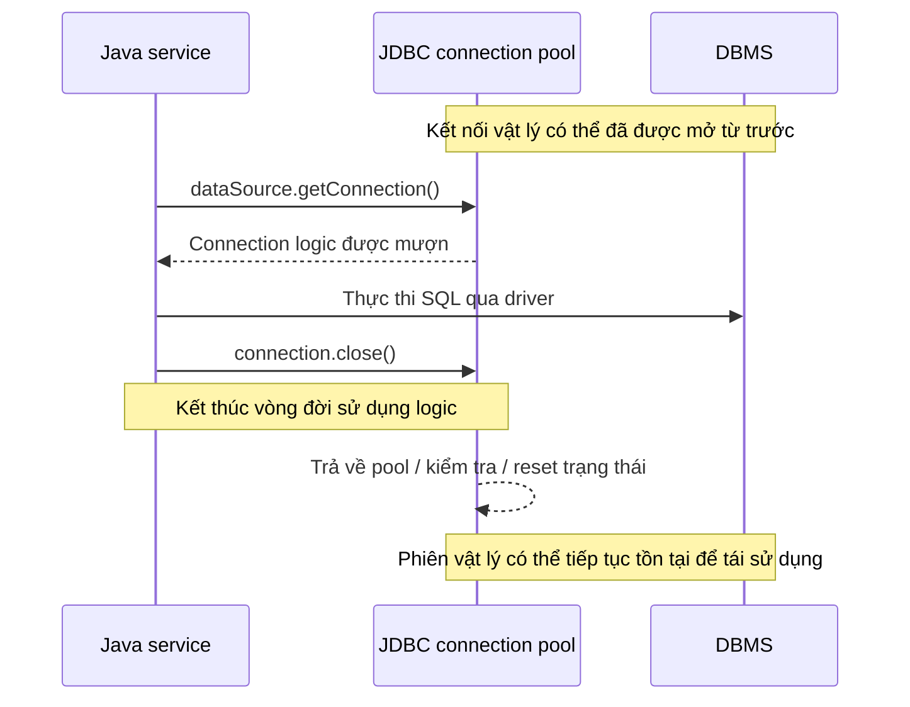
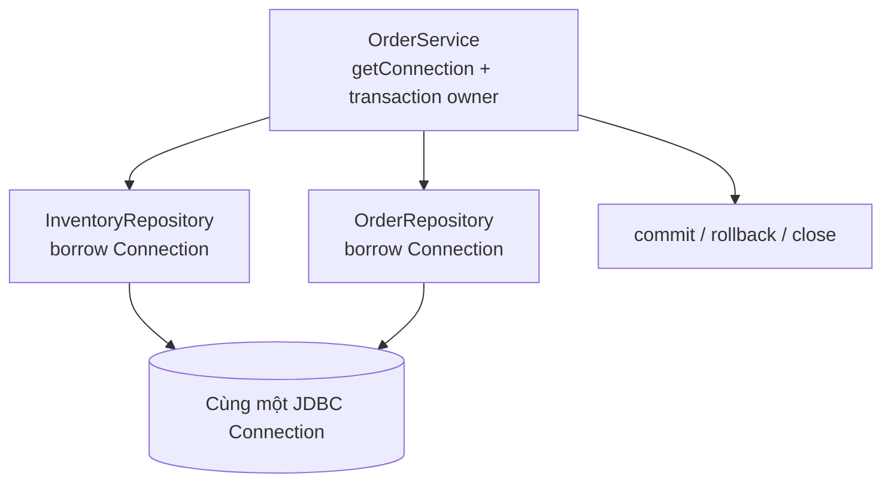

# Lựa chọn chủ sở hữu và phạm vi sống của `Connection`

Trong **JDBC (Java Database Connectivity)**, `java.sql.Connection` là đối tượng đại diện cho một phiên làm việc logic giữa mã Java và cơ sở dữ liệu quan hệ. Qua đối tượng này, chương trình tạo câu lệnh SQL, đọc kết quả, điều chỉnh chế độ giao dịch, gọi `commit()` hoặc `rollback()` và cuối cùng giải phóng tài nguyên. Vì vậy, khi thiết kế tầng truy cập dữ liệu, hai quyết định quan trọng là **ai chịu trách nhiệm đóng `Connection`** và **kết nối được phép tồn tại trong bao lâu**.

Một lỗi thiết kế phổ biến là để nhiều tầng cùng nghĩ rằng mình sở hữu kết nối: repository đóng `Connection` được service truyền vào, service tiếp tục dùng nó và gặp lỗi *connection is closed*. Chiều ngược lại cũng nguy hiểm: mỗi tầng nghĩ tầng khác sẽ đóng, khiến kết nối không được trả về pool. Cả hai lỗi xuất phát từ việc thiếu một hợp đồng sở hữu rõ ràng.

Mục tiêu của bài thuộc chương **Quản lý kết nối** là xác định ranh giới lấy, sử dụng, giao dịch và trả kết nối để mã JDBC chạy đúng với `DataSource` thông thường, connection pool hoặc transaction manager.

## 1. “Chủ sở hữu `Connection`” có nghĩa là gì?

Ở đây, **chủ sở hữu** là thành phần chịu trách nhiệm kết thúc việc sử dụng đối tượng kết nối được cấp cho mã ứng dụng. Chủ sở hữu phải bảo đảm `close()` được gọi đúng thời điểm, kể cả khi truy vấn gặp lỗi. Một phương thức chỉ **mượn** `Connection` do bên ngoài truyền vào có thể tạo và đóng `PreparedStatement`/`ResultSet` của riêng nó, nhưng **không được tự đóng** kết nối đó.

Điều này khác với **chủ sở hữu kết nối vật lý** và **chủ sở hữu giao dịch**:

| Trách nhiệm | Ý nghĩa | Ai thường đảm nhiệm? |
|---|---|---|
| **Cấp/thu hồi connection logic** | Cấp `Connection` cho một đơn vị công việc và nhận lại khi sử dụng xong | Mã gọi `DataSource#getConnection()`, hoặc framework/container quản lý |
| **Quản lý kết nối vật lý** | Mở socket/phiên DBMS, kiểm tra kết nối hỏng, đóng hoặc tái sử dụng | JDBC driver, `DataSource` hoặc connection pool |
| **Quản lý giao dịch** | Quyết định lúc `commit()`/`rollback()` và phạm vi các câu SQL | Mã Java tự điều phối, transaction manager của framework hoặc JTA coordinator |
| **Quản lý statement/result set** | Đóng những tài nguyên được tạo trong quá trình thực thi SQL | Phương thức tạo chúng, trừ khi hợp đồng API chuyển quyền rõ ràng |

**Quy tắc nền tảng:** *Thành phần nhận trách nhiệm sở hữu phải đóng kết nối; thành phần nhận kết nối để dùng tạm không được tự quyết định vòng đời của nó.* Từ “sở hữu” ở đây là **quy ước thiết kế trong ứng dụng**, không phải một thuộc tính mà kiểu `Connection` tự biểu thị trong hệ thống kiểu Java.

### Ví dụ về hai hợp đồng API khác nhau

```java
// Hàm tự lấy Connection: hàm này phải đóng Connection nó đã lấy.
List<String> findActiveNames(DataSource dataSource) throws SQLException;

// Hàm được truyền Connection: bên gọi quyết định khi nào đóng Connection.
List<String> findActiveNames(Connection connection) throws SQLException;
```

Cả hai chữ ký đều hợp lệ. Hợp đồng đầu thuận tiện cho một thao tác độc lập. Hợp đồng sau phù hợp khi một service cần phối hợp **nhiều repository trên cùng một kết nối và cùng giao dịch**. Vấn đề xảy ra khi trộn hai hợp đồng mà không quy định rõ ai đóng.

## 2. Phân biệt thời gian sống logic và vật lý

Khi một ứng dụng dùng connection pool, cần tách biệt hai vòng đời:



- **Vòng đời logic:** bắt đầu khi ứng dụng mượn được `Connection` và kết thúc khi ứng dụng đóng/trả nó; phạm vi này nên ngắn, bao trùm đúng những thao tác cần dùng chung kết nối.
- **Vòng đời vật lý:** bắt đầu khi driver/pool thiết lập phiên với DBMS và có thể kéo dài qua nhiều lần mượn–trả; pool quyết định lúc nào đóng phiên thật.

Với `DataSource` không có pool, `close()` thường đóng trực tiếp kết nối vật lý. Với pool, `close()` thường trả kết nối logic về pool. Vì thế, **dù có pool hay không, mã đã mượn kết nối vẫn phải đóng đúng hạn**. Không gọi `close()` vì sợ mất kết nối vật lý là hiểu sai cơ chế pooling và sẽ làm cạn pool.

`Connection` có thể bị vô hiệu trước lúc đóng do timeout, mạng hoặc server gặp lỗi. Một kết nối có thời gian sống ngắn vẫn có thể cần xử lý `SQLException`; một pool lớn cũng không bảo đảm kết nối luôn khỏe mạnh.

## 3. Chọn chủ sở hữu theo ranh giới công việc

Không tồn tại một thời gian sống cố định tốt cho mọi phương thức. Quyết định nên bắt đầu từ **đơn vị công việc nào cần dùng chung kết nối và giao dịch**.

| Tình huống | Thành phần hợp lý để quản lý kết nối logic | Phạm vi sống đề xuất |
|---|---|---|
| Một truy vấn độc lập trong ứng dụng JDBC thuần | Phương thức repository tự mượn và đóng | Từ lúc bắt đầu truy vấn đến khi đọc xong toàn bộ kết quả |
| Một thao tác nghiệp vụ gồm nhiều câu SQL trong cùng một giao dịch | Service hoặc transaction boundary cao hơn các repository | Suốt phần thao tác SQL cần commit/rollback cùng nhau |
| Framework đã quản lý giao dịch, ví dụ `@Transactional` với JDBC được tích hợp đúng | Transaction manager cùng hạ tầng JDBC tương ứng | Phạm vi giao dịch do framework định nghĩa |
| Xử lý một lô lớn gồm nhiều giao dịch độc lập | Một connection/transaction cho mỗi đơn vị hoặc mỗi batch thích hợp | Không giữ kết nối cho toàn bộ job nếu chỉ dùng ở từng batch |
| Xử lý request HTTP | Tầng thực sự làm việc với DB hoặc transaction manager | Chỉ phần cần DB, thường không kéo dài qua chờ mạng/HTTP bên ngoài |
| Worker bất đồng bộ hoặc task chạy nền | Mỗi task/batch tự mượn kết nối hoặc được framework cấp | Thuộc vòng đời của task/batch, không chia sẻ đối tượng connection từ thread khác |

Phạm vi **quá ngắn** làm một đơn vị nghiệp vụ bị tách thành nhiều transaction độc lập. Phạm vi **quá dài** giữ kết nối bận khi ứng dụng đang xử lý CPU, chờ API khác hoặc đợi người dùng, khiến độ trễ cấp phát và nguy cơ cạn pool tăng lên.

## 4. Mẫu A — Repository sở hữu kết nối cho một truy vấn độc lập

Một repository thực hiện truy vấn, đọc toàn bộ dữ liệu cần thiết thành giá trị Java rồi trả kết quả cho bên gọi. Nó mượn và đóng kết nối ngay trong phương thức:

```java
import java.sql.Connection;
import java.sql.PreparedStatement;
import java.sql.ResultSet;
import java.sql.SQLException;
import java.util.ArrayList;
import java.util.List;
import javax.sql.DataSource;

public final class CustomerRepository {
    private final DataSource dataSource;

    public CustomerRepository(DataSource dataSource) {
        this.dataSource = dataSource;
    }

    public List<String> findCustomerNames() throws SQLException {
        String sql = "SELECT full_name FROM customers ORDER BY id";
        List<String> names = new ArrayList<>();

        try (Connection connection = dataSource.getConnection();
             PreparedStatement statement = connection.prepareStatement(sql);
             ResultSet rows = statement.executeQuery()) {

            while (rows.next()) {
                names.add(rows.getString("full_name"));
            }
        }
        return names;
    }
}
```

Ví dụ giả định `dataSource` đã được cấu hình và bảng `customers` tồn tại. `try-with-resources` đóng `ResultSet`, sau đó `PreparedStatement`, cuối cùng là `Connection` theo thứ tự ngược khi rời khỏi khối. Các giá trị `String` đã được copy vào `List`, nên kết quả có thể dùng sau khi tài nguyên JDBC đóng.

**Vì sao không trả thẳng `ResultSet`?** Nếu repository trả `ResultSet` nhưng đã đóng kết nối, bên gọi không còn cơ sở để đọc nó. Nếu repository giữ kết nối mở để bên gọi duyệt, thì phải thiết kế lại hợp đồng sở hữu: bên gọi cần nhận một tài nguyên tự đóng và biết rõ phải giải phóng cả `ResultSet`, statement và connection. Khi chỉ cần danh sách dữ liệu vừa phải, cách materialize dữ liệu trước khi trả về đơn giản và an toàn hơn.

**Giới hạn của mẫu A:** nếu service gọi hai repository và mỗi repository tự mở một `Connection` mới, hai lời gọi không tự động thuộc cùng một giao dịch. Mẫu A phù hợp với truy vấn độc lập hoặc khi kết nối/giao dịch đã được quản lý bởi một cơ chế phối hợp khác.

## 5. Mẫu B — Service sở hữu kết nối để điều phối nhiều repository

Giả sử cần giảm tồn kho và tạo một bản ghi đơn hàng, cả hai thao tác nằm trong **cùng database** và phải cùng thành công hoặc cùng hủy. Tầng service là nơi tự nhiên để nắm ranh giới transaction; các repository nhận `Connection` từ service và chỉ đóng statement của chúng.



Mã minh họa được chia thành hai phần để làm rõ việc **ai sở hữu đối tượng nào**.

```java
import java.sql.Connection;
import java.sql.PreparedStatement;
import java.sql.SQLException;

public final class InventoryRepository {
    // Connection do service truyền vào: KHÔNG đóng connection ở đây.
    public void reserve(Connection connection, long productId, int quantity)
            throws SQLException {
        String sql = "UPDATE inventory SET available = available - ? "
                   + "WHERE product_id = ? AND available >= ?";

        try (PreparedStatement statement = connection.prepareStatement(sql)) {
            statement.setInt(1, quantity);
            statement.setLong(2, productId);
            statement.setInt(3, quantity);
            if (statement.executeUpdate() != 1) {
                throw new SQLException("Không tìm thấy sản phẩm hoặc không đủ tồn kho");
            }
        }
    }
}

public final class OrderRepository {
    // Chỉ đóng PreparedStatement do phương thức này tạo.
    public void insert(Connection connection, long orderId, long productId,
                       int quantity) throws SQLException {
        String sql = "INSERT INTO orders(id, product_id, quantity) VALUES (?, ?, ?)";

        try (PreparedStatement statement = connection.prepareStatement(sql)) {
            statement.setLong(1, orderId);
            statement.setLong(2, productId);
            statement.setInt(3, quantity);
            statement.executeUpdate();
        }
    }
}
```

Trong service, một `Connection` được dùng cho cả hai repository. Phương thức `placeOrder` dưới đây minh họa quản lý transaction cục bộ bằng JDBC; code giả định bảng và ràng buộc đã được thiết kế phù hợp:

```java
import java.sql.Connection;
import java.sql.SQLException;
import javax.sql.DataSource;

public final class OrderService {
    private final DataSource dataSource;
    private final InventoryRepository inventory = new InventoryRepository();
    private final OrderRepository orders = new OrderRepository();

    public OrderService(DataSource dataSource) {
        this.dataSource = dataSource;
    }

    public void placeOrder(long orderId, long productId, int quantity)
            throws SQLException {
        if (quantity <= 0) {
            throw new IllegalArgumentException("Số lượng phải dương");
        }

        try (Connection connection = dataSource.getConnection()) {
            boolean previousAutoCommit = connection.getAutoCommit();
            connection.setAutoCommit(false);

            try {
                inventory.reserve(connection, productId, quantity);
                orders.insert(connection, orderId, productId, quantity);
                connection.commit();
            } catch (SQLException | RuntimeException error) {
                try {
                    connection.rollback();
                } catch (SQLException rollbackError) {
                    error.addSuppressed(rollbackError);
                }
                throw error;
            } finally {
                connection.setAutoCommit(previousAutoCommit);
            }
        }
    }
}
```

Trách nhiệm trong ví dụ được chia rõ:

1. **`OrderService`** mượn và sở hữu vòng đời logic của `Connection`. Nó đặt `autoCommit=false`, quyết định `commit()`/`rollback()` và cuối cùng đóng kết nối.
2. **`InventoryRepository` và `OrderRepository`** chỉ nhận mượn `Connection` và đóng từng `PreparedStatement` tự tạo. Chúng không tự mở kết nối khác, không gọi `commit()` và không gọi `close()` trên connection nhận từ service.
3. **DBMS** thực thi các câu SQL trong cùng một giao dịch cục bộ trên một connection. Khi một câu lệnh thất bại trước commit, service yêu cầu rollback để không xác nhận một nửa thay đổi.

Ví dụ đặt trọng tâm vào **ownership và transaction boundary**. Với ứng dụng sản xuất, còn phải xử lý chắc chắn lỗi khi khôi phục trạng thái connection: một exception trong `finally` có thể che lỗi ban đầu, vì vậy helper giao dịch nên bảo toàn exception chính và ghi lỗi phục hồi như *suppressed exception*. Cần đánh giá thêm concurrent update, deadlock, retry an toàn và trường hợp mạng đứt khi kết quả `commit()` chưa rõ. Trong hệ thống đã có transaction manager của framework, thường nên giao việc này cho transaction manager thay vì tự viết thủ công.

### Vì sao `close()` ở repository sẽ làm hỏng ví dụ?

Nếu `InventoryRepository.reserve(...)` dùng:

```java
// SAI: repository không sở hữu Connection do service cấp.
try (Connection borrowed = connection;
     PreparedStatement statement = borrowed.prepareStatement(sql)) {
    // ...
}
```

thì thoát khối `try` sẽ đóng luôn connection mà service còn cần để thêm đơn hàng và commit. Dù biến tên là `borrowed`, cú pháp `try-with-resources` vẫn gọi `close()`. Quy tắc là **chỉ đưa vào `try-with-resources` những tài nguyên mà phạm vi hiện tại phải đóng**.

## 6. Khi framework hoặc container sở hữu giao dịch

Trong Spring JDBC, Jakarta EE hoặc môi trường có JTA, ranh giới giao dịch thường do **transaction manager** điều phối. Tầng application/service khai báo giao dịch, còn framework có thể liên kết `Connection` với ngữ cảnh giao dịch hiện hành và quản lý lúc cấp phát/giải phóng. Với cấu hình như vậy, trách nhiệm khác so với JDBC thuần:

| Kiểu triển khai | Ai bắt đầu/kết thúc transaction? | Code repository nên làm gì? |
|---|---|---|
| JDBC thuần, repository độc lập | Tùy phương thức, thường auto-commit | Tự mượn/trả connection; tự đóng statement/result set |
| JDBC thuần, service sở hữu transaction | Service | Nhận `Connection` do service truyền; không đóng connection |
| Spring JDBC với `JdbcTemplate` và transaction manager cấu hình đúng | Transaction manager | Gọi `JdbcTemplate`; framework điều phối việc lấy/trả connection theo transaction |
| JTA/container-managed transaction | Container/transaction manager | Lấy connection qua nguồn managed đúng cấu hình; để hạ tầng giao dịch quản lý commit/rollback |

Ví dụ ý tưởng với Spring (đòi hỏi transaction manager và `JdbcTemplate` cùng tham gia **một DataSource được cấu hình đúng**):

```java
@Transactional
public void placeOrder(long orderId, long productId, int quantity) {
    inventoryRepository.reserve(productId, quantity);
    orderRepository.insert(orderId, productId, quantity);
}
```

Trong ví dụ khái niệm này, repository sử dụng cơ chế lấy connection có nhận biết giao dịch do framework cung cấp, chẳng hạn `JdbcTemplate`. `@Transactional` **không tự tạo giao dịch nếu không có hạ tầng transaction phù hợp**, và hai lời gọi sẽ không đương nhiên dùng một transaction nếu mỗi repository tự gọi `DriverManager.getConnection(...)` hoặc một nguồn connection không tham gia quản lý giao dịch.

Đặc biệt, nếu dùng Spring transaction management, việc trực tiếp gọi `dataSource.getConnection()` trên một `DataSource` thường **không nhất thiết** lấy đúng connection đã được liên kết với transaction hiện hành. Với JDBC thuần tích hợp Spring, nên dùng `JdbcTemplate`, `DataSourceUtils` hoặc wrapper có nhận biết giao dịch theo thiết kế của framework. Không được tự `commit()` hoặc `rollback()` trên connection đang do transaction manager kiểm soát.

Với XA/JTA, transaction manager có thể điều phối các tài nguyên cùng tham gia giao dịch toàn cục. Dù application gọi `close()` trên một handle logic qua nguồn managed, nó không có quyền tự kết thúc global transaction. Quy tắc cụ thể về ai đóng handle và thời điểm đóng thuộc hợp đồng của datasource/container; điều quan trọng là **không trộn quản lý transaction thủ công với cơ chế container-managed**.

## 7. Không kéo dài vòng đời connection theo vòng đời của object

Một `Repository` có thể được tái sử dụng trong nhiều yêu cầu, nhưng **một `Connection` không nên được giữ làm field sống cùng repository**:

```java
// Anti-pattern: một Connection sống cùng đối tượng repository.
public final class BadRepository {
    private final Connection connection;

    public BadRepository(DataSource dataSource) throws SQLException {
        this.connection = dataSource.getConnection();
    }

    // Khi object sống lâu, Connection cũng bị giữ lâu và dễ bị chia sẻ sai.
}
```

Hệ quả có thể gồm: pool mất một slot suốt thời gian object tồn tại, kết nối trở nên stale sau một khoảng không hoạt động, và nhiều request/luồng vô tình dùng chung state như auto-commit, transaction isolation hoặc các statement đang chạy. Để repository tồn tại lâu, hãy lưu **`DataSource`** làm dependency và lấy kết nối trong đúng phạm vi công việc.

```java
public final class BetterRepository {
    private final DataSource dataSource;

    public BetterRepository(DataSource dataSource) {
        this.dataSource = dataSource;
    }

    // Mỗi phương thức hoặc transaction boundary lấy Connection khi cần.
}
```

### Không để một connection “đi qua” ranh giới bất đồng bộ

Ví dụ, service lấy một `Connection`, đưa nó cho `CompletableFuture` rồi ra khỏi `try-with-resources`; luồng nền có thể cố dùng connection đã đóng. Nếu giữ connection sống đến khi task bất đồng bộ kết thúc, nhiều request có thể chiếm toàn bộ pool trong lúc chờ. Mỗi task độc lập nên tự lấy/trả kết nối trong phạm vi chạy của nó, hoặc để một transaction manager hỗ trợ đúng mô hình thực thi điều phối. **Không mặc định rằng transaction context của framework tự truyền qua thread mới.**

Một `Connection` còn mang trạng thái phiên và giao dịch, nên thường **không nên dùng đồng thời trên nhiều luồng**. Các driver khác nhau có mức thread-safety khác nhau; cách an toàn và dễ kiểm soát là một đơn vị công việc sử dụng một connection tại một thời điểm.

## 8. Kết thúc một truy vấn khác với kết thúc một giao dịch

Ba mốc thời gian dễ bị lẫn:

```text
Lấy Connection ----------- Dùng câu SQL 1 -- SQL 2 ------ close()
                                 |             |
                               execute      execute
                        [BEGIN TRANSACTION -------- COMMIT]
```

- **Kết thúc câu SQL:** đóng `Statement`/`ResultSet` tương ứng sau khi đọc kết quả; connection có thể còn dùng tiếp.
- **Kết thúc transaction:** commit hoặc rollback theo ranh giới nghiệp vụ; cùng connection vẫn có thể dùng cho transaction khác nếu hợp đồng/cấu hình cho phép.
- **Kết thúc quyền mượn connection:** gọi `close()` hoặc để framework trả connection sau khi scope đã hoàn thành; không cần chờ đến khi instance repository/service bị hủy.

Ở chế độ `autoCommit=true` thông thường, mỗi statement được commit theo ngữ nghĩa JDBC khi hoàn thành; với kết quả dạng streaming, khái niệm statement “hoàn thành” có thể liên quan việc tiêu thụ/đóng result set. Khi `autoCommit=false`, ứng dụng/transaction manager cần chủ động quyết định commit/rollback. **Không dựa vào `close()` để ngầm commit hay rollback**: hành vi với giao dịch còn mở có thể phụ thuộc driver/DBMS/pool, và trong một số trường hợp được mô tả là phụ thuộc triển khai. Hãy kết thúc giao dịch rõ ràng trước khi trả kết nối.

Kết nối càng sống lâu trong transaction đang mở thì càng dễ giữ lock và snapshot, ảnh hưởng các transaction khác. Tránh để giao dịch mở khi đang gọi API ngoài, chờ hàng đợi, thao tác UI, hoặc xử lý nghiệp vụ tốn nhiều CPU mà không cần DB.

## 9. Các tình huống dễ gây rò rỉ và đóng sai

| Mẫu code/hành vi | Vấn đề | Cách sửa |
|---|---|---|
| `Connection c = ds.getConnection()` rồi nhiều nhánh `return` không đóng | Pool bị giữ connection; gặp lỗi có thể rò rỉ | Bao `Connection` trong `try-with-resources` ngay khi lấy |
| Repository được truyền `Connection` nhưng gọi `close()` | Đóng tài nguyên thuộc scope của service | Repository chỉ đóng statement/result set do mình tạo |
| Repository trả `ResultSet` nhưng đã đóng statement/connection | Bên gọi truy cập result set không còn hợp lệ | Ánh xạ đầy đủ dữ liệu trước khi trả hoặc thiết kế API stream có ownership rõ |
| Hàm nhận `Stream<T>` đọc lazy từ JDBC, nhưng không ai đóng stream | Statement và connection có thể còn mở | Dùng callback xử lý trong scope hoặc stream có `onClose` và bên gọi bắt buộc đóng |
| Lưu `Connection` trong field singleton | Giữ connection lâu, dễ lỗi đồng thời/stale connection | Lưu `DataSource`, mượn connection theo công việc |
| Gọi `close()` trên pool bị hiểu là đóng DB nên cố tình không gọi | Cạn pool | Luôn đóng logical connection sau khi sử dụng |
| Mở hai connection cho hai bước của một local transaction | Không có cùng ranh giới atomicity | Truyền cùng một connection hoặc dùng transaction manager thống nhất |
| Dùng `commit()` trong repository khi service cần gom nhiều lệnh | Repository kết thúc transaction sớm | Để tầng sở hữu transaction quyết định commit/rollback |
| Giữ connection trong khi chờ HTTP hoặc tác vụ chậm | Tiêu thụ slot pool, tăng lock và timeout | Di chuyển phần chờ ra ngoài phạm vi kết nối nếu nghiệp vụ cho phép |

### Có nên trả một stream đọc dữ liệu lớn?

Một API streaming có thể hữu ích khi tập dữ liệu rất lớn, nhưng bản thân nó đòi hỏi hợp đồng vòng đời chặt chẽ hơn `List<T>`. Repository có thể sử dụng **callback chạy đồng bộ trong phạm vi đang mở connection**, hoặc trả về một đối tượng `AutoCloseable` bao bọc các tài nguyên JDBC. Nếu trả stream, bên gọi phải biết **đóng stream ngay cả khi xử lý sớm kết thúc hoặc ném exception**, đồng thời streaming thực sự có được driver hỗ trợ theo cấu hình fetch size và transaction hay không. Không được giả định `ResultSet` tự đóng khi Java Stream chạy tới phần tử cuối.

## 10. Kiểm soát lỗi và bảo toàn tài nguyên

`try-with-resources` là lựa chọn mặc định khi mã hiện tại là chủ sở hữu `Connection`:

```java
try (Connection connection = dataSource.getConnection()) {
    // Thực hiện công việc có dùng connection.
} // Tự gọi connection.close() ngay cả khi khối lệnh ném exception.
```

`close()` vẫn có thể ném `SQLException`. Nếu phần thân khối `try` ném lỗi rồi thao tác đóng cũng ném lỗi, Java giữ lỗi ở phần thân làm lỗi chính và gắn lỗi khi đóng vào danh sách **suppressed exceptions**, thay vì âm thầm bỏ lỗi đóng.

Khi giao dịch được quản lý thủ công, còn hai điểm cần nhớ:

1. **Rollback cần nằm trong nhánh lỗi:** nếu `rollback()` cũng thất bại, nên ghi nhận nó như lỗi bổ sung và không làm mất nguyên nhân đầu tiên.
2. **Trạng thái phiên phải được xử lý trước khi trả về pool:** những thay đổi như `autoCommit`, isolation, `readOnly` hoặc schema/catalog có thể ảnh hưởng lần mượn sau nếu implementation không reset đầy đủ. Không giả định mọi pool đều có cùng chính sách reset; ưu tiên chuẩn quản lý connection/transaction của framework và kiểm tra hành vi pool cụ thể.

Khi transaction manager đã sở hữu transaction, mã nghiệp vụ phải để transaction manager thực hiện những bước kết thúc này. Việc cố sửa `autoCommit` hoặc rollback thủ công trên một connection đã được enlist có thể phá vỡ hợp đồng transaction của framework/container.

### Quan sát connection leak trong vận hành

Những dấu hiệu đáng chú ý là số connection đang được mượn tăng liên tục, hàng đợi lấy connection kéo dài, timeout xuất hiện khi DBMS vẫn hoạt động và thời gian giao dịch tăng. Các chỉ số nên theo dõi gồm **active/idle/waiting connections**, thời gian chờ lấy connection, thời gian giữ connection, số lần mở/đóng vật lý và lỗi kết nối. Một số pool còn hỗ trợ leak detection với ngưỡng thời gian; đây là công cụ điều tra, **không thay thế việc đóng tài nguyên đúng cách**.

## 11. Quy tắc quyết định nhanh

Trước khi thêm một lời gọi `getConnection()` hoặc `close()` vào mã JDBC, hãy tự trả lời:

1. **Ai cấp `Connection`?** Nếu phương thức này tự mượn từ `DataSource`, nó thường chịu trách nhiệm trả kết nối trong `finally` hoặc `try-with-resources`, trừ khi đã chuyển ownership qua một hợp đồng rõ ràng.
2. **Có bao nhiêu SQL cần thuộc một transaction?** Nếu nhiều câu cần cùng commit/rollback, đặt transaction boundary ở tầng bao trùm tất cả và bảo đảm chúng cùng dùng đúng connection/transaction được quản lý.
3. **Connection có được truyền từ ngoài vào không?** Nếu có, coi là borrowed; không đóng hoặc tự commit/rollback khi bên gọi chưa trao quyền này.
4. **Có framework/transaction manager đang sở hữu transaction không?** Nếu có, dùng đúng cơ chế JDBC có nhận biết giao dịch của framework và tránh tự kết thúc transaction.
5. **Đã đọc xong dữ liệu chưa?** Đóng `ResultSet` và statement khi hoàn tất; không trả tài nguyên còn sống ra ngoài mà không mô tả cách bên gọi đóng.
6. **Có đang giữ kết nối khi không dùng DB không?** Rút ngắn scope nếu còn chờ mạng, xử lý file, chờ người dùng hoặc tác vụ dài.
7. **Nếu có exception ở bất kỳ bước nào, kết nối có được trả không?** Dùng `try-with-resources` cho các tài nguyên thuộc quyền sở hữu và kiểm tra cách rollback/khôi phục state.

### Bài tập tình huống

**Tình huống A — Hai repository, một nghiệp vụ:** `createInvoice()` gọi `invoiceRepository.insert()` và `accountingRepository.insert()`. Mỗi repository tự lấy connection rồi auto-commit. Nếu bước hai lỗi, bước một đã lưu. **Điều chỉnh:** đưa transaction boundary lên service, dùng chung connection khi cùng DBMS hoặc transaction manager phù hợp; xác nhận cả hai thao tác cùng commit/rollback.

**Tình huống B — Pool luôn báo hết connection:** Một repository singleton giữ `Connection` trong constructor để tránh gọi `getConnection()` nhiều lần. **Điều chỉnh:** lưu `DataSource` làm dependency, mượn và trả connection theo method/transaction. Nếu connection đang bị giữ trong thời gian chờ xử lý lâu, cần rút ngắn phạm vi sống.

**Tình huống C — Trả về một `ResultSet`:** `findAll()` trả `ResultSet` từ khối `try-with-resources`, bên gọi gọi `next()` thì gặp lỗi. **Điều chỉnh:** ánh xạ kết quả trong khối rồi trả danh sách DTO/record; nếu cần stream, thiết kế một `AutoCloseable` hoặc callback sở hữu trọn tài nguyên.

**Tình huống D — Có `@Transactional` nhưng dữ liệu vẫn commit từng lệnh:** Repository gọi `DriverManager.getConnection()` trực tiếp và tự chạy SQL. **Điều chỉnh:** kiểm tra cấu hình transaction manager và cho repository dùng cơ chế nhận biết giao dịch như `JdbcTemplate`/`DataSourceUtils`; annotation đơn lẻ không thể điều phối một connection nằm ngoài context framework.

**Tình huống E — Tác vụ bất đồng bộ:** Service mượn connection, giao nó cho `CompletableFuture.runAsync(...)`, rồi thoát khối `try`. **Điều chỉnh:** không truyền connection đang mượn qua ranh giới async. Cho tác vụ bất đồng bộ tự lấy/trả kết nối và quản lý giao dịch của mình, hoặc dùng một cơ chế được thiết kế rõ cho context bất đồng bộ.

## Ghi nhớ

Trong JDBC, **chủ sở hữu `Connection` là thành phần chịu trách nhiệm kết thúc quyền sử dụng**, không nhất thiết là nơi tạo kết nối vật lý. Repository có thể sở hữu connection cho một truy vấn độc lập; service có thể sở hữu connection cho một transaction gồm nhiều thao tác; framework hoặc transaction manager có thể quản lý cả ranh giới giao dịch và kết nối logic. Thành phần chỉ được truyền connection để dùng tạm **không đóng kết nối của bên gọi**. Hãy giữ phạm vi sống vừa đủ để hoàn tất phần việc với DBMS, đóng statement/result set đúng lúc, kết thúc transaction rõ ràng và luôn trả connection về nguồn cấp phát.
