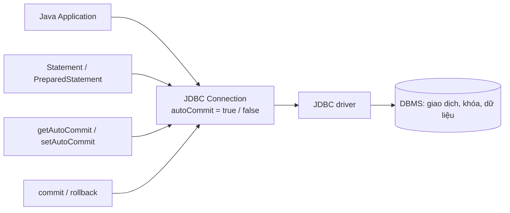
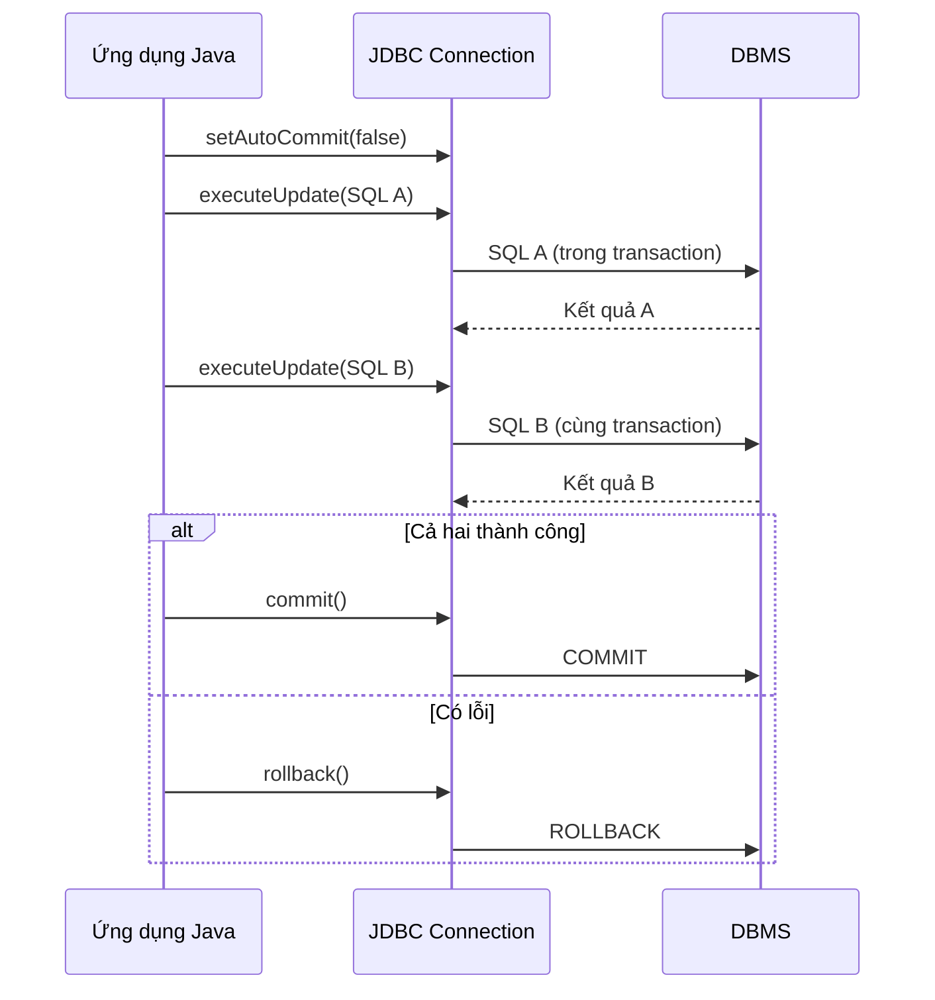

# Đọc và thay đổi `autoCommit` trong JDBC

## 1. `autoCommit` là gì và thuộc về đối tượng nào?

Trong **JDBC (Java Database Connectivity)**, ứng dụng Java truy cập cơ sở dữ liệu quan hệ qua đối tượng `java.sql.Connection`. Ngoài tạo `Statement` và `PreparedStatement`, `Connection` còn quản lý cách những câu lệnh SQL trên **chính kết nối đó** được nhóm thành giao dịch (*transaction*).

Thuộc tính **`autoCommit`** xác định JDBC có tự động commit từng câu lệnh SQL sau khi câu lệnh hoàn tất hay không:

- **`autoCommit = true`:** Các câu lệnh SQL được thực thi và commit như những giao dịch riêng lẻ theo hợp đồng JDBC. Lập trình viên thường không cần gọi `commit()` sau mỗi lệnh.
- **`autoCommit = false`:** Ứng dụng tự xác định thời điểm kết thúc giao dịch bằng `commit()` hoặc `rollback()`. Các câu lệnh nối tiếp trên cùng kết nối có thể thuộc cùng một giao dịch.

Theo JDBC, một `Connection` mới mặc định có `autoCommit` là `true`. Tuy nhiên, `DataSource`, connection pool hoặc framework có thể cấu hình lại kết nối trước khi giao cho ứng dụng. Vì vậy, khi hành vi phụ thuộc trạng thái ban đầu, **hãy đọc giá trị thật bằng `getAutoCommit()`**.



Chế độ `autoCommit` là **trạng thái của `Connection`**, không phải trạng thái độc lập của từng `PreparedStatement`, một biến toàn cục cho cả ứng dụng, hay một thiết lập áp dụng cho mọi tài khoản trong DBMS. Hai kết nối khác nhau có thể dùng hai chế độ khác nhau.

## 2. API cần biết: `getAutoCommit()` và `setAutoCommit(boolean)`

Hai phương thức được định nghĩa trong `java.sql.Connection`:

```java
boolean getAutoCommit() throws SQLException;
void setAutoCommit(boolean autoCommit) throws SQLException;
```

| Phương thức | Công dụng | Kết quả hoặc tác dụng |
| --- | --- | --- |
| `getAutoCommit()` | Đọc chế độ hiện tại của kết nối | `true` hoặc `false` |
| `setAutoCommit(false)` | Chuyển sang quản lý giao dịch thủ công | Các câu SQL tiếp theo cần được kết thúc bằng `commit()` hoặc `rollback()` |
| `setAutoCommit(true)` | Chuyển sang chế độ tự commit | **Có thể commit giao dịch hiện tại** khi thực sự đổi từ `false` sang `true` |
| `commit()` | Xác nhận thay đổi trong giao dịch hiện tại | Kết thúc giao dịch thủ công khi `autoCommit = false` |
| `rollback()` | Hủy thay đổi chưa commit trong giao dịch hiện tại | Kết thúc giao dịch thủ công khi `autoCommit = false` |

Các phương thức này có thể ném `SQLException`, chẳng hạn do kết nối đã đóng, lỗi truyền thông hoặc yêu cầu không hợp lệ trong trạng thái hiện tại.

### 2.1. Đọc trạng thái hiện tại

```java
import java.sql.Connection;
import java.sql.SQLException;
import javax.sql.DataSource;

public class AutoCommitInspector {
    public static void inspect(DataSource dataSource) throws SQLException {
        try (Connection connection = dataSource.getConnection()) {
            boolean autoCommit = connection.getAutoCommit();
            System.out.println("autoCommit = " + autoCommit);
        }
    }
}
```

Ví dụ giả định `dataSource` đã được cấu hình hợp lệ để kết nối tới DBMS. Đọc `getAutoCommit()` không tự bật/tắt chế độ; chỉ trả về trạng thái của **kết nối đang dùng**.

### 2.2. Thay đổi trạng thái

```java
try (Connection connection = dataSource.getConnection()) {
    boolean oldValue = connection.getAutoCommit();
    System.out.println("Ban đầu: " + oldValue);

    connection.setAutoCommit(false);
    System.out.println("Sau khi tắt: " + connection.getAutoCommit());

    // Chưa chạy SQL nào; chưa có thay đổi dữ liệu cần commit.
    connection.setAutoCommit(true);
    System.out.println("Sau khi bật lại: " + connection.getAutoCommit());
}
```

Đoạn mã này chỉ dùng để minh họa đọc/đổi chế độ. Trong nghiệp vụ thật, **không tùy tiện bật lại `true` khi đang có giao dịch chưa kết thúc**, vì việc đổi chế độ có thể commit những cập nhật đang chờ.

## 3. Cơ chế hoạt động khi `autoCommit = true`

Ở chế độ tự commit, khi một câu lệnh SQL hoàn tất, JDBC yêu cầu commit giao dịch chứa câu lệnh đó. Ví dụ:

```java
try (Connection connection = dataSource.getConnection()) {
    connection.setAutoCommit(true);

    try (PreparedStatement update = connection.prepareStatement(
            "UPDATE products SET active = TRUE WHERE id = ?")) {
        update.setLong(1, 10L);
        int affected = update.executeUpdate();
        System.out.println("Số hàng cập nhật: " + affected);
    }
}
```

Nếu lệnh cập nhật hoàn tất thành công và DBMS hỗ trợ giao dịch tương ứng, thay đổi đã được commit theo chế độ hiện tại. Lệnh tiếp theo trên cùng kết nối không tự động được gộp vào giao dịch trước.

**Lưu ý về thời điểm “hoàn tất”:** Với lệnh cập nhật thông thường, thời điểm hoàn tất thường gắn với lúc lệnh thực thi xong. Với truy vấn có `ResultSet`, JDBC xác định thời điểm hoàn tất theo vòng đời kết quả; chẳng hạn, `SELECT` thường chỉ hoàn tất khi `ResultSet` liên quan được đóng. Vì thế, một truy vấn đọc dữ liệu lớn còn đang mở có thể giữ tài nguyên/giao dịch lâu hơn thời gian gọi `executeQuery()`.

Chế độ `true` tiện cho truy vấn độc lập hoặc thao tác đơn lẻ, nhưng **không bảo đảm tính nguyên tử cho nhiều câu SQL có quan hệ nghiệp vụ**. Ví dụ, một lệnh trừ tồn kho đã commit trước khi lệnh tạo phiếu đặt hàng bị lỗi sẽ không tự được khôi phục nhờ lệnh thứ hai thất bại.

## 4. Cơ chế hoạt động khi `autoCommit = false`

Khi gọi `connection.setAutoCommit(false)`, ứng dụng chọn chế độ kết thúc giao dịch một cách tường minh. Sau đó:

1. Thực thi một hoặc nhiều câu lệnh SQL trên **cùng `Connection`**.
2. Nếu toàn bộ thao tác cần thiết thành công, gọi `connection.commit()`.
3. Nếu một thao tác thất bại và cần hủy cả nhóm, gọi `connection.rollback()`.



Không cần tự gửi chuỗi SQL `BEGIN TRANSACTION` trong đa số cách dùng JDBC thông thường. Khi đã tắt auto-commit, driver/DBMS quản lý điểm bắt đầu giao dịch theo hợp đồng JDBC. Sau một lần `commit()` hoặc `rollback()`, chế độ vẫn là `false` cho đến khi được đổi lại; các thao tác SQL tiếp theo có thể bắt đầu một giao dịch mới.

**Không gọi `commit()` hoặc `rollback()` để kết thúc giao dịch thủ công khi `getAutoCommit() == true`.** Theo hợp đồng JDBC, các phương thức này chỉ hợp lệ trong chế độ auto-commit đã tắt và có thể ném `SQLException` nếu gọi lúc đang bật tự commit.

## 5. Quan trọng nhất: Đổi từ `false` sang `true` có thể commit ngầm

Quy tắc dễ bị bỏ sót của `Connection.setAutoCommit(...)` là: **nếu phương thức được gọi trong một giao dịch và chế độ auto-commit thực sự thay đổi, giao dịch hiện tại được commit**. Gọi phương thức với chính giá trị đang có là thao tác không đổi chế độ.

Ví dụ dưới đây minh họa một lỗi nguy hiểm:

```java
connection.setAutoCommit(false);

try (PreparedStatement statement = connection.prepareStatement(
        "UPDATE accounts SET balance = balance - 100 WHERE id = 1")) {
    statement.executeUpdate();
}

// NGUY HIỂM nếu muốn hủy thay đổi:
// Đổi false -> true có thể commit khoản cập nhật đang chờ.
connection.setAutoCommit(true);

// Lúc này rollback không còn tác dụng hủy giao dịch vừa được commit.
```

Đừng dùng `setAutoCommit(true)` như một cách “dọn giao dịch” hoặc thay thế `rollback()`. Luôn **commit hoặc rollback rõ ràng trước khi khôi phục chế độ**.

### 5.1. Bảng chuyển trạng thái

| Trạng thái trước | Lời gọi | Kết quả quan trọng |
| --- | --- | --- |
| `true` | `setAutoCommit(true)` | Không đổi chế độ; không phát sinh chuyển trạng thái |
| `true` | `setAutoCommit(false)` | Chuyển sang giao dịch thủ công; SQL tiếp theo thuộc phạm vi phải tự kết thúc |
| `false` | `setAutoCommit(false)` | Không đổi chế độ; **không tự commit** giao dịch đang làm |
| `false` | `setAutoCommit(true)` | Chuyển sang tự commit; **giao dịch đang hoạt động được commit khi đổi chế độ** |

Điểm chính không phải mọi lần gọi `setAutoCommit` đều tạo commit: hành vi commit đặc biệt gắn với việc **đổi chế độ trong khi đang có giao dịch**. Vì trạng thái giao dịch có thể phức tạp khi SQL thất bại hoặc kết nối gián đoạn, cách an toàn nhất là không thay đổi chế độ ở giữa một đơn vị nghiệp vụ chưa kết thúc.

## 6. Ví dụ thực tế: Tắt `autoCommit` cho hai thao tác phải cùng thành công

Giả sử ứng dụng cần **giữ tồn kho** và **tạo bản ghi đặt giữ hàng** trong một giao dịch. Hai câu SQL phải cùng thành công; nếu tạo bản ghi thất bại, lượng tồn kho đã trừ phải được hoàn tác. Ví dụ giả định DBMS hỗ trợ transaction cho các bảng liên quan:

```sql
-- Cấu trúc minh họa, có thể cần điều chỉnh theo DBMS.
CREATE TABLE inventory (
    product_id BIGINT PRIMARY KEY,
    available_qty INTEGER NOT NULL
);

CREATE TABLE reservations (
    reservation_id BIGINT PRIMARY KEY,
    product_id BIGINT NOT NULL,
    quantity INTEGER NOT NULL
);
```

Phương thức Java bên dưới lấy một connection thuộc sở hữu riêng của phương thức từ `DataSource`. Sau khi đọc và lưu trạng thái ban đầu, nó tắt auto-commit, thực hiện hai thao tác, rồi commit hoặc rollback. Nó **chỉ khôi phục chế độ khi đã kết thúc giao dịch thành công bằng commit/rollback**; đây là chi tiết quan trọng vì đổi từ `false` sang `true` có thể commit ngầm nếu rollback thất bại.

```java
import java.sql.Connection;
import java.sql.PreparedStatement;
import java.sql.SQLException;
import javax.sql.DataSource;

public final class InventoryReservation {
    private final DataSource dataSource;

    public InventoryReservation(DataSource dataSource) {
        this.dataSource = dataSource;
    }

    public void reserve(long reservationId, long productId, int quantity)
            throws SQLException {
        if (quantity <= 0) {
            throw new IllegalArgumentException("Số lượng phải lớn hơn 0");
        }

        try (Connection connection = dataSource.getConnection()) {
            boolean originalAutoCommit = connection.getAutoCommit();
            connection.setAutoCommit(false);

            boolean transactionEnded = false;
            Throwable primaryFailure = null;
            try {
                String decreaseStock = """
                    UPDATE inventory
                    SET available_qty = available_qty - ?
                    WHERE product_id = ? AND available_qty >= ?
                    """;

                try (PreparedStatement update =
                        connection.prepareStatement(decreaseStock)) {
                    update.setInt(1, quantity);
                    update.setLong(2, productId);
                    update.setInt(3, quantity);

                    if (update.executeUpdate() != 1) {
                        throw new SQLException(
                            "Sản phẩm không tồn tại hoặc không đủ tồn kho");
                    }
                }

                String createReservation = """
                    INSERT INTO reservations
                        (reservation_id, product_id, quantity)
                    VALUES (?, ?, ?)
                    """;

                try (PreparedStatement insert =
                        connection.prepareStatement(createReservation)) {
                    insert.setLong(1, reservationId);
                    insert.setLong(2, productId);
                    insert.setInt(3, quantity);
                    if (insert.executeUpdate() != 1) {
                        throw new SQLException("Không thể tạo phiếu giữ hàng");
                    }
                }

                connection.commit();
                transactionEnded = true;
            } catch (SQLException | RuntimeException failure) {
                primaryFailure = failure;
                try {
                    connection.rollback();
                    transactionEnded = true;
                } catch (SQLException rollbackFailure) {
                    failure.addSuppressed(rollbackFailure);
                }
                throw failure;
            } finally {
                // Không đổi false -> true nếu rollback cũng thất bại:
                // làm như vậy có nguy cơ commit công việc còn treo.
                if (transactionEnded) {
                    try {
                        connection.setAutoCommit(originalAutoCommit);
                    } catch (SQLException restoreFailure) {
                        if (primaryFailure != null) {
                            primaryFailure.addSuppressed(restoreFailure);
                        } else {
                            throw restoreFailure;
                        }
                    }
                }
            }
        }
    }
}
```

**Ý nghĩa từng phần:**

- `originalAutoCommit = connection.getAutoCommit()` đọc trạng thái thực tế của kết nối được cấp, thay vì mặc định pool luôn trả `true`.
- `setAutoCommit(false)` tạo phạm vi làm việc mà **cả hai** câu lệnh có thể được commit cùng nhau.
- Hai `PreparedStatement` dùng **cùng một connection**; nếu chúng dùng hai kết nối khác nhau, gọi `rollback()` trên một kết nối không hủy các thay đổi của kết nối kia.
- Câu `UPDATE ... WHERE available_qty >= ?` và kiểm tra `executeUpdate() == 1` giúp từ chối trường hợp tồn kho không đủ trong chính câu cập nhật. Điều này không thay thế mọi kiểm tra nghiệp vụ hoặc constraint.
- `commit()` xác nhận cả cập nhật tồn kho và phiếu giữ hàng. Nếu một bước ném lỗi, `rollback()` cố gắng hủy các thay đổi chưa commit.
- Sau khi commit/rollback thành công, `setAutoCommit(originalAutoCommit)` khôi phục trạng thái được mượn. Nếu rollback thất bại, đoạn mã không bật lại auto-commit; kết nối được đóng ở cuối scope.

**Giới hạn của ví dụ:** Trong hệ thống thật, cần quản lý `reservationId` chống lặp yêu cầu (idempotency), quyền thao tác, lỗi mất kết nối và trạng thái commit không chắc chắn. Nếu rollback thất bại, không thể mặc định trạng thái transaction đã sạch; connection pool cần có cơ chế phát hiện/loại bỏ kết nối lỗi. Đây là ví dụ dùng connection riêng do phương thức sở hữu; không áp dụng nguyên xi khi framework đã sở hữu giao dịch.

## 7. Những rủi ro khi quản lý `autoCommit` sai cách

### 7.1. Bật lại `true` trong `finally` mà chưa biết rollback thành công

Một mẫu thường gặp nhưng có thể nguy hiểm là:

```java
connection.setAutoCommit(false);
try {
    // Nhiều câu lệnh SQL...
} finally {
    connection.setAutoCommit(true); // Có thể commit phần việc chưa rollback!
}
```

Nếu có lỗi giữa chừng, giao dịch vẫn còn hoạt động và lệnh khôi phục chế độ được thực thi mà chưa `rollback()`, các thay đổi chưa hoàn tất **có thể bị commit ngoài ý muốn**. Hãy tách hai trách nhiệm: **kết thúc giao dịch** trước, rồi mới **khôi phục cấu hình connection**.

### 7.2. Quên commit hoặc rollback

Khi `autoCommit = false`, dữ liệu vừa cập nhật có thể chưa trở thành thay đổi đã commit mà các kết nối khác quan sát được. Giữ giao dịch mở lâu làm tăng khả năng giữ khóa, giữ snapshot, tiêu tốn tài nguyên hoặc gây nghẽn cho các request khác.

Không dựa vào `Connection.close()` để quyết định mặc định “tự rollback” hay “tự commit” mọi công việc chưa kết thúc. Theo JDBC, kết quả của việc đóng kết nối đang có transaction chưa được kết thúc là **phụ thuộc triển khai**. Ứng dụng nên xác nhận hoặc hủy giao dịch rõ ràng trước khi đóng.

### 7.3. Đổi chế độ của connection do framework quản lý

Trong Spring hoặc hệ thống có transaction manager, framework có thể đã gọi `setAutoCommit(false)` và tự quản lý phạm vi commit/rollback. Nếu repository tự gọi `setAutoCommit(true)`, nó có thể kết thúc sớm giao dịch của framework.

Quy tắc: **thành phần đang sở hữu transaction mới quyết định chế độ auto-commit và thời điểm kết thúc giao dịch**. Tầng repository chỉ nên thực thi SQL trong connection được cấp nếu giao dịch đã do tầng ngoài quản lý.

### 7.4. Chia một connection cho các luồng xử lý độc lập

`autoCommit` là trạng thái của cả connection. Nếu luồng A đang tắt auto-commit, luồng B dùng chung connection rồi bật lại, giao dịch của luồng A có thể bị commit bất ngờ. Không dùng chung một `Connection` giữa các request hoặc luồng độc lập như một tài nguyên an toàn đồng thời.

### 7.5. Tin vào trạng thái mặc định của connection pool

Pool có thể đặt một giá trị mặc định riêng, hoặc khôi phục trạng thái khi kết nối được trả về. Đây là hành vi của pool và cấu hình cụ thể. Nếu một phương thức phải làm việc với transaction thủ công, hãy kiểm tra trạng thái ban đầu và xác định ai chịu trách nhiệm khôi phục. Đừng cho rằng hai lần `dataSource.getConnection()` là cùng một connection hay nhận lại cùng trạng thái.

## 8. Những điểm đặc biệt về giao dịch và DBMS

### 8.1. `autoCommit` không thay thế kiến thức về DDL

Các lệnh DDL như `CREATE TABLE`, `ALTER TABLE` hoặc `DROP TABLE` có thể có quy tắc commit đặc biệt. Một số hệ quản trị tự commit trước/sau DDL hoặc không hỗ trợ rollback cho một số lệnh DDL, bất kể ý định quản lý transaction của Java. Không giả định `setAutoCommit(false)` biến mọi DDL thành thao tác có thể rollback.

### 8.2. Cơ sở dữ liệu có thể hỗ trợ transaction không đồng đều

JDBC cung cấp API quản lý transaction, nhưng tính năng thực tế phụ thuộc DBMS, engine lưu trữ, câu lệnh và cấu hình. Có thể dùng `DatabaseMetaData.supportsTransactions()` để kiểm tra khả năng tổng quát, sau đó đọc tài liệu DBMS cho các trường hợp cụ thể.

### 8.3. Mức cô lập là một cấu hình khác

`autoCommit` quyết định **ai kết thúc giao dịch và khi nào**; mức cô lập (*transaction isolation*) quyết định **tương tác/khả năng quan sát** giữa các transaction đồng thời. Ví dụ:

```java
connection.setTransactionIsolation(
        Connection.TRANSACTION_READ_COMMITTED);
connection.setAutoCommit(false);
```

Việc chọn isolation và auto-commit là hai quyết định khác nhau. Một giao dịch thủ công vẫn có thể gặp xung đột, deadlock hoặc hiện tượng đồng thời tùy isolation/DBMS; chỉ đặt `false` không tự bảo đảm mọi dữ liệu luôn tuần tự tuyệt đối.

### 8.4. Commit thất bại có thể để lại trạng thái không rõ

Khi `commit()` ném `SQLException` vì mất kết nối hoặc timeout, ứng dụng **không luôn biết chắc** DBMS đã commit hay chưa. Nên ghi mã yêu cầu duy nhất, dùng các thao tác idempotent khi có thể, phân loại SQLState và thiết kế cách kiểm tra/truy hồi kết quả trước khi retry. Không chạy lại một thao tác có tác dụng phụ chỉ vì `commit()` đã ném lỗi.

## 9. Đọc và thay đổi `autoCommit` khi dùng `DataSource`

Trong chương trình nhỏ dùng `DriverManager.getConnection(...)`, mã thường sở hữu toàn bộ vòng đời connection. Trong ứng dụng có pool, `DataSource.getConnection()` có thể trả **proxy**; `close()` thường có nghĩa trả kết nối về pool, không nhất thiết đóng kết nối vật lý.

| Tình huống | Ai quyết định `autoCommit`? | Cách làm |
| --- | --- | --- |
| Script JDBC độc lập, tự tạo connection | Chính đoạn mã sử dụng connection | Đọc trạng thái, đổi nếu cần, commit/rollback trước khi đóng |
| Service lấy connection riêng từ pool và tự quản lý transaction | Service hoặc lớp hạ tầng đã được phân quyền sở hữu | Giữ giao dịch ngắn, khôi phục trạng thái an toàn, đóng connection đúng hạn |
| Code chạy trong giao dịch do framework quản lý | Transaction manager/framework | Không tự đổi auto-commit/commit/rollback trong repository |
| Chạy một `SELECT` đơn lẻ | Thường không cần tự thay đổi | Dùng trạng thái mặc định do hạ tầng cấu hình |
| Hệ thống cần nhiều DBMS | Ứng dụng quyết định phạm vi; DBMS/driver thực thi | Dùng API chuẩn nhưng xác minh khả năng transaction và DDL |

Khi sử dụng pool, việc “trả về pool” không thay thế nghĩa vụ đóng `ResultSet` và `Statement`. Mỗi thao tác JDBC nên sử dụng `try-with-resources` hoặc cơ chế quản lý tài nguyên tương đương của framework.

## 10. Quan sát và kiểm tra trạng thái để chẩn đoán lỗi

Trạng thái `getAutoCommit()` hữu ích khi chẩn đoán một giao dịch không được commit hoặc tại sao `commit()` gây lỗi. Tuy nhiên, giá trị này **không cho biết** những câu SQL nào đã chạy, giao dịch có bao nhiêu thay đổi, hay DBMS đã commit thành công một request trước đó hay chưa.

Ví dụ một helper chỉ đọc trạng thái:

```java
public static void logConnectionMode(Connection connection)
        throws SQLException {
    System.out.println("JDBC autoCommit: " + connection.getAutoCommit());
}
```

Để phân tích sâu hơn, dùng log có kiểm soát và metric:

- Ghi nhận điểm bắt đầu/kết thúc transaction cùng ID của request, nhưng không log mật khẩu, thông tin kết nối bí mật hoặc giá trị nhạy cảm.
- Theo dõi thời gian chờ connection từ pool, số connection đang được mượn và thời gian giữ giao dịch.
- Xem các truy vấn bị khóa lâu, deadlock và trạng thái transaction ở phía DBMS khi có công cụ hỗ trợ.
- Đo thời gian `executeUpdate()`, `commit()` và `rollback()` riêng khi cần tìm nguyên nhân chậm.

Không tự ý bật/tắt `autoCommit` trong một công cụ logging “để kiểm tra thử”, vì thao tác đó có thể thay đổi trạng thái giao dịch của nghiệp vụ đang chạy.

## 11. Lỗi thường gặp và cách xử lý

| Hiện tượng | Nguyên nhân có thể | Hướng kiểm tra |
| --- | --- | --- |
| Gọi `commit()` bị `SQLException` | Connection đang `autoCommit = true` hoặc có vấn đề kết nối | Kiểm tra `getAutoCommit()`, quyền sở hữu giao dịch và lỗi JDBC |
| Cập nhật bước 1 vẫn tồn tại dù bước 2 lỗi | Hai lệnh tự commit độc lập hoặc `setAutoCommit(true)` quá sớm | Nhóm lệnh trong transaction thủ công trên cùng connection |
| Dữ liệu thay đổi không hiển thị ở kết nối khác | Giao dịch chưa commit hoặc khác mức cô lập | Xác minh `commit()`, isolation và trạng thái transaction |
| Giao dịch bị commit khi chuẩn bị trả connection về pool | Bật lại `true` trước khi rollback/commit | Kết thúc giao dịch rõ ràng rồi mới khôi phục chế độ |
| Connection còn giữ khóa quá lâu | `autoCommit=false` nhưng quên kết thúc transaction | Rà soát mọi nhánh lỗi và thời gian giữ tài nguyên |
| Repository làm hỏng transaction của framework | Tự gọi `setAutoCommit` hoặc `commit` trong giao dịch được quản lý | Giao quyền cho transaction manager |
| Kết quả DDL không rollback được | DBMS thực hiện implicit commit hoặc không hỗ trợ rollback DDL | Đối chiếu tài liệu DBMS và phương ngữ SQL |
| Sau lỗi mạng không rõ request đã hoàn thành chưa | Mất phản hồi ở thời điểm `commit()` | Thiết kế đối chiếu trạng thái và idempotency |

## 12. Bài tập tự kiểm tra

**Câu 1.** Kết nối mới có `getAutoCommit() == true`. Ứng dụng chạy hai lệnh `UPDATE`; lệnh thứ nhất thành công, lệnh thứ hai lỗi. Mặc định lệnh thứ nhất có bị rollback không?

**Trả lời:** Không. Ở chế độ tự commit, từng câu SQL đã hoàn tất được commit riêng; lỗi câu sau không tự rollback câu trước.

**Câu 2.** Sau `setAutoCommit(false)`, ứng dụng thực hiện hai câu SQL thành công rồi muốn giữ lại thay đổi. Phải làm gì?

**Trả lời:** Gọi `connection.commit()` trên chính connection đã thực thi hai câu lệnh. Nếu muốn hủy thay đổi chưa commit, gọi `rollback()` thay thế.

**Câu 3.** Sau một lệnh `UPDATE` trong chế độ `false`, gọi `setAutoCommit(true)` để “khôi phục mặc định” mà chưa gọi `commit()` hay `rollback()`. Điều gì có thể xảy ra?

**Trả lời:** Việc đổi chế độ trong giao dịch sẽ commit giao dịch hiện tại. Đây không phải cách an toàn để hủy thao tác đang dang dở.

**Câu 4.** Trong transaction manager của framework, mã repository có nên gọi `setAutoCommit(false)` để “chắc chắn chạy trong transaction” không?

**Trả lời:** Không tự ý. Transaction manager là thành phần sở hữu chế độ và phạm vi giao dịch; repository nên sử dụng connection và transaction do framework cấp.

**Câu 5.** `setAutoCommit(false)` có bảo đảm hai `UPDATE` trên hai connection khác nhau được commit cùng nhau không?

**Trả lời:** Không. Nó chỉ áp dụng cho connection được gọi. Muốn giao dịch xuyên nhiều connection/nguồn dữ liệu phải có cơ chế điều phối transaction thích hợp.

**Câu 6.** Vì sao nên lưu `boolean original = connection.getAutoCommit()` trước khi đổi chế độ?

**Trả lời:** Vì connection lấy từ pool/framework có thể không có trạng thái mặc định mà ta dự đoán; sau khi transaction kết thúc, thành phần sở hữu cần khôi phục cấu hình đúng với trạng thái đã nhận.

## 13. Nguyên tắc cần ghi nhớ

**`getAutoCommit()` đọc chế độ giao dịch hiện tại của `Connection`; `setAutoCommit(boolean)` thay đổi chế độ đó.** `true` phù hợp cho các câu lệnh độc lập; `false` cho phép kết thúc một nhóm SQL bằng `commit()` hoặc `rollback()`. Khi đổi từ `false` sang `true` trong lúc còn giao dịch, JDBC có thể **commit giao dịch đang hoạt động**, vì vậy phải hoàn tất transaction trước khi khôi phục chế độ. Ứng dụng phải xác định rõ ai sở hữu connection/transaction, xử lý cả nhánh lỗi và xác minh những hành vi phụ thuộc driver, pool hoặc DBMS.
