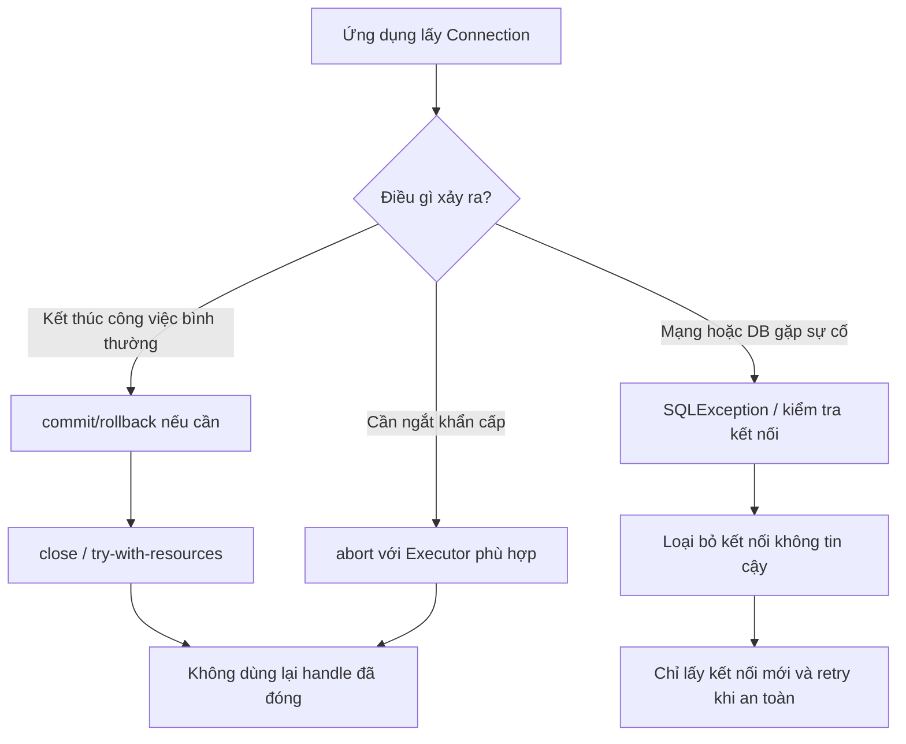
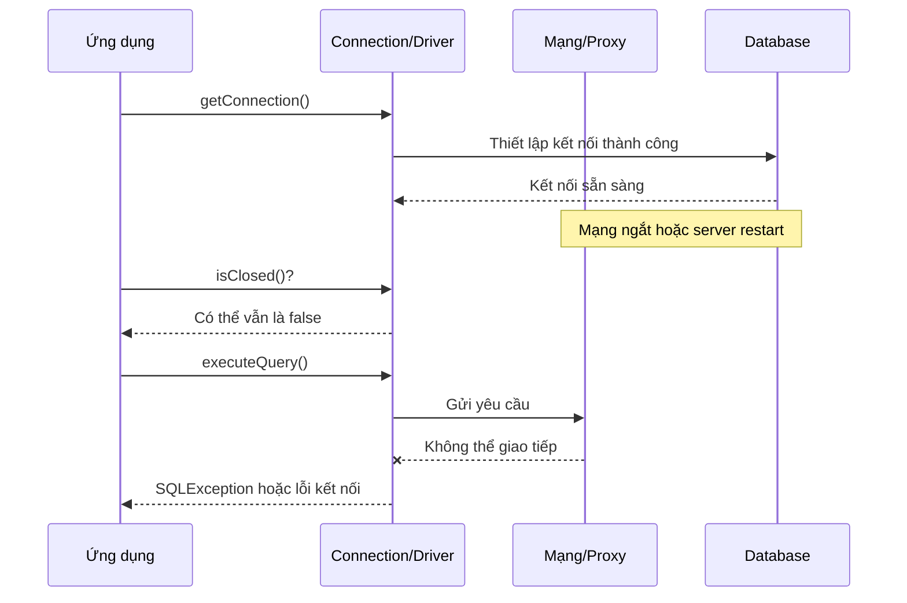
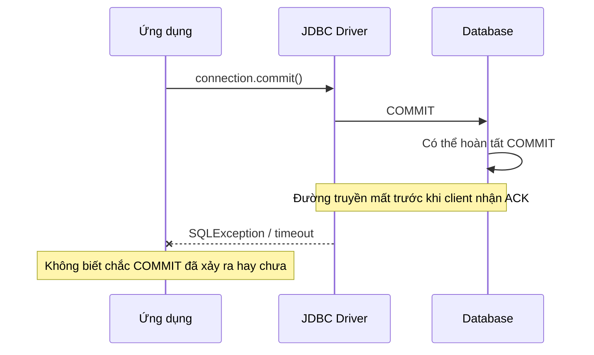
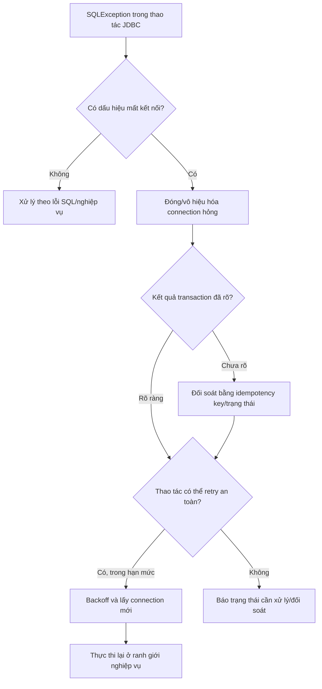

# Phân biệt `close()`, `abort()` và mất kết nối ngoài ý muốn trong JDBC

## 1. Vì sao ba trạng thái này không giống nhau?

Trong **JDBC (Java Database Connectivity)**, một `java.sql.Connection` đại diện cho phiên làm việc mà mã Java dùng để truy cập cơ sở dữ liệu quan hệ. Trong quá trình thực thi, connection có thể được kết thúc chủ động bằng `close()`, bị yêu cầu chấm dứt khẩn cấp bằng `abort(Executor)`, hoặc mất khả năng trao đổi dữ liệu khi ứng dụng chưa hề gọi hai phương thức đó.

Ba trường hợp có nguyên nhân, biểu hiện và cách xử lý khác nhau:

| Tình huống | Ai khởi phát? | Ý định | Hành động phù hợp |
| --- | --- | --- | --- |
| Gọi `connection.close()` | Mã ứng dụng hoặc khối `try-with-resources` | Giải phóng kết nối khi đã hoàn thành công việc | Đóng bình thường sau khi đã hoàn tất hoặc xử lý giao dịch |
| Gọi `connection.abort(executor)` | Mã quản lý hạ tầng/ứng dụng | Yêu cầu chấm dứt kết nối khi không thể dựa vào đóng bình thường | Chỉ dùng khi có lý do cần ngắt khẩn cấp; kiểm tra hỗ trợ của driver và pool |
| Kết nối mất ngoài ý muốn | Sự cố mạng, máy chủ, proxy, timeout, driver hoặc thiết bị trung gian | Không phải quyết định đóng của ứng dụng | Nhận diện lỗi, loại bỏ kết nối hỏng và quyết định phục hồi/retry an toàn |

Điểm dễ nhầm: **một `Connection` không bị đóng bởi mã Java vẫn có thể đã mất liên lạc với máy chủ**. Ngược lại, `close()` được gọi thành công không nhất thiết có nghĩa socket vật lý đã bị đóng ngay, nếu ứng dụng sử dụng connection pool.



Bài học tập trung vào vòng đời `Connection`, cách xử lý lỗi và những hệ quả của giao dịch. Nó không phụ thuộc một driver cụ thể; các ví dụ sử dụng `javax.sql.DataSource` đã được ứng dụng cấu hình.

## 2. `close()`: kết thúc phạm vi sử dụng một cách bình thường

`Connection.close()` là phương thức JDBC để **giải phóng ngay khi không còn cần sử dụng connection**. Với kết nối trực tiếp, driver giải phóng tài nguyên của connection; với connection pool, `close()` trên **connection logic** thường trả đối tượng về pool để một tác vụ khác có thể mượn sau này.

Mẫu sử dụng thông dụng nhất là `try-with-resources`:

```java
import java.sql.Connection;
import java.sql.PreparedStatement;
import java.sql.ResultSet;
import java.sql.SQLException;
import javax.sql.DataSource;

public final class UserLookup {
    public static String findName(DataSource dataSource, long id)
            throws SQLException {

        String sql = "SELECT full_name FROM app_user WHERE id = ?";

        try (Connection connection = dataSource.getConnection();
             PreparedStatement statement = connection.prepareStatement(sql)) {

            statement.setLong(1, id);

            try (ResultSet rs = statement.executeQuery()) {
                return rs.next()
                        ? rs.getString("full_name")
                        : null;
            }
        } // Đóng ResultSet, PreparedStatement, Connection.
    }
}
```

Giả sử `DataSource` kết nối đến cơ sở dữ liệu có bảng `app_user(id, full_name)`. Khi phương thức kết thúc, `try-with-resources` tự gọi `close()` cho các tài nguyên đã được khởi tạo thành công, **kể cả khi một lệnh SQL ném `SQLException` hoặc có `return` trong khối**.

### Đóng tài nguyên theo đúng phạm vi

| Tài nguyên | Tạo từ đâu? | Khi nào đóng? |
| --- | --- | --- |
| `Connection` | `DataSource.getConnection()` hoặc `DriverManager.getConnection(...)` | Sau khi hoàn tất giao dịch và không còn thao tác JDBC trong phạm vi đó |
| `PreparedStatement` | `connection.prepareStatement(sql)` | Sau khi không cần thực thi lại statement |
| `ResultSet` | `statement.executeQuery()` hoặc API JDBC trả result set | Sau khi đọc hết dữ liệu cần thiết hoặc ngừng xử lý |

Thứ tự giải phóng nên đi **từ đối tượng phụ thuộc bên trong ra đối tượng bao ngoài**: đóng `ResultSet` trước, rồi `Statement`, cuối cùng `Connection`. Đóng statement thường cũng đóng result set hiện tại do nó tạo; vẫn nên quản lý result set rõ ràng để trả tài nguyên sớm và tránh nhầm phạm vi.

`Connection.close()` **không biến `ResultSet` thành một danh sách Java độc lập**. Không được trả `ResultSet` từ một hàm đã đóng connection và sau đó mới đọc nó. Hãy đọc dữ liệu vào DTO, record hoặc danh sách khi tài nguyên còn mở.

### Đóng trong lúc còn transaction chưa hoàn tất

Khi `autoCommit = false`, **không được dựa vào `close()` để tự quyết định commit hay rollback**. JDBC không quy định một kết quả giao dịch thống nhất khi gọi `close()` trong lúc vẫn còn transaction đang hoạt động; hành vi có thể phụ thuộc driver, pool và hệ quản trị.

Vì vậy:

1. `commit()` sau khi toàn bộ lệnh nghiệp vụ thành công.
2. `rollback()` khi xử lý giao dịch thất bại và connection còn sử dụng được.
3. Gọi `close()` (hoặc để `try-with-resources` đóng) sau khi hoàn tất việc xử lý transaction.

Trong môi trường có transaction manager, thành phần quản lý giao dịch của ứng dụng sẽ điều phối commit/rollback; repository không được tùy tiện thay đổi `autoCommit` hoặc tự đóng một connection do transaction manager đang sở hữu.

### `close()` và connection pool

Với pool, tài nguyên mà ứng dụng nhận thường là một **handle logic**. Gọi `close()` lên handle:

- Đánh dấu handle đó đã hết phạm vi sử dụng; ứng dụng không được tiếp tục dùng lại.
- Cho phép pool thu hồi connection vật lý hoặc trả nó về hàng đợi, tùy trạng thái và chính sách.
- Có thể kích hoạt dọn dẹp trạng thái hoặc phát hiện lỗi trước khi pool tái sử dụng connection.

Do đó, **`close()` không có nghĩa luôn gửi lệnh ngắt socket vật lý đến database**. Đây là lý do nên đóng connection sau mỗi đơn vị công việc ngắn, thay vì giữ connection đến hết vòng đời ứng dụng.

## 3. `abort(Executor)`: yêu cầu chấm dứt kết nối khi cần ngắt khẩn cấp

Từ JDBC 4.1 (Java 7), `Connection` có phương thức:

```java
void abort(java.util.concurrent.Executor executor) throws SQLException;
```

Mục đích là **chấm dứt một connection đang mở và đánh dấu nó đóng**, đồng thời sử dụng `Executor` do bên gọi cung cấp để thực hiện phần dọn dẹp có thể phải chạy riêng. API này hữu ích khi tài nguyên bị lỗi nặng hoặc đường đóng bình thường có nguy cơ mắc kẹt vì mạng/driver không phản hồi.

Điểm cần hiểu về `abort`:

- Đây là **một yêu cầu ngắt kết nối**, không phải phiên bản thay thế thường xuyên cho `close()`.
- Driver xử lý công việc chấm dứt bằng `Executor` được cung cấp; kết quả không nên được hiểu như sự bảo đảm rằng máy chủ đã kịp hủy mọi thao tác tại đúng thời điểm hàm trở về.
- Khi connection đã đóng, lời gọi `abort` tiếp theo thường không còn công việc để làm theo contract JDBC.
- Driver có thể ném `SQLException` hoặc báo không hỗ trợ tính năng; không nên giả định mọi phiên bản driver đều triển khai giống nhau.
- Nếu dùng pool/container, gọi trực tiếp `abort` lên handle có thể không đi theo chính sách vô hiệu hóa connection của pool. Với ứng dụng quản lý bởi pool, ưu tiên **API đánh dấu/loại bỏ connection hỏng do pool cung cấp**, khi có.

### Ví dụ minh họa lời gọi `abort`

```java
import java.sql.Connection;
import java.sql.SQLException;
import java.util.concurrent.ExecutorService;
import java.util.concurrent.Executors;
import javax.sql.DataSource;

public final class EmergencyAbortExample {
    public static void abortIfNecessary(DataSource dataSource)
            throws SQLException {

        // Ví dụ kỹ thuật trên kết nối do lời gọi này tự sở hữu.
        // Trong ứng dụng dùng pool, tuân theo API quản lý của pool.
        ExecutorService cleanupExecutor =
                Executors.newSingleThreadExecutor();

        try (Connection connection = dataSource.getConnection()) {
            // Trong tình huống thật, chỉ gọi khi cần chấm dứt
            // connection đang gặp sự cố nghiêm trọng.
            connection.abort(cleanupExecutor);
        } finally {
            // shutdown() không đợi các tác vụ đã nhận hoàn thành.
            // Nó cho phép tác vụ đã gửi chạy hết trước khi executor dừng.
            cleanupExecutor.shutdown();
        }
    }
}
```

**Đây là ví dụ cú pháp, không phải mã nên chạy trên mỗi request.** Trong đoạn mã, kết nối được abort ngay sau khi lấy chỉ để minh họa API. Ở ứng dụng thực, `abort` chỉ xuất hiện trong nhánh xử lý sự cố có chủ đích. Phải có executor đủ khả năng thực thi tác vụ dọn dẹp; không nên truyền executor đã bị tắt hoặc trì hoãn vô hạn. Hành vi cụ thể của driver cần được kiểm tra trên môi trường mục tiêu.

Nếu ứng dụng đang giữ một transaction và phải abort connection, **không coi `abort` là một lời xác nhận rằng giao dịch chắc chắn đã rollback trên máy chủ**. Khi kết nối bị hỏng hoặc không thể liên lạc, thời điểm máy chủ kết thúc giao dịch có thể không quan sát được trực tiếp. Phải xử lý trạng thái nghiệp vụ một cách thận trọng, đặc biệt khi thao tác cuối có thể đã được commit trước lúc lỗi xuất hiện.

### Không nhầm `abort` với `Statement.cancel()`

| Phương thức | Đối tượng tác động | Ý định |
| --- | --- | --- |
| `Statement.cancel()` | Một thao tác SQL đang thực thi, theo hỗ trợ của driver | Yêu cầu hủy hoạt động hiện tại của statement |
| `Connection.abort(executor)` | Toàn bộ connection | Chấm dứt kết nối khi cần thiết |
| `Connection.close()` | Phạm vi sử dụng connection | Giải phóng tài nguyên theo đường bình thường |

Nếu chỉ muốn giới hạn thời gian một truy vấn, trước hết xem `statement.setQueryTimeout(seconds)` và cơ chế timeout của driver; không dùng `abort()` như bộ đếm thời gian cho mọi câu SQL.

## 4. Mất kết nối ngoài ý muốn: ứng dụng chưa đóng nhưng đường truyền đã hỏng

Một kết nối có thể không còn sử dụng được dù ứng dụng chưa gọi `close()` hoặc `abort()`. Một số nguyên nhân điển hình:

- Cơ sở dữ liệu khởi động lại, failover sang nút khác hoặc tiến trình máy chủ gặp sự cố.
- Đứt mạng, đổi địa chỉ IP, lỗi DNS, kết nối TCP bị firewall/NAT/load balancer ngắt sau thời gian nhàn rỗi.
- Một proxy đặt giới hạn thời gian sống tối đa cho connection.
- Network timeout hoặc socket timeout của driver xảy ra giữa chừng.
- Connection quá cũ trong pool, hoặc đã bị database đóng mà pool chưa phát hiện.
- Lỗi giao thức, lỗi driver hoặc sự cố tài nguyên máy chủ khiến kết nối không tiếp tục dùng được.

**Khi đường truyền bị hỏng, đối tượng `Connection` Java vẫn có thể còn tồn tại trong bộ nhớ.** Kết nối đứt không buộc đối tượng Java ngay lập tức biết rằng remote endpoint đã biến mất. Lỗi thường chỉ lộ ra khi thực thi SQL, gửi dữ liệu hoặc kiểm tra tính hợp lệ.



Sơ đồ mô tả **một tình huống có thể xảy ra**, không khẳng định mọi lần lỗi mạng đều lập tức ném exception. Nếu socket đang chờ dữ liệu mà không có timeout phù hợp, thread có thể tiếp tục chờ đến khi tầng mạng/driver phát hiện lỗi.

## 5. `isClosed()` có chứng minh connection còn sống không?

**Không.** `Connection.isClosed()` chủ yếu cho biết connection đã được đóng theo trạng thái mà JDBC/driver ghi nhận. Nó **không thực hiện một phép xác thực toàn diện rằng đường truyền đến máy chủ đang hoạt động và câu SQL tiếp theo chắc chắn chạy được**.

Ví dụ dưới đây là một kiểm tra **không đủ**:

```java
if (!connection.isClosed()) {
    // SAI nếu suy luận: "chắc chắn database còn kết nối".
    // Đường truyền có thể vừa bị mất.
    runNextQuery(connection);
}
```

Trong đó `runNextQuery(...)` chỉ là tên minh họa. Kể cả khi `isClosed()` trả `false`, kết nối vẫn có thể đã bị đứt ở tầng mạng hoặc bị đóng từ phía máy chủ.

### `isValid(timeout)` giúp gì?

JDBC cung cấp:

```java
boolean isValid(int timeout) throws SQLException;
```

`isValid(timeout)` yêu cầu driver đánh giá kết nối có hợp lệ hay không; `timeout` tính bằng **giây**. Phương thức có thể dùng cơ chế ping/kiểm tra riêng của driver. Nó trả `false` khi kết nối không hợp lệ, có thể ném `SQLException` nếu có lỗi truy cập cơ sở dữ liệu, và thời gian/độ chính xác phụ thuộc triển khai. Giá trị âm không hợp lệ; `0` biểu thị không đặt giới hạn thời gian theo đối số của phương thức.

Ví dụ:

```java
import java.sql.Connection;
import java.sql.SQLException;
import java.sql.SQLTransientConnectionException;
import javax.sql.DataSource;

public final class ConnectionHealth {
    public static void check(DataSource dataSource) throws SQLException {
        try (Connection connection = dataSource.getConnection()) {
            if (!connection.isValid(2)) {
                throw new SQLTransientConnectionException(
                        "Connection is not valid");
            }
            System.out.println("Connection responded to validation");
        }
    }
}
```

Kết quả `true` cho biết connection đã vượt qua **phép kiểm tra tại thời điểm đó**; không bảo đảm query tiếp theo không gặp lỗi (có một khoảng thời gian giữa kiểm tra và sử dụng). Phần lớn connection pool đã có cơ chế kiểm tra và loại bỏ connection hỏng; ứng dụng không cần chạy `isValid()` trước **mọi** câu SQL một cách máy móc.

### Bảng phân biệt nhanh

| Kiểm tra | Trả lời đúng câu hỏi nào? | Không chứng minh điều gì? |
| --- | --- | --- |
| `isClosed()` | Connection có được ghi nhận là đã đóng không? | Máy chủ còn phản hồi |
| `isValid(timeout)` | Connection có vượt qua phép xác minh của driver lúc kiểm tra không? | Mọi query sau này đều thành công |
| `executeQuery()/executeUpdate()` | Lệnh SQL cụ thể chạy thành công hoặc báo lỗi như thế nào? | Kết nối sẽ không lỗi ở lệnh kế tiếp |
| Pool validation/eviction | Pool có nhận diện/loại bỏ connection hỏng theo chính sách không? | Không có lỗi mạng nào xảy ra giữa hai bước sử dụng |

## 6. Cách đọc lỗi khi kết nối bị gián đoạn

JDBC truyền lỗi liên quan cơ sở dữ liệu qua `SQLException` và các lớp con. Khi chẩn đoán, có thể đọc:

```java
catch (SQLException error) {
    System.err.println("SQLState: " + error.getSQLState());
    System.err.println("Vendor code: " + error.getErrorCode());
    System.err.println("Exception: " + error.getClass().getName());
    // Ghi log nội bộ theo chính sách bảo mật ứng dụng.
    throw error;
}
```

Đây là đoạn minh họa phần `catch` cho một khối `try` có thao tác JDBC; không phải một method độc lập.

Các thông tin hữu ích:

| Dấu hiệu | Ý nghĩa thường gặp | Giới hạn cần nhớ |
| --- | --- | --- |
| SQLState bắt đầu bằng `08` | Nhóm lỗi **connection exception** theo phân lớp SQLState | Nội dung và cách ánh xạ có thể khác theo driver |
| `SQLTransientConnectionException` | Lỗi liên quan connection có thể mang tính tạm thời | Không mặc định lặp lại toàn bộ giao dịch là an toàn |
| `SQLNonTransientConnectionException` | Lỗi kết nối mà thử lại ngay không chắc giải quyết được | Cần kiểm tra cấu hình và nguyên nhân gốc |
| `SQLRecoverableException` | Driver gợi ý khả năng phục hồi sau bước khôi phục, chẳng hạn lấy kết nối mới | Không cho phép tái sử dụng connection hỏng hoặc retry mù |
| Socket timeout/connection reset | Lỗi mạng hoặc driver phát hiện ngắt kết nối | Có thể chưa biết server đã nhận/xử lý lệnh tới đâu |

Thông điệp exception như *connection reset*, *broken pipe* hoặc *communications link failure* rất hữu ích cho log, nhưng không nên chỉ dựa vào so khớp chuỗi để điều phối nghiệp vụ. Ngoài `getSQLState()`, có thể kiểm tra `getNextException()` và nguyên nhân `getCause()` để giữ ngữ cảnh, vì driver có thể đóng gói nhiều lỗi.

**Quy tắc an toàn:** khi driver báo connection đã hỏng, không tiếp tục gửi SQL bằng cùng handle với hy vọng nó tự phục hồi. Hãy đóng handle (để pool thu hồi/loại bỏ theo chính sách) và, nếu hợp lệ, lấy một connection mới. Riêng môi trường pool có API vô hiệu hóa connection nên dùng đúng API đó để tránh đưa handle hỏng trở lại danh sách có thể cấp phát.

## 7. Timeout: đừng nhầm giữa giới hạn truy vấn và giới hạn mạng

JDBC có các mức timeout khác nhau, giải quyết các giai đoạn khác nhau của thao tác:

| API/cơ chế | Đơn vị | Tác động chính |
| --- | --- | --- |
| `DriverManager.setLoginTimeout(seconds)` / cấu hình datasource | Giây | Giới hạn thời gian chờ khi thiết lập connection, tùy driver/triển khai |
| `Statement.setQueryTimeout(seconds)` | Giây | Yêu cầu giới hạn thời gian thực thi statement |
| `Connection.setNetworkTimeout(executor, milliseconds)` | Mili giây | Giới hạn thời gian chờ phản hồi liên quan giao tiếp mạng, theo hỗ trợ của driver |
| Driver socket/connect timeout | Theo từng driver | Thiết lập tầng kết nối hoặc I/O của driver |
| Pool acquisition timeout | Theo từng pool | Thời gian chờ lấy connection từ pool khi không có sẵn |

Ví dụ giới hạn thời gian cho một câu truy vấn:

```java
String sql = "SELECT id FROM app_user WHERE active = ?";
try (Connection connection = dataSource.getConnection();
     PreparedStatement statement = connection.prepareStatement(sql)) {
    statement.setBoolean(1, true);
    statement.setQueryTimeout(5); // Giây; driver có thể giới hạn hỗ trợ.

    try (ResultSet rs = statement.executeQuery()) {
        while (rs.next()) {
            System.out.println(rs.getLong("id"));
        }
    }
}
```

Với `setQueryTimeout(5)`, nếu driver hỗ trợ, nó yêu cầu giới hạn thời gian thực thi statement. Nếu timeout xảy ra, driver thường phát sinh `SQLTimeoutException`, nhưng cần xem trạng thái connection và transaction theo driver trước khi dùng tiếp.

`Connection.setNetworkTimeout(...)` có ý nghĩa khác: khi quá hạn network timeout, driver có thể **đánh dấu connection đóng và giải phóng tài nguyên**. Không nên xem đây chỉ là cách viết khác của query timeout. Các lựa chọn cần được cấu hình thống nhất với driver và pool; không nên tùy tiện thay đổi network timeout trên một connection mượn từ pool rồi trả về mà không hiểu cách pool khôi phục cấu hình.

Giá trị timeout không loại bỏ được hoàn toàn sự không chắc chắn: một lệnh có thể đã được máy chủ xử lý trước khi client nhận ra mất kết nối.

## 8. Giao dịch khi mất kết nối: vấn đề “đã commit hay chưa?”

Đây là hệ quả nghiêm trọng nhất của sự cố kết nối. Với một thao tác thay đổi dữ liệu, hãy phân biệt hai câu hỏi:

1. **Ứng dụng có nhận được phản hồi thành công không?**
2. **Máy chủ đã thực sự lưu thay đổi/commit hay chưa?**

Hai câu hỏi không luôn có cùng câu trả lời. Ví dụ:



Khi `connection.commit()` ném exception vì mất mạng, client **không thể suy ra chắc rằng transaction đã rollback**. Nếu máy chủ đã commit nhưng phản hồi bị mất, một lần retry `INSERT` hoặc trừ tiền có thể tạo tác động trùng lặp. Nếu chưa commit, không retry có thể khiến nghiệp vụ chưa hoàn thành.

### Ví dụ: nguyên tắc xử lý transaction khi kết nối còn khỏe

```java
import java.sql.Connection;
import java.sql.PreparedStatement;
import java.sql.SQLException;
import javax.sql.DataSource;

public final class InventoryService {
    public static void decreaseStock(
            DataSource dataSource, long productId, int quantity)
            throws SQLException {
        if (quantity <= 0) {
            throw new IllegalArgumentException(
                    "quantity must be positive");
        }

        try (Connection connection = dataSource.getConnection()) {
            connection.setAutoCommit(false);
            try {
                String sql = """
                    UPDATE inventory
                       SET stock = stock - ?
                     WHERE product_id = ? AND stock >= ?
                    """;

                int updated;
                try (PreparedStatement statement =
                             connection.prepareStatement(sql)) {
                    statement.setInt(1, quantity);
                    statement.setLong(2, productId);
                    statement.setInt(3, quantity);
                    updated = statement.executeUpdate();
                }

                if (updated != 1) {
                    throw new SQLException(
                            "Product not found or insufficient stock");
                }
                connection.commit();
            } catch (SQLException | RuntimeException failure) {
                try {
                    connection.rollback();
                } catch (SQLException rollbackError) {
                    failure.addSuppressed(rollbackError);
                }
                throw failure;
            }
        }
    }
}
```

Ví dụ giả định bảng `inventory(product_id, stock)` và DB hỗ trợ transaction. Trong tình huống bình thường, lỗi trước commit dẫn đến cố gắng `rollback()`. Tuy nhiên, **nếu chính `commit()` gặp sự cố kết nối, lời gọi `rollback()` trong khối `catch` có thể cũng thất bại hoặc không chứng minh được transaction chưa commit**. `try-with-resources` vẫn giải phóng handle.

Muốn hỗ trợ retry một nghiệp vụ có tác động ngoài, có thể sử dụng **mã định danh yêu cầu duy nhất (idempotency key)**, constraint `UNIQUE` hoặc bảng ghi nhận trạng thái xử lý được cập nhật cùng transaction. Khi lỗi khiến outcome không rõ, ứng dụng có thể tra cứu trạng thái bằng connection **mới** để xác định yêu cầu đã được ghi nhận chưa, thay vì tự động thực thi lại.

Chẳng hạn, với một yêu cầu thanh toán `request_id = "pay-123"`, lưu `request_id` duy nhất cùng bản ghi thay đổi trong cùng transaction. Lần thử lại cần dựa trên trạng thái của `request_id`, không chỉ dựa trên việc client trước đó nhận `SQLException`. Các tác vụ `SELECT` không gây thay đổi trạng thái thường dễ retry hơn, nhưng vẫn cần cân nhắc tính nhất quán và phạm vi transaction.

### Không dùng `abort()` để xác nhận rollback

Gọi `abort()` trong lúc mạng đã mất không đem lại bằng chứng rằng DB đã biết yêu cầu chấm dứt đúng thời điểm. Transaction manager và pool có thể có chính sách riêng; điều quan trọng là **không đồng nhất “client đã bỏ kết nối” với “server chưa ghi dữ liệu”**.

## 9. Phục hồi an toàn sau sự cố

Một chiến lược xử lý lỗi hợp lý thường gồm những bước sau:

1. **Ghi nhận lỗi có đủ ngữ cảnh**: hoạt động đang thực hiện, `SQLState`, mã lỗi, thời gian và trạng thái transaction; tránh log mật khẩu, token và dữ liệu nhạy cảm.
2. **Không tin cậy connection đã bị lỗi mạng**: đóng handle hoặc thông báo cho pool để hủy connection vật lý bị hỏng, theo API của pool.
3. **Xác định loại thao tác**: truy vấn chỉ đọc, cập nhật đơn, hay giao dịch nhiều bước? Kết quả thao tác đã rõ hay chưa?
4. **Kiểm tra điều kiện retry**: chỉ retry ở một ranh giới nghiệp vụ có thể thực hiện lại an toàn; dùng idempotency key hoặc kiểm tra trạng thái để xử lý outcome không rõ.
5. **Lấy một connection mới**: nếu cần tiếp tục, yêu cầu pool/datasource cấp connection mới hợp lệ, rồi xây dựng lại statement và tham số.
6. **Giới hạn số lần retry**: tránh vòng lặp vô hạn; dùng backoff có giới hạn để không làm quá tải cơ sở dữ liệu đang gặp sự cố.



**Không biến các lớp lỗi `SQLTransient...` thành lệnh retry vô điều kiện.** Một lỗi tạm thời của connection không tự bảo đảm thao tác đang thực thi là idempotent. Cũng không nên mở connection mới *bên trong một transaction cũ* và mong nó kế thừa trạng thái chưa commit.

### Mã minh họa: đọc dữ liệu với phạm vi kết nối ngắn

Ví dụ trả về một `Optional<String>` và để lớp trên quyết định retry khi nhận `SQLException`:

```java
import java.sql.Connection;
import java.sql.PreparedStatement;
import java.sql.ResultSet;
import java.sql.SQLException;
import java.util.Optional;
import javax.sql.DataSource;

public final class CustomerRead {
    public static Optional<String> findEmail(
            DataSource dataSource, long id) throws SQLException {
        String sql = "SELECT email FROM customer WHERE id = ?";

        try (Connection connection = dataSource.getConnection();
             PreparedStatement statement = connection.prepareStatement(sql)) {
            statement.setLong(1, id);
            statement.setQueryTimeout(5);

            try (ResultSet rs = statement.executeQuery()) {
                if (rs.next()) {
                    return Optional.ofNullable(rs.getString("email"));
                }
                return Optional.empty();
            }
        }
    }
}
```

Mã này chỉ quản lý một phạm vi JDBC ngắn: dù có `SQLException`, `try-with-resources` vẫn cố gắng đóng tài nguyên. Một lớp cao hơn có thể thực hiện retry có giới hạn cho **truy vấn đọc** khi xác nhận lỗi thuộc nhóm có thể phục hồi. Không gộp logic retry cho thao tác trừ tiền, nhập đơn hàng và truy vấn đọc vào cùng một nhánh xử lý.

## 10. Kiểm tra nhanh các tình huống điển hình

| Tình huống | Nhận định đúng | Bước tiếp theo |
| --- | --- | --- |
| Kết thúc một truy vấn `SELECT` bình thường | Gọi `close()`/để `try-with-resources` giải phóng tài nguyên | Trả về DTO đã ánh xạ |
| `close()` được gọi trên handle từ pool | Handle thường được trả lại pool; không chắc socket vật lý đóng ngay | Không dùng lại handle đó |
| Statement không phản hồi, connection cần chấm dứt khẩn cấp | Có thể cân nhắc `abort(executor)` khi phù hợp driver và pool | Kiểm tra trạng thái nghiệp vụ và loại bỏ kết nối |
| `isClosed() == false` sau DB restart | Không chứng minh đường truyền còn tốt | Chấp nhận lỗi ở thao tác thực, kiểm tra/loại bỏ kết nối |
| `isValid(2) == true` | Connection vượt qua kiểm tra hiện tại | Vẫn xử lý `SQLException` ở truy vấn tiếp theo |
| `commit()` ném timeout hoặc connection error | Kết quả giao dịch có thể **không rõ** | Đối soát trạng thái, tránh ghi trùng khi retry |
| `rollback()` cũng thất bại sau lỗi mạng | Không chứng minh rollback đã diễn ra | Loại bỏ connection; đối soát trước khi retry |
| Nhiều kết nối idle bị cắt bởi proxy | Pool có thể cấp connection cũ không hợp lệ | Cấu hình health check, max lifetime/idle timeout phù hợp |
| Muốn dừng một câu SQL quá lâu | Không mặc định cần abort connection | Dùng `setQueryTimeout`/`cancel` theo khả năng |
| Có sự cố liên tục ở DB | Retry nhanh có thể tăng tải gây lỗi dây chuyền | Giới hạn retry, backoff và cơ chế bảo vệ tải |

## 11. Bài tập thực hành

**Bài tập 1 – Vòng đời tài nguyên.** Viết một phương thức `List<String> listEmails(DataSource dataSource)` dùng `PreparedStatement` và `ResultSet`. Bảo đảm cả ba tài nguyên đều có phạm vi `try-with-resources`. Giải thích chuyện gì xảy ra nếu `ResultSet.next()` ném `SQLException`.

**Bài tập 2 – Phát hiện hiểu nhầm.** Một lập trình viên viết:

```java
if (!connection.isClosed()) {
    statement.executeUpdate();
}
```

Hỏi: có trường hợp nào câu lệnh vẫn thất bại vì connection hỏng không? Vì sao? `isValid()` có thể giải quyết hoàn toàn khoảng thời gian giữa bước kiểm tra và bước sử dụng không?

**Bài tập 3 – Sự cố khi commit.** Một ứng dụng tạo đơn hàng rồi gọi `commit()`, nhưng nhận timeout trước phản hồi. Hãy mô tả hai khả năng phía server và thiết kế một cơ chế `request_id` duy nhất để tránh tạo trùng đơn hàng khi khách nhấn “Thử lại”.

**Bài tập 4 – So sánh thao tác.** Trả lời khi nào ưu tiên `close()`, khi nào có thể cân nhắc `abort(Executor)`, khi nào không có lời gọi đóng nào từ phía ứng dụng nhưng vẫn gặp lỗi kết nối. Nêu thêm sự khác biệt của handle pool với connection vật lý.

**Bài tập 5 – Điều tra lỗi.** Thiết kế log cho một lỗi JDBC gồm `SQLState`, `errorCode`, tên phương thức DAO, thời gian thực thi và trạng thái transaction. Đề xuất cách không ghi lộ thông tin xác thực và cách xác định lỗi do mạng, pool hay câu SQL.

Điểm cần ghi nhớ: **`close()` là kết thúc sử dụng bình thường; `abort(Executor)` là yêu cầu chấm dứt kết nối khẩn cấp; mất kết nối ngoài ý muốn là sự cố có thể xảy ra bất kỳ lúc nào**. Mã JDBC tốt luôn quản lý tài nguyên theo phạm vi, hoàn tất giao dịch tường minh, phát hiện connection hỏng và chỉ phục hồi/retry khi đã xét đến tính đúng đắn của dữ liệu.
