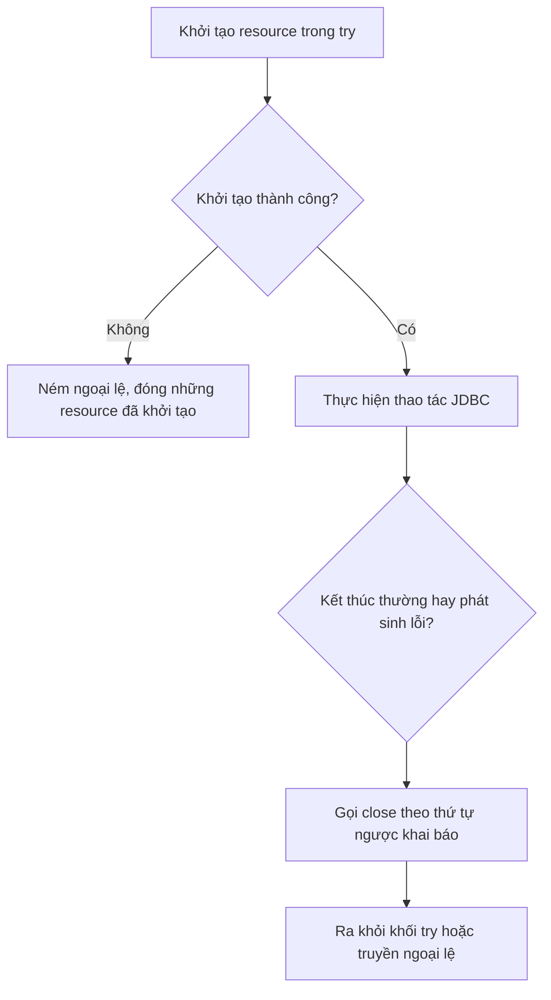

# Đóng tài nguyên JDBC bằng try-with-resources

Khi làm việc với **JDBC (Java Database Connectivity)** để truy cập cơ sở dữ liệu quan hệ từ Java, ứng dụng tạo ra các tài nguyên như `Connection`, `Statement`, `PreparedStatement` và `ResultSet`. Những đối tượng này có thể gắn với kết nối mạng, phiên làm việc trên máy chủ, bộ nhớ, con trỏ đọc dữ liệu và các tài nguyên khác. Nếu không được đóng đúng cách, ứng dụng có thể làm cạn số kết nối cho phép, giữ tài nguyên quá lâu và tăng nguy cơ lỗi khi chạy liên tục.

Trong chương **Vòng đời tài nguyên**, `try-with-resources` là công cụ quan trọng để **đóng tài nguyên tự động khi rời khỏi khối xử lý**, kể cả khi SQL phát sinh lỗi hoặc chương trình trả về sớm.

Bài học tập trung vào cách sử dụng cú pháp này với JDBC, thứ tự đóng tài nguyên, cách Java bảo toàn ngoại lệ khi đóng, ý nghĩa của `close()` trong connection pool và ranh giới giữa **đóng tài nguyên** với **kết thúc transaction**.

## 1. Vì sao JDBC cần đóng tài nguyên?

Một kết nối JDBC không chỉ là một đối tượng Java đơn giản. Tùy driver và database, việc mở `Connection` có thể tạo phiên giao tiếp với máy chủ. `Statement` và `ResultSet` có thể giữ cấu trúc thực thi, bộ đệm, con trỏ hoặc những nguồn lực khác trong khi truy vấn còn hoạt động.

| Tài nguyên | Vai trò | Hệ quả có thể xảy ra khi không đóng |
| --- | --- | --- |
| `Connection` | Đại diện cho phiên truy cập database; tạo statement và quản lý transaction. | Cạn giới hạn kết nối, giữ phiên và tài nguyên máy chủ; nếu dùng pool có thể làm cạn pool. |
| `Statement` | Gửi câu SQL và quản lý kết quả gắn với statement. | Giữ tài nguyên driver/database lâu hơn cần thiết. |
| `PreparedStatement` | Statement có khả năng bind tham số và được chuẩn bị theo cách driver hỗ trợ. | Giữ tài nguyên thực thi, dữ liệu bind hoặc statement handle. |
| `CallableStatement` | Gọi stored procedure và nhận các kết quả tương ứng. | Giữ tài nguyên statement và kết quả của procedure. |
| `ResultSet` | Duyệt các hàng trả về từ truy vấn. | Có thể giữ cursor hoặc dữ liệu đệm, và kéo dài thời gian sử dụng statement/connection. |

Mức tài nguyên cụ thể tùy driver, kiểu `ResultSet`, cấu hình fetch và hệ quản trị. Không phải mọi truy vấn đều tạo server-side cursor, nhưng **chương trình vẫn phải quản lý vòng đời của các đối tượng JDBC**.

Một sai lầm thường gặp là tin rằng garbage collector sẽ giải phóng kết nối “đủ sớm”. Garbage collector quản lý bộ nhớ Java, còn vòng đời của socket, phiên database và connection pool cần **đóng có chủ đích**. Không nên dựa vào finalizer hoặc thời điểm GC để bảo đảm database được giải phóng tài nguyên.

## 2. `try-with-resources` hoạt động như thế nào?

Từ **Java 7**, cú pháp `try-with-resources` cho phép khai báo một hoặc nhiều đối tượng triển khai `java.lang.AutoCloseable` trong dấu ngoặc sau `try`:

```java
try (SomeResource resource = createResource()) {
    // Làm việc với resource.
} // Java tự gọi resource.close() khi thoát khỏi khối.
```

Các đối tượng JDBC chủ yếu sau đều triển khai `AutoCloseable`:

- `java.sql.Connection`;
- `java.sql.Statement`, bao gồm `PreparedStatement` và `CallableStatement`;
- `java.sql.ResultSet`.

Ví dụ tối thiểu:

```java
import java.sql.Connection;
import java.sql.DriverManager;
import java.sql.SQLException;

public class OpenAndClose {
    public static void main(String[] args) throws SQLException {
        String url = System.getenv("JDBC_URL");
        String user = System.getenv("DB_USER");
        String password = System.getenv("DB_PASSWORD");

        try (Connection connection =
                     DriverManager.getConnection(url, user, password)) {
            System.out.println("Đã mở kết nối JDBC");
        }
        // connection.close() đã được gọi tự động.
    }
}
```

Đoạn mã giả định các biến môi trường đã được thiết lập, driver JDBC có trên runtime classpath và database cho phép đăng nhập. `DriverManager.getConnection(...)` vẫn có thể ném `SQLException` nếu thiếu driver, URL sai, xác thực thất bại hoặc kết nối mạng không thành công.

Khi khối `try` kết thúc, Java gọi `close()` **ngay cả trong các trường hợp**:

1. Mã trong khối chạy hết bình thường.
2. Một lệnh `return`, `break` hoặc `continue` chuyển điều khiển ra khỏi khối.
3. Một ngoại lệ được ném bên trong khối.

`try-with-resources` bảo đảm chương trình **thực hiện lời gọi `close()` theo ngữ nghĩa Java**. Nó không thể bảo đảm đóng vật lý thành công nếu driver, mạng hoặc tiến trình bị lỗi nghiêm trọng; `close()` cũng có thể ném ngoại lệ cần được xử lý.

## 3. So sánh với cách đóng thủ công

### Trước đây: `try-finally`

```java
Connection connection = null;
try {
    connection = DriverManager.getConnection(url, user, password);
    // Thực hiện thao tác JDBC.
} finally {
    if (connection != null) {
        connection.close();
    }
}
```

Cách này có thể hợp lệ nhưng dài dòng hơn, nhất là khi có nhiều tài nguyên lồng nhau. Nếu xử lý ngoại lệ không cẩn thận, một lỗi từ `close()` trong `finally` có thể **che mất lỗi gốc** phát sinh trong khối `try`.

### Cách ưu tiên: `try-with-resources`

```java
try (Connection connection =
             DriverManager.getConnection(url, user, password)) {
    // Thực hiện thao tác JDBC.
}
```

Java tự quản lý thao tác đóng và giữ được thông tin ngoại lệ bị phát sinh lúc đóng trong `getSuppressed()`. Mã ngắn hơn, giảm khả năng bỏ sót nhánh xử lý tài nguyên.

Sơ đồ vòng đời:



Đặc biệt, nếu khai báo nhiều tài nguyên và một tài nguyên sau khởi tạo thất bại, Java vẫn đóng các tài nguyên trước đó **đã khởi tạo thành công**.

## 4. Đóng đủ `Connection`, `Statement` và `ResultSet`

Một thao tác truy vấn thường dùng ba đối tượng:

1. `Connection` để truy cập cơ sở dữ liệu.
2. `PreparedStatement` để gửi SQL.
3. `ResultSet` để duyệt kết quả.

Chúng có quan hệ phụ thuộc:


Thứ tự đóng thích hợp là **`ResultSet` trước, `PreparedStatement` tiếp theo, `Connection` cuối cùng**.

### Ví dụ đọc dữ liệu và đóng đầy đủ

Giả sử database có bảng `products(id, name, price)`:

```java
import java.sql.Connection;
import java.sql.DriverManager;
import java.sql.PreparedStatement;
import java.sql.ResultSet;
import java.sql.SQLException;

public final class FindProduct {
    public static void main(String[] args) {
        String url = System.getenv("JDBC_URL");
        String user = System.getenv("DB_USER");
        String password = System.getenv("DB_PASSWORD");

        String sql = "SELECT id, name, price FROM products WHERE id = ?";

        try (Connection connection =
                     DriverManager.getConnection(url, user, password);
             PreparedStatement statement =
                     connection.prepareStatement(sql)) {

            statement.setLong(1, 101L);

            try (ResultSet resultSet = statement.executeQuery()) {
                if (resultSet.next()) {
                    long id = resultSet.getLong("id");
                    String name = resultSet.getString("name");
                    java.math.BigDecimal price =
                            resultSet.getBigDecimal("price");

                    System.out.printf(
                            "id=%d, name=%s, price=%s%n",
                            id, name, price);
                } else {
                    System.out.println("Không tìm thấy sản phẩm");
                }
            } // Đóng ResultSet.
        } catch (SQLException error) {
            System.err.println("Lỗi JDBC: " + error.getSQLState());
        } // Đóng PreparedStatement rồi Connection.
    }
}
```

Ở đây `ResultSet` được khai báo bằng một khối `try` lồng vì cần gọi `statement.setLong(...)` **trước** khi chạy `executeQuery()`. Cách lồng khối thể hiện rõ thứ tự và ranh giới sử dụng tài nguyên.

Có thể khai báo ba tài nguyên chung trong một `try` nếu câu SQL không cần bind tham số:

```java
try (Connection connection =
             DriverManager.getConnection(url, user, password);
     Statement statement = connection.createStatement();
     ResultSet resultSet = statement.executeQuery(
             "SELECT id, name FROM products")) {

    while (resultSet.next()) {
        System.out.println(resultSet.getString("name"));
    }
}
// Tự đóng theo thứ tự:
// resultSet.close() -> statement.close() -> connection.close()
```

Đoạn thứ hai cần `import java.sql.Statement;`, và các biến `url`, `user`, `password` phải tồn tại trong ngữ cảnh gọi. Khi viết code thực tế, vẫn nên dùng `PreparedStatement` để bind các giá trị động nhằm tránh SQL injection.

### Có cần đóng `ResultSet` nếu đã đóng statement?

Theo hợp đồng JDBC, đóng một `Statement` sẽ đóng `ResultSet` hiện tại mà statement đang quản lý. Tuy nhiên, **khai báo `ResultSet` riêng trong `try-with-resources` vẫn là thực hành rõ ràng** vì:

- Cho thấy chính xác nơi kết thúc việc đọc hàng.
- Giúp giải phóng kết quả sớm, ngay cả khi statement còn hoạt động.
- Giảm phụ thuộc vào những hành vi đóng gián tiếp khi code được refactor.
- Làm rõ quyền sở hữu tài nguyên trong hàm và khi code review.

Không cần gọi thêm `resultSet.close()` thủ công sau khi kết thúc khối `try-with-resources` của chính nó.

## 5. Quy tắc đóng theo thứ tự ngược khai báo

Khi khai báo nhiều tài nguyên trong cùng danh sách, **Java đóng chúng từ phải sang trái**, ngược thứ tự khởi tạo:

```java
try (Connection connection = openConnection();
     PreparedStatement statement =
             connection.prepareStatement("SELECT 1");
     ResultSet resultSet = statement.executeQuery()) {

    resultSet.next();
}
// 1. resultSet.close()
// 2. statement.close()
// 3. connection.close()
```

`openConnection()` trong đoạn trên là tên phương thức minh họa do ứng dụng cần định nghĩa. Ví dụ phù hợp với các database hỗ trợ `SELECT 1`.

Thứ tự này quan trọng vì `ResultSet` phụ thuộc vào statement và statement phụ thuộc vào connection. Nếu đóng connection quá sớm, việc tiếp tục đọc result set có thể không còn hợp lệ.

### Khi khởi tạo tài nguyên thứ hai hoặc thứ ba thất bại

```java
try (Connection connection = openConnection();
     PreparedStatement statement =
             connection.prepareStatement("SELECT * FROM missing_table");
     ResultSet resultSet = statement.executeQuery()) {
    // Nếu executeQuery thất bại, khối body không chạy.
}
```

Nếu `executeQuery()` ném lỗi, `statement` và `connection` đã khởi tạo trước đó **vẫn được đóng tự động**. Lỗi xảy ra trong giai đoạn khởi tạo tài nguyên cũng được quy tắc `try-with-resources` xử lý, miễn là JVM đang thực thi bình thường.

## 6. `close()` có thể ném ngoại lệ: hiểu suppressed exceptions

`AutoCloseable.close()` có thể ném ngoại lệ; các phương thức `close()` JDBC thường khai báo `SQLException`. Khi **vừa có lỗi trong body, vừa có lỗi trong `close()`**, Java ưu tiên lỗi trong body và gắn lỗi khi đóng vào danh sách *suppressed exceptions*.

Ví dụ minh họa hoàn toàn bằng Java, không cần database:

```java
public class SuppressedExceptionDemo {
    static final class DemoResource implements AutoCloseable {
        @Override
        public void close() throws Exception {
            throw new Exception("Lỗi khi đóng resource");
        }
    }

    public static void main(String[] args) {
        try (DemoResource ignored = new DemoResource()) {
            throw new IllegalStateException("Lỗi xử lý chính");
        } catch (Exception error) {
            System.out.println("Lỗi chính: " + error.getMessage());

            for (Throwable suppressed : error.getSuppressed()) {
                System.out.println(
                        "Lỗi khi đóng: " + suppressed.getMessage());
            }
        }
    }
}
```

Kết quả minh họa:

```text
Lỗi chính: Lỗi xử lý chính
Lỗi khi đóng: Lỗi khi đóng resource
```

Nếu body không lỗi nhưng `close()` ném ngoại lệ, lỗi từ `close()` trở thành lỗi chính. Nếu nhiều tài nguyên `close()` cùng lỗi, một lỗi đóng là lỗi chính, các lỗi đóng tiếp theo có thể được lưu dưới dạng suppressed.

### Cách ghi nhận lỗi trong JDBC

```java
try (Connection connection =
             DriverManager.getConnection(url, user, password)) {
    // Dùng connection ở đây.
} catch (SQLException error) {
    System.err.println(
            "SQLState=" + error.getSQLState()
            + ", vendorCode=" + error.getErrorCode());

    for (Throwable suppressed : error.getSuppressed()) {
        System.err.println("Lỗi bổ sung khi đóng: "
                + suppressed.getClass().getSimpleName());
    }
}
```

Không phải mọi lỗi đều có suppressed exceptions, và một số driver có thể gắn thêm thông tin qua `SQLException.getNextException()`. Khi chẩn đoán vấn đề phức tạp, cần xem **ngoại lệ chính, cause, suppressed và chuỗi SQL exceptions** trong hệ thống logging phù hợp. Tránh ghi mật khẩu hoặc connection URL có secret vào log.

## 7. `try-with-resources` không tự xử lý transaction

**Đóng kết nối** và **commit/rollback transaction** là hai trách nhiệm khác nhau.

Ở chế độ mặc định `autoCommit = true`, nhiều thao tác JDBC được commit theo quy tắc của database/driver sau khi câu SQL hoàn thành. Khi gọi `connection.setAutoCommit(false)`, ứng dụng phải quyết định:

- `commit()` khi toàn bộ thao tác đã thành công.
- `rollback()` khi cần hủy các thay đổi chưa commit.

**Không dựa vào `Connection.close()` như một câu lệnh rollback mặc định.** Theo JDBC, hành vi của việc đóng connection đang còn transaction chưa kết thúc có thể phụ thuộc implementation; với pool, `close()` trên connection được mượn thường là trả về pool, khiến việc quản lý transaction càng cần rõ ràng.

### Ví dụ cập nhật hai bản ghi trong cùng transaction

Giả sử bảng `accounts(id, balance)` có cột số dư đủ kiểu dữ liệu và database hỗ trợ transaction. Ví dụ dùng hai câu SQL có tham số:

```java
import java.math.BigDecimal;
import java.sql.Connection;
import java.sql.DriverManager;
import java.sql.PreparedStatement;
import java.sql.SQLException;

public final class TransferMoney {
    public static void transfer(
            String url,
            String user,
            String password,
            long fromAccount,
            long toAccount,
            BigDecimal amount) throws SQLException {

        if (amount == null || amount.signum() <= 0
                || fromAccount == toAccount) {
            throw new IllegalArgumentException("Yêu cầu chuyển không hợp lệ");
        }

        try (Connection connection =
                     DriverManager.getConnection(url, user, password)) {

            connection.setAutoCommit(false);

            try {
                int debited;
                try (PreparedStatement debit =
                             connection.prepareStatement(
                                 "UPDATE accounts SET balance = balance - ? "
                               + "WHERE id = ? AND balance >= ?")) {

                    debit.setBigDecimal(1, amount);
                    debit.setLong(2, fromAccount);
                    debit.setBigDecimal(3, amount);
                    debited = debit.executeUpdate();
                }

                if (debited != 1) {
                    throw new SQLException(
                            "Không đủ số dư hoặc tài khoản nguồn không tồn tại");
                }

                int credited;
                try (PreparedStatement credit =
                             connection.prepareStatement(
                                 "UPDATE accounts SET balance = balance + ? "
                               + "WHERE id = ?")) {

                    credit.setBigDecimal(1, amount);
                    credit.setLong(2, toAccount);
                    credited = credit.executeUpdate();
                }

                if (credited != 1) {
                    throw new SQLException(
                            "Tài khoản đích không tồn tại");
                }

                connection.commit();
            } catch (SQLException | RuntimeException error) {
                try {
                    connection.rollback();
                } catch (SQLException rollbackError) {
                    error.addSuppressed(rollbackError);
                }
                throw error;
            }
        } // Connection vẫn được close khi rời khối, kể cả khi rollback lỗi.
    }
}
```

Ví dụ chỉ minh họa **vòng đời tài nguyên và luồng commit/rollback**. Hệ thống chuyển tiền thật cần thêm ràng buộc nghiệp vụ, xử lý đồng thời, idempotency và thiết kế transaction/isolation phù hợp; không nên dùng nguyên bản như một dịch vụ thanh toán.

Đáng chú ý:

1. `Connection` tồn tại trong một `try-with-resources` lớn nhất.
2. Mỗi `PreparedStatement` tồn tại trong một khối nhỏ, đóng ngay sau khi dùng.
3. `commit()` chỉ được gọi khi hai cập nhật đều đáp ứng điều kiện.
4. Nếu gặp lỗi, chương trình cố `rollback()` và giữ lại lỗi rollback ở `suppressed` để không mất nguyên nhân ban đầu.
5. Nếu `commit()` thất bại do mất mạng, **trạng thái commit thực tế có thể không rõ ràng**; việc thử rollback không chứng minh giao dịch chắc chắn đã bị hủy. Cần xử lý theo ngữ cảnh ứng dụng.
6. `Connection.close()` vẫn được gọi lúc kết thúc; nó không thay thế kiểm soát transaction.

Với connection pool, việc đổi `autoCommit` và các thiết lập phiên phải được pool/framework quản lý reset đúng lúc. Nếu ứng dụng giữ một kết nối bên ngoài phạm vi một đơn vị công việc, bản thân ứng dụng cần khôi phục trạng thái thích hợp trước khi tái sử dụng.

## 8. Sử dụng `try-with-resources` với connection pool

Trong ứng dụng server, connection thường lấy từ `javax.sql.DataSource`:

```java
import java.sql.Connection;
import java.sql.PreparedStatement;
import java.sql.ResultSet;
import java.sql.SQLException;
import javax.sql.DataSource;

public class ProductRepository {
    private final DataSource dataSource;

    public ProductRepository(DataSource dataSource) {
        this.dataSource = dataSource;
    }

    public long countProducts() throws SQLException {
        String sql = "SELECT COUNT(*) FROM products";

        try (Connection connection = dataSource.getConnection();
             PreparedStatement statement =
                     connection.prepareStatement(sql);
             ResultSet resultSet = statement.executeQuery()) {

            resultSet.next();
            return resultSet.getLong(1);
        }
    }
}
```

Với một `DataSource` có pooling, `close()` trên handle `Connection` được mượn **thường trả connection về pool** để request khác sử dụng, thay vì đóng socket vật lý mỗi lần. `close()` vẫn cực kỳ cần thiết.

Lưu ý:

- `DataSource` **là giao diện JDBC, không mặc định có pool**. HikariCP và các thư viện tương tự cung cấp triển khai có pooling.
- Mượn connection càng sớm và giữ càng lâu, số connection đang bận càng tăng.
- Trả connection bằng `try-with-resources` giúp giảm rủi ro pool cạn vì quên `close()`.
- Không chia sẻ bừa một `Connection` giữa các request/thread; chia sẻ `DataSource` được quản lý chung và mượn connection cho từng đơn vị xử lý.
- Nếu giữ transaction xuyên nhiều thao tác, các thao tác thuộc cùng transaction phải dùng cùng connection; không trả connection về pool giữa transaction chưa hoàn tất.

Trong pool, câu lệnh `close()` là thao tác **giải phóng quyền sử dụng connection của ứng dụng**. Nó có thể kích hoạt rollback/reset/trả về pool hoặc loại bỏ connection hỏng tùy pool và tình trạng phiên; không nên giả định mọi triển khai có hành vi giống nhau.

## 9. Giữ đúng phạm vi sử dụng tài nguyên

### 9.1. Không trả về `ResultSet` sau khi đóng connection

Ví dụ sau **sai về vòng đời**:

```java
// Ví dụ KHÔNG NÊN DÙNG:
public ResultSet findProducts(Connection connection) throws SQLException {
    try (PreparedStatement statement =
                 connection.prepareStatement("SELECT * FROM products")) {
        return statement.executeQuery();
    } // Statement đã đóng; ResultSet trả về có thể đã bị đóng.
}
```

Khi `Statement` đóng, `ResultSet` mà nó quản lý cũng bị đóng theo hợp đồng JDBC. Code gọi có thể nhận một `ResultSet` không còn dùng được.

Nếu phương thức mở cả `Connection` rồi trả về `ResultSet`, lỗi vòng đời còn rõ hơn vì connection đã hết phạm vi trước khi người gọi đọc dữ liệu.

**Cách tốt hơn:** đọc `ResultSet` *bên trong* phạm vi sở hữu và trả về dữ liệu Java đã tách khỏi JDBC:

```java
import java.sql.Connection;
import java.sql.PreparedStatement;
import java.sql.ResultSet;
import java.sql.SQLException;

public final class ProductLookup {
    public record ProductSummary(long id, String name) {}

    public static ProductSummary findById(
            Connection connection, long id) throws SQLException {

        String sql = "SELECT id, name FROM products WHERE id = ?";

        try (PreparedStatement statement =
                     connection.prepareStatement(sql)) {
            statement.setLong(1, id);

            try (ResultSet result = statement.executeQuery()) {
                if (!result.next()) {
                    return null; // Không có hàng: result và statement vẫn đóng.
                }

                return new ProductSummary(
                        result.getLong("id"),
                        result.getString("name"));
            }
        }
    }
}
```

Ví dụ dùng `record` của Java 16+; với Java cũ hơn có thể dùng POJO. Phương thức nhận `Connection` từ người gọi, nên **không tự đóng `Connection`** trong phương thức này: người gọi sở hữu vòng đời connection. Phương thức chỉ sở hữu và đóng `PreparedStatement`, `ResultSet` do nó tạo.

### 9.2. Thoát sớm bằng `return` vẫn đóng resource

```java
public boolean exists(Connection connection, long id) throws SQLException {
    try (PreparedStatement statement = connection.prepareStatement(
            "SELECT 1 FROM products WHERE id = ?")) {
        statement.setLong(1, id);

        try (ResultSet resultSet = statement.executeQuery()) {
            return resultSet.next();
        }
    }
}
```

Dù `return` xuất hiện trong khối lồng, Java vẫn đóng `ResultSet` rồi `PreparedStatement` trước khi hoàn tất trả kết quả. `Connection` do phương thức gọi cung cấp sẽ được đóng bởi **bên sở hữu** nó.

### 9.3. Tránh giữ `Connection` trong lúc chờ I/O ngoài database

Một anti-pattern dễ làm cạn pool:

```java
try (Connection connection = dataSource.getConnection()) {
    // Thực hiện SQL ngắn.
    // Chờ HTTP API hoặc xử lý file trong vài giây.
    // connection vẫn đang bị giữ dù tạm thời không dùng đến.
}
```

Nếu không có lý do transaction/consistency yêu cầu giữ connection, hãy hoàn thành SQL và trả connection trước khi chờ một thao tác độc lập. Cũng cần tránh trả về lazy `Stream` hay callback còn đọc `ResultSet` sau khi khối `try` đã kết thúc; phải thiết kế ranh giới tiêu thụ dữ liệu rõ ràng.

## 10. Cú pháp Java 9: khai báo resource đã tồn tại

Java 7 yêu cầu khai báo resource trực tiếp trong danh sách `try(...)`. Từ **Java 9**, có thể đưa vào một biến tài nguyên đã khai báo bên ngoài nếu biến đó là `final` hoặc *effectively final*:

```java
Connection connection =
        DriverManager.getConnection(url, user, password);

// Từ Java 9, biến effectively final có thể xuất hiện trong try(...).
try (connection) {
    // Sử dụng connection.
} // connection.close() được gọi tự động.
```

Điểm cần hiểu:

- Biến `connection` có thể còn trong **phạm vi Java** sau khối `try`, nhưng kết nối đã được đóng; không dùng tiếp.
- Biến phải thỏa điều kiện effectively final, nghĩa là không bị gán lại sau khi khởi tạo.
- Cú pháp này đặc biệt hữu ích với resource được chuẩn bị trước, nhưng trong nhiều trường hợp khai báo ngay trong `try` giúp ranh giới sở hữu rõ hơn.

Từ Java 10, có thể dùng `var` khi khai báo kiểu cục bộ trong khối tài nguyên:

```java
try (var connection =
             DriverManager.getConnection(url, user, password)) {
    System.out.println(connection.isClosed());
}
```

`var` chỉ để Java suy luận kiểu compile-time, không thay đổi quy tắc `AutoCloseable` hay thứ tự đóng.

## 11. Các lỗi thường gặp khi đóng tài nguyên JDBC

| Lỗi | Vì sao có vấn đề? | Cách khắc phục |
| --- | --- | --- |
| Chỉ đóng `Connection`, không quản lý statement/result set | Tài nguyên con có thể tồn tại lâu hơn cần thiết, vòng đời khó kiểm soát. | Khai báo `Statement` và `ResultSet` trong `try-with-resources` riêng hoặc cùng danh sách. |
| `return ResultSet` từ một `try` đã đóng `Statement` | Result set hết hiệu lực khi caller đọc. | Đọc dữ liệu trong khối và trả DTO/record/list, hoặc thiết kế API truyền quyền sở hữu rõ ràng. |
| Gọi `connection.close()` trước khi đọc hết `ResultSet` | Result set không còn sử dụng ổn định được. | Giữ connection tới khi kết thúc đọc và đóng con trước cha. |
| Tin GC sẽ đóng connection | Không có thời điểm giải phóng đáng tin cậy. | Dùng `try-with-resources` trên mỗi đường đi xử lý. |
| Bỏ quên `close()` vì dùng connection pool | Handle không được trả về pool, cuối cùng pool cạn. | Luôn gọi `close()` khi xong việc, thường bằng `try-with-resources`. |
| Ngỡ `close()` tự động `commit()` hay `rollback()` đúng ý | Transaction có thể còn dang dở, hành vi phụ thuộc driver/pool. | Gọi `commit()` hoặc `rollback()` tường minh. |
| Bắt `SQLException` và chỉ ghi “đã lỗi” | Mất thông tin để chẩn đoán lỗi SQL và lỗi đóng. | Quan sát `SQLState`, vendor code, cause, suppressed/next exceptions phù hợp. |
| Mượn connection rồi chờ việc ngoài DB | Chiếm kết nối không cần thiết, request khác phải chờ pool. | Thu hẹp thời gian giữ kết nối nếu không cần transaction. |
| Dùng cùng một `Connection` đồng thời qua nhiều thread | Có thể trộn trạng thái statement, transaction và kết quả. | Dùng pool cấp kết nối theo phạm vi đơn vị xử lý. |
| Đóng resource do caller sở hữu | Caller không thể dùng tiếp trong phạm vi được cam kết. | Quy định rõ bên nào tạo, quản lý và đóng resource. |

### Vấn đề khi dùng `Statement.execute()` trả nhiều kết quả

Một `Statement` có thể cung cấp nhiều `ResultSet` hoặc update count, đặc biệt khi gọi procedure. Các kết quả cần được tiêu thụ/đóng theo hợp đồng của `Statement.getMoreResults()` và khả năng của driver. `try-with-resources` trên statement bảo đảm statement cuối cùng được đóng, nhưng **không tự viết logic duyệt hoặc quản lý từng kết quả** thay cho chương trình.

Nếu hệ thống dùng streaming `ResultSet` hoặc fetch size lớn, hãy đọc hết/đóng đúng phạm vi để tránh giữ cursor/connection lâu ngoài dự kiến.

## 12. Phát hiện rò rỉ tài nguyên trong ứng dụng thực tế

Một số triệu chứng có thể gợi ý thiếu `close()` hoặc giữ connection quá lâu:

- Sau một thời gian chạy, pool có **active connections** gần mức tối đa, trong khi yêu cầu mới phải chờ.
- Số kết nối ở database tăng bất thường; hệ quản trị báo quá nhiều kết nối.
- Độ trễ `DataSource.getConnection()` tăng hoặc phát sinh timeout khi mượn.
- Request đã hoàn tất nhưng connection vẫn được báo đang sử dụng.
- Log của thư viện pool cảnh báo **connection leak**; cảnh báo là tín hiệu cần kiểm tra, không luôn chứng minh code đã quên đóng vì request dài cũng có thể kích hoạt.

Để điều tra:

1. Tìm mọi nơi mở `Connection`, `Statement`, `ResultSet`.
2. Xác minh có khối `try-with-resources` hoặc cơ chế đóng tương đương cho **mọi nhánh** thành công, lỗi và return sớm.
3. Kiểm tra có trả về `ResultSet`/lazy stream còn phụ thuộc tài nguyên đã đóng hay không.
4. Xem thời gian giữ connection, số connection active/idle/pending và SQL đang chạy.
5. Đối chiếu transaction có được commit/rollback rồi mới trả connection về pool.
6. Kiểm thử các nhánh lỗi như vi phạm constraint, SQL exception và timeout; xác nhận connection được giải phóng theo hợp đồng, không chỉ nhánh thành công.

`try-with-resources` giúp loại bỏ nhiều loại leak, nhưng nếu code giữ một connection rất lâu bên trong khối `try` thì vẫn gây thiếu tài nguyên. **Phạm vi khối `try` cũng quan trọng như việc có `try`.**

## 13. Bài tập thực hành

### Bài 1: Chuyển từ `finally` sang `try-with-resources`

Cho đoạn mã:

```java
Connection connection = null;
Statement statement = null;
ResultSet result = null;

try {
    connection = DriverManager.getConnection(url, user, password);
    statement = connection.createStatement();
    result = statement.executeQuery("SELECT id FROM products");

    while (result.next()) {
        System.out.println(result.getLong(1));
    }
} finally {
    if (result != null) result.close();
    if (statement != null) statement.close();
    if (connection != null) connection.close();
}
```

Hãy viết lại thành một khối `try-with-resources` khai báo ba đối tượng theo thứ tự `Connection`, `Statement`, `ResultSet`. Giải thích vì sao tài nguyên được đóng theo thứ tự ngược.

### Bài 2: Lỗi trong `executeQuery()`

Sửa SQL thành tên bảng không tồn tại trong database thử nghiệm. Quan sát `SQLException`. Giải thích vì sao `Connection` và `Statement` vẫn được đóng ngay cả khi không tạo được `ResultSet`.

### Bài 3: `return` sớm

Viết phương thức `boolean exists(Connection, long)` trả về kết quả từ `ResultSet.next()` ngay trong khối `try`. Chỉ ra thời điểm `ResultSet` và `PreparedStatement` được đóng.

### Bài 4: Suppressed exceptions

Chạy `SuppressedExceptionDemo`. Đổi nội dung khối body để **không ném lỗi**, chỉ resource `close()` ném lỗi. So sánh lỗi chính trong hai tình huống và ý nghĩa `getSuppressed()`.

### Bài 5: Transaction

Trong database thử nghiệm, dùng hai câu `UPDATE` trong cùng transaction. Cố tình làm câu thứ hai thất bại, thực hiện `rollback()` và xác nhận dữ liệu không bị cập nhật một phần. Xác minh rằng các `PreparedStatement` và `Connection` đều được đóng.

### Bài 6: Connection pool

Giả sử pool có tối đa 10 connection. Có 10 request mượn connection và không trả về. Dự đoán request thứ 11 sẽ ra sao; sau đó thêm `try-with-resources` và đo số connection active/idle qua metrics pool.

## 14. Câu hỏi tự kiểm tra

**`try-with-resources` đóng resource khi khối `try` có `return` không?** Có, resource được đóng trước khi hoàn tất việc trả giá trị.

**Nếu có ba resource trong cùng một `try`, đóng theo thứ tự nào?** Theo **thứ tự ngược** so với lúc khai báo.

**`Connection`, `Statement`, `ResultSet` có dùng được `try-with-resources` không?** Có, các giao diện JDBC này triển khai `AutoCloseable`.

**Nếu `executeQuery()` lỗi trong giai đoạn khởi tạo `ResultSet`, `Connection` có được đóng không?** Có, nếu connection đã được khởi tạo thành công trong danh sách resource của `try`.

**Nếu body lỗi và `close()` cũng lỗi, làm sao tìm lỗi khi đóng?** Xem `Throwable.getSuppressed()` trên ngoại lệ chính.

**Khi dùng connection pool, có thể bỏ `Connection.close()` để tái sử dụng nhanh hơn không?** Không. Với pool thông thường, `close()` là cách **trả connection đã mượn về pool**.

**Đóng connection bằng `try-with-resources` có thay cho `commit()` hoặc `rollback()` không?** Không. Transaction cần được kết thúc tường minh theo nghiệp vụ.

## Ghi nhớ

- `try-with-resources` là cơ chế Java 7+ để đóng tự động các tài nguyên triển khai `AutoCloseable`, bao gồm `Connection`, `Statement`, `PreparedStatement`, `CallableStatement` và `ResultSet`.
- Khai báo các tài nguyên theo thứ tự phụ thuộc; Java sẽ **đóng ngược thứ tự khai báo**.
- Cú pháp này xử lý cả đường đi thành công, ngoại lệ và return sớm; lỗi đóng bổ sung có thể được lưu bằng **suppressed exceptions**.
- Đọc dữ liệu từ `ResultSet` trong khi statement/connection còn mở; không trả về result set gắn với resource đã đóng.
- Dùng pool vẫn phải `close()` đúng lúc để trả connection về pool, và không chia sẻ một connection tùy tiện giữa các request.
- **Đóng resource khác với quản lý transaction:** khi tắt auto-commit, phải chủ động `commit()` hoặc `rollback()`.
- Thu hẹp thời gian giữ resource và đo lường active/idle/pending connections để tránh rò rỉ và nghẽn pool.
