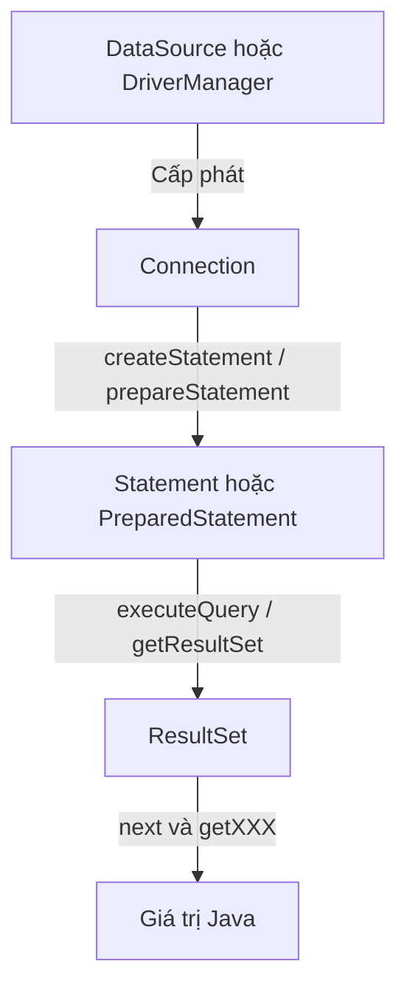
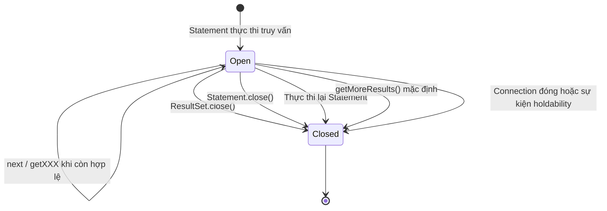

# Quản lý `ResultSet` khi `Statement` được thực thi lại hoặc đóng

## 1. Bài toán: đang đọc kết quả thì kết quả bỗng bị đóng

Trong ứng dụng Java truy cập cơ sở dữ liệu quan hệ qua **JDBC (Java Database Connectivity)**, một truy vấn `SELECT` thường trả về `ResultSet`. Lập trình viên gọi `next()` để đi qua các hàng và dùng `getLong()`, `getString()` hoặc những phương thức getter khác để lấy dữ liệu. Khi chỉ thực thi một truy vấn rồi đóng toàn bộ tài nguyên, vòng đời tương đối dễ hiểu. Tuy nhiên, khi ứng dụng **thực thi lại cùng `Statement`** hoặc đóng nó trong lúc vẫn giữ một `ResultSet`, các thao tác đọc tiếp có thể thất bại.

Ví dụ, một chương trình đang duyệt danh sách sản phẩm. Sau khi đọc sản phẩm đầu tiên, chương trình dùng chính `Statement` đó để chạy thêm một câu `SELECT` khác. Khi quay lại kết quả đầu tiên, lời gọi `resultSet.next()` có thể ném `SQLException` vì **kết quả cũ đã tự động bị đóng**. Đây là hành vi thuộc hợp đồng JDBC, không nhất thiết là lỗi của driver hay cơ sở dữ liệu.

Bài học này tập trung vào ba câu hỏi: **`ResultSet` thuộc về ai?**, **những thao tác nào khiến nó không còn hợp lệ?**, và **cách tổ chức mã an toàn khi phải thực thi nhiều truy vấn hoặc xử lý transaction**. Kiến thức này đặc biệt hữu ích trong repository, service, batch job và ứng dụng có connection pool.

## 2. Quan hệ sở hữu tài nguyên: `Connection` → `Statement` → `ResultSet`

Trong JDBC, ba đối tượng cơ bản thường được sử dụng theo thứ tự:



| Tài nguyên | Vai trò | Ai thường chịu trách nhiệm đóng? |
| --- | --- | --- |
| `Connection` | Phiên làm việc JDBC và ranh giới transaction. | Thành phần đã lấy kết nối, hoặc transaction manager/framework nếu được giao quản lý. |
| `Statement` / `PreparedStatement` | Thực thi SQL và tạo kết quả. | Thành phần tạo statement từ `Connection`. |
| `ResultSet` | Con trỏ và tập dữ liệu được trả về từ statement. | Thành phần nhận kết quả và sử dụng nó. |

`ResultSet` **không phải** bản sao độc lập của toàn bộ dữ liệu truy vấn. Driver có thể đã tải sẵn nhiều hàng, tải theo từng lô hoặc giữ một cursor phía máy chủ. Vì vậy, dữ liệu và khả năng truy cập kết quả vẫn phụ thuộc vòng đời của JDBC statement và đôi khi còn phụ thuộc transaction hoặc connection tương ứng.

Về nguyên tắc, **đóng `ResultSet` sớm nhất có thể**, **đóng `Statement` sau khi dùng xong các kết quả của nó**, rồi **đóng `Connection` khi hoàn thành công việc hoặc transaction**. Java hỗ trợ thực hiện đúng thứ tự bằng `try-with-resources`.

## 3. Những sự kiện khiến `ResultSet` bị đóng

Một `ResultSet` đang mở có thể chuyển sang trạng thái đóng qua nhiều đường khác nhau:

| Sự kiện | Điều xảy ra với `ResultSet` | Ý nghĩa cho mã Java |
| --- | --- | --- |
| Gọi `resultSet.close()` | Đóng `ResultSet` rõ ràng. | Không dùng lại `next()` hoặc `getXXX()` sau đó. |
| Gọi `statement.close()` | Đóng `ResultSet` hiện hành của statement; các kết quả phụ thuộc cũng không nên tiếp tục sử dụng. | Đóng statement chỉ sau khi đã xử lý xong kết quả. |
| **Thực thi lại cùng statement** bằng `executeQuery()`, `executeUpdate()`, `execute()` hoặc phương thức thực thi khác | Theo quy tắc mặc định, statement đóng `ResultSet` hiện hành trước khi xử lý kết quả mới. | Không xen kẽ việc đọc hai `ResultSet` bằng cách tái sử dụng cùng statement. |
| Di chuyển đến kết quả tiếp theo bằng `getMoreResults()` mặc định | Đóng `ResultSet` hiện hành khi chuyển sang kết quả tiếp theo. | Xử lý hoặc sao chép dữ liệu cần giữ trước khi chuyển. |
| Đóng `Connection` tạo statement | Kết nối cùng các tài nguyên JDBC gắn với nó hết hiệu lực sử dụng. | Không trả `ResultSet` ra ngoài phạm vi sống của connection. |
| `commit()` | Có thể đóng cursor theo **holdability** của `ResultSet`/connection. | Không giả định mọi cursor đều sống qua commit. |

Các tình huống trên khác với việc **đọc đến cuối tập kết quả**. Khi `next()` trả `false`, không còn hàng tiếp theo, nhưng kết quả chưa chắc đã tự động được đóng. Bạn vẫn cần `close()` hoặc bảo đảm khối `try-with-resources` đóng nó. Cũng không nên suy rằng một `ResultSet` đã hết hàng thì statement hoặc connection đã tự giải phóng đầy đủ tài nguyên.



Sơ đồ diễn giải vòng đời thông dụng, không mô tả mọi tùy chọn đặc biệt của API xử lý nhiều kết quả. Sau khi `ResultSet` đã đóng, lập trình viên phải coi nó là **không còn khả dụng**.

## 4. Thực thi lại cùng `Statement` sẽ làm gì với kết quả cũ?

Theo quy tắc mặc định của JDBC, **mỗi `Statement` chỉ có thể giữ một `ResultSet` hiện hành đang mở tại một thời điểm**. Vì thế, các phương thức thực thi của cùng `Statement` thường **đóng ngầm kết quả hiện hành** trước khi tạo kết quả tiếp theo.

Giả sử có bảng `products(id, name, price)` và các hàng dữ liệu phù hợp. Đoạn mã sau minh họa lỗi:

```java
import java.sql.Connection;
import java.sql.ResultSet;
import java.sql.SQLException;
import java.sql.Statement;
import javax.sql.DataSource;

public final class IncorrectResultSetReuse {
    public static void run(DataSource dataSource) throws SQLException {
        try (Connection connection = dataSource.getConnection();
             Statement statement = connection.createStatement()) {

            try (ResultSet first = statement.executeQuery(
                    "SELECT id, name FROM products ORDER BY id")) {
                if (first.next()) {
                    System.out.println(first.getString("name"));
                }

                // Cùng Statement: câu lệnh này đóng ngầm ResultSet `first`.
                try (ResultSet second = statement.executeQuery(
                        "SELECT COUNT(*) AS total FROM products")) {
                    if (second.next()) {
                        System.out.println("So san pham: " + second.getLong("total"));
                    }
                }

                // Sai: `first` đã đóng, nên thao tác này sẽ ném SQLException.
                first.next();
            }
        }
    }
}
```

Hãy chú ý đến thứ tự thực thi. Trước khi truy vấn đếm sản phẩm, `first` vẫn còn hợp lệ. Ngay khi `statement.executeQuery(...)` chạy lần thứ hai, statement không còn giữ kết quả đầu tiên. Việc đóng `second` **không khôi phục** `first`. `try-with-resources` sau cùng có thể gọi `first.close()` lần nữa, nhưng thao tác đóng một `ResultSet` đã đóng không khiến nó mở trở lại.

Điều này áp dụng tương tự cho `PreparedStatement`. Nếu đặt tham số mới rồi gọi `preparedStatement.executeQuery()` lần tiếp theo, `ResultSet` của lần thực thi trước **không còn được dùng tiếp**. Trạng thái cuộn con trỏ như `TYPE_SCROLL_INSENSITIVE` cũng không bảo vệ kết quả cũ khỏi việc statement được thực thi lại.

## 5. Cách đúng khi chỉ cần xử lý tuần tự từng kết quả

Nếu chỉ cần đọc kết quả thứ nhất rồi chạy kết quả thứ hai, cách đơn giản nhất là **hoàn thành và đóng kết quả đầu tiên trước khi thực thi lại statement**:

```java
try (Connection connection = dataSource.getConnection();
     Statement statement = connection.createStatement()) {

    try (ResultSet products = statement.executeQuery(
            "SELECT id, name FROM products ORDER BY id")) {
        while (products.next()) {
            System.out.println(products.getLong("id") + ": "
                    + products.getString("name"));
        }
    } // `products` đóng ở đây.

    try (ResultSet totals = statement.executeQuery(
            "SELECT COUNT(*) AS total FROM products")) {
        if (totals.next()) {
            System.out.println("Tong: " + totals.getLong("total"));
        }
    }
}
```

Nếu cần giữ dữ liệu đầu tiên để so sánh với dữ liệu thứ hai, bạn có thể **sao chép những giá trị cần thiết vào các biến hoặc đối tượng Java** khi kết quả thứ nhất còn mở. Sau đó đóng `ResultSet` thứ nhất, chạy truy vấn tiếp và xử lý dữ liệu đã lưu.

```java
long productId;
String productName;

try (ResultSet product = statement.executeQuery(
        "SELECT id, name FROM products WHERE id = 1")) {
    if (!product.next()) {
        throw new SQLException("Khong tim thay san pham");
    }
    productId = product.getLong("id");
    productName = product.getString("name");
}

try (ResultSet count = statement.executeQuery(
        "SELECT COUNT(*) AS total FROM products")) {
    if (count.next()) {
        System.out.printf("San pham %d (%s), tong=%d%n",
                productId, productName, count.getLong("total"));
    }
}
```

Đây là một đoạn minh họa đặt trong phương thức đã có `Statement statement` hợp lệ. Khi sao chép dữ liệu, hãy cân nhắc kích thước: lưu vài trường hoặc một danh sách ID thường đơn giản, nhưng **đọc hàng triệu hàng vào bộ nhớ chỉ để tránh dùng hai statement không phải giải pháp tốt**.

## 6. Cần giữ hai `ResultSet` đồng thời thì làm thế nào?

Trong các hệ quản trị và driver hỗ trợ cách dùng phù hợp, nếu cần xen kẽ đọc hai kết quả độc lập, hãy tạo **hai đối tượng `Statement` khác nhau** thay vì thực thi lại một statement:

```java
try (Connection connection = dataSource.getConnection();
     Statement firstStatement = connection.createStatement();
     Statement secondStatement = connection.createStatement()) {

    try (ResultSet first = firstStatement.executeQuery(
                    "SELECT id FROM products ORDER BY id");
         ResultSet second = secondStatement.executeQuery(
                    "SELECT id FROM categories ORDER BY id")) {

        if (first.next()) {
            System.out.println("Product: " + first.getLong("id"));
        }
        if (second.next()) {
            System.out.println("Category: " + second.getLong("id"));
        }
        if (first.next()) {
            System.out.println("Next product: " + first.getLong("id"));
        }
    }
}
```

Ví dụ giả định bảng `products` và `categories` tồn tại; mục đích là minh họa **hai statement sở hữu hai kết quả riêng**. Re-execute `secondStatement` sẽ không kích hoạt quy tắc JDBC tự động đóng kết quả hiện hành của `firstStatement`.

Tuy vậy, **không phải mọi driver hoặc chế độ lấy dữ liệu đều hỗ trợ truy vấn xen kẽ như nhau trên cùng kết nối vật lý**. Driver có thể đang stream dữ liệu từng hàng, dùng server-side cursor hoặc có giới hạn giao thức. Một số DBMS/driver yêu cầu đọc hết hoặc đóng một result stream trước khi gửi câu lệnh khác, kể cả khi có hai `Statement`. Hãy thử đúng cấu hình driver/DBMS hoặc xử lý tuần tự, tách connection phù hợp nếu thực sự cần truy vấn độc lập.

Trong trường hợp hai truy vấn phải thuộc **cùng transaction**, không tùy tiện chuyển mỗi truy vấn sang một `Connection` khác để tránh giới hạn kết quả: hai connection thường là hai phiên transaction riêng. Khi cần bảo đảm nhất quán, hãy chọn cơ chế được DBMS hỗ trợ và thiết kế ranh giới transaction có chủ đích.

## 7. `PreparedStatement` tái sử dụng được, còn `ResultSet` thì sao?

Một lợi ích của `PreparedStatement` là cho phép chuẩn bị câu SQL có tham số, thực thi nhiều lần với các giá trị khác nhau mà không phải tạo một prepared statement mới cho mỗi lượt. Nhưng **mỗi lần thực thi mới vẫn kết thúc vòng đời kết quả hiện hành trước đó**.

Ví dụ đọc tên từng sản phẩm theo một danh sách ID:

```java
import java.sql.Connection;
import java.sql.PreparedStatement;
import java.sql.ResultSet;
import java.sql.SQLException;
import java.util.List;
import javax.sql.DataSource;

public final class ProductLookup {
    private final DataSource dataSource;

    public ProductLookup(DataSource dataSource) {
        this.dataSource = dataSource;
    }

    public void printNames(List<Long> ids) throws SQLException {
        String sql = "SELECT name FROM products WHERE id = ?";

        try (Connection connection = dataSource.getConnection();
             PreparedStatement statement = connection.prepareStatement(sql)) {

            for (Long id : ids) {
                statement.setLong(1, id);

                try (ResultSet result = statement.executeQuery()) {
                    if (result.next()) {
                        System.out.println(result.getString("name"));
                    }
                } // Đóng kết quả trước lần executeQuery kế tiếp.
            }
        }
    }
}
```

Mã trên giả định danh sách ID và bảng dữ liệu hợp lệ. Nếu có `null` trong danh sách, cần kiểm tra trước khi truyền vào `setLong`. Cách truy vấn từng ID phù hợp để **minh họa vòng đời tài nguyên**; với danh sách ID lớn, nên cân nhắc truy vấn nhiều ID trong một lần, `JOIN` hoặc batch theo khả năng DBMS để giảm số lượt trao đổi mạng.

Bạn không cần đóng `PreparedStatement` sau từng `executeQuery` nếu còn muốn dùng nó cho lần truy vấn tiếp. Hãy đóng **kết quả của từng lần thực thi**, sau đó đóng prepared statement khi hoàn thành toàn bộ công việc.

## 8. `Statement.close()` và `Connection.close()` ảnh hưởng đến kết quả

Một `ResultSet` gắn với statement đã tạo ra nó. Khi đóng `Statement`, JDBC cũng đóng `ResultSet` hiện hành nếu có. Vì vậy không thể viết một phương thức tạo statement cục bộ, đóng statement rồi **trả `ResultSet` ra cho caller dùng sau**.

Ví dụ thiết kế sai:

```java
// Sai: ResultSet trả về phụ thuộc Statement đã bị đóng.
public ResultSet fetchRows(Connection connection) throws SQLException {
    try (Statement statement = connection.createStatement()) {
        return statement.executeQuery("SELECT id FROM products");
    }
}
```

Khi method `fetchRows` kết thúc, khối `try-with-resources` đóng statement, khiến kết quả trả về đã bị đóng. Nếu cả `Connection` cũng được đóng trong phương thức, kết quả càng không thể sử dụng hợp lệ.

**Thiết kế thích hợp:** trả về các đối tượng dữ liệu độc lập, hoặc truyền một callback/mapper để **đọc `ResultSet` khi statement vẫn mở**. Ví dụ ánh xạ sang `List`:

```java
import java.sql.Connection;
import java.sql.PreparedStatement;
import java.sql.ResultSet;
import java.sql.SQLException;
import java.util.ArrayList;
import java.util.List;
import javax.sql.DataSource;

public final class ProductIdRepository {
    private final DataSource dataSource;

    public ProductIdRepository(DataSource dataSource) {
        this.dataSource = dataSource;
    }

    public List<Long> findIdsWithStock() throws SQLException {
        String sql = "SELECT id FROM products WHERE stock > 0 ORDER BY id";
        List<Long> ids = new ArrayList<>();

        try (Connection connection = dataSource.getConnection();
             PreparedStatement statement = connection.prepareStatement(sql);
             ResultSet result = statement.executeQuery()) {

            while (result.next()) {
                ids.add(result.getLong("id"));
            }
        }

        return ids; // Dữ liệu Java, không phụ thuộc ResultSet đã đóng.
    }
}
```

Ví dụ này phù hợp nếu lượng ID ở mức kiểm soát được. Với dữ liệu lớn, nên trả dữ liệu theo trang, cursor có vòng đời được quản lý rõ ràng hoặc một cơ chế stream **ràng buộc việc đóng tài nguyên với vòng đời consumer**. Không trả `Stream` lazy dựa trên `ResultSet` đã đóng trước khi stream được tiêu thụ.

Khi dùng connection pool, `Connection.close()` có thể là thao tác trả handle về pool thay vì đóng kết nối vật lý ngay. Dù vậy, code ứng dụng **không được tiếp tục sử dụng** `Statement` hoặc `ResultSet` gắn với handle đã đóng; kết quả không trở nên độc lập chỉ vì kết nối vật lý có thể được tái sử dụng.

## 9. Vì sao `try-with-resources` là cách quản lý được ưu tiên?

`Connection`, `Statement` và `ResultSet` đều triển khai `AutoCloseable`, nên Java có thể tự đóng chúng khi rời khối `try`, kể cả nếu có ngoại lệ hoặc `return`. Các tài nguyên được đóng theo **thứ tự ngược với thứ tự khai báo**.

```java
try (Connection connection = dataSource.getConnection();
     PreparedStatement statement = connection.prepareStatement(sql);
     ResultSet result = statement.executeQuery()) {
    while (result.next()) {
        // Xử lý từng hàng.
    }
} // Đóng ResultSet, rồi PreparedStatement, cuối cùng Connection.
```

Trên thực tế, việc đóng `Statement` đã đóng luôn kết quả hiện hành, nhưng **khai báo `ResultSet` rõ ràng** vẫn giúp biểu thị quyền sở hữu tài nguyên, đóng sớm hơn khi cần và dễ kiểm soát trường hợp có nhiều kết quả. Đóng cùng một tài nguyên đã đóng không đồng nghĩa có thể sử dụng lại tài nguyên đó.

Trong `try-with-resources`, nếu phần xử lý ném `SQLException` rồi một thao tác `close()` cũng ném lỗi, ngoại lệ từ lúc đóng thường được ghi thành **suppressed exception** trên lỗi chính. Có thể kiểm tra bằng `Throwable.getSuppressed()` để chẩn đoán; không nên dùng `finally` viết không cẩn thận khiến lỗi khi đóng che mất lỗi truy vấn ban đầu.

```java
try (Connection connection = dataSource.getConnection();
     PreparedStatement statement = connection.prepareStatement(sql)) {

    statement.setLong(1, productId);
    try (ResultSet result = statement.executeQuery()) {
        // Có thể xử lý và return ngay ở đây; tài nguyên vẫn được đóng.
    }
}
```

Ở những đoạn mã trên, giả sử các biến `dataSource`, `sql` và `productId` đã được khai báo trong phạm vi phù hợp. Quan trọng là bảo đảm `ResultSet` **không tồn tại lâu hơn statement hoặc connection** mà nó phụ thuộc.

## 10. Trường hợp đặc biệt: một lệnh SQL trả về nhiều kết quả

Một số driver và DBMS có thể trả về nhiều kết quả từ một lần gọi `Statement.execute(...)`, ví dụ các result set và update count liên tiếp từ stored procedure hoặc lệnh được DBMS hỗ trợ. Khi đó, ứng dụng có thể dùng `getResultSet()`, `getUpdateCount()` và `getMoreResults()` để duyệt từng kết quả.

**Mặc định, `getMoreResults()` đóng `ResultSet` hiện hành**. Cách duyệt tuần tự dưới đây đóng rõ ràng mỗi `ResultSet` trước khi chuyển sang kết quả kế tiếp:

```java
boolean hasResultSet = statement.execute(sql);

while (true) {
    if (hasResultSet) {
        try (ResultSet result = statement.getResultSet()) {
            while (result.next()) {
                // Xử lý một ResultSet của lần execute này.
            }
        }
    } else {
        int updateCount = statement.getUpdateCount();
        if (updateCount == -1) {
            break; // Không còn kết quả hoặc update count nào.
        }
        System.out.println("So hang anh huong: " + updateCount);
    }

    hasResultSet = statement.getMoreResults();
}
```

Đoạn này đặt trong ngữ cảnh có `Statement statement` và `String sql` hợp lệ. `getMoreResults()` trả `false` **không nhất thiết** có nghĩa là đã hết mọi kết quả: kết quả tiếp theo có thể là **update count**. Đó là lý do vòng lặp cần kiểm tra thêm `getUpdateCount() == -1` để kết luận đã hết dữ liệu.

### Có thể giữ nhiều `ResultSet` từ cùng một lần `execute()` không?

JDBC còn có overload:

```java
statement.getMoreResults(Statement.KEEP_CURRENT_RESULT);
```

với các giá trị điều khiển như:

| Hằng số | Ý nghĩa khi chuyển sang kết quả tiếp theo |
| --- | --- |
| `Statement.CLOSE_CURRENT_RESULT` | Đóng kết quả hiện hành. |
| `Statement.KEEP_CURRENT_RESULT` | Yêu cầu giữ mở kết quả hiện hành. |
| `Statement.CLOSE_ALL_RESULTS` | Đóng các kết quả đã mở của statement. |

**Khả năng giữ nhiều kết quả cùng lúc phụ thuộc driver/DBMS.** Kiểm tra `DatabaseMetaData.supportsMultipleOpenResults()` trước khi thiết kế theo kiểu này, và vẫn phải quản lý đóng mọi kết quả đã giữ. `KEEP_CURRENT_RESULT` là tình huống đặc biệt của **chuỗi nhiều kết quả từ một lần thực thi**, không nên dùng như một cách tùy tiện để giữ kết quả sau khi gọi `executeQuery()` lại với câu SQL mới.

## 11. `closeOnCompletion()` là gì?

Từ JDBC 4.1, `Statement` có cơ chế **đóng statement khi tất cả các `ResultSet` phụ thuộc đã được đóng**, thông qua:

```java
statement.closeOnCompletion();
```

Đây là lựa chọn **opt-in**. Nó hữu ích trong một số thiết kế bàn giao quyền đọc `ResultSet`: khi consumer đóng hết kết quả phụ thuộc, statement có thể tự đóng mà không cần lời gọi `close()` riêng ở đúng vị trí. Tuy nhiên, khi đã bật chế độ này, đóng kết quả có thể khiến **statement không còn dùng được cho lần thực thi kế tiếp**. Vì vậy, nếu mục tiêu là tái sử dụng `PreparedStatement` trong vòng lặp, hãy quản lý statement bằng `try-with-resources` thông thường và **đừng bật `closeOnCompletion()` mà không tính đến vòng đời đó**.

Có thể kiểm tra trạng thái một đối tượng bằng `statement.isClosed()` hoặc `resultSet.isClosed()` khi driver hỗ trợ các API tương ứng. Nhưng việc kiểm tra `isClosed() == false` ở một thời điểm **không thay thế quyền sở hữu và thứ tự đóng tài nguyên**: câu lệnh tiếp theo hoặc thread khác vẫn có thể làm kết quả trở nên không hợp lệ. Mã ứng dụng cũng không nên chia sẻ `Statement` hoặc `ResultSet` giữa các thread nếu không có bảo đảm và đồng bộ được thiết kế rõ ràng.

## 12. `commit()` và holdability: khác với việc thực thi lại statement

JDBC có khái niệm **result set holdability**: kết quả có thể được giữ qua `commit()` hay phải đóng khi commit. Hai hằng số liên quan là:

| Holdability | Ý nghĩa |
| --- | --- |
| `ResultSet.HOLD_CURSORS_OVER_COMMIT` | Kết quả có thể giữ mở qua commit nếu DBMS/driver hỗ trợ chế độ đó. |
| `ResultSet.CLOSE_CURSORS_AT_COMMIT` | Kết quả bị đóng khi transaction commit. |

Có thể kiểm tra khả năng hỗ trợ của driver bằng `DatabaseMetaData.supportsResultSetHoldability(...)` và trạng thái hiện tại qua `connection.getHoldability()`. Một số cách tạo statement còn cho phép chỉ định holdability khi tạo, nếu được triển khai hỗ trợ.

```java
import java.sql.Connection;
import java.sql.ResultSet;
import java.sql.SQLException;

public final class HoldabilityInspector {
    public static void inspect(Connection connection) throws SQLException {
        int current = connection.getHoldability();
        System.out.println(current == ResultSet.HOLD_CURSORS_OVER_COMMIT
                ? "Cursor co the duoc giu qua commit"
                : "Cursor dong khi commit theo holdability hien tai");

        boolean supported = connection.getMetaData().supportsResultSetHoldability(
                ResultSet.HOLD_CURSORS_OVER_COMMIT);
        System.out.println("Ho tro HOLD_CURSORS_OVER_COMMIT: " + supported);
    }
}
```

**Holdability chỉ nói về hành vi liên quan đến `commit()`; nó không có nghĩa `ResultSet` sẽ sống qua `Statement.close()` hoặc việc thực thi lại cùng statement.** Ngay cả ở chế độ giữ cursor qua commit, bạn vẫn phải đóng kết quả sau khi xử lý xong. Hành vi chính xác có thể phụ thuộc DBMS, driver và loại `ResultSet`.

Đừng phụ thuộc vào cursor kéo dài qua nhiều transaction nếu nghiệp vụ không thật sự yêu cầu. Cursor và transaction mở lâu có thể giữ tài nguyên phía máy chủ, cản trở dọn dữ liệu hoặc gây khó khăn khi kết nối bị gián đoạn. Với khối dữ liệu lớn, nên thiết kế việc đọc theo trang hoặc theo luồng rõ ràng.

## 13. Kết quả lớn, streaming và connection pool

Đối với truy vấn nhiều hàng, một số driver có thể lấy dữ liệu dần thay vì đưa toàn bộ kết quả vào bộ nhớ Java. Các API như `Statement.setFetchSize(...)` là **gợi ý** để driver điều chỉnh số hàng lấy mỗi lần, nhưng hiệu quả và điều kiện bật streaming phụ thuộc driver/DBMS. Trong một số cấu hình, driver cần transaction hoặc kiểu cursor nhất định để stream.

Trong trường hợp đó, việc **thực thi lại statement hoặc đóng statement** khi chưa đọc hết kết quả có thể khiến dữ liệu đang được stream không còn truy cập được. Một kết quả đang mở cũng có thể giữ tài nguyên mạng, cursor và connection trong pool lâu hơn dự kiến.

Ví dụ xử lý theo dòng trong phạm vi quản lý kết nối:

```java
import java.sql.Connection;
import java.sql.PreparedStatement;
import java.sql.ResultSet;
import java.sql.SQLException;
import javax.sql.DataSource;

public final class ReportExporter {
    public static void export(DataSource dataSource) throws SQLException {
        String sql = "SELECT id, name FROM products ORDER BY id";

        try (Connection connection = dataSource.getConnection();
             PreparedStatement statement = connection.prepareStatement(sql)) {
            statement.setFetchSize(500); // Gợi ý; hành vi phụ thuộc driver.

            try (ResultSet result = statement.executeQuery()) {
                while (result.next()) {
                    long id = result.getLong("id");
                    String name = result.getString("name");
                    // Ghi id/name sang sink theo từng hàng, không giữ ResultSet ngoài try.
                }
            }
        }
    }
}
```

Ví dụ không giả định driver nhất định sẽ stream 500 hàng mỗi lần. Nếu ghi ra file/mạng chậm trong vòng lặp, connection có thể bị giữ rất lâu; cần đo tải thực tế và cân nhắc batch, phân trang có khóa sắp xếp ổn định, hoặc quy trình xuất dữ liệu chuyên dụng. Dù có connection pool, **`close()` đúng hạn vẫn là trách nhiệm quan trọng nhất**.

## 14. Chẩn đoán lỗi và tránh rò rỉ tài nguyên

Khi dùng một `ResultSet` đã đóng, nhiều driver sẽ ném `SQLException` với thông báo như `ResultSet is closed`. Nội dung thông báo, SQLState và mã lỗi phụ thuộc triển khai, vì vậy không nên dựa vào một chuỗi thông báo cụ thể để viết logic nghiệp vụ.

Những điểm cần kiểm tra theo thứ tự:

1. `ResultSet` có được tạo từ **cùng `Statement`** vừa được tái thực thi không?
2. Có câu `statement.close()` hoặc khối `try-with-resources` kết thúc **trước khi consumer đọc xong** không?
3. Có phương thức trả về `ResultSet` ra ngoài phạm vi sống của `Statement`/`Connection` không?
4. Có gọi `getMoreResults()` và vô tình đóng kết quả hiện hành không?
5. Có transaction `commit()` trong khi holdability yêu cầu đóng cursor không?
6. Có framework hoặc pool đã đóng connection theo lifecycle riêng không?

| Lỗi thiết kế | Dấu hiệu | Cách sửa |
| --- | --- | --- |
| Tái sử dụng `Statement` giữa lúc đang duyệt | `next()` hoặc `getXXX()` trên kết quả cũ thất bại. | Xử lý kết quả cũ trước, hoặc dùng statement khác nếu driver cho phép. |
| Trả `ResultSet` từ phương thức đã đóng statement | Caller nhận kết quả không còn hợp lệ. | Ánh xạ dữ liệu ngay trong scope, trả DTO/List hoặc dùng callback. |
| Bỏ quên `ResultSet.close()` | Cursor/tài nguyên DB có thể bị giữ lâu. | Khai báo `ResultSet` trong `try-with-resources`. |
| Bỏ quên `Connection.close()` | Pool có thể cạn do kết nối không được trả. | Đóng connection hoặc để framework quản lý theo hợp đồng rõ ràng. |
| Bật `closeOnCompletion()` rồi muốn tái thực thi | Statement bị đóng khi kết quả cuối cùng được đóng. | Dùng `try-with-resources` thông thường nếu cần tái sử dụng statement. |
| Giữ cursor qua transaction không phù hợp | Kết quả đóng khi commit hoặc giữ tài nguyên quá lâu. | Kiểm tra holdability, transaction và thiết kế đọc dữ liệu. |

**Không nên tự động sửa lỗi bằng cách bắt `SQLException` rồi thực thi lại truy vấn**. Nếu dữ liệu đã thay đổi hoặc transaction đang ở trạng thái khác, kết quả mới có thể khác dữ liệu cũ. Hãy sửa đúng vấn đề vòng đời tài nguyên và quyết định rõ khi nào cần truy vấn lại.

## 15. Bài tập và câu hỏi tự kiểm tra

### Bài tập 1: tìm và sửa lỗi khi tái thực thi

Đoạn mã sau có lỗi vòng đời:

```java
ResultSet users = statement.executeQuery("SELECT id FROM users");
while (users.next()) {
    long userId = users.getLong("id");
    ResultSet orders = statement.executeQuery(
            "SELECT id FROM orders WHERE user_id = " + userId);
    // Duyệt orders...
}
```

Hãy giải thích vì sao vòng lặp ngoài hỏng sau lần thực thi thứ hai, rồi sửa theo hai cách: (1) dùng hai `PreparedStatement` riêng và bind `userId` bằng dấu `?`, nếu driver cho phép hai kết quả mở đồng thời; (2) hoàn thành việc đọc ID người dùng vào một danh sách với kích thước kiểm soát được rồi truy vấn đơn hàng sau khi đã đóng kết quả người dùng. Với dữ liệu rất lớn, cân nhắc `JOIN` thay vì truy vấn từng người dùng.

### Bài tập 2: kiểm tra kết quả còn mở

Viết chương trình thử trên database riêng với hai câu SQL đơn giản. Tạo một `Statement`, gọi `executeQuery()` lần đầu, lưu lại `ResultSet`, rồi gọi `executeQuery()` lần hai. Quan sát `first.isClosed()` và việc gọi `first.next()` trong khối bắt `SQLException`. Sau đó sửa chương trình để đóng kết quả đầu tiên trước khi truy vấn tiếp và dùng `try-with-resources` cho toàn bộ tài nguyên.

### Câu hỏi tự kiểm tra

1. **Một `Statement` có thể mặc định giữ hai `ResultSet` độc lập sau hai lần `executeQuery()` không?** Không. Lần thực thi mới đóng kết quả hiện hành của statement theo quy tắc mặc định.
2. **Nếu `ResultSet.next()` trả `false`, kết quả đã tự đóng chưa?** Không được giả định như vậy. Vẫn phải đóng kết quả đúng cách.
3. **Đóng `Statement` rồi trả `ResultSet` cho caller có hợp lệ không?** Không, vì `ResultSet` phụ thuộc vào statement đã bị đóng.
4. **Khi dùng connection pool, đóng connection logic có làm kết quả trở nên độc lập không?** Không. Các tài nguyên JDBC thuộc connection đó hết khả năng sử dụng hợp lệ theo vòng đời của handle.
5. **`getMoreResults()` trả `false` có chắc là hết mọi kết quả không?** Chưa chắc: cần kiểm tra `getUpdateCount()`, vì kết quả tiếp theo có thể là update count.
6. **`HOLD_CURSORS_OVER_COMMIT` có giữ `ResultSet` qua `statement.close()` không?** Không. Holdability liên quan đến `commit()`, không bỏ qua quy tắc đóng statement.
7. **Có nên bật `closeOnCompletion()` khi muốn tái sử dụng `PreparedStatement` qua nhiều lượt?** Thường không. Cơ chế này có thể đóng statement khi tất cả kết quả phụ thuộc được đóng, làm lần thực thi sau thất bại.

Điểm cốt lõi của vòng đời JDBC là: **`ResultSet` gắn với statement tạo ra nó; thực thi lại hoặc đóng statement làm kết quả hiện hành không còn dùng được**. Hãy để việc mở, đọc và đóng kết quả diễn ra trong một phạm vi rõ ràng, tránh chuyển `ResultSet` ra ngoài phạm vi của kết nối và chọn cách xử lý nhiều kết quả phù hợp với driver thực tế.
