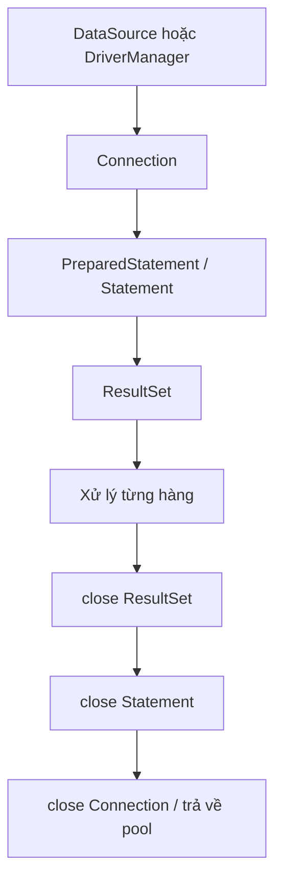
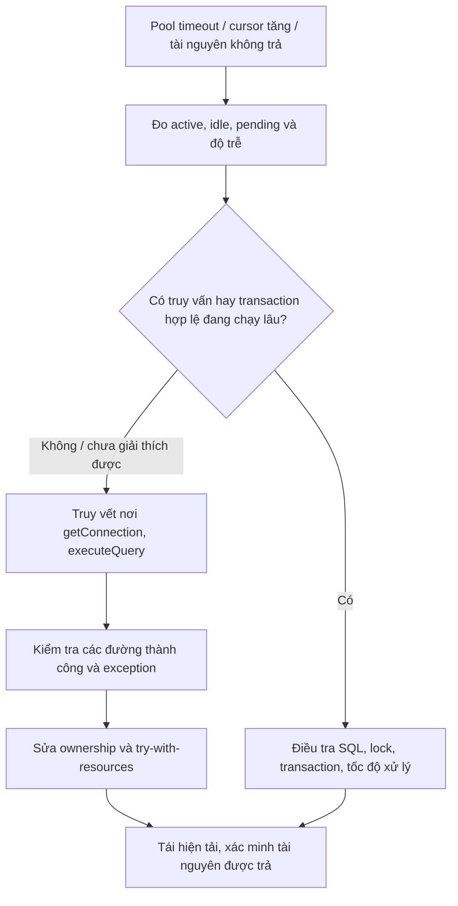

# Phát hiện rò rỉ kết nối, câu lệnh và tập kết quả trong JDBC

## 1. Rò rỉ tài nguyên JDBC là gì?

JDBC (Java Database Connectivity) cung cấp API chuẩn của Java để truy cập cơ sở dữ liệu quan hệ. Mỗi yêu cầu SQL có thể sử dụng nhiều tài nguyên ở ứng dụng, driver JDBC và hệ quản trị cơ sở dữ liệu (DBMS): kết nối mạng, phiên làm việc, statement, cursor, bộ đệm dữ liệu hoặc trạng thái giao dịch.

**Rò rỉ tài nguyên JDBC** xảy ra khi ứng dụng đã sử dụng xong một tài nguyên nhưng không đóng hoặc trả nó về đúng nơi quản lý. Những tài nguyên quan trọng nhất cần theo dõi là:

- **`Connection`:** đại diện cho một phiên truy cập cơ sở dữ liệu. Kết nối mở trực tiếp thường giữ socket và phiên DBMS; kết nối lấy từ pool là một lượt *mượn* tài nguyên cần được trả lại.
- **`Statement`, `PreparedStatement`, `CallableStatement`:** đại diện cho đối tượng thực thi SQL. Driver/DBMS có thể giữ trạng thái hoặc tài nguyên khi statement còn mở.
- **`ResultSet`:** đại diện cho các hàng do truy vấn trả về. Tùy driver, nó có thể liên quan đến cursor phía máy chủ, bộ đệm và tài nguyên cần giải phóng khi đã đọc xong.

Một phương thức Java kết thúc không đồng nghĩa mọi tài nguyên do phương thức đó mượn đã được đóng. Garbage collector chủ yếu quản lý bộ nhớ Java; **không nên dựa vào GC, finalizer hoặc thời điểm thu gom rác để giải phóng tài nguyên JDBC**. Vòng đời tài nguyên cần được quản lý chủ động.

Ví dụ một API có thể hoạt động bình thường khi ít người truy cập, nhưng sau vài giờ xuất hiện lỗi hết kết nối: nếu mỗi request mượn một connection từ pool rồi quên gọi `close()`, các kết nối sẽ dần không còn sẵn cho request mới.

## 2. Chuỗi tài nguyên và quan hệ đóng

Thông thường, ứng dụng mở kết nối, tạo statement, chạy SQL và nhận `ResultSet`. Mỗi đối tượng có phạm vi sử dụng riêng:



**Quy tắc tổng quát:** tài nguyên được tạo sau thường nên được đóng trước. Java hỗ trợ quy tắc này bằng `try-with-resources`; các biến resource được tự động đóng theo **thứ tự ngược với thứ tự khai báo**.

Một số hành vi trong JDBC giúp giải phóng tài nguyên liên quan:

| Hành động | Ý nghĩa theo JDBC |
| --- | --- |
| `ResultSet.close()` | Giải phóng tài nguyên gắn với tập kết quả đó khi không còn dùng |
| `Statement.close()` | Giải phóng tài nguyên của statement; các `ResultSet` hiện tại do nó tạo ra cũng được đóng |
| Thực thi một SQL mới trên cùng `Statement` | Thông thường `ResultSet` hiện tại của statement sẽ bị đóng; không phù hợp nếu vẫn cần đọc nó |
| `Connection.close()` | Giải phóng tài nguyên JDBC của kết nối; với pool thường trả lượt mượn về pool |
| `commit()` / `rollback()` | Kết thúc giao dịch; **không thay thế** việc đóng các handle JDBC đang sử dụng |

Mặc dù việc đóng statement hoặc connection có thể làm các resource bên dưới được đóng, **vẫn nên đóng rõ ràng từng `ResultSet`, `Statement` và `Connection` mà mã đang sở hữu**. Điều này làm vòng đời dễ đọc, giải phóng tài nguyên sớm hơn và giảm phụ thuộc vào những chi tiết cụ thể của driver.

## 3. Phân biệt rò rỉ thật với tài nguyên đang được sử dụng hợp lệ

Không phải mọi connection đang mở đều là rò rỉ. Hệ thống có thể giữ nhiều kết nối **idle trong pool** để tái sử dụng, hoặc có truy vấn dài thực sự đang chạy. Cần phân biệt:

| Tình huống | Có phải rò rỉ? | Lý do |
| --- | --- | --- |
| Pool có 10 kết nối rảnh, có thể phục vụ request | Không nhất thiết | Đây có thể là số connection vật lý được pool giữ theo cấu hình |
| Một request đang xử lý SQL chậm và vẫn mượn connection | Chưa thể kết luận | Có thể là công việc hợp lệ, truy vấn chậm hoặc transaction giữ quá lâu |
| Method đã return nhưng vẫn giữ connection đã mượn mà không còn người sở hữu | Thường là có | Không có đường đóng/trả lại tài nguyên rõ ràng |
| Request ném exception trước khi gọi `connection.close()` | Có nguy cơ cao | Nhánh lỗi có thể bỏ qua thao tác đóng |
| Duyệt một `ResultSet` lớn trong nhiều phút | Chưa thể kết luận | Có thể là streaming hợp lệ nhưng cần theo dõi thời gian giữ cursor |
| Mỗi lần gọi API làm số connection được mượn tăng, không giảm khi request kết thúc | Dấu hiệu mạnh | Cần kiểm tra đường acquire/release và hoạt động thực tế |

Các dấu hiệu dưới đây là **triệu chứng**, không phải bằng chứng duy nhất của leak:

- Request chờ lấy connection từ pool, sau đó timeout dù DBMS chưa hẳn đạt giới hạn kết nối vật lý.
- Số connection đang được mượn (*active/in-use*) tăng dần và không trở về mức thông thường sau khi tải giảm.
- Số phiên/cursor/statement mở ở DBMS tăng bất thường, nếu hệ quản trị hỗ trợ quan sát các chỉ số này.
- Bộ nhớ driver hoặc tài nguyên phía DBMS tăng theo thời gian; ứng dụng có hiện tượng GC nhiều hoặc truy vấn mới chậm.
- Khi restart ứng dụng, triệu chứng tạm biến mất rồi tái xuất hiện sau lượng request tương đương.

Ngược lại, một pool được cấu hình giữ sẵn nhiều kết nối vật lý không nhất thiết có vấn đề, vì số **kết nối vật lý đang mở** khác với số **lượt mượn chưa trả**.

## 4. Mẫu gây rò rỉ `Connection` thường gặp

### 4.1. Bỏ qua `close()` trên đường thành công

Đoạn mã sau mượn một connection mới mỗi lần gọi và không trả lại:

```java
// VÍ DỤ SAI: không đóng connection được lấy từ DataSource.
public int countOrders(DataSource dataSource) throws SQLException {
    Connection connection = dataSource.getConnection();
    try (PreparedStatement statement = connection.prepareStatement(
            "SELECT COUNT(*) FROM orders");
         ResultSet rows = statement.executeQuery()) {
        rows.next();
        return rows.getInt(1);
    }
}
```

`PreparedStatement` và `ResultSet` đã được đóng tự động, nhưng **`Connection` không nằm trong resource list**, nên vẫn được giữ sau khi method return. Nếu sử dụng connection pool, mỗi request có thể tiêu thụ thêm một lượt mượn.

Cách sửa: đưa connection vào `try-with-resources` để nó được trả lại trên cả đường thành công và đường ném exception:

```java
import java.sql.Connection;
import java.sql.PreparedStatement;
import java.sql.ResultSet;
import java.sql.SQLException;
import javax.sql.DataSource;

public class OrderCounter {
    public static int countOrders(DataSource dataSource)
            throws SQLException {
        String sql = "SELECT COUNT(*) FROM orders";

        try (Connection connection = dataSource.getConnection();
             PreparedStatement statement = connection.prepareStatement(sql);
             ResultSet rows = statement.executeQuery()) {
            if (!rows.next()) {
                throw new SQLException("Truy vấn COUNT không trả về hàng");
            }
            return rows.getInt(1);
        }
    }
}
```

Khi kết thúc block, Java lần lượt gọi `rows.close()`, `statement.close()`, rồi `connection.close()`. Nếu mã trong block ném exception, các lời gọi đóng vẫn được thử thực hiện.

### 4.2. Chỉ đóng ở đường thành công, quên nhánh lỗi

```java
// VÍ DỤ SAI: một SQLException có thể bỏ qua close().
Connection connection = dataSource.getConnection();
PreparedStatement statement = connection.prepareStatement(sql);
statement.executeUpdate();
statement.close();
connection.close();
```

Nếu `prepareStatement()` hoặc `executeUpdate()` ném lỗi, các dòng `close()` phía dưới sẽ không được thực thi. `try-with-resources` là giải pháp cơ bản. Với code legacy bắt buộc dùng `finally`, cần đóng từng resource trong các nhánh an toàn và không để lỗi đóng resource thứ nhất ngăn việc đóng những resource còn lại.

## 5. Rò rỉ `Statement` và `PreparedStatement`

Khi một service dùng chung connection do tầng trên quản lý, nó vẫn có trách nhiệm đóng những statement do chính nó tạo:

```java
// VÍ DỤ SAI: không đóng statement.
public void updateStatus(Connection connection, long id)
        throws SQLException {
    PreparedStatement statement = connection.prepareStatement(
        "UPDATE orders SET status = ? WHERE id = ?");
    statement.setString(1, "DONE");
    statement.setLong(2, id);
    statement.executeUpdate();
}
```

Nếu service chạy nhiều lần trong một giao dịch dài hoặc trên connection tồn tại lâu, statement có thể tích tụ tài nguyên trước khi connection được đóng.

Sửa bằng cách **đóng statement tại nơi tạo** mà vẫn giữ nguyên quyền sở hữu connection của tầng gọi:

```java
public void updateStatus(Connection connection, long id)
        throws SQLException {
    String sql = "UPDATE orders SET status = ? WHERE id = ?";

    try (PreparedStatement statement = connection.prepareStatement(sql)) {
        statement.setString(1, "DONE");
        statement.setLong(2, id);
        statement.executeUpdate();
    }
}
```

Trong ví dụ này, service **không đóng `connection`** vì connection được truyền vào từ caller. Caller hoặc transaction manager phải quyết định khi nào đóng/trả connection về pool. Đây là phân chia ownership quan trọng: một lớp chỉ đóng tài nguyên mà nó sở hữu, tránh để repository đóng nhầm transaction đang được dùng ở lớp trên.

Các lỗi thường gặp khác:

- Tạo statement trong vòng lặp nhưng chỉ đóng statement cuối cùng; mỗi vòng lặp cần vòng đời rõ ràng.
- Không đóng statement khi thoát sớm bằng `return`, `break` hoặc exception.
- Giữ statement trong singleton/service dùng chung cho các request; JDBC statement không được mặc định là an toàn để dùng đồng thời từ nhiều luồng.
- Nhầm việc đóng `ResultSet` với việc statement đã được đóng; hai tài nguyên có vòng đời riêng.

## 6. Rò rỉ `ResultSet` và cursor

Một `ResultSet` có thể gắn với cursor và bộ đệm phía driver/DBMS. Nếu mã chỉ đọc vài hàng rồi bỏ tham chiếu mà không đóng `ResultSet`, tài nguyên liên quan có thể tồn tại lâu hơn mong muốn.

Ví dụ có rủi ro:

```java
// VÍ DỤ SAI: ResultSet không được đóng rõ ràng.
PreparedStatement statement =
        connection.prepareStatement("SELECT id FROM orders");
ResultSet rows = statement.executeQuery();
if (rows.next()) {
    System.out.println(rows.getLong("id"));
}
// Không có close() cho rows hoặc statement.
```

Sửa bằng resource lồng nhau để xử lý `ResultSet` ngay sau khi dùng:

```java
String sql = "SELECT id FROM orders ORDER BY id";
try (PreparedStatement statement = connection.prepareStatement(sql);
     ResultSet rows = statement.executeQuery()) {
    while (rows.next()) {
        long id = rows.getLong("id");
        processOrder(id);
    }
}
```

Trong ví dụ, `processOrder(long)` đại diện cho xử lý nghiệp vụ do ứng dụng định nghĩa. Connection vẫn thuộc sở hữu caller và không bị đóng ở block này.

**Lưu ý:** JDBC quy định việc đóng `Statement` sẽ đóng `ResultSet` hiện tại mà statement đó tạo ra. Tuy nhiên, điều này không phải lý do bỏ qua việc quản lý `ResultSet`: đóng ngay khi không còn dùng giúp rút ngắn thời gian giữ cursor và làm rõ phạm vi tài nguyên.

### 6.1. Không trả một `ResultSet` sống ra khỏi phạm vi đã đóng statement

Một lỗi ngược lại với rò rỉ là **đóng quá sớm**:

```java
// VÍ DỤ SAI: ResultSet được return nhưng statement đã bị đóng.
public ResultSet findOrders(Connection connection) throws SQLException {
    try (PreparedStatement statement = connection.prepareStatement(
            "SELECT id FROM orders")) {
        return statement.executeQuery();
    }
}
```

Khi rời block, `statement.close()` sẽ đóng `ResultSet`. Caller nhận một đối tượng không còn dùng được. Nếu muốn truyền dữ liệu qua ranh giới service, hãy ánh xạ hàng thành DTO/record hoặc callback xử lý trong phạm vi đang mở; không truyền một `ResultSet` sống cho lớp khác mà không xác định rõ ownership của statement và connection.

## 7. `try-with-resources`: Biện pháp phòng ngừa quan trọng nhất

Trong Java, các tài nguyên triển khai `AutoCloseable` có thể được khai báo trong `try-with-resources`. `Connection`, `Statement` và `ResultSet` đều thỏa điều kiện này.

Ví dụ có đầy đủ vòng đời:

```java
import java.sql.Connection;
import java.sql.PreparedStatement;
import java.sql.ResultSet;
import java.sql.SQLException;
import javax.sql.DataSource;

public class CustomerLookup {
    private final DataSource dataSource;

    public CustomerLookup(DataSource dataSource) {
        this.dataSource = dataSource;
    }

    public String findEmail(long customerId) throws SQLException {
        String sql = "SELECT email FROM customers WHERE id = ?";

        try (Connection connection = dataSource.getConnection();
             PreparedStatement statement = connection.prepareStatement(sql)) {
            statement.setLong(1, customerId);

            try (ResultSet rows = statement.executeQuery()) {
                if (!rows.next()) {
                    return null;
                }
                return rows.getString("email");
            }
        }
    }
}
```

Các đặc điểm an toàn:

1. Kết nối được đóng ngay cả khi không có khách hàng tương ứng và code `return null` sớm.
2. Nếu `prepareStatement` hoặc `executeQuery` ném `SQLException`, những resource đã được tạo trước vẫn được đóng.
3. `ResultSet` được đóng trước `PreparedStatement` và `Connection`.
4. Mỗi lần gọi phương thức sở hữu một lượt mượn connection độc lập; không lưu connection trong field của singleton.

### 7.1. Nếu vừa xử lý SQL lỗi vừa đóng tài nguyên lỗi thì sao?

Java giữ exception xảy ra trong thân `try` làm lỗi chính và lưu các lỗi trong quá trình đóng resource dưới dạng **suppressed exceptions**. Có thể xem bằng `Throwable.getSuppressed()`:

```java
try (Connection connection = dataSource.getConnection();
     PreparedStatement statement = connection.prepareStatement(sql)) {
    statement.executeUpdate();
} catch (SQLException error) {
    System.err.println("Lỗi chính: " + error.getMessage());
    for (Throwable suppressed : error.getSuppressed()) {
        System.err.println("Lỗi khi đóng tài nguyên: "
                + suppressed.getMessage());
    }
    throw error;
}
```

Đoạn này giả định `sql` và `dataSource` có sẵn. Khi quan sát lỗi, không log tham số chứa dữ liệu nhạy cảm hoặc thông tin đăng nhập database. Suppressed exceptions có ích vì một lỗi đóng connection có thể che lấp thông tin nếu code legacy tự dùng `finally` thiếu cẩn thận.

## 8. Theo dõi connection pool để nhận biết rò rỉ

Trong ứng dụng production, connection pool thường là điểm quan sát đầu tiên. Các thư viện pool khác nhau đặt tên metric khác nhau, nhưng có thể nhóm chỉ số như sau:

| Chỉ số | Ý nghĩa | Cách diễn giải |
| --- | --- | --- |
| Active / in-use connections | Kết nối đang được ứng dụng mượn | Tăng theo tải là bình thường; không giảm khi tải đã về thấp thì cần điều tra |
| Idle / available connections | Kết nối đang rảnh để cấp cho request | Idle giảm về 0 trong lúc active chạm giới hạn báo hiệu thiếu khả năng cấp thêm |
| Pending / waiting requests | Số request đang đợi lấy connection | Tăng cao có thể do leak, SQL chậm, transaction dài hoặc pool quá nhỏ |
| Acquisition wait time | Thời gian chờ lấy connection | Phản ánh áp lực lên pool và tốc độ hoàn trả |
| Connection usage / borrow duration | Thời gian giữ một lượt mượn | Bất thường nếu request kết thúc nhanh nhưng vẫn giữ connection lâu |
| Timeout acquiring connection | Lần mượn không có connection sẵn trong thời hạn | Triệu chứng của pool cạn, chưa chỉ ra nguyên nhân cuối cùng |

**Cảnh báo cần thiết:** “Pool active đạt maximum” chưa đủ để kết luận leak. Nếu database chậm hoặc lưu lượng tăng đột biến, rất nhiều connection có thể đang phục vụ công việc hợp lệ. Cần kết hợp metric của pool với tốc độ request, thời gian SQL, thời gian transaction và trạng thái phiên tại DBMS.

### 8.1. Dùng tính năng phát hiện leak của pool

Một số connection pool có tính năng **leak detection**: khi connection được mượn lâu hơn một ngưỡng, pool ghi cảnh báo kèm stack trace của vị trí mượn. Ví dụ với **HikariCP**, cấu hình thường có tên `leakDetectionThreshold`, tính bằng mili giây:

```properties
# Ví dụ minh họa khi điều tra; điều chỉnh theo workload thực tế.
leakDetectionThreshold=30000
```

Giá trị trên minh họa ngưỡng 30 giây và chỉ có ý nghĩa khi được đưa vào đúng cấu hình của phiên bản HikariCP đang sử dụng. Thời gian chờ thực tế của các báo cáo dài có thể hợp lệ; cảnh báo sau 30 giây là **nghi vấn cần điều tra**, không phải bằng chứng leak. Việc log nhiều stack trace cũng có chi phí vận hành, nên cấu hình theo môi trường và mục tiêu chẩn đoán.

Đặc biệt, leak detection ở mức pool giúp quan sát **connection chưa được trả**. Nó không tự chỉ ra mọi `Statement` hay `ResultSet` bị giữ lâu bên trong một connection vẫn đang được dùng hợp lệ.

## 9. Quan sát statement, cursor và phiên ở cơ sở dữ liệu

Khi pool metric không giải thích hết triệu chứng, cần đối chiếu thông tin phía DBMS:

- Số session đang hoạt động và đang chờ.
- Truy vấn đang chạy lâu, đang đợi lock hoặc đang ở trạng thái transaction còn mở.
- Số cursor/statement đang mở nếu DBMS cung cấp chỉ số hoặc view hệ thống tương ứng.
- Thời gian giữ transaction, tài nguyên tạm và hoạt động I/O có liên quan.

Mỗi DBMS có công cụ giám sát riêng; không thể giả định cùng một câu lệnh quan sát hoạt động trên PostgreSQL, Oracle, MySQL và SQL Server. Ví dụ, PostgreSQL có các view hệ thống như `pg_stat_activity` để theo dõi session/trạng thái truy vấn; các DBMS khác có các bảng/view hoặc công cụ tương đương.

Đối chiếu theo **thời điểm, request ID và connection/session ID** khi có thể. Chẳng hạn, một request đã kết thúc ở application log nhưng phiên DBMS vẫn giữ transaction mở nhiều phút có thể chỉ ra đường đóng/rollback thiếu hoặc một thành phần khác đang sở hữu phiên đó.

Không tự ý đóng/kết thúc toàn bộ session đang mở chỉ dựa trên một biểu đồ tăng: kết nối idle trong pool và giao dịch nghiệp vụ hợp lệ có thể bị ảnh hưởng. Cần định vị session bị lỗi rồi xác định cách xử lý phù hợp với vận hành.

## 10. Quy trình chẩn đoán từng bước khi nghi có rò rỉ

Một quy trình điều tra thực tế nên bắt đầu từ dấu hiệu đo được, sau đó thu hẹp đến đường code chịu trách nhiệm:

### Bước 1 — Xác nhận hiện tượng và thời điểm

Ghi nhận thời gian lỗi, endpoint/tác vụ liên quan, thông báo timeout lấy connection, lượng request, độ trễ SQL và số connection in-use/idle. Xem sự cố xảy ra khi tải tăng hay sau khi tải đã giảm.

### Bước 2 — Phân biệt rò rỉ với công việc chạy lâu

Nếu có nhiều truy vấn chậm, lock hoặc transaction dài đang thực sự hoạt động, ưu tiên xác định vì sao chúng giữ connection lâu. Nếu số active chỉ tăng sau mỗi đợt request và **không hoàn trả** khi các request đã xong, dấu hiệu leak mạnh hơn.

### Bước 3 — Xác định nguồn cấp connection

Tìm call site của `DataSource.getConnection()` hoặc `DriverManager.getConnection()`. Kiểm tra mọi đường kết thúc: thành công, `return` sớm, lỗi validation, lỗi SQL, timeout, hủy tác vụ và callback bất đồng bộ. Kiểm tra ai là chủ sở hữu connection trong mỗi đường code.

### Bước 4 — Kiểm tra statement và result set

Với mỗi `prepareStatement` / `createStatement` và `executeQuery`, tìm phạm vi `try-with-resources` hoặc cách đóng tương đương. Chú ý statement tạo trong vòng lặp, cursor trả về lớp khác và kết quả chưa duyệt hết.

### Bước 5 — Kiểm tra transaction và pool

Xác minh `commit()` / `rollback()`, thời gian giữ transaction, connection có bị chia sẻ giữa nhiều luồng không và pool có báo stack trace mượn connection quá lâu hay không. Nếu lỗi chỉ xảy ra khi connection được mượn từ pool, kiểm tra cả cấu hình pool và cách framework quản lý giao dịch.

### Bước 6 — Tái hiện có kiểm soát và xác minh

Chạy lặp lại các request thành công và thất bại trong môi trường kiểm thử. Quan sát active connection tăng khi đang chạy rồi trở về mức ổn định sau khi request kết thúc. Xác minh số statement/cursor ổn định trong giới hạn hợp lý của driver/DBMS. Không chỉ kiểm tra một request thành công: nhiều leak chỉ xuất hiện ở nhánh exception hiếm.



## 11. Chú ý với truy vấn lớn, streaming và xử lý bất đồng bộ

Đọc `ResultSet` theo từng hàng có thể tiết kiệm bộ nhớ ứng dụng, nhưng **có thể giữ connection và cursor trong suốt quá trình đọc**. Nếu mỗi hàng lại gọi HTTP bên ngoài, ghi file chậm hoặc chờ người dùng, một connection có thể bị giữ quá lâu dù ứng dụng không quên đóng.

Ví dụ có vấn đề về thời gian giữ tài nguyên:

```java
try (Connection connection = dataSource.getConnection();
     PreparedStatement statement = connection.prepareStatement(
             "SELECT id FROM orders ORDER BY id");
     ResultSet rows = statement.executeQuery()) {
    while (rows.next()) {
        callSlowExternalService(rows.getLong("id"));
    }
}
```

Ví dụ giả định `callSlowExternalService(long)` là một thao tác I/O chậm. Resource ở đây **được đóng đúng** nhưng chỉ sau khi xử lý xong toàn bộ hàng; áp lực lên pool có thể vẫn lớn.

Các hướng cải thiện tùy bài toán:

- Chỉ truy vấn những cột cần thiết, giới hạn kết quả hoặc chia công việc thành các trang/khối SQL nhỏ khi phù hợp.
- Chuyển dữ liệu từ `ResultSet` thành DTO/batch nhỏ, đóng JDBC resource, rồi mới gọi hệ thống bên ngoài.
- Dùng `setFetchSize` và cursor/streaming theo tài liệu driver khi có số lượng hàng lớn; hiểu rằng fetch size là **gợi ý**, không tự giới hạn tổng hàng hoặc rút ngắn thời gian sở hữu kết nối.
- Đặt timeout cho truy vấn, giới hạn thời gian giao dịch và thiết kế cơ chế hủy tác vụ; đóng tài nguyên trên cả nhánh bị hủy.

### 11.1. Không đưa handle JDBC sống qua ranh giới bất đồng bộ

Nếu một phương thức trả `Stream<T>` hoặc callback dùng trực tiếp `ResultSet` bên trong, caller phải biết rõ **khi nào stream được tiêu thụ và ai đóng nó**. Một stream được tạo từ cursor rồi trả ra ngoài mà không có hợp đồng đóng rõ ràng rất dễ giữ connection trong pool quá lâu.

Trong code sử dụng thread pool hoặc reactive API, tránh giữ `Connection` hoặc `ResultSet` mở rồi chuyển cho nhiều luồng độc lập. Driver JDBC truyền thống thường có API blocking và không mặc định an toàn cho truy cập đồng thời trên một connection.

## 12. Quyền sở hữu tài nguyên trong các kiến trúc thường gặp

| Kiến trúc | Ai đóng `Connection`? | Ai đóng `Statement` / `ResultSet`? |
| --- | --- | --- |
| Script Java gọi `DriverManager.getConnection()` | Đoạn code tạo và sở hữu connection | Code tạo statement/result set |
| Service tự gọi `DataSource.getConnection()` | Service trả connection về pool bằng `close()` | Service hoặc helper trực tiếp tạo handle |
| Repository nhận `Connection` từ caller | Caller/transaction manager | Repository đóng statement/result set mình tạo |
| Framework transaction management | Framework/transaction manager theo hợp đồng framework | Framework hoặc data-access layer theo hợp đồng tương ứng |
| API trả DTO từ một truy vấn | Thành phần sở hữu query scope | Đóng toàn bộ JDBC resource trước khi return DTO |

Không nên tạo một `Connection` tại constructor của singleton rồi chia sẻ cho mọi request; như vậy quyền sở hữu và trạng thái giao dịch dễ bị trộn lẫn. Với pool, hãy mượn kết nối trong phạm vi cần thiết và trả sớm nhất có thể sau khi công việc database kết thúc.

### 12.1. Giao dịch phải kết thúc trước khi đóng kết nối

Nếu ứng dụng tự đặt `connection.setAutoCommit(false)`, cần `commit()` khi thành công hoặc `rollback()` khi thất bại, **trước** khi đóng connection. Theo JDBC, việc đóng connection khi còn giao dịch đang hoạt động có kết quả phụ thuộc triển khai; không mặc định luôn rollback.

```java
try (Connection connection = dataSource.getConnection()) {
    connection.setAutoCommit(false);
    try {
        // Chạy các statement trong cùng transaction.
        performDatabaseWork(connection);
        connection.commit();
    } catch (SQLException | RuntimeException failure) {
        try {
            connection.rollback();
        } catch (SQLException rollbackError) {
            failure.addSuppressed(rollbackError);
        }
        throw failure;
    }
}
```

Ví dụ giả định `performDatabaseWork(Connection)` thực hiện SQL và **không tự đóng connection**. Phương thức hiện tại sở hữu connection riêng lấy từ `DataSource`; nếu chạy trong framework đã quản lý transaction, không tự gọi `setAutoCommit`, `commit` hoặc `rollback` trên connection của framework.

Ngay cả khi rollback gặp lỗi, block `try-with-resources` vẫn thử đóng connection. Kết nối gặp lỗi có thể cần bị pool loại bỏ hoặc đặt lại trạng thái; điều này thuộc hợp đồng và cơ chế kiểm tra sức khỏe của pool cụ thể.

## 13. Các nhầm lẫn phổ biến

| Hiểu lầm | Giải thích đúng |
| --- | --- |
| Java có GC nên không cần đóng connection | GC không bảo đảm giải phóng kịp thời socket, session và cursor |
| Chỉ cần đóng `Connection`, không cần quan tâm `ResultSet` | Đóng từng handle ở đúng phạm vi giúp giải phóng sớm và dễ xác minh |
| Pool còn 20 connection mở nghĩa là đang rò rỉ 20 connection | Pool có thể giữ sẵn 20 kết nối vật lý để tái sử dụng |
| Pool active cao chắc chắn do leak | SQL chậm, transaction dài hoặc tăng tải cũng có thể gây active cao |
| Có leak warning là chắc chắn quên `close()` | Cảnh báo theo thời gian mượn; truy vấn hợp lệ chạy lâu cũng kích hoạt |
| Duyệt `ResultSet.next()` từng hàng không dùng nhiều tài nguyên | Driver có thể đệm dữ liệu và kết nối/cursor vẫn giữ đến khi đóng |
| `Statement.close()` không tác động tới `ResultSet` | Đóng statement sẽ đóng ResultSet hiện tại do nó tạo ra |
| Có `commit()` tức đã trả connection về pool | Commit kết thúc transaction, không tự thay `Connection.close()` |
| Exception ở giữa method hiếm nên không cần quản lý | Nhánh exception là nguồn leak thường gặp; dùng `try-with-resources` |
| Đóng connection trong repository luôn đúng | Nếu connection do caller/framework sở hữu, repository không được tự đóng |
| Tăng kích thước pool là cách sửa leak | Pool lớn chỉ trì hoãn lúc cạn tài nguyên nếu code vẫn không trả connection |

## 14. Câu hỏi tự kiểm tra

**Câu 1.** Một method dùng `try-with-resources` cho `PreparedStatement` và `ResultSet` nhưng mượn `Connection` ngoài block rồi không đóng. Method có thể rò rỉ tài nguyên gì?

**Trả lời:** Lượt mượn connection không được trả, đặc biệt rõ khi dùng connection pool. Statement/result set được đóng không thay thế `connection.close()`.

**Câu 2.** Pool báo active chạm maximum và nhiều request timeout lấy connection. Có thể kết luận ngay có connection leak không?

**Trả lời:** Chưa. Cần đối chiếu request load, truy vấn chậm, transaction dài, thời gian giữ connection và việc active có giảm khi công việc kết thúc hay không.

**Câu 3.** Vì sao code trả `ResultSet` ra khỏi method trong khi `PreparedStatement` nằm trong `try-with-resources` là sai?

**Trả lời:** Statement bị đóng khi method thoát, kéo theo ResultSet hiện tại bị đóng. Caller nhận cursor đã hết hiệu lực. Nên đọc và ánh xạ dữ liệu trong scope còn mở.

**Câu 4.** Một truy vấn duyệt 1 triệu hàng gọi API HTTP bên ngoài cho từng hàng. Code đóng resource đầy đủ, nhưng pool thường xuyên cạn. Đây có nhất thiết là leak không?

**Trả lời:** Không. Đây có thể là tình trạng giữ connection quá lâu vì công việc chậm. Cần chia batch, tách xử lý ngoài DB và rút ngắn thời gian mở cursor.

**Câu 5.** Trong phương thức nhận `Connection` từ transaction manager, có nên gọi `connection.close()` khi vừa chạy xong một `PreparedStatement` không?

**Trả lời:** Không tự ý. Đóng statement/result set do mình tạo, còn connection thuộc trách nhiệm của transaction manager.

**Câu 6.** Khi đã dùng `try-with-resources` nhưng cả câu SQL và `close()` đều ném lỗi, làm sao xem lỗi đóng tài nguyên?

**Trả lời:** Xem `Throwable.getSuppressed()` trên exception chính; Java lưu các lỗi xảy ra khi đóng resource dưới dạng suppressed exceptions.

## 15. Nguyên tắc ghi nhớ

**Phát hiện rò rỉ JDBC cần kết hợp dấu hiệu vận hành với kiểm tra quyền sở hữu tài nguyên trong mã nguồn.** `Connection` phải được đóng/trả về pool ở đúng tầng sở hữu; `Statement` và `ResultSet` cần đóng ngay sau khi hoàn tất. `try-with-resources` là lựa chọn mặc định, nhưng vẫn phải chú ý transaction, xử lý lỗi, streaming và framework quản lý tài nguyên. Một tài nguyên mở lâu có thể là leak hoặc công việc hợp lệ bị chậm: hãy dựa vào metric pool, trạng thái DBMS và các nhánh thực thi để xác định nguyên nhân.
