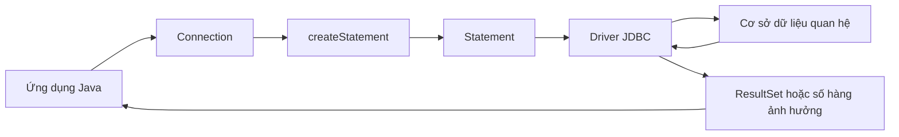

# Vai trò và trường hợp sử dụng `Statement` trong JDBC

## 1. `Statement` là gì?

Trong Java Database Connectivity (JDBC), `java.sql.Statement` là giao diện dùng để gửi **một câu lệnh SQL dạng chuỗi** từ ứng dụng Java đến hệ quản trị cơ sở dữ liệu quan hệ và nhận kết quả thực thi. Đối tượng `Statement` được tạo từ một `java.sql.Connection`, nên nó sử dụng chính phiên kết nối và ngữ cảnh giao dịch của `Connection` đó.

Khi làm việc với cơ sở dữ liệu quan hệ, ứng dụng thường cần đọc bản ghi, cập nhật dữ liệu hoặc thay đổi cấu trúc bảng. `Statement` cung cấp một API chung để thực hiện các thao tác này mà không phải tự xây dựng giao thức trao đổi với từng hệ quản trị cơ sở dữ liệu. Driver JDBC chịu trách nhiệm truyền yêu cầu, nhận phản hồi và chuyển đổi kết quả về các kiểu JDBC tương ứng.

Ví dụ tối giản:

```java
try (Statement statement = connection.createStatement();
     ResultSet resultSet = statement.executeQuery(
         "SELECT id, full_name FROM employees ORDER BY id")) {

    while (resultSet.next()) {
        long id = resultSet.getLong("id");
        String fullName = resultSet.getString("full_name");
        System.out.println(id + " - " + fullName);
    }
}
```

Trong ví dụ, `connection` là một `Connection` đã mở hợp lệ; bảng `employees` có các cột `id` và `full_name`. Mã Java gửi chuỗi SQL cố định, duyệt từng hàng do truy vấn trả về, rồi tự động đóng `ResultSet` và `Statement` bằng `try-with-resources`.



**Đặc điểm quyết định:** `Statement` thực thi SQL dưới dạng văn bản nguyên vẹn; nó **không có API gắn tham số** như `setString(...)` hoặc `setLong(...)`. Vì vậy, `Statement` phù hợp nhất với SQL **cố định, do chương trình kiểm soát**. Khi câu lệnh chứa giá trị thay đổi từ người dùng, HTTP request, tập tin hoặc hệ thống bên ngoài, thông thường phải chọn `PreparedStatement`.

## 2. Vị trí của `Statement` trong API JDBC

Các đối tượng chính phối hợp với nhau theo trình tự sau:

1. `Connection` đại diện cho kết nối đến cơ sở dữ liệu và quản lý giao dịch.
2. `Connection.createStatement()` tạo một `Statement` thuộc kết nối đó.
3. `Statement` thực thi SQL thông qua `executeQuery`, `executeUpdate` hoặc `execute`.
4. Với truy vấn trả về bảng kết quả, ứng dụng đọc dữ liệu từ `ResultSet`.
5. Ứng dụng đóng tài nguyên và `Connection` khi hoàn tất công việc.

Ba giao diện thường gặp có mục đích khác nhau:

| Giao diện | Cách cung cấp SQL | Trường hợp phù hợp |
| --- | --- | --- |
| `Statement` | Truyền trực tiếp chuỗi SQL hoàn chỉnh tại lúc thực thi | SQL tĩnh, thao tác quản trị có câu lệnh đáng tin cậy, ví dụ minh họa JDBC |
| `PreparedStatement` | Chuẩn bị SQL với dấu `?`, sau đó gắn **giá trị** bằng các phương thức `setXxx` | Truy vấn có dữ liệu đầu vào thay đổi, thao tác CRUD của ứng dụng, chạy lặp lại cùng cấu trúc SQL |
| `CallableStatement` | Gọi stored procedure/function theo cú pháp JDBC và hỗ trợ tham số vào/ra | Thực thi thủ tục lưu trữ khi cơ sở dữ liệu và driver hỗ trợ |

`PreparedStatement` kế thừa `Statement`, nhưng bổ sung khả năng gắn tham số và API cho SQL đã được chuẩn bị. Cả hai đều có thể thực thi các truy vấn SQL hợp lệ; lựa chọn chủ yếu phụ thuộc vào **nguồn và tính biến đổi của câu SQL**, chứ không đơn thuần dựa vào việc câu lệnh là `SELECT` hay `UPDATE`.

## 3. Các phương thức thực thi SQL quan trọng

| Phương thức | Kết quả Java | Cách dùng điển hình |
| --- | --- | --- |
| `executeQuery(String sql)` | `ResultSet` | `SELECT` trả về một tập kết quả |
| `executeUpdate(String sql)` | `int` | `INSERT`, `UPDATE`, `DELETE` trả về số hàng chịu tác động; lệnh DDL được hỗ trợ thường trả về `0` |
| `execute(String sql)` | `boolean` | SQL mà loại kết quả có thể chưa biết trước; `true` khi kết quả đầu tiên là `ResultSet`, `false` nếu không phải |
| `executeBatch()` | `int[]` | Thực thi lô các lệnh đã đăng ký bằng `addBatch` |
| `executeLargeUpdate(String sql)` | `long` | Lệnh cập nhật có số hàng ảnh hưởng có thể vượt giới hạn `int`, nếu driver hỗ trợ |

`execute()` **không** trả về `true` để biểu thị SQL chạy thành công. Giá trị `boolean` chỉ cho biết loại **kết quả đầu tiên**. Nếu `false`, có thể đọc `getUpdateCount()` để lấy số hàng cập nhật; `-1` cho biết không có số đếm cập nhật hiện tại. Với một số lệnh hoặc thủ tục tạo nhiều kết quả, `getMoreResults()` cho phép chuyển sang kết quả tiếp theo.

Chọn đúng phương thức ngay từ đầu giúp mã rõ ràng: dùng `executeQuery` khi biết câu SQL trả về `ResultSet`, `executeUpdate` khi cần số hàng bị ảnh hưởng và `execute` khi thực sự phải xử lý các loại kết quả khác nhau.

## 4. Trường hợp 1: Đọc dữ liệu bằng SQL cố định

Một ứng dụng nội bộ có thể cần đọc danh sách nhân viên đang hoạt động theo một quy tắc cố định, không nhận giá trị lọc từ bên ngoài:

```java
import java.sql.Connection;
import java.sql.ResultSet;
import java.sql.SQLException;
import java.sql.Statement;

public class EmployeeReader {
    public static void printActiveEmployees(Connection connection)
            throws SQLException {
        String sql = """
            SELECT id, full_name, department
            FROM employees
            WHERE active = TRUE
            ORDER BY id
            """;

        try (Statement statement = connection.createStatement();
             ResultSet results = statement.executeQuery(sql)) {
            while (results.next()) {
                long id = results.getLong("id");
                String name = results.getString("full_name");
                String department = results.getString("department");

                System.out.printf("%d | %s | %s%n", id, name, department);
            }
        }
    }
}
```

Ở đây:

- Câu SQL do lập trình viên định nghĩa và không ghép thêm dữ liệu động.
- `executeQuery` trả về một `ResultSet`; `next()` di chuyển con trỏ qua các hàng.
- `getLong` và `getString` lấy giá trị theo **nhãn cột** (`id`, `full_name`, `department`).
- `try-with-resources` giải phóng tài nguyên ngay cả khi việc đọc dữ liệu phát sinh `SQLException`.

SQL cụ thể cần tương thích với hệ quản trị đang sử dụng. Ví dụ, cách biểu diễn giá trị boolean, giới hạn số hàng hoặc cú pháp phân trang có thể khác giữa các hệ cơ sở dữ liệu.

**Khi nên dùng:** truy vấn báo cáo tĩnh, kiểm tra nhanh cơ sở dữ liệu, tác vụ quản trị có câu SQL được xác định sẵn. Nếu `department` được chọn từ giao diện hoặc API, nên chuyển sang `PreparedStatement` để truyền giá trị lọc.

## 5. Trường hợp 2: Thay đổi dữ liệu và kiểm tra số hàng ảnh hưởng

`executeUpdate` phù hợp với các lệnh DML như `INSERT`, `UPDATE`, `DELETE`. Giá trị trả về cho biết số hàng mà cơ sở dữ liệu báo đã chịu tác động:

```java
String sql = "UPDATE employees SET active = FALSE WHERE id = 10";

try (Statement statement = connection.createStatement()) {
    int affectedRows = statement.executeUpdate(sql);
    System.out.println("Số hàng bị ảnh hưởng: " + affectedRows);
}
```

Trong đoạn mã này, giá trị `10` là một phần của câu SQL **cố định** để minh họa cách dùng API. Nếu mã thực tế cần cập nhật nhân viên theo một `id` nhận được lúc chạy, nên thay bằng:

```java
String sql = "UPDATE employees SET active = FALSE WHERE id = ?";

try (PreparedStatement statement = connection.prepareStatement(sql)) {
    statement.setLong(1, employeeId);
    int affectedRows = statement.executeUpdate();
    System.out.println("Số hàng bị ảnh hưởng: " + affectedRows);
}
```

`PreparedStatement` ở ví dụ thứ hai đòi hỏi `import java.sql.PreparedStatement;` và biến `employeeId` là giá trị `long` có sẵn trong chương trình. Dấu `?` đại diện cho một **giá trị SQL**, được driver truyền qua cơ chế gắn tham số. Ví dụ này thể hiện ranh giới sử dụng an toàn giữa hai API.

Không nên suy ra `affectedRows == 0` luôn đồng nghĩa câu lệnh thất bại: có thể điều kiện `WHERE` không khớp bản ghi nào, hoặc cách đếm hàng của driver/hệ quản trị khác nhau trong một số tình huống. Kiểm tra kết quả theo quy tắc nghiệp vụ thực tế.

## 6. Trường hợp 3: Thực thi DDL và tác vụ quản trị

`Statement` thường tiện dụng trong công cụ phát triển, chương trình khởi tạo thử nghiệm hoặc script quản trị sử dụng những lệnh DDL cố định:

```java
String createTable = """
    CREATE TABLE audit_events (
        id BIGINT PRIMARY KEY,
        event_type VARCHAR(50) NOT NULL
    )
    """;

try (Statement statement = connection.createStatement()) {
    statement.executeUpdate(createTable);
    System.out.println("Đã gửi yêu cầu tạo bảng audit_events");
}
```

DDL bao gồm các lệnh như `CREATE TABLE`, `ALTER TABLE`, `DROP TABLE`. Cú pháp và cách thực thi DDL phụ thuộc cơ sở dữ liệu: một số hệ quản trị tự commit khi chạy DDL, nên **không mặc định rằng có thể rollback DDL** chỉ vì đang dùng giao dịch JDBC. Đối với môi trường production, công cụ migration có quản lý phiên bản và lịch sử thay đổi thường phù hợp hơn các câu lệnh DDL viết rải rác trong ứng dụng.

Trường hợp tốt cho `Statement` là **câu lệnh quản trị đã được kiểm soát**. Không nhận trực tiếp chuỗi SQL tùy ý từ request để chạy qua `Statement`, nhất là khi tài khoản kết nối có quyền thay đổi cấu trúc dữ liệu.

## 7. Trường hợp 4: Chạy nhiều lệnh SQL cố định theo batch

Với nhiều câu lệnh DML độc lập đã được xác định sẵn, `addBatch` và `executeBatch` có thể giúp giảm số lần ứng dụng yêu cầu driver thực thi riêng lẻ:

```java
import java.sql.Connection;
import java.sql.SQLException;
import java.sql.Statement;
import java.util.Arrays;

public class ConfigurationUpdater {
    public static void applyStaticUpdates(Connection connection)
            throws SQLException {
        boolean previousAutoCommit = connection.getAutoCommit();
        connection.setAutoCommit(false);

        try (Statement statement = connection.createStatement()) {
            statement.addBatch(
                "UPDATE app_config SET enabled = TRUE WHERE config_key = 'search'");
            statement.addBatch(
                "UPDATE app_config SET enabled = FALSE WHERE config_key = 'legacy_mode'");

            int[] counts = statement.executeBatch();
            connection.commit();
            System.out.println("Kết quả batch: " + Arrays.toString(counts));
        } catch (SQLException error) {
            try {
                connection.rollback();
            } catch (SQLException rollbackError) {
                error.addSuppressed(rollbackError);
            }
            throw error;
        } finally {
            connection.setAutoCommit(previousAutoCommit);
        }
    }
}
```

Ví dụ giả định bảng `app_config` có các cột `config_key` và `enabled`, và phương thức được gọi trên kết nối mà nó có quyền quản lý giao dịch. Khi dùng trong ứng dụng thật, cần xác định rõ **thành phần nào sở hữu giao dịch** để tránh tự `commit` hoặc thay đổi `autoCommit` của giao dịch do một tầng khác quản lý.

Một số điểm cần hiểu về batch:

- `int[]` chứa kết quả từng lệnh; phần tử có thể là số hàng ảnh hưởng, `Statement.SUCCESS_NO_INFO` hoặc, tùy cách driver tiếp tục sau lỗi, `Statement.EXECUTE_FAILED`.
- Batch không tự đảm bảo tính nguyên tử. Giao dịch và khả năng rollback tùy hệ quản trị, loại câu lệnh và cấu hình kết nối.
- Nếu lỗi, JDBC có thể ném `BatchUpdateException`; thông tin đếm của những lệnh đã thực thi có thể lấy qua `getUpdateCounts()`.
- Nếu thực hiện nhiều bản ghi cùng cấu trúc SQL nhưng **khác giá trị**, `PreparedStatement` kết hợp `addBatch()` thường là lựa chọn phù hợp hơn.

Không nên nhầm batch JDBC với việc nối hàng loạt câu SQL bằng dấu `;` rồi gọi `execute` một lần: khả năng chạy nhiều câu SQL trong cùng chuỗi thay đổi theo driver và cấu hình, không phải hành vi di động giữa mọi cơ sở dữ liệu.

## 8. Trường hợp 5: Xử lý SQL có loại kết quả chưa biết

Trong một tiện ích chạy câu lệnh SQL đáng tin cậy, chương trình có thể cần xử lý cả truy vấn trả về hàng lẫn lệnh cập nhật. Khi đó, `execute` cùng các hàm đọc kết quả sẽ linh hoạt hơn:

```java
// sql là chuỗi SQL được kiểm soát bởi chương trình hoặc quản trị viên được phép.
try (Statement statement = connection.createStatement()) {
    boolean hasResultSet = statement.execute(sql);

    while (true) {
        if (hasResultSet) {
            try (ResultSet rows = statement.getResultSet()) {
                // Đọc dữ liệu bằng ResultSetMetaData nếu cần xử lý cột động.
                while (rows.next()) {
                    // Xử lý từng hàng theo cấu trúc kết quả thực tế.
                }
            }
        } else {
            int updateCount = statement.getUpdateCount();
            if (updateCount == -1) {
                break; // Không còn kết quả.
            }
            System.out.println("Số hàng cập nhật: " + updateCount);
        }

        hasResultSet = statement.getMoreResults();
    }
}
```

Đoạn mã dùng `getMoreResults` cho trường hợp driver trả về **nhiều kết quả**. Khả năng tạo nhiều kết quả phụ thuộc lệnh SQL, driver và hệ quản trị; với một `SELECT` tĩnh, `executeQuery` vẫn rõ ràng hơn. Ví dụ cần biến `sql` thuộc `String` và các import JDBC tương ứng.

**Không** hiểu “tiện ích chạy SQL” là cho mọi người dùng gửi SQL tự do: phải có cơ chế quyền truy cập, giới hạn lệnh và tài khoản cơ sở dữ liệu phù hợp với mục đích quản trị.

## 9. Ranh giới bảo mật: tránh ghép dữ liệu động vào SQL

Rủi ro lớn nhất khi dùng `Statement` trong luồng ứng dụng là **SQL injection**. Ví dụ sau là cách viết **không an toàn** nếu `username` đến từ bên ngoài:

```java
// KHÔNG sử dụng: đầu vào có thể làm thay đổi cú pháp SQL.
String sql = "SELECT id FROM accounts WHERE username = '" + username + "'";
try (Statement statement = connection.createStatement();
     ResultSet results = statement.executeQuery(sql)) {
    // ...
}
```

Việc bọc giá trị trong dấu nháy đơn không tự làm cho truy vấn an toàn. Giá trị có ký tự điều khiển cú pháp SQL có thể khiến câu lệnh bị hiểu theo cách khác với dự định. Cách xử lý đúng cho dữ liệu bên ngoài là gắn tham số:

```java
String sql = "SELECT id FROM accounts WHERE username = ?";
try (PreparedStatement statement = connection.prepareStatement(sql)) {
    statement.setString(1, username);
    try (ResultSet results = statement.executeQuery()) {
        while (results.next()) {
            System.out.println(results.getLong("id"));
        }
    }
}
```

Giá trị được truyền tách biệt với cấu trúc SQL, giúp driver xử lý đúng kiểu dữ liệu và tránh biến đầu vào thành cú pháp của câu lệnh. Khi chọn tên bảng, tên cột hoặc hướng sắp xếp động, dấu `?` **không thay thế được các định danh SQL**. Với các phần cấu trúc này, hãy chọn từ **danh sách giá trị cho phép do chương trình định nghĩa**, thay vì chèn trực tiếp chuỗi tùy ý từ người dùng.

Ngoài SQL injection, cần cấp quyền cơ sở dữ liệu tối thiểu cần thiết. Một tài khoản chỉ phục vụ truy vấn đọc thường không cần quyền `DROP TABLE` hoặc sửa schema.

## 10. Quản lý tài nguyên và các tùy chọn thực thi

`Statement`, `ResultSet` và `Connection` đều gắn với tài nguyên có vòng đời. Cách quản lý tài nguyên ảnh hưởng đến độ ổn định của ứng dụng khi chạy nhiều truy vấn:

- **Đóng tài nguyên:** ưu tiên `try-with-resources`. Đóng `Statement` cũng đóng `ResultSet` hiện tại do nó tạo ra. Đóng `Connection` khi chủ sở hữu kết nối hoàn tất công việc; nếu ứng dụng dùng connection pool, thao tác `close()` thường trả kết nối cho pool.
- **Không tái sử dụng đồng thời một `Statement`:** thực thi một SQL mới trên cùng `Statement` thường đóng `ResultSet` hiện tại theo hợp đồng JDBC. Nếu cần duyệt hai tập kết quả đồng thời, dùng hai `Statement` riêng.
- **Không chia sẻ giữa nhiều luồng:** không dựa vào giả định `Statement` an toàn để cùng lúc sử dụng từ nhiều thread; mỗi thao tác nên có phạm vi sử dụng tài nguyên rõ ràng.
- **Giao dịch thuộc `Connection`:** `commit`, `rollback` và `setAutoCommit` là thao tác trên `Connection`. `Statement` thực thi trong ngữ cảnh giao dịch của kết nối đã tạo ra nó.

Một số tùy chọn hữu ích:

```java
try (Statement statement = connection.createStatement()) {
    statement.setQueryTimeout(15); // Yêu cầu giới hạn thực thi: 15 giây.
    statement.setFetchSize(100);   // Gợi ý driver lấy dữ liệu theo lô.
    statement.setMaxRows(500);     // Giới hạn số hàng ResultSet của Statement.

    try (ResultSet rows = statement.executeQuery(
            "SELECT id, full_name FROM employees ORDER BY id")) {
        while (rows.next()) {
            // Xử lý kết quả.
        }
    }
}
```

`setFetchSize` là **gợi ý** cho driver, không bảo đảm mỗi lần truyền đúng 100 hàng. `setQueryTimeout` phụ thuộc khả năng thực thi của driver; không nên xem nó là một giới hạn thời gian tuyệt đối cho toàn bộ giao dịch. `setMaxRows` áp dụng cho số hàng trong `ResultSet` được tạo bởi `Statement`, không thay thế các quy tắc giới hạn dữ liệu ở tầng nghiệp vụ.

JDBC còn cho phép tạo `Statement` với kiểu `ResultSet` và chế độ đồng thời, chẳng hạn:

```java
try (Statement statement = connection.createStatement(
        ResultSet.TYPE_FORWARD_ONLY,
        ResultSet.CONCUR_READ_ONLY)) {
    // ResultSet tiến về phía trước, chỉ đọc.
}
```

Khả năng cuộn con trỏ (`TYPE_SCROLL_*`), cập nhật qua `ResultSet` và các tùy chọn nâng cao khác phải được kiểm tra theo driver và cơ sở dữ liệu cụ thể.

## 11. Những lỗi thường gặp

| Hiện tượng | Nguyên nhân hay gặp | Hướng xử lý |
| --- | --- | --- |
| Gọi `executeQuery` cho `UPDATE`/DDL | Chọn API không phù hợp với loại kết quả | Dùng `executeUpdate` nếu cần số hàng ảnh hưởng, hoặc `execute` khi loại kết quả không chắc chắn |
| Gọi `executeUpdate` cho `SELECT` trả về hàng | Phương thức không phù hợp với truy vấn | Dùng `executeQuery` và xử lý `ResultSet` |
| `ResultSet` bị đóng ngoài dự kiến | Thực thi SQL mới trên `Statement` đang được dùng để duyệt dữ liệu | Kết thúc đọc trước khi tái sử dụng hoặc tạo `Statement` khác |
| Rò rỉ cursor/tài nguyên | Không đóng `ResultSet`, `Statement` hoặc kết nối | Dùng `try-with-resources`, xác định rõ ai sở hữu kết nối |
| Truy vấn chạy sai khi đầu vào có ký tự đặc biệt | Ghép chuỗi dữ liệu đầu vào vào SQL | Dùng `PreparedStatement` với dấu `?` cho giá trị |
| Batch trả số âm | Hệ thống báo trạng thái đặc biệt như `SUCCESS_NO_INFO` | Diễn giải các hằng JDBC, không coi mọi số âm là số hàng lỗi |
| DDL khác nhau giữa các môi trường | Cú pháp, hỗ trợ giao dịch và tính năng khác theo DBMS | Kiểm tra dialect và driver của môi trường triển khai |

Khi gặp `SQLException`, hãy đọc `getMessage()`, `getSQLState()` và `getErrorCode()` để có thêm thông tin chẩn đoán. Mã lỗi và thông điệp cụ thể thường phụ thuộc driver hoặc cơ sở dữ liệu; không nên đoán nguyên nhân chỉ từ loại exception.

## 12. Quy tắc lựa chọn trong dự án thực tế

| Tình huống | Lựa chọn gợi ý | Lý do |
| --- | --- | --- |
| `SELECT` cố định trong công cụ kiểm tra dữ liệu | `Statement` | SQL hoàn chỉnh do mã nguồn kiểm soát, dùng ít thao tác |
| `CREATE TABLE` trong chương trình thử nghiệm hoặc script quản trị có kiểm soát | `Statement` | Phù hợp với DDL cố định |
| Tìm khách hàng theo email từ HTTP request | `PreparedStatement` | Email là dữ liệu động, cần gắn tham số |
| Cập nhật nhiều nhân viên, mỗi người có `id` khác nhau | `PreparedStatement` + batch | Một cấu trúc SQL, nhiều bộ giá trị động |
| Gọi stored procedure có tham số OUT | `CallableStatement` | Hỗ trợ giao tiếp theo hợp đồng thủ tục lưu trữ |
| Chọn tên cột sắp xếp theo yêu cầu giao diện | SQL cấu trúc theo allowlist; tham số hóa các giá trị còn lại | Dấu `?` không thể thay thế tên cột hoặc từ khóa SQL |

**Nguyên tắc cần nhớ:** `Statement` là công cụ JDBC trực tiếp để thực thi **câu SQL hoàn chỉnh, đáng tin cậy** và nhận `ResultSet` hoặc số hàng ảnh hưởng. Nó rất hữu ích khi học JDBC, chạy SQL cố định và thực hiện công việc quản trị có kiểm soát. Đối với phần lớn truy vấn nghiệp vụ có dữ liệu biến đổi, `PreparedStatement` là lựa chọn an toàn và dễ bảo trì hơn.
