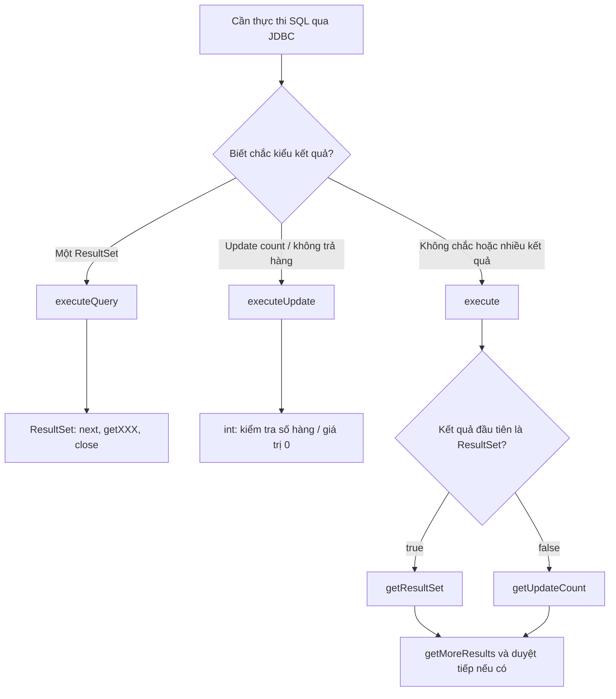

# Phân biệt `executeQuery()`, `executeUpdate()` và `execute()` trong JDBC

Trong chương **Thực thi SQL**, ba phương thức quan trọng nhất để gửi câu lệnh SQL qua **JDBC (Java Database Connectivity API for relational database access)** là `executeQuery()`, `executeUpdate()` và `execute()`. Cả ba thuộc giao diện `Statement` và được kế thừa bởi `PreparedStatement`, `CallableStatement`, nhưng **khác nhau ở loại kết quả mà chương trình mong đợi và cách đọc kết quả**.

Với một truy vấn `SELECT` trả dữ liệu, chương trình thường cần `ResultSet`. Với lệnh `UPDATE` thông thường, chương trình thường muốn biết có bao nhiêu hàng bị tác động. Với stored procedure hoặc câu SQL có kiểu kết quả không biết trước, một lần thực thi có thể tạo ra `ResultSet`, update count hoặc nhiều kết quả liên tiếp. Chọn sai phương thức có thể dẫn đến `SQLException` hoặc cách diễn giải sai kết quả.

**Điểm cốt lõi:** Phương thức thực thi nên được chọn theo **kiểu kết quả JDBC do câu lệnh và driver trả về**. Từ khóa SQL giúp dự đoán trường hợp thông thường, nhưng không đủ cho những lệnh có `RETURNING`, `OUTPUT`, procedure hoặc nhiều kết quả.

## 1. Nhìn nhanh ba phương thức

| Phương thức | Giá trị trả về | Ý nghĩa | Tình huống phổ biến |
| --- | --- | --- | --- |
| `executeQuery()` | `ResultSet` | Một tập kết quả dạng hàng để đọc bằng `next()`. | `SELECT`, câu SQL được driver hỗ trợ trả về một `ResultSet`. |
| `executeUpdate()` | `int` | Update count hoặc `0` nếu câu SQL không trả về kết quả dạng hàng. | `INSERT`, `UPDATE`, `DELETE`, một số lệnh DDL. |
| `execute()` | `boolean` | `true` nếu **kết quả đầu tiên** là `ResultSet`; `false` nếu kết quả đầu tiên là update count hoặc không có kết quả. | SQL không biết trước kiểu kết quả, stored procedure, câu có thể trả nhiều kết quả. |

Trên `Statement`, các lời gọi điển hình là:

```java
ResultSet rows = statement.executeQuery("SELECT id, name FROM products");

int affected = statement.executeUpdate(
        "UPDATE products SET stock = 10 WHERE id = 101");

boolean firstIsResultSet = statement.execute("CALL some_procedure()");
```

Ví dụ `CALL` chỉ minh họa hình thức gọi: tên procedure, cú pháp và các kết quả trả về phụ thuộc hệ quản trị.

Trên `PreparedStatement`, SQL được truyền **khi tạo statement** và phương thức thực thi được gọi **không có tham số SQL**:

```java
PreparedStatement ps = connection.prepareStatement(
        "SELECT name FROM products WHERE id = ?");

ps.setLong(1, 101L);

ResultSet rows = ps.executeQuery();  // Không truyền SQL lần nữa.
```

Cần đóng `PreparedStatement` và `ResultSet` đúng lúc; các đoạn ngắn ở trên chỉ nhằm so sánh chữ ký phương thức.

### Sơ đồ chọn phương thức



## 2. Chuẩn bị ví dụ: bảng và kết nối JDBC

Các ví dụ sau giả định database quan hệ có bảng `products`:

```sql
CREATE TABLE products (
    id BIGINT PRIMARY KEY,
    name VARCHAR(200) NOT NULL,
    price DECIMAL(12, 2) NOT NULL,
    stock INTEGER NOT NULL
);
```

Dữ liệu thử nghiệm:

```sql
INSERT INTO products (id, name, price, stock)
VALUES
    (101, 'Ban phim', 450000, 12),
    (102, 'Chuot', 250000, 7);
```

Sử dụng database thử nghiệm riêng khi chạy câu lệnh ghi. Cần có JDBC driver phù hợp trên runtime classpath, ví dụ PostgreSQL driver `org.postgresql:postgresql` khi kết nối PostgreSQL. Không nên nhúng mật khẩu thực vào source code.

Đoạn mã kết nối cơ bản:

```java
String url = System.getenv("JDBC_URL");
String user = System.getenv("DB_USER");
String password = System.getenv("DB_PASSWORD");

try (Connection connection =
             DriverManager.getConnection(url, user, password)) {
    // Tạo Statement/PreparedStatement và thực thi SQL.
} // connection.close() tự được gọi.
```

Giả định đã `import java.sql.Connection;`, `import java.sql.DriverManager;` và cấu hình các biến môi trường. Trong ứng dụng server, `DataSource` có connection pool thường được dùng thay vì mở kết nối vật lý mới cho từng thao tác; cách chọn `executeQuery`/`executeUpdate`/`execute` không thay đổi.

## 3. `executeQuery()`: khi cần một `ResultSet`

`executeQuery()` được thiết kế cho câu lệnh có **một kết quả dạng bảng/hàng**. Nó trả về `ResultSet` để chương trình duyệt các hàng.

Ví dụ tìm sản phẩm theo số lượng tồn kho:

```java
import java.sql.Connection;
import java.sql.PreparedStatement;
import java.sql.ResultSet;
import java.sql.SQLException;

public final class ProductReader {
    public static void printProducts(Connection connection, int minStock)
            throws SQLException {

        String sql = """
                SELECT id, name, stock
                FROM products
                WHERE stock >= ?
                ORDER BY id
                """;

        try (PreparedStatement ps = connection.prepareStatement(sql)) {
            ps.setInt(1, minStock);

            try (ResultSet rs = ps.executeQuery()) {
                while (rs.next()) {
                    long id = rs.getLong("id");
                    String name = rs.getString("name");
                    int stock = rs.getInt("stock");

                    System.out.printf(
                            "id=%d, name=%s, stock=%d%n",
                            id, name, stock);
                }
            }
        }
    }
}
```

Đoạn mã dùng Java 15+ cho text block `"""`; trên Java cũ có thể khai báo `String sql` bằng chuỗi thông thường.

Cách hoạt động:

1. `connection.prepareStatement(sql)` tạo một statement có tham số `?`.
2. `ps.setInt(1, minStock)` gắn giá trị cho placeholder đầu tiên.
3. `ps.executeQuery()` gửi SQL và trả về `ResultSet`.
4. `rs.next()` chuyển con trỏ tới hàng kế tiếp, trả `false` khi hết hàng.
5. `try-with-resources` đóng `ResultSet` và `PreparedStatement` sau khi xử lý.

### Một `SELECT` không có hàng vẫn thành công

```sql
SELECT id, name FROM products WHERE id = -1;
```

Nếu không có sản phẩm tương ứng, `executeQuery()` **vẫn trả về `ResultSet` hợp lệ**; chỉ có `rs.next()` trả về `false`. Một tập hàng rỗng không đồng nghĩa với lỗi SQL.

Ví dụ:

```java
try (PreparedStatement ps = connection.prepareStatement(
        "SELECT id FROM products WHERE id = ?")) {
    ps.setLong(1, -1);

    try (ResultSet rs = ps.executeQuery()) {
        boolean found = rs.next(); // false nếu không có hàng.
        System.out.println("Found: " + found);
    }
}
```

### Khi nào `executeQuery()` không phù hợp?

Nếu SQL không tạo ra `ResultSet` theo hợp đồng driver, chẳng hạn một lệnh `UPDATE` thông thường chỉ trả về update count, gọi `executeQuery()` có thể ném `SQLException`. Không sử dụng `executeQuery()` chỉ vì muốn “xem thao tác có thành công không”.

Ngược lại, một số câu **ghi dữ liệu** lại có thể trả về hàng, ví dụ PostgreSQL `UPDATE ... RETURNING`. Trường hợp đó `executeQuery()` có thể thích hợp nếu driver hỗ trợ; xem phần `RETURNING` ở dưới.

## 4. `executeUpdate()`: khi cần update count

`executeUpdate()` thường dùng cho các lệnh DML không trả về tập hàng:

- `INSERT` để thêm dữ liệu;
- `UPDATE` để sửa dữ liệu;
- `DELETE` để xóa dữ liệu.

Giá trị `int` thường đại diện cho **số hàng bị tác động**; với câu lệnh không trả về tập hàng như một số DDL, giá trị có thể là `0` theo hợp đồng JDBC.

### Ví dụ `UPDATE` và kiểm tra số hàng

```java
import java.sql.Connection;
import java.sql.PreparedStatement;
import java.sql.SQLException;

public final class StockUpdater {
    public static boolean sellOne(Connection connection, long productId)
            throws SQLException {

        String sql = """
                UPDATE products
                SET stock = stock - 1
                WHERE id = ? AND stock > 0
                """;

        try (PreparedStatement ps = connection.prepareStatement(sql)) {
            ps.setLong(1, productId);

            int affectedRows = ps.executeUpdate();

            if (affectedRows > 1) {
                throw new SQLException(
                        "Số hàng cập nhật lớn hơn dự kiến: " + affectedRows);
            }

            return affectedRows == 1;
        }
    }
}
```

Ở đây giả định `products.id` là khóa chính/duy nhất:

- `1`: một hàng được cập nhật.
- `0`: không tìm thấy `id` tương ứng hoặc sản phẩm không có `stock > 0`.
- `> 1`: trái với kỳ vọng khi `id` là duy nhất, cần điều tra.

Câu SQL trừ tồn kho và kiểm tra `stock > 0` ngay tại database giúp tránh mẫu không an toàn “đọc stock ở Java rồi cập nhật bằng giá trị vừa đọc” trong nhiều tình huống đồng thời. Những nghiệp vụ phức tạp vẫn cần transaction và isolation phù hợp.

### Ví dụ `INSERT`

```java
String sql =
        "INSERT INTO products (id, name, price, stock) VALUES (?, ?, ?, ?)";

try (PreparedStatement ps = connection.prepareStatement(sql)) {
    ps.setLong(1, 103L);
    ps.setString(2, "USB Hub");
    ps.setBigDecimal(3, new java.math.BigDecimal("320000"));
    ps.setInt(4, 5);

    int inserted = ps.executeUpdate();
    System.out.println("Inserted rows: " + inserted);
}
```

Giả định `id = 103` chưa tồn tại. Nếu vi phạm khóa chính hoặc constraint khác, driver thường ném `SQLException`; không có số hàng thành công đáng tin cậy từ lời gọi đã thất bại.

### Ví dụ `DELETE`

```java
String sql = "DELETE FROM products WHERE id = ?";

try (PreparedStatement ps = connection.prepareStatement(sql)) {
    ps.setLong(1, 103L);
    int deleted = ps.executeUpdate();
    System.out.println("Deleted rows: " + deleted);
}
```

Một lệnh `DELETE` không có `WHERE` có thể xóa **tất cả hàng** phù hợp trong bảng; phải kiểm tra cẩn thận SQL và quyền trước khi chạy.

### Update count không phải mã trạng thái thành công/thất bại

`executeUpdate()` hoàn thành không ném `SQLException` nghĩa là lời gọi SQL được driver/database xử lý thành công theo hợp đồng của nó. Giá trị `0` **không tự động là thất bại**: có thể không có hàng khớp `WHERE`, hoặc lệnh DDL không trả về số hàng.

Tùy cơ sở dữ liệu/driver, update count cho một số câu `UPDATE` có thể phản ánh số **hàng khớp điều kiện** hoặc số **hàng thực sự thay đổi giá trị**. Khi cần semantics chính xác cho nghiệp vụ, đối chiếu cấu hình và tài liệu của driver/database.

Nếu câu SQL có thể tác động hơn giới hạn `int`, JDBC 4.2 cung cấp `executeLargeUpdate()` trả về `long`; phương thức này được hỗ trợ theo khả năng của driver.

## 5. DDL và `executeUpdate()`: giá trị `0` có nghĩa gì?

DDL (*Data Definition Language*) thay đổi cấu trúc như tạo bảng hoặc chỉ mục:

```sql
CREATE TABLE audit_events (
    id BIGINT PRIMARY KEY,
    message VARCHAR(500) NOT NULL
);
```

Với một lệnh DDL **không trả về `ResultSet`**, có thể gọi:

```java
try (Statement statement = connection.createStatement()) {
    int count = statement.executeUpdate("""
            CREATE TABLE audit_events (
                id BIGINT PRIMARY KEY,
                message VARCHAR(500) NOT NULL
            )
            """);

    System.out.println(count); // Thường là 0 cho DDL.
}
```

Đoạn ví dụ cần `import java.sql.Statement;` và giả định bảng chưa tồn tại; Java 15+ cho text block. Nếu bảng đã có hoặc thiếu quyền tạo bảng, lệnh có thể ném `SQLException`.

**`count == 0` không có nghĩa là “không tạo bảng nào”.** Nó thể hiện câu lệnh không có update count dạng số hàng bị sửa. Thành công/thất bại của DDL cần xem việc thực thi và ngoại lệ.

Hành vi transaction của DDL không giống nhau giữa các hệ quản trị. Có cơ sở dữ liệu hỗ trợ rollback cho nhiều DDL, có hệ hoặc lệnh thực hiện implicit commit. Không giả định DDL có thể rollback giống một lệnh `UPDATE` thông thường.

## 6. `execute()`: khi chưa biết trước kiểu kết quả

`execute()` linh hoạt hơn hai phương thức trên. Với `Statement`:

```java
boolean firstResultIsRows = statement.execute(sql);
```

Giá trị trả về:

- `true`: **kết quả đầu tiên** là `ResultSet`; gọi `getResultSet()` để lấy.
- `false`: kết quả đầu tiên là **update count** hoặc **không có kết quả**; gọi `getUpdateCount()` để phân biệt.

**`false` không có nghĩa SQL thất bại.** Nếu SQL thất bại, driver thường ném `SQLException`.

Ví dụ một `UPDATE` thông thường:

```java
try (Statement statement = connection.createStatement()) {
    boolean hasRows = statement.execute(
            "UPDATE products SET stock = 5 WHERE id = 101");

    System.out.println("First result is ResultSet: " + hasRows);

    if (!hasRows) {
        int affected = statement.getUpdateCount();
        System.out.println("Update count: " + affected);
    }
}
```

Trong trường hợp thông thường, `hasRows` là `false` và `getUpdateCount()` trả số hàng bị tác động. `getUpdateCount() == -1` biểu thị **không có update count ở kết quả hiện tại**, trong bối cảnh duyệt kết quả thường nghĩa là không còn kết quả nữa nếu `getMoreResults()` cũng là `false`.

### Khi kết quả đầu tiên là `ResultSet`

```java
try (Statement statement = connection.createStatement()) {
    boolean hasRows = statement.execute(
            "SELECT id, name FROM products ORDER BY id");

    if (hasRows) {
        try (ResultSet rs = statement.getResultSet()) {
            while (rs.next()) {
                System.out.println(rs.getLong("id")
                        + " - " + rs.getString("name"));
            }
        }
    }
}
```

`getResultSet()` chỉ lấy `ResultSet` của **kết quả hiện tại** khi kết quả đó là tập hàng. Nếu kết quả hiện tại không phải tập hàng, phương thức có thể trả về `null`. Không gọi `getResultSet()` rồi giả định luôn có dữ liệu.

## 7. Một lần `execute()` có thể tạo **nhiều kết quả**

Stored procedure và một số câu lệnh hỗ trợ nhiều kết quả có thể lần lượt trả về:

- Một hoặc nhiều `ResultSet`;
- Một hoặc nhiều update count;
- Hoặc kết thúc mà không còn kết quả.

JDBC cung cấp:

| Phương thức | Vai trò |
| --- | --- |
| `getResultSet()` | Trả về `ResultSet` cho kết quả hiện tại khi đó là result set. |
| `getUpdateCount()` | Trả update count của kết quả hiện tại, hoặc `-1` nếu hiện tại không có update count. |
| `getMoreResults()` | Chuyển đến kết quả tiếp theo và trả `true` nếu kết quả mới là `ResultSet`. |
| `getMoreResults(int)` | Chuyển kết quả và chỉ định cách xử lý result set hiện tại nếu driver hỗ trợ. |

Có một bẫy quan trọng: **`getMoreResults() == false` chưa chắc là hết kết quả**. Nó cũng trả `false` khi kết quả kế tiếp là update count.

### Vòng lặp đúng để xử lý nhiều kết quả

Ví dụ tổng quát cho câu SQL **đáng tin cậy do ứng dụng kiểm soát**:

```java
import java.sql.Connection;
import java.sql.ResultSet;
import java.sql.ResultSetMetaData;
import java.sql.SQLException;
import java.sql.Statement;

public final class MultipleResultsReader {
    public static void inspect(Connection connection, String trustedSql)
            throws SQLException {

        try (Statement statement = connection.createStatement()) {
            boolean isResultSet = statement.execute(trustedSql);

            while (true) {
                if (isResultSet) {
                    try (ResultSet rs = statement.getResultSet()) {
                        ResultSetMetaData metadata = rs.getMetaData();
                        int columns = metadata.getColumnCount();

                        while (rs.next()) {
                            for (int col = 1; col <= columns; col++) {
                                System.out.print(
                                        metadata.getColumnLabel(col) + "="
                                        + rs.getObject(col) + " ");
                            }
                            System.out.println();
                        }
                    }
                } else {
                    int updateCount = statement.getUpdateCount();

                    if (updateCount == -1) {
                        break; // Không còn kết quả JDBC nào nữa.
                    }

                    System.out.println("Update count: " + updateCount);
                }

                isResultSet = statement.getMoreResults();
            }
        }
    }
}
```

Luồng xử lý:

1. Gọi `execute()` để kiểm tra kiểu của **kết quả đầu tiên**.
2. Nếu là result set, lấy và đọc `ResultSet` rồi đóng.
3. Nếu không phải result set, đọc `getUpdateCount()`. Khi nó bằng `-1` và không có result set thì dừng.
4. Gọi `getMoreResults()` để chuyển đến kết quả tiếp theo.
5. Lặp lại cho đến khi không còn gì để đọc.

Vòng lặp này không dừng chỉ vì `getMoreResults()` trả `false`; nó còn xét `getUpdateCount()` để phân biệt update count với kết thúc. Mặc định, `getMoreResults()` đóng result set hiện tại; ví dụ trên cũng chủ động đóng nó bằng `try-with-resources`.

Khả năng trả về nhiều kết quả phụ thuộc database, JDBC driver và loại câu SQL. Đoạn mã trên là **bộ đọc kết quả**, không có nghĩa mọi driver cho phép gửi nhiều SQL statement trong cùng một chuỗi. Hãy sử dụng `CallableStatement` và giao thức gọi procedure phù hợp khi làm việc với stored procedure.

### Nếu cần giữ nhiều result set mở đồng thời

`Statement.getMoreResults(int current)` cho phép yêu cầu `CLOSE_CURRENT_RESULT`, `KEEP_CURRENT_RESULT` hoặc `CLOSE_ALL_RESULTS`. Không phải driver nào cũng hỗ trợ việc giữ nhiều result set cùng lúc; kiểm tra `DatabaseMetaData.supportsMultipleOpenResults()` và tài liệu driver trước khi dùng. Trong phần lớn nghiệp vụ, **đọc và đóng từng result set trước khi chuyển tiếp** là cách đơn giản hơn.

## 8. Trường hợp đặc biệt: DML vừa sửa dữ liệu vừa trả về hàng

Nếu phân loại hoàn toàn theo từ khóa `SELECT`/`UPDATE`, ứng dụng có thể chọn nhầm phương thức.

### PostgreSQL `RETURNING`

Một số hệ quản trị, chẳng hạn PostgreSQL, hỗ trợ câu lệnh:

```sql
UPDATE products
SET stock = stock - 1
WHERE id = 101 AND stock > 0
RETURNING id, name, stock;
```

Câu này **sửa dữ liệu** nhưng **trả về hàng**, nên `executeQuery()` có thể phù hợp với driver hỗ trợ:

```java
String sql = """
        UPDATE products
        SET stock = stock - 1
        WHERE id = ? AND stock > 0
        RETURNING id, name, stock
        """;

try (PreparedStatement ps = connection.prepareStatement(sql)) {
    ps.setLong(1, 101L);

    try (ResultSet rs = ps.executeQuery()) {
        if (rs.next()) {
            System.out.println("Stock sau cập nhật: "
                    + rs.getInt("stock"));
        } else {
            System.out.println("Không có hàng nào được cập nhật");
        }
    }
}
```

Ở đây `executeQuery()` là lựa chọn theo **kiểu kết quả trả về**, dù lệnh bắt đầu bằng `UPDATE`. Cú pháp `RETURNING` không phổ biến đồng nhất trên mọi database; các hệ khác có thể dùng `OUTPUT` hoặc cơ chế khác, và cách JDBC driver báo kết quả cũng có thể khác.

**Lưu ý:** `RETURN_GENERATED_KEYS` và `getGeneratedKeys()` là cơ chế riêng để lấy khóa được sinh từ lệnh ghi. Nó không có nghĩa mọi lệnh `UPDATE`/`INSERT` sẽ tự trả `ResultSet` qua `executeUpdate()`.

### Lấy generated keys sau `executeUpdate()`

```java
String sql = "INSERT INTO products (name, price, stock) VALUES (?, ?, ?)";

try (PreparedStatement ps = connection.prepareStatement(
        sql, Statement.RETURN_GENERATED_KEYS)) {
    ps.setString(1, "Keyboard");
    ps.setBigDecimal(2, new java.math.BigDecimal("450000"));
    ps.setInt(3, 10);

    int inserted = ps.executeUpdate();

    if (inserted == 1) {
        try (ResultSet keys = ps.getGeneratedKeys()) {
            if (keys.next()) {
                System.out.println("ID mới: " + keys.getLong(1));
            }
        }
    }
}
```

Ví dụ này giả định bảng `products` có `id` tự sinh và driver hỗ trợ `getGeneratedKeys()`, khác với schema có `id BIGINT PRIMARY KEY` phải nhập ID trực tiếp ở phần đầu. Để chạy ví dụ thực tế, cần tạo bảng có cấu hình cột tự sinh phù hợp, và `import java.sql.Statement;`.

Nếu database/driver không hỗ trợ lấy khóa, hoặc câu lệnh không sinh khóa, không nên giả định `keys.next()` sẽ luôn là `true`.

## 9. So sánh `Statement` và `PreparedStatement` khi thực thi

Ba phương thức cùng nhóm nhưng **chữ ký gọi khác nhau**:

| Đối tượng | Cách cung cấp SQL | Ví dụ |
| --- | --- | --- |
| `Statement` | Truyền chuỗi SQL tại lời gọi thực thi. | `statement.executeQuery("SELECT ...")` |
| `PreparedStatement` | Truyền SQL khi tạo `prepareStatement(sql)`; bind tham số rồi gọi `executeQuery()`/`executeUpdate()`/`execute()` **không có SQL string**. | `ps.setLong(1, id); ps.executeQuery();` |
| `CallableStatement` | Chuẩn bị lời gọi stored procedure/function theo cú pháp driver; bind input/output rồi thực thi. | `callable.execute();` |

Một lỗi phổ biến:

```java
PreparedStatement ps = connection.prepareStatement(
        "SELECT name FROM products WHERE id = ?");

ps.setLong(1, 101L);

// Không viết: ps.executeQuery("SELECT * FROM products");
// Hãy dùng:
try (ResultSet rs = ps.executeQuery()) {
    // Đọc dữ liệu.
}
```

Mặc dù `PreparedStatement` kế thừa giao diện `Statement`, các phương thức `executeQuery(String)`/`executeUpdate(String)`/`execute(String)` truyền SQL lại tại lúc gọi **không phải cách dùng `PreparedStatement` đã chuẩn bị**, và theo hợp đồng JDBC có thể ném `SQLException`.

### SQL động và SQL injection

Không ghép đầu vào người dùng trực tiếp vào câu lệnh:

```java
// KHÔNG DÙNG khi userInput không đáng tin cậy.
String sql = "SELECT id FROM products WHERE name = '" + userInput + "'";
```

Ưu tiên placeholder:

```java
String sql = "SELECT id FROM products WHERE name = ?";

try (PreparedStatement ps = connection.prepareStatement(sql)) {
    ps.setString(1, userInput);

    try (ResultSet rs = ps.executeQuery()) {
        while (rs.next()) {
            System.out.println(rs.getLong(1));
        }
    }
}
```

Placeholder `?` dùng cho **giá trị**, không dùng thay từ khóa SQL hoặc tên bảng/cột. Nếu tên bảng/cột thực sự cần thay đổi theo đầu vào, phải dùng danh sách tên được cho phép và xử lý quoting/identifier theo database.

## 10. Ví dụ Java đầy đủ: ba đường thực thi

Ví dụ sau sử dụng PostgreSQL, Java 11+ và bảng `products` được tạo sẵn như phần chuẩn bị. Giả định tồn tại `id = 101`. Chương trình sẽ **cập nhật dữ liệu thật** trong database được cấu hình, vì vậy chỉ nên chạy trong môi trường học tập.

```java
import java.sql.Connection;
import java.sql.DriverManager;
import java.sql.PreparedStatement;
import java.sql.ResultSet;
import java.sql.SQLException;
import java.sql.Statement;

public final class JdbcExecuteMethodsDemo {
    public static void main(String[] args) {
        String url = System.getenv("JDBC_URL");
        String user = System.getenv("DB_USER");
        String password = System.getenv("DB_PASSWORD");

        if (isBlank(url) || isBlank(user) || password == null) {
            System.err.println("Thiếu JDBC_URL, DB_USER hoặc DB_PASSWORD");
            return;
        }

        try (Connection connection =
                     DriverManager.getConnection(url, user, password)) {

            printProduct(connection, 101L);

            int count = updateStock(connection, 101L, 9);
            System.out.println("Số hàng UPDATE: " + count);

            inspectQueryWithExecute(connection);

        } catch (SQLException error) {
            System.err.println("JDBC error: SQLState="
                    + error.getSQLState()
                    + ", vendorCode=" + error.getErrorCode());
        }
    }

    private static void printProduct(Connection connection, long id)
            throws SQLException {
        String sql = "SELECT name, stock FROM products WHERE id = ?";

        try (PreparedStatement ps = connection.prepareStatement(sql)) {
            ps.setLong(1, id);

            try (ResultSet rs = ps.executeQuery()) {
                if (rs.next()) {
                    System.out.println(rs.getString("name")
                            + ", stock=" + rs.getInt("stock"));
                } else {
                    System.out.println("Không tìm thấy sản phẩm");
                }
            }
        }
    }

    private static int updateStock(
            Connection connection, long id, int newStock)
            throws SQLException {
        String sql = "UPDATE products SET stock = ? WHERE id = ?";

        try (PreparedStatement ps = connection.prepareStatement(sql)) {
            ps.setInt(1, newStock);
            ps.setLong(2, id);

            return ps.executeUpdate();
        }
    }

    private static void inspectQueryWithExecute(Connection connection)
            throws SQLException {
        String sql = "SELECT COUNT(*) AS total FROM products";

        try (Statement statement = connection.createStatement()) {
            boolean isRows = statement.execute(sql);

            if (isRows) {
                try (ResultSet rs = statement.getResultSet()) {
                    if (rs.next()) {
                        System.out.println("Tổng sản phẩm: "
                                + rs.getLong("total"));
                    }
                }
            } else {
                System.out.println("Update count: "
                        + statement.getUpdateCount());
            }
        }
    }

    private static boolean isBlank(String value) {
        return value == null || value.trim().isEmpty();
    }
}
```

Thử ba biến môi trường:

```text
JDBC_URL=jdbc:postgresql://localhost:5432/appdb
DB_USER=app_user
DB_PASSWORD=<mật khẩu được cấu hình ngoài source code>
```

Kết quả dự kiến khi database có dữ liệu phù hợp:

- `printProduct` gọi `executeQuery()` và đọc `ResultSet`.
- `updateStock` gọi `executeUpdate()` và nhận số hàng sửa.
- `inspectQueryWithExecute` gọi `execute()`, kiểm tra `boolean` rồi lấy `ResultSet` bằng `getResultSet()`.
- `try-with-resources` đóng statement, result set và connection theo vòng đời của từng khối.

Dù chương trình sử dụng `Statement` cho một SQL cố định ở bước cuối, phần có dữ liệu động vẫn nên sử dụng `PreparedStatement` và bind tham số.

## 11. Lỗi thường gặp và cách phân biệt

| Hiện tượng | Nguyên nhân điển hình | Cách xử lý |
| --- | --- | --- |
| Gọi `executeQuery()` với `UPDATE` thông thường | Lệnh không trả `ResultSet`. | Dùng `executeUpdate()` nếu cần update count. |
| Gọi `executeUpdate()` với `SELECT` | Lệnh trả result set. | Dùng `executeQuery()`. |
| `execute()` trả `false` | Kết quả đầu tiên không phải `ResultSet`; không nhất thiết là lỗi. | Kiểm tra `getUpdateCount()`. |
| `executeQuery()` trả kết quả rỗng | Không có hàng thỏa điều kiện. | Kiểm tra `rs.next()`; không xử lý như SQL lỗi. |
| `executeUpdate()` trả `0` | Có thể không có hàng khớp hoặc DDL không trả update count. | Diễn giải theo câu lệnh và database. |
| `getMoreResults()` trả `false` | Có thể kế tiếp là update count hoặc đã hết kết quả. | Xem `getUpdateCount()` trước khi kết luận. |
| Lệnh `UPDATE ... RETURNING` bị xử lý như update count thông thường | SQL thực tế trả về hàng. | Dùng API đọc `ResultSet` theo driver. |
| SQL sai cú pháp, thiếu quyền hoặc vi phạm constraint | Database không thực hiện thành công. | Bắt `SQLException`, xem `SQLState` và mã lỗi nhà cung cấp. |
| Đọc `ResultSet` sau khi statement/connection đã đóng | Tài nguyên đã hết vòng đời. | Đọc trong `try-with-resources`, chuyển sang DTO trước khi trả dữ liệu. |
| Gọi `ps.executeQuery("...")` trên prepared statement | Không đúng hợp đồng của `PreparedStatement`. | Chuẩn bị SQL một lần và gọi `ps.executeQuery()`. |

### Hiểu `SQLException`

Cả ba phương thức có thể ném `SQLException` do lỗi cú pháp SQL, không đủ quyền, vi phạm ràng buộc, mất kết nối hoặc nhiều nguyên nhân khác:

```java
try (PreparedStatement ps = connection.prepareStatement(sql)) {
    int affectedRows = ps.executeUpdate();
    System.out.println("Affected: " + affectedRows);
} catch (SQLException error) {
    System.err.println("SQLState: " + error.getSQLState());
    System.err.println("Vendor code: " + error.getErrorCode());
}
```

Một `SQLException` là tín hiệu lỗi của thao tác JDBC; `0` hay `false` là **giá trị kết quả hợp lệ trong nhiều trường hợp**. Không nên thay thế việc xử lý ngoại lệ bằng kiểm tra `execute() == false`.

## 12. Liên hệ với transaction và vòng đời tài nguyên

Phương thức thực thi **không quyết định commit hay rollback**. Điều này do `Connection` và database điều khiển.

- Khi `autoCommit = true` (mặc định thường gặp), từng câu lệnh được commit tự động theo quy tắc JDBC.
- Khi `autoCommit = false`, các lệnh có thể thuộc cùng transaction; ứng dụng cần `commit()` hoặc `rollback()`.
- `SELECT` có thể giữ cursor, lock hoặc tài nguyên tùy cách truy vấn; đọc hết và đóng `ResultSet` đúng lúc.
- Với `UPDATE`/`DELETE`, cần kiểm tra số hàng kỳ vọng và transaction, đặc biệt khi nhiều câu SQL phụ thuộc nhau.
- DDL có thể có hành vi commit khác DML giữa các cơ sở dữ liệu.

Ví dụ transaction dùng `executeUpdate()` cho hai thao tác:

```java
try (Connection connection =
             DriverManager.getConnection(url, user, password)) {
    connection.setAutoCommit(false);

    try {
        try (PreparedStatement ps = connection.prepareStatement(
                "UPDATE products SET stock = stock - ? "
              + "WHERE id = ? AND stock >= ?")) {
            ps.setInt(1, 2);
            ps.setLong(2, 101);
            ps.setInt(3, 2);

            if (ps.executeUpdate() != 1) {
                throw new SQLException("Không đủ hàng ở sản phẩm nguồn");
            }
        }

        try (PreparedStatement ps = connection.prepareStatement(
                "UPDATE products SET stock = stock + ? WHERE id = ?")) {
            ps.setInt(1, 2);
            ps.setLong(2, 102);

            if (ps.executeUpdate() != 1) {
                throw new SQLException("Không tìm thấy sản phẩm đích");
            }
        }

        connection.commit();
    } catch (SQLException error) {
        try {
            connection.rollback();
        } catch (SQLException rollbackError) {
            error.addSuppressed(rollbackError);
        }
        throw error;
    }
}
```

Đây là mã minh họa chạy trên database thử nghiệm. Trong hệ thống thực tế, cần thêm quy tắc nghiệp vụ và quản lý cạnh tranh phù hợp. Nếu `commit()` thất bại do đứt mạng, trạng thái giao dịch có thể chưa chắc chắn; cần giải quyết theo ngữ cảnh thay vì giả định rollback đã bảo đảm thành công.

Bất kể dùng phương thức thực thi nào, luôn đóng `ResultSet`, `Statement`/`PreparedStatement` và `Connection` theo ranh giới sở hữu. Với connection pool, gọi `close()` thường trả connection được mượn về pool.

## 13. Bài tập thực hành

1. **Đọc dữ liệu:** viết `findProductById(long id)` sử dụng `PreparedStatement.executeQuery()`. Kiểm tra cả trường hợp tìm thấy và không tìm thấy; giải thích vì sao `ResultSet` rỗng không phải lỗi.
2. **Sửa dữ liệu:** dùng `executeUpdate()` cập nhật `price` theo `id`, in `affectedRows`. Thử một `id` không tồn tại và giải thích kết quả.
3. **Lấy khóa tạo tự động:** tạo bảng thử nghiệm có khóa tự sinh, thực hiện `INSERT` và `getGeneratedKeys()`. So sánh cách lấy khóa này với `RETURNING` của PostgreSQL.
4. **Hiểu `execute()`:** dùng `statement.execute("SELECT ...")` rồi đọc `getResultSet()`. Thay bằng `UPDATE` thông thường, quan sát `boolean` và `getUpdateCount()`.
5. **Duyệt nhiều kết quả:** viết vòng lặp xử lý `getMoreResults()` và `getUpdateCount()`; giải thích vì sao `getMoreResults() == false` chưa đủ để kết luận đã hết kết quả.
6. **SQL injection:** thay nối chuỗi giá trị `name` bằng bind tham số `?`, rồi thử tên sản phẩm có dấu nháy đơn.
7. **Transaction:** thực hiện hai câu `UPDATE` trong cùng transaction; buộc câu thứ hai trả `0` để thử `rollback()`, kiểm tra không có thay đổi một phần.
8. **Phân loại ngược:** với `SELECT`, `UPDATE`, `CREATE TABLE`, `UPDATE ... RETURNING`, stored procedure trả nhiều kết quả, hãy xác định phương thức thực thi hợp lý và dữ liệu cần đọc.

## 14. Tự kiểm tra kiến thức

**Câu hỏi 1. `execute()` trả `false` có nghĩa SQL thất bại?**

Không. `false` nghĩa là kết quả đầu tiên không phải `ResultSet`. Xem `getUpdateCount()` để biết có update count hay không; lỗi SQL thường được biểu diễn bằng `SQLException`.

**Câu hỏi 2. `executeUpdate()` trả `0` có luôn nghĩa `UPDATE` thất bại?**

Không. Có thể không có hàng phù hợp điều kiện, hoặc câu SQL là DDL không trả update count. Cần diễn giải theo ngữ cảnh.

**Câu hỏi 3. `SELECT` không tìm được bản ghi sẽ làm `executeQuery()` trả `null`?**

Không. Thông thường nó trả về một `ResultSet` hợp lệ nhưng không có hàng; `rs.next()` trả `false`.

**Câu hỏi 4. Vì sao `getMoreResults()` trả `false` không đủ để dừng vòng lặp?**

Vì kết quả kế tiếp có thể là update count. Cần kiểm tra `getUpdateCount() == -1` trước khi xác định không còn kết quả.

**Câu hỏi 5. Khi một lệnh `UPDATE` có `RETURNING`, có nhất thiết phải dùng `executeUpdate()`?**

Không. Nếu lệnh trả về hàng theo driver, có thể cần `executeQuery()` hoặc `execute()`, tùy database.

**Câu hỏi 6. `executeQuery()` trên `PreparedStatement` có cần truyền lại SQL string không?**

Không. SQL đã được cung cấp khi tạo `PreparedStatement`; chỉ bind tham số rồi gọi `executeQuery()` không đối số.

## Ghi nhớ

- **`executeQuery()`** dùng khi cần đọc **một `ResultSet`**; kết quả không có hàng vẫn là truy vấn thành công.
- **`executeUpdate()`** dùng khi cần **update count** hoặc khi SQL không trả hàng, như DML thông thường và một số DDL; `0` không mặc nhiên là lỗi.
- **`execute()`** dùng khi kiểu kết quả chưa biết hoặc SQL có thể trả nhiều kết quả. `true` nghĩa kết quả đầu tiên là `ResultSet`; `false` không có nghĩa thực thi thất bại.
- Dùng **`getResultSet()`, `getUpdateCount()` và `getMoreResults()`** để đọc và duyệt đúng các kết quả do `execute()` tạo ra.
- Câu SQL như **`UPDATE ... RETURNING`** có thể trả hàng dù đang ghi dữ liệu: chọn phương thức theo kết quả thực tế và khả năng driver.
- Với **`PreparedStatement`**, SQL được chuẩn bị trước và các lời gọi `executeQuery()`/`executeUpdate()`/`execute()` thường **không nhận tham số SQL**.
- Dù dùng phương thức nào, hãy dùng **`try-with-resources`**, kiểm tra `SQLException` và quản lý transaction bằng `Connection`.
