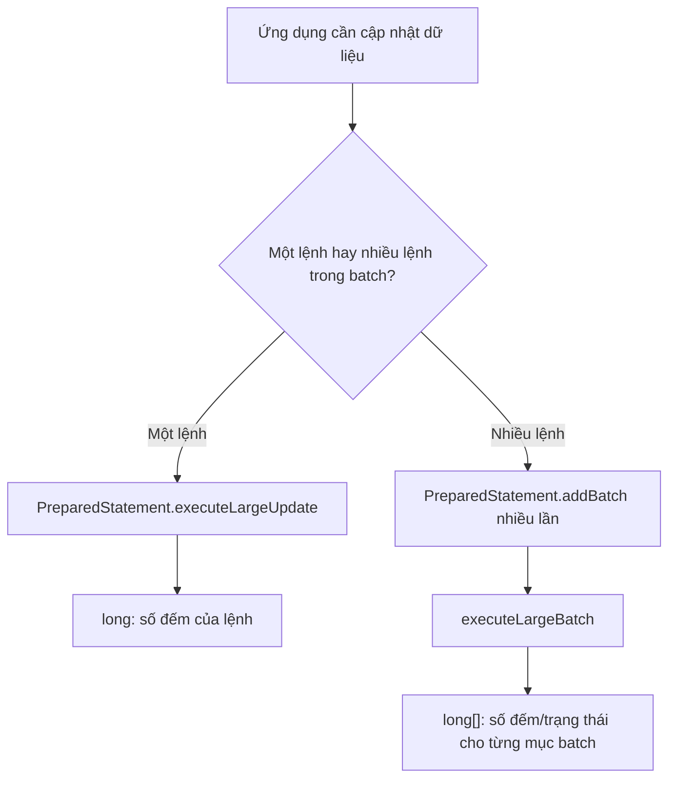

# Sử dụng `executeLargeUpdate()` khi cần số đếm lớn trong JDBC

## 1. Bài toán: số dòng bị tác động vượt giới hạn `int`

Trong **JDBC (Java Database Connectivity)**, ứng dụng Java truy cập cơ sở dữ liệu quan hệ thông qua các API như `Connection`, `Statement` và `PreparedStatement`. Khi thực thi `INSERT`, `UPDATE` hoặc `DELETE`, ứng dụng thường cần biết **bao nhiêu dòng đã bị tác động** để ghi nhận kết quả, thống kê hoặc kiểm tra điều kiện nghiệp vụ.

API quen thuộc là `Statement.executeUpdate(...)` hoặc `PreparedStatement.executeUpdate()`, trả về `int`. Kiểu `int` của Java có giá trị lớn nhất:

```text
Integer.MAX_VALUE = 2_147_483_647
```

Nếu một thao tác bảo trì hoặc nhập dữ liệu quy mô rất lớn có thể tác động nhiều hơn **2.147.483.647 dòng**, kiểu `int` không đủ miền giá trị để biểu diễn số đếm. JDBC cung cấp nhóm API sử dụng `long`, nổi bật là **`executeLargeUpdate()`**, để ứng dụng có thể nhận số đếm lớn mà không bị ràng buộc bởi giới hạn của `int`.

Ví dụ, một tác vụ lưu trữ hàng tỷ bản ghi có thể cần đánh dấu các sự kiện cũ là đã lưu trữ:

```sql
UPDATE audit_event
   SET archived = TRUE
 WHERE event_date < DATE '2025-01-01'
   AND archived = FALSE;
```

Nếu hệ quản trị thực sự xử lý hơn hai tỷ dòng và driver hỗ trợ báo cáo số đếm lớn, ứng dụng cần lưu kết quả bằng `long`. Ngay cả khi dữ liệu hiện tại còn nhỏ, hệ thống theo dõi thống kê lâu dài cũng nên tránh thiết kế buộc phải ép số đếm sang `int`.

> **Phạm vi của bài:** `executeLargeUpdate()` chỉ giải quyết **kiểu dữ liệu biểu diễn update count** của JDBC. Nó không tự tăng tốc SQL, không chia một lệnh thành nhiều phần, không giảm thời gian giữ khóa và không thay thế việc thiết kế transaction hay kiểm soát tài nguyên.

## 2. So sánh `executeUpdate()` và `executeLargeUpdate()`

| Khía cạnh | `executeUpdate` | `executeLargeUpdate` |
| --- | --- | --- |
| Giá trị trả về | `int` | `long` |
| Miền giá trị tối đa của kiểu Java | `2_147_483_647` | `9_223_372_036_854_775_807` |
| Cách gọi với `Statement` | `executeUpdate(sql)` | `executeLargeUpdate(sql)` |
| Cách gọi với `PreparedStatement` | `executeUpdate()` | `executeLargeUpdate()` |
| Mục đích | Lấy số dòng bị tác động hoặc giá trị `0` của lệnh không trả update count | Cùng mục đích, nhưng nhận bằng kiểu `long` |
| Có tự động chia nhỏ một SQL lớn? | Không | Không |
| Có trả về các dòng của `SELECT`? | Không | Không |

Nhóm API dùng số đếm `long` được đưa vào **JDBC 4.2 (Java 8)**. Khi phát triển trên JDK hỗ trợ API này, cần lưu ý cả **driver JDBC thực tế**: không phải driver cũ nào cũng triển khai việc lấy update count trên 32 bit một cách đầy đủ. Có driver có thể ném `SQLFeatureNotSupportedException` hoặc có giới hạn riêng; cũng không nên mặc định mọi driver sẽ báo cáo chính xác một số đếm vượt `Integer.MAX_VALUE` chỉ vì mã Java dùng `long`.

Về mặt ngữ nghĩa, kết quả thành công của `executeLargeUpdate()` đối với câu DML là **số dòng mà JDBC/driver báo cáo đã bị tác động**; các lệnh SQL không trả update count, ví dụ một số DDL được hỗ trợ, thường trả về `0`. Nếu SQL tạo ra `ResultSet`, hãy chọn API xử lý kết quả truy vấn tương ứng.

### Nhìn đúng vấn đề bằng một ví dụ số học

```java
long affectedRows = 3_000_000_000L;

System.out.println(affectedRows);         // 3000000000
System.out.println(Integer.MAX_VALUE);     // 2147483647

// Sai nếu cần giữ nguyên giá trị:
int truncated = (int) affectedRows;
System.out.println(truncated);             // Giá trị khác 3000000000

// Đổi kiểu có kiểm tra thay vì âm thầm làm sai thống kê:
// int exact = Math.toIntExact(affectedRows);
// Dòng trên sẽ ném ArithmeticException vì vượt miền int.
```

Đây chỉ là minh họa giới hạn kiểu Java, **không phải kết quả từ một cơ sở dữ liệu cụ thể**. Toán tử ép kiểu `(int)` sẽ bỏ các bit cao của giá trị `long`, có thể tạo một số sai (thậm chí âm). Nếu hệ thống nhận số đếm lớn, hãy giữ kiểu `long` xuyên suốt các lớp xử lý và khi ghi thống kê.

## 3. Cách dùng với `Statement`

Với câu SQL không cần bind giá trị động, gọi `executeLargeUpdate(String sql)` trên `Statement`:

```java
import java.sql.Connection;
import java.sql.SQLException;
import java.sql.Statement;
import javax.sql.DataSource;

public final class LargeUpdateWithStatement {
    public static long archiveAllOldEvents(DataSource dataSource)
            throws SQLException {
        String sql = """
                UPDATE audit_event
                   SET archived = TRUE
                 WHERE event_date < DATE '2025-01-01'
                   AND archived = FALSE
                """;

        try (Connection connection = dataSource.getConnection();
             Statement statement = connection.createStatement()) {

            long affectedRows = statement.executeLargeUpdate(sql);
            System.out.println("Rows reported by JDBC: " + affectedRows);
            return affectedRows;
        }
    }
}
```

Đoạn mã sử dụng **Java 17+** để trình bày SQL bằng text block. Ví dụ giả định bảng `audit_event` có cột `event_date` và `archived`, hệ quản trị chấp nhận cú pháp SQL `DATE 'yyyy-mm-dd'` và driver hỗ trợ API. Với sản phẩm có cú pháp ngày khác, phải sửa SQL tương ứng.

Luồng xử lý:

1. `DataSource` cung cấp một `Connection`.
2. `Connection.createStatement()` tạo `Statement`.
3. `executeLargeUpdate(sql)` gửi SQL tới driver để thực thi và trả lại `long`.
4. `try-with-resources` đóng `Statement`, sau đó đóng/hoàn trả `Connection`.

`Statement` chỉ phù hợp khi cấu trúc và **giá trị trong SQL đã được xác định từ phía chương trình**. Nếu ngày cắt, mã khách hàng hoặc thông tin lọc đến từ input, **không nối chuỗi input vào SQL**. Dùng `PreparedStatement` để tránh SQL injection và để truyền tham số đúng kiểu.

## 4. Cách dùng với `PreparedStatement`: lựa chọn thông dụng

Với tham số động, cách viết khuyến nghị là chuẩn bị SQL có dấu `?`, bind tham số bằng `setXxx(...)`, rồi gọi **`PreparedStatement.executeLargeUpdate()` không đối số**.

```java
import java.sql.Connection;
import java.sql.Date;
import java.sql.PreparedStatement;
import java.sql.SQLException;
import java.time.LocalDate;
import java.util.Objects;
import javax.sql.DataSource;

public final class AuditEventRepository {
    private final DataSource dataSource;

    public AuditEventRepository(DataSource dataSource) {
        this.dataSource = Objects.requireNonNull(dataSource);
    }

    public long archiveBefore(LocalDate cutoff) throws SQLException {
        Objects.requireNonNull(cutoff, "cutoff");

        String sql = """
                UPDATE audit_event
                   SET archived = ?
                 WHERE event_date < ?
                   AND archived = ?
                """;

        try (Connection connection = dataSource.getConnection();
             PreparedStatement statement =
                     connection.prepareStatement(sql)) {

            statement.setBoolean(1, true);
            statement.setDate(2, Date.valueOf(cutoff));
            statement.setBoolean(3, false);

            return statement.executeLargeUpdate();
        }
    }
}
```

Ở phương thức trên:

- `setBoolean(1, true)` là giá trị mới của `archived`.
- `setDate(2, Date.valueOf(cutoff))` là ngày giới hạn.
- `setBoolean(3, false)` chỉ chọn những dòng chưa lưu trữ.
- `executeLargeUpdate()` gửi câu SQL đã bind và trả về số đếm `long`.

Để chạy được, schema và driver cần hỗ trợ kiểu cột tương ứng. Cú pháp boolean và cách biểu diễn ngày có thể khác nhau giữa các hệ quản trị. Ví dụ sử dụng `DataSource` đã được ứng dụng cấu hình và không thiết lập transaction riêng, vì chính sách transaction có thể nằm ở tầng dịch vụ.

**Không truyền chuỗi SQL vào `PreparedStatement.executeLargeUpdate(...)`.** Với `PreparedStatement`, câu SQL được đưa vào từ lúc gọi `connection.prepareStatement(sql)`; phương thức thực thi cần dùng là bản **không tham số**. Trong khi đó, `Statement.executeLargeUpdate(sql)` yêu cầu SQL ở chính lần gọi.

### Vì sao trả `long` từ tầng repository?

Giả sử repository viết đúng `executeLargeUpdate()` nhưng khai báo:

```java
// Thiết kế sai với nghiệp vụ có thể vượt int:
public int archiveBefore(LocalDate cutoff) throws SQLException {
    long affectedRows = /* gọi executeLargeUpdate() */;
    return (int) affectedRows;
}
```

Phương thức này vẫn âm thầm làm mất khả năng biểu diễn số đếm lớn. Thay vì vậy, dùng **`long` từ repository qua service, DTO, log, metric, message/event và tầng lưu trữ báo cáo**. Nếu một API bên ngoài chỉ hỗ trợ `int`, cần xác định quy tắc xử lý tràn (ví dụ từ chối bằng lỗi rõ ràng hoặc chia nhỏ nghiệp vụ) thay vì ép kiểu không kiểm tra.

## 5. Số đếm mà driver trả về thực sự có ý nghĩa gì?

Đừng nhầm **số dòng bị tác động** với **số bản ghi mà điều kiện truy vấn tìm thấy**, **số cột thay đổi**, **số khóa được sinh**, hay **số bản ghi xử lý thành công theo nghiệp vụ**.

Ví dụ:

```sql
UPDATE account
   SET status = 'ACTIVE'
 WHERE status = 'ACTIVE';
```

Một số hệ quản trị/driver có cách cấu hình khác nhau về việc báo cáo số dòng **khớp điều kiện** và số dòng **thực sự có giá trị thay đổi**. Vì vậy, **ý nghĩa chi tiết của update count có thể phụ thuộc sản phẩm, driver và câu SQL**. Không dùng số đếm làm điều kiện nghiệp vụ đòi hỏi tính tương đương tuyệt đối giữa các hệ quản trị mà chưa kiểm chứng.

Các tình huống thường gặp:

| Kết quả | Cách diễn giải thận trọng |
| --- | --- |
| `0L` từ câu `UPDATE` | Driver báo không có dòng bị tác động theo ngữ nghĩa của nó |
| `1L` | Driver báo một dòng bị tác động, có thể dùng kiểm tra cập nhật một bản ghi trong mô hình đã xác minh |
| `2_500_000_000L` | Một số đếm lớn hợp lệ trong miền `long`, nếu driver và DB thực sự báo cáo |
| `0L` từ một DDL được hỗ trợ | Không có update count cần báo cáo; không đồng nghĩa “DDL không có hiệu lực” |
| `SQLException` | Thao tác không hoàn tất theo luồng thành công; cần xử lý lỗi và trạng thái giao dịch |

`executeLargeUpdate()` không trả về từng dòng hoặc danh sách khóa chính. Nếu cần dữ liệu hàng sau khi cập nhật, tùy SQL và driver có thể cần `executeQuery()`, tính năng `RETURNING` hoặc API khác được hỗ trợ. Nếu cần khóa sinh, phải yêu cầu và đọc `getGeneratedKeys()` theo contract JDBC và driver.

Ví dụ nhận khóa được sinh khi driver hỗ trợ:

```java
String sql = "INSERT INTO audit_job(job_name) VALUES (?)";

try (Connection connection = dataSource.getConnection();
     PreparedStatement statement = connection.prepareStatement(
             sql, Statement.RETURN_GENERATED_KEYS)) {

    statement.setString(1, "archive-events");
    long inserted = statement.executeLargeUpdate();

    try (java.sql.ResultSet keys = statement.getGeneratedKeys()) {
        if (inserted > 0 && keys.next()) {
            long jobId = keys.getLong(1);
            System.out.println("New job ID: " + jobId);
        }
    }
}
```

Đoạn này giả định cột khóa được DB cấu hình **tự sinh** và driver hỗ trợ `getGeneratedKeys()`. `inserted` là số dòng được báo cáo, còn `jobId` là giá trị khóa sinh: **hai giá trị không thể thay thế cho nhau**. `Statement` ở đây là `java.sql.Statement` và phải được import tương ứng.

## 6. Phân biệt `executeLargeUpdate()` với các API số đếm khác

`Statement` có những API liên quan đến kết quả cập nhật. Chọn đúng phương thức phụ thuộc câu SQL trả dữ liệu, trả số dòng hay nhiều kết quả:

| API | Trả về | Dùng khi |
| --- | --- | --- |
| `executeQuery(sql)` / `PreparedStatement.executeQuery()` | `ResultSet` | Câu SQL trả bảng dữ liệu như `SELECT` |
| `executeUpdate(sql)` / `PreparedStatement.executeUpdate()` | `int` | DML/DDL thông thường khi đủ miền `int` |
| `executeLargeUpdate(sql)` / `PreparedStatement.executeLargeUpdate()` | `long` | DML/DDL cần số đếm miền `long` |
| `execute(sql)` / `PreparedStatement.execute()` | `boolean` | Một câu có thể trả `ResultSet`, update count hoặc nhiều kết quả |
| `getUpdateCount()` | `int` | Đọc update count hiện tại sau `execute(...)` |
| `getLargeUpdateCount()` | `long` | Đọc update count hiện tại theo miền `long` sau `execute(...)` |
| `executeBatch()` | `int[]` | Thực thi batch và nhận các số đếm kiểu `int` |
| `executeLargeBatch()` | `long[]` | Thực thi batch và nhận các số đếm kiểu `long` |

Khi chỉ cần số đếm từ một câu `UPDATE`, **gọi trực tiếp `executeLargeUpdate()` là cách rõ ràng nhất**. Không cần gọi `execute()` rồi hỏi `getLargeUpdateCount()` nếu không phải xử lý nhiều kiểu kết quả.

### `getLargeUpdateCount()` khi dùng `execute()`

Với câu SQL có thể tạo nhiều kết quả (đặc biệt một số stored procedure hoặc dạng SQL riêng của driver), `execute()` trả `true` nếu **kết quả đầu tiên là `ResultSet`**; `false` nếu kết quả đầu tiên là update count hoặc không có kết quả. Nó **không phải boolean thành công/thất bại**.

Một mẫu đọc kết quả hỗn hợp:

```java
import java.sql.ResultSet;
import java.sql.SQLException;
import java.sql.Statement;

public static void consumeAllResults(Statement statement, String sql)
        throws SQLException {
    boolean hasResultSet = statement.execute(sql);

    while (true) {
        if (hasResultSet) {
            try (ResultSet rs = statement.getResultSet()) {
                while (rs.next()) {
                    // Xử lý dữ liệu của ResultSet hiện tại.
                }
            }
        } else {
            long updateCount = statement.getLargeUpdateCount();
            if (updateCount == -1L) {
                break; // Không còn kết quả nào để xử lý.
            }
            System.out.println("Update count: " + updateCount);
        }

        hasResultSet = statement.getMoreResults();
    }
}
```

Đoạn trên minh họa một method tĩnh đặt trong class và nhận `Statement` còn mở do bên gọi quản lý. Khi dùng `getLargeUpdateCount()`, **`-1L` là giá trị báo “không có update count hiện tại”**, khác với số dòng thực sự bị tác động. Phải phân biệt sentinel này với kết quả thành công của `executeLargeUpdate()` (số đếm không âm hoặc `0`).

`getMoreResults()` mặc định chuyển kết quả và đóng `ResultSet` hiện tại. Việc tự đóng `ResultSet` bằng `try-with-resources` vẫn làm vòng đời tài nguyên rõ ràng. Khả năng có nhiều kết quả và cách tương tác với stored procedure phụ thuộc driver và hệ quản trị.

## 7. Khi thực thi batch: `executeLargeBatch()` và `long[]`

Nếu chương trình đã sử dụng `addBatch()` để gom nhiều lệnh cập nhật, phương thức tương ứng với số đếm lớn là **`executeLargeBatch()`**, trả về một **mảng `long[]`**. Đây là API khác với `executeLargeUpdate()`:



Ví dụ cập nhật trạng thái của nhiều khách hàng. Đây là batch gồm các lệnh nhỏ để minh họa API; không cần có hàng tỷ bản ghi mới sử dụng được:

```java
import java.sql.Connection;
import java.sql.PreparedStatement;
import java.sql.SQLException;
import java.util.List;
import javax.sql.DataSource;

public final class BatchArchive {
    public static long[] archiveCustomers(
            DataSource dataSource, List<Long> customerIds)
            throws SQLException {

        String sql = "UPDATE customer SET archived = ? WHERE id = ?";

        try (Connection connection = dataSource.getConnection();
             PreparedStatement statement =
                     connection.prepareStatement(sql)) {

            for (Long customerId : customerIds) {
                if (customerId == null) {
                    throw new IllegalArgumentException(
                            "customerIds must not contain null");
                }
                statement.setBoolean(1, true);
                statement.setLong(2, customerId);
                statement.addBatch();
            }

            return customerIds.isEmpty()
                    ? new long[0]
                    : statement.executeLargeBatch();
        }
    }
}
```

Mỗi phần tử `long[]` tương ứng với một lệnh trong batch theo contract JDBC, nhưng **không nhất thiết mỗi phần tử đều là số đếm không âm**. JDBC dùng một số hằng số đặc biệt:

| Giá trị | Tên hằng | Ý nghĩa |
| --- | --- | --- |
| `>= 0` | Số đếm cụ thể | Số dòng bị tác động mà driver báo cáo cho mục đó |
| `Statement.SUCCESS_NO_INFO` (`-2`) | Thành công, không có số đếm chính xác | Không biết bao nhiêu dòng đã bị tác động |
| `Statement.EXECUTE_FAILED` (`-3`) | Một lệnh trong batch thất bại | Thường xuất hiện trong kết quả lỗi của driver tiếp tục xử lý batch |

Vì vậy, **không cộng toàn bộ phần tử bằng `sum()` rồi coi kết quả là tổng chính xác**. Hai giá trị âm có ý nghĩa trạng thái, không phải số dòng âm.

### Tính tổng batch khi có đủ dữ liệu

```java
import java.sql.Statement;
import java.util.OptionalLong;

public static OptionalLong exactBatchTotal(long[] counts) {
    long total = 0L;
    for (long count : counts) {
        if (count == Statement.SUCCESS_NO_INFO) {
            return OptionalLong.empty(); // Không đủ số đếm chính xác.
        }
        if (count == Statement.EXECUTE_FAILED) {
            throw new IllegalStateException(
                    "Batch has a failed command");
        }
        if (count < 0L) {
            throw new IllegalArgumentException(
                    "Unexpected update count: " + count);
        }
        total = Math.addExact(total, count);
    }
    return OptionalLong.of(total);
}
```

Phương thức trên chỉ coi tổng là chính xác khi **mọi phần tử đều là số đếm không âm**. `Math.addExact(long, long)` ném `ArithmeticException` nếu phép cộng tràn miền `long`; điều này có thể quan trọng khi cộng số đếm từ nhiều tác vụ, kể cả khi từng kết quả vẫn nằm trong miền hợp lệ.

### Lỗi batch và `BatchUpdateException`

Khi batch có lỗi, driver có thể dừng ngay hoặc tiếp tục xử lý một số lệnh còn lại tùy khả năng và chính sách. `BatchUpdateException` cho phép xem update count đã được driver cung cấp:

```java
import java.sql.BatchUpdateException;
import java.sql.PreparedStatement;
import java.sql.SQLException;
import java.util.Arrays;

public static long[] runLargeBatch(PreparedStatement statement)
        throws SQLException {
    try {
        return statement.executeLargeBatch();
    } catch (BatchUpdateException error) {
        long[] reported = error.getLargeUpdateCounts();
        System.err.println(
                "Reported batch counts: " + Arrays.toString(reported));
        throw error;
    }
}
```

Mã này chỉ minh họa cách đọc dữ liệu lỗi; caller phải quyết định rollback, ghi log và xử lý tiếp. **Update counts không mặc nhiên nói rõ những lệnh nào đã commit**: điều đó còn phụ thuộc auto-commit, transaction và hành vi của driver. Tránh tự động chạy lại cả batch khi chưa biết các thay đổi trước đó đã được ghi nhận hay chưa.

## 8. Transaction và quy mô lệnh là hai vấn đề riêng

Giả sử một câu `UPDATE` chạm vào vài tỷ dòng. Chuyển từ `executeUpdate()` sang `executeLargeUpdate()` **không làm câu SQL chạy nhanh hơn** và không tự giảm chi phí ở cơ sở dữ liệu:

- Hệ quản trị vẫn phải tìm và cập nhật các dòng phù hợp; có thể giữ khóa hoặc sinh lượng lớn log giao dịch.
- Một transaction rất lớn có thể tạo áp lực lên bộ nhớ, dung lượng lưu log, replica và cơ chế phục hồi.
- Nếu kết nối bị mất trong lúc commit, phía client có thể **không biết chắc kết quả giao dịch đã được ghi nhận hay chưa**.
- Số đếm `long` hợp lệ không đảm bảo câu SQL đã thực hiện đúng ý nghĩa nghiệp vụ; vẫn phải kiểm tra điều kiện `WHERE` và phạm vi tác động.

Với những lệnh cập nhật rất lớn, cần xét lựa chọn **chia nhỏ theo khóa, mốc thời gian hoặc từng lô** ở tầng thiết kế nghiệp vụ để kiểm soát transaction và tài nguyên. Mỗi lô có thể dùng `executeLargeUpdate()` rồi cộng các số đếm bằng `long`/`Math.addExact(...)`. Tuy nhiên, tổng các lô chỉ đúng khi cách phân đoạn không đếm trùng, không bỏ sót, và xử lý an toàn khi dữ liệu thay đổi đồng thời.

### Ví dụ transaction bao quanh một lệnh cập nhật

```java
import java.sql.Connection;
import java.sql.PreparedStatement;
import java.sql.SQLException;
import java.time.LocalDate;
import javax.sql.DataSource;

public static long archiveInOwnTransaction(
        DataSource dataSource, LocalDate cutoff) throws SQLException {

    String sql = """
            UPDATE audit_event
               SET archived = TRUE
             WHERE event_date < ? AND archived = FALSE
            """;

    try (Connection connection = dataSource.getConnection()) {
        connection.setAutoCommit(false);

        try {
            long count;
            try (PreparedStatement statement =
                         connection.prepareStatement(sql)) {
                statement.setDate(
                        1, java.sql.Date.valueOf(cutoff));
                count = statement.executeLargeUpdate();
            }

            connection.commit();
            return count;
        } catch (SQLException | RuntimeException failure) {
            try {
                connection.rollback();
            } catch (SQLException rollbackFailure) {
                failure.addSuppressed(rollbackFailure);
            }
            throw failure;
        }
    }
}
```

Ví dụ giả định đây là connection mà method **tự sở hữu**; ứng dụng có transaction manager phải để tầng quản lý transaction điều phối commit/rollback và không tự đổi `autoCommit`. Khi `commit()` thất bại vì lỗi mạng, `rollback()` có thể cũng thất bại hoặc không chứng minh được dữ liệu chưa được commit. Vì vậy, không retry những lệnh có tác động lớn một cách mù quáng; cân nhắc checkpoint/idempotency key hoặc đối soát trạng thái trước khi chạy lại.

## 9. Kiểm tra khả năng driver và tương thích JDBC

Việc API đã có trong JDK **không đủ để khẳng định driver đang chạy báo số đếm lớn chính xác**. Khi chuyển ứng dụng sang `executeLargeUpdate()`:

1. **Xác minh JDK và driver:** sử dụng JDK có JDBC 4.2+ và driver tương thích được dự án hỗ trợ.
2. **Thử trên cơ sở dữ liệu mục tiêu:** chạy những `UPDATE` nhỏ có số đếm biết trước để xác minh phương thức hoạt động và câu SQL trả đúng ngữ nghĩa.
3. **Đọc giới hạn của driver:** một số driver cũ có thể chưa triển khai đầy đủ large update count, có thể báo không hỗ trợ hoặc dựa trên giới hạn của API `int`.
4. **Giữ `long` trong toàn bộ luồng:** tham số, biến, DTO, serialization, metrics và nơi lưu báo cáo phải có khả năng biểu diễn số lớn.
5. **Thiết kế kịch bản dữ liệu thật:** nếu ứng dụng thực sự có thể tác động hàng tỷ dòng, cần kiểm tra trên môi trường phù hợp; kiểm thử vài dòng chỉ chứng minh cú pháp API hoạt động, **không chứng minh driver sẽ xử lý chính xác số đếm vượt giới hạn `int`**.

`DatabaseMetaData` có các phương thức hỏi khả năng liên quan như `supportsBatchUpdates()` để biết driver/DB khai báo hỗ trợ batch hay không. Tuy nhiên, **không có cơ sở để coi cờ hỗ trợ batch là bảo đảm large update count được báo cáo chính xác**. Cần đánh giá phiên bản driver và khả năng thực tế của `executeLargeUpdate()`/`executeLargeBatch()`.

### Vậy có nên fallback sang `executeUpdate()` khi `executeLargeUpdate()` lỗi?

Không nên tự động gọi `executeUpdate()` **ngay sau khi `executeLargeUpdate()` thất bại** mà chưa phân tích nguyên nhân. Nếu lời gọi trước đã gửi SQL đi và kết quả không rõ, thực thi lần nữa có thể **cập nhật trùng** hoặc gây lỗi nghiệp vụ.

Nếu một driver thực sự không hỗ trợ large update count, chiến lược thay thế cần được quyết định **trước khi thực hiện lệnh** (chẳng hạn cấu hình phiên bản driver khác hoặc chia thao tác thành các lô có số đếm nhỏ mà không đếm trùng). Không tạo cơ chế fallback có thể thực thi lại chính một câu SQL vừa lỗi giữa chừng.

## 10. Những nhầm lẫn phổ biến

| Nhầm lẫn | Thực tế |
| --- | --- |
| “Dùng `long` là database có thể cập nhật nhiều hơn” | Chỉ thay miền số đếm trả về; năng lực database không thay đổi |
| “Lệnh cập nhật rất lớn luôn cần một transaction lớn” | Cần chọn ranh giới transaction theo nghiệp vụ; có thể cần chia lô |
| “Mọi driver JDBC đều trả số lớn chính xác” | Phải kiểm tra khả năng và phiên bản driver |
| “`executeLargeUpdate()` sẽ tự phân trang SQL” | Phương thức không tự chia nhỏ câu lệnh |
| “Số đếm `0` nghĩa là SQL không chạy” | Có thể câu lệnh chạy và không tác động dòng nào, hoặc là DDL không có update count |
| “`getLargeUpdateCount()` bằng `executeLargeUpdate()`” | Một phương thức thực thi SQL, một phương thức đọc update count hiện tại sau `execute()` |
| “`executeLargeBatch()` trả tổng số dòng” | Trả mảng `long[]` cho từng mục batch |
| “Mọi phần tử `long[]` là số dòng” | Có thể có hằng `SUCCESS_NO_INFO` hoặc `EXECUTE_FAILED` |
| “Có thể ép `long` sang `int` để tương thích” | Ép kiểu có thể làm sai số; dùng `Math.toIntExact` nếu thực sự cần kiểm tra |
| “Thấy `SQLException` thì chắc chắn không có cập nhật nào” | Kết quả thực thi/commit có thể chưa rõ khi lỗi kết nối |
| “`setLargeMaxRows()` làm update count lớn hơn” | Nó liên quan giới hạn số dòng `ResultSet`, không nâng khả năng đếm dòng DML |

## 11. Ví dụ sử dụng số đếm trong một tầng dịch vụ

Khi API trả số đếm cho một tác vụ nền, nên mô hình hóa bằng `long`:

```java
import java.sql.SQLException;
import java.time.LocalDate;

public final class ArchiveService {
    private final AuditEventRepository repository;

    public ArchiveService(AuditEventRepository repository) {
        this.repository = repository;
    }

    public String archiveBefore(LocalDate cutoff) throws SQLException {
        long rows = repository.archiveBefore(cutoff);
        return "Archived rows reported by JDBC: " + rows;
    }
}
```

`AuditEventRepository` là lớp đã định nghĩa ở mục 4. Trong ứng dụng thực tế, việc trả chuỗi chỉ để minh họa; có thể ghi metric, tạo DTO có trường `long affectedRows` hoặc cập nhật bản ghi tiến độ. Nếu một tác vụ có nhiều bước, nên phân biệt **số dòng đã xử lý**, **số dòng bị tác động**, **số dòng thất bại** và **số dòng đã commit** để tránh báo cáo sai.

Nếu cần chuyển số đếm thành JSON, việc dùng số nguyên 64 bit ở Java không bảo đảm mọi client có cùng độ chính xác số học. Ví dụ, một số môi trường JavaScript biểu diễn số nguyên JSON qua `Number` và chỉ bảo đảm chính xác đến `Number.MAX_SAFE_INTEGER` (`9_007_199_254_740_991`). Với số nguyên lớn vượt ngưỡng an toàn của client, nên cân nhắc biểu diễn bằng chuỗi thập phân theo contract API; đây là vấn đề chuyển dữ liệu ở lớp API, không phải giới hạn của `executeLargeUpdate()`.

## 12. Bài tập thực hành và câu hỏi tự kiểm tra

**Bài tập 1 – Chuyển phương thức hiện có.** Cho repository đang dùng:

```java
public int deleteExpired(Connection connection, java.sql.Date cutoff)
        throws SQLException {
    String sql = "DELETE FROM audit_event WHERE event_date < ?";
    try (PreparedStatement statement = connection.prepareStatement(sql)) {
        statement.setDate(1, cutoff);
        return statement.executeUpdate();
    }
}
```

Hãy chuyển sang `executeLargeUpdate()` và trả `long`. Giải thích vì sao **chỉ đổi kiểu biến bên nhận thành `long` nhưng vẫn gọi `executeUpdate()`** chưa bảo đảm giải quyết được giới hạn update count của `int`.

**Bài tập 2 – Phân tích số đếm.** Một thống kê gồm ba lô có kết quả `1_500_000_000L`, `1_200_000_000L`, `900_000_000L`. Tính tổng bằng `long`. Nếu ép tổng sang `int`, điều gì xảy ra? Hãy dùng `Math.addExact` để cộng và `Math.toIntExact` để chủ động phát hiện giá trị không thể biểu diễn bằng `int`.

**Bài tập 3 – Batch có trạng thái không rõ.** Giả sử `executeLargeBatch()` trả:

```java
long[] counts = {2L, Statement.SUCCESS_NO_INFO, 5L};
```

Có thể kết luận chính xác tổng dòng đã cập nhật là `7` không? Vì sao? Hãy dùng `exactBatchTotal(...)` ở mục 7 để kiểm tra.

**Bài tập 4 – Lỗi giữa chừng.** Một lệnh `UPDATE` được gửi thành công nhưng kết nối mất trước khi ứng dụng nhận kết quả. Có nên tự động gọi lại cùng lệnh khi bắt `SQLException` không? Hãy đề xuất cách dùng ranh giới transaction, mốc xử lý hoặc cơ chế idempotency để tránh tác động trùng.

**Bài tập 5 – Chọn đúng API.** Với mỗi tình huống, chọn phương thức JDBC và kiểu dữ liệu nhận kết quả: (a) `SELECT` danh sách 10 dòng; (b) `UPDATE` có thể chạm hàng tỷ dòng; (c) batch nhiều lệnh `UPDATE` với số đếm lớn; (d) stored procedure có thể trả nhiều loại kết quả; (e) `INSERT` cần đọc khóa mới sinh.

### Ghi nhớ

`executeLargeUpdate()` là phương thức JDBC **thực thi một câu SQL cập nhật và trả về số đếm `long`** khi số dòng bị tác động có thể vượt miền `int`. Với `Statement`, gọi `executeLargeUpdate(sql)`; với `PreparedStatement`, bind tham số rồi gọi `executeLargeUpdate()`. Khi dùng batch, chuyển sang `executeLargeBatch()` và xử lý từng giá trị/trạng thái trong `long[]`. Luôn giữ `long` xuyên suốt hệ thống, kiểm chứng khả năng driver và đặt việc quản lý transaction, khả năng retry, hiệu năng SQL đúng ở nơi chúng thuộc về.
