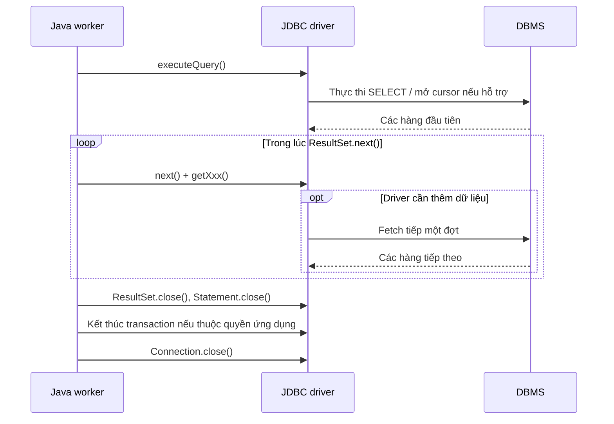

# Cấu hình `fetchSize` và phân biệt với giới hạn kết quả

Khi ứng dụng Java đọc dữ liệu từ cơ sở dữ liệu quan hệ bằng **JDBC (Java Database Connectivity)**, một câu `SELECT` có thể trả về vài hàng hoặc hàng triệu hàng. Để tối ưu việc thực thi SQL và truyền dữ liệu qua driver, lập trình viên thường gặp ba công cụ: `setFetchSize(...)`, `setMaxRows(...)` và mệnh đề giới hạn số hàng của SQL như `LIMIT` hoặc `FETCH FIRST`. Chúng có tên gọi gần nhau nhưng **giải quyết những vấn đề khác nhau**.

- **`fetchSize`** là gợi ý cho JDBC driver về số hàng nên lấy từ DBMS trong một đợt khi đọc `ResultSet`. Mục tiêu thường là điều chỉnh số lượt trao đổi và lượng dữ liệu giữ trong bộ đệm.
- **`maxRows`** là giới hạn số hàng mà một `Statement` được phép đưa vào kết quả của ứng dụng. Đây là ràng buộc ở tầng JDBC, không đồng nghĩa DBMS luôn tránh xử lý các hàng còn lại.
- **`LIMIT`, `FETCH FIRST`, `TOP`** là cú pháp giới hạn kết quả trong câu SQL theo DBMS. Chúng ràng buộc số hàng của truy vấn tại phía cơ sở dữ liệu; cú pháp và cách tối ưu phụ thuộc hệ quản trị.

Nếu mục tiêu là chỉ hiển thị **50 bản ghi**, hãy giới hạn ngay trong truy vấn. Nếu cần xử lý **toàn bộ 500.000 bản ghi** mà không muốn driver nạp tất cả cùng lúc, hãy nghiên cứu `fetchSize` và khả năng streaming/cursor của driver. Hai tình huống không thể giải quyết bằng cách thay thế lẫn nhau.

## 1. Kết quả truy vấn đi từ DBMS đến Java như thế nào?

Một ứng dụng gọi `PreparedStatement#executeQuery()` và nhận về `ResultSet`. Sau đó, mỗi lần `ResultSet#next()` thành công, chương trình có thể đọc các cột của một hàng. Tuy nhiên, **một lần gọi `next()` không bắt buộc tương ứng một chuyến mạng đến DBMS**: driver có thể lấy nhiều hàng về trước và đặt trong bộ đệm, hoặc truy xuất bổ sung khi cần.

```mermaid
flowchart LR
    A[(DBMS\nTập kết quả SQL)] -->|Các lượt fetch\nphụ thuộc driver| B[JDBC driver\nBộ đệm / cursor]
    B -->|ResultSet.next| C[Ứng dụng Java\nXử lý từng hàng]
    D[setFetchSize(n)] -. Gợi ý kích thước đợt .-> B
    E[SQL LIMIT / FETCH FIRST] -. Giới hạn kết quả truy vấn .-> A
    F[Statement.setMaxRows(n)] -. Giới hạn hàng được trả qua JDBC .-> B
```

Mô hình trên là cách hiểu khái niệm, **không cam kết driver nào cũng mở cursor hoặc chuyển dữ liệu thành các đợt mạng đúng `n` hàng**. Có driver chủ động tải toàn bộ kết quả, có driver sử dụng server-side cursor, và có driver chỉ streaming khi đáp ứng thêm điều kiện cấu hình.

### Ba thông số cần phân biệt

| Thuộc tính | Cấu hình ở đâu? | Kiểm soát điều gì? | Có làm kết quả còn ít hàng hơn không? |
|---|---|---|---|
| `setFetchSize(100)` | `Statement`, `PreparedStatement` hoặc `ResultSet` | Gợi ý số hàng đọc trong một lượt fetch | **Không**; về nguyên tắc vẫn có thể duyệt toàn bộ kết quả |
| `setMaxRows(100)` | `Statement`/`PreparedStatement` | Số hàng tối đa của `ResultSet` mà statement trả về | **Có**, tối đa 100 hàng được cung cấp cho ứng dụng |
| `LIMIT 100` | Câu SQL, ví dụ PostgreSQL/MySQL | Số hàng tối đa mà truy vấn trả về từ DBMS | **Có**, truy vấn chỉ trả tối đa 100 hàng |
| `FETCH FIRST 100 ROWS ONLY` | Câu SQL ở DBMS hỗ trợ | Tương tự giới hạn kết quả phía server | **Có** |
| `setQueryTimeout(30)` | `Statement`/`PreparedStatement` | Thời gian tối đa cố gắng chờ thực thi, đơn vị giây | **Không**; đây là giới hạn thời gian, không phải số hàng |

Giả sử câu SQL có thể trả 10.000 hàng. Đặt `fetchSize=200` không biến kết quả thành 200 hàng: vòng lặp `while (rs.next())` vẫn có thể thấy **đủ 10.000 hàng**. Đặt `maxRows=200` có nghĩa ứng dụng chỉ được nhận **tối đa 200 hàng**. Còn đưa `LIMIT 200` vào SQL khiến DBMS cung cấp kết quả gồm **tối đa 200 hàng**, dù DBMS vẫn có thể phải xét nhiều hàng hơn để lọc và sắp xếp.

## 2. `Statement#setFetchSize(int)`: một gợi ý, không phải `LIMIT`

Phương thức `setFetchSize(int rows)` thuộc `java.sql.Statement` và được kế thừa bởi `PreparedStatement`. Nó cung cấp **hint** để driver cân nhắc số hàng nên lấy từ cơ sở dữ liệu mỗi khi cần thêm dữ liệu cho `ResultSet`.

```java
String sql = "SELECT id, total_amount FROM orders WHERE status = ? ORDER BY id";

try (Connection connection = dataSource.getConnection();
     PreparedStatement statement = connection.prepareStatement(sql)) {

    statement.setString(1, "PAID");
    statement.setFetchSize(200); // Gợi ý lấy dữ liệu theo đợt 200 hàng

    try (ResultSet rows = statement.executeQuery()) {
        while (rows.next()) {
            long id = rows.getLong("id");
            BigDecimal amount = rows.getBigDecimal("total_amount");
            processOrder(id, amount);
        }
    }
}
```

Đoạn code giả định `dataSource`, bảng `orders` và hàm `processOrder(...)` đã có. Chương trình xử lý từng hàng, nhưng hành vi **đọc qua mạng và dùng bộ đệm** phải dựa trên JDBC driver, phiên bản và thiết lập kết nối. Không thể suy ra từ `setFetchSize(200)` rằng driver chắc chắn thực hiện một chuyến mạng cho mỗi 200 hàng.

### Những quy tắc JDBC quan trọng

1. **Giá trị dương (`rows > 0`):** cung cấp kích thước fetch mong muốn; driver có thể áp dụng một cách khác hoặc bỏ qua hint.
2. **Giá trị `0`:** thường có nghĩa quay lại hành vi mặc định do driver chọn. Mặc định không có nghĩa chắc chắn lấy toàn bộ hoặc không sử dụng cursor.
3. **Giá trị âm:** không hợp lệ theo hợp đồng JDBC chuẩn và có thể ném `SQLException`; không dùng giá trị âm trừ khi tài liệu driver xác nhận rõ một extension đặc biệt.
4. **Thời điểm đặt:** nên gọi `statement.setFetchSize(...)` **trước `executeQuery()`** để driver có cơ hội sử dụng hint ngay từ lúc tạo kết quả.
5. **Quan hệ với `setMaxRows`:** không coi hai giá trị là độc lập hoàn toàn; một số driver có thể báo `SQLException` nếu fetch size lớn hơn giới hạn max rows hiện hành.

`Statement#getFetchSize()` cho biết giá trị hint đang được JDBC báo lại, **không phải số hàng thực tế được tải trong mỗi lượt mạng**. Muốn xác minh lượng dữ liệu truyền, cần dùng công cụ đo hiệu năng, trace driver hoặc công cụ quan sát DBMS phù hợp.

### Cấu hình trực tiếp trên `ResultSet`

`ResultSet` cũng có `setFetchSize(int rows)` và `getFetchSize()`:

```java
try (PreparedStatement statement = connection.prepareStatement(
         "SELECT id, name FROM products ORDER BY id");
     ResultSet rows = statement.executeQuery()) {

    rows.setFetchSize(100);
    while (rows.next()) {
        handleProduct(rows.getLong("id"), rows.getString("name"));
    }
}
```

Hint đặt trên `ResultSet` có thể giúp tinh chỉnh việc đọc kết quả đã tạo, nhưng **mức độ hỗ trợ thay đổi giữa các driver**. Với các driver cần mở cursor ngay khi thực thi, đặt `fetchSize` trên `PreparedStatement` trước `executeQuery()` thường là cách dự đoán được hơn. Một số driver có thể không điều chỉnh cơ chế lấy dữ liệu giữa chừng chỉ vì `ResultSet#setFetchSize()` được gọi.

## 3. `setMaxRows(...)`: giới hạn hàng mà JDBC trả cho ứng dụng

`Statement#setMaxRows(int max)` quy định **số hàng tối đa trong `ResultSet`** do statement tạo ra. Các hàng vượt giới hạn được JDBC loại khỏi kết quả hiển thị cho ứng dụng theo hợp đồng API.

```java
String sql = "SELECT id, name FROM products ORDER BY id";

try (Connection connection = dataSource.getConnection();
     PreparedStatement statement = connection.prepareStatement(sql)) {

    statement.setMaxRows(50);  // Ứng dụng nhận nhiều nhất 50 hàng

    try (ResultSet rows = statement.executeQuery()) {
        int count = 0;
        while (rows.next()) {
            System.out.printf("%d: %s%n", rows.getLong("id"),
                    rows.getString("name"));
            count++;
        }
        System.out.println("Đã đọc: " + count); // Tối đa 50
    }
}
```

Giá trị `0` là **không giới hạn số hàng ở tầng `setMaxRows`**. Giá trị âm không hợp lệ. Với API JDBC hỗ trợ, `Statement#setLargeMaxRows(long)` và `getLargeMaxRows()` cho phép mô tả giới hạn bằng `long` thay vì `int`; cần kiểm tra khả năng hỗ trợ của driver.

**Điểm cần phân biệt:** `setMaxRows(50)` là hợp đồng mà ứng dụng quan sát ở JDBC. Driver có thể chuyển giới hạn thành câu lệnh SQL tương đương hoặc áp dụng khi tiếp nhận kết quả, tùy DBMS và implementation. Vì thế, **không nên giả định `setMaxRows` luôn làm giảm công việc CPU/I/O của DBMS**. Khi mục tiêu là giảm số hàng server trả về và chủ động tối ưu câu truy vấn, hãy sử dụng cú pháp giới hạn của SQL thích hợp.

### Kết hợp `setMaxRows` và `setFetchSize` có ý nghĩa gì?

```java
statement.setMaxRows(250);
statement.setFetchSize(100);
```

Về mặt ý nghĩa, ứng dụng chỉ đọc tối đa **250 hàng**; driver được gợi ý dùng các lượt fetch khoảng **100 hàng**. Không được suy ra chắc chắn sẽ có đúng ba lượt (100 + 100 + 50) vì driver có thể dùng cơ chế truyền, đệm, cursor hoặc giới hạn riêng. Đồng thời, **fetch size không thể tăng số hàng vượt `maxRows`**.

Nếu truy vấn thực tế chỉ có 12 hàng, cả hai cấu hình trên đều không khiến có thêm hàng xuất hiện. Nếu cần biết còn bao nhiêu hàng để làm phân trang, phải sử dụng một truy vấn đếm hoặc chiến lược truy xuất bổ sung phù hợp, chứ không suy ra tổng số bản ghi từ `fetchSize`.

## 4. `LIMIT`/`FETCH FIRST`: giới hạn ở phía SQL và DBMS

Nếu một API chỉ hiển thị 20 đơn hàng gần nhất, một cách viết thích hợp là giới hạn ngay ở câu SQL. Ví dụ với PostgreSQL hoặc MySQL:

```sql
SELECT id, created_at, total_amount
FROM orders
WHERE customer_id = ?
ORDER BY created_at DESC, id DESC
LIMIT ?;
```

Trong Java, khi DBMS/driver hỗ trợ placeholder ở vị trí `LIMIT`:

```java
String sql = "SELECT id, created_at, total_amount "
           + "FROM orders WHERE customer_id = ? "
           + "ORDER BY created_at DESC, id DESC LIMIT ?";

try (Connection connection = dataSource.getConnection();
     PreparedStatement statement = connection.prepareStatement(sql)) {

    statement.setLong(1, customerId);
    statement.setInt(2, 20);
    statement.setFetchSize(20); // Hint tùy chọn, không tạo giới hạn

    try (ResultSet rows = statement.executeQuery()) {
        while (rows.next()) {
            // Ánh xạ mỗi hàng thành DTO.
        }
    }
}
```

Ở ví dụ này, **`LIMIT 20` xác định tập kết quả tối đa 20 hàng**, còn `setFetchSize(20)` chỉ là điều chỉnh tùy chọn về cách driver lấy dữ liệu. Để kết quả ổn định, `ORDER BY` cần có khóa sắp xếp xác định; trong ví dụ, `id` là khóa phụ để phân biệt các đơn hàng có cùng `created_at`.

### Cú pháp khác nhau theo DBMS

| DBMS | Ví dụ giới hạn 20 hàng | Ghi chú |
|---|---|---|
| PostgreSQL | `ORDER BY id LIMIT 20` | Hỗ trợ `LIMIT` và các biến thể phân trang. |
| MySQL | `ORDER BY id LIMIT 20` | Hỗ trợ `LIMIT ... OFFSET ...`. |
| SQL Server | `SELECT TOP (20) ... ORDER BY id` | Có cú pháp `OFFSET ... FETCH NEXT ... ROWS ONLY` trong trường hợp phù hợp. |
| Oracle Database (bản hỗ trợ row-limiting clause) | `ORDER BY id FETCH FIRST 20 ROWS ONLY` | Phiên bản cũ có thể dùng cách giới hạn khác như `ROWNUM`. |
| DBMS hỗ trợ SQL row limiting chuẩn | `ORDER BY id FETCH FIRST 20 ROWS ONLY` | Kiểm tra phiên bản và khả năng hỗ trợ tham số của DBMS cụ thể. |

Ngay cả khi SQL đã có `LIMIT`, DBMS vẫn có thể phải **lọc, join hoặc sắp xếp nhiều hàng** trước khi chọn 20 hàng. Giới hạn số hàng đầu ra **không đồng nghĩa** giới hạn tuyệt đối số hàng được server đọc trong kế hoạch truy vấn. Hiệu năng còn phụ thuộc chỉ mục, bộ lọc, thứ tự sắp xếp và execution plan.

### `LIMIT` mà không `ORDER BY` có thể không ổn định

```sql
SELECT id FROM orders LIMIT 20;
```

Đây là yêu cầu lấy **bất kỳ 20 hàng** thỏa điều kiện theo kế hoạch thực thi. Thứ tự xuất hiện có thể thay đổi do chỉ mục, dữ liệu và kế hoạch truy vấn. Đối với giao diện hiển thị hoặc phân trang, luôn xác định `ORDER BY` phù hợp, tốt nhất bao gồm một khóa duy nhất để tránh thứ tự mơ hồ khi nhiều hàng có cùng giá trị sắp xếp.

## 5. `fetchSize` ảnh hưởng hiệu năng và bộ nhớ như thế nào?

Để hình dung, giả sử một truy vấn trả **100.000 hàng**. Nếu driver thực sự nhận dữ liệu theo đợt, kích thước fetch tác động đến điểm cân bằng giữa số lượt lấy và lượng dữ liệu đệm của mỗi lượt.

| `fetchSize` minh họa | Số lượt lấy lý tưởng nếu đúng `n` hàng/lượt | Lợi ích có thể có | Chi phí có thể có |
|---:|---:|---|---|
| 1 | 100.000 | Mỗi lượt đệm rất ít hàng | Quá nhiều lượt lấy, tăng latency/network overhead |
| 100 | 1.000 | Cân bằng tương đối giữa số lượt và đệm | Cần hiệu chỉnh theo kích thước mỗi hàng |
| 1.000 | 100 | Ít round-trip hơn | Một lượt có thể chứa nhiều dữ liệu trong RAM |
| 10.000 | 10 | Rất ít lượt lấy trên lý thuyết | Bộ đệm lớn, nguy cơ dùng nhiều heap hơn |

**Các con số trong bảng chỉ là phép chia minh họa**, không phải dự đoán số lần mạng thực tế: driver có thể lấy thêm trước (prefetch), chuyển dữ liệu theo byte, nén giao thức, hoặc tải toàn bộ kết quả bất kể hint. Một hàng gồm vài cột số nguyên có kích thước rất khác một hàng chứa JSON/CLOB lớn; `fetchSize=1000` **không có nghĩa** bộ đệm luôn tiêu tốn một lượng RAM cố định.

### Chọn `fetchSize` quá nhỏ

Nếu driver sử dụng server cursor và mỗi lượt fetch phải chờ mạng, kích thước quá nhỏ có thể làm tổng thời gian tăng vì phải đi lại nhiều lần. Tác động đặc biệt rõ khi đường truyền có latency cao. Các phép đo throughput và số lượt fetch mới cho biết vấn đề này có xảy ra trên driver cụ thể hay không.

### Chọn `fetchSize` quá lớn

Mỗi lượt lấy có thể cần đệm nhiều hàng, nhất là khi mỗi hàng chứa các cột văn bản, JSON hoặc dữ liệu nhị phân lớn. Điều đó có thể làm tăng peak memory hoặc thời gian chờ tới khi ứng dụng xử lý được hàng đầu tiên. **Tăng `fetchSize` không luôn tăng tốc**; cần xét tốc độ xử lý tại ứng dụng, băng thông mạng và hành vi của driver.

### `fetchSize` không cứu được một thuật toán nạp mọi hàng vào `List`

```java
List<Order> result = new ArrayList<>();
while (rows.next()) {
    result.add(mapOrder(rows));
}
return result;
```

Cho dù JDBC driver thật sự fetch từng đợt 100 hàng, đoạn mã trên vẫn giữ **tất cả đối tượng `Order`** trong `result` cho đến khi trả về. Nếu mục tiêu là xử lý dữ liệu lớn với bộ nhớ ổn định, hãy cân nhắc xử lý từng hàng/batch trong scope mở `ResultSet`, ghi ra hệ thống đích theo đợt, hoặc phân trang bằng truy vấn SQL. Không trả `ResultSet`/`Stream` còn phụ thuộc connection ra ngoài mà không thiết kế hợp đồng đóng tài nguyên rõ ràng.

## 6. Phụ thuộc driver: `fetchSize` có thể bị bỏ qua

Đây là phần dễ gây sai sót khi chương trình chạy trên một DBMS nhưng ứng dụng kết luận rằng cấu hình sẽ hoạt động y hệt ở hệ khác.

### PostgreSQL JDBC: cursor và giao dịch

Với PostgreSQL JDBC driver, để fetch kết quả theo các đợt dựa trên server-side cursor trong trường hợp thông dụng, ứng dụng thường cần **connection đang ở chế độ `autoCommit=false`**, `ResultSet` dạng **forward-only**, fetch size dương và các điều kiện hỗ trợ cursor của driver được đáp ứng. Nếu để `autoCommit=true` trong tình huống driver không thể duy trì cursor giữa các lượt, driver có thể tải kết quả theo cơ chế khác thay vì streaming theo đợt.

```java
// Ví dụ định hướng riêng cho PostgreSQL JDBC driver và giao dịch cục bộ.
try (Connection connection = dataSource.getConnection()) {
    connection.setAutoCommit(false);

    try (PreparedStatement statement = connection.prepareStatement(
             "SELECT id, payload FROM events ORDER BY id",
             ResultSet.TYPE_FORWARD_ONLY,
             ResultSet.CONCUR_READ_ONLY)) {

        statement.setFetchSize(500);
        try (ResultSet rows = statement.executeQuery()) {
            while (rows.next()) {
                consumeEvent(rows.getLong("id"), rows.getString("payload"));
            }
        }
    }

    connection.commit();
}
```

Đoạn mã minh họa **điều kiện kích hoạt cursor**, chưa phải helper quản lý transaction production đầy đủ. Trong ứng dụng thực tế cần có nhánh rollback khi lỗi, xử lý kết quả commit không xác định, và khôi phục trạng thái connection nếu cần trước khi trả pool. Chỉ dùng mẫu tự quản lý transaction này khi ứng dụng thật sự sở hữu giao dịch cục bộ; nếu framework/JTA đã quản lý transaction, phải sử dụng cơ chế tích hợp của framework.

**Quan trọng:** Không commit giữa vòng lặp khi cursor phụ thuộc transaction đang mở; việc commit có thể đóng cursor, khiến `ResultSet` không thể tiếp tục đọc. Tránh kéo dài giao dịch khi xử lý mỗi hàng cần nhiều thao tác tốn thời gian hoặc gọi dịch vụ ngoài.

### MySQL Connector/J: chế độ cursor/streaming phụ thuộc cấu hình

MySQL Connector/J có các chế độ xử lý kết quả riêng. Trong những cấu hình thông dụng, muốn sử dụng **cursor-based fetching** với fetch size dương có thể cần bật `useCursorFetch` và các điều kiện liên quan đến prepared statements theo tài liệu driver của phiên bản đang sử dụng. Một số phiên bản/thiết lập khác hỗ trợ kiểu streaming riêng của Connector/J, có thể dùng một giá trị fetch size đặc biệt và **không phải hành vi JDBC chuẩn áp dụng cho mọi driver**.

Vì vậy, không nên sao chép một đoạn `setFetchSize(100)` từ PostgreSQL sang MySQL rồi mặc định rằng dữ liệu sẽ được tải thành các đợt 100 hàng. Cần kiểm tra **phiên bản Connector/J, tùy chọn JDBC URL/DataSource, loại statement, trạng thái transaction và chế độ result set**. Cùng một hint có thể dẫn đến cách đệm khác nhau.

### Oracle và SQL Server: có cơ chế đệm riêng

Oracle JDBC có các cơ chế row prefetch/fetch size; Microsoft JDBC Driver for SQL Server có hành vi adaptive buffering và các thiết lập liên quan đến cách phản hồi dữ liệu. Trong mỗi hệ, kích thước fetch cần được hiểu cùng tài liệu driver và đặc điểm truy vấn. **Đặt fetch size không bảo đảm toàn bộ hàng được streaming theo một chiến lược giống nhau trên mọi DBMS.**

Khi chạy đa DBMS, nên giữ cách tiêu thụ kết quả và đóng tài nguyên theo chuẩn JDBC, đồng thời tách cấu hình tối ưu đặc thù driver thành phần cấu hình riêng có thể đo kiểm.

## 7. `fetchSize`, `ResultSet` và vòng đời `Connection`

Nếu driver duy trì cursor phía server và lấy dữ liệu từng đợt, `ResultSet` có thể phụ thuộc vào **kết nối và giao dịch vẫn còn mở**. Điều này dẫn đến một số quy tắc thiết kế:

1. **Giữ `Connection`, `PreparedStatement`, `ResultSet` còn sống trong suốt lúc tiêu thụ kết quả**; đóng chúng theo thứ tự ngược sau khi đọc xong.
2. **Không tự ý commit/rollback hoặc trả connection về pool giữa vòng lặp** nếu cursor đang đọc cần trạng thái transaction đó.
3. **Không chia sẻ một `Connection`/`ResultSet` đang đọc đồng thời cho nhiều worker thread**, trừ khi driver và thiết kế có hợp đồng rõ ràng.
4. **Không kéo dài giao dịch tùy tiện** vì cursor có thể giữ snapshot, lock hoặc tài nguyên server. Đánh đổi streaming với giao dịch lâu cần được đo và thiết kế theo nghiệp vụ.
5. **Không trả `ResultSet` ra ngoài một `try-with-resources` đã đóng `Connection`**; dữ liệu cần được map trong scope hoặc trả qua API streaming có ownership và cơ chế `close()` minh bạch.



Điểm mấu chốt là **`fetchSize` là cơ chế quản lý cách chuyển hàng**, không thay thế ranh giới tài nguyên/giao dịch. Nếu chỉ để tối ưu một API lấy 20 hàng mà vô tình giữ giao dịch mở hàng chục giây, chi phí có thể vượt xa lợi ích giảm bộ nhớ.

## 8. Khi nào chọn `fetchSize`, `maxRows` hoặc giới hạn SQL?

| Tình huống | Công cụ nên ưu tiên | Giải thích |
|---|---|---|
| Endpoint trả về 20 sản phẩm đầu tiên | SQL `ORDER BY ... LIMIT 20`/`FETCH FIRST ...` | Giới hạn số hàng DBMS trả; có thứ tự rõ ràng. |
| Xuất dữ liệu nhiều trăm nghìn hàng | Streaming/cursor được driver hỗ trợ + `fetchSize` phù hợp | Cần xử lý hết dữ liệu nhưng kiểm soát bộ đệm và số lượt lấy. |
| Công cụ có quy định không cho hiện quá 1.000 hàng | `setMaxRows(1000)` như rào chắn ở JDBC; nên cân nhắc SQL LIMIT | Hạn chế hàng nhận bởi ứng dụng; SQL LIMIT có thể giảm dữ liệu trả từ server. |
| Giao diện phân trang | SQL `LIMIT/OFFSET` hoặc keyset pagination | `fetchSize` không tạo trang và không biết tổng số trang. |
| Query có độ trễ lớn do network fetch | Đo và tinh chỉnh `fetchSize`, sau khi xác minh streaming thực sự hoạt động | Giảm round-trip nếu driver áp dụng hint. |
| Query nặng do thiếu index hoặc sort nhiều | Xem execution plan, lọc/index/SQL | Tăng `fetchSize` không cải thiện chi phí server thực thi truy vấn. |
| Kết quả nhỏ vài hàng | Dùng fetch mặc định trước | Tinh chỉnh không cần thiết có thể khiến code phức tạp hơn. |

### `OFFSET` lớn có thể gây tốn kém

```sql
SELECT id, created_at
FROM orders
ORDER BY created_at DESC, id DESC
LIMIT 50 OFFSET 500000;
```

Truy vấn trên chỉ trả tối đa 50 hàng, nhưng DBMS có thể phải xử lý/bỏ qua rất nhiều hàng đứng trước. Khi phân trang sâu, **keyset pagination** (truy vấn tiếp từ khóa của hàng cuối trang trước) thường đáng cân nhắc để giảm chi phí và ổn định hơn khi dữ liệu thay đổi. Đây là vấn đề chiến lược truy vấn; `setFetchSize(50)` không giải quyết được việc DBMS phải tìm vị trí trang.

## 9. Quy trình đo và điều chỉnh `fetchSize`

Không có giá trị `fetchSize` cố định tối ưu cho mọi ứng dụng. Nên tiến hành có kiểm soát:

1. **Xác định mục tiêu:** ít bộ nhớ hơn, thời gian hoàn thành ngắn hơn, giảm network round-trip hay tăng throughput. Đừng chỉ tăng một thông số vì thấy truy vấn trả nhiều hàng.
2. **Tách vấn đề lượng hàng và cách chuyển hàng:** nếu nghiệp vụ cần 50 hàng, giới hạn SQL trước; nếu cần đọc toàn bộ, đo fetch/streaming.
3. **Kiểm tra driver và cấu hình:** DBMS, phiên bản JDBC driver, kiểu `ResultSet`, `autoCommit`, cursor/streaming settings, connection pool và transaction manager.
4. **Đo baseline:** thời gian từ `executeQuery()` đến hàng đầu tiên, tổng thời gian duyệt, lượng heap tối đa, số hàng/s, số lượt mạng/fetch và thời gian giữ connection nếu có thể đo.
5. **Thử một vài giá trị có ý nghĩa:** chẳng hạn 50, 200, 1.000 tùy kích thước hàng và băng thông; giữ nguyên SQL, lượng dữ liệu và điều kiện khác để kết quả so sánh có giá trị.
6. **Quan sát tác dụng phụ:** thời gian chờ pool, transaction mở lâu, lock, độ trễ xử lý từng hàng và áp lực GC. Với truy vấn lớn, tránh để ứng dụng xây `List` chứa toàn bộ dữ liệu trong lúc đo tác dụng của fetch size.
7. **Chọn cấu hình dựa trên dữ liệu đo:** lưu thành cấu hình có thể điều chỉnh và kiểm thử lại khi nâng cấp driver, thay đổi schema hoặc chuyển DBMS.

### Mẫu thử nghiệm tối giản

```java
static long countRows(DataSource dataSource, int fetchSize)
        throws SQLException {
    String sql = "SELECT id FROM events ORDER BY id";
    long count = 0;

    try (Connection connection = dataSource.getConnection();
         PreparedStatement statement = connection.prepareStatement(sql)) {

        statement.setFetchSize(fetchSize);
        try (ResultSet rows = statement.executeQuery()) {
            while (rows.next()) {
                rows.getLong(1); // Đọc cột để duyệt toàn bộ kết quả
                count++;
            }
        }
    }
    return count;
}
```

Mẫu này giúp kiểm tra **số hàng được đọc** khi thay hint; nó không xác nhận streaming thực sự diễn ra hoặc đo hiệu năng đầy đủ. Với driver như PostgreSQL, kết quả đo có thể không phản ánh fetch theo đợt nếu chưa cấu hình điều kiện cursor phù hợp; cần thiết kế benchmark theo đặc điểm driver và quản lý transaction đúng cách.

## 10. Các lỗi hiểu sai thường gặp

**“`setFetchSize(100)` làm truy vấn chỉ trả 100 hàng.”** Sai. Đây là hint về kích thước đợt fetch; dùng `LIMIT` hoặc `setMaxRows` khi cần giới hạn số hàng.

**“`setMaxRows(100)` chắc chắn làm SQL chạy nhanh như `LIMIT 100`.”** Không thể khẳng định. `setMaxRows` có thể được driver áp dụng phía client hoặc server; phải xem execution plan, driver và phép đo.

**“Driver đã dùng `fetchSize` thì ứng dụng không thể tràn bộ nhớ.”** Sai. Driver có thể đệm khác mong đợi; chính ứng dụng cũng có thể tích lũy toàn bộ dữ liệu vào `List`.

**“`getFetchSize()` cho biết mỗi lượt TCP nhận đúng bao nhiêu hàng.”** Sai. Nó trả giá trị hint mà JDBC báo lại; không phải chỉ số giám sát lưu lượng mạng.

**“Dùng `LIMIT` mà không `ORDER BY` vẫn trả cùng 20 bản ghi mỗi lần.”** Không được bảo đảm. Kết quả có thể đổi theo execution plan và dữ liệu.

**“Cứ đặt `fetchSize` lớn nhất sẽ tốt nhất.”** Sai. Bộ đệm lớn có thể gây tăng RAM và GC; giá trị phù hợp tùy kích thước hàng, network và cách driver lấy dữ liệu.

**“Có cursor streaming thì đóng connection sớm vẫn đọc `ResultSet` được.”** Sai. `ResultSet` phụ thuộc statement/connection và có thể phụ thuộc transaction đang mở.

**“Mọi driver đều hỗ trợ cùng một cách streaming.”** Sai. Phải kiểm tra tài liệu, phiên bản và tùy chọn JDBC driver cụ thể.

## 11. Câu hỏi vận dụng

**Tình huống A:** Bảng có 1.000.000 hàng, API chỉ hiển thị 20 hàng mới nhất. Nên `setFetchSize(20)` hay dùng SQL giới hạn? → Dùng `ORDER BY` ổn định cùng `LIMIT 20`/cú pháp tương đương. `fetchSize` có thể để mặc định, vì mục tiêu chính là giảm số hàng kết quả.

**Tình huống B:** Job phải xử lý toàn bộ 1.000.000 hàng, nhưng heap giới hạn. Có thể dùng `setMaxRows(500)` để “đọc dần” không? → Không, vì nó làm mất các hàng sau hàng thứ 500. Hãy tìm cơ chế streaming/cursor hỗ trợ bởi driver với `fetchSize` thích hợp hoặc phân lô có checkpoint.

**Tình huống C:** PostgreSQL driver được đặt `setFetchSize(100)` nhưng memory vẫn tăng khi đọc rất nhiều hàng. Cần kiểm tra gì? → Kiểm tra `autoCommit`, kiểu `ResultSet`, điều kiện server-side cursor, phiên bản driver, và việc ứng dụng có đang tích lũy mọi DTO vào collection hay không.

**Tình huống D:** `setMaxRows(100)` cùng `setFetchSize(1000)` có luôn hợp lệ không? → Không nhất thiết. Một số driver có thể từ chối fetch size lớn hơn giới hạn max rows; nên chọn giá trị phù hợp và kiểm tra khả năng hỗ trợ.

**Tình huống E:** `SELECT ... LIMIT 20 OFFSET 500000` quá chậm. Tăng `fetchSize` lên 5000 có xử lý nguyên nhân không? → Không. Cần xem execution plan, chỉ mục, bộ lọc và cân nhắc keyset pagination, vì chi phí xác định trang nằm phía DBMS.

**Tình huống F:** Job streaming 500.000 hàng giữ transaction mở và gọi HTTP API 2 giây trên mỗi hàng. Điều gì đáng lo? → Transaction/connection bị giữ rất lâu, có thể gây cạn pool và tài nguyên DBMS. Cần thiết kế tách bước đọc, checkpoint/batch, xử lý ngoài DB và cơ chế phục hồi phù hợp.

## Ghi nhớ

Trong JDBC, **`fetchSize` điều chỉnh cách driver có thể lấy dữ liệu theo đợt**, **`setMaxRows` giới hạn số hàng ứng dụng được nhận từ statement**, còn **`LIMIT`/`FETCH FIRST` giới hạn kết quả tại SQL/DBMS**. Không dùng fetch size để phân trang, không kỳ vọng maxRows luôn tối ưu truy vấn server và không suy ra streaming chỉ từ một lời gọi API. Để đạt hiệu năng ổn định, hãy chọn cú pháp SQL theo lượng dữ liệu nghiệp vụ thật sự cần, kiểm tra khả năng cursor của driver, giữ tài nguyên/giao dịch sống đúng phạm vi và đo thời gian, bộ nhớ, network theo workload thực tế.
