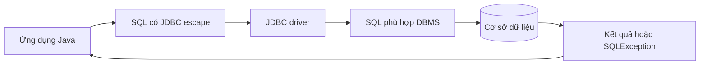

# Đánh giá tính khả chuyển của cú pháp SQL và JDBC escape syntax

## 1. Khi một ứng dụng Java cần chạy trên nhiều hệ quản trị

Giả sử một hệ thống đặt hàng viết bằng Java ban đầu dùng PostgreSQL. Khách hàng tiếp theo yêu cầu chạy cùng ứng dụng trên MySQL hoặc SQL Server. Phần mã Java sử dụng **JDBC (Java Database Connectivity)** vẫn gọi `Connection`, `PreparedStatement` và `ResultSet`, nhưng những câu SQL đang chạy tốt với PostgreSQL có thể lỗi hoặc cho kết quả khác ở hệ quản trị mới.

Ví dụ, PostgreSQL và MySQL thường dùng `LIMIT 10 OFFSET 20` để phân trang. SQL Server có cú pháp `ORDER BY ... OFFSET 20 ROWS FETCH NEXT 10 ROWS ONLY`. PostgreSQL có `ILIKE` để so khớp chuỗi không phân biệt hoa/thường, trong khi cú pháp và ngữ nghĩa tìm kiếm của các DBMS khác không hoàn toàn giống nhau.

**Tính khả chuyển (portability)** cần được xem xét ở nhiều lớp:

| Khía cạnh | Câu hỏi cần trả lời |
| --- | --- |
| **API Java** | Mã vẫn dùng các kiểu và phương thức JDBC chuẩn khi đổi driver không? |
| **Cú pháp SQL** | Hệ quản trị mới có phân tích được câu lệnh, hoặc JDBC driver có thể chuyển đổi cú pháp không? |
| **Ngữ nghĩa** | Cùng dữ liệu đầu vào có tạo ra kết quả đúng với yêu cầu nghiệp vụ không? |
| **Vận hành** | Transaction, quyền, timeout, giới hạn kết nối và hiệu năng có đáp ứng yêu cầu không? |

JDBC chuẩn hóa **cách Java gửi SQL, nhận kết quả và quản lý kết nối/giao dịch**. Nó không phải trình biên dịch tổng quát từ mọi SQL dialect sang mọi dialect khác. Một công cụ giúp giảm bớt khác biệt cú pháp là **JDBC escape syntax**.

## 2. SQL thông dụng, SQL dialect và JDBC escape khác nhau thế nào?

| Cách viết | Ví dụ | Ý nghĩa |
| --- | --- | --- |
| SQL phổ biến | `SELECT id FROM products WHERE price > 0 ORDER BY id` | Nhiều DBMS hỗ trợ, nhưng vẫn phụ thuộc schema và kiểu dữ liệu. |
| SQL dialect | PostgreSQL `ON CONFLICT`, MySQL `ON DUPLICATE KEY UPDATE`, SQL Server `TOP` | Cú pháp hoặc tính năng riêng của DBMS và phiên bản cụ thể. |
| JDBC escape syntax | `{fn UCASE(name)}`, `{d '2026-01-01'}` | Ký pháp do JDBC định nghĩa để driver xử lý hoặc chuyển đổi. |
| Parameter marker | `?` trong `PreparedStatement` | Vị trí cho **giá trị** truyền từ Java, không phải tên bảng, tên cột hay từ khóa SQL. |

Chẳng hạn, đoạn mã sau sử dụng API JDBC chuẩn:

```java
String sql = "SELECT id, name FROM products WHERE id = ?";

try (PreparedStatement statement = connection.prepareStatement(sql)) {
    statement.setLong(1, productId);
    try (ResultSet rows = statement.executeQuery()) {
        if (rows.next()) {
            System.out.println(rows.getString("name"));
        }
    }
}
```

Mã Java chỉ cần interface JDBC, nhưng câu truy vấn vẫn yêu cầu bảng `products`, các cột `id`, `name` và quyền đọc dữ liệu tồn tại trên database đích. **Câu SQL đúng cú pháp cũng chưa bảo đảm cùng kết quả**: collation, quy tắc ép kiểu, `NULL`, Unicode, timezone hoặc transaction có thể tạo khác biệt ngữ nghĩa.

## 3. JDBC escape syntax: driver làm gì với dấu ngoặc nhọn?

JDBC escape syntax sử dụng các cụm **ngoặc nhọn `{...}`** và từ khóa được quy định. Khi escape processing được bật, driver có thể nhận diện các cụm này và chuyển chúng thành biểu thức SQL tương ứng với hệ quản trị đích, nếu được hỗ trợ.



Ví dụ:

```sql
SELECT {fn UCASE(name)} AS uppercase_name
FROM products
WHERE created_on >= {d '2026-01-01'};
```

Tùy driver, `UCASE` có thể được chuyển thành cách gọi hàm tương ứng với DBMS và literal ngày có thể được biểu diễn dưới cú pháp đích. Không thể biết chính xác kết quả dịch chỉ từ dấu ngoặc nhọn; cần đối chiếu khả năng driver.

| Dạng escape | Công dụng | Ví dụ |
| --- | --- | --- |
| `{fn function(arguments)}` | Hàm vô hướng (scalar function). | `{fn UCASE(name)}` |
| `{d 'yyyy-mm-dd'}` | Literal ngày. | `{d '2026-01-01'}` |
| `{t 'hh:mm:ss'}` | Literal giờ. | `{t '09:30:00'}` |
| `{ts 'yyyy-mm-dd hh:mm:ss'}` | Literal ngày giờ; có thể có phần giây thập phân. | `{ts '2026-01-01 09:30:00.125'}` |
| `{escape 'c'}` | Chỉ định ký tự escape cho `LIKE`. | `LIKE 'A!_%' {escape '!'}` |
| `{oj ...}` | Outer join. | `{oj p LEFT OUTER JOIN c ON p.category_id = c.id}` |
| `{call procedure(...)}` | Gọi stored procedure. | `{call update_stock(?, ?)}` |
| `{? = call function(...)}` | Gọi routine có vị trí giá trị trả về. | `{? = call calculate_tax(?)}` |

**Giới hạn:** các cú pháp này không bao phủ toàn bộ SQL. Driver cũng không bắt buộc hỗ trợ mọi hàm, kiểu dữ liệu và biến thể routine có thể xuất hiện trong ứng dụng.

## 4. Hàm vô hướng với `{fn ...}`

Các DBMS có thể dùng tên hoặc cách viết hàm khác nhau. JDBC quy định những tên hàm escape thuộc nhóm chuỗi, số học, ngày/giờ và hệ thống:

```sql
SELECT
    id,
    {fn UCASE(name)} AS upper_name,
    {fn LENGTH(name)} AS name_length
FROM products
WHERE id = ?;
```

Các ví dụ khác:

```sql
SELECT {fn ABS(delta)} FROM inventory_changes;
SELECT {fn CONCAT(first_name, last_name)} FROM customers;
```

Các câu trên minh họa **hình thức JDBC escape**; không nên tuyên bố mọi driver hỗ trợ tất cả ví dụ. Driver có thể ánh xạ `UCASE` thành tên hàm của DBMS, nhưng độ dài chuỗi, chuyển hoa/thường, `NULL` và Unicode vẫn có thể phụ thuộc DBMS hoặc collation.

Để biết driver **công bố** hỗ trợ những hàm nào, hỏi `DatabaseMetaData`:

- `getStringFunctions()`: nhóm hàm chuỗi.
- `getNumericFunctions()`: nhóm hàm số.
- `getTimeDateFunctions()`: nhóm hàm thời gian.
- `getSystemFunctions()`: nhóm hàm hệ thống.

Những phương thức này trả về danh sách tên hàm dưới dạng **chuỗi phân tách bằng dấu phẩy**. Kết quả metadata là điểm khởi đầu, nhưng cần thực thi truy vấn với đúng kiểu dữ liệu và so sánh kết quả để xác nhận khả năng hỗ trợ trong thực tế.

## 5. Escape literal ngày, giờ và timestamp

Các DBMS có thể có cú pháp literal hoặc cách ép chuỗi thành ngày giờ khác nhau. JDBC cung cấp ba dạng:

```sql
-- DATE: ngày
SELECT id FROM orders WHERE order_date = {d '2026-01-01'};

-- TIME: giờ trong ngày
SELECT id FROM schedules WHERE starts_at >= {t '09:30:00'};

-- TIMESTAMP: ngày giờ
SELECT id FROM audit_events
WHERE created_at < {ts '2026-01-01 09:30:00.125'};
```

Các bảng trên được giả định tồn tại để minh họa cú pháp. Driver có thể dịch escape, nhưng DBMS vẫn quyết định cách so sánh literal với kiểu cột. **Timestamp không kèm thông tin timezone** cần quy ước rõ ở tầng nghiệp vụ; escape không tự gắn múi giờ.

Với giá trị ngày giờ đến từ ứng dụng, sử dụng tham số có kiểu rõ ràng thường phù hợp hơn nối literal vào SQL:

```java
import java.sql.Connection;
import java.sql.PreparedStatement;
import java.sql.ResultSet;
import java.sql.SQLException;
import java.time.LocalDate;

public final class OrdersFromDate {
    public static void run(Connection connection, LocalDate from)
            throws SQLException {
        String sql = "SELECT id FROM orders WHERE order_date >= ? ORDER BY id";

        try (PreparedStatement statement = connection.prepareStatement(sql)) {
            // JDBC 4.2: driver phải hỗ trợ ánh xạ java.time.
            statement.setObject(1, from);
            try (ResultSet rows = statement.executeQuery()) {
                while (rows.next()) {
                    System.out.println(rows.getLong("id"));
                }
            }
        }
    }
}
```

Với driver chưa hỗ trợ `LocalDate` qua `setObject`, có thể dùng `statement.setDate(1, java.sql.Date.valueOf(from))` cho cột `DATE`. Cần thiết kế riêng cho `TIMESTAMP`, `TIMESTAMP WITH TIME ZONE` và thời gian được diễn giải theo múi giờ nào.

## 6. Escape ký tự đại diện `%` và `_` trong `LIKE`

Trong SQL, `%` thường khớp một chuỗi bất kỳ còn `_` khớp một ký tự bất kỳ. Khi tìm **chính ký tự `%` hoặc `_` trong dữ liệu**, ứng dụng cần biểu thị chúng như ký tự thông thường.

Ví dụ muốn tìm mã sản phẩm bắt đầu bằng hai ký tự `A_`, trong đó `_` là ký tự thật:

```sql
SELECT id, code
FROM products
WHERE code LIKE 'A!_%' {escape '!'};
```

Trong mẫu `A!_%`, dấu `!` trước `_` cho biết `_` không phải wildcard, còn `%` cuối cùng vẫn là wildcard. Nếu tiền tố đến từ người dùng, cần **bind một pattern đã escape**, không nối SQL trực tiếp:

```java
import java.sql.Connection;
import java.sql.PreparedStatement;
import java.sql.ResultSet;
import java.sql.SQLException;

public final class ProductPrefixSearch {
    public static void run(Connection connection, String prefix)
            throws SQLException {
        if (prefix == null) {
            throw new IllegalArgumentException("Prefix khong duoc null");
        }
        String sql = "SELECT id, code FROM products "
                   + "WHERE code LIKE ? {escape '!'} ORDER BY id";
        String pattern = escapeLike(prefix) + "%";

        try (PreparedStatement statement = connection.prepareStatement(sql)) {
            statement.setString(1, pattern);
            try (ResultSet rows = statement.executeQuery()) {
                while (rows.next()) {
                    System.out.println(rows.getString("code"));
                }
            }
        }
    }

    private static String escapeLike(String value) {
        return value.replace("!", "!!")
                    .replace("%", "!%")
                    .replace("_", "!_");
    }
}
```

Nhập `A_` tạo ra pattern `A!_%`; nhập `50%` tạo `50!%%`, trong đó dấu `%` trước là dữ liệu thật, dấu `%` cuối mới là wildcard. **Escape syntax khai báo ký tự thoát, còn ứng dụng tự chịu trách nhiệm tạo pattern đúng ý định.** Collation và khả năng dùng index vẫn do DBMS quyết định.

## 7. Outer join escape `{oj ...}`

Nhiều hệ quản trị hiện đại hỗ trợ trực tiếp cú pháp outer join:

```sql
SELECT p.id, c.name
FROM products p
LEFT OUTER JOIN categories c ON p.category_id = c.id;
```

JDBC có dạng escape tương ứng:

```sql
SELECT p.id, c.name
FROM {oj products p LEFT OUTER JOIN categories c
      ON p.category_id = c.id};
```

Driver có thể xử lý `{oj ...}` theo khả năng join của DBMS. Có thể khảo sát bằng `DatabaseMetaData.supportsOuterJoins()`, `supportsFullOuterJoins()` hoặc `supportsLimitedOuterJoins()`. Không phải mọi DBMS đều hỗ trợ cùng những biến thể join.

Với nhiều DBMS đích, `LEFT OUTER JOIN` viết trực tiếp đã đủ dễ hiểu và phù hợp. Không nên thêm escape chỉ vì tưởng rằng dấu ngoặc nhọn luôn làm truy vấn khả chuyển hơn; hãy dựa trên **danh sách driver/DBMS thực tế cần hỗ trợ**.

## 8. Routine: `{call ...}` và `{? = call ...}`

Stored procedure và function khác nhau đáng kể giữa các hệ quản trị: cách định nghĩa, tham số `IN/OUT`, kiểu trả về, xử lý nhiều result set và transaction. JDBC cung cấp `CallableStatement` và các dạng escape:

```sql
-- Stored procedure
{call update_stock(?, ?)}

-- Routine có giá trị trả về
{? = call calculate_tax(?)}
```

Ví dụ hàm giả định `calculate_tax` nhận và trả về giá trị `DECIMAL`:

```java
import java.math.BigDecimal;
import java.sql.CallableStatement;
import java.sql.Connection;
import java.sql.SQLException;
import java.sql.Types;

public final class TaxFunction {
    public static BigDecimal calculate(Connection connection,
                                       BigDecimal amount)
            throws SQLException {
        try (CallableStatement call =
                     connection.prepareCall("{? = call calculate_tax(?)}")) {
            call.registerOutParameter(1, Types.DECIMAL);
            call.setBigDecimal(2, amount);
            call.execute();
            return call.getBigDecimal(1);
        }
    }
}
```

Vị trí số `1` là tham số giá trị trả về, số `2` là tham số đầu vào; các chỉ số JDBC bắt đầu từ **1**. Ví dụ chỉ chạy khi có routine phù hợp trên DBMS đích và driver hỗ trợ cách gọi đó. Escape **không tự chuyển body của stored procedure** hoặc mọi quy tắc tham số giữa các hệ quản trị.

## 9. Escape processing mặc định và `setEscapeProcessing`

`Statement.setEscapeProcessing(boolean)` cho phép bật hoặc tắt xử lý JDBC escape ở một statement thích hợp. **Theo JDBC, xử lý escape mặc định được bật**.

```java
try (Statement statement = connection.createStatement()) {
    statement.setEscapeProcessing(true);
    try (ResultSet rows = statement.executeQuery(
            "SELECT {fn UCASE(name)} FROM products")) {
        while (rows.next()) {
            System.out.println(rows.getString(1));
        }
    }
}
```

Đây là ví dụ cú pháp trong ngữ cảnh đã có `connection`; nó còn phụ thuộc bảng và driver hỗ trợ hàm. Nếu tắt escape processing, cú pháp `{fn ...}` có thể đi nguyên dạng tới DBMS và bị từ chối.

**Lưu ý:** Với `PreparedStatement` hoặc `CallableStatement`, driver có thể đã phân tích SQL **khi chuẩn bị đối tượng**. Theo hợp đồng API, tắt escape processing sau khi đã prepare có thể không có hiệu lực. Vì vậy, không dùng `preparedStatement.setEscapeProcessing(false)` như cách chắc chắn ngăn driver dịch escape.

Với SQL native chứa ký tự ngoặc nhọn, ví dụ một số biểu thức JSON, cần hiểu cách parser của driver hoạt động thay vì tắt xử lý escape trên toàn bộ hệ thống mà không kiểm tra ảnh hưởng.

## 10. `Connection.nativeSQL(...)` quan sát được gì?

API này yêu cầu driver chuyển câu SQL sang cú pháp native:

```java
String nativeSql = connection.nativeSQL(
        "SELECT {fn UCASE(name)} FROM products");
System.out.println(nativeSql);
```

`nativeSQL(...)` **không thực thi truy vấn**, không truy cập hàng dữ liệu và không xác nhận tài khoản hay schema tồn tại. Một driver có thể giữ nguyên phần SQL đã tương thích, hoặc chuyển khác với driver còn lại.

Vì thế, chuỗi trả về có ích khi khảo sát cú pháp escape, nhưng **không chứng minh câu lệnh chạy thành công hay giữ nguyên ngữ nghĩa**. Để xác nhận portability, vẫn cần thực thi SQL và đối chiếu kết quả.

## 11. Dùng `DatabaseMetaData` để khảo sát khả năng

`DatabaseMetaData` cho phép ứng dụng hỏi driver/database về phiên bản và các tính năng:

| API metadata | Ý nghĩa |
| --- | --- |
| `getDatabaseProductName()`, `getDatabaseProductVersion()` | Tên và phiên bản DBMS. |
| `getDriverName()`, `getDriverVersion()` | Driver và phiên bản. |
| `getStringFunctions()`, `getNumericFunctions()` | Danh sách hàm chuỗi/số được công bố. |
| `getTimeDateFunctions()`, `getSystemFunctions()` | Danh sách hàm ngày giờ/hệ thống. |
| `supportsOuterJoins()`, `supportsFullOuterJoins()` | Khả năng outer join được công bố. |
| `supportsStoredProcedures()` | Hỗ trợ stored procedure theo metadata. |
| `getIdentifierQuoteString()` | Ký tự quote tên identifier. |
| `getSQLKeywords()` | Từ khóa riêng theo hợp đồng metadata. |

Ví dụ vừa thăm dò metadata, vừa **thực thi thử**:

```java
import java.sql.Connection;
import java.sql.DatabaseMetaData;
import java.sql.PreparedStatement;
import java.sql.ResultSet;
import java.sql.SQLException;
import javax.sql.DataSource;

public final class EscapeCapabilityProbe {
    public static void run(DataSource source, long productId)
            throws SQLException {
        String sql =
                "SELECT {fn UCASE(name)} AS upper_name FROM products WHERE id = ?";

        try (Connection connection = source.getConnection()) {
            DatabaseMetaData meta = connection.getMetaData();
            System.out.println("DBMS: " + meta.getDatabaseProductName()
                    + " " + meta.getDatabaseProductVersion());
            System.out.println("Driver: " + meta.getDriverName()
                    + " " + meta.getDriverVersion());
            System.out.println("Functions: " + meta.getStringFunctions());
            System.out.println("Native SQL: " + connection.nativeSQL(sql));

            try (PreparedStatement statement = connection.prepareStatement(sql)) {
                statement.setLong(1, productId);
                try (ResultSet rows = statement.executeQuery()) {
                    if (rows.next()) {
                        System.out.println(rows.getString("upper_name"));
                    } else {
                        System.out.println("Khong tim thay san pham");
                    }
                }
            }
        }
    }
}
```

Ví dụ giả định có bảng `products(id, name)`, một `DataSource` cấu hình hợp lệ và driver hỗ trợ hàm. Nếu driver không xử lý được escape, lỗi `SQLException` là dữ liệu kiểm thử cần ghi nhận. **Metadata là khả năng được công bố, còn thực thi và so sánh kết quả mới xác nhận khả năng thực tế.**

## 12. Những khác biệt mà JDBC escape không giải quyết

| Nhu cầu | Khác biệt thường gặp | Hướng xử lý |
| --- | --- | --- |
| Phân trang | PostgreSQL/MySQL dùng `LIMIT/OFFSET`; SQL Server dùng `OFFSET ... FETCH NEXT`. | Adapter theo dialect hoặc framework có hỗ trợ. |
| Upsert | `ON CONFLICT`, `ON DUPLICATE KEY UPDATE`, `MERGE`. | SQL riêng theo DBMS và kiểm thử cạnh tranh dữ liệu. |
| Nhận khóa sau `INSERT` | `RETURNING`, `OUTPUT` hoặc cơ chế riêng. | Cân nhắc `getGeneratedKeys()` theo khả năng driver. |
| Identifier | Dấu nháy kép, backtick, dấu ngoặc vuông; case folding khác nhau. | Thiết kế schema và quote identifier có kiểm soát. |
| DDL | `SEQUENCE`, `IDENTITY`, index, JSON/UUID/array khác nhau. | Migration theo DBMS. |
| Khóa và transaction | `SELECT ... FOR UPDATE`, lock hint, MVCC, isolation. | Thiết kế nhất quán và concurrency test cho từng hệ. |
| Tìm kiếm | `ILIKE`, regex, full-text search, collation. | Thiết kế theo tính năng DBMS. |

Ví dụ phân trang:

```sql
-- PostgreSQL/MySQL
SELECT id, name FROM products ORDER BY id LIMIT 10 OFFSET 20;

-- SQL Server
SELECT id, name FROM products ORDER BY id
OFFSET 20 ROWS FETCH NEXT 10 ROWS ONLY;
```

Ngay cả khi hai câu SQL đều chạy, hãy bảo đảm `ORDER BY` đủ ổn định, chẳng hạn dùng khóa chính duy nhất; dữ liệu thay đổi đồng thời vẫn có thể ảnh hưởng trang kết quả. JDBC có `Statement.setMaxRows(...)` để giới hạn số hàng của một kết quả, nhưng không phải API phân trang có offset và không bảo đảm lợi ích hiệu năng giống phân trang tại DBMS.

## 13. Bind giá trị an toàn không thay thế xử lý dialect

`PreparedStatement` dùng `?` để truyền **giá trị**:

```java
String sql = "SELECT id FROM products WHERE price >= ? AND category_id = ?";
try (PreparedStatement statement = connection.prepareStatement(sql)) {
    statement.setBigDecimal(1, minPrice);
    statement.setLong(2, categoryId);
    try (ResultSet rows = statement.executeQuery()) {
        while (rows.next()) {
            System.out.println(rows.getLong("id"));
        }
    }
}
```

Marker `?` **không thay tên cột, tên bảng hoặc từ khóa SQL**:

```java
// Sai kỳ vọng: bind "name" sẽ không biến SELECT ? thành SELECT name.
String invalidSql = "SELECT ? FROM products";
```

Nếu người dùng được chọn tên cột sắp xếp, ứng dụng cần ánh xạ lựa chọn qua **allowlist** identifier được cho phép rồi dựng phần cấu trúc SQL có kiểm soát. `getIdentifierQuoteString()` có thể giúp biết ký tự quote, nhưng tự nó không xử lý mọi vấn đề schema và chữ hoa/thường.

Ngoài cú pháp, kiểu giá trị đã bind còn có thể thay đổi ngữ nghĩa: `BigDecimal` phụ thuộc precision/scale của cột; `LocalDateTime` hoặc `OffsetDateTime` phụ thuộc kiểu timestamp và cách chuyển đổi timezone. Cần thử các giá trị biên trên từng DBMS mục tiêu.

## 14. Quy trình đánh giá tính khả chuyển

Một cách thực hành phù hợp khi chuyển ứng dụng JDBC sang nhiều DBMS:

1. **Xác định môi trường đích:** phiên bản Java, JDBC driver, DBMS và phiên bản server; biết chính xác tổ hợp cần hỗ trợ.
2. **Phân loại SQL:** tìm các phần SQL phổ biến và những phần phụ thuộc dialect (upsert, phân trang, hàm đặc thù, DDL, khóa).
3. **Chọn escape khi có ích:** cân nhắc `{fn ...}`, literal ngày/giờ, `{escape ...}`, `{oj ...}` và callable syntax.
4. **Khảo sát metadata:** dùng `DatabaseMetaData` và khi cần `nativeSQL(...)` để hiểu khả năng driver công bố.
5. **Chạy integration test trên từng DBMS:** chuẩn bị schema/dữ liệu tương đương, thực thi câu lệnh và so sánh số hàng, kiểu, giá trị, transaction.
6. **Thử trường hợp biên:** `NULL`, Unicode/collation, `%`/`_`, timezone, số thập phân, thứ tự phân trang và cạnh tranh cập nhật.
7. **Quan sát vận hành:** timeout, lock wait, execution plan và chỉ mục. SQL đúng cú pháp không đồng nghĩa hiệu năng phù hợp.
8. **Giữ phần dialect ở ranh giới rõ ràng:** khi thật sự cần SQL riêng, đặt nó vào adapter có test thay vì cố gắng dùng một cú pháp chung làm sai nghiệp vụ.

Bảng sau chỉ là **kế hoạch kiểm chứng**, không phải các kết quả PASS đã đo:

| Trường hợp | PostgreSQL | MySQL | SQL Server |
| --- | --- | --- | --- |
| `SELECT` có marker `?` | Cần chạy test | Cần chạy test | Cần chạy test |
| `{fn UCASE(name)}` | Test driver và đầu ra | Test driver và đầu ra | Test driver và đầu ra |
| `{d '2026-01-01'}` | Test kiểu và giá trị | Test kiểu và giá trị | Test kiểu và giá trị |
| `LIKE ? {escape '!'}` | Test wildcard/collation | Test wildcard/collation | Test wildcard/collation |
| Phân trang | Test dialect | Test dialect | Test dialect |

Chỉ đánh dấu PASS sau khi chạy trên đúng driver/DBMS và đối chiếu kết quả với yêu cầu nghiệp vụ.

## 15. Ví dụ kết hợp: tìm sản phẩm theo mã và ngày tạo

Giả sử bảng `products(id, code, name, created_on)` có cột `created_on` kiểu `DATE`. Ứng dụng muốn tìm sản phẩm có mã bắt đầu bằng một tiền tố do người dùng nhập và ngày tạo không trước một mốc nhất định.

```java
import java.sql.Connection;
import java.sql.Date;
import java.sql.PreparedStatement;
import java.sql.ResultSet;
import java.sql.SQLException;
import java.time.LocalDate;
import javax.sql.DataSource;

public final class PortableProductSearch {
    private final DataSource source;

    public PortableProductSearch(DataSource source) {
        this.source = source;
    }

    public void search(String prefix, LocalDate fromDate) throws SQLException {
        if (prefix == null || fromDate == null) {
            throw new IllegalArgumentException("Thieu du lieu tim kiem");
        }
        String sql = "SELECT id, name FROM products "
                   + "WHERE code LIKE ? {escape '!'} "
                   + "AND created_on >= ? ORDER BY id";
        String pattern = prefix.replace("!", "!!")
                               .replace("%", "!%")
                               .replace("_", "!_") + "%";

        try (Connection connection = source.getConnection();
             PreparedStatement statement = connection.prepareStatement(sql)) {
            statement.setString(1, pattern);
            statement.setDate(2, Date.valueOf(fromDate));
            try (ResultSet rows = statement.executeQuery()) {
                while (rows.next()) {
                    System.out.println(rows.getLong("id")
                            + ": " + rows.getString("name"));
                }
            }
        }
    }
}
```

Với cột timestamp thay vì date, cần điều chỉnh kiểu tham số và quy tắc timezone. Với collation khác nhau, phép so khớp mã sản phẩm có thể khác. Khi thêm phân trang, có thể dành phần SQL phân trang cho một adapter theo DBMS, còn mã bind tham số và ánh xạ `ResultSet` được dùng chung.

## 16. Những cách hiểu sai thường gặp

| Nhận định sai | Cách hiểu đúng |
| --- | --- |
| “Dùng JDBC nghĩa là mọi SQL khả chuyển.” | JDBC chuẩn hóa API; dialect và ngữ nghĩa vẫn phụ thuộc DBMS. |
| “Mọi `{fn ...}` đều chạy được.” | Chỉ những hàm và kiểu đối số được driver/DBMS hỗ trợ. |
| “`nativeSQL` chạy được tức SQL đúng.” | Nó không thực thi và không kiểm tra kết quả. |
| “Escape processing mặc định tắt.” | Theo JDBC, với `Statement` mặc định bật. |
| “`{escape '!'}` tự sửa toàn bộ pattern từ người dùng.” | Ứng dụng phải escape các wildcard trong giá trị. |
| “Có thể bind tên cột vào `?`.” | Marker chỉ dành cho giá trị, không thay thế cấu trúc SQL. |
| “Metadata báo hỗ trợ thì được đánh dấu PASS.” | Cần thử truy vấn và đối chiếu kết quả thực tế. |
| “SQL giống nhau sẽ chạy nhanh như nhau.” | Kế hoạch truy vấn, chỉ mục và cấu hình DBMS khác nhau. |

## 17. Bài tập và câu hỏi tự kiểm tra

### Bài tập 1: thăm dò hàm chuỗi

Viết hai truy vấn, một dùng `UPPER(name)` và một dùng `{fn UCASE(name)}`. In `getStringFunctions()` và `nativeSQL(...)`, sau đó chạy cả hai trên các DBMS cần hỗ trợ. Thử tên tiếng Việt có dấu, Unicode và giá trị `NULL`, ghi lại kết quả kèm tên/phiên bản driver.

### Bài tập 2: tìm ký tự wildcard thực

Cho các mã `A_01`, `A%02`, `AB03`. Dùng `LIKE ? {escape '!'}` để tìm đúng những mã bắt đầu bằng hai ký tự `A_`. Sau đó thử tiền tố `A%` và giải thích vị trí nào trong pattern là ký tự dữ liệu, vị trí nào là wildcard.

### Bài tập 3: đánh giá ứng dụng nhiều DBMS

Một chức năng cần phân trang đơn hàng, upsert tồn kho và nhận khóa sinh sau `INSERT`. Lập bảng phân loại phần SQL có thể dùng chung, phần cần dialect riêng, khả năng dùng `getGeneratedKeys()` và những test phải chạy trên PostgreSQL, MySQL, SQL Server. Không điền PASS nếu chưa có kết quả thực thi.

### Câu hỏi tự kiểm tra

1. **JDBC escape syntax là gì?** Một số ký pháp ngoặc nhọn chuẩn để driver nhận diện và chuyển đổi cú pháp khi hỗ trợ.
2. **`{fn UCASE(name)}` bảo đảm chạy trên mọi driver?** Không. Cần kiểm tra metadata và thực thi trên DBMS đích.
3. **Các dạng literal thời gian?** `{d '...'}`, `{t '...'}` và `{ts '...'}`.
4. **`{escape '!'}` làm gì?** Chỉ định ký tự escape trong `LIKE`, giúp phân biệt wildcard với ký tự dữ liệu.
5. **`nativeSQL(...)` có thực thi truy vấn?** Không. Nó chỉ yêu cầu driver chuyển đổi chuỗi SQL.
6. **`?` có thể bind tên cột?** Không. Placeholder dành cho giá trị, identifier cần allowlist.
7. **Tại sao SQL dịch được vẫn có thể không khả chuyển về nghiệp vụ?** Vì collation, kiểu dữ liệu, `NULL`, timezone, transaction và hành vi thực thi có thể khác nhau.

Khi đánh giá tính khả chuyển trong JDBC, hãy xem **escape syntax là công cụ hỗ trợ một phần cú pháp**, kết hợp `PreparedStatement` để bind dữ liệu an toàn, `DatabaseMetaData` để khảo sát driver và **integration test trên đúng DBMS đích** để xác nhận kết quả nghiệp vụ.
