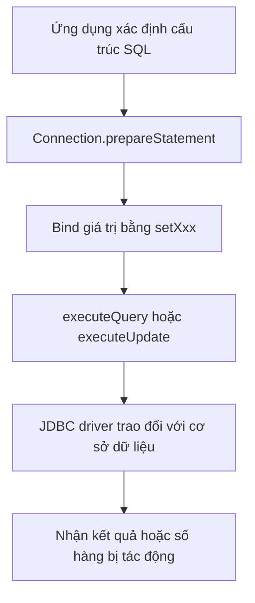

# Vai trò của `PreparedStatement` và câu SQL có tham số trong JDBC

Trong một ứng dụng sử dụng **JDBC (Java Database Connectivity)** để làm việc với cơ sở dữ liệu quan hệ, phần lớn câu SQL cần nhận dữ liệu thay đổi theo từng yêu cầu: email người dùng, mã sản phẩm, khoảng giá, trạng thái đơn hàng hoặc thời gian tạo. Cách truyền những giá trị này vào SQL ảnh hưởng trực tiếp đến **tính an toàn, tính đúng đắn và khả năng bảo trì** của ứng dụng.

`PreparedStatement` là giao diện JDBC dành cho câu lệnh SQL đã được xác định cấu trúc, có thể chứa **dấu giữ chỗ `?` (parameter marker)** để nhận giá trị ở thời điểm thực thi. Đây là lựa chọn thông dụng khi ứng dụng cần chạy `SELECT`, `INSERT`, `UPDATE` hoặc `DELETE` với dữ liệu đầu vào.

## 1. Vì sao không nên ghép dữ liệu vào chuỗi SQL?

Giả sử ứng dụng cần tìm tài khoản theo email. Cách ghép chuỗi sau đây có vấn đề:

```java
String email = requestEmail; // Giá trị đến từ người dùng
String sql = "SELECT id, email FROM users WHERE email = '" + email + "'";

try (Statement statement = connection.createStatement();
     ResultSet resultSet = statement.executeQuery(sql)) {
    // Xử lý kết quả
}
```

Nếu `requestEmail` chứa dấu nháy đơn hoặc cú pháp SQL, dữ liệu có thể làm thay đổi ý nghĩa câu lệnh. Ví dụ, giá trị đầu vào:

```text
' OR '1'='1
```

sẽ tạo thành câu truy vấn có điều kiện gần như luôn đúng:

```sql
SELECT id, email FROM users WHERE email = '' OR '1'='1'
```

Đây là một dạng **SQL injection**: dữ liệu chưa được tin cậy bị diễn giải như một phần cú pháp SQL. Ngoài rủi ro bảo mật, việc nối chuỗi còn khiến lập trình viên phải tự xử lý dấu nháy, ký tự đặc biệt, định dạng ngày và kiểu số theo từng hệ quản trị cơ sở dữ liệu.

## 2. Câu SQL có tham số là gì?

Câu SQL có tham số giữ nguyên **cấu trúc câu lệnh**, còn các giá trị thay đổi được biểu diễn bằng `?`:

```sql
SELECT id, email
FROM users
WHERE email = ? AND active = ?
```

Mỗi `?` tương ứng với một vị trí nhận giá trị. Ứng dụng cung cấp giá trị qua các phương thức `setXxx(index, value)` của `PreparedStatement`, trong đó **chỉ số tham số bắt đầu từ 1**, không phải 0.

```java
String sql = "SELECT id, email FROM users WHERE email = ? AND active = ?";

try (PreparedStatement statement = connection.prepareStatement(sql)) {
    statement.setString(1, requestEmail);
    statement.setBoolean(2, true);

    try (ResultSet resultSet = statement.executeQuery()) {
        while (resultSet.next()) {
            long id = resultSet.getLong("id");
            String email = resultSet.getString("email");
            System.out.println(id + ": " + email);
        }
    }
}
```

Ở đây, kể cả khi `requestEmail` là chuỗi chứa `' OR '1'='1`, trình điều khiển JDBC xử lý nó như **giá trị của điều kiện `email = ?`**, không biến nó thành mệnh đề `OR` bổ sung. Việc bind tham số tách biệt vai trò của **mã SQL** và **dữ liệu**.

Một số đặc điểm cần nhớ:

| Thành phần | Vai trò |
| --- | --- |
| `Connection.prepareStatement(sql)` | Tạo đối tượng thực thi câu SQL với cấu trúc đã xác định. |
| `?` | Đánh dấu vị trí của một **giá trị** cần cung cấp khi chạy câu SQL. |
| `setString(1, email)` | Gán chuỗi `email` cho vị trí tham số thứ nhất. |
| `setInt`, `setLong`, `setBigDecimal`, `setBoolean`, ... | Gán giá trị phù hợp với kiểu dữ liệu SQL. |
| `executeQuery()` | Thực thi truy vấn trả về `ResultSet`, thường dùng với `SELECT`. |
| `executeUpdate()` | Thực thi lệnh thay đổi dữ liệu/DDL, trả về số hàng bị tác động trong các lệnh DML thông thường. |
| `try-with-resources` | Đóng `ResultSet`, `PreparedStatement` và các tài nguyên JDBC sau khi sử dụng. |

## 3. `PreparedStatement` hoạt động như thế nào?

Luồng xử lý ở phía ứng dụng có thể hình dung như sau:



Về mặt khái niệm, cấu trúc truy vấn và các giá trị tham số được cung cấp riêng. **Cơ chế prepare thực tế tùy thuộc JDBC driver và hệ quản trị cơ sở dữ liệu**: driver có thể dùng prepared statement phía máy chủ, thực hiện chuẩn bị ở phía client hoặc chọn cách khác. Vì vậy, không nên mặc định mọi lệnh `prepareStatement` đều tạo một kế hoạch thực thi được cache ở máy chủ.

`PreparedStatement` giúp giảm lỗi định dạng và nguy cơ SQL injection tại các vị trí giá trị, nhưng không tự kiểm tra nghiệp vụ: email vẫn cần được xác thực định dạng khi thích hợp, quyền truy cập vẫn cần được kiểm tra và dữ liệu vẫn phải thỏa ràng buộc của cơ sở dữ liệu.

## 4. Ví dụ: tìm dữ liệu bằng `PreparedStatement`

Đoạn mã dưới đây minh họa một hàm tìm tên hiển thị theo email. `DataSource` cung cấp kết nối JDBC và thường được cấu hình trong tầng truy cập dữ liệu của ứng dụng.

```java
import java.sql.Connection;
import java.sql.PreparedStatement;
import java.sql.ResultSet;
import java.sql.SQLException;
import java.util.Optional;
import javax.sql.DataSource;

public final class UserRepository {
    private final DataSource dataSource;

    public UserRepository(DataSource dataSource) {
        this.dataSource = dataSource;
    }

    public Optional<String> findDisplayNameByEmail(String email) throws SQLException {
        String sql = "SELECT display_name FROM users WHERE email = ?";

        try (Connection connection = dataSource.getConnection();
             PreparedStatement statement = connection.prepareStatement(sql)) {

            statement.setString(1, email);

            try (ResultSet resultSet = statement.executeQuery()) {
                if (resultSet.next()) {
                    return Optional.ofNullable(resultSet.getString("display_name"));
                }
                return Optional.empty();
            }
        }
    }
}
```

Trình tự quan trọng là **tạo SQL → chuẩn bị statement → gán tất cả tham số → thực thi → đọc kết quả**. Các đối tượng đều được đóng qua `try-with-resources`, kể cả khi có `SQLException`. Đoạn mã giả định bảng `users` có các cột `email` và `display_name`; kết quả thực tế phụ thuộc schema và dữ liệu của ứng dụng.

Trong ví dụ này, `email` là dữ liệu cần so khớp **chính xác**. Giá trị chứa ký tự `%` hoặc `_` không trở thành ký tự đại diện vì câu truy vấn dùng toán tử `=`. Trường hợp dùng `LIKE` sẽ được đề cập ở phần lưu ý.

## 5. Bind tham số đúng kiểu dữ liệu

JDBC cung cấp các phương thức bind theo kiểu Java/SQL. Chọn kiểu phù hợp giúp tránh chuyển đổi ngầm không cần thiết và dễ biểu đạt ý định:

```java
String sql = "INSERT INTO orders "
           + "(customer_id, total_amount, paid, created_at) "
           + "VALUES (?, ?, ?, ?)";

try (PreparedStatement statement = connection.prepareStatement(sql)) {
    statement.setLong(1, customerId);
    statement.setBigDecimal(2, totalAmount); // java.math.BigDecimal
    statement.setBoolean(3, false);
    statement.setTimestamp(4, java.sql.Timestamp.from(java.time.Instant.now()));

    int insertedRows = statement.executeUpdate();
    System.out.println("Số dòng được thêm: " + insertedRows);
}
```

Một vài quy tắc sử dụng:

- **Chuỗi và số:** Dùng `setString` cho dữ liệu ký tự, `setInt`/`setLong` cho số nguyên, `setBigDecimal` cho giá trị tiền tệ cần giữ độ chính xác thập phân. Không tự chèn dấu nháy quanh dấu `?`.
- **Ngày giờ:** Có thể dùng `setDate`, `setTime`, `setTimestamp`; `setObject` với kiểu ngày giờ trong `java.time` được JDBC 4.2 hỗ trợ về mặt API nhưng mức độ tương thích phụ thuộc driver và loại cột.
- **Giá trị SQL `NULL`:** Dùng `setNull(index, java.sql.Types.INTEGER)` hoặc kiểu SQL tương ứng. `setObject(index, null, sqlType)` cũng phù hợp khi driver hỗ trợ. Tránh giả định driver luôn suy ra được kiểu khi truyền `null` không chỉ định kiểu.
- **Thứ tự:** Vị trí `?` được đánh số theo thứ tự xuất hiện trong SQL từ trái sang phải. Một giá trị dùng ở hai vị trí cần bind ở **cả hai** vị trí.
- **Phạm vi bind:** Trước mỗi lần thực thi, cần bảo đảm **tất cả** vị trí tham số đều có giá trị đúng ý định. Khi tái sử dụng một statement, giá trị đã bind có thể còn từ lần trước; nên gán lại đầy đủ để tránh dữ liệu cũ.

Ví dụ cập nhật dùng nhiều kiểu và một điều kiện:

```java
String sql = "UPDATE products SET price = ?, active = ? WHERE id = ?";

try (PreparedStatement statement = connection.prepareStatement(sql)) {
    statement.setBigDecimal(1, new java.math.BigDecimal("249000.00"));
    statement.setBoolean(2, true);
    statement.setLong(3, productId);

    int affectedRows = statement.executeUpdate();
    if (affectedRows == 0) {
        System.out.println("Không tìm thấy sản phẩm để cập nhật.");
    }
}
```

## 6. Có thể tái sử dụng `PreparedStatement` không?

Có. Khi thực thi **cùng một cấu trúc SQL** với nhiều bộ giá trị, có thể giữ `PreparedStatement` trong phạm vi một kết nối và bind lại các giá trị trước mỗi lần chạy. Ví dụ:

```java
String sql = "UPDATE products SET stock_quantity = ? WHERE id = ?";

try (PreparedStatement statement = connection.prepareStatement(sql)) {
    for (StockUpdate update : updates) {
        statement.setInt(1, update.getNewQuantity());
        statement.setLong(2, update.getProductId());
        statement.addBatch();
    }

    int[] updateCounts = statement.executeBatch();
}
```

Ví dụ giả định ứng dụng đã định nghĩa lớp `StockUpdate`, biến `updates` và `connection`. `addBatch()` gom các lần thực thi với bộ tham số hiện tại; `executeBatch()` gửi lô cho driver xử lý. Khả năng tối ưu batching khác nhau giữa các driver. Nếu các cập nhật cần thành công hoặc thất bại **như một đơn vị**, ứng dụng phải quản lý transaction (`setAutoCommit(false)`, `commit`, `rollback`) theo yêu cầu nghiệp vụ; batching tự nó không bảo đảm tính nguyên tử.

**Hiệu năng:** Prepared statement *có thể* giảm chi phí phân tích hoặc tối ưu câu SQL khi driver/cơ sở dữ liệu hỗ trợ tái sử dụng. Tuy nhiên, không có bảo đảm rằng một câu SQL dùng `PreparedStatement` luôn nhanh hơn `Statement`; lợi ích phụ thuộc driver, cơ sở dữ liệu, truy vấn, cache và cách ứng dụng sử dụng kết nối.

Không nên chia sẻ cùng một `PreparedStatement` cho nhiều luồng đồng thời nếu không có bảo đảm thread-safety rõ ràng từ driver. Thông thường mỗi thao tác/kết nối quản lý statement theo phạm vi riêng.

## 7. Giới hạn của dấu `?`: tham số là **giá trị**, không phải cú pháp SQL

Một nhầm lẫn phổ biến là dùng `?` cho tên bảng, tên cột hoặc từ khóa:

```sql
-- Không đúng cách: ? không thể đại diện cho tên cột trong ORDER BY
SELECT id, name FROM products ORDER BY ?

-- Không đúng cách: ? không thể đại diện cho tên bảng
SELECT id, name FROM ? WHERE active = ?
```

Dấu `?` chỉ dùng ở vị trí biểu thức **giá trị** mà hệ quản trị cơ sở dữ liệu cho phép. Với tên cột sắp xếp được chọn động, hãy dùng **danh sách giá trị cho phép** ở phía Java rồi mới đưa tên cột hợp lệ vào SQL:

```java
String orderBy;
switch (sortKey) {
    case "name":
        orderBy = "name";
        break;
    case "price":
        orderBy = "price";
        break;
    default:
        orderBy = "id";
}

String sql = "SELECT id, name, price FROM products "
           + "WHERE category_id = ? ORDER BY " + orderBy;

try (PreparedStatement statement = connection.prepareStatement(sql)) {
    statement.setLong(1, categoryId);
    // executeQuery() và xử lý ResultSet
}
```

`orderBy` trong ví dụ chỉ nhận **các tên cột cố định do mã nguồn định nghĩa**, không lấy nguyên văn từ đầu vào. Nếu cần thay đổi chiều sắp xếp, `ASC`/`DESC` cũng phải được chọn từ các giá trị cho phép. Với `LIMIT`, `OFFSET` hoặc cấu trúc khác, khả năng bind tham số phụ thuộc cú pháp và driver của hệ quản trị cơ sở dữ liệu cụ thể.

**`IN` với danh sách dài động:** Một dấu `?` không tự mở rộng thành nhiều giá trị của mệnh đề `IN`. Nếu có ba mã sản phẩm, cần ba placeholder và bind ba lần:

```sql
SELECT id, name FROM products WHERE id IN (?, ?, ?)
```

Ứng dụng có thể tạo số placeholder theo **số lượng phần tử** rồi bind từng phần tử, đồng thời giới hạn kích thước danh sách và xử lý riêng trường hợp danh sách rỗng. Không nối trực tiếp các giá trị đầu vào thành `IN (1, 2, ...)`.

## 8. Những lỗi dễ gặp khi dùng câu SQL có tham số

| Lỗi | Vì sao sai và cách sửa |
| --- | --- |
| `WHERE email = '?'` | Dấu `?` nằm trong dấu nháy đơn là một ký tự chuỗi SQL, không phải placeholder. Viết `WHERE email = ?`. |
| `statement.setString(0, email)` | Chỉ số tham số bắt đầu từ **1**. |
| `executeQuery()` cho lệnh `UPDATE` | Dùng `executeUpdate()` cho `INSERT`, `UPDATE`, `DELETE`; `executeQuery()` dành cho truy vấn trả về `ResultSet`. |
| Thiếu bind một tham số | Thường gây `SQLException` khi thực thi; kiểm tra đủ số dấu `?` và thứ tự bind. |
| Nối dữ liệu người dùng vào `ORDER BY` | Placeholder không bảo vệ tên cột/từ khóa được ghép chuỗi. Dùng allowlist cố định. |
| Dùng `=` để so khớp `NULL` | Trong SQL, `column = NULL` không trả về `TRUE`. Dùng `IS NULL` hoặc xây dựng điều kiện phù hợp. |
| Nghĩ `LIKE ?` tự bảo vệ ký tự `%` và `_` | Trong mẫu `LIKE`, `%` và `_` vẫn là ký tự đại diện. Nếu cần tìm nguyên văn, phải escape đúng theo cú pháp `LIKE ... ESCAPE` của DB. |
| Mở statement nhưng không đóng | Gây tiêu tốn tài nguyên. Dùng `try-with-resources`. |
| Cho rằng `PreparedStatement` tự xác thực quyền | Bind tham số bảo vệ cấu trúc SQL ở vị trí giá trị, không thay kiểm tra phân quyền hay validation nghiệp vụ. |

Ví dụ với tìm kiếm `LIKE` chủ động cho phép người dùng tìm theo tiền tố:

```java
String sql = "SELECT id, name FROM products WHERE name LIKE ?";

try (PreparedStatement statement = connection.prepareStatement(sql)) {
    statement.setString(1, prefix + "%");
    // Thực thi và xử lý kết quả
}
```

Ở đây ký tự `%` được **ứng dụng chủ động thêm vào mẫu tìm kiếm** để cho phép khớp nhiều ký tự. Nếu `prefix` bản thân chứa `%` hoặc `_`, chúng vẫn có ý nghĩa wildcard; khi yêu cầu là tìm kiếm chuỗi nguyên văn, cần xử lý escape ký tự wildcard theo quy tắc của hệ quản trị cơ sở dữ liệu.

## 9. Phân biệt `Statement`, `PreparedStatement` và `CallableStatement`

| Giao diện JDBC | Trường hợp điển hình | Đặc điểm |
| --- | --- | --- |
| `Statement` | Chạy SQL tĩnh không cần giá trị do người dùng cung cấp. | Truyền toàn bộ chuỗi SQL vào phương thức thực thi. |
| `PreparedStatement` | `SELECT`, `INSERT`, `UPDATE`, `DELETE` có tham số. | Chuẩn bị câu lệnh, gán giá trị cho `?` và có thể thực thi nhiều lần. |
| `CallableStatement` | Gọi stored procedure hoặc routine mà DB/driver hỗ trợ. | Kế thừa khả năng của `PreparedStatement`, hỗ trợ tham số vào/ra theo cơ chế gọi procedure. |

Trong phần lớn thao tác truy cập dữ liệu có đầu vào thay đổi, `PreparedStatement` là lựa chọn thực tế giúp phân tách cấu trúc SQL khỏi dữ liệu. Không cần chuyển mọi câu SQL tĩnh sang `PreparedStatement` chỉ để đạt hiệu năng; hãy ưu tiên tính đúng đắn và nhu cầu sử dụng.

## 10. Câu hỏi tự kiểm tra

1. Tại sao `WHERE email = ?` kết hợp `setString` an toàn hơn so với nối `email` vào chuỗi SQL?
2. Vì sao `setLong(0, id)` không hợp lệ trong JDBC?
3. Có thể dùng `ORDER BY ?` để chọn tên cột sắp xếp từ đầu vào không? Nếu không, nên làm thế nào?
4. Khi dùng một `PreparedStatement` nhiều lần, cần làm gì để tránh giữ lại giá trị tham số cũ?
5. Batch update và transaction có vai trò gì khác nhau?

**Ghi nhớ:** `PreparedStatement` giữ cấu trúc SQL ổn định và nhận dữ liệu qua các tham số được bind đúng kiểu, đúng vị trí. Nó là công cụ nền tảng để hạn chế SQL injection tại các vị trí giá trị và tổ chức mã JDBC dễ đọc, nhưng vẫn cần validation, phân quyền, quản lý tài nguyên và transaction theo đúng yêu cầu ứng dụng.
