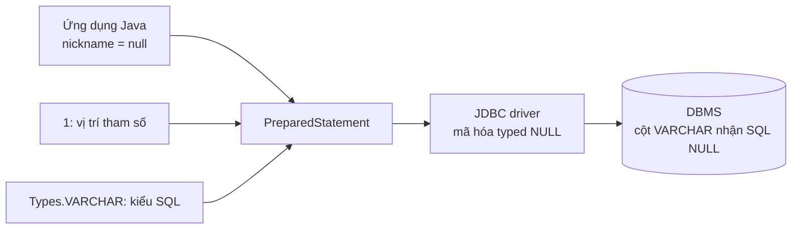

# Gán SQL NULL với kiểu dữ liệu phù hợp trong JDBC

## 1. Vì sao `NULL` cần được gán đúng kiểu?

Trong **JDBC (Java Database Connectivity)**, ứng dụng Java gửi truy vấn đến cơ sở dữ liệu quan hệ qua các API như `Connection` và `PreparedStatement`. Câu SQL có thể chứa dấu giữ chỗ `?`; trước khi thực thi, ứng dụng phải truyền **một giá trị hoặc SQL `NULL`** cho từng tham số.

SQL `NULL` biểu diễn **giá trị thiếu hoặc không xác định** theo ngữ nghĩa SQL. Nó không phải số `0`, chuỗi rỗng `""`, `false` hay từ khóa Java `null` được tự động hiểu thành một kiểu SQL duy nhất.

Ví dụ, các cột sau có thể cùng nhận `NULL` nhưng có kiểu rất khác nhau:

```sql
-- Cấu trúc minh họa; cú pháp thực tế có thể khác theo DBMS.
CREATE TABLE employees (
    id BIGINT PRIMARY KEY,
    nickname VARCHAR(120),
    manager_id BIGINT,
    bonus_amount DECIMAL(12, 2),
    leave_date DATE
);
```

Khi chưa có biệt danh, người quản lý, tiền thưởng hoặc ngày nghỉ việc, ứng dụng có thể muốn lưu `NULL` vào các cột tương ứng. **Kiểu SQL mà driver phải dùng để gắn `NULL` vẫn cần phù hợp với kiểu của cột hoặc biểu thức đích.**

Đây là nhiệm vụ của `PreparedStatement.setNull(parameterIndex, sqlType)`. Phương thức cung cấp cả **vị trí** tham số lẫn **mã kiểu dữ liệu SQL**, giúp driver biết phải truyền giá trị trống như thế nào.



**Nguyên tắc xuyên suốt:** lựa chọn kiểu cho `setNull` dựa trên **kiểu SQL mà tham số đại diện**, không dựa vào kiểu Java của biến trống, vì một biến Java `null` tự nó không nói được kiểu SQL cần dùng.

## 2. Phân biệt ba khái niệm dễ nhầm

| Khái niệm | Ví dụ | Ý nghĩa |
| --- | --- | --- |
| Java `null` | `String nickname = null;` | Biến tham chiếu Java chưa trỏ đến đối tượng |
| SQL `NULL` | `UPDATE employees SET nickname = NULL` | Giá trị không xác định/không có trong mô hình SQL |
| Kiểu SQL của một tham số `NULL` | `setNull(1, Types.VARCHAR)` | Thông tin cho driver/DBMS biết tham số trống thuộc kiểu nào |

Với JDBC, không nên viết:

```java
// Không phải cách gắn tham số JDBC:
statement.setString(1, "NULL");  // Gửi chuỗi bốn ký tự N-U-L-L.
statement.setString(1, "");      // Gửi chuỗi rỗng, không phải SQL NULL.
```

Việc lưu chuỗi rỗng có thể có ngữ nghĩa riêng tùy DBMS: chẳng hạn một số hệ quản trị coi chuỗi ký tự rỗng là `NULL` ở một số kiểu dữ liệu. Vì vậy, ứng dụng phải phân biệt **giá trị rỗng theo nghiệp vụ** với **không có giá trị**, sau đó dùng phương thức gắn tham số phù hợp với hệ quản trị đích.

## 3. Phương thức chuẩn: `PreparedStatement.setNull`

Chữ ký quan trọng nhất:

```java
void setNull(int parameterIndex, int sqlType) throws SQLException;
```

- `parameterIndex` là **vị trí dấu `?`**, đếm từ **1**, theo thứ tự xuất hiện trong câu SQL.
- `sqlType` là một mã kiểu JDBC trong lớp `java.sql.Types`, ví dụ `Types.VARCHAR`, `Types.BIGINT`, `Types.DECIMAL` hoặc `Types.DATE`.
- Phương thức có thể ném `SQLException` nếu vị trí không hợp lệ, trạng thái statement không phù hợp hoặc driver gặp lỗi khi gắn kiểu dữ liệu.

Ví dụ cập nhật một biệt danh thành SQL `NULL`:

```java
import java.sql.Connection;
import java.sql.PreparedStatement;
import java.sql.SQLException;
import java.sql.Types;

public class EmployeeNickname {
    public static int clearNickname(Connection connection, long employeeId)
            throws SQLException {
        String sql = "UPDATE employees SET nickname = ? WHERE id = ?";

        try (PreparedStatement statement = connection.prepareStatement(sql)) {
            statement.setNull(1, Types.VARCHAR);
            statement.setLong(2, employeeId);
            return statement.executeUpdate();
        }
    }
}
```

Ở đây, dấu `?` thứ nhất đại diện cho cột `nickname VARCHAR(120)` nên dùng `Types.VARCHAR`; dấu thứ hai là ID nên được gắn bằng `setLong`. Kết quả trả về của `executeUpdate()` là số hàng được DBMS báo đã chịu tác động.

Không dùng `Types.NULL` như lựa chọn mặc định cho **mọi** cột. Hằng số này không nói rõ kiểu thực tế của tham số đích, và việc driver/DBMS suy ra kiểu trong một biểu thức bất kỳ có thể không hoạt động như mong muốn.

## 4. Bảng chọn kiểu `java.sql.Types` thông dụng

| Kiểu cột/biểu thức SQL | Mã kiểu JDBC thường phù hợp | Giá trị Java khi có dữ liệu |
| --- | --- | --- |
| `CHAR`, `VARCHAR` | `Types.CHAR`, `Types.VARCHAR` | `String` |
| `NCHAR`, `NVARCHAR` | `Types.NCHAR`, `Types.NVARCHAR` | `String` |
| `BIGINT` | `Types.BIGINT` | `Long` / `long` |
| `INTEGER` / `INT` | `Types.INTEGER` | `Integer` / `int` |
| `SMALLINT` | `Types.SMALLINT` | `Short` / `short` |
| `DECIMAL(p,s)`, `NUMERIC(p,s)` | `Types.DECIMAL`, `Types.NUMERIC` | `BigDecimal` |
| `REAL`, `DOUBLE PRECISION` | `Types.REAL`, `Types.DOUBLE` | `Float`, `Double` |
| `BOOLEAN` hoặc kiểu boolean tương ứng | `Types.BOOLEAN` / `Types.BIT` tùy schema | `Boolean` |
| `DATE` | `Types.DATE` | `LocalDate` hoặc `java.sql.Date` |
| `TIME` | `Types.TIME` | `LocalTime` hoặc `java.sql.Time` |
| `TIMESTAMP` | `Types.TIMESTAMP` | `LocalDateTime`, `Timestamp` theo ngữ nghĩa |
| `TIMESTAMP WITH TIME ZONE` | `Types.TIMESTAMP_WITH_TIMEZONE` khi hỗ trợ | Thường `OffsetDateTime` |
| `BINARY`, `VARBINARY` | `Types.BINARY`, `Types.VARBINARY` | `byte[]` |
| `BLOB`, `CLOB` | `Types.BLOB`, `Types.CLOB` | Dữ liệu nhị phân/văn bản lớn |
| `ARRAY`, `STRUCT`, kiểu riêng DBMS | `Types.ARRAY`, `Types.STRUCT`, có thể `Types.OTHER` | Phụ thuộc kiểu SQL và driver |

Các cặp ánh xạ là **định hướng chọn kiểu**, không phải cam kết mọi DBMS hỗ trợ đầy đủ từng mã JDBC. Đặc biệt, `BOOLEAN`, kiểu thời gian có múi giờ, kiểu mảng, JSON/JSONB, UUID, enum hoặc cấu trúc tự định nghĩa cần đối chiếu schema, tài liệu driver và hệ quản trị sử dụng.

Ví dụ cụ thể:

```java
statement.setNull(1, Types.VARCHAR);  // nickname VARCHAR
statement.setNull(2, Types.BIGINT);   // manager_id BIGINT
statement.setNull(3, Types.DECIMAL);  // bonus_amount DECIMAL
statement.setNull(4, Types.DATE);     // leave_date DATE
```

Đoạn mã giả định một `PreparedStatement` có ít nhất bốn vị trí tham số tương ứng theo đúng thứ tự cột. Không gắn theo tên cột bằng API này: `PreparedStatement` sử dụng vị trí `?`.

## 5. Gán cả giá trị thường và `NULL` trong cùng câu SQL

Trong chương trình thực tế, một trường có thể có giá trị ở request này nhưng bằng `null` ở request khác. Cần xử lý **cả hai nhánh** một cách nhất quán.

Ví dụ sửa thông tin nhân viên trong bảng đã khai báo ở mục 1:

```java
import java.math.BigDecimal;
import java.sql.Connection;
import java.sql.Date;
import java.sql.PreparedStatement;
import java.sql.SQLException;
import java.sql.Types;
import java.time.LocalDate;

public final class EmployeeUpdater {
    public static int update(
            Connection connection,
            long employeeId,
            String nickname,
            Long managerId,
            BigDecimal bonusAmount,
            LocalDate leaveDate) throws SQLException {

        String sql = """
            UPDATE employees
            SET nickname = ?,
                manager_id = ?,
                bonus_amount = ?,
                leave_date = ?
            WHERE id = ?
            """;

        try (PreparedStatement ps = connection.prepareStatement(sql)) {
            if (nickname == null) {
                ps.setNull(1, Types.VARCHAR);
            } else {
                ps.setString(1, nickname);
            }

            if (managerId == null) {
                ps.setNull(2, Types.BIGINT);
            } else {
                ps.setLong(2, managerId);
            }

            if (bonusAmount == null) {
                ps.setNull(3, Types.DECIMAL);
            } else {
                ps.setBigDecimal(3, bonusAmount);
            }

            if (leaveDate == null) {
                ps.setNull(4, Types.DATE);
            } else {
                ps.setDate(4, Date.valueOf(leaveDate));
            }

            ps.setLong(5, employeeId);
            return ps.executeUpdate();
        }
    }
}
```

Đây là Java sử dụng JDBC chuẩn; đoạn mã giả định `connection` đã mở và caller sở hữu vòng đời của nó. `PreparedStatement` được đóng bằng `try-with-resources`, trong khi `Connection` **không bị đóng ở helper** vì được nhận từ bên ngoài.

Các điểm đáng chú ý:

1. Kiểu truyền vào `setNull` khớp **kiểu cột SQL**, không chọn tất cả là `VARCHAR` chỉ vì dữ liệu đi từ một JSON request.
2. `Long`, `BigDecimal` và `LocalDate` là các kiểu tham chiếu có thể bằng Java `null`; kiểu nguyên thủy `long` không thể chứa `null`.
3. Nếu có giá trị, dùng `setLong`, `setBigDecimal`, `setDate` hoặc phương thức tương ứng để giữ ngữ nghĩa kiểu dữ liệu.
4. Biến `employeeId` là bắt buộc nên được gắn trực tiếp bằng `setLong`.
5. Phần SQL có năm dấu `?` nên phải đặt đúng **năm tham số** trước khi thực thi.

**Ý nghĩa của API cập nhật:** ví dụ trên xem Java `null` là yêu cầu **ghi SQL `NULL` vào cột**. Nếu bạn đang làm HTTP PATCH, cần phân biệt “thuộc tính không được gửi” với “thuộc tính được gửi nhưng có giá trị null”; hai trạng thái này không thể biểu diễn bằng một biến nullable đơn thuần.

## 6. Gán `NULL` bằng `setObject` có chỉ định kiểu

Ngoài `setNull`, JDBC còn có các phương thức `setObject` cho phép yêu cầu kiểu SQL đích:

```java
// Dùng mã kiểu int của java.sql.Types.
statement.setObject(1, null, Types.VARCHAR);

// JDBC 4.2: dùng enum java.sql.JDBCType (SQLType).
statement.setObject(2, null, java.sql.JDBCType.DECIMAL);
```

`JDBCType` là một triển khai của `java.sql.SQLType`; các overload nhận `SQLType` xuất hiện trong JDBC 4.2. Khả năng hỗ trợ thật sự còn phụ thuộc phiên bản JDK và driver. Với nhiệm vụ đơn giản **gán SQL `NULL`**, `setNull(index, Types.X)` thường là cách dễ đọc nhất.

So sánh:

| Cách gọi | Đánh giá |
| --- | --- |
| `setNull(1, Types.VARCHAR)` | Rõ ràng về ý định gán SQL `NULL` kiểu `VARCHAR` |
| `setObject(1, null, Types.VARCHAR)` | Có kiểu SQL tường minh; có thể dùng |
| `setObject(1, null, JDBCType.VARCHAR)` | Có kiểu SQL tường minh theo JDBC 4.2; phụ thuộc hỗ trợ driver |
| `setObject(1, null)` | Thiếu kiểu SQL chỉ định; khả năng suy luận tùy driver/ngữ cảnh, không nên mặc định |
| `setString(1, null)` | Một số driver xử lý như NULL kiểu chuỗi; `setNull` thể hiện ý định rõ hơn khi chủ động gán NULL |
| `setString(1, "NULL")` | **Sai ý định:** lưu chuỗi ký tự `NULL` |

Trong một số biểu thức SQL, chẳng hạn phép so sánh hoặc hàm nhận tham số chưa có ngữ cảnh kiểu, DBMS có thể không suy ra được kiểu của `?`. Gắn kiểu SQL tường minh giúp driver biết dữ liệu cần gửi, nhưng câu SQL vẫn phải hợp lệ với quy tắc suy diễn kiểu của DBMS; đôi khi cần thêm ép kiểu SQL rõ ràng phù hợp hệ quản trị.

## 7. `setNull` có tham số `typeName` cho kiểu đặc thù

JDBC còn định nghĩa:

```java
void setNull(int parameterIndex, int sqlType, String typeName)
        throws SQLException;
```

`typeName` cung cấp tên kiểu SQL khi cần phân biệt một **kiểu do người dùng/DBMS định nghĩa**, ví dụ kiểu cấu trúc, kiểu đặc thù hoặc kiểu có tên. Việc sử dụng tên kiểu và mã `Types` phụ thuộc driver, không có một giá trị `typeName` dùng chung cho mọi DBMS.

Ví dụ minh họa cú pháp (không phải tên kiểu có sẵn trong mọi DBMS):

```java
// Chỉ có ý nghĩa nếu DBMS định nghĩa kiểu address_type
// và driver hỗ trợ gắn NULL của kiểu STRUCT đó.
statement.setNull(1, Types.STRUCT, "address_type");
```

Với các kiểu như PostgreSQL `uuid` / `jsonb`, array có tên hoặc kiểu tùy biến, hãy xác định rõ kiểu cột và phương thức gắn tham số được driver hỗ trợ. Không mặc định mọi kiểu riêng đều có thể dùng một giá trị `Types.OTHER` hoặc một tên kiểu bất kỳ. Nếu JDBC chuẩn không đáp ứng, một số driver cung cấp đối tượng hoặc API riêng; cần kiểm tra tài liệu của driver.

## 8. SQL `NULL` trong `WHERE`: `= ?` không có nghĩa là `IS NULL`

Một sai lầm thường gặp là gán `NULL` cho tham số của biểu thức `column = ?` rồi kỳ vọng nhận những hàng có cột đó bằng `NULL`:

```sql
-- Nếu ? được gắn SQL NULL, điều kiện này không chọn các hàng NULL.
SELECT id
FROM employees
WHERE manager_id = ?;
```

Trong SQL, `NULL` tuân theo **logic ba giá trị**: `TRUE`, `FALSE` và `UNKNOWN`. So sánh `manager_id = NULL` là `UNKNOWN`, kể cả khi `manager_id` của hàng cũng đang là `NULL`. Mệnh đề `WHERE` chỉ giữ những hàng có điều kiện nhận `TRUE`.

Để tìm những hàng thiếu quản lý, dùng:

```sql
SELECT id
FROM employees
WHERE manager_id IS NULL;
```

Để tìm những hàng **có** quản lý, dùng `IS NOT NULL`. Tương tự, `NULL <> NULL` không cho `TRUE`; `COUNT(column)` bỏ qua các giá trị NULL còn `COUNT(*)` đếm hàng.

### 8.1. Chọn SQL theo dữ liệu lọc

Nếu tham số lọc `managerId` có ý nghĩa “null thì tìm người chưa có quản lý”, chọn **một trong hai câu SQL**:

```java
public static long countEmployees(
        Connection connection, Long managerId) throws SQLException {
    String sql = managerId == null
            ? "SELECT COUNT(*) FROM employees WHERE manager_id IS NULL"
            : "SELECT COUNT(*) FROM employees WHERE manager_id = ?";

    try (PreparedStatement ps = connection.prepareStatement(sql)) {
        if (managerId != null) {
            ps.setLong(1, managerId);
        }
        try (ResultSet rs = ps.executeQuery()) {
            rs.next();
            return rs.getLong(1);
        }
    }
}
```

Ví dụ này dùng hai **câu SQL cố định do ứng dụng kiểm soát**, không nối dữ liệu đầu vào vào chuỗi SQL. Cần bổ sung các import `java.sql.Connection`, `PreparedStatement`, `ResultSet`, `SQLException` khi đặt trong file độc lập.

### 8.2. Đừng nhầm `NULL` làm giá trị truyền và `NULL` trong điều kiện

```sql
-- Hợp lệ nếu muốn gán cột thành NULL:
UPDATE employees SET manager_id = ? WHERE id = ?;

-- Không có ý nghĩa tìm hàng manager_id NULL bằng so sánh =:
SELECT id FROM employees WHERE manager_id = ?;
```

Trong câu `UPDATE` đầu tiên, `setNull(1, Types.BIGINT)` có mục tiêu rõ ràng: **ghi NULL** vào cột. Trong câu `SELECT` thứ hai, gán NULL cho `?` không thể thay thế `IS NULL`. Ngữ nghĩa của **vị trí SQL chứa tham số** quyết định kết quả, không chỉ kiểu được gắn.

## 9. Giá trị mặc định, `NOT NULL` và ba trạng thái cập nhật

`setNull` chỉ gán một giá trị SQL `NULL`; nó **không bỏ qua cột** và **không yêu cầu DBMS dùng DEFAULT**. Ví dụ:

```sql
CREATE TABLE notification_settings (
    account_id BIGINT PRIMARY KEY,
    locale VARCHAR(10) DEFAULT 'vi',
    email_opt_in BOOLEAN NOT NULL
);
```

Với `INSERT INTO notification_settings(account_id, locale, email_opt_in) VALUES (?, ?, ?)`:

- Nếu truyền `setNull(2, Types.VARCHAR)`, ứng dụng đang yêu cầu **lưu NULL** vào `locale`, miễn ràng buộc cho phép.
- Nếu **bỏ cột `locale` khỏi câu INSERT**, DBMS có thể áp dụng DEFAULT theo định nghĩa cột.
- Với cột `email_opt_in BOOLEAN NOT NULL`, `setNull(3, Types.BOOLEAN)` sẽ khiến DBMS từ chối nếu constraint được thực thi.

Một API cập nhật từng phần cần phân biệt:

| Trạng thái trong request | Ý định nghiệp vụ thường gặp | Hành vi SQL phù hợp |
| --- | --- | --- |
| Thuộc tính không xuất hiện | Giữ nguyên giá trị cũ | Không cập nhật cột đó |
| Thuộc tính xuất hiện với `null` | Xóa giá trị, nếu schema cho phép | `SET column = NULL` hoặc `setNull` trên tham số |
| Thuộc tính xuất hiện với giá trị | Ghi giá trị mới | Gắn giá trị bằng `setXxx` |

Không nên mặc định một biến nullable đủ mô tả cả “không gửi trường” và “đã gửi trường null”. Có thể dùng DTO chứa cờ hiện diện, mô hình patch riêng hoặc cấu trúc giữ được thông tin trường có xuất hiện hay không.

## 10. Gán `NULL` với dữ liệu ngày giờ, số thập phân và kiểu đặc biệt

### 10.1. Ngày giờ

Phân biệt `DATE` (ngày), `TIME` (giờ) và `TIMESTAMP` (ngày giờ) khi chọn kiểu `NULL`:

```java
ps.setNull(1, Types.DATE);       // leave_date DATE
ps.setNull(2, Types.TIME);       // shift_start TIME
ps.setNull(3, Types.TIMESTAMP);  // scheduled_at TIMESTAMP
```

Nếu schema dùng `TIMESTAMP WITH TIME ZONE` và driver hỗ trợ JDBC 4.2 tương ứng, có thể cần `Types.TIMESTAMP_WITH_TIMEZONE`. Không coi mọi kiểu timestamp có cùng cách xử lý múi giờ trên mọi DBMS.

### 10.2. Số thập phân

Với số tiền hoặc thuế, `DECIMAL(p,s)` thường thích hợp cho dữ liệu có độ chính xác thập phân. Khi chưa có tiền thưởng:

```java
ps.setNull(1, Types.DECIMAL);
```

Khi có giá trị:

```java
ps.setBigDecimal(1, new java.math.BigDecimal("1250.75"));
```

`setNull` không tự quyết định precision/scale của cột. Những ràng buộc này được áp dụng theo kiểu dữ liệu và quy tắc DBMS; ứng dụng vẫn cần kiểm tra phạm vi và quy tắc nghiệp vụ.

### 10.3. Array, JSON, UUID và dữ liệu do DBMS định nghĩa

Các loại như `ARRAY`, `UUID`, JSON/JSONB hoặc enum có thể yêu cầu API và kiểu dữ liệu đặc thù. Chẳng hạn, một DBMS có thể biểu diễn UUID bằng kiểu riêng thay vì `VARCHAR`; nếu chọn `Types.VARCHAR` cho tham số nullable ở đây, đôi khi driver hoặc DBMS từ chối hoặc yêu cầu ép kiểu.

Hướng xử lý là xác định kiểu thực tế trong schema, kiểm tra driver hỗ trợ những mã `Types` và overload nào, rồi viết adapter riêng nếu phải xử lý kiểu vendor-specific. Không nên “thử đại `Types.OTHER`” cho mọi trường hợp.

## 11. Đọc `SQL NULL` từ `ResultSet` cũng phải đúng cách

Gán `NULL` khi **ghi** và nhận `NULL` khi **đọc** là hai nhiệm vụ khác nhau. JDBC có sự khác biệt quan trọng giữa getter cho kiểu nguyên thủy và getter trả đối tượng:

```java
try (PreparedStatement ps = connection.prepareStatement(
        "SELECT manager_id, bonus_amount FROM employees WHERE id = ?")) {
    ps.setLong(1, employeeId);

    try (ResultSet rs = ps.executeQuery()) {
        if (rs.next()) {
            long managerId = rs.getLong("manager_id");
            boolean managerIsNull = rs.wasNull();

            java.math.BigDecimal bonus =
                    rs.getBigDecimal("bonus_amount");

            System.out.println(managerIsNull
                    ? "Chưa có người quản lý"
                    : "Quản lý ID: " + managerId);
            System.out.println("Thưởng: " + bonus);
        }
    }
}
```

Nếu `manager_id` là SQL `NULL` thì `getLong(...)` trả về `0`; **chỉ** `rs.wasNull()` ngay sau lần đọc đó phân biệt được “thiếu giá trị” với “giá trị thật bằng 0”. `wasNull()` nói về **cột vừa đọc gần nhất**, vì vậy trong ví dụ nó được gọi trước `getBigDecimal`.

Với getter đối tượng như `getBigDecimal` hoặc `getString`, SQL `NULL` thường được trả về thành Java `null`. JDBC còn hỗ trợ `getObject(..., Class<T>)` cho một số kiểu và driver; cần kiểm tra khả năng hỗ trợ nếu muốn ánh xạ trực tiếp sang `Long`, `LocalDate` hoặc các kiểu riêng.

## 12. Lỗi thường gặp và cách xác định nguyên nhân

| Hiện tượng | Nguyên nhân có thể | Hướng xử lý |
| --- | --- | --- |
| Driver báo không xác định kiểu của tham số NULL | Dùng `setObject(index, null)` hoặc SQL thiếu ngữ cảnh kiểu | Dùng `setNull(index, Types.X)`; kiểm tra kiểu SQL và cast phù hợp |
| Lỗi chuyển đổi kiểu hoặc `SQLException` khi bind | Mã `Types` không phù hợp cột hay driver | Đối chiếu schema, driver, mã kiểu SQL thực tế |
| Cột chứa chuỗi `"NULL"` | Truyền chuỗi thay vì SQL NULL | Dùng `setNull`, phân biệt chuỗi và giá trị thiếu |
| Query không trả hàng khi tìm cột bằng NULL | Dùng `WHERE column = ?` với tham số NULL | Dùng `IS NULL` hoặc câu SQL có ngữ nghĩa đúng |
| Vi phạm `NOT NULL` | Cố gán NULL vào cột không cho phép | Kiểm tra đầu vào, schema và quy tắc nghiệp vụ |
| Giá trị DEFAULT không được dùng | Gắn NULL tường minh trong INSERT | Bỏ cột hoặc dùng `DEFAULT` theo cú pháp DBMS |
| Tham số đầu tiên không được gắn như dự định | Đếm vị trí `?` từ 0 hoặc sai thứ tự | Đếm từ 1, gắn mọi tham số trước execute |
| Đọc cột nullable ra số 0 gây hiểu nhầm | Dùng `getInt/getLong` mà bỏ qua `wasNull` | Gọi `wasNull()` ngay sau getter đó |
| SQL đặc thù như UUID/JSONB không nhận `VARCHAR` | Kiểu riêng cần binding/cast riêng của DBMS | Theo tài liệu driver và schema thực tế |
| PATCH có trường bị xóa ngoài ý muốn | Nhầm “không xuất hiện” với “xuất hiện có null” | Mô hình hóa rõ ba trạng thái cập nhật |

Khi JDBC ném `SQLException`, có thể quan sát `getSQLState()`, `getErrorCode()` và `getMessage()`, đồng thời ghi lại **loại kiểu SQL và vị trí tham số** ở mức log an toàn. Tránh log giá trị nhạy cảm hoặc thông tin đăng nhập cơ sở dữ liệu. SQLState và mã lỗi cụ thể phụ thuộc driver và DBMS.

## 13. Một quy trình gắn tham số nullable đáng tin cậy

Trước khi viết lệnh `setNull`, thực hiện lần lượt:

1. **Xác định ý nghĩa nghiệp vụ của null.** Trường không có giá trị, muốn xóa giá trị hay muốn giữ nguyên?
2. **Đọc schema của cột hoặc kiểu biểu thức SQL.** Ví dụ `BIGINT`, `DECIMAL`, `DATE` hoặc kiểu DBMS tùy biến.
3. **Chọn mã `java.sql.Types` tương ứng.** Ưu tiên `Types.BIGINT` cho BIGINT, `Types.DECIMAL` cho DECIMAL, `Types.DATE` cho DATE.
4. **Nếu Java value là null, gọi `setNull`; nếu không, gọi `setXxx` tương ứng.** Không chuyển dữ liệu thành chuỗi một cách tùy tiện.
5. **Xem lại vị trí `?` và điều kiện SQL.** Đặc biệt không dùng `= ?` để tìm cột bằng SQL NULL.
6. **Kiểm tra constraint và hành vi driver bằng tình huống thật.** Bao gồm NOT NULL, DEFAULT, kiểu vendor-specific và dữ liệu ngày giờ.

Để code ngắn gọn hơn mà vẫn rõ kiểu dữ liệu, có thể viết một helper nhỏ cho từng trường hợp thường dùng:

```java
import java.sql.PreparedStatement;
import java.sql.SQLException;
import java.sql.Types;

public final class NullableBindings {
    private NullableBindings() {}

    public static void setNullableLong(
            PreparedStatement statement, int index, Long value)
            throws SQLException {
        if (value == null) {
            statement.setNull(index, Types.BIGINT);
        } else {
            statement.setLong(index, value);
        }
    }

    public static void setNullableString(
            PreparedStatement statement, int index, String value)
            throws SQLException {
        if (value == null) {
            statement.setNull(index, Types.VARCHAR);
        } else {
            statement.setString(index, value);
        }
    }
}
```

Tên helper nhắc lại kiểu SQL cần gắn. Tuy nhiên, không dùng `setNullableLong` cho một cột `INTEGER` chỉ vì mã Java được lưu trong `Long`: **schema SQL vẫn là nguồn xác định loại dữ liệu của tham số**.

## 14. Câu hỏi tự kiểm tra

**Câu 1.** Cột `manager_id BIGINT` nullable; biến Java `Long managerId` bằng `null`. Gắn giá trị thế nào?

**Trả lời:** Gọi `statement.setNull(index, Types.BIGINT)` tại đúng vị trí tham số; nếu khác null dùng `setLong(index, managerId)`.

**Câu 2.** `setString(index, "NULL")` có ghi SQL NULL không?

**Trả lời:** Không. Đây là chuỗi chứa bốn ký tự, khác SQL NULL. Dùng `setNull(index, Types.VARCHAR)` nếu ý định là giá trị thiếu.

**Câu 3.** Vì sao `WHERE manager_id = ?` với tham số SQL NULL không trả các hàng có `manager_id IS NULL`?

**Trả lời:** So sánh bằng với NULL có giá trị `UNKNOWN` trong logic ba giá trị SQL; dùng `IS NULL` để lọc các hàng thiếu giá trị.

**Câu 4.** Cột có `DEFAULT 'vi'`. Nếu `INSERT` gắn NULL tường minh, DBMS có tự áp dụng DEFAULT không?

**Trả lời:** Không mặc định. Gắn NULL là yêu cầu lưu NULL. Muốn dùng default cần bỏ cột khỏi danh sách chèn hoặc dùng cú pháp DEFAULT thích hợp.

**Câu 5.** Có thể dùng `setObject(index, null)` cho mọi kiểu dữ liệu không?

**Trả lời:** Không nên giả định. Thiếu kiểu đích có thể gây khó suy diễn; ưu tiên `setNull(index, Types.X)` hoặc overload `setObject` có kiểu SQL tường minh.

**Câu 6.** `rs.getInt("bonus_count")` trả 0. Làm sao biết là SQL NULL hay số 0 thật?

**Trả lời:** Gọi ngay `rs.wasNull()` sau lần đọc `getInt` đó. Nó trả `true` nếu cột vừa đọc là SQL NULL.

## 15. Ghi nhớ

**SQL NULL không tự mang thông tin kiểu dữ liệu rõ ràng từ biến Java `null`.** Trong truy vấn tham số JDBC, `PreparedStatement.setNull(index, Types.X)` giúp biểu thị đúng cả **giá trị trống** và **kiểu SQL đích**. Hãy chọn mã `Types` dựa trên schema, sử dụng `setXxx` khi có dữ liệu, phân biệt `IS NULL` với `= ?`, và kiểm tra constraint/DEFAULT của DBMS. Những thói quen này giúp mã truy cập dữ liệu quan hệ chính xác, dễ đọc và ít phụ thuộc vào suy luận kiểu ngầm của driver.
