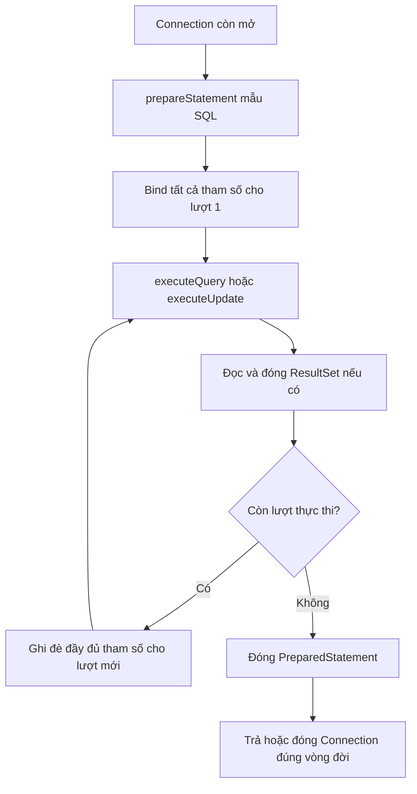

# Tái sử dụng `PreparedStatement` và quản lý giá trị tham số cũ trong JDBC

Trong chương **Truy vấn tham số**, `PreparedStatement` là công cụ cốt lõi của **JDBC (Java Database Connectivity API for relational database access)** khi cần thực thi cùng một mẫu SQL với nhiều bộ giá trị. Thay vì tạo một `PreparedStatement` mới cho từng bản ghi hoặc từng lần tìm kiếm, ứng dụng có thể chuẩn bị câu SQL một lần, **gán lại tham số** rồi thực thi nhiều lần trên cùng đối tượng.

Tái sử dụng có ích vì giảm số lần tạo đối tượng và có thể tận dụng cơ chế chuẩn bị lệnh hoặc cache của JDBC driver và database. Nhưng nó đi kèm một quy tắc dễ bỏ sót: **giá trị của tham số đã gán thường được giữ lại cho những lần thực thi tiếp theo cho đến khi bị thay thế hoặc được xóa**.

Nếu một vòng lặp, nhánh `if` hoặc request tiếp theo không gán đủ tham số, lệnh SQL có thể vô tình sử dụng **giá trị cũ** và trả về kết quả sai. Đây là lỗi logic đặc biệt đáng chú ý đối với tham số phân quyền, mã khách hàng hoặc mã tenant.

Bài này giải thích khi nào nên tái sử dụng `PreparedStatement`, cách gán và xóa giá trị tham số an toàn, sự khác biệt giữa `clearParameters()` và `clearBatch()`, cũng như các giới hạn vòng đời, transaction và đa luồng.

## 1. `PreparedStatement` lưu những gì?

`PreparedStatement` mở rộng `Statement` và gắn với một mẫu câu SQL có vị trí tham số `?`:

```java
String sql = """
        SELECT id, name, status
        FROM orders
        WHERE customer_id = ? AND status = ?
        ORDER BY id
        """;

PreparedStatement ps = connection.prepareStatement(sql);
```

Trong ví dụ có hai **parameter markers**, đánh số từ **1**:

- Vị trí `1`: `customer_id`.
- Vị trí `2`: `status`.

Các lời gọi như `setLong(1, ...)`, `setString(2, ...)` gán giá trị theo vị trí. JDBC driver chịu trách nhiệm truyền những giá trị được bind dưới dạng tham số, thay vì yêu cầu ứng dụng tự nối chúng thành một chuỗi SQL.

Có thể hình dung đối tượng như một cấu trúc gồm:

| Phần | Nội dung | Khi tái sử dụng |
| --- | --- | --- |
| Mẫu SQL | `SELECT ... WHERE customer_id = ? AND status = ?` | Thường giữ nguyên trong toàn bộ vòng đời `PreparedStatement`. |
| Tham số tại vị trí 1 | Giá trị `customer_id` hiện tại. | Có thể ghi đè bằng `setLong(1, ...)`. |
| Tham số tại vị trí 2 | Giá trị `status` hiện tại. | Có thể ghi đè bằng `setString(2, ...)`. |
| Thuộc tính statement | Timeout, fetch size, max rows... tùy API/driver. | Có trạng thái riêng; không mặc nhiên reset theo tham số. |
| `ResultSet` hiện tại | Kết quả của lần thực thi gần nhất nếu có. | Cần xử lý và đóng trước khi thực thi lại để tránh mất kết quả. |

### Sơ đồ vòng đời



**Chú ý:** “SQL được chuẩn bị” không nhất thiết có nghĩa server đã lập và giữ một execution plan ngay tại `prepareStatement()`. Một số driver chuẩn bị phía client, một số chuẩn bị phía server, có driver đợi đến lần thực thi hoặc phụ thuộc ngưỡng và cấu hình. Mức lợi ích hiệu năng phải được đo trong môi trường cụ thể.

## 2. Giá trị tham số cũ được giữ lại như thế nào?

Theo cách sử dụng thông thường của JDBC, sau khi gọi `setXXX()`, giá trị tham số vẫn có hiệu lực cho lần thực thi tiếp theo, trừ khi ứng dụng gán giá trị khác hoặc gọi `clearParameters()`.

Xét cùng một câu SQL:

```sql
SELECT id, name
FROM orders
WHERE customer_id = ? AND status = ?;
```

Các thao tác Java:

```java
ps.setLong(1, 1001L);
ps.setString(2, "NEW");
readRows(ps.executeQuery());

ps.setLong(1, 1002L);
readRows(ps.executeQuery());
```

`readRows(...)` ở trên là phương thức minh họa để đọc và đóng `ResultSet`, không phải API có sẵn của JDBC. Ở lần thứ hai, code chỉ đổi vị trí 1; vị trí 2 **vẫn là `"NEW"`**. Lệnh thực tế sẽ tương đương với điều kiện tìm kiếm `customer_id = 1002 AND status = 'NEW'`.

Bảng theo dõi trạng thái:

| Thời điểm | Tham số 1 (`customer_id`) | Tham số 2 (`status`) | Lệnh sẽ tìm |
| --- | --- | --- | --- |
| Vừa tạo `PreparedStatement` | Chưa gán | Chưa gán | Chưa đủ điều kiện thực thi. |
| Sau hai lời gọi `setXXX` lần 1 | `1001` | `NEW` | Đơn của khách 1001, trạng thái NEW. |
| Gọi `executeQuery()` lần 1 | `1001` | `NEW` | Tham số vẫn có hiệu lực. |
| Chỉ gọi `setLong(1, 1002)` | `1002` | **`NEW` từ lượt trước** | Đơn của khách 1002, trạng thái NEW. |
| Gọi `setString(2, "PAID")` | `1002` | `PAID` | Đơn của khách 1002, trạng thái PAID. |

Không có bước tự động “quên” các giá trị sau `executeQuery()`, `executeUpdate()` hoặc `execute()` mà ứng dụng có thể dựa vào để tránh lỗi này.

### Hệ quả thực tế

- **Sai dữ liệu trả về:** lượt truy vấn mới vẫn lọc bởi điều kiện cũ.
- **Sai dữ liệu cập nhật:** lệnh `UPDATE` hoặc `DELETE` có thể dùng tham số `WHERE` cũ.
- **Rò rỉ dữ liệu giữa ngữ cảnh:** nếu mã tenant hoặc quyền truy cập được giữ lại không đúng, hệ thống có thể truy vấn nhầm phạm vi.
- **Khó phát hiện khi test đơn lẻ:** lỗi thường chỉ xuất hiện sau khi cùng đối tượng được thực thi từ hai lượt trở lên.

Vì vậy, phải kiểm thử cả **chuỗi nhiều lần thực thi**, không chỉ một lần gọi thành công.

## 3. Quy tắc an toàn nhất: gán đủ tham số trước mỗi lượt

Khi tái sử dụng một `PreparedStatement`, cách đơn giản và dễ review nhất là **gán đầy đủ các placeholder cho mỗi lần thực thi**, kể cả khi giá trị giống lượt trước.

Ví dụ lấy nhiều danh sách đơn hàng liên tiếp:

```java
import java.sql.Connection;
import java.sql.PreparedStatement;
import java.sql.ResultSet;
import java.sql.SQLException;
import java.util.List;

public final class OrderQueryLoop {
    public record Filter(long customerId, String status) {}

    public static void printOrders(
            Connection connection, List<Filter> filters) throws SQLException {

        String sql = """
                SELECT id, customer_id, status
                FROM orders
                WHERE customer_id = ? AND status = ?
                ORDER BY id
                """;

        try (PreparedStatement ps = connection.prepareStatement(sql)) {
            for (Filter filter : filters) {
                // Gán TẤT CẢ tham số cho lượt hiện tại.
                ps.setLong(1, filter.customerId());
                ps.setString(2, filter.status());

                try (ResultSet rs = ps.executeQuery()) {
                    while (rs.next()) {
                        System.out.printf(
                                "order=%d, customer=%d, status=%s%n",
                                rs.getLong("id"),
                                rs.getLong("customer_id"),
                                rs.getString("status"));
                    }
                }
            }
        }
    }
}
```

Ví dụ dùng **Java 16+** vì `record` và Java 15+ vì text block `"""`. Trên Java cũ hơn, có thể thay bằng lớp POJO và chuỗi SQL thông thường. Bảng `orders` và các cột được giả định tồn tại trong database thử nghiệm.

Những điểm quan trọng:

1. Tạo `PreparedStatement` một lần trên **một `Connection` còn mở**.
2. Trước mỗi `executeQuery()`, gọi đủ `setLong` và `setString`.
3. Đọc và đóng `ResultSet` ngay trong lượt thực thi.
4. Đóng `PreparedStatement` khi kết thúc vòng lặp.
5. `Connection` được quản lý bởi bên đã cấp cho phương thức; phương thức này không tự đóng connection mà nó **không sở hữu**.

Cách này tạo thêm các lời gọi setter rất nhỏ nhưng ngăn được lỗi khó chẩn đoán do phụ thuộc giá trị cũ.

### Có thể cố ý giữ lại tham số không đổi không?

Có thể, nhưng phải biết rõ tất cả vị trí và vòng đời:

```java
// Trong một đơn vị công việc, tenantId được kiểm soát và không thay đổi.
ps.setLong(1, tenantId);

for (String status : statuses) {
    ps.setString(2, status);
    try (ResultSet rs = ps.executeQuery()) {
        while (rs.next()) {
            // Xử lý kết quả.
        }
    }
}
```

Đây là cách dùng hợp lệ nếu tham số 1 thực sự là **hằng số cho toàn bộ vòng đời statement**, đã được gán trước vòng lặp và không có code nào có thể đổi nó. Tuy nhiên, việc cố ý giữ tham số cần dễ hiểu và được kiểm soát chặt, nhất là giá trị liên quan quyền truy cập, tenant hoặc dữ liệu nhạy cảm.

Trong mã có nhiều nhánh, yêu cầu thay đổi thường xuyên hoặc nhiều người bảo trì, **gán lại tất cả tham số ở mỗi lần thực thi** thường ít rủi ro hơn lợi ích rất nhỏ từ việc bỏ qua vài lệnh `setXXX()`.

## 4. Lỗi phổ biến: nhánh `if` không gán lại tham số

Xét câu SQL:

```sql
SELECT id, customer_id, status
FROM orders
WHERE customer_id = ? AND status = ?;
```

Đoạn mã sau có lỗi:

```java
// Ví dụ SAI: không bảo đảm tham số thứ hai được cập nhật.
ps.setLong(1, currentCustomerId);

if (newStatusFilter != null) {
    ps.setString(2, newStatusFilter);
}

try (ResultSet rs = ps.executeQuery()) {
    // Lọc có thể vẫn dùng status từ lượt trước.
}
```

Nếu `newStatusFilter == null`, điều kiện `if` không chạy. Với `PreparedStatement` đã được dùng trước đó, vị trí 2 có thể vẫn chứa `"PAID"` hoặc giá trị khác từ lượt cũ.

### Vì sao `setNull()` không đồng nghĩa “bỏ điều kiện”?

Một người có thể cố chữa lỗi bằng:

```java
if (newStatusFilter == null) {
    ps.setNull(2, java.sql.Types.VARCHAR);
} else {
    ps.setString(2, newStatusFilter);
}
```

Điều này **thiết lập SQL `NULL` tại vị trí 2** và tránh dùng giá trị cũ, nhưng câu `status = NULL` không có nghĩa “không lọc trạng thái”. Trong SQL chuẩn, so sánh với `NULL` bằng `=` cho kết quả *UNKNOWN*, nên điều kiện `WHERE` thường không chọn các hàng đó.

Nếu nghiệp vụ yêu cầu **không lọc status khi tham số vắng mặt**, phải thiết kế điều kiện SQL tương ứng.

### Giải pháp A: dùng hai mẫu SQL rõ ràng

```java
String sqlWithStatus = """
        SELECT id, status FROM orders
        WHERE customer_id = ? AND status = ?
        """;

String sqlWithoutStatus = """
        SELECT id, status FROM orders
        WHERE customer_id = ?
        """;

if (statusFilter == null) {
    try (PreparedStatement ps = connection.prepareStatement(sqlWithoutStatus)) {
        ps.setLong(1, customerId);
        try (ResultSet rs = ps.executeQuery()) {
            while (rs.next()) {
                // Đọc đơn hàng không lọc status.
            }
        }
    }
} else {
    try (PreparedStatement ps = connection.prepareStatement(sqlWithStatus)) {
        ps.setLong(1, customerId);
        ps.setString(2, statusFilter);

        try (ResultSet rs = ps.executeQuery()) {
            while (rs.next()) {
                // Đọc đơn hàng có lọc status.
            }
        }
    }
}
```

Trong ví dụ, `customerId` và `statusFilter` là các giá trị do ứng dụng cung cấp. Mỗi đường đi dùng SQL cố định, bind đủ tham số và xử lý kết quả trong phạm vi tài nguyên hợp lệ.

### Giải pháp B: viết SQL hỗ trợ bộ lọc tùy chọn

Một số hệ quản trị hỗ trợ dạng:

```sql
SELECT id, status
FROM orders
WHERE customer_id = ?
  AND (? IS NULL OR status = ?);
```

Khi sử dụng dạng này, **có ba placeholder** dù chỉ có hai dữ liệu nghiệp vụ:

```java
ps.setLong(1, customerId);

if (statusFilter == null) {
    ps.setNull(2, java.sql.Types.VARCHAR);
    ps.setNull(3, java.sql.Types.VARCHAR);
} else {
    ps.setString(2, statusFilter);
    ps.setString(3, statusFilter);
}
```

Cú pháp/kiểu dữ liệu của placeholder trong biểu thức `? IS NULL` có thể cần ép kiểu rõ ràng ở một số driver/database, đặc biệt khi database không suy ra được kiểu tham số. Cách này cũng có thể ảnh hưởng tối ưu truy vấn và khả năng tận dụng chỉ mục; hãy chọn theo database và kết quả đo thực tế.

**Điểm quan trọng:** SQL gồm bao nhiêu dấu `?` thì phải quản lý đủ bấy nhiêu vị trí. Việc cùng một giá trị nghiệp vụ xuất hiện hai lần không làm JDBC tự chia sẻ một placeholder.

## 5. `clearParameters()` dùng để làm gì?

JDBC cung cấp:

```java
preparedStatement.clearParameters();
```

Phương thức này **xóa các giá trị tham số hiện tại** của `PreparedStatement`. Một mục đích quan trọng là giải phóng sớm các tài nguyên mà driver đang giữ cho giá trị tham số, chẳng hạn dữ liệu lớn, trước khi statement được dùng tiếp hoặc đóng.

Sau khi gọi `clearParameters()`, ứng dụng phải **gán lại các tham số cần thiết** trước lần thực thi tiếp theo.

Ví dụ:

```java
String sql = "SELECT id FROM orders WHERE customer_id = ? AND status = ?";

try (PreparedStatement ps = connection.prepareStatement(sql)) {
    ps.setLong(1, 1001L);
    ps.setString(2, "NEW");

    try (ResultSet rs = ps.executeQuery()) {
        while (rs.next()) {
            System.out.println(rs.getLong(1));
        }
    }

    // Bỏ bộ tham số hiện có.
    ps.clearParameters();

    // Gán lại đầy đủ bộ tham số mới.
    ps.setLong(1, 1002L);
    ps.setString(2, "PAID");

    try (ResultSet rs = ps.executeQuery()) {
        while (rs.next()) {
            System.out.println(rs.getLong(1));
        }
    }
}
```

Với cách làm này, `clearParameters()` đánh dấu một ranh giới rõ ràng giữa hai bộ giá trị. Tuy vậy, nếu ta đã chủ động **gán đủ tham số ở mọi lượt**, việc gọi `clearParameters()` trước mỗi lần thực thi thường **không bắt buộc**.

### Những điều `clearParameters()` không làm

| Hiểu nhầm | Thực tế |
| --- | --- |
| `clearParameters()` xóa dấu `?` trong SQL. | Không. Mẫu SQL vẫn giữ nguyên. |
| Nó chuyển toàn bộ tham số thành SQL `NULL`. | Không. Giá trị đã bị xóa; muốn bind `NULL` phải gọi setter thích hợp như `setNull()`. |
| Nó đóng `PreparedStatement`. | Không. Statement vẫn tồn tại và có thể bind tham số rồi thực thi. |
| Nó tự động giải phóng mọi `ResultSet`. | Không nên dựa vào nó để quản lý `ResultSet`; dùng `ResultSet.close()` đúng lúc. |
| Nó xóa batch đã tích lũy bằng `addBatch()`. | Không. Đó là trách nhiệm của `clearBatch()`. |
| Nó thay SQL hoặc chuẩn bị lại toàn bộ câu SQL. | Không. Nó chỉ liên quan giá trị tham số hiện tại. |
| Nó tự chạy lại câu SQL. | Không. Phải gọi `executeQuery()`, `executeUpdate()` hoặc `execute()` riêng. |

Nếu sau `clearParameters()` ứng dụng chỉ gán một phần tham số rồi thực thi, driver thường báo lỗi vì chưa có giá trị cho các vị trí bắt buộc. Đây có thể là cách phát hiện lỗi *thiếu bind*, nhưng **không thay thế quy ước gán đủ tham số**.

### Trường hợp giá trị lớn hoặc streaming

Với tham số BLOB/CLOB hoặc stream, driver có thể giữ bộ đệm, luồng hoặc tài nguyên trong quá trình bind/thực thi. `clearParameters()` có thể hỗ trợ giải phóng tài nguyên tham số sớm theo hợp đồng JDBC, nhưng mức độ giải phóng và thời điểm thực tế phụ thuộc driver. Không được cho rằng gọi `clearParameters()` sẽ luôn đóng một `InputStream` do ứng dụng sở hữu; cần đọc tài liệu driver và **đóng stream của chính ứng dụng theo vòng đời riêng**.

## 6. Gán `NULL` đúng cách và phân biệt “chưa gán”

Trong JDBC, **“chưa có giá trị được bind”** và **“đã bind giá trị SQL `NULL`”** là hai trạng thái khác nhau.

| Trạng thái | Ví dụ | Ý nghĩa |
| --- | --- | --- |
| Chưa gán | Tạo statement, chưa gọi setter cho vị trí 2. | Chưa có giá trị hợp lệ cho tham số đó trong lần thực thi. |
| Đã gán giá trị bình thường | `ps.setString(2, "NEW")` | Vị trí 2 có giá trị `NEW`. |
| Đã gán SQL `NULL` | `ps.setNull(2, Types.VARCHAR)` | Vị trí 2 có giá trị `NULL` đúng kiểu SQL yêu cầu. |
| Đã xóa tham số | `ps.clearParameters()` | Các giá trị hiện tại không còn được bind; phải gán lại trước khi thực thi. |

Ví dụ cập nhật cột `note` có thể là `NULL`:

```java
import java.sql.Connection;
import java.sql.PreparedStatement;
import java.sql.SQLException;
import java.sql.Types;

public final class OrderNoteUpdater {
    public static int updateNote(
            Connection connection, long orderId, String note)
            throws SQLException {

        String sql = "UPDATE orders SET note = ? WHERE id = ?";

        try (PreparedStatement ps = connection.prepareStatement(sql)) {
            if (note == null) {
                ps.setNull(1, Types.VARCHAR);
            } else {
                ps.setString(1, note);
            }

            ps.setLong(2, orderId);
            return ps.executeUpdate();
        }
    }
}
```

Với cả hai nhánh của `if`, vị trí **1 luôn được bind**. Vị trí **2 luôn được bind** từ `orderId`. Lúc này, `note == null` có nghĩa là **cập nhật cột `note` thành SQL `NULL`**, một ý nghĩa nghiệp vụ khác hẳn “không cập nhật cột note”.

`setObject(index, null, sqlType)` cũng có thể là lựa chọn khi cần chỉ định kiểu SQL tường minh. Kiểu `Types.VARCHAR` chỉ phù hợp nếu cột và driver mong đợi kiểu tương ứng; `Types.TIMESTAMP`, `Types.BIGINT`, `Types.DECIMAL` và các kiểu khác phải được lựa chọn theo dữ liệu thực.

**Không tự động dùng `setString(index, null)` cho mọi kiểu** rồi giả định driver sẽ xử lý như nhau. Đặc biệt với tham số `NULL`, chỉ định kiểu SQL khi phù hợp giúp tránh mơ hồ về kiểu dữ liệu.

## 7. Tái sử dụng trong vòng lặp `INSERT`/`UPDATE`

Một lợi ích rõ ràng của `PreparedStatement` là dùng cùng một mẫu lệnh DML cho nhiều hàng:

```java
import java.math.BigDecimal;
import java.sql.Connection;
import java.sql.PreparedStatement;
import java.sql.SQLException;
import java.util.List;

public final class PriceUpdates {
    public record PriceChange(long productId, BigDecimal newPrice) {}

    public static int updatePrices(
            Connection connection, List<PriceChange> changes)
            throws SQLException {

        String sql = "UPDATE products SET price = ? WHERE id = ?";
        int totalRows = 0;

        try (PreparedStatement ps = connection.prepareStatement(sql)) {
            for (PriceChange change : changes) {
                // Mọi lượt đều gán CẢ HAI tham số.
                ps.setBigDecimal(1, change.newPrice());
                ps.setLong(2, change.productId());

                totalRows += ps.executeUpdate();
            }
        }

        return totalRows;
    }
}
```

Ví dụ dùng `record` của Java 16+. Mã trên giả định `products.id` là khóa duy nhất, dữ liệu kiểm thử hợp lệ, giá có kiểu tương thích `DECIMAL` và `newPrice()` không `null`.

Nếu cần tất cả cập nhật thành công hoặc tất cả thất bại, phải đặt chúng trong một **transaction** chung. Việc dùng một `PreparedStatement` **không tự động gộp nhiều lời gọi `executeUpdate()` thành một transaction** khi connection vẫn ở chế độ `autoCommit=true`.

### Có nên tái sử dụng cho mọi trường hợp?

Không nhất thiết. Với một lệnh chỉ chạy một lần, cách tạo statement trong `try-with-resources` thường đã đủ. Khi tái sử dụng nhiều lần, lợi ích có thể gồm giảm tạo đối tượng, tối ưu đường đi driver và cơ chế statement caching/prepare của database. Nhưng tốc độ cải thiện phụ thuộc driver, số lần thực thi, SQL, server và cấu hình.

Nếu SQL thay đổi cấu trúc hoàn toàn giữa các lượt (ví dụ số cột hoặc tên bảng thay đổi), `PreparedStatement` hiện có không thể thay mẫu SQL bằng cách gọi setter. Cần chuẩn bị một statement khác tương ứng với SQL mới.

## 8. `ResultSet` của lượt trước phải được xử lý ra sao?

Khi thực thi nhiều truy vấn với **cùng một `PreparedStatement`**, ứng dụng nên **đọc và đóng `ResultSet` của lượt trước rồi mới gọi `executeQuery()` lần tiếp theo**.

Theo quy tắc thông thường của `Statement`, một statement chỉ duy trì một kết quả `ResultSet` đang mở tại một thời điểm; các lời gọi thực thi mới có thể **tự đóng `ResultSet` hiện tại**. Vì thế, giữ lại một `ResultSet` và tiếp tục duyệt sau khi thực thi lại statement là thiết kế không an toàn.

Ví dụ **không nên dùng**:

```java
ResultSet first = ps.executeQuery();

ps.setLong(1, anotherId);
ResultSet second = ps.executeQuery();

// first có thể đã bị đóng do lời gọi executeQuery thứ hai.
while (first.next()) {
    // Lỗi vòng đời hoặc đọc không hợp lệ.
}
```

Cách đúng:

```java
ps.setLong(1, firstId);
try (ResultSet first = ps.executeQuery()) {
    while (first.next()) {
        // Đọc hết dữ liệu lần 1.
    }
}

ps.setLong(1, secondId);
try (ResultSet second = ps.executeQuery()) {
    while (second.next()) {
        // Đọc hết dữ liệu lần 2.
    }
}
```

Nếu nghiệp vụ thực sự cần hai kết quả đang mở đồng thời, hãy cân nhắc hai `PreparedStatement` riêng (và xác minh khả năng của driver/connection), hoặc sao chép dữ liệu của lượt đầu vào DTO/list trước khi chạy lượt sau.

### Mỗi `PreparedStatement` có thể có cấu hình riêng

Các lời gọi như `setFetchSize()`, `setQueryTimeout()`, `setMaxRows()` tác động đến **statement**, không phải các giá trị bind của dấu `?`. `clearParameters()` không có nghĩa là reset mọi thiết lập statement này. Khi tái sử dụng, cần hiểu cấu hình nào giữ nguyên để tránh một lượt thực thi vô tình áp dụng giới hạn từ lượt trước.

## 9. `addBatch()` và sự khác biệt với `clearBatch()`

Tái sử dụng `PreparedStatement` còn quan trọng khi cần thực thi nhiều thao tác ghi theo **batch**. Thay vì gọi `executeUpdate()` sau mỗi hàng, có thể bind các tham số, gọi `addBatch()` nhiều lần rồi thực thi bằng `executeBatch()`.

Ví dụ:

```java
import java.sql.Connection;
import java.sql.PreparedStatement;
import java.sql.SQLException;
import java.util.List;

public final class BatchInsertExample {
    public record Item(long id, String name, int quantity) {}

    public static void insertItems(
            Connection connection, List<Item> items) throws SQLException {

        String sql = """
                INSERT INTO inventory (id, name, quantity)
                VALUES (?, ?, ?)
                """;

        try (PreparedStatement ps = connection.prepareStatement(sql)) {
            for (Item item : items) {
                // Gán đủ bộ tham số cho TỪNG phần tử batch.
                ps.setLong(1, item.id());
                ps.setString(2, item.name());
                ps.setInt(3, item.quantity());

                ps.addBatch();
            }

            int[] counts = ps.executeBatch();
            System.out.println("Số lệnh batch đã báo kết quả: "
                    + counts.length);
        }
    }
}
```

Ví dụ dùng Java 16+ vì `record`, Java 15+ vì text block. `inventory` phải là bảng có các cột tương ứng.

Trong mô hình này:

- `setXXX()` thay đổi **bộ tham số hiện tại**.
- `addBatch()` đưa **một lượt thực thi với bộ tham số đã đặt** vào danh sách batch.
- `executeBatch()` yêu cầu driver xử lý các phần tử batch, trả mảng `int[]` gồm update count hoặc mã kết quả đặc biệt.
- `clearBatch()` xóa **các lệnh đã được thêm vào batch mà chưa muốn thực thi tiếp**.
- `clearParameters()` xóa **các giá trị tham số hiện tại**, chứ **không phải** thao tác hủy danh sách batch.

### So sánh `clearParameters()` và `clearBatch()`

| Phương thức | Xử lý gì? | Điều không nên giả định |
| --- | --- | --- |
| `clearParameters()` | Xóa giá trị tham số đang được bind trên `PreparedStatement`. | Không hủy các lượt đã thêm bằng `addBatch()`. |
| `clearBatch()` | Hủy danh sách batch đã tích lũy của statement. | Không bảo đảm xóa các giá trị tham số đang bind. |
| `executeBatch()` | Thực thi batch và trả báo cáo kết quả. | Không tự bảo đảm các lệnh thành công như một transaction nếu chưa cấu hình transaction. |
| `close()` | Kết thúc sử dụng statement, giải phóng tài nguyên tương ứng. | Không thay cho `commit()` hoặc `rollback()`. |

Trong từng vòng `addBatch()`, **vẫn phải bind đầy đủ các giá trị cho hàng hiện tại**. Nếu bỏ một setter, bộ tham số được thêm vào batch có thể mang giá trị còn lại từ lượt trước.

### Hủy batch đang chờ

```java
try (PreparedStatement ps = connection.prepareStatement(
        "UPDATE inventory SET quantity = ? WHERE id = ?")) {

    ps.setInt(1, 5);
    ps.setLong(2, 1001L);
    ps.addBatch();

    // Quyết định nghiệp vụ thay đổi: không thực thi batch vừa tích lũy.
    ps.clearBatch();

    // Nếu muốn thực thi lệnh khác, gán đủ mọi tham số rồi addBatch lại.
    ps.setInt(1, 7);
    ps.setLong(2, 1002L);
    ps.addBatch();

    ps.executeBatch();
}
```

Không dùng `clearParameters()` thay cho `clearBatch()` trong tình huống muốn bỏ các lệnh đã xếp vào batch.

### Batch, transaction và lỗi

Khi một phần tử batch thất bại, JDBC có thể ném `BatchUpdateException`; tùy driver, những phần tử khác có thể đã được thử thực thi hoặc không. `getUpdateCounts()` có thể chứa các giá trị đặc biệt như `Statement.SUCCESS_NO_INFO` và `Statement.EXECUTE_FAILED`. Không mặc định mọi phần tử đã chạy thành công nếu `executeBatch()` ném lỗi.

Với lô cập nhật cần tính nguyên tử theo nghiệp vụ:

```java
try (Connection connection = dataSource.getConnection()) {
    connection.setAutoCommit(false);

    try (PreparedStatement ps = connection.prepareStatement(
            "UPDATE inventory SET quantity = ? WHERE id = ?")) {

        for (Item item : items) {
            ps.setInt(1, item.quantity());
            ps.setLong(2, item.id());
            ps.addBatch();
        }

        ps.executeBatch();
        connection.commit();

    } catch (SQLException error) {
        try {
            connection.rollback();
        } catch (SQLException rollbackError) {
            error.addSuppressed(rollbackError);
        }
        throw error;
    }
}
```

Đoạn mã mang tính minh họa: `dataSource` là `javax.sql.DataSource` đã được cấu hình, `items` là danh sách các phần tử có phương thức `id()` và `quantity()`. Khi triển khai thật, xác minh database hỗ trợ transaction cho thao tác này, xử lý các update count theo hợp đồng ứng dụng và cân nhắc trạng thái commit không chắc chắn nếu mất kết nối. Nếu một phần tử không tìm thấy hàng, `executeBatch()` có thể vẫn thành công và trả update count bằng `0`; kiểm tra nghiệp vụ vẫn cần thiết.

## 10. `PreparedStatement` không dùng chung tùy tiện giữa nhiều thread

Một `PreparedStatement` là đối tượng có **trạng thái tham số thay đổi** và gắn với một `Connection`. Nếu hai luồng cùng dùng một statement mà không có cơ chế điều phối hợp lệ, một luồng có thể ghi đè tham số giữa lúc luồng kia đang bind hoặc execute.

Ví dụ luồng A:

```text
A: setLong(1, 1001)
A: setString(2, "NEW")
```

Trong khi luồng B chen vào:

```text
B: setLong(1, 2002)
B: setString(2, "PAID")
A: executeQuery()  <-- Bộ tham số có thể đã bị B thay đổi
```

Không dựa vào việc driver “có thể chịu được” để chia sẻ `PreparedStatement` giữa các request. Với ứng dụng web có nhiều request đồng thời:

1. Dùng một `DataSource` có pooling phù hợp cho toàn ứng dụng.
2. Mỗi đơn vị công việc **mượn một `Connection`** theo phạm vi cần thiết.
3. Tạo `PreparedStatement` trong phạm vi connection đó.
4. Bind đầy đủ tham số, thực thi và đóng `ResultSet`.
5. Đóng statement và trả connection về pool khi hoàn tất.

**Có thể dùng chung một hằng `String` chứa SQL** giữa nhiều luồng; đó là mẫu bất biến. Không suy ra rằng cũng có thể chia sẻ cùng đối tượng `PreparedStatement`.

Một `PreparedStatement` được tạo từ `Connection A` không thể đem sang `Connection B` để thực thi. Nếu connection đã đóng hoặc đã được trả về pool, giữ statement của connection đó để dùng vào request sau là lỗi vòng đời. Nếu thư viện pool/driver có **statement cache**, hãy để cơ chế đó quản lý, thay vì tự giữ JDBC objects vượt ra ngoài phạm vi của connection được mượn.

## 11. Hiệu năng: tái sử dụng tiết kiệm gì và giới hạn ở đâu?

Việc tái sử dụng `PreparedStatement` có thể giảm số lần tạo đối tượng Java và một phần công việc phân tích/chuẩn bị SQL, nhất là khi thực thi cùng SQL nhiều lần. Tuy nhiên, **không có bảo đảm mọi driver đều chuẩn bị server-side một lần rồi dùng lại cùng plan mãi mãi**.

Tùy hệ quản trị và driver:

- `prepareStatement()` có thể chỉ tạo đối tượng phía client hoặc thực sự trao đổi với server.
- Driver có thể bắt đầu dùng server-side prepared statement sau một số lần thực thi hoặc theo cấu hình.
- Database có thể lập kế hoạch lại hoặc chọn cách tối ưu theo giá trị tham số.
- Driver hoặc connection pool có thể có cơ chế cache statement, nhưng không phải lúc nào cũng bật.
- Chất lượng index, thiết kế SQL, số hàng trả về, network và transaction có thể chi phối thời gian lớn hơn phần chuẩn bị.

### Mô hình so sánh

```text
Mỗi lượt tạo statement mới:
    prepare -> bind -> execute -> đọc kết quả -> close
    prepare -> bind -> execute -> đọc kết quả -> close
    prepare -> bind -> execute -> đọc kết quả -> close

Tái sử dụng trong cùng phạm vi:
    prepare
       -> bind bộ 1 -> execute -> đọc/đóng kết quả
       -> bind bộ 2 -> execute -> đọc/đóng kết quả
       -> bind bộ 3 -> execute -> đọc/đóng kết quả
    close
```

Mô hình thể hiện số thao tác tạo đối tượng giảm đi. Nó **không đồng nghĩa mọi lần `execute` sau chỉ tốn thời gian SQL**; driver và database có thể vẫn cần truyền/giải mã tham số, thực hiện tối ưu hay xử lý khác.

### Khi nào lợi ích đáng đo?

- Vòng lặp chạy một mẫu `INSERT`/`UPDATE` nhiều lần.
- Một đơn vị công việc cần lặp lại cùng `SELECT` với nhiều ID.
- Một ứng dụng có kết nối đang được mượn từ pool và có thể tái sử dụng statement trong phạm vi công việc.
- SQL có chi phí chuẩn bị đáng kể và driver hỗ trợ một mức độ caching/prepare hữu ích.

Cần đo **thông lượng**, **p95/p99 latency**, số lần prepare/execute, thời gian DB thực thi và sử dụng tài nguyên; tránh đánh giá chỉ dựa vào số lần gọi `prepareStatement()` trên source code.

## 12. Khi nào nên đóng hoặc tạo lại `PreparedStatement`?

`PreparedStatement` nên được đóng khi hết đơn vị công việc, đổi mẫu SQL, không còn nhu cầu thực thi hoặc connection sắp được đóng/trả về pool.

| Tình huống | Quyết định gợi ý | Lý do |
| --- | --- | --- |
| Cùng SQL, nhiều ID trong một vòng lặp | Tái sử dụng một statement trong phạm vi vòng lặp. | Giảm thao tác prepare và cho phép bind lại. |
| Mỗi request có SQL khác hẳn | Tạo statement theo đúng mẫu SQL của request. | Không thể đổi mẫu SQL bằng `setXXX()`. |
| Mượn connection từ pool cho một request | Đóng statement trước khi trả connection. | Giữ đúng ownership và tránh giữ handle quá vòng đời. |
| Cần hai `ResultSet` mở đồng thời | Dùng các statement riêng phù hợp hoặc vật hóa kết quả. | Một statement thường quản lý một result set hiện tại. |
| Nhiều thread/request đồng thời | Mỗi phạm vi sử dụng có statement riêng. | Tránh tranh chấp trạng thái tham số. |
| Bind LOB/stream lớn | Xem xét `clearParameters()` và đóng tài nguyên liên quan đúng lúc. | Có thể giảm thời gian giữ bộ đệm/stream. |
| Cần hủy batch đã tích lũy | Gọi `clearBatch()`. | `clearParameters()` không thay cho hủy batch. |

Việc giữ statement mở vô thời hạn cũng có chi phí: driver/server có thể dành handle, metadata, cache hoặc tài nguyên cho nó. Vì vậy, không tối ưu theo hướng “chuẩn bị một lần cho toàn vòng đời ứng dụng” nếu statement gắn với connection có vòng đời ngắn hoặc thay đổi liên tục.

## 13. Lỗi thường gặp và cách sửa

| Triệu chứng | Nguyên nhân có thể | Cách khắc phục |
| --- | --- | --- |
| Lượt thứ hai trả kết quả theo status trước đó | Chỉ thay `customer_id` nhưng không gán lại `status`. | Gán mọi tham số trong mỗi lượt. |
| Dữ liệu được cập nhật theo ID cũ | Bỏ quên setter của tham số `WHERE`. | Bind đầy đủ, kiểm tra số hàng và transaction. |
| Gọi `clearParameters()` rồi `executeQuery()` lỗi thiếu tham số | Chưa gán lại đủ vị trí sau khi xóa. | Bind lại theo thứ tự SQL và số placeholder. |
| Gán `NULL` nhưng truy vấn không trả hàng | Dùng `column = NULL` trong `WHERE`. | Thiết kế điều kiện `IS NULL` hoặc bỏ bộ lọc bằng SQL khác. |
| `clearParameters()` nhưng batch cũ vẫn còn | Nhầm với `clearBatch()`. | Dùng đúng API theo trạng thái muốn xóa. |
| `getResultSet()` của lượt trước không đọc được | Statement đã execute lần mới và đóng kết quả cũ. | Đóng/đọc hết `ResultSet` trước khi tái thực thi. |
| Hai request có tham số lẫn nhau | Cùng chia sẻ một `PreparedStatement` có trạng thái giữa các thread. | Đưa statement vào phạm vi connection/request; không dùng chung trực tiếp. |
| `PreparedStatement` bị lỗi khi dùng sau khi trả connection về pool | Statement đã hết vòng đời hoặc connection không còn thuộc request. | Tạo lại statement từ connection hiện hành. |
| Kết quả sai khi có hai dấu `?` cho cùng một giá trị | Chỉ bind một vị trí. | Bind từng placeholder theo chỉ số bắt đầu từ 1. |
| Thấy nhiều lần prepare dù có dùng một statement | Driver/server có chính sách prepare/cache riêng. | Đọc tài liệu driver, đo thực tế trước khi tối ưu. |

### Có thể dùng `ParameterMetaData` để đếm vị trí không?

JDBC cung cấp `PreparedStatement.getParameterMetaData()` và `ParameterMetaData.getParameterCount()`, nhưng mức hỗ trợ metadata, khả năng suy ra kiểu và chi phí truy vấn có thể khác nhau giữa các driver. Đây là công cụ trợ giúp khi cần chẩn đoán, **không thay cho việc thiết kế SQL và bind theo hợp đồng đã biết**.

### Bảo mật

`PreparedStatement` giúp phân biệt **giá trị dữ liệu** với cấu trúc SQL khi bind bằng `?`, giảm nguy cơ SQL injection. Nhưng nó không thay thế **kiểm tra quyền**: nếu một tham số định danh tenant bị giữ từ request trước hoặc được lấy từ nguồn không đáng tin cậy, vẫn có thể xuất hiện lỗi truy cập sai phạm vi.

Bảo đảm luôn xác minh quyền với ngữ cảnh xác thực hiện hành, tạo ranh giới sở hữu statement rõ ràng, tránh log dữ liệu bí mật của tham số và kiểm soát cả số hàng `UPDATE`/`DELETE` tác động.

## 14. Ví dụ đầy đủ: tìm kiếm nhiều bộ lọc và kiểm soát tham số cũ

Ví dụ dùng JDBC API chuẩn, `DataSource` và một phương thức repository thực thi cùng SQL nhiều lần. Bảng `orders` có ít nhất `id`, `customer_id`, `status`, `total_amount`. Java 11+ được dùng ở đoạn sau (không cần `record`).

```java
import java.sql.Connection;
import java.sql.PreparedStatement;
import java.sql.ResultSet;
import java.sql.SQLException;
import javax.sql.DataSource;

public final class OrderSearchService {
    private final DataSource dataSource;

    public OrderSearchService(DataSource dataSource) {
        this.dataSource = dataSource;
    }

    public void printOrdersForCustomers(
            long[] customerIds, String requiredStatus) throws SQLException {

        String sql = "SELECT id, customer_id, status, total_amount "
                   + "FROM orders WHERE customer_id = ? AND status = ? "
                   + "ORDER BY id";

        try (Connection connection = dataSource.getConnection();
             PreparedStatement ps = connection.prepareStatement(sql)) {

            for (long customerId : customerIds) {
                // Không phụ thuộc vào tham số từ lượt trước.
                ps.setLong(1, customerId);
                ps.setString(2, requiredStatus);

                try (ResultSet rs = ps.executeQuery()) {
                    while (rs.next()) {
                        System.out.printf(
                                "customer=%d order=%d status=%s amount=%s%n",
                                rs.getLong("customer_id"),
                                rs.getLong("id"),
                                rs.getString("status"),
                                rs.getBigDecimal("total_amount"));
                    }
                }
            }
        }
    }
}
```

**Điều kiện sử dụng ví dụ:** `dataSource` đã được cấu hình với JDBC driver, tài khoản và URL đúng; `requiredStatus` là một trạng thái hợp lệ, không `null` nếu SQL dùng `status = ?`; người gọi có quyền truy cập những `customerId` được yêu cầu.

Những đặc điểm:

1. `PreparedStatement` được tạo **một lần** trong phạm vi một connection.
2. Mỗi vòng lặp gán lại **cả `customer_id` lẫn `status`**.
3. `ResultSet` được đọc và đóng trước vòng lặp tiếp theo.
4. `PreparedStatement` và `Connection` đều đóng bằng `try-with-resources`.
5. Nếu `DataSource` có pooling, đóng connection thường trả nó về pool sau khi xong công việc.

Không tái sử dụng đối tượng `OrderSearchService` theo cách lưu một `PreparedStatement` trong field toàn cục; dịch vụ chỉ giữ `DataSource`, còn mỗi phương thức tạo statement trong phạm vi tài nguyên cụ thể.

## 15. Bài tập thực hành

1. **Quan sát tham số còn hiệu lực:** dùng một `PreparedStatement` có `WHERE customer_id = ? AND status = ?`. Ở lần 1, bind hai vị trí; lần 2 chỉ đổi vị trí 1. So sánh kết quả và giải thích tham số nào được giữ lại.
2. **Khắc phục lỗi:** sửa ví dụ sao cho mọi lần `executeQuery()` đều có `setLong(1, ...)` và `setString(2, ...)`, kể cả khi status không đổi.
3. **`clearParameters()`:** gọi phương thức này giữa hai lượt, thử thực thi khi chưa bind lại đầy đủ, quan sát `SQLException`; sau đó bind đủ và chạy lại.
4. **`NULL` và bộ lọc tùy chọn:** so sánh `status = ?` với tham số `NULL` và phiên bản SQL bỏ điều kiện `status`. Giải thích vì sao kết quả khác nhau.
5. **Batch:** tạo ba bộ tham số `INSERT` rồi gọi `addBatch()`. Dùng `clearBatch()` trước `executeBatch()` để hủy lượt thêm trước đó, đối chiếu với `clearParameters()`.
6. **Vòng đời:** giữ `ResultSet` của lần `executeQuery()` đầu, thực thi lại statement và quan sát lỗi khi đọc kết quả cũ; sửa bằng `try-with-resources` trong từng lượt.
7. **Connection pool:** trình bày vì sao nên chia sẻ `DataSource` giữa các request nhưng không nên lưu một `PreparedStatement` dùng chung giữa nhiều thread.
8. **Đo hiệu năng:** chạy 1.000 thao tác cùng mẫu SQL trên database thử nghiệm, so sánh việc chuẩn bị mới mỗi lần với tái sử dụng trong một phạm vi connection; đo thời gian và giải thích tại sao kết quả tùy driver/database.

## 16. Tự kiểm tra kiến thức

**Hỏi:** Sau `executeQuery()`, các giá trị đã bind có tự động trở về trạng thái “chưa gán” không?

**Đáp:** Không nên giả định như vậy. Theo cách dùng chuẩn, giá trị còn hiệu lực cho những lần thực thi tiếp theo cho đến khi được thay thế hoặc xóa; vì thế cần bind rõ ràng.

**Hỏi:** Nếu cùng SQL có hai dấu `?`, gọi một lần `setString(1, value)` có đặt cả hai không?

**Đáp:** Không. Mỗi marker có chỉ số riêng, bắt đầu từ 1; vị trí 2 cần setter tương ứng.

**Hỏi:** `clearParameters()` có tương đương `setNull()` cho mọi vị trí không?

**Đáp:** Không. `clearParameters()` xóa các giá trị đang bind; `setNull(index, sqlType)` bind một giá trị SQL `NULL` cụ thể cho một vị trí.

**Hỏi:** `clearParameters()` có xóa các phần tử đã gọi `addBatch()` không?

**Đáp:** Không. Để hủy batch, dùng `clearBatch()`.

**Hỏi:** Có thể tái sử dụng một `PreparedStatement` trên một connection khác hoặc sau khi connection đã trả về pool không?

**Đáp:** Không. Statement gắn với connection đã tạo ra nó và phải được quản lý trong vòng đời hợp lệ của connection đó.

**Hỏi:** Tại sao `PreparedStatement` đã bind tham số vẫn có thể gây lỗi bảo mật?

**Đáp:** Nếu ứng dụng dùng sai mã tenant/quyền do giữ tham số cũ, hoặc không kiểm tra quyền với ngữ cảnh hiện hành, dữ liệu có thể bị truy cập sai dù câu SQL dùng placeholder an toàn trước injection.

## Ghi nhớ

- `PreparedStatement` phù hợp khi **cùng mẫu SQL** được thực thi nhiều lần trên **cùng một connection** đang còn hiệu lực.
- **Tham số đã bind thường được giữ lại** giữa các lượt thực thi; bỏ qua một setter có thể làm lần sau sử dụng giá trị cũ.
- Cách dễ bảo trì nhất là **gán đủ mọi tham số trước mỗi lần `executeQuery()`, `executeUpdate()` hoặc `execute()`**.
- `clearParameters()` xóa giá trị tham số hiện tại; muốn bind SQL `NULL` dùng `setNull()` phù hợp; muốn hủy danh sách batch dùng **`clearBatch()`**.
- Đọc và đóng `ResultSet` của lượt trước trước khi gọi thực thi tiếp theo; đóng statement và connection theo phạm vi sở hữu.
- Không chia sẻ `PreparedStatement` có trạng thái giữa các thread hoặc request; chia sẻ `DataSource` và mẫu SQL khi phù hợp.
- Lợi ích hiệu năng thực tế tùy driver, database, cơ chế cache và workload; việc giữ statement mở lâu không mặc nhiên tốt hơn quản lý vòng đời rõ ràng.
