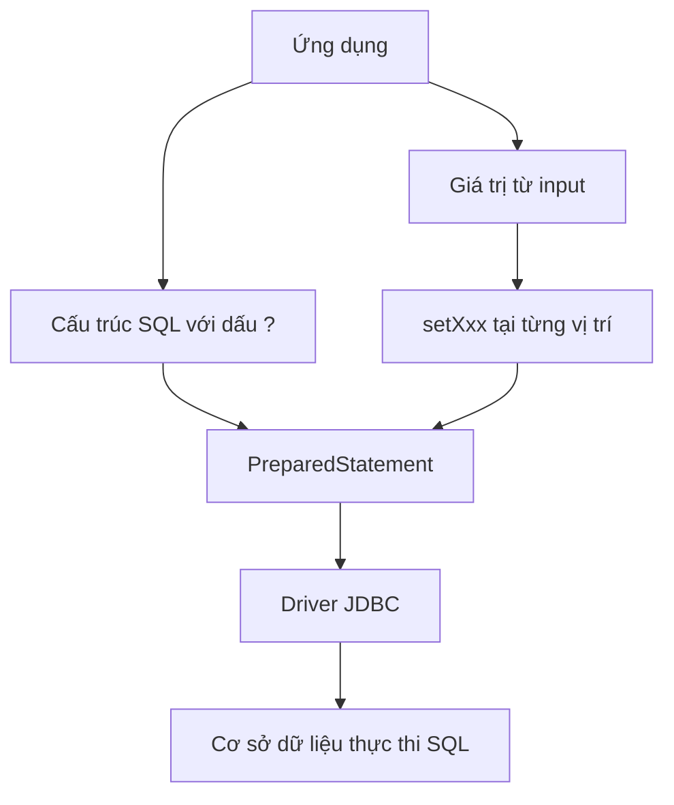
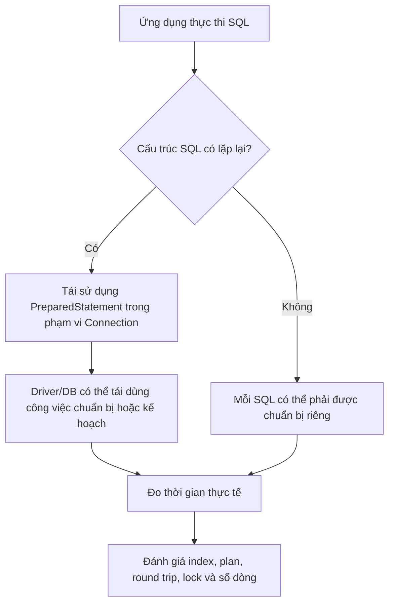

# Đánh giá giới hạn của `PreparedStatement` đối với bảo mật và hiệu năng

## 1. `PreparedStatement` giải quyết vấn đề nào?

**JDBC (Java Database Connectivity)** cung cấp API cho ứng dụng Java truy cập cơ sở dữ liệu quan hệ. Khi thực thi một câu SQL có dữ liệu động, `java.sql.PreparedStatement` cho phép khai báo **cấu trúc câu lệnh** với các dấu giữ chỗ `?` và truyền **giá trị** thông qua `setString()`, `setLong()`, `setDate()` hoặc những phương thức `setXxx()` khác.

Ví dụ, một hệ thống cho phép người dùng tìm đơn hàng theo mã:

```java
String sql = "SELECT id, status FROM orders WHERE id = ?";

try (PreparedStatement statement = connection.prepareStatement(sql)) {
    statement.setLong(1, orderId);

    try (ResultSet rs = statement.executeQuery()) {
        while (rs.next()) {
            System.out.println(rs.getLong("id") + ": "
                    + rs.getString("status"));
        }
    }
}
```

Ở đây `connection` là một `java.sql.Connection` đang mở, do bên gọi sở hữu. Mã sử dụng các kiểu thuộc `java.sql` và không đóng connection vì phạm vi ví dụ chỉ quản lý statement/result set.

Việc tham số hóa có **hai lợi ích quan trọng**:

1. **Bảo mật:** giá trị động được truyền như dữ liệu thay vì ghép thành văn bản SQL, giúp chống SQL injection tại những vị trí được bind đúng cách.
2. **Tái sử dụng câu lệnh:** nhiều lần thực thi có thể dùng cùng cấu trúc SQL và một đối tượng statement; driver/hệ quản trị *có thể* tối ưu việc chuẩn bị hoặc thực thi lặp lại.

Tuy nhiên, câu nói “cứ dùng `PreparedStatement` là SQL luôn an toàn và nhanh hơn” là **không chính xác**. Nó không bảo vệ mọi phần SQL được ghép động, không cấp quyền thay người dùng và không tự biến một câu SQL thiếu chỉ mục thành truy vấn hiệu quả.

## 2. Ranh giới cơ bản: cấu trúc SQL khác giá trị SQL

`PreparedStatement` có thể được hình dung như một bản mô tả câu lệnh SQL cố định và một tập giá trị truyền vào riêng:



Ví dụ:

```sql
SELECT id, email
FROM account
WHERE email = ? AND active = ?;
```

```java
statement.setString(1, "mai@example.test");
statement.setBoolean(2, true);
```

Dấu `?` thứ nhất nhận **giá trị chuỗi**, dấu thứ hai nhận **giá trị boolean**. JDBC đánh số tham số từ **1**. Giá trị `"mai@example.test"` có thể chứa dấu nháy hoặc ký tự đặc biệt nhưng vẫn là một **giá trị dữ liệu**, không trở thành cú pháp SQL mới do ứng dụng tự nối chuỗi.

Việc driver gửi truy vấn đến máy chủ dưới dạng *server-side prepared statement* hay xử lý tham số ở client tùy driver/cấu hình. Bảo đảm quan trọng ở mức API là **ứng dụng giao cấu trúc SQL và tham số riêng**; không nên suy diễn rằng mọi driver đều gửi một lệnh `PREPARE` vật lý trên máy chủ ngay khi gọi `connection.prepareStatement(sql)`.

## 3. Khả năng chống SQL injection và giới hạn của nó

### Ghép chuỗi trực tiếp là điểm rủi ro

Đoạn sau **không an toàn** nếu `emailInput` là dữ liệu chưa tin cậy:

```java
// SAI: dữ liệu không tin cậy trở thành một phần cú pháp SQL.
String sql = "SELECT id FROM account WHERE email = '"
        + emailInput + "'";

try (Statement statement = connection.createStatement();
     ResultSet rs = statement.executeQuery(sql)) {
    // ...
}
```

Người dùng có thể nhập ký tự nháy hoặc nội dung có ý nghĩa SQL, khiến câu lệnh ghép chuỗi khác với điều kiện tìm email ban đầu. Không nên cố sửa bằng một vài lệnh `replace("'", "''")` thủ công vì xử lý escape còn liên quan đến dialect, encoding và ngữ cảnh cú pháp.

Thay bằng:

```java
String sql = "SELECT id FROM account WHERE email = ?";

try (PreparedStatement statement = connection.prepareStatement(sql)) {
    statement.setString(1, emailInput);

    try (ResultSet rs = statement.executeQuery()) {
        while (rs.next()) {
            System.out.println(rs.getLong("id"));
        }
    }
}
```

Giá trị của `emailInput` luôn được truyền ở vị trí **biểu thức giá trị**, không thể tự biến thành `OR`, `UNION` hoặc một câu SQL thứ hai do mã ứng dụng ghép nối. Đây là mục tiêu chính của tham số hóa.

### `PreparedStatement` không bảo vệ SQL được lắp ghép bên ngoài placeholder

Mẫu sau vẫn có rủi ro:

```java
// SAI: tham số hóa userId nhưng ghép trực tiếp điều kiện bổ sung.
String sql = "SELECT id, amount FROM payment "
        + "WHERE user_id = ? ORDER BY " + userSortExpression;

try (PreparedStatement statement = connection.prepareStatement(sql)) {
    statement.setLong(1, userId);
    // ...
}
```

Phần `userSortExpression` đã trở thành **cấu trúc SQL** trước khi câu lệnh được chuẩn bị. Sự có mặt của một placeholder ở vị trí khác không làm nó an toàn. Tương tự, ghép động tên bảng, tên cột, toán tử, mệnh đề `WHERE`, biểu thức `JOIN` hoặc nguyên đoạn `ORDER BY` từ input không được bảo vệ bởi những tham số khác.

### “An toàn khỏi injection” không đồng nghĩa “đúng quyền truy cập”

Ví dụ một ứng dụng nhiều khách hàng (multi-tenant) sử dụng:

```sql
SELECT id, total
FROM invoice
WHERE id = ?;
```

Truy vấn này có thể chống injection ở tham số `id` nhưng vẫn trả hóa đơn của tenant khác nếu ứng dụng không kiểm tra quyền. Câu SQL an toàn hơn về **phân vùng dữ liệu** là:

```sql
SELECT id, total
FROM invoice
WHERE id = ? AND tenant_id = ?;
```

Hai tham số phải được lấy từ nguồn thích hợp: `id` là đối tượng cần tìm, còn `tenant_id` nên lấy từ **ngữ cảnh xác thực/ủy quyền đáng tin cậy** của server, không tin vào mã tenant tùy ý mà client gửi lên. Kiểm soát quyền có thể cần phối hợp logic ứng dụng, chính sách cơ sở dữ liệu, tài khoản chỉ có quyền tối thiểu và kiểm thử bảo mật.

**`PreparedStatement` ngăn dữ liệu bị diễn giải thành cú pháp ở vị trí bind; nó không kiểm tra người dùng có quyền đọc hoặc sửa bản ghi đó hay không.**

## 4. Những gì không thể thay thế bằng dấu `?`

Placeholder của `PreparedStatement` dùng cho **giá trị dữ liệu**, không đại diện tùy ý cho tên đối tượng hay cú pháp SQL.

| Thành phần | Bind bằng `?`? | Ví dụ / cách xử lý |
| --- | --- | --- |
| ID, email, số tiền, mốc thời gian | Có | `WHERE id = ?`; `statement.setLong(1, id)` |
| Giá trị của `INSERT` hoặc `UPDATE` | Có | `SET status = ?` |
| Giá trị `NULL` | Có, với kiểu phù hợp | `setNull(index, Types.VARCHAR)` |
| Tên bảng | Không | Chọn từ whitelist hoặc ánh xạ cấu hình tin cậy |
| Tên cột | Không | Chọn từ các cột đã được phép |
| Từ khóa `ASC` / `DESC` | Không | Chọn bằng nhánh logic hoặc enum |
| Toán tử và biểu thức SQL tùy ý | Không | Chỉ tạo các biểu thức đã được kiểm soát |
| Số lượng phần tử của `IN (...)` | Không tự co giãn | Tạo đúng số placeholder cho từng phần tử |
| Phần `LIMIT` hoặc `OFFSET` | Phụ thuộc dialect và vị trí hỗ trợ | Một số DB cho bind giá trị; vẫn phải kiểm tra miền hợp lệ |

Ví dụ sai về ý định:

```java
// SAI về ngữ nghĩa: ? là biểu thức giá trị, không phải tên cột.
String sql = "SELECT id FROM account ORDER BY ?";
statement.setString(1, "created_at");
```

Nếu driver/DB chấp nhận câu này, nó có thể hiểu `"created_at"` là **một chuỗi hằng**, không phải yêu cầu sắp xếp theo cột `created_at`. Kết quả sẽ không có thứ tự như mong đợi. Không cố đưa tên bảng hoặc toàn bộ đoạn SQL vào `setString()` để “làm cho nó an toàn”.

### Chọn cột sắp xếp bằng whitelist

Một cách tạo SQL động an toàn là ánh xạ yêu cầu từ client thành **một trong các biểu thức cố định** do ứng dụng định nghĩa:

```java
enum AccountSort {
    NEWEST("created_at DESC, id DESC"),
    EMAIL("email ASC, id ASC");

    final String sqlOrderBy;

    AccountSort(String sqlOrderBy) {
        this.sqlOrderBy = sqlOrderBy;
    }
}

String sql = """
        SELECT id, email, created_at
        FROM account
        WHERE tenant_id = ?
        ORDER BY
        """ + sort.sqlOrderBy;

try (PreparedStatement statement = connection.prepareStatement(sql)) {
    statement.setLong(1, authenticatedTenantId);
    try (ResultSet rs = statement.executeQuery()) {
        // Đọc dữ liệu.
    }
}
```

Đoạn này giả định `sort` là giá trị enum đã được xác định và `authenticatedTenantId` lấy từ ngữ cảnh đáng tin cậy. SQL động vẫn tồn tại, nhưng chỉ có **hai cấu trúc câu lệnh được định nghĩa sẵn**. Đừng ánh xạ kiểu `"created_at " + request.getDirection()` khi hướng sắp xếp chưa được giới hạn.

## 5. Ba trường hợp dễ nhầm: `LIKE`, `IN` và danh sách điều kiện

### `LIKE ?` ngăn injection nhưng không vô hiệu hóa wildcard

Xét:

```sql
SELECT id, name FROM customer WHERE name LIKE ?;
```

Giá trị `%` hoặc `_` trong SQL `LIKE` là **ký tự đại diện của pattern**, không phải cú pháp injection. Nếu ứng dụng truyền `"%"+ keyword +"%"`, người dùng gõ `%` có thể khiến truy vấn khớp nhiều dòng hơn dự kiến dù vẫn hoàn toàn được bind an toàn.

Nếu nghiệp vụ cần tìm **chuỗi ký tự literal**, phải escape các ký tự đặc biệt của `LIKE` theo dialect. Ví dụ minh họa cho hệ quản trị hỗ trợ mệnh đề `ESCAPE '!'`:

```java
static String escapeLikeLiteral(String value) {
    return value.replace("!", "!!")
                .replace("%", "!%")
                .replace("_", "!_");
}

String sql = """
        SELECT id, name
        FROM customer
        WHERE name LIKE ? ESCAPE '!'
        """;

try (PreparedStatement statement = connection.prepareStatement(sql)) {
    statement.setString(1, "%"
            + escapeLikeLiteral(keyword) + "%");
    try (ResultSet rs = statement.executeQuery()) {
        // Đọc các dòng có tên chứa keyword literal.
    }
}
```

Điều này xử lý **ngữ nghĩa tìm kiếm**, bổ sung cho khả năng chống injection. Quy ước `ESCAPE` và collation/case sensitivity có thể khác giữa các hệ quản trị; kiểm thử với driver mục tiêu.

### Một `?` không thay thế toàn bộ danh sách `IN`

Ví dụ sau không tạo một danh sách ID như mong muốn:

```java
// SAI về ý định: một placeholder nhận một giá trị đơn.
String sql = "SELECT * FROM product WHERE id IN (?)";
statement.setString(1, "1,2,3");
```

Chuỗi `"1,2,3"` là **một giá trị**, không phải ba tham số `1`, `2`, `3`. Có thể tạo số lượng placeholder theo **kích thước danh sách** đã được kiểm soát, rồi bind từng phần tử:

```java
import java.sql.Connection;
import java.sql.PreparedStatement;
import java.sql.ResultSet;
import java.sql.SQLException;
import java.util.ArrayList;
import java.util.Collections;
import java.util.List;

static List<Long> findProductIds(
        Connection connection, List<Long> ids) throws SQLException {
    if (ids == null || ids.isEmpty()) {
        return List.of();
    }
    if (ids.size() > 500) {
        throw new IllegalArgumentException("Too many ids");
    }

    String placeholders =
            String.join(",", Collections.nCopies(ids.size(), "?"));
    String sql = "SELECT id FROM product WHERE id IN ("
            + placeholders + ") ORDER BY id";

    List<Long> result = new ArrayList<>();
    try (PreparedStatement statement = connection.prepareStatement(sql)) {
        for (int i = 0; i < ids.size(); i++) {
            Long id = ids.get(i);
            if (id == null) {
                throw new IllegalArgumentException("Null id");
            }
            statement.setLong(i + 1, id);
        }

        try (ResultSet rs = statement.executeQuery()) {
            while (rs.next()) {
                result.add(rs.getLong("id"));
            }
        }
    }
    return result;
}
```

Phần cấu trúc động ở đây **chỉ sinh dấu `?` theo số phần tử**; giá trị ID vẫn được bind. Mốc 500 chỉ là **giới hạn nghiệp vụ minh họa**, không phải giới hạn chung của JDBC. Mỗi driver/DB có thể giới hạn số tham số, độ dài SQL hoặc kích thước request; với danh sách rất lớn, hãy xem giải pháp bảng tạm, join với bảng staging, array/table-valued parameter theo khả năng DB hoặc xử lý theo lô.

### Ghép điều kiện `WHERE` tùy chọn

Nhiều màn hình tìm kiếm cho phép lọc theo trạng thái, khoảng ngày hoặc tên. Có thể xây cấu trúc SQL từ một **tập điều kiện đã định nghĩa trước**, chỉ thêm điều kiện khi có input:

```java
StringBuilder sql = new StringBuilder(
        "SELECT id, status FROM orders WHERE tenant_id = ?");
if (status != null) {
    sql.append(" AND status = ?");
}
sql.append(" ORDER BY id");

try (PreparedStatement statement =
             connection.prepareStatement(sql.toString())) {
    statement.setLong(1, authenticatedTenantId);
    if (status != null) {
        statement.setString(2, status);
    }
    // executeQuery() và xử lý ResultSet.
}
```

Đây là **ghép những đoạn SQL cố định, có kiểm soát**; không thêm biểu thức truy vấn tùy ý do người dùng gửi lên. Mỗi tổ hợp điều kiện có thể tạo một *SQL shape* khác nhau, ảnh hưởng đến cache statement và kế hoạch thực thi: đây là một trong những giới hạn hiệu năng của truy vấn động.

## 6. Bind đúng kiểu và xử lý `NULL`

Tham số hóa không có nghĩa mọi dữ liệu đều nên chuyển sang chuỗi bằng `setString()`. Driver cần biết kiểu hợp lý để chuyển đổi giá trị và chọn toán tử phù hợp trên cơ sở dữ liệu.

| Kiểu dữ liệu ứng dụng/SQL | Cách bind gợi ý | Chú ý |
| --- | --- | --- |
| `BIGINT` / ID | `setLong(index, id)` | JDBC đánh số từ 1; kiểm tra miền số hợp lệ |
| `DECIMAL` / số tiền | `setBigDecimal(index, amount)` | Dùng `BigDecimal` để tránh sai số kiểu floating point |
| `BOOLEAN` | `setBoolean(index, active)` | Kiểu/cú pháp boolean phụ thuộc hệ quản trị |
| `DATE` | `setDate(index, Date.valueOf(localDate))` | Truyền ngày không có giờ; quy tắc ngày theo driver |
| `TIMESTAMP` | `setTimestamp(index, timestamp)` hoặc `setObject` với kiểu thời gian được hỗ trợ | Kiểm tra múi giờ và hỗ trợ JDBC 4.2 |
| `VARCHAR NULL` | `setNull(index, Types.VARCHAR)` | Khai báo kiểu SQL khi truyền `NULL` |
| BLOB/CLOB lớn | `setBinaryStream` / `setCharacterStream` | Cân nhắc vòng đời stream và tài nguyên |

Ví dụ cập nhật email có thể rỗng theo ý nghĩa SQL `NULL`:

```java
String sql = "UPDATE account SET recovery_email = ? WHERE id = ?";
try (PreparedStatement statement = connection.prepareStatement(sql)) {
    if (recoveryEmail == null) {
        statement.setNull(1, java.sql.Types.VARCHAR);
    } else {
        statement.setString(1, recoveryEmail);
    }
    statement.setLong(2, accountId);
    int updated = statement.executeUpdate();
}
```

Lỗi kiểu dữ liệu hoặc chuyển đổi cột có thể làm truy vấn thất bại, hoặc dẫn đến implicit cast khiến chỉ mục không được sử dụng như dự kiến. Phải kiểm tra schema và kiểu tham số thực tế. `setObject(index, null)` không phải lúc nào cũng đủ thông tin để driver suy ra kiểu SQL thích hợp; khi có thể, dùng `setNull(index, sqlType)`.

Ngoài ra, **input validation vẫn cần thiết** dù đã bind: ngày bắt đầu không nên sau ngày kết thúc, số trang phải nằm trong khoảng cho phép, độ dài chuỗi phải phù hợp, và người dùng phải có quyền thực hiện thao tác. Prepared statement giải quyết ranh giới cú pháp SQL, không kiểm tra tính hợp lệ nghiệp vụ.

## 7. Giới hạn về hiệu năng: chuẩn bị câu lệnh không tự làm SQL chạy nhanh

Nhiều người kỳ vọng `PreparedStatement` luôn nhanh hơn `Statement` vì tên “prepared”. Thực tế, hiệu năng chịu tác động của **driver, mạng, hệ quản trị, tần suất tái sử dụng, kế hoạch thực thi và bản thân truy vấn**.

Một truy vấn được chuẩn bị vẫn có thể:

- Quét toàn bộ bảng vì không có chỉ mục phù hợp hoặc điều kiện lọc thiếu tính chọn lọc.
- Phải sort hoặc join khối lượng dữ liệu lớn.
- Truyền hàng triệu dòng qua mạng vì ứng dụng không giới hạn kết quả.
- Bị chờ lock, transaction khác hoặc giới hạn tài nguyên trên máy chủ.
- Dùng kế hoạch không phù hợp với giá trị tham số hiện tại vì thống kê hoặc cơ chế cache/generic plan.
- Mất thời gian vì tạo và đóng statement quá nhiều lần hoặc vì mỗi lần thực thi đều cần network round trip.

### Khi nào chuẩn bị/tái sử dụng có thể mang lại lợi ích?



Khi một cấu trúc SQL được thực thi nhiều lần với các giá trị khác nhau, `PreparedStatement` giúp mã Java tái sử dụng một đối tượng statement và có thể giúp driver/DB tái sử dụng phần công việc liên quan đến chuẩn bị. Tuy nhiên:

1. **Không có bảo đảm một lần `prepareStatement(sql)` luôn bằng một lần `PREPARE` trên máy chủ.** Driver có thể chuẩn bị ở client, trì hoãn tạo server-side prepared statement hoặc có ngưỡng số lần thực thi riêng.
2. **Không có bảo đảm server luôn giữ và dùng lại cùng execution plan.** Kế hoạch có thể phụ thuộc giá trị tham số, cấu hình hệ quản trị, thống kê, invalidation và chiến lược generic/custom plan.
3. **Không có bảo đảm câu SQL lặp lại luôn có lợi khi được chuẩn bị.** Với truy vấn chỉ chạy một lần, chi phí chuẩn bị hoặc cơ chế cache có thể không đáng kể hoặc thậm chí tạo overhead trong một số môi trường.
4. **Statement thường gắn với một `Connection`.** Đóng connection/hoàn trả handle pool có thể chấm dứt phạm vi tái sử dụng của đối tượng statement tại mã ứng dụng. Driver/pool có thể tự có cache nội bộ theo cấu hình.

### Bảng kiểm tra những nhận định phổ biến

| Nhận định | Đánh giá |
| --- | --- |
| “Một `PreparedStatement` lúc nào cũng nhanh hơn một `Statement`” | **Không đúng cho mọi trường hợp**; phải đo |
| “Chuẩn bị SQL một lần, bind nhiều lần trên cùng statement có thể giảm overhead” | **Có thể**, tùy driver/DB và cách thực thi |
| “Mọi driver JDBC luôn dùng server-side prepare ngay” | **Không**; khác nhau theo driver/cấu hình |
| “Parameter hóa tự tạo index hoặc chọn plan tối ưu” | **Không**; thiết kế index và optimizer thuộc DB |
| “Một prepared SQL có thể xử lý mọi giá trị với cùng hiệu năng” | **Không**; độ chọn lọc dữ liệu có thể khác lớn |
| “Tái sử dụng statement giữa nhiều thread sẽ nhanh hơn” | **Không nên giả định an toàn**; tránh dùng đồng thời một statement |
| “Dùng `PreparedStatement` giúp chống injection khi bind đúng” | **Có**, tại những vị trí truyền giá trị qua tham số |

## 8. Ví dụ tái sử dụng statement đúng phạm vi

Giả sử cần cập nhật email cho nhiều tài khoản. Cách tạo một statement rồi bind và thực thi nhiều lần có thể giảm chi phí tạo đối tượng và chuẩn bị lại SQL:

```java
import java.sql.Connection;
import java.sql.PreparedStatement;
import java.sql.SQLException;
import java.util.List;
import javax.sql.DataSource;

public final class EmailUpdater {
    public record Change(long accountId, String email) {}

    public static int updateEmails(
            DataSource dataSource, List<Change> changes)
            throws SQLException {

        String sql = "UPDATE account SET email = ? WHERE id = ?";
        int total = 0;

        try (Connection connection = dataSource.getConnection();
             PreparedStatement statement = connection.prepareStatement(sql)) {

            for (Change change : changes) {
                if (change.email() == null) {
                    throw new IllegalArgumentException("email is null");
                }
                statement.setString(1, change.email());
                statement.setLong(2, change.accountId());
                total = Math.addExact(total, statement.executeUpdate());
            }
        }
        return total;
    }
}
```

Đoạn mã **không bảo đảm tất cả lần cập nhật thuộc một transaction nguyên tử**. Nó sử dụng `autoCommit` đang có của connection (thường được bật cho kết nối mới theo mặc định), và do đó mỗi lệnh có thể được commit riêng. Nếu nghiệp vụ cần “tất cả hoặc không gì cả”, phải dùng transaction rõ ràng hoặc để transaction manager điều phối.

Ngoài ra, `total` là `int` và ví dụ thích hợp với số đếm tổng cộng không vượt miền này. Nếu tổng có thể rất lớn, nên dùng `long` và API update count lớn phù hợp. Dùng `Math.addExact` để phát hiện tràn thay vì để tổng bị sai âm thầm.

**Lưu ý về concurrency:** không đặt `PreparedStatement` ở một singleton rồi dùng từ nhiều request/thread. Statement và connection có trạng thái tham số, kết quả, transaction và tài nguyên. Tái sử dụng trong cùng luồng công việc có sở hữu rõ ràng là mô hình dễ kiểm soát hơn.

## 9. Tối ưu nhiều cập nhật: batch và transaction là quyết định riêng

Khi mỗi lần `executeUpdate()` tạo một lượt trao đổi với máy chủ, số lần round trip có thể lớn. `PreparedStatement.addBatch()` và `executeBatch()` cho phép gom nhiều bộ tham số thành một batch để driver gửi/thực thi theo cách phù hợp. Driver có thể tối ưu số lượt trao đổi, nhưng không có bảo đảm mọi batch luôn được chuyển thành một round trip hoặc một SQL duy nhất.

Ví dụ cho một transaction do phương thức tự sở hữu:

```java
import java.sql.BatchUpdateException;
import java.sql.Connection;
import java.sql.PreparedStatement;
import java.sql.SQLException;
import java.util.List;
import javax.sql.DataSource;

public final class BatchStatusUpdater {
    public record Change(long accountId, String status) {}

    public static void updateStatuses(
            DataSource dataSource, List<Change> changes)
            throws SQLException {

        String sql = "UPDATE account SET status = ? WHERE id = ?";
        try (Connection connection = dataSource.getConnection()) {
            connection.setAutoCommit(false);
            try (PreparedStatement statement =
                         connection.prepareStatement(sql)) {

                for (Change change : changes) {
                    statement.setString(1, change.status());
                    statement.setLong(2, change.accountId());
                    statement.addBatch();
                }

                if (!changes.isEmpty()) {
                    int[] counts = statement.executeBatch();
                    // Kiểm tra SUCCESS_NO_INFO nếu cần số đếm chính xác.
                    if (counts.length != changes.size()) {
                        throw new SQLException("Unexpected batch count size");
                    }
                }
                connection.commit();
            } catch (SQLException | RuntimeException failure) {
                try {
                    connection.rollback();
                } catch (SQLException rollbackError) {
                    failure.addSuppressed(rollbackError);
                }
                throw failure;
            }
        }
    }
}
```

Ví dụ đơn giản để thấy cách bind/batch: không kiểm tra quy tắc trạng thái nghiệp vụ và không quyết định cách xử lý từng dòng. Khi thực hiện batch, driver có thể trả `Statement.SUCCESS_NO_INFO` thay vì số dòng chính xác cho một phần tử; khi lỗi có thể phát sinh `BatchUpdateException` với update counts cho những mục đã được báo cáo. Một transaction lớn vẫn có thể gây khóa, tăng log và tạo gánh nặng DB, nên lựa chọn kích thước batch phải theo benchmark và nghiệp vụ.

**Không retry toàn bộ batch một cách tự động sau lỗi kết nối hoặc lỗi commit** nếu kết quả từng lệnh chưa rõ. Dùng transaction có chủ đích, idempotency key, unique constraint hoặc cơ chế đối soát theo yêu cầu nghiệp vụ. `PreparedStatement` không tự giải quyết retry hay tính nguyên tử.

## 10. Query plan và giá trị tham số: một giới hạn tinh tế

Giả sử bảng `orders` có 99,9% dòng ở trạng thái `COMPLETED` và rất ít dòng ở trạng thái `PENDING`:

```sql
SELECT id, created_at
FROM orders
WHERE status = ?;
```

Chạy cùng SQL với hai tham số:

```java
statement.setString(1, "PENDING");
// Có thể phù hợp với truy cập index nếu dữ liệu hiếm.

statement.setString(1, "COMPLETED");
// Có thể phù hợp chiến lược truy cập khác khi nhiều dòng khớp.
```

Hai lần thực thi có **cùng cấu trúc SQL** nhưng lượng dữ liệu và kế hoạch tối ưu có thể rất khác nhau. Một số hệ quản trị có cách chọn hoặc cache kế hoạch cho prepared statement tùy giá trị tham số và phiên bản/cấu hình. Do đó, việc dùng lại một kế hoạch không tự bảo đảm tối ưu cho mọi giá trị; cũng không nên khẳng định mọi hệ quản trị luôn dùng một kế hoạch cố định.

Để điều tra hiệu năng, đo trên **DB/driver/schema/dữ liệu thực tế**, dùng công cụ plan của hệ quản trị (chẳng hạn `EXPLAIN` theo cú pháp cụ thể), thống kê số dòng và thời gian truy vấn. Nên kiểm tra cả tham số phổ biến và tham số hiếm, cùng độ lớn kết quả. Đừng chỉ đo riêng thời gian của `prepareStatement()`, vì chi phí thực thi và truyền dữ liệu thường quan trọng hơn.

Các yếu tố thường có tác động mạnh hơn việc thay `Statement` bằng `PreparedStatement`:

- Có index phù hợp với bộ lọc và thứ tự sắp xếp hay không.
- Chọn đúng cột, tránh `SELECT *` khi chỉ cần một số trường.
- Giới hạn kết quả/paging hợp lý, không tải dữ liệu rất lớn vô tình.
- Sử dụng join hoặc truy vấn theo lô để tránh N+1 query.
- Transaction giữ khóa trong bao lâu, kết nối có bị dùng quá lâu không.
- Kích thước batch, fetch size, caching và cấu hình driver/connection pool.

Trong một số driver, đặt `setFetchSize(...)` có thể ảnh hưởng đến cách lấy `ResultSet`, nhưng nó chỉ là một gợi ý và có thể yêu cầu cấu hình/transaction đặc biệt để streaming. Đây là bài toán tối ưu đọc dữ liệu, tách biệt với lợi ích tham số hóa.

## 11. Cách kiểm chứng bảo mật và hiệu năng một cách có hệ thống

Một bài kiểm tra tốt cần kiểm chứng **đúng ngữ nghĩa** trước khi kết luận về tốc độ. Đề xuất các kịch bản:

| Kiểm tra | Dữ liệu / tình huống | Kết quả mong đợi |
| --- | --- | --- |
| Chuỗi có dấu nháy | Email chứa ký tự `'` | Được coi là giá trị, không phá cấu trúc SQL |
| Giá trị trông giống SQL | Chuỗi chứa `OR`, `UNION` hoặc dấu chấm phẩy | Chỉ là giá trị khi bind đúng |
| Tên cột ORDER BY từ client | Giá trị lạ không thuộc enum/whitelist | Bị từ chối, không tạo SQL tùy ý |
| `LIKE` có `%`/`_` | Tìm literal hoặc wildcard theo yêu cầu | Hành vi khớp rõ ràng, dùng escape khi cần literal |
| Danh sách ID lớn | `IN` có nhiều tham số | Có giới hạn kích thước và không ghép giá trị thẳng vào SQL |
| Truy cập đa tenant | ID hợp lệ nhưng thuộc tenant khác | Không trả dữ liệu trái quyền |
| Truy vấn cùng shape chạy lặp | Dữ liệu nhỏ/lớn, số lần chạy khác nhau | Đo tổng thời gian, chi phí prepare và execute |
| Tham số phân bố lệch | Giá trị rất phổ biến so với rất hiếm | Quan sát kế hoạch thực thi và tốc độ riêng từng nhóm |
| Batch gặp lỗi giữa chừng | Constraint violation hoặc mất mạng | Xử lý trạng thái/transaction an toàn, không retry mù |
| Tài nguyên | Ngoại lệ ở `executeQuery()` hoặc `ResultSet.next()` | Statement, result set và connection được đóng đúng phạm vi |

### Một mẫu đo thời gian đơn giản (không phải benchmark đầy đủ)

```java
long start = System.nanoTime();

try (PreparedStatement statement = connection.prepareStatement(
        "SELECT id FROM account WHERE email = ?")) {
    statement.setString(1, email);
    try (ResultSet rs = statement.executeQuery()) {
        while (rs.next()) {
            // Tiêu thụ kết quả để phép đo không bỏ qua công việc đọc.
            rs.getLong("id");
        }
    }
}

long elapsedNanos = System.nanoTime() - start;
System.out.println("Elapsed ms: " + elapsedNanos / 1_000_000.0);
```

Đoạn này đo **một lần chạy** gồm prepare, execute và đọc kết quả, hữu ích để ghi log thử nghiệm nhưng không đủ để kết luận công nghệ nào nhanh hơn. Nếu so sánh hai chiến lược, cần chạy nhiều lần, warm-up JVM/driver, cố định điều kiện mạng, kiểm soát cache, bộ dữ liệu, đồng thời quan sát thời gian DB server và execution plan. Đừng dùng một con số trong môi trường phát triển để khẳng định tốc độ production.

### Bảo vệ thông tin khi log

Để chẩn đoán, có thể log SQL shape, thời gian thực thi, số dòng, mã lỗi và `SQLState`; phải hạn chế log mật khẩu, mã xác thực, token, dữ liệu cá nhân hoặc tất cả giá trị bind. Driver hoặc thư viện logging có thể hỗ trợ log bind parameters, nên kiểm tra cấu hình log trong môi trường production. Tham số hóa không tự bảo đảm dữ liệu nhạy cảm không xuất hiện trong log, trace hoặc audit.

## 12. Những nhầm lẫn cần tránh

| Nhầm lẫn | Cách hiểu chính xác |
| --- | --- |
| “Dùng một `?` là toàn bộ SQL đã an toàn” | Chỉ những giá trị bind đúng cách được tách khỏi cú pháp SQL |
| “Có thể đặt tên bảng hoặc cột vào `setString()`” | Placeholder không thay thế identifier hay keyword |
| “`PreparedStatement` tự kiểm tra quyền dữ liệu” | Ủy quyền phải được thực thi ở ứng dụng/DB |
| “`LIKE ?` luôn tìm literal” | `%` và `_` vẫn có nghĩa pattern nếu không escape |
| “Một `?` dùng được cho cả danh sách `IN`” | Cần một placeholder mỗi phần tử hoặc kỹ thuật DB riêng |
| “Tất cả driver luôn server-side prepare” | Có driver client-side hoặc chuẩn bị trễ |
| “Cứ chuẩn bị câu SQL thì nó nhanh hơn” | Cần đo thời gian thực thi, kế hoạch, index, round trip |
| “Prepared statement loại bỏ N+1 query” | N+1 phụ thuộc cách tổ chức truy vấn của ứng dụng |
| “Prepared statement đảm bảo transaction an toàn” | Transaction phải được quản lý riêng |
| “Dùng statement chung giữa thread để cache” | Statement/connection có trạng thái; không được mặc định thread-safe |
| “Khi batch lỗi có thể chạy lại ngay” | Có thể một phần lệnh đã thực thi hoặc commit |

## 13. Bài tập thực hành

**Bài 1 – Phân biệt dữ liệu và cấu trúc.** Với một màn hình tìm kiếm cho phép lọc email và sắp xếp theo `created_at` hoặc `email`, hãy xác định phần nào bind bằng `?` và phần nào phải chọn từ whitelist. Viết SQL và mã Java sao cho một chuỗi `sort` lạ bị từ chối.

**Bài 2 – Bắt lỗi bảo mật.** Cho đoạn:

```java
String sql = "SELECT * FROM orders WHERE tenant_id = ? "
        + "AND status = '" + userStatus + "'";
PreparedStatement ps = connection.prepareStatement(sql);
ps.setLong(1, tenantId);
```

Vì sao câu lệnh vẫn nguy hiểm dù có `PreparedStatement`? Hãy chuyển `status` thành dấu `?` thứ hai, bind bằng `setString(2, userStatus)` và xác định nguồn đáng tin cậy của `tenantId`.

**Bài 3 – Tìm kiếm literal.** Người dùng tìm tên sản phẩm có chứa chuỗi `50%_off`. Hãy dùng `LIKE ? ESCAPE '!'` với hàm escape ở mục 5 để kiểm tra rằng dấu `%` và `_` được coi là ký tự thông thường.

**Bài 4 – Đo hiệu năng.** Viết hai phiên bản cập nhật 1.000 dòng: (a) chuẩn bị statement một lần và gọi `executeUpdate()` với tham số mới ở mỗi lượt; (b) dùng `addBatch()/executeBatch()`. Đo nhiều lần trên một DB thử nghiệm và so sánh tổng thời gian, số lượt gọi và số dòng. Ghi nhận rằng kết quả thay đổi theo driver, độ trễ mạng và cấu hình transaction.

**Bài 5 – Chẩn đoán query plan.** Cho truy vấn `WHERE status = ?` với một trạng thái rất phổ biến và một trạng thái hiếm. Dùng công cụ phân tích SQL của hệ quản trị mục tiêu để quan sát kế hoạch/số dòng; giải thích tại sao cùng một prepared SQL có thể không chạy với cùng tốc độ cho hai giá trị.

**Bài 6 – Đúng kiểu dữ liệu.** Sửa một phương thức `UPDATE account SET balance = ? WHERE id = ?` để dùng `BigDecimal` và `setBigDecimal()` thay vì đưa số tiền qua chuỗi hoặc `double`. Thảo luận cách xử lý `NULL` và kiểm tra số tiền hợp lệ.

## 14. Nguyên tắc áp dụng trong dự án

Khi viết JDBC trong ứng dụng truy cập dữ liệu quan hệ, một cách thực hành bền vững là:

1. Xây dựng **cấu trúc SQL có kiểm soát**; chỉ dùng placeholder cho giá trị và whitelist/enum cho những phần cú pháp cần lựa chọn động.
2. Luôn bind dữ liệu chưa tin cậy bằng `setXxx()` với kiểu tương ứng; xử lý `NULL`, wildcard và giới hạn miền dữ liệu theo đúng nghiệp vụ.
3. Kết hợp kiểm soát truy cập, phân vùng tenant và quyền DB tối thiểu; không coi tham số hóa là một hệ thống authorization.
4. Tái sử dụng statement trong **phạm vi connection và tác vụ rõ ràng**; đóng tài nguyên bằng `try-with-resources` và quản lý transaction độc lập.
5. Chỉ tối ưu khi có số đo: xem kế hoạch truy vấn, index, phân bố dữ liệu, số lần gọi, chi phí mạng, batch và giới hạn driver/DB.
6. Xử lý `SQLException` và kết quả giao dịch chưa rõ trước khi retry thao tác ghi dữ liệu.

**Kết luận:** `PreparedStatement` là công cụ nền tảng để **tách dữ liệu khỏi cú pháp SQL** và có khả năng giảm overhead khi tái sử dụng câu lệnh. Giới hạn của nó nằm ở phần cấu trúc SQL được ghép động, yêu cầu kiểm soát quyền và tính đúng đắn của dữ liệu, cùng các quyết định tối ưu hóa phụ thuộc driver, database và từng truy vấn thực tế.
