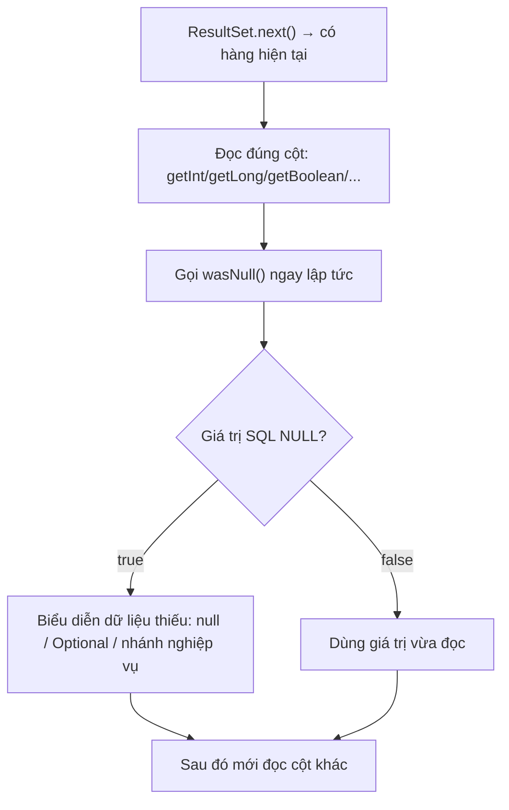

# Sử dụng `wasNull` ngay sau phép đọc có liên quan trong JDBC

## 1. Vì sao cần `ResultSet.wasNull()`?

Trong **JDBC (Java Database Connectivity)**, ứng dụng Java truy cập cơ sở dữ liệu quan hệ qua các giao diện như `Connection`, `PreparedStatement` và `ResultSet`. Một câu lệnh `SELECT` có thể trả về các cột cho phép **SQL `NULL`**: chẳng hạn `manager_id` chưa có người quản lý, `discount_percent` chưa được xác định hoặc `verified` chưa được ghi nhận.

Vấn đề xuất hiện khi ứng dụng đọc một cột nullable bằng getter trả về **kiểu nguyên thủy Java**. Kiểu `int`, `long`, `boolean` hay `double` không chứa được `null`. Theo hợp đồng JDBC, nếu cột đang đọc là SQL `NULL`, những getter tương ứng trả về giá trị mặc định như `0`, `false` hoặc `0.0`. Chỉ nhìn giá trị đó, ứng dụng không thể biết đây là dữ liệu thực hay SQL `NULL`.

`ResultSet.wasNull()` giải quyết sự nhập nhằng này:

```java
int managerId = rows.getInt("manager_id");
boolean missingManager = rows.wasNull(); // Gọi NGAY sau getInt.
```

Nếu `manager_id` của hàng hiện tại là SQL `NULL`, `getInt` trả `0` và `wasNull()` trả `true`. Nếu cột chứa số `0` thật, `getInt` vẫn trả `0` nhưng `wasNull()` trả `false`.

**Quy tắc cốt lõi:** `wasNull()` cho biết **cột được đọc gần nhất** có giá trị SQL `NULL` hay không. Vì vậy, khi cần kết quả của một cột cụ thể, phải gọi nó **ngay sau getter của chính cột đó, trước khi đọc cột khác**.

## 2. Hợp đồng API và phạm vi tác dụng

Trong `java.sql.ResultSet`, phương thức có chữ ký:

```java
boolean wasNull() throws SQLException;
```

| Thành phần | Ý nghĩa |
| --- | --- |
| Đối tượng gọi | Chính `ResultSet` đang được duyệt |
| Giá trị `true` | Giá trị của **cột vừa được đọc** là SQL `NULL` |
| Giá trị `false` | Giá trị của cột vừa được đọc **không** là SQL `NULL` |
| Ngoại lệ | Có thể ném `SQLException` khi có lỗi JDBC/trạng thái tập kết quả không phù hợp |
| Phạm vi | Dựa vào lần đọc cột gần nhất; **không** phải trạng thái của cả hàng hay toàn bộ truy vấn |

Không truyền tên hoặc chỉ số cột vào `wasNull()`. Cột liên quan đã được xác định bởi lời gọi getter ngay trước đó, chẳng hạn `getInt("quantity")` hoặc `getBoolean(3)`.

Trình tự thường dùng:



**Không** gọi `wasNull()` khi chưa đọc một cột của hàng hiện tại rồi đoán nó sẽ kiểm tra một cột nào đó. Kết quả của phương thức chỉ có ý nghĩa khi nó gắn với một phép đọc cột đã thực hiện.

## 3. Getter nào đặc biệt cần `wasNull`?

Các getter trả về kiểu nguyên thủy không thể thể hiện riêng trạng thái SQL `NULL`:

| Getter JDBC | Kiểu Java trả về | Khi SQL `NULL` | Giá trị hợp lệ có thể trùng |
| --- | --- | --- | --- |
| `getBoolean(...)` | `boolean` | `false` | `false` |
| `getByte(...)` | `byte` | `0` | `0` |
| `getShort(...)` | `short` | `0` | `0` |
| `getInt(...)` | `int` | `0` | `0` |
| `getLong(...)` | `long` | `0L` | `0L` |
| `getFloat(...)` | `float` | `0.0f` | `0.0f` |
| `getDouble(...)` | `double` | `0.0d` | `0.0d` |

Đây là lý do không nên đưa trực tiếp `rows.getBoolean("verified")` vào nhánh `if` nếu cột đó cho phép SQL `NULL` và nghiệp vụ cần phân biệt **chưa được xác minh** với **đã xác minh là sai**.

Một số getter trả về **kiểu tham chiếu** như `getString`, `getBigDecimal`, `getDate`, `getTimestamp`, `getBytes` và `getObject` có thể trả Java `null` cho SQL `NULL`. Khi đó ứng dụng có thể kiểm tra chính kết quả trả về; `wasNull()` vẫn có ý nghĩa khi cần hỏi tường minh trạng thái SQL NULL.

Ví dụ:

```java
String nickname = rows.getString("nickname");
if (nickname == null) {
    System.out.println("Chưa có biệt danh");
}
```

Trái lại:

```java
int score = rows.getInt("score");
if (score == 0) {
    // KHÔNG đủ: score thực sự bằng 0 hay SQL NULL?
}
```

Chính hai trường hợp có thể cùng cho giá trị `0` làm cho `wasNull()` cần thiết.

## 4. Ví dụ đơn giản: phân biệt `0` và SQL `NULL`

Giả sử bảng `employees` lưu số ngày nghỉ còn lại; cột `remaining_days` có thể chứa `0` hoặc SQL `NULL`:

```sql
-- Schema minh họa; điều chỉnh cú pháp theo hệ quản trị.
CREATE TABLE employees (
    id BIGINT PRIMARY KEY,
    full_name VARCHAR(150) NOT NULL,
    remaining_days INTEGER NULL,
    verified BOOLEAN NULL,
    manager_id BIGINT NULL
);
```

Ví dụ dữ liệu:

| `id` | `full_name` | `remaining_days` | `verified` | `manager_id` |
| --- | --- | --- | --- | --- |
| 101 | An | `0` | `false` | SQL `NULL` |
| 102 | Bình | SQL `NULL` | SQL `NULL` | `101` |
| 103 | Chi | `7` | `true` | `101` |

Khi đọc hàng của An và Bình bằng `getInt("remaining_days")`, **cả hai** có thể cho kết quả Java `0`. Nhưng:

```java
int days = rows.getInt("remaining_days");
boolean daysMissing = rows.wasNull();

if (daysMissing) {
    System.out.println("Chưa xác định số ngày phép");
} else {
    System.out.println("Số ngày phép còn lại: " + days);
}
```

Đối với An, `daysMissing == false` và `days == 0`, nghĩa là **đã xác định còn 0 ngày**. Đối với Bình, `daysMissing == true`, nghĩa là **chưa có dữ liệu**. Hai trạng thái cần được hiển thị và xử lý khác nhau.

## 5. Ví dụ Java hoàn chỉnh: ánh xạ một hàng nullable

Đoạn mã dưới đây đọc danh sách nhân viên bằng JDBC. Nó giữ nguyên thông tin thiếu dữ liệu bằng các kiểu hộp `Integer`, `Boolean` và `Long`. Các cột cần đọc được chọn với tên rõ ràng, và kết quả `wasNull()` được kiểm tra **ngay sau mỗi getter nguyên thủy**.

```java
import java.sql.Connection;
import java.sql.PreparedStatement;
import java.sql.ResultSet;
import java.sql.SQLException;
import java.util.ArrayList;
import java.util.List;
import javax.sql.DataSource;

public final class EmployeeReader {
    private final DataSource dataSource;

    public EmployeeReader(DataSource dataSource) {
        this.dataSource = dataSource;
    }

    public List<EmployeeView> findAll() throws SQLException {
        String sql = """
            SELECT id, full_name, remaining_days, verified, manager_id
            FROM employees
            ORDER BY id
            """;

        List<EmployeeView> employees = new ArrayList<>();

        try (Connection connection = dataSource.getConnection();
             PreparedStatement statement = connection.prepareStatement(sql);
             ResultSet rows = statement.executeQuery()) {

            while (rows.next()) {
                long id = rows.getLong("id"); // id là PRIMARY KEY NOT NULL.
                String name = rows.getString("full_name");

                int rawDays = rows.getInt("remaining_days");
                boolean daysMissing = rows.wasNull(); // Đúng cột days.
                Integer days = daysMissing ? null : rawDays;

                boolean rawVerified = rows.getBoolean("verified");
                boolean verifiedMissing = rows.wasNull(); // Đúng cột verified.
                Boolean verified = verifiedMissing ? null : rawVerified;

                long rawManagerId = rows.getLong("manager_id");
                boolean managerMissing = rows.wasNull(); // Đúng cột manager_id.
                Long managerId = managerMissing ? null : rawManagerId;

                employees.add(new EmployeeView(
                    id, name, days, verified, managerId
                ));
            }
        }
        return employees;
    }

    public static final class EmployeeView {
        public final long id;
        public final String name;
        public final Integer remainingDays;
        public final Boolean verified;
        public final Long managerId;

        public EmployeeView(long id, String name,
                Integer remainingDays, Boolean verified, Long managerId) {
            this.id = id;
            this.name = name;
            this.remainingDays = remainingDays;
            this.verified = verified;
            this.managerId = managerId;
        }
    }
}
```

Đoạn mã giả định `DataSource` đã được cấu hình, bảng `employees` tồn tại và driver hỗ trợ các kiểu cột tương ứng. `try-with-resources` đóng `ResultSet`, `PreparedStatement` và `Connection` sau khi đọc xong, kể cả khi phát sinh lỗi.

Chú ý ba cách đọc nullable trong ví dụ:

1. Đọc `remaining_days` bằng `getInt`, sau đó hỏi `wasNull()`, rồi mới chuyển `int` sang `Integer` hoặc `null`.
2. Đọc `verified` bằng `getBoolean`, hỏi `wasNull()` trước khi đọc cột kế tiếp, rồi giữ đủ ba trạng thái `true`, `false`, `null`.
3. Đọc `manager_id` bằng `getLong`, hỏi `wasNull()` ngay sau getter, rồi giữ giá trị kiểu `Long` nullable.

Vì `id` được khai báo `PRIMARY KEY NOT NULL`, ví dụ đọc `id` bằng kiểu `long` mà không cần lưu trạng thái `wasNull`. Với bất kỳ cột nào **có thể nullable**, việc chọn kiểu Java nguyên thủy phải được cân nhắc.

## 6. Sai lầm quan trọng: đọc cột khác rồi mới gọi `wasNull`

Hãy xem đoạn mã **sai** sau:

```java
// SAI: wasNull() ở đây kiểm tra full_name, không phải remaining_days.
int days = rows.getInt("remaining_days");
String name = rows.getString("full_name");
boolean daysMissing = rows.wasNull();
```

`wasNull()` tại dòng cuối hỏi xem **`full_name` vừa đọc** có SQL `NULL` hay không. Nếu `full_name` không nullable, kết quả hầu như luôn là `false` ngay cả khi `remaining_days` là `NULL`. Ứng dụng có thể biến dữ liệu thiếu thành số `0` và đưa ra quyết định sai.

Cách đúng:

```java
int days = rows.getInt("remaining_days");
boolean daysMissing = rows.wasNull(); // Kiểm tra ngay getter của days.

String name = rows.getString("full_name"); // Đọc cột khác sau.
```

**Không có danh sách trạng thái `wasNull` theo từng cột** được JDBC tự lưu để ứng dụng truy xuất sau này. Chỉ có thông tin về phép đọc cột gần nhất. Để tránh lỗi, nên đặt cặp `getXxx(...)` và `wasNull()` sát nhau trong cùng vài dòng mã.

## 7. Sai lầm thứ hai: gọi `wasNull` sau hai getter nguyên thủy

Giả sử cần đọc cả số lần đăng nhập và trạng thái xác minh:

```java
// SAI: chỉ xác định được trạng thái NULL của verified.
int loginCount = rows.getInt("login_count");
boolean verified = rows.getBoolean("verified");
boolean wasNull = rows.wasNull();
```

`wasNull` cuối cùng chỉ liên quan đến `verified`. Nếu `login_count` là `NULL` nhưng `verified` bằng `false` thật, `wasNull` sẽ là `false`; thông tin `login_count` thiếu đã bị mất.

Đúng:

```java
int loginCount = rows.getInt("login_count");
boolean loginCountMissing = rows.wasNull();

boolean verified = rows.getBoolean("verified");
boolean verifiedMissing = rows.wasNull();
```

Khi cần lưu cả hai giá trị nullable, có thể chuyển ngay sang kiểu hộp:

```java
Integer nullableLoginCount =
        loginCountMissing ? null : loginCount;
Boolean nullableVerified =
        verifiedMissing ? null : verified;
```

Mỗi cột đều có kết quả riêng để tránh nhầm lẫn. `login_count` và `verified` ở đoạn mã này là ví dụ cột có thể nullable trong một bảng ứng dụng, không nhất thiết thuộc schema `employees` ở phần trước.

## 8. Trường hợp boolean: `false` chưa chắc là “không”

Boolean thường là nơi lỗi bị che giấu nhất. Giả sử một cột `consent_granted BOOLEAN NULL` có ba ý nghĩa nghiệp vụ:

| Giá trị SQL | Kết quả `getBoolean` | Kết quả `wasNull` | Nghĩa trong ứng dụng |
| --- | --- | --- | --- |
| `TRUE` | `true` | `false` | Người dùng đã đồng ý |
| `FALSE` | `false` | `false` | Người dùng đã từ chối |
| `NULL` | `false` | `true` | Chưa ghi nhận lựa chọn |

Nếu viết:

```java
boolean consent = rows.getBoolean("consent_granted");
if (!consent) {
    // Không phân biệt "từ chối" với "chưa có lựa chọn".
}
```

Ứng dụng có thể diễn giải sai `NULL` thành một câu trả lời `false`. Với chức năng yêu cầu phân biệt các trạng thái này, dùng:

```java
boolean rawConsent = rows.getBoolean("consent_granted");
boolean unknown = rows.wasNull();

if (unknown) {
    System.out.println("Chưa ghi nhận lựa chọn");
} else if (rawConsent) {
    System.out.println("Đã đồng ý");
} else {
    System.out.println("Đã từ chối");
}
```

Ví dụ chỉ minh họa bảo toàn ba trạng thái dữ liệu. Quy tắc sử dụng thông tin đồng ý, từ chối hoặc chưa biết phải được định nghĩa ở tầng nghiệp vụ; `wasNull` không tự quyết định hành vi kinh doanh.

## 9. Getter kiểu tham chiếu và `getObject`

Với các getter trả về đối tượng, giá trị Java `null` có thể biểu diễn trực tiếp SQL `NULL`:

```java
String nickname = rows.getString("nickname");
java.math.BigDecimal bonus = rows.getBigDecimal("bonus");
java.sql.Date terminationDate = rows.getDate("termination_date");

if (bonus == null) {
    System.out.println("Chưa có giá trị thưởng");
}
```

Khi các getter này đọc SQL `NULL`, chúng trả về Java `null` theo hợp đồng getter tương ứng. Vì vậy, nếu chỉ muốn kiểm tra thiếu dữ liệu, không cần gọi thêm `wasNull()`. Tuy nhiên, gọi `wasNull()` **ngay sau getter** vẫn hợp lệ khi cần biểu thị tường minh rằng cột SQL chứa `NULL`.

### 9.1. `getObject(columnLabel)`

`ResultSet.getObject(String)` trả một `Object` thích hợp với kiểu SQL. Đối với SQL `NULL`, kết quả là Java `null`:

```java
Object rawValue = rows.getObject("manager_id");
if (rawValue == null) {
    System.out.println("Chưa có người quản lý");
}
```

Nếu dùng `getObject(...)` không chỉ định kiểu, **kiểu Java cụ thể** được driver chọn có thể khác nhau theo kiểu SQL, DBMS hoặc cấu hình. Không nên ép kiểu thành `Long` chỉ vì cột trông giống số nguyên nếu chưa xác minh ánh xạ.

### 9.2. `getObject(columnLabel, Class<T>)`

JDBC có overload nhận kiểu Java mong muốn:

```java
// Khi driver hỗ trợ phép ánh xạ này:
Long managerId = rows.getObject("manager_id", Long.class);
```

Trên driver hỗ trợ ánh xạ đó, kết quả có thể là `Long` hoặc Java `null` khi cột là SQL `NULL`. Tuy nhiên, **không phải mọi driver đều hỗ trợ mọi phép chuyển kiểu** qua overload này; `SQLException` hoặc lỗi tính năng không được hỗ trợ là tình huống cần tính đến.

Với mã cần tương thích nhiều driver, mẫu `getLong(...)` rồi `wasNull()` là cách kiểm tra tường minh, dễ hiểu và bám sát hợp đồng JDBC.

## 10. Viết helper để không quên thứ tự gọi

Trong repository hoặc lớp ánh xạ dữ liệu, có thể đóng gói cặp `getXxx` + `wasNull` vào một helper nhỏ:

```java
import java.sql.ResultSet;
import java.sql.SQLException;

public final class NullableResultSetReader {
    private NullableResultSetReader() {}

    public static Integer getNullableInt(
            ResultSet rows, String column) throws SQLException {
        int value = rows.getInt(column);
        return rows.wasNull() ? null : value;
    }

    public static Long getNullableLong(
            ResultSet rows, String column) throws SQLException {
        long value = rows.getLong(column);
        return rows.wasNull() ? null : value;
    }

    public static Boolean getNullableBoolean(
            ResultSet rows, String column) throws SQLException {
        boolean value = rows.getBoolean(column);
        return rows.wasNull() ? null : value;
    }
}
```

Cách sử dụng:

```java
Integer days =
        NullableResultSetReader.getNullableInt(rows, "remaining_days");
Boolean verified =
        NullableResultSetReader.getNullableBoolean(rows, "verified");
Long managerId =
        NullableResultSetReader.getNullableLong(rows, "manager_id");
```

Helper bảo đảm lời gọi `wasNull` nằm ngay sau đúng getter và trước mọi phép đọc cột tiếp theo. Đây là **ưu điểm về tính đúng đắn và dễ đọc**; không cần tạo helper quá chung hoặc dùng reflection nếu việc đọc vài cột trực tiếp đã rõ ràng.

Đừng viết helper kiểu “đọc tất cả cột trước, kiểm tra `wasNull` sau” vì khi đó chỉ phép đọc cuối cùng còn liên quan đến kết quả `wasNull`.

## 11. Thứ tự `ResultSet.next()` và phép đọc trong từng hàng

`ResultSet` có con trỏ chỉ hàng hiện tại. Thông thường, con trỏ ban đầu nằm **trước hàng đầu tiên**. Cần gọi `next()` để di chuyển đến một hàng hợp lệ trước khi dùng getter.

```java
try (ResultSet rows = statement.executeQuery()) {
    while (rows.next()) {
        int quantity = rows.getInt("quantity");
        boolean quantityMissing = rows.wasNull();

        // Xử lý hàng hiện tại.
        if (!quantityMissing) {
            System.out.println(quantity);
        }
    }
}
```

Mỗi vòng lặp phải đọc lại giá trị và kiểm tra `wasNull` của **hàng hiện tại**. Không lưu biến `wasNull` từ hàng trước để áp dụng cho hàng tiếp theo; trạng thái SQL `NULL` có thể khác nhau giữa từng hàng.

Với `ResultSet` đang đóng, con trỏ không ở hàng hợp lệ, hoặc cột không tồn tại, lời gọi getter có thể ném `SQLException`. `wasNull` không sửa được những lỗi này. Nên giữ toàn bộ phép đọc bên trong phạm vi `try-with-resources` và thân `while (rows.next())` hoặc `if (rows.next())`.

## 12. Phân biệt SQL `NULL` với giá trị mặc định của ứng dụng

Một số ứng dụng có yêu cầu nghiệp vụ “nếu không có số ngày phép thì hiển thị 0”. Điều đó là một **quyết định chuyển đổi ở tầng ứng dụng**, khác với việc giá trị gốc trong DBMS thực sự là 0.

Ví dụ:

```java
int days = rows.getInt("remaining_days");
boolean missing = rows.wasNull();

// Giá trị phục vụ hiển thị, nếu quy tắc nghiệp vụ đã xác định.
int daysForDisplay = missing ? 0 : days;

// Trạng thái nguồn vẫn được giữ để xử lý những nghiệp vụ khác.
boolean dataWasMissing = missing;
```

Nếu bỏ qua `wasNull`, hệ thống đánh mất thông tin nguồn và có thể ghi ngược số `0` thay cho `NULL` vào lần cập nhật sau. Điều này làm thay đổi ý nghĩa dữ liệu mà không có quyết định nghiệp vụ rõ ràng.

| Dữ liệu từ DBMS | Java `getInt` | `wasNull` | Giá trị sau quy tắc hiển thị có thể chọn |
| --- | --- | --- | --- |
| SQL `NULL` | `0` | `true` | `0`, “Chưa cập nhật”, hoặc rỗng tùy nghiệp vụ |
| Số `0` | `0` | `false` | `0` |
| Số `5` | `5` | `false` | `5` |

Việc cả hai hàng đầu hiển thị “0” theo một quy tắc không có nghĩa dữ liệu gốc tương đương.

## 13. `wasNull` và logic ba giá trị của SQL

`ResultSet.wasNull()` giúp Java biết **giá trị cột trả về** có SQL `NULL`, nhưng nó không thay thế hiểu biết về SQL `NULL` trong biểu thức `WHERE`:

```sql
-- Tìm hàng có manager_id chưa được gán.
SELECT id, manager_id
FROM employees
WHERE manager_id IS NULL;
```

Nếu viết `WHERE manager_id = NULL`, phép so sánh SQL cho kết quả `UNKNOWN`, không phải `TRUE`; vì thế thường không lấy được các hàng `NULL`. Phải dùng `IS NULL` hoặc biểu thức có ngữ nghĩa SQL phù hợp.

Ngược lại, một câu truy vấn có thể **biến SQL NULL thành giá trị khác ngay trong SELECT**:

```sql
SELECT id,
       COALESCE(remaining_days, 0) AS display_days
FROM employees;
```

Khi đọc cột `display_days`, `getInt("display_days")` có thể trả `0` và `wasNull()` là `false`, dù `remaining_days` ở bảng gốc là `NULL`. Lý do: `wasNull` hỏi **giá trị của biểu thức trong kết quả truy vấn**, không hỏi tình trạng của cột nguồn trước khi `COALESCE` xử lý.

Tương tự, `COUNT(*)` là một giá trị đếm và `SUM(...)`, `AVG(...)` có thể có hành vi riêng với `NULL` theo SQL. Muốn giữ thông tin liệu dữ liệu gốc đã thiếu, hãy chọn thêm cột hoặc biểu thức phù hợp với mục tiêu, rồi đọc nó rõ ràng trong Java.

## 14. Đọc cột theo tên hay theo vị trí?

JDBC cho phép:

```java
int daysByName = rows.getInt("remaining_days");
boolean missingByName = rows.wasNull();

int daysByIndex = rows.getInt(3);
boolean missingByIndex = rows.wasNull();
```

Ở ví dụ, chỉ số `3` có nghĩa nếu cột `remaining_days` thực sự đứng thứ ba trong danh sách `SELECT`; chỉ số cột của `ResultSet` đếm từ **1**. Hai cách đều dùng chung quy tắc `wasNull`.

Đọc theo **column label** thường dễ bảo trì hơn trong những repository có truy vấn rõ ràng, đặc biệt khi dùng alias:

```sql
SELECT remaining_days AS vacation_balance
FROM employees;
```

Ở Java:

```java
int days = rows.getInt("vacation_balance");
boolean missing = rows.wasNull();
```

Đừng nhầm nhãn `vacation_balance` với tên cột gốc `remaining_days` sau khi đã đặt alias. Chọn danh sách cột rõ ràng và dùng alias không trùng lặp khi ánh xạ DTO.

## 15. Xử lý lỗi và kiểm tra hành vi

Một cách xác minh bài học là chuẩn bị dữ liệu thử có **hai hàng giống nhau ở giá trị getter nhưng khác SQL NULL**. Dùng bảng `employees` đã khai báo:

| Tình huống thử | Dữ liệu `remaining_days` | `getInt` kỳ vọng | `wasNull` kỳ vọng |
| --- | --- | --- | --- |
| Số 0 thật | `0` | `0` | `false` |
| Giá trị chưa biết | SQL `NULL` | `0` | `true` |
| Giá trị dương | `7` | `7` | `false` |

Với `verified`:

| Tình huống thử | Dữ liệu `verified` | `getBoolean` kỳ vọng | `wasNull` kỳ vọng |
| --- | --- | --- | --- |
| Đúng | `TRUE` | `true` | `false` |
| Sai | `FALSE` | `false` | `false` |
| Chưa xác định | SQL `NULL` | `false` | `true` |

Các phép thử hữu ích khác gồm đọc hai cột nullable liên tiếp, đọc nhiều hàng liên tiếp, đọc cột có alias và thử SQL với `COALESCE`. Mục đích là xác nhận cách **bảo toàn ý nghĩa NULL**, không chỉ xác nhận mã Java chạy không ném exception.

Một số lỗi phổ biến:

| Lỗi | Nguyên nhân | Cách sửa |
| --- | --- | --- |
| SQL `NULL` bị hiển thị thành 0 hoặc `false` | Chỉ dùng getter nguyên thủy | Kiểm tra `wasNull()` ngay sau getter |
| `wasNull` phản ánh cột khác | Có getter khác chen giữa | Đặt `getXxx` và `wasNull` liên tiếp |
| Giá trị ở hàng trước ảnh hưởng hàng sau | Dùng lại cờ thiếu dữ liệu qua vòng lặp | Đọc và kiểm tra lại mỗi hàng |
| Gọi getter khi chưa có hàng hiện tại | Quên `next()` hoặc con trỏ hết hàng | Kiểm tra `next()` trước khi đọc |
| Cố đọc cột bằng nhãn không tồn tại | Dùng sai column label/alias | Đối chiếu `SELECT` và nhãn cột |
| `getObject(..., Long.class)` không hoạt động trên driver | Driver thiếu hỗ trợ ánh xạ mong muốn | Dùng `getLong` + `wasNull`, hoặc kiểm tra kiểu driver hỗ trợ |
| `wasNull` là `false` dù cột nguồn nullable | SQL đã dùng `COALESCE` hoặc biểu thức khác | Kiểm tra giá trị biểu thức thực sự được SELECT |

Khi phát sinh `SQLException`, có thể xem `getSQLState()`, `getErrorCode()` và thông điệp lỗi để xác định cột, trạng thái con trỏ hoặc hỗ trợ chuyển kiểu. Không tự suy ra mọi lỗi đọc dữ liệu là do cột `NULL`.

## 16. Bài tập tự kiểm tra

**Câu 1.** Cột `remaining_days` bằng SQL `NULL`. `getInt("remaining_days")` trả gì, và gọi phương thức nào để biết đã thiếu dữ liệu?

**Trả lời:** `getInt` trả `0`. Gọi `wasNull()` ngay sau `getInt`; kết quả là `true` nếu cột vừa đọc là SQL `NULL`.

**Câu 2.** Mã gọi `getLong("manager_id")`, sau đó `getString("full_name")`, cuối cùng `wasNull()`. Kết quả `wasNull` nói về cột nào?

**Trả lời:** `full_name`, vì đây là cột được đọc gần nhất. Muốn biết trạng thái của `manager_id` phải gọi `wasNull` ngay sau `getLong("manager_id")`.

**Câu 3.** `getBoolean("verified")` trả `false`. Có thể khẳng định giá trị SQL là `FALSE` không?

**Trả lời:** Chưa. Cột có thể là SQL `NULL` hoặc `FALSE`. Dùng `wasNull` để phân biệt.

**Câu 4.** Cột `nickname` đọc qua `getString` trả Java `null`. Có bắt buộc phải gọi `wasNull` mới xác định được SQL `NULL` không?

**Trả lời:** Không bắt buộc nếu chỉ cần biết giá trị vắng mặt; getter kiểu tham chiếu đã trả Java `null` cho SQL `NULL`. Có thể gọi `wasNull` ngay sau getter nếu cần kiểm tra tường minh.

**Câu 5.** Truy vấn `SELECT COALESCE(remaining_days, 0) AS days FROM employees` trả `0` cho hàng có `remaining_days` là SQL `NULL`. `getInt("days")` rồi `wasNull()` cho gì?

**Trả lời:** `getInt` trả `0` và `wasNull()` là `false`, vì biểu thức `COALESCE` đã chuyển SQL `NULL` thành số `0` trong kết quả truy vấn.

**Câu 6.** Muốn ánh xạ cột `manager_id BIGINT NULL` thành `Long` mà không lệ thuộc vào `getObject(..., Long.class)`, cần làm gì?

**Trả lời:** Gọi `long raw = rows.getLong("manager_id")`; ngay sau đó gọi `boolean missing = rows.wasNull()`; kết quả `Long managerId = missing ? null : raw`.

**Câu 7.** Vì sao gọi `wasNull()` một lần cuối hàng không đủ để biết ba cột đã đọc có SQL `NULL`?

**Trả lời:** Vì `wasNull()` chỉ phản ánh **phép đọc cột gần nhất**, không lưu trạng thái độc lập của mọi cột. Mỗi getter nguyên thủy cần được kiểm tra riêng ngay sau phép đọc nếu nullable.

## 17. Ghi nhớ

Trong JDBC, **`ResultSet.wasNull()` phải được gọi ngay sau getter liên quan khi cần phân biệt SQL `NULL` với giá trị mặc định của getter nguyên thủy**. Phương thức này kiểm tra **cột vừa được đọc**, không kiểm tra toàn bộ hàng hay một cột do người viết mã ngầm định. Khi ánh xạ dữ liệu quan hệ sang đối tượng Java, hãy giữ rõ ba trạng thái nếu nghiệp vụ yêu cầu, đặc biệt với `boolean`, và cân nhắc `getObject` hoặc getter kiểu tham chiếu khi driver hỗ trợ. Đặt `getXxx` và `wasNull` sát nhau là thói quen nhỏ nhưng ngăn những lỗi âm thầm biến dữ liệu thiếu thành `0` hoặc `false`.
