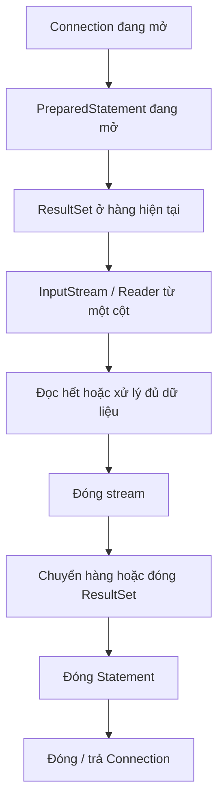

# Quản lý thời gian tồn tại của dữ liệu đọc theo luồng từ ResultSet

Trong chương **Đọc ResultSet**, một vấn đề quan trọng của **JDBC (Java Database Connectivity API for relational database access)** là quản lý **vòng đời dữ liệu đang được đọc theo luồng** (*streaming*). Thay vì lấy toàn bộ BLOB hoặc CLOB thành một mảng byte hay chuỗi Java, ứng dụng có thể nhận một `InputStream` hoặc `Reader` từ `ResultSet` và tiêu thụ dữ liệu từng phần.

Cách đọc này phù hợp với tệp đính kèm, ảnh, tài liệu văn bản dài, nhật ký lớn hoặc các cột lưu dữ liệu nhị phân và ký tự. Tuy nhiên, **luồng lấy từ `ResultSet` thường phụ thuộc vào hàng hiện tại, `ResultSet`, `Statement`, `Connection` và đôi khi cả transaction**. Nếu ứng dụng đóng một tài nguyên cha, chuyển sang hàng khác hoặc gọi getter không đúng thời điểm, luồng có thể không còn sử dụng được.

Mục tiêu của bài là biết **khi nào luồng còn hiệu lực**, cách tiêu thụ và đóng nó an toàn, cách tránh trả về một luồng đã mất nguồn dữ liệu, và cách kết hợp streaming với quản lý kết nối, hiệu năng và lỗi I/O.

## 1. “Đọc theo luồng” trong JDBC nghĩa là gì?

Một truy vấn JDBC thông thường có thể lấy giá trị của cột bằng:

```java
String title = resultSet.getString("title");
byte[] payload = resultSet.getBytes("payload");
```

`getString()` tạo ra giá trị Java kiểu `String`, còn `getBytes()` trả về mảng `byte[]`. Với dữ liệu lớn, việc đưa toàn bộ giá trị vào bộ nhớ ứng dụng có thể không phù hợp.

JDBC cung cấp các phương thức đọc theo luồng:

| Phương thức JDBC | Kiểu Java trả về | Sử dụng tiêu biểu |
| --- | --- | --- |
| `ResultSet.getBinaryStream(...)` | `InputStream` | Dữ liệu nhị phân như ảnh, PDF, BLOB. |
| `ResultSet.getAsciiStream(...)` | `InputStream` | Dữ liệu ký tự dạng ASCII; ít phù hợp khi nội dung có Unicode. |
| `ResultSet.getCharacterStream(...)` | `Reader` | Dữ liệu văn bản/CLOB dưới dạng ký tự Java. |
| `ResultSet.getNCharacterStream(...)` | `Reader` | Dữ liệu ký tự quốc gia/Unicode theo hỗ trợ của driver. |
| `ResultSet.getBlob(...)` | `Blob` | Đối tượng biểu diễn giá trị BLOB, có thể mở `InputStream`. |
| `ResultSet.getClob(...)` | `Clob` | Đối tượng biểu diễn giá trị CLOB, có thể mở `Reader`. |

Các phương thức có dạng nhận **chỉ số cột** (bắt đầu từ 1) hoặc **nhãn cột**. Với cột chứa SQL `NULL`, những getter trả đối tượng như `getBinaryStream()` và `getCharacterStream()` thường trả về `null`. Cần xử lý trường hợp này trước khi đọc.

**Streaming không đồng nghĩa dữ liệu chắc chắn chưa nằm trong bộ nhớ.** JDBC driver có thể tải trước toàn bộ hoặc một phần giá trị; việc có truyền/đệm theo từng khối thực sự hay không tùy driver, cấu hình fetch và loại dữ liệu. Dù thế, đọc từ `InputStream` hoặc `Reader` giúp code ứng dụng **không bắt buộc** phải xây dựng một `byte[]` hoặc `String` lớn.

## 2. Vì sao vòng đời luồng gắn với `ResultSet`?

Giả sử database có bảng:

```sql
CREATE TABLE attachments (
    id BIGINT PRIMARY KEY,
    file_name VARCHAR(255) NOT NULL,
    content_type VARCHAR(100),
    payload BLOB
);
```

`BLOB` ở đây là kiểu dữ liệu mang tính minh họa; cú pháp lưu trữ nhị phân khác nhau giữa hệ quản trị, chẳng hạn PostgreSQL có thể dùng `BYTEA`. Khi dùng ví dụ trên, cần điều chỉnh DDL theo database đang chạy.

Với một truy vấn:

```sql
SELECT file_name, content_type, payload
FROM attachments
WHERE id = ?;
```

ứng dụng có thể gọi:

```java
InputStream input = resultSet.getBinaryStream("payload");
```

`input` không nhất thiết là bản sao hoàn chỉnh, độc lập của giá trị trong database. Nó có thể là một **luồng đọc trực tiếp hoặc gián tiếp qua driver** từ kết quả của hàng hiện tại.

Hãy hình dung quan hệ:



Điều kiện an toàn để tiêu thụ stream là:

1. `ResultSet` và `Statement` tạo ra nó còn mở.
2. `Connection` còn thuộc quyền sử dụng của đoạn mã đọc.
3. Con trỏ `ResultSet` vẫn ở **hàng chứa dữ liệu**.
4. Không gọi phương thức JDBC làm vô hiệu hóa hoặc đóng stream hiện tại.
5. Với dữ liệu dựa trên locator/cursor phía server, transaction và phiên database vẫn còn phù hợp.

Vì vậy, **đừng coi `InputStream`/`Reader` lấy từ `ResultSet` là đối tượng được phép sống độc lập** với các tài nguyên JDBC.

## 3. Những hành động có thể làm luồng mất hiệu lực

### 3.1. Chuyển sang hàng kế tiếp bằng `next()`

Một luồng được lấy từ hàng hiện tại không nên tiếp tục được đọc **sau khi gọi `ResultSet.next()`**. Theo hợp đồng JDBC, việc chuyển hàng có thể đóng các stream đang mở trên hàng trước.

Ví dụ sai:

```java
if (rs.next()) {
    InputStream stream = rs.getBinaryStream("payload");

    rs.next(); // Chuyển con trỏ trước khi đọc xong payload.

    // SAI: stream có thể đã bị đóng / không còn hợp lệ.
    byte[] data = stream.readAllBytes();
}
```

`InputStream.readAllBytes()` xuất hiện từ Java 9 và còn có nguy cơ đưa toàn bộ BLOB vào bộ nhớ. Đoạn này cố ý minh họa **lỗi vòng đời**, không phải cách đọc nên dùng.

Cách đúng là **đọc và đóng stream trước khi chuyển hàng**:

```java
while (rs.next()) {
    try (InputStream stream = rs.getBinaryStream("payload")) {
        if (stream != null) {
            byte[] buffer = new byte[8192];
            while (stream.read(buffer) != -1) {
                // Xử lý từng khối byte của HÀNG HIỆN TẠI.
            }
        }
    }
    // Đến đây stream đã được tiêu thụ và đóng.
    // Lượt tiếp theo mới gọi rs.next().
}
```

Đoạn trên chỉ minh họa vòng đời; trong ứng dụng cần xử lý thực tế các byte đã đọc, gồm số lượng byte trả về từ `read()`, thay vì bỏ qua nội dung.

### 3.2. Gọi getter khác trên cùng `ResultSet`

Với các streaming getter như `getBinaryStream()` hoặc `getCharacterStream()`, hợp đồng JDBC cảnh báo rằng **lần gọi getter tiếp theo có thể tự động đóng stream đang mở**. Vì vậy, cần đọc đầy đủ stream của một cột **trước khi đọc một cột khác bằng getter**.

Ví dụ không an toàn:

```java
InputStream payload = rs.getBinaryStream("payload");

// Có thể làm stream payload bị đóng trước khi đọc hết.
String fileName = rs.getString("file_name");

copyPayload(payload);
```

`copyPayload(...)` là phương thức minh họa, không phải API có sẵn của JDBC. Ngoài ra, luồng cũng có thể bị vô hiệu hóa khi statement được thực thi lại hoặc result set bị đóng.

Cách an toàn hơn:

```java
// Đọc cột nhỏ bằng getter trước.
String fileName = rs.getString("file_name");
String contentType = rs.getString("content_type");

// Lấy stream cuối cùng và tiêu thụ hết trước getter/next tiếp theo.
try (InputStream payload = rs.getBinaryStream("payload")) {
    if (payload != null) {
        byte[] buffer = new byte[8192];
        int count;
        while ((count = payload.read(buffer)) != -1) {
            consumeBytes(buffer, count);
        }
    }
}
```

`consumeBytes(...)` là hàm do ứng dụng tự xây dựng, ví dụ ghi `count` byte đầu trong buffer ra tệp hoặc gửi tới một đích phù hợp.

**Quy tắc thực hành:** lấy các cột metadata nhỏ trước, rồi lấy stream và đọc hết nó trước khi gọi `next()` hoặc getter khác. Không nên dựa vào việc một JDBC driver cụ thể “vẫn cho đọc tiếp” để xây dựng một API có thể mang sang driver khác.

### 3.3. Đóng `ResultSet`, `Statement` hoặc `Connection`

Nếu ứng dụng gọi `resultSet.close()`, `statement.close()` hoặc `connection.close()` trước khi kết thúc việc đọc, luồng gắn với dữ liệu của `ResultSet` không còn có vòng đời được bảo đảm.

Ví dụ:

```java
InputStream input;

try (PreparedStatement statement =
             connection.prepareStatement(
                 "SELECT payload FROM attachments WHERE id = ?")) {
    statement.setLong(1, id);

    try (ResultSet rs = statement.executeQuery()) {
        if (!rs.next()) {
            return;
        }

        input = rs.getBinaryStream(1);
    }
}

// SAI: rs và statement đã đóng trước khi đọc input.
input.transferTo(output);
```

`input.transferTo(output)` (Java 9+) và `output` trong đoạn trên chỉ minh họa tình huống sai; đoạn mã giả định `connection`, `id` và `output` đã có. Dù một driver tải sẵn dữ liệu và tình cờ cho phép đọc sau khi đóng `ResultSet`, **không nên xem đó là hợp đồng portable**.

### 3.4. Thực thi lại cùng một `Statement`

Theo JDBC, một `Statement` thường chỉ quản lý một `ResultSet` hiện tại; thực thi câu SQL mới trên cùng statement có thể đóng kết quả hiện tại. Luồng phụ thuộc vào kết quả cũ cũng không nên được tiếp tục dùng:

```java
ResultSet first = statement.executeQuery(
        "SELECT payload FROM attachments WHERE id = 1");

first.next();
InputStream input = first.getBinaryStream(1);

// Lệnh mới có thể làm ResultSet cũ bị đóng.
ResultSet second = statement.executeQuery(
        "SELECT payload FROM attachments WHERE id = 2");

// Không đọc tiếp input từ ResultSet first ở đây.
```

Đọc và đóng kết quả đầu tiên trước khi tái thực thi. Nếu thật sự cần kết quả đồng thời, cân nhắc statement riêng và xác minh khả năng của driver/database.

### 3.5. Commit hoặc rollback khi kết quả còn đang đọc

Một số cơ sở dữ liệu sử dụng **cursor phía server** để đọc `ResultSet` theo từng nhóm hàng. Commit, rollback hoặc thay đổi trạng thái transaction có thể làm cursor mất hiệu lực tùy *holdability* và driver.

JDBC có các chế độ như `ResultSet.CLOSE_CURSORS_AT_COMMIT` và `ResultSet.HOLD_CURSORS_OVER_COMMIT`, nhưng khả năng hỗ trợ và hành vi thực tế khác nhau. Những chế độ này không phải giấy phép để giữ một `InputStream`/`Reader` và tiếp tục đọc tùy ý sau khi transaction kết thúc.

**Nguyên tắc an toàn:** hoàn thành việc tiêu thụ stream và đóng `ResultSet` trước khi kết thúc transaction liên quan, trừ khi bạn có hợp đồng cụ thể và kiểm thử đầy đủ cho driver/database đang dùng.

## 4. Ví dụ đầy đủ: sao chép dữ liệu nhị phân ra tệp

Đây là tình huống phổ biến: đọc cột `payload` chứa nội dung nhị phân và ghi ra đĩa **theo từng khối**, không tạo một `byte[]` chứa toàn bộ tệp.

Ví dụ sử dụng bảng `attachments` nói trên, JDBC `DataSource` đã cấu hình và Java 15+ (vì sử dụng text block):

```java
import java.io.IOException;
import java.io.InputStream;
import java.nio.file.Files;
import java.nio.file.Path;
import java.sql.Connection;
import java.sql.PreparedStatement;
import java.sql.ResultSet;
import java.sql.SQLException;
import javax.sql.DataSource;

public final class AttachmentDownloader {
    private final DataSource dataSource;

    public AttachmentDownloader(DataSource dataSource) {
        this.dataSource = dataSource;
    }

    public boolean download(long attachmentId, Path target)
            throws SQLException, IOException {

        String sql = """
                SELECT file_name, content_type, payload
                FROM attachments
                WHERE id = ?
                """;

        try (Connection connection = dataSource.getConnection();
             PreparedStatement statement =
                     connection.prepareStatement(sql)) {

            statement.setLong(1, attachmentId);

            try (ResultSet rows = statement.executeQuery()) {
                if (!rows.next()) {
                    return false;
                }

                // Đọc metadata TRƯỚC khi mở stream.
                String fileName = rows.getString("file_name");
                String contentType = rows.getString("content_type");

                try (InputStream input =
                             rows.getBinaryStream("payload")) {

                    if (input == null) {
                        return false; // Cột payload chứa SQL NULL.
                    }

                    // Files.copy đọc theo luồng, không đóng input thay ta.
                    // target phải là đường dẫn do ứng dụng đã kiểm soát.
                    Files.copy(input, target);
                }

                System.out.println(
                        "Đã tải: " + fileName + ", type=" + contentType);
                return true;
            }
        }
    }
}
```

Ghi chú: text block `"""` yêu cầu Java 15+; thay bằng chuỗi thường nếu dự án dùng Java 11. Ví dụ chỉ minh họa cách đọc, không khai báo một API HTTP hoặc hệ thống lưu trữ tệp hoàn chỉnh.

**Vòng đời được bảo đảm bởi cấu trúc khối:**

1. `Connection` được mượn trước, `PreparedStatement` được tạo tiếp.
2. `ResultSet` còn mở và con trỏ đang đứng ở hàng cần đọc.
3. Các cột `file_name` và `content_type` được đọc **trước** `payload`.
4. `InputStream` được mở, `Files.copy` đọc đến EOF, rồi `InputStream.close()` được gọi.
5. `ResultSet`, `PreparedStatement`, `Connection` lần lượt đóng khi ra khỏi các khối.
6. Nếu `DataSource` có connection pool, `Connection.close()` thường trả handle được mượn về pool.

`Files.copy(input, target)` ném `FileAlreadyExistsException` khi đích đã tồn tại (nếu không truyền lựa chọn thay thế). Đó là hành vi hợp lý nếu cần tránh ghi đè nhầm. Không dùng trực tiếp `file_name` do người dùng cung cấp để tạo đường dẫn: tên tệp có thể chứa `../` hoặc ký tự đặc biệt. Hãy lưu vào thư mục do ứng dụng kiểm soát và xây tên đích theo ID hoặc quy tắc kiểm tra chặt chẽ.

### Khi nào bài toán cần tệp tạm?

Nếu có lỗi mạng hoặc lỗi đọc giữa chừng, `Files.copy` có thể để lại **tệp đích chỉ có một phần nội dung**. Với dữ liệu quan trọng, nên ghi vào tệp tạm, chỉ công bố tệp chính sau khi sao chép thành công và dọn tệp tạm khi thất bại.

Mô hình:

```text
ResultSet còn mở
    -> getBinaryStream
    -> ghi vào temporary file
    -> đóng InputStream
    -> đóng ResultSet/Statement
    -> nếu đủ dữ liệu và xác minh thành công:
       đổi tên/move tệp tạm thành tệp đích
    -> nếu lỗi:
       xóa tệp tạm, báo lỗi
```

Nếu cần thay thế tệp một cách nguyên tử, có thể cân nhắc `Files.move` với `StandardCopyOption.ATOMIC_MOVE` trên cùng filesystem **khi filesystem hỗ trợ**. Không mặc định mọi hệ tệp đều hỗ trợ atomic move; cũng cần cân nhắc quyền tệp, dung lượng đĩa, checksum và chính sách tránh ghi đè.

## 5. Đọc nhiều hàng có BLOB: chỉ chuyển hàng sau khi hoàn tất stream

Với truy vấn trả về nhiều bản ghi, hãy đặt khối `try-with-resources` của stream **bên trong từng lần `rs.next()`**.

```java
import java.io.IOException;
import java.io.InputStream;
import java.io.OutputStream;
import java.nio.file.Files;
import java.nio.file.Path;
import java.sql.Connection;
import java.sql.PreparedStatement;
import java.sql.ResultSet;
import java.sql.SQLException;

public final class AttachmentBatchExport {
    public static void export(
            Connection connection, Path outputDirectory)
            throws SQLException, IOException {

        String sql =
                "SELECT id, payload FROM attachments ORDER BY id";

        try (PreparedStatement statement =
                     connection.prepareStatement(sql);
             ResultSet rows = statement.executeQuery()) {

            while (rows.next()) {
                long id = rows.getLong("id"); // Getter metadata trước.
                Path target = outputDirectory.resolve(
                        "attachment-" + id + ".bin");

                try (InputStream input =
                             rows.getBinaryStream("payload")) {
                    if (input == null) {
                        continue;
                    }

                    try (OutputStream output =
                                 Files.newOutputStream(target)) {
                        byte[] buffer = new byte[8192];
                        int count;

                        while ((count = input.read(buffer)) != -1) {
                            output.write(buffer, 0, count);
                        }
                    }
                }
                // Đã đóng stream của hàng hiện tại trước rs.next() tiếp.
            }
        }
    }
}
```

Trong ví dụ:

- `Connection` do caller truyền vào, nên **caller sở hữu việc đóng** kết nối.
- `PreparedStatement` và `ResultSet` được tạo trong phương thức nên phương thức đóng chúng.
- `InputStream` và `OutputStream` được đóng trước khi con trỏ chuyển hàng.
- Khi sử dụng `newOutputStream`, ứng dụng cần có chính sách xử lý tệp đã tồn tại, quyền ghi, lỗi từng bản ghi và việc dọn tệp khi xuất thất bại.

Đoạn mã sử dụng ID kiểu số để xây tên tệp, tránh dùng tên tệp chưa kiểm soát từ database. Nó không tự tạo `outputDirectory`: thư mục phải tồn tại và do ứng dụng cho phép ghi.

### Vì sao cần dùng số byte thực tế?

Trong vòng đọc:

```java
int count = input.read(buffer);
```

`count` có thể nhỏ hơn kích thước buffer. Khi ghi dữ liệu, phải gọi `output.write(buffer, 0, count)`, không phải luôn ghi toàn bộ `buffer`. Nếu ghi cả buffer khi lượt đọc cuối chỉ có vài byte hợp lệ, đầu ra sẽ có byte dư và tệp có thể bị hỏng.

Nên đọc cho đến khi `read()` trả về `-1` (EOF); **không sử dụng `available()` làm kích thước toàn bộ dữ liệu**. `InputStream.available()` chỉ ước lượng số byte có thể đọc ngay mà không bị chặn, không phải độ dài BLOB.

## 6. Đọc dữ liệu ký tự lớn bằng `getCharacterStream()`

Cột văn bản dài có thể được đọc dưới dạng `Reader` thay vì tạo một `String` lớn:

```java
import java.io.IOException;
import java.io.Reader;
import java.io.Writer;
import java.nio.charset.StandardCharsets;
import java.nio.file.Files;
import java.nio.file.Path;
import java.sql.Connection;
import java.sql.PreparedStatement;
import java.sql.ResultSet;
import java.sql.SQLException;

public final class DocumentExporter {
    public static boolean exportText(
            Connection connection, long documentId, Path target)
            throws SQLException, IOException {

        String sql =
                "SELECT title, body FROM documents WHERE id = ?";

        try (PreparedStatement statement =
                     connection.prepareStatement(sql)) {
            statement.setLong(1, documentId);

            try (ResultSet rs = statement.executeQuery()) {
                if (!rs.next()) {
                    return false;
                }

                String title = rs.getString("title");

                try (Reader reader =
                             rs.getCharacterStream("body")) {
                    if (reader == null) {
                        return false;
                    }

                    try (Writer writer = Files.newBufferedWriter(
                            target, StandardCharsets.UTF_8)) {

                        char[] buffer = new char[8192];
                        int count;

                        while ((count = reader.read(buffer)) != -1) {
                            if (count > 0) {
                                writer.write(buffer, 0, count);
                            }
                        }
                    }
                }

                System.out.println("Đã xuất văn bản: " + title);
                return true;
            }
        }
    }
}
```

Giả định có bảng `documents(id, title, body)`, trong đó `body` là cột văn bản dài mà driver hỗ trợ `getCharacterStream()`.

`Reader` trả về **ký tự**, không phải byte thô. `Files.newBufferedWriter(..., UTF_8)` biến ký tự thành byte UTF-8 ở tệp đích, giúp giữ nội dung tiếng Việt và ký tự Unicode mà không phải tự đoán byte encoding của cột nguồn.

Không chọn `getAsciiStream()` cho nội dung có dấu hoặc Unicode trừ khi đã xác định rõ yêu cầu mã hóa và hỗ trợ của driver. Với nội dung nhị phân, dùng `getBinaryStream()` và `OutputStream` thay vì xử lý như text.

### SQL `NULL` và nội dung rỗng

- Nếu cột `body` chứa SQL `NULL`, `getCharacterStream("body")` có thể trả về `null`.
- Nếu cột là chuỗi rỗng hợp lệ, `Reader` có thể được tạo nhưng ngay lần `read()` đầu trả về `-1`.
- Nếu truy vấn không có hàng, `rs.next()` trả về `false`.

Ba tình huống này khác nhau về mặt nghiệp vụ; ứng dụng nên quyết định rõ có tạo tệp rỗng, bỏ qua hay báo thiếu dữ liệu.

## 7. Phân biệt `getBinaryStream()`, `getBlob()` và `getBytes()`

Đây là ba cách thường dùng khi đọc dữ liệu nhị phân:

| Cách đọc | Dữ liệu nhận được | Hệ quả cần quan tâm |
| --- | --- | --- |
| `rs.getBytes("payload")` | `byte[]` độc lập với ResultSet sau khi đã nhận. | Có thể tiêu tốn bộ nhớ lớn; không phù hợp với BLOB lớn chưa giới hạn. |
| `rs.getBinaryStream("payload")` | `InputStream`. | Phải tiêu thụ khi row/result set/connection còn hợp lệ; đóng stream đúng lúc. |
| `rs.getBlob("payload")` | `Blob`. | Có thể là locator hoặc dữ liệu đã vật hóa; quản lý `InputStream` và `Blob.free()`. |

`Blob` là giao diện JDBC có các phương thức như `length()`, `getBinaryStream()`, `getBytes(position, length)` và `free()`. Một số driver dùng locator BLOB phía server, nên dữ liệu vẫn cần phiên hoặc transaction còn hiệu lực; driver khác có thể vật hóa dữ liệu vào bộ nhớ.

### Ví dụ dùng `Blob` đúng vòng đời

```java
import java.io.InputStream;
import java.nio.file.Files;
import java.nio.file.Path;
import java.sql.Blob;
import java.sql.ResultSet;

Blob blob = rs.getBlob("payload");

if (blob != null) {
    try {
        try (InputStream input = blob.getBinaryStream()) {
            Files.copy(input, target);
        }
    } finally {
        blob.free();
    }
}
```

Đây là **một đoạn mã trong phạm vi `ResultSet` đang mở**; giả định biến `rs` và `target` đã có, phương thức gọi khai báo hoặc xử lý `SQLException`, `IOException`. `Blob` **không tự động tham gia `try-with-resources`** như một `InputStream`; cần gọi `free()` khi đã xong, theo khả năng hỗ trợ của JDBC driver. Với `Clob`, cơ chế tương tự là `getCharacterStream()` và `Clob.free()`.

Sau `free()`, không tiếp tục dùng `Blob`/`Clob` đó. Đừng lưu một `Blob` locator trong DTO để đọc sau khi connection đã đóng rồi giả định luôn hoạt động.

### Khi nên materialize thành dữ liệu độc lập

Nếu cần truyền dữ liệu ra khỏi ranh giới JDBC mà nội dung **nhỏ và đã có giới hạn rõ ràng**, có thể đọc toàn bộ vào `byte[]` hoặc `String` **trước khi đóng `ResultSet`**. Lúc đó DTO/giá trị Java không còn phụ thuộc vào luồng của driver.

Ngược lại, với tệp vài trăm MB hoặc hàng GB, vật hóa toàn bộ có thể làm ứng dụng hết bộ nhớ. Khi cần dữ liệu sống lâu hơn `ResultSet`, hãy **copy stream sang một nơi do ứng dụng sở hữu**, chẳng hạn tệp tạm hoặc object storage, rồi chuyển đường dẫn/identifier của bản sao đó cho lớp khác.

## 8. Anti-pattern: trả về stream đã mất nguồn dữ liệu

Một lỗi phổ biến là repository mở kết nối trong `try-with-resources` rồi **trả thẳng stream** cho caller:

```java
// KHÔNG NÊN DÙNG: stream bị lệ thuộc vào tài nguyên đã đóng.
public InputStream findPayload(DataSource dataSource, long id)
        throws SQLException {

    try (Connection connection = dataSource.getConnection();
         PreparedStatement ps = connection.prepareStatement(
                 "SELECT payload FROM attachments WHERE id = ?")) {

        ps.setLong(1, id);

        try (ResultSet rs = ps.executeQuery()) {
            if (!rs.next()) {
                return null;
            }

            return rs.getBinaryStream("payload");
        }
    } // Đến đây ResultSet/Statement/Connection đã đóng.
}
```

Phương thức có thể trả ra một đối tượng `InputStream`, nhưng **caller nhận được sau khi JDBC resources đã bị đóng**. Nếu driver cần tiếp tục đọc từ database, việc đọc về sau có thể thất bại.

### Cách sửa 1: tiêu thụ stream bên trong repository

Thiết kế API theo yêu cầu nghiệp vụ:

```java
public boolean savePayload(
        DataSource dataSource, long id, Path target)
        throws SQLException, IOException {

    try (Connection connection = dataSource.getConnection();
         PreparedStatement ps = connection.prepareStatement(
                 "SELECT payload FROM attachments WHERE id = ?")) {

        ps.setLong(1, id);

        try (ResultSet rs = ps.executeQuery()) {
            if (!rs.next()) {
                return false;
            }

            try (InputStream input = rs.getBinaryStream(1)) {
                if (input == null) {
                    return false;
                }

                Files.copy(input, target);
                return true;
            }
        }
    }
}
```

Phương thức hoàn thành việc ghi trước khi đóng `Connection`. Bên ngoài chỉ nhận thông tin rằng thao tác đã lưu hay chưa, không nhận một stream có lifetime khó xác định.

### Cách sửa 2: callback đồng bộ với ranh giới sở hữu rõ ràng

Một API có thể cho caller **xử lý stream ngay khi repository còn giữ kết nối mở**, ví dụ callback được gọi đồng bộ trong khối `try`. Khi callback kết thúc, repository mới đóng các tài nguyên.

Hợp đồng phải ghi rõ:

- Callback **không giữ lại** `InputStream`/`Reader` để đọc sau.
- Callback không gửi stream sang thread nền hay future bất đồng bộ rồi trả về sớm.
- Ngoại lệ từ callback phải được xử lý/truyền tiếp, và resource luôn được đóng.
- Việc đọc cần có timeout, giới hạn dung lượng và chính sách hủy nếu caller ngừng tiêu thụ.

Nếu API của framework yêu cầu streaming response bất đồng bộ, **không được đóng JDBC connection trước khi quá trình truyền thực sự hoàn tất**. Điều đó cần thiết kế ownership khác, theo cơ chế streaming của framework; không thể chỉ dùng một khối `try-with-resources` kết thúc ngay khi trả về response wrapper.

## 9. Mối liên hệ giữa fetch size, cursor và thời gian giữ kết nối

Đọc luồng từ một cột BLOB/CLOB và **fetch nhiều hàng của `ResultSet` theo từng nhóm** là hai khái niệm liên quan nhưng **không đồng nhất**:

- `getBinaryStream()`/`getCharacterStream()` là API đọc **giá trị một cột** qua luồng.
- `setFetchSize(n)` là **gợi ý** cho driver về số hàng có thể tải mỗi lần khi duyệt `ResultSet`; không đảm bảo database chỉ giữ đúng n hàng trong RAM.
- Cursor phía server có thể giúp tránh tải toàn bộ `ResultSet` vào bộ nhớ, nhưng khả năng kích hoạt phụ thuộc driver, loại result set, cấu hình kết nối và transaction.

Ví dụ cấu trúc xử lý từng hàng:

```java
String sql = "SELECT id, payload FROM attachments ORDER BY id";

try (PreparedStatement ps = connection.prepareStatement(
        sql,
        ResultSet.TYPE_FORWARD_ONLY,
        ResultSet.CONCUR_READ_ONLY)) {

    ps.setFetchSize(100);

    try (ResultSet rs = ps.executeQuery()) {
        while (rs.next()) {
            long id = rs.getLong("id");

            try (InputStream stream = rs.getBinaryStream("payload")) {
                if (stream != null) {
                    // Tiêu thụ toàn bộ dữ liệu của id trước rs.next() tiếp.
                }
            }
        }
    }
}
```

Ví dụ cần `import java.sql.ResultSet;`, `import java.io.InputStream;`. Lời gọi `setFetchSize(100)` **không đảm bảo** mỗi tệp được chia thành khối 100 byte hoặc chỉ có 100 hàng trong bộ nhớ; ý nghĩa của nó là gợi ý về fetch **hàng**.

Với PostgreSQL JDBC, hành vi dùng cursor để fetch nhiều đợt phụ thuộc các điều kiện như chế độ auto-commit và result set phù hợp. Những điều kiện này phải được kiểm tra theo phiên bản driver thực tế; không thể áp dụng một mẫu cấu hình chung cho PostgreSQL, MySQL, Oracle và SQL Server.

### Stream lâu có thể làm cạn connection pool

Khi một request mượn `Connection` và đọc BLOB lớn trong nhiều giây hoặc phút, connection đó có thể tiếp tục bị giữ cho đến khi stream được tiêu thụ và các tài nguyên JDBC đóng xong. Một pool có 10 connection sẽ không thể phục vụ tùy ý nhiều request streaming chậm đồng thời.

Không giữ connection mở trong lúc thực hiện các công việc không liên quan như xử lý ảnh CPU nặng hoặc gọi HTTP API khác nếu có thể tách các công việc đó khỏi thời điểm truy cập dữ liệu. Tuy nhiên, **không được đóng connection quá sớm khi stream vẫn cần nó**.

Nếu lưu lượng tải tệp lớn, cân nhắc tách BLOB sang object storage hoặc một thiết kế staging/caching phù hợp; JDBC vẫn có thể lưu metadata trong cơ sở dữ liệu. Đây là quyết định kiến trúc phụ thuộc yêu cầu nhất quán, bảo mật và lưu lượng.

## 10. Transaction và holdability khi streaming

Với một `ResultSet` đang được duyệt bằng cursor, thời gian tồn tại của cursor có thể gắn với transaction. Java định nghĩa hai hằng:

- `ResultSet.CLOSE_CURSORS_AT_COMMIT`: đóng cursor khi commit.
- `ResultSet.HOLD_CURSORS_OVER_COMMIT`: có thể giữ cursor qua commit khi driver/database hỗ trợ.

Có thể kiểm tra khả năng hỗ trợ qua `DatabaseMetaData.supportsResultSetHoldability(...)` và cấu hình nếu có hợp đồng rõ ràng. Nhưng giữ cursor qua commit **không nhất thiết bảo đảm mọi stream đã lấy từ một cột còn đọc được sau commit**.

### Mẫu an toàn khi cần transaction để duyệt cursor

```java
try (Connection connection = dataSource.getConnection()) {
    connection.setAutoCommit(false);

    try {
        try (PreparedStatement ps = connection.prepareStatement(
                "SELECT id, payload FROM attachments ORDER BY id")) {

            ps.setFetchSize(100);

            try (ResultSet rs = ps.executeQuery()) {
                while (rs.next()) {
                    long id = rs.getLong(1);

                    try (InputStream input = rs.getBinaryStream(2)) {
                        if (input != null) {
                            byte[] buffer = new byte[8192];
                            int count;
                            long totalBytes = 0;

                            while ((count = input.read(buffer)) != -1) {
                                totalBytes += count;
                            }

                            System.out.println("id=" + id
                                    + ", bytes=" + totalBytes);
                        }
                    }
                }
            }
        }

        // Commit sau khi đã đọc/đóng các stream và result set.
        connection.commit();
    } catch (SQLException | IOException error) {
        try {
            connection.rollback();
        } catch (SQLException rollbackError) {
            error.addSuppressed(rollbackError);
        }
        throw error;
    }
}
```

Đoạn mã đọc hết stream để **đếm byte**, không lưu nội dung; trong ứng dụng thật cần ghi phần dữ liệu đọc được vào đích phù hợp khi nghiệp vụ yêu cầu. Lời gọi `input.read(buffer)` có thể ném `IOException`, do đó nhánh `catch (SQLException | IOException)` có ý nghĩa và cả hai loại lỗi đều dẫn đến cố gắng rollback.

Điểm chính là kết thúc việc đọc **trước** `commit()` và không mặc định `close()` tự xử lý transaction đúng ý. Nếu rollback/commit thất bại do lỗi mạng, trạng thái transaction có thể không chắc chắn; cần đánh giá theo nghiệp vụ.

## 11. Xử lý `IOException`, `SQLException` và kết quả xuất không hoàn chỉnh

Đọc theo luồng nối **hai vùng lỗi**:

1. **JDBC:** mở connection, thực thi SQL, chuyển con trỏ, tạo stream có thể ném `SQLException`.
2. **I/O:** `InputStream.read()`, `Reader.read()`, `OutputStream.write()`, `Files.copy()` có thể ném `IOException`.

Một phương thức xuất dữ liệu nên khai báo hoặc xử lý **cả hai** ngoại lệ:

```java
public boolean exportOne(long id, Path target)
        throws SQLException, IOException {
    // Truy vấn, mở stream và ghi tệp trong các khối try-with-resources.
    return true;
}
```

`try-with-resources` sẽ gọi `close()` kể cả khi xử lý gặp lỗi. Nếu body phát sinh ngoại lệ rồi `close()` cũng lỗi, Java thường giữ lỗi khi đóng trong danh sách **suppressed exceptions** của lỗi chính.

Ví dụ ghi nhận:

```java
try {
    downloader.download(id, target);
} catch (SQLException | IOException error) {
    System.err.println("Không xuất được dữ liệu: "
            + error.getClass().getSimpleName());

    for (Throwable suppressed : error.getSuppressed()) {
        System.err.println("Lỗi bổ sung khi đóng: "
                + suppressed.getClass().getSimpleName());
    }
}
```

Không ghi mật khẩu, JDBC URL có secret hoặc dữ liệu nhạy cảm vào log công khai. Với `SQLException`, có thể xem `getSQLState()`, `getErrorCode()` và `getNextException()` để chẩn đoán theo database.

### Đọc được một phần không đồng nghĩa “đã xuất thành công”

Nếu stream bị cắt giữa chừng, ứng dụng có thể đã ghi vài MB trước khi gặp lỗi. Đừng coi tệp hoặc HTTP response đó là dữ liệu hoàn chỉnh.

Tùy nghiệp vụ, cần:

- Ghi staging file trước, chỉ công bố khi đọc và kiểm tra xong.
- Kiểm tra byte count/chunk count hoặc checksum nếu có thông tin đáng tin cậy.
- Hủy tệp tạm hoặc đánh dấu bản xuất thất bại khi có lỗi.
- Không tự động retry một phần tải mà không xác định được cách tiếp tục, vì rất dễ trùng byte hoặc trộn các phiên bản dữ liệu.
- Khi phát nội dung qua HTTP, phản hồi có thể đã gửi header và một phần body: cách báo lỗi lúc đó phụ thuộc giao thức và framework.

Nếu có transaction ghi dữ liệu hoặc hiệu ứng phụ liên quan, việc hoàn tất I/O không tự động chứng minh transaction đã commit.

## 12. Các nhầm lẫn thường gặp

| Nhầm lẫn | Điều đúng cần nhớ |
| --- | --- |
| “Đã nhận `InputStream` nên nó độc lập với JDBC.” | Stream có thể phụ thuộc vào hàng hiện tại và các tài nguyên JDBC còn mở. |
| “Có thể `rs.next()` rồi đọc nốt stream của hàng trước.” | Không an toàn; việc chuyển hàng có thể đóng stream của hàng trước. |
| “Gọi `rs.getString()` sau `getBinaryStream()` không ảnh hưởng gì.” | Getter tiếp theo có thể tự đóng stream hiện tại theo hợp đồng JDBC. |
| “Đóng `ResultSet` rồi trả stream ra ngoài repository là được.” | Không nên; caller có thể nhận stream đã mất nguồn dữ liệu. |
| “`getBytes()` và `getBinaryStream()` giống nhau về bộ nhớ.” | `getBytes()` tạo mảng dữ liệu; streaming cho phép tiêu thụ theo từng phần nhưng còn phụ thuộc driver. |
| “`setFetchSize(100)` đọc BLOB theo khối 100 byte.” | Fetch size gợi ý số **hàng**, không phải kích thước byte của BLOB. |
| “Chỉ cần đóng `InputStream`, không cần đóng JDBC.” | Cần đóng stream, `ResultSet`, statement và connection theo ownership. |
| “Đọc stream hết rồi connection pool tự trả connection ngay.” | Chỉ khi application gọi `close()`/giải phóng handle theo hợp đồng pool. |
| “Có thể luôn dùng `getAsciiStream()` cho văn bản tiếng Việt.” | ASCII không phù hợp cho đầy đủ ký tự Unicode; dùng `getCharacterStream()` khi cần dữ liệu ký tự. |
| “`Files.copy()` bảo đảm đầu ra hoàn chỉnh dù có lỗi.” | Lỗi giữa chừng có thể để lại tệp không đầy đủ; cần staging/cleanup. |
| “Đã bật `HOLD_CURSORS_OVER_COMMIT` thì mọi BLOB stream sống qua commit.” | Không được bảo đảm cho mọi driver, locator và stream; phải kiểm thử hỗ trợ thực tế. |

## 13. Checklist thiết kế API đọc dữ liệu lớn

Trước khi đưa tính năng streaming vào production, kiểm tra các câu hỏi:

1. **Dữ liệu lớn đến mức nào?** Có giới hạn độ dài, dung lượng đĩa, network và bộ nhớ không?
2. **Ai sở hữu connection?** Request, repository, service hay framework? Ai đóng và trả về pool?
3. **Stream được đọc ở đâu?** Toàn bộ quá trình tiêu thụ có diễn ra **trước khi đóng `ResultSet`** không?
4. **Có gọi getter sau khi mở stream?** Nếu có, hãy sắp xếp lại để đọc metadata trước.
5. **Có đổi hàng hoặc thực thi statement mới khi stream chưa xong?** Nếu có, thiết kế lại.
6. **Có giữ transaction/cursor cần thiết trong suốt thời gian đọc?** Quy tắc commit, holdability, driver như thế nào?
7. **Có xử lý `NULL` và kết quả không có hàng?** Phân biệt với nội dung rỗng.
8. **Có đóng cả tài nguyên JDBC và tài nguyên I/O?** Sử dụng `try-with-resources` theo đúng thứ tự.
9. **Nếu đọc lỗi giữa chừng, tệp đích có bị hỏng/không đầy đủ không?** Có chiến lược dọn dẹp và thông báo lỗi không?
10. **Nếu stream rất chậm, connection pool có bị cạn không?** Theo dõi active/idle/pending, timeout và lưu lượng đồng thời.
11. **Đường dẫn/tên tệp có được kiểm soát?** Tránh path traversal, truy cập ngoài vùng được phép và ghi đè tệp quan trọng.
12. **Đã kiểm thử trên database/driver thật chưa?** Streaming và fetch size có thể rất khác nhau giữa các triển khai.

## 14. Bài tập thực hành

### Bài 1: Chỉ ra lỗi vòng đời

Cho đoạn mã:

```java
InputStream input;

try (Connection connection = dataSource.getConnection();
     PreparedStatement ps = connection.prepareStatement(
             "SELECT payload FROM attachments WHERE id = ?")) {
    ps.setLong(1, 7);

    try (ResultSet rs = ps.executeQuery()) {
        rs.next();
        input = rs.getBinaryStream(1);
    }
}

byte[] allBytes = input.readAllBytes();
```

Hãy chỉ ra vì sao `input` không còn được bảo đảm hợp lệ ở dòng cuối. Viết lại để đọc hoặc sao chép trong khi `ResultSet` vẫn mở; kiểm tra cả trường hợp `rs.next() == false`.

### Bài 2: Thứ tự getter

Với hai cột `file_name` và `payload`, giải thích vì sao nên gọi `rs.getString("file_name")` **trước** `rs.getBinaryStream("payload")`. Sau đó đọc stream đến EOF và mới chuyển hàng.

### Bài 3: Sao chép BLOB theo khối

Viết phương thức `exportAttachment(Connection, long, Path)` dùng `PreparedStatement`, `ResultSet`, `InputStream` và `OutputStream` với buffer 8192 byte. Bảo đảm:

- Không gọi `next()` trong khi stream chưa đọc xong.
- Ghi đúng `count` byte của từng lần `read()`.
- Đóng đủ các tài nguyên do phương thức sở hữu.

### Bài 4: CLOB và tiếng Việt

Tạo một bản ghi văn bản có ký tự tiếng Việt; đọc bằng `getCharacterStream()` và ghi ra UTF-8 với `Writer`. So sánh với việc lấy `String` bằng `getString()` khi dữ liệu lớn.

### Bài 5: SQL `NULL`

Thử ba trường hợp: không có hàng, hàng có cột `payload IS NULL`, hàng có dữ liệu nhị phân rỗng. Viết kết quả ứng dụng mong đợi cho từng trường hợp.

### Bài 6: Stream bị ngắt giữa chừng

Mô phỏng `IOException` sau khi đã ghi một phần tệp. Thiết kế phương án staging file và cleanup sao cho ứng dụng không công bố bản tải chưa hoàn chỉnh.

### Bài 7: Fetch size và connection pool

Đo số lượng connection active trong khi tải nhiều BLOB lớn đồng thời từ database thử nghiệm. So sánh với việc sao chép nhanh vào tệp tạm rồi giải phóng connection trước khi phục vụ công việc khác. Giải thích các đánh đổi về độ trễ và dung lượng đĩa.

### Bài 8: Holdability

Tìm hiểu khả năng `supportsResultSetHoldability()` của driver đang dùng, thử đóng/mở transaction khi đang duyệt `ResultSet` trong môi trường kiểm thử. Không dựa vào kết quả với một driver để suy ra mọi JDBC driver đều giống nhau.

## 15. Tự kiểm tra kiến thức

**Hỏi:** Có nên trả `InputStream` từ một repository nếu repository đã đóng `ResultSet` trước khi return không?

**Đáp:** Không. Stream có thể phụ thuộc vào `ResultSet`/connection đã đóng; nên đọc hoặc sao chép trong phạm vi JDBC còn hiệu lực.

**Hỏi:** Khi nào nên gọi `ResultSet.next()` nếu đang đọc dữ liệu từ `getBinaryStream()`?

**Đáp:** Sau khi đã tiêu thụ và đóng stream của hàng hiện tại.

**Hỏi:** `getBinaryStream()` có luôn giảm lượng dữ liệu mà driver giữ trong RAM xuống đúng một buffer 8 KB không?

**Đáp:** Không. Code có thể đọc với buffer 8 KB, nhưng driver và database có thể đệm trước dữ liệu theo cách riêng.

**Hỏi:** `getCharacterStream()` phù hợp hơn `getAsciiStream()` cho văn bản Unicode vì sao?

**Đáp:** Vì nó cung cấp `Reader` để làm việc với ký tự Java; không giới hạn nội dung ở bảng mã ASCII.

**Hỏi:** Nếu `Files.copy()` ném `IOException` giữa chừng, có thể xem tệp đích là dữ liệu đã tải đầy đủ không?

**Đáp:** Không. Cần đánh dấu lỗi và xử lý tệp chưa hoàn chỉnh; dùng staging file nếu cần tránh công bố bản xuất dở.

**Hỏi:** `setFetchSize(100)` có nghĩa đọc 100 byte mỗi lần từ BLOB không?

**Đáp:** Không. Đây là gợi ý về số hàng cần fetch cho `ResultSet`, không quy định kích thước byte của luồng.

## Ghi nhớ

- **`InputStream`/`Reader` từ `ResultSet` có vòng đời phụ thuộc JDBC**; không coi chúng là dữ liệu độc lập sau khi đóng `ResultSet` hoặc `Connection`.
- **Đọc metadata nhỏ trước**, sau đó mở và **tiêu thụ hết stream trước getter hoặc `next()` tiếp theo**.
- Sử dụng **`try-with-resources` lồng nhau** để đóng stream, `ResultSet`, statement và connection theo thứ tự hợp lệ.
- Đọc BLOB bằng `getBinaryStream()`/`InputStream`, đọc văn bản dài bằng `getCharacterStream()`/`Reader`; kiểm tra SQL `NULL`.
- Không trả stream chưa đọc ra ngoài scope JDBC đã đóng; muốn dùng lâu hơn phải **sao chép sang tài nguyên do ứng dụng sở hữu** hoặc thiết kế callback/streaming response có ownership rõ ràng.
- **Fetch size, cursor, transaction và connection pool** ảnh hưởng thời gian giữ tài nguyên, nhưng chi tiết phụ thuộc driver/database.
- Đọc theo luồng có thể thất bại giữa chừng: xử lý cả **`SQLException` và `IOException`**, dọn dữ liệu xuất một phần và kiểm tra đầu ra khi cần.
