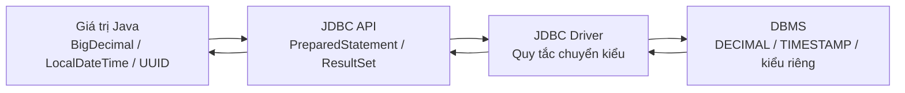

# Mối quan hệ giữa kiểu Java, kiểu SQL và kiểu riêng của hệ quản trị

Khi ứng dụng Java làm việc với cơ sở dữ liệu quan hệ thông qua **JDBC (Java Database Connectivity)**, một giá trị phải đi qua ba hệ kiểu dữ liệu:

1. **Kiểu Java** mô tả giá trị mà chương trình thao tác, chẳng hạn `long`, `String`, `BigDecimal`, `LocalDateTime` hay `UUID`.
2. **Kiểu SQL/JDBC** mô tả ý nghĩa dữ liệu khi truyền qua giao diện JDBC: `INTEGER`, `DECIMAL`, `VARCHAR`, `TIMESTAMP`, `BLOB`… Các mã kiểu chuẩn được định nghĩa trong `java.sql.Types`; từ JDBC 4.2 còn có `java.sql.JDBCType` triển khai giao diện `SQLType`.
3. **Kiểu riêng của hệ quản trị cơ sở dữ liệu (DBMS)** là kiểu cột thực tế và các quy tắc lưu trữ, ví dụ `uuid` và `jsonb` trong PostgreSQL, `VARCHAR2` trong Oracle, `uniqueidentifier` trong SQL Server hoặc `UNSIGNED BIGINT` trong MySQL.

Ba lớp này **có liên hệ nhưng không ánh xạ một–một**. Hai DBMS có thể cung cấp cùng kiểu SQL ở mức JDBC nhưng có giới hạn độ dài, độ chính xác, múi giờ hoặc cách chuyển đổi khác nhau. JDBC cung cấp giao diện thống nhất, còn **JDBC driver** của từng DBMS chịu trách nhiệm chuyển đổi giữa giá trị Java và kiểu SQL thực tế.

## 1. Giá trị đi qua ba lớp kiểu như thế nào?



Ví dụ, với số tiền `new BigDecimal("125000.50")`:

- **Java:** biến có kiểu `BigDecimal`, giữ giá trị thập phân chính xác.
- **JDBC:** gọi `PreparedStatement#setBigDecimal(...)`; driver xử lý tham số dưới dạng số thập phân SQL thích hợp.
- **DBMS:** cột có thể là `DECIMAL(15,2)`, `NUMERIC(15,2)` hoặc `NUMBER(15,2)`, tùy sản phẩm.
- **Khi đọc:** `ResultSet#getBigDecimal(...)` trả lại `BigDecimal`, nhưng dữ liệu có thể đã bị làm tròn hoặc từ chối nếu không phù hợp với độ chính xác và thang đo của cột.

Điểm quan trọng: **kiểu khai báo của cột quyết định miền giá trị lưu được; kiểu Java và phương thức JDBC quyết định cách gửi/nhận giá trị**. Một phương thức `setXxx()` chạy thành công không có nghĩa mọi giá trị của kiểu Java đều lưu được trong cột.

## 2. Các ánh xạ thường gặp

Bảng sau là **lựa chọn thông dụng**, không phải cam kết mọi driver đều trả về đúng kiểu Java đó khi gọi `getObject()` không kèm kiểu đích.

| Dữ liệu nghiệp vụ | Kiểu Java thường dùng | Kiểu SQL/JDBC tương ứng | Lưu ý |
|---|---|---|---|
| Số nguyên nhỏ | `byte`, `short` | `TINYINT`, `SMALLINT` | `TINYINT` không được mọi DBMS hỗ trợ giống nhau; kiểm tra miền giá trị. |
| Số nguyên | `int`, `Integer` | `INTEGER` | Kiểu Java nguyên thủy không biểu diễn được `NULL`. |
| Số nguyên lớn | `long`, `Long` | `BIGINT` | `BIGINT UNSIGNED` ở MySQL có thể vượt phạm vi `long` có dấu. |
| Tiền, số thập phân chính xác | `BigDecimal` | `DECIMAL(p,s)`, `NUMERIC(p,s)` | `p` là tổng chữ số; `s` là số chữ số sau dấu thập phân. |
| Số thực xấp xỉ | `float`, `Float`, `double`, `Double` | `REAL`, `FLOAT`, `DOUBLE PRECISION` | Có sai số biểu diễn; kích thước của `FLOAT` phụ thuộc DBMS. |
| Đúng/sai | `boolean`, `Boolean` | `BOOLEAN`, `BIT` | Một số DBMS mô phỏng boolean qua kiểu số hoặc `BIT`; `Boolean` chứa được `null`. |
| Chuỗi ngắn/vừa | `String` | `CHAR`, `VARCHAR`, `NCHAR`, `NVARCHAR` | Phân biệt chuỗi cố định/biến độ dài và quy tắc Unicode của DBMS. |
| Văn bản dài | `String`, `Reader`, `Clob` | `CLOB`, `NCLOB`, các kiểu text riêng | Với dữ liệu lớn nên cân nhắc luồng/LOB thay vì nạp toàn bộ vào RAM. |
| Dữ liệu nhị phân | `byte[]`, `InputStream`, `Blob` | `BINARY`, `VARBINARY`, `BLOB` | Giới hạn kích thước và API LOB khác nhau theo driver. |
| Ngày | `LocalDate` | `DATE` | Chỉ phù hợp nếu cột thực sự biểu diễn ngày, không kèm giờ. |
| Giờ không có múi giờ | `LocalTime` | `TIME` | Không suy ra được ngày hoặc múi giờ từ riêng giá trị giờ. |
| Ngày–giờ không có múi giờ | `LocalDateTime` | `TIMESTAMP` | Không biểu diễn một thời điểm toàn cục khi thiếu thông tin múi giờ. |
| Giờ có độ lệch UTC | `OffsetTime` | `TIME WITH TIME ZONE` | Mức hỗ trợ phụ thuộc DBMS/driver. |
| Ngày–giờ có độ lệch UTC | `OffsetDateTime` | `TIMESTAMP WITH TIME ZONE` | Có thể được DBMS chuẩn hóa và **không giữ nguyên offset gốc**. |
| Mảng SQL | `java.sql.Array` | `ARRAY` | Nhiều DBMS không hỗ trợ mảng SQL chuẩn theo cùng cách. |
| Cấu trúc SQL | `java.sql.Struct` | `STRUCT` | Thường dành cho kiểu đối tượng do DBMS định nghĩa. |
| XML | `java.sql.SQLXML` | `SQLXML` | Cần kiểm tra DBMS có kiểu XML tương ứng hay chỉ lưu văn bản. |

**JDBC 4.2 và `java.time`:** các driver phù hợp có thể nhận `LocalDate`, `LocalTime`, `LocalDateTime`, `OffsetTime` và `OffsetDateTime` qua `setObject(...)` và trả chúng qua `getObject(..., SomeClass.class)` cho các kiểu SQL tương ứng. `java.sql.Date`, `Time` và `Timestamp` vẫn có thể xuất hiện trong code cũ. Không nên tự coi `java.time.Instant` hoặc `ZonedDateTime` là kiểu đích được mọi JDBC driver hỗ trợ trực tiếp: cần kiểm tra driver và chọn chiến lược lưu thời gian rõ ràng.

### Vì sao một kiểu Java có thể ứng với nhiều kiểu SQL?

`String` có thể lưu trong `CHAR(2)`, `VARCHAR(255)`, `CLOB` hoặc cột `JSON`/`XML` của một hệ quản trị. Nhưng chúng mang ý nghĩa khác nhau:

- `CHAR(n)` thường dành cho mã có độ dài cố định và có thể được đệm khoảng trắng.
- `VARCHAR(n)` dành cho chuỗi biến độ dài trong một giới hạn.
- `CLOB` dành cho nội dung văn bản rất lớn.
- JSON/XML có cú pháp, phép kiểm tra và toán tử truy vấn riêng, dù một driver có thể gửi hoặc nhận chúng dưới dạng `String`.

Vì thế, **chọn kiểu dữ liệu SQL theo ngữ nghĩa và ràng buộc nghiệp vụ trước**, rồi chọn kiểu Java và phương thức JDBC phù hợp; không chọn cột chỉ vì một phương thức `setString()` đang hoạt động.

## 3. JDBC chuyển đổi dữ liệu ở đâu?

### 3.1. Khi ghi: `PreparedStatement`

Tham số của `PreparedStatement` được đánh số **từ 1**. Các phương thức như `setLong()`, `setString()` và `setBigDecimal()` biểu đạt kiểu giá trị Java mà ứng dụng cung cấp. Driver sẽ chuyển kiểu này sang dạng mà cột và giao thức của DBMS chấp nhận.

```java
String sql = "INSERT INTO invoices (invoice_no, total_amount, issued_on) "
           + "VALUES (?, ?, ?)";

try (PreparedStatement ps = connection.prepareStatement(sql)) {
    ps.setString(1, "HD-2026-001");
    ps.setBigDecimal(2, new BigDecimal("125000.50"));
    ps.setObject(3, LocalDate.of(2026, 11, 16)); // JDBC 4.2, SQL DATE
    ps.executeUpdate();
}
```

Ví dụ giả định `connection` là một `java.sql.Connection` đang mở, cột `total_amount` là một kiểu `DECIMAL`/`NUMERIC` đủ sức chứa giá trị và cột `issued_on` có ngữ nghĩa `DATE`. Kiểu cú pháp tạo bảng cụ thể có thể khác giữa các DBMS.

`setObject(index, value)` cho driver tự xác định cách chuyển đổi; một số API còn cho phép chỉ định kiểu đích bằng `Types` hoặc `SQLType`/`JDBCType`. Khi tính tương thích quan trọng, **ưu tiên `setXxx()` biểu đạt đúng ngữ nghĩa** hoặc cung cấp kiểu SQL đích rõ ràng nếu driver yêu cầu. `PreparedStatement` cũng giúp tách tham số dữ liệu khỏi câu SQL.

### 3.2. Khi đọc: `ResultSet`

Khi truy vấn, driver chuyển dữ liệu trả về thành kiểu Java theo phương thức truy xuất:

```java
String sql = "SELECT total_amount, issued_on FROM invoices WHERE invoice_no = ?";

try (PreparedStatement ps = connection.prepareStatement(sql)) {
    ps.setString(1, "HD-2026-001");
    try (ResultSet rs = ps.executeQuery()) {
        if (rs.next()) {
            BigDecimal total = rs.getBigDecimal("total_amount");
            LocalDate issued = rs.getObject("issued_on", LocalDate.class);
            System.out.println(total + " / " + issued);
        }
    }
}
```

`getObject("issued_on", LocalDate.class)` yêu cầu một kiểu Java cụ thể; `getObject("issued_on")` không có kiểu đích có thể trả về lớp khác, phụ thuộc kiểu cột và driver. Nếu dùng phương thức đọc không tương thích với dữ liệu/cột, driver có thể báo `SQLException` hoặc chuyển đổi theo quy tắc riêng. Không nên dựa vào ép kiểu tùy ý từ `Object`.

### 3.3. `Types`, `JDBCType` và kiểu cột không phải cùng một thứ

```java
int sqlTypeCode = java.sql.Types.DECIMAL;      // Mã kiểu JDBC dạng int
java.sql.JDBCType sqlType = JDBCType.DECIMAL; // Enum mô tả kiểu SQL chuẩn
```

`Types.DECIMAL` hoặc `JDBCType.DECIMAL` chỉ là **định danh kiểu ở tầng API JDBC**, không tuyên bố cột trong mọi DBMS có cùng cách lưu trữ. Chẳng hạn, một cột `NUMBER(12,2)` của Oracle có thể được driver báo về tầng JDBC như kiểu số thập phân tương thích. Ngược lại, các kiểu DBMS không có mã chuẩn tương ứng thường được báo là `Types.OTHER` hoặc một mã do driver hỗ trợ. Không được suy ra tên kiểu vật lý chỉ từ một mã `Types`.

## 4. Kiểu riêng của từng DBMS ảnh hưởng gì?

| DBMS | Ví dụ kiểu riêng hoặc cách triển khai | Hệ quả khi viết JDBC |
|---|---|---|
| **PostgreSQL** | `uuid`, `jsonb`, `bytea`, `timestamptz`, kiểu mảng, `enum` | `uuid` thường làm việc được với `UUID` qua driver PostgreSQL; JSONB có thể cần cú pháp ép kiểu SQL hoặc đối tượng/thiết lập riêng của driver. `timestamptz` lưu thời điểm, không bảo tồn múi giờ đặt tên/offset ban đầu. |
| **MySQL** | `TINYINT(1)`, `BIGINT UNSIGNED`, `JSON`, `DATETIME`, `TIMESTAMP`, `ENUM` | `TINYINT(1)` có thể được driver coi là boolean tùy cấu hình. `BIGINT UNSIGNED` có thể không vừa `long`; `DATETIME` và `TIMESTAMP` có ngữ nghĩa múi giờ khác nhau. |
| **SQL Server** | `uniqueidentifier`, `datetimeoffset`, `nvarchar`, `varbinary(max)`, `rowversion` | UUID, chuỗi Unicode và ngày–giờ có offset cần ánh xạ phù hợp với Microsoft JDBC Driver. `rowversion` là dấu phiên bản nhị phân, **không phải** ngày–giờ dù tên kiểu cũ là `timestamp`. |
| **Oracle Database** | `NUMBER(p,s)`, `VARCHAR2`, `NVARCHAR2`, `RAW`, `CLOB`, `TIMESTAMP WITH TIME ZONE` | Không mặc định `NUMBER` luôn là `int`/`long`; dùng `BigDecimal` khi cần độ chính xác. Oracle `DATE` chứa cả thành phần giờ–phút–giây, nên tránh giả định nó giống `DATE` chỉ có ngày trong các DBMS khác. |

Các ví dụ trên chỉ minh họa khác biệt thiết kế; **hành vi chuyển đổi thực tế còn phụ thuộc phiên bản server, JDBC driver và cấu hình kết nối**.

### Ví dụ: cùng một UUID, nhiều cách lưu

Giả sử Java dùng:

```java
UUID orderId = UUID.fromString("123e4567-e89b-12d3-a456-426614174000");
```

Với PostgreSQL, ứng dụng thường có thể dùng cột `uuid` và driver tương ứng:

```java
// Ví dụ dành cho PostgreSQL với cột id kiểu uuid.
try (PreparedStatement ps = connection.prepareStatement(
        "SELECT id FROM orders WHERE id = ?")) {
    ps.setObject(1, orderId);
    try (ResultSet rs = ps.executeQuery()) {
        if (rs.next()) {
            UUID value = rs.getObject("id", UUID.class);
        }
    }
}
```

Với hệ khác, mô hình lưu có thể dùng `uniqueidentifier`, `CHAR(36)`, `BINARY(16)` hoặc kiểu tương đương. Chuyển UUID sang `String` chuẩn 36 ký tự là cách truyền đơn giản cho **cột văn bản**, nhưng không thể lấy 36 ký tự ấy gắn thẳng vào cột `BINARY(16)`: cần quyết định thứ tự byte và cách mã hóa nhất quán. **Không nên coi `UUID`, SQL `CHAR(36)` và 16 byte nhị phân là cùng một kiểu.**

### Ví dụ: JSON không tự động trở thành một kiểu Java chuẩn

Một chuỗi JSON trong Java là `String`, nhưng cột PostgreSQL `jsonb`, MySQL `JSON` hay dữ liệu JSON trong DBMS khác có kiểu lưu trữ và cách kiểm tra khác nhau. Tùy driver, `setString()` có thể không tương thích trực tiếp với tham số mà server yêu cầu là kiểu JSON; có thể phải dùng `CAST(? AS ...)`, cú pháp ép kiểu đặc thù hoặc API driver. Tương tự, `getObject()` không bảo đảm trả về cùng một lớp Java cho JSON giữa mọi DBMS. Cần quy ước rõ cách **serialize/deserialize**, xác thực JSON và hỗ trợ tìm kiếm theo nội dung.

## 5. Bảo toàn ý nghĩa của dữ liệu khi chuyển kiểu

### Số thập phân, độ chính xác và phạm vi

- **Tiền tệ, số lượng cần chính xác:** ưu tiên `BigDecimal` và `DECIMAL(p,s)`/`NUMERIC(p,s)`. Tránh chuyển số tiền sang `double` ở bước trung gian vì phép biểu diễn nhị phân có thể làm mất độ chính xác thập phân.
- **Đúng miền số:** SQL `DECIMAL(10,2)` có tối đa 10 chữ số tổng cộng, trong đó 2 chữ số ở phần thập phân; giá trị quá lớn có thể bị từ chối. `BigDecimal` trong Java không tự bị giới hạn theo `p,s` của cột.
- **Số nguyên có dấu:** Java `long` chứa từ `-2^63` đến `2^63 - 1`; cột không dấu 64 bit có thể lưu giá trị lớn hơn mức này. Cần chiến lược ánh xạ khác và kiểm tra giới hạn trước khi ghi.
- **Số thực xấp xỉ:** `FLOAT` và `DOUBLE` phù hợp hơn với tính toán chấp nhận sai số; chính xác số bit và cách SQL đặt tên kiểu có thể khác nhau.

### Ngày–giờ và múi giờ

`LocalDateTime` chỉ có lịch và đồng hồ, **không cho biết giá trị là thời điểm nào trên dòng thời gian UTC**. `OffsetDateTime` mang offset so với UTC, nhưng một DBMS có thể chỉ lưu thời điểm đã chuẩn hóa; khi đọc lại, offset gốc có thể biến mất. `ZonedDateTime` còn chứa quy tắc múi giờ theo vùng (ví dụ `Asia/Ho_Chi_Minh`), điều mà `TIMESTAMP WITH TIME ZONE` của mọi DBMS không bảo đảm giữ lại.

Khi lưu thời điểm sự kiện, hãy chọn một quy ước rõ ràng: có thể lưu **thời điểm UTC** bằng một kiểu thời gian phù hợp với DBMS và lưu **mã vùng múi giờ** ở cột riêng nếu nghiệp vụ cần khôi phục múi giờ gốc. Tránh cộng/trừ offset thủ công dựa vào múi giờ mặc định của máy chạy ứng dụng. Kiểm tra cả múi giờ phiên kết nối và khả năng hỗ trợ JDBC 4.2 của driver.

### `NULL` là trạng thái của giá trị, không phải kiểu Java

Một cột `INTEGER NULL` có thể trả về số nguyên hoặc SQL `NULL`. Nếu gọi `getInt()`, JDBC trả về `0` khi giá trị SQL là `NULL`; để phân biệt với số không thực, **phải gọi `wasNull()` ngay sau lần đọc tương ứng**:

```java
int value = rs.getInt("optional_score");
Integer score = rs.wasNull() ? null : value;
```

Với các kiểu tham chiếu, `getString()`, `getBigDecimal()` hoặc `getObject()` thường trả về Java `null` cho SQL `NULL`. Khi ghi một giá trị vắng mặt, dùng `setNull(index, Types.INTEGER)` (hoặc kiểu SQL phù hợp), thay vì cố gắng gửi `null` qua API nhận kiểu nguyên thủy:

```java
if (score == null) {
    ps.setNull(1, Types.INTEGER);
} else {
    ps.setInt(1, score);
}
```

Đối với kiểu riêng như PostgreSQL `uuid`/`jsonb`, cách chỉ định `NULL` có thể cần kiểu SQL hoặc phép ép kiểu mà driver nhận diện được. Các ràng buộc `NOT NULL`, `CHECK`, khóa chính và khóa ngoại được DBMS thực thi độc lập với việc kiểu Java có chấp nhận `null` hay không.

## 6. Dùng metadata để xem driver thực sự nhận diện kiểu nào

Khi một kiểu SQL gây lỗi chuyển đổi hoặc ứng dụng chạy trên nhiều DBMS, hãy kiểm tra **metadata được driver báo về**, thay vì chỉ dựa trên tên cột trong DDL:

```java
String sql = "SELECT id, total_amount, issued_on FROM invoices WHERE 1 = 0";

try (PreparedStatement ps = connection.prepareStatement(sql);
     ResultSet rs = ps.executeQuery()) {
    ResultSetMetaData meta = rs.getMetaData();

    for (int i = 1; i <= meta.getColumnCount(); i++) {
        System.out.printf(
            "%s | JDBC type=%d | DB type=%s | precision=%d | scale=%d%n",
            meta.getColumnLabel(i),
            meta.getColumnType(i),       // Mã java.sql.Types
            meta.getColumnTypeName(i),   // Tên kiểu do driver báo
            meta.getPrecision(i),
            meta.getScale(i)
        );
    }
}
```

`ResultSetMetaData#getColumnType()` trả mã JDBC (`Types.INTEGER`, `Types.DECIMAL`, `Types.OTHER`…), còn `getColumnTypeName()` trả tên kiểu mà driver báo. `getPrecision()` và `getScale()` hỗ trợ đánh giá giới hạn số, nhưng ý nghĩa chính xác còn tùy kiểu và driver. Có thể dùng thêm `DatabaseMetaData#getTypeInfo()` để khám phá các kiểu mà driver công bố, hoặc `DatabaseMetaData#getColumns()` để tra cứu cấu trúc cột.

Metadata là **thông tin do driver cung cấp**, không thay thế phép thử ghi/đọc với giá trị biên và không phải mọi DBMS đều báo đủ chi tiết cho kiểu riêng.

## 7. Một quy trình chọn kiểu dữ liệu an toàn

Khi thiết kế hoặc thay đổi một cột mà Java truy cập qua JDBC:

1. **Xác định ngữ nghĩa nghiệp vụ:** tiền chính xác hay số đo xấp xỉ; ngày lịch hay thời điểm; chuỗi tự do hay mã cố định; có cho phép thiếu giá trị không.
2. **Chọn kiểu cột của DBMS:** xác định miền giá trị, `p/s`, độ dài, Unicode, múi giờ, giới hạn LOB và `NULL`/`NOT NULL`.
3. **Chọn kiểu Java biểu đạt đúng ý nghĩa:** ví dụ `BigDecimal` cho `DECIMAL`, `LocalDate` cho ngày, `OffsetDateTime` cho ngày–giờ có offset được hỗ trợ, `UUID` cho định danh UUID nếu driver hỗ trợ.
4. **Chọn API JDBC có kiểu rõ ràng:** `setBigDecimal()`, `setObject()` có chủ đích, `getObject(column, TargetClass.class)` hoặc API riêng của driver khi kiểu DBMS chưa được chuẩn hóa.
5. **Kiểm thử cả chiều ghi và đọc:** kiểm tra số 0 và SQL `NULL`, biên số, độ dài tối đa, ký tự Unicode, độ chính xác thập phân, thời điểm chuyển ngày và sai khác cấu hình múi giờ.
6. **Kiểm tra metadata và phiên bản driver:** đặc biệt khi chuyển DBMS, nâng cấp JDBC driver hoặc sử dụng kiểu riêng như UUID, JSON, ARRAY và các kiểu thời gian có offset.

### Tình huống tự kiểm tra

**Tình huống 1:** Cột `price DECIMAL(12,2)` đang được ứng dụng đọc bằng `getDouble()`. Điều gì có thể xảy ra? → Giá trị thập phân được chuyển sang số thực nhị phân xấp xỉ. Nếu cần tính toán tiền chính xác, đọc bằng `getBigDecimal()` và giữ `BigDecimal` ở các bước sau.

**Tình huống 2:** Cột SQL `BIGINT` cho phép `NULL`, Java dùng `long`. Có phân biệt được giá trị chưa nhập và `0`? → Không. Dùng `Long`/đối tượng có thể `null`; khi dùng `getLong()`, kiểm tra `wasNull()` ngay sau đó.

**Tình huống 3:** Ứng dụng chuyển từ PostgreSQL `uuid` sang MySQL `BINARY(16)`. Có thể giữ nguyên `setObject(index, uuid)` mà không kiểm tra? → Không nên. Phải xác định mapping JDBC và quy tắc chuyển 16 byte cho cột đích, rồi kiểm thử round-trip của UUID.

**Tình huống 4:** Một bản ghi được lưu lúc `2026-11-16T09:00` bằng `LocalDateTime`. Có biết chắc thời điểm UTC? → Không. Cần có ngữ cảnh múi giờ hoặc quy ước lưu thời gian được xác định trước.

**Ghi nhớ:** JDBC thống nhất **cách ứng dụng trao đổi dữ liệu**, không xóa bỏ khác biệt giữa hệ kiểu Java, SQL và từng DBMS. Thiết kế đúng bắt đầu từ ý nghĩa dữ liệu, tiếp đến là kiểu cột, phương thức JDBC và kiểm tra việc chuyển đổi ở cả hai chiều.
