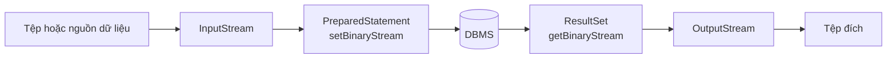

# Gán và đọc dữ liệu nhị phân

Trong **JDBC (Java Database Connectivity)**, dữ liệu nhị phân là một dãy byte được lưu và trao đổi giữa ứng dụng Java với cơ sở dữ liệu quan hệ. Khác với chuỗi ký tự, dãy byte không nhất thiết có bảng mã hoặc cấu trúc văn bản: đó có thể là ảnh PNG, tệp PDF, nội dung nén, chữ ký số, khóa công khai hoặc một định dạng nhị phân riêng.

JDBC cung cấp ba cách làm việc thường gặp:

1. **`byte[]`** với `PreparedStatement#setBytes(...)` và `ResultSet#getBytes(...)`: đơn giản với dữ liệu có kích thước nhỏ hoặc vừa và có thể nằm trong bộ nhớ.
2. **`InputStream`** với `setBinaryStream(...)` và `getBinaryStream(...)`: phù hợp khi cần đọc hoặc ghi từng phần, tránh chủ động tạo một mảng byte lớn trong mã Java.
3. **`java.sql.Blob`** với `setBlob(...)`, `getBlob(...)` và các phương thức của `Blob`: biểu diễn đối tượng nhị phân lớn theo hợp đồng JDBC, có thể dùng khi driver/DBMS cung cấp khả năng xử lý LOB.

Những API này làm việc với cùng ý tưởng là **lưu và lấy lại chính xác dãy byte**. Cách dữ liệu được lưu bên trong DBMS, giới hạn kích thước và khả năng streaming thực tế phụ thuộc **kiểu cột, JDBC driver và cấu hình truy vấn**.

## 1. Phân biệt kiểu nhị phân ở Java và SQL

Ở Java, một `byte` có 8 bit; `byte[]` giữ một dãy byte liên tiếp. Khi lưu dãy byte vào cột SQL, ta thường gặp các kiểu sau:

| Kiểu SQL/JDBC | Ý nghĩa thường gặp | Lưu ý thực tế |
|---|---|---|
| `BINARY(n)` | Nhị phân có độ dài cố định | Có thể được đệm byte khi giá trị ngắn hơn độ dài khai báo; cần kiểm tra hành vi DBMS. |
| `VARBINARY(n)` | Nhị phân có độ dài thay đổi, tối đa `n` đơn vị theo DBMS | Hợp với dữ liệu có giới hạn rõ ràng. |
| `LONGVARBINARY` | Nhị phân dài theo hệ kiểu JDBC | Việc có kiểu cột vật lý cùng tên hay không tùy DBMS. |
| `BLOB` | Binary Large Object | Thích hợp cho dữ liệu lớn ở DBMS có triển khai BLOB; có thể có locator/stream. |

Các mã kiểu JDBC tương ứng như `Types.BINARY`, `Types.VARBINARY`, `Types.LONGVARBINARY` và `Types.BLOB` nằm trong `java.sql.Types`. Chúng là **mã kiểu ở giao diện JDBC**, không bảo đảm tên kiểu SQL vật lý sẽ giống nhau trên mọi DBMS.

Ví dụ một số hệ quản trị:

| DBMS | Kiểu cột thường gặp | Đặc điểm cần chú ý |
|---|---|---|
| PostgreSQL | `bytea`; large object được tham chiếu bằng OID và API riêng | `bytea` là kiểu nhị phân trong hàng; large-object API có cơ chế và vòng đời khác. Không đồng nhất `bytea` với PostgreSQL large object. |
| MySQL | `BINARY`, `VARBINARY`, `TINYBLOB`, `BLOB`, `MEDIUMBLOB`, `LONGBLOB` | Mỗi loại có giới hạn kích thước; giới hạn gói truyền và cấu hình server cũng quan trọng. |
| SQL Server | `BINARY`, `VARBINARY`, `VARBINARY(MAX)` | `VARBINARY(MAX)` dùng cho giá trị nhị phân lớn; driver có cơ chế streaming/buffering riêng. |
| Oracle Database | `RAW`, `BLOB` | `RAW` hợp với dữ liệu nhị phân có giới hạn; `BLOB` dùng cho dữ liệu lớn, có API LOB. |

Một ứng dụng Java có thể dùng `byte[]` với nhiều kiểu cột trên nếu driver hỗ trợ chuyển đổi. Nhưng **cách chuyển đổi không phải ánh xạ một–một**, và giới hạn kích thước thực tế cần xác minh trên hệ quản trị đang dùng.

### Nhị phân không phải chuỗi ký tự

Ảnh, tệp nén hoặc tệp PDF chứa byte tùy ý. Không được dùng:

```java
// Sai khi áp dụng cho dữ liệu nhị phân tùy ý:
String text = new String(fileBytes);
byte[] reconstructed = text.getBytes();
```

Hai lời gọi trên liên quan tới *character encoding*. Việc diễn giải byte thành ký tự có thể thay thế các chuỗi byte không hợp lệ, làm thay đổi dữ liệu gốc. Nếu thực sự cần biểu diễn dãy byte dưới dạng văn bản, có thể dùng **Base64** hoặc **hex** với encode/decode rõ ràng; tuy nhiên, khi cột SQL hỗ trợ lưu byte trực tiếp thì thường nên dùng kiểu nhị phân, tránh tăng kích thước do mã hóa văn bản.

## 2. Lựa chọn API theo kích thước và cách xử lý

| Nhu cầu | Ghi dữ liệu | Đọc dữ liệu | Mức sử dụng bộ nhớ của mã Java |
|---|---|---|---|
| Ảnh thu nhỏ, mã nhị phân ngắn, nội dung đã có trong RAM | `setBytes(index, byte[])` | `getBytes(index/name)` | Phải giữ một `byte[]` chứa toàn bộ giá trị. |
| Tệp từ đĩa cần truyền tới DBMS | `setBinaryStream(index, InputStream, length)` | — | Có thể cấp dữ liệu dần từ `InputStream`; driver vẫn có thể đệm nội bộ. |
| Xuất tệp từ DBMS ra đĩa hoặc mạng | — | `getBinaryStream(index/name)` | Ứng dụng có thể sao chép từng khối thay vì tạo `byte[]` lớn. |
| Cần thao tác theo API LOB, biết kích thước hoặc đọc một vùng | `setBlob(...)` | `getBlob(...)` | Phụ thuộc `Blob` là locator hay dữ liệu đã nạp; đọc toàn bộ bằng `getBytes()` vẫn tốn bộ nhớ. |

**Không có đảm bảo tổng quát rằng gọi API stream sẽ luôn dùng bộ nhớ hằng số.** Tùy driver và kiểu cột, driver có thể đọc toàn bộ dữ liệu trước khi gửi đi, hoặc đệm toàn bộ kết quả rồi mới trả một `InputStream`. Đối với tệp rất lớn, cần thử nghiệm với driver, kiểu SQL và phiên bản DBMS đang sử dụng.

## 3. Ghi `byte[]` bằng `PreparedStatement#setBytes`

Giả sử bảng `binary_documents` có `id` là `BIGINT` và `payload` là cột nhị phân đủ chứa dữ liệu. Ví dụ DDL cụ thể trên PostgreSQL:

```sql
CREATE TABLE binary_documents (
    id BIGINT PRIMARY KEY,
    payload BYTEA NOT NULL
);
```

Với DBMS khác, thay `BYTEA` bằng kiểu nhị phân tương ứng và kiểm tra giới hạn kích thước. Nếu đã có dãy byte trong bộ nhớ, có thể ghi như sau:

```java
import java.sql.Connection;
import java.sql.PreparedStatement;
import java.sql.SQLException;
import javax.sql.DataSource;

public static void insertBytes(DataSource dataSource, long id, byte[] content)
        throws SQLException {
    if (content == null) {
        throw new IllegalArgumentException("content không được null");
    }

    String sql = "INSERT INTO binary_documents (id, payload) VALUES (?, ?)";

    try (Connection connection = dataSource.getConnection();
         PreparedStatement statement = connection.prepareStatement(sql)) {
        statement.setLong(1, id);
        statement.setBytes(2, content);
        statement.executeUpdate();
    }
}
```

Trong ví dụ:

- `setLong(1, id)` gán khóa bản ghi, còn **`setBytes(2, content)` gán dữ liệu nhị phân vào tham số thứ hai**. Chỉ số tham số trong JDBC bắt đầu từ 1.
- `PreparedStatement` truyền dữ liệu như một tham số có kiểu; chương trình không phải ghép chuỗi biểu diễn byte vào SQL.
- Phương thức chỉ hoạt động nếu dữ liệu vừa kiểu/độ dài cột, DBMS chấp nhận và kết nối đã được cấu hình phù hợp.
- `byte[]` có nội dung sẵn trong RAM; nếu tệp có kích thước rất lớn thì việc đọc toàn bộ tệp vào `byte[]` có thể gây áp lực bộ nhớ.

Giữ dãy byte theo đúng thứ tự rất quan trọng. `setBytes()` không tự hiểu PNG, PDF hoặc ZIP, và không sửa hay xác thực định dạng tệp; DBMS lưu theo khả năng của kiểu cột.

### Vì sao nên dùng tham số thay cho nối chuỗi?

Không biến byte thành chuỗi hex rồi nối trực tiếp vào câu SQL:

```java
// Tránh kiểu dựng SQL tùy tiện từ dữ liệu:
String sql = "INSERT INTO binary_documents (id, payload) VALUES ("
           + id + ", '" + someEncodedValue + "')";
```

Ví dụ trên vừa phụ thuộc cú pháp literal của DBMS vừa tạo rủi ro nếu nội dung xuất phát từ đầu vào không tin cậy. `PreparedStatement` tách biệt **câu SQL** và **giá trị nhị phân**; driver có thể mã hóa tham số theo đúng giao thức của DBMS.

## 4. Đọc toàn bộ `byte[]` bằng `ResultSet#getBytes`

Khi dữ liệu có kích thước phù hợp để giữ trong bộ nhớ, `getBytes(...)` trả về dãy byte tương ứng với cột:

```java
import java.sql.Connection;
import java.sql.PreparedStatement;
import java.sql.ResultSet;
import java.sql.SQLException;
import javax.sql.DataSource;

public static byte[] loadBytes(DataSource dataSource, long id)
        throws SQLException {
    String sql = "SELECT payload FROM binary_documents WHERE id = ?";

    try (Connection connection = dataSource.getConnection();
         PreparedStatement statement = connection.prepareStatement(sql)) {
        statement.setLong(1, id);

        try (ResultSet rows = statement.executeQuery()) {
            if (!rows.next()) {
                return null; // Không tìm thấy bản ghi.
            }
            return rows.getBytes("payload");
        }
    }
}
```

`getBytes("payload")` đọc theo **nhãn cột**. Nếu chỉ truy vấn một cột, `getBytes(1)` là cách tương đương. `ResultSet` phải đang ở một hàng hợp lệ sau `next()`; không đọc trước khi `next()` thành công.

**Cần phân biệt ba trạng thái** khi thiết kế API:

1. Không có bản ghi mang `id` được yêu cầu.
2. Có bản ghi nhưng giá trị SQL của cột là `NULL`, nếu schema cho phép.
3. Có bản ghi và giá trị nhị phân có độ dài bằng 0 hoặc lớn hơn 0.

Ví dụ trên dùng `null` cho trường hợp không tìm thấy vì schema ví dụ đặt `payload NOT NULL`. Nếu cột có thể là `NULL`, `getBytes(...)` cũng trả `null` trong trường hợp đó; ứng dụng cần một kiểu kết quả khác hoặc kiểm tra bản ghi tồn tại để phân biệt. Một **dãy rỗng `new byte[0]` khác với SQL `NULL`**.

Không nên dùng `getBytes()` để tải tệp hàng gigabyte chỉ vì lời gọi API ngắn gọn: nó đòi một mảng byte chứa toàn bộ giá trị, và driver có thể sử dụng thêm bộ nhớ đệm.

## 5. Gán dữ liệu trực tiếp từ `InputStream`

Khi dữ liệu nằm trong tệp, `setBinaryStream` cho phép truyền một `InputStream` tới tham số SQL mà không cần chủ động gọi `Files.readAllBytes(...)`.

```java
import java.io.IOException;
import java.io.InputStream;
import java.nio.file.Files;
import java.nio.file.Path;
import java.sql.Connection;
import java.sql.PreparedStatement;
import java.sql.SQLException;
import javax.sql.DataSource;

public static void insertFile(DataSource dataSource, long id, Path path)
        throws SQLException, IOException {
    long length = Files.size(path);

    String sql = "INSERT INTO binary_documents (id, payload) VALUES (?, ?)";
    try (InputStream input = Files.newInputStream(path);
         Connection connection = dataSource.getConnection();
         PreparedStatement statement = connection.prepareStatement(sql)) {

        statement.setLong(1, id);
        statement.setBinaryStream(2, input, length);
        statement.executeUpdate();
    }
}
```

Phương thức `setBinaryStream(int, InputStream, long)` cung cấp **số byte kỳ vọng**. Cũng có overload `setBinaryStream(index, input)` không truyền độ dài; mức hỗ trợ và hiệu quả của từng overload phụ thuộc driver. Với dữ liệu tệp ổn định, biết kích thước giúp driver có thêm thông tin để truyền tham số.

Lưu ý khi làm việc với stream:

- **Không đóng `InputStream` trước khi `executeUpdate()` hoàn tất**. Driver có thể tiêu thụ stream trong khi thực thi, thậm chí đọc một phần vào thời điểm gán tham số.
- Nếu khai báo độ dài, phải đảm bảo luồng cung cấp lượng byte phù hợp. Nếu tệp bị sửa trong lúc đang đọc, kích thước lấy từ `Files.size(path)` có thể không còn khớp; driver có thể báo lỗi hoặc có hành vi riêng.
- Đóng `InputStream` bằng `try-with-resources` và đóng `PreparedStatement`/`Connection` đúng phạm vi sở hữu.
- **Streaming ở API không bảo đảm streaming trên mạng hoặc ở bộ nhớ driver**. Cần kiểm tra hành vi thực tế với tệp lớn.
- Cột DBMS có thể có giới hạn thấp hơn kích thước tệp; phải kiểm tra giới hạn dữ liệu, quyền truy cập, quota và timeout.

### Khi chỉ có `InputStream` mà không biết trước độ dài

Nếu nội dung đến từ một nguồn phát trực tuyến, `InputStream` không nhất thiết có khả năng đo số byte mà không đọc hết. Một lựa chọn là overload:

```java
statement.setBinaryStream(2, inputStream);
```

Tuy nhiên, một số driver hoặc kiểu cột yêu cầu biết độ dài trước hoặc không hỗ trợ tối ưu cách này. Khi cần khả năng tương thích cao, có thể tạm lưu vào một tệp có giới hạn dung lượng và xác định độ dài, hoặc áp dụng API LOB phù hợp mà driver hỗ trợ. Không dùng `InputStream.available()` làm kích thước toàn bộ dữ liệu: nó chỉ nói về số byte có thể đọc mà không bị chặn theo hợp đồng của `InputStream`.

## 6. Đọc dữ liệu bằng `getBinaryStream` và ghi ra tệp

Để xuất một giá trị nhị phân lớn, đọc stream trong lúc `ResultSet`, `PreparedStatement` và `Connection` còn mở. Ví dụ dưới đây dùng Java 9+ với `InputStream#transferTo(OutputStream)`:

```java
import java.io.IOException;
import java.io.InputStream;
import java.io.OutputStream;
import java.nio.file.Files;
import java.nio.file.Path;
import java.sql.Connection;
import java.sql.PreparedStatement;
import java.sql.ResultSet;
import java.sql.SQLException;
import javax.sql.DataSource;

public static boolean exportFile(
        DataSource dataSource, long id, Path destination)
        throws SQLException, IOException {
    String sql = "SELECT payload FROM binary_documents WHERE id = ?";

    try (Connection connection = dataSource.getConnection();
         PreparedStatement statement = connection.prepareStatement(sql)) {

        statement.setLong(1, id);
        try (ResultSet rows = statement.executeQuery()) {
            if (!rows.next()) {
                return false; // Không tìm thấy tài liệu.
            }

            try (InputStream input = rows.getBinaryStream("payload")) {
                if (input == null) {
                    throw new SQLException("Cột payload là SQL NULL");
                }
                try (OutputStream output = Files.newOutputStream(destination)) {
                    input.transferTo(output);
                }
            }
            return true;
        }
    }
}
```

Hàm trả `false` nếu không có bản ghi; với `payload NOT NULL`, trường hợp `input == null` là bất thường và được báo rõ. **Việc ghi đè tệp đích có thể bắt đầu trước khi toàn bộ stream được đọc thành công**. Trong ứng dụng cần bảo toàn tệp cũ, nên ghi vào tệp tạm rồi chỉ đổi tên/di chuyển vào vị trí chính thức sau khi hoàn tất và xác minh; cần dọn dẹp tệp tạm khi lỗi.

Điểm quan trọng về vòng đời:

1. `ResultSet#getBinaryStream(...)` được gọi khi con trỏ đang đứng trên hàng cần đọc.
2. Luồng được tiêu thụ đầy đủ **trước khi gọi `rows.next()` tiếp** hoặc đóng result set. Theo hợp đồng JDBC, một số thao tác di chuyển con trỏ hay đọc cột tiếp theo có thể khiến stream đang mở bị đóng.
3. Nếu cần `id`, `file_name` hoặc metadata của cùng một hàng, hãy đọc các cột ấy **trước khi mở và tiêu thụ stream nhị phân**.
4. `try-with-resources` đóng `OutputStream`, `InputStream` và các tài nguyên JDBC theo phạm vi tương ứng, kể cả khi thao tác sao chép ném ngoại lệ.

Đọc bằng `getBinaryStream()` tránh chủ động tạo một mảng byte lớn trong code, nhưng driver có thể vẫn đã đệm dữ liệu từ DBMS. Cần đo và lựa chọn driver/kiểu cột phù hợp cho bài toán khối lượng lớn.

### Tự sao chép theo từng khối khi không dùng `transferTo`

```java
byte[] buffer = new byte[8192];
int count;
while ((count = input.read(buffer)) != -1) {
    output.write(buffer, 0, count);
}
```

`8192` là kích thước bộ đệm minh họa phía ứng dụng, **không phải kích thước fetch của JDBC**. Không dùng `while (input.available() > 0)` để đọc hết stream: giá trị `available()` không báo chắc chắn luồng đã đến EOF. Với giao thức InputStream, kết thúc được xác định khi `read()` trả `-1`.

## 7. Làm việc với `Blob`

`java.sql.Blob` mô tả một giá trị **Binary Large Object** theo API JDBC. Tùy DBMS/driver, nó có thể là đối tượng bao nội dung trong RAM hoặc một **locator** trỏ tới dữ liệu lưu phía database. Vì vậy, không mặc định `Blob` luôn nhẹ hoặc có thể dùng sau khi transaction/connection đã kết thúc.

Các phương thức chính:

| Phương thức | Ý nghĩa |
|---|---|
| `ResultSet#getBlob(...)` | Lấy giá trị dạng `Blob`; có thể là `null` nếu SQL `NULL`. |
| `Blob#length()` | Lấy chiều dài giá trị nhị phân tính bằng byte, kiểu `long`. |
| `Blob#getBytes(long pos, int length)` | Đọc một đoạn byte; `pos` **bắt đầu từ 1** theo JDBC. |
| `Blob#getBinaryStream()` | Lấy stream để đọc dữ liệu nhị phân. |
| `Blob#position(...)` | Tìm vị trí một dãy byte hoặc Blob khác trong đối tượng nếu được hỗ trợ. |
| `Blob#free()` | Giải phóng tài nguyên liên quan đến `Blob` theo hợp đồng JDBC. |
| `Connection#createBlob()` | Yêu cầu tạo một đối tượng `Blob` rỗng để ghi; khả năng hỗ trợ phụ thuộc driver. |

Ví dụ đọc một `Blob` để xử lý theo stream:

```java
Blob blob = rows.getBlob("payload");
if (blob != null) {
    try {
        System.out.println("Kích thước: " + blob.length());
        try (InputStream input = blob.getBinaryStream()) {
            processBinaryStream(input); // Hàm ứng dụng tự định nghĩa.
        }
    } finally {
        blob.free();
    }
}
```

Đoạn code cần `import java.sql.Blob;` và `import java.io.InputStream;`. `Blob` **không phải `AutoCloseable`**, vì vậy không đưa trực tiếp vào `try-with-resources`; `free()` là thao tác giải phóng riêng, có thể ném `SQLException`. Mẫu minh họa ưu tiên dễ đọc; trong logic production cần xử lý trường hợp cả công việc chính lẫn `free()` cùng thất bại để không che mất lỗi chính.

Đừng dùng `blob.getBytes(1, (int) blob.length())` với dữ liệu rất lớn: ép chiều dài `long` sang `int` có thể gây tràn số, và API `getBytes` vẫn tạo mảng chứa toàn bộ đoạn yêu cầu. Nếu muốn đọc một phần qua `getBytes(pos, length)`, nhớ rằng **vị trí trong `Blob` là 1-based**.

### Ghi bằng `setBlob`

JDBC có các overload như:

```java
statement.setBlob(2, blob);               // Dùng đối tượng Blob.
statement.setBlob(2, inputStream, length); // Dùng stream và chiều dài.
```

Khi ứng dụng nhận được một `Blob` từ driver hoặc tạo được bằng `Connection#createBlob()`, `setBlob` có thể thích hợp. Cách driver biểu diễn BLOB và các overload hỗ trợ thực tế có thể khác nhau. **Không cần chuyển mọi `byte[]` thành `Blob`**: với dữ liệu nhỏ, `setBytes` thường đơn giản hơn.

## 8. SQL `NULL`, mảng rỗng và dữ liệu nhị phân độ dài cố định

SQL `NULL` thể hiện **không có giá trị**; nó không phải một byte có giá trị 0 và cũng không giống dãy byte dài 0. Khi ghi:

```java
import java.sql.Types;

if (content == null) {
    statement.setNull(2, Types.BLOB); // Nếu tham số thuộc cột BLOB.
} else {
    statement.setBytes(2, content);
}
```

Với cột `VARBINARY`, mã kiểu thích hợp thường là `Types.VARBINARY`. Với các kiểu riêng như PostgreSQL `bytea`, cách gán NULL đôi khi cần chỉ rõ kiểu cột/cast theo khả năng của driver. **Chọn mã kiểu SQL thực sự tương ứng với cột**, không dùng `Types.BLOB` cho mọi kiểu nhị phân theo thói quen.

Khi đọc:

```java
byte[] payload = rows.getBytes("payload");
if (payload == null) {
    // Cột đang là SQL NULL, nếu schema cho phép.
} else if (payload.length == 0) {
    // Có giá trị nhị phân nhưng là dãy rỗng.
}
```

Tương tự, `getBinaryStream(...)` và `getBlob(...)` có thể trả `null` khi cột là SQL `NULL`. Có thể gọi `rows.wasNull()` **ngay sau getter cần kiểm tra** để xác định trạng thái NULL. Không gọi getter khác rồi mới dùng `wasNull()`, vì nó phản ánh lần đọc cột gần nhất.

Với `BINARY(n)` có độ dài cố định, hệ quản trị có thể **đệm byte** vào giá trị ngắn; vì thế dữ liệu đọc về không nhất thiết có cùng độ dài với mảng đầu vào. Nếu cần giữ độ dài tùy biến và phục hồi đúng từng byte, thường nên chọn `VARBINARY` hoặc `BLOB` thích hợp và thử nghiệm round-trip với DBMS cụ thể.

## 9. Bảo toàn dữ liệu và tính toàn vẹn khi truyền file

Lưu trữ đúng byte không chỉ là gọi đúng getter/setter. Ứng dụng cần quyết định những thông tin liên quan:

- **Độ dài:** kiểm tra giới hạn kích thước trước khi ghi; với nội dung upload không biết trước độ dài, cần giới hạn số byte được phép đọc.
- **Kiểu nội dung:** lưu MIME type nếu nghiệp vụ cần, ví dụ `application/pdf` hoặc `image/png`. MIME type là metadata ứng dụng và không đảm bảo nội dung thật hợp lệ.
- **Tên tệp:** lưu riêng trong cột văn bản; không coi tên tệp nhận từ người dùng là một đường dẫn an toàn để ghi trực tiếp trên server.
- **Checksum:** nếu cần phát hiện sai khác, có thể tính SHA-256 trên chuỗi byte gốc khi ghi và khi đọc; so sánh trên cùng cách biểu diễn byte.
- **Đồng bộ dữ liệu:** nếu record có metadata và payload, ghi trong một giao dịch phù hợp để tránh trạng thái chỉ có metadata mà chưa có nội dung.
- **Quyền truy cập:** dữ liệu nhị phân có thể chứa tài liệu riêng tư; kiểm soát quyền tải lên/tải xuống và tránh ghi toàn bộ payload vào log.

Ví dụ xác minh dãy byte nhỏ sau khi ghi/đọc:

```java
byte[] original = new byte[] {0, 1, 2, (byte) 0xFF, 0, 10};
insertBytes(dataSource, 1001L, original);
byte[] restored = loadBytes(dataSource, 1001L);

if (!java.util.Arrays.equals(original, restored)) {
    throw new IllegalStateException("Dữ liệu nhị phân không khớp");
}
```

Ví dụ giả định ID `1001` chưa tồn tại và sử dụng hai phương thức đã minh họa ở trên. Bài kiểm tra chú ý cả byte `0x00` và `0xFF`: chúng là dữ liệu bình thường trong một mảng nhị phân và không được tự động xem là ký tự kết thúc chuỗi.

## 10. Quản lý tài nguyên khi đọc/ghi nhị phân lớn

Đọc/ghi stream đòi hỏi nhiều tài nguyên còn sống cùng lúc:



Với chiều ghi, nguồn `InputStream` cần còn mở đến khi driver hoàn tất việc tiêu thụ và thực thi statement. Với chiều đọc, `ResultSet` cùng `Statement` và `Connection` phải còn hợp lệ cho tới khi dữ liệu đã được đọc xong. Nếu cần stream thuộc quyền sở hữu của bên gọi, API của repository phải quy định rõ ai sẽ đóng stream và các tài nguyên JDBC liên quan. Đơn giản hơn, hãy xử lý stream **ngay bên trong phương thức repository** và trả về kết quả đã hoàn tất.

**Một số giới hạn cần nhớ:**

1. **Không gọi `getBinaryStream()` rồi đóng `ResultSet` trước khi sử dụng stream**. Stream thường phụ thuộc tài nguyên JDBC còn mở.
2. **Không giả định `setFetchSize` quyết định kích thước khối binary stream**. Fetch size liên quan cách driver lấy hàng `ResultSet`, không phải quy định mỗi lần đọc bao nhiêu byte của LOB.
3. **Không giữ connection vô hạn** trong lúc chờ upload từ mạng chậm hoặc trả file cho client chậm. Cân nhắc timeout, tách storage hoặc chiến lược xử lý theo batch nếu nghiệp vụ yêu cầu.
4. **Không đưa `Connection` cho nhiều luồng cùng thao tác** nếu không có hợp đồng thread-safety rõ ràng.
5. **Không nuốt ngoại lệ I/O hay SQL**. Stream có thể phát sinh `IOException`, JDBC có thể ném `SQLException`, và việc đóng tài nguyên cũng có thể thất bại.
6. **Không coi một API stream bảo đảm tải không giới hạn dung lượng**. DBMS có giới hạn cột/LOB, driver có thể dùng bộ đệm và heap Java hữu hạn.

### Lưu trong database hay hệ lưu trữ đối tượng?

JDBC cho phép lưu dữ liệu nhị phân trong bảng, thuận tiện khi muốn quản lý quyền truy cập, metadata và giao dịch cùng một DBMS. Tuy vậy, với file dung lượng lớn hoặc lưu lượng tải xuống cao, nhiều hệ thống dùng **object storage** và chỉ lưu URL/khóa đối tượng trong database. Cách này có đặc tính giao dịch, sao lưu, bảo mật và vận hành khác: việc cập nhật record DB và đối tượng trong storage không tự nhiên nằm trong cùng một giao dịch JDBC. Chọn phương án dựa vào kích thước file, tần suất truy cập, yêu cầu nhất quán và năng lực vận hành.

## 11. Những lỗi thường gặp

| Triệu chứng / cách viết | Nguyên nhân | Cách xử lý |
|---|---|---|
| Đọc ảnh bằng `getString()` rồi `getBytes()` của chuỗi | Dữ liệu nhị phân bị diễn giải thành ký tự | Dùng `getBytes()`, `getBinaryStream()` hoặc `Blob`. |
| Tải file rất lớn bằng `getBytes()` | Cần một mảng chứa toàn bộ payload | Dùng stream nếu driver/DBMS hỗ trợ và đo bộ nhớ. |
| `setBinaryStream(...)` nhưng stream đã đóng trước `executeUpdate()` | Driver không còn nguồn dữ liệu để đọc | Giữ stream mở trong suốt thực thi và đóng sau đó. |
| Dùng `available()` làm tổng kích thước tệp | `available()` không biểu thị tổng độ dài | Dùng kích thước file đã biết, hoặc overload không có length nếu hỗ trợ. |
| Dùng `BINARY(32)` để lưu khóa nhị phân dài thay đổi | Kiểu cố định có thể đệm byte | Dùng `VARBINARY`/BLOB phù hợp và kiểm thử giá trị biên. |
| Dùng `setNull(index, Types.VARCHAR)` cho cột BLOB | Sai khai báo kiểu SQL đích | Chọn mã kiểu/cast mà driver nhận diện đúng. |
| Nhầm `NULL` với `byte[0]` | Không phân biệt thiếu dữ liệu và dữ liệu rỗng | Kiểm tra `getBytes() == null` hoặc `wasNull()`. |
| Đóng `Connection` trước khi đọc hết `InputStream` từ ResultSet | Luồng đọc bị vô hiệu hóa | Tiêu thụ/đóng stream trong phạm vi ResultSet/Connection. |
| Dùng `Blob#getBytes(1, (int) blob.length())` với file lớn | Tràn kiểu `int` hoặc thiếu RAM | Dùng `Blob#getBinaryStream()` và đọc theo khối. |
| Tưởng rằng stream bảo đảm không dùng bộ đệm | Driver có thể tự buffer | Kiểm tra tài liệu driver và đo heap/throughput thực tế. |

## 12. Tình huống vận dụng

**Tình huống A — Lưu ảnh đại diện 30 KB:** Ảnh đã có sẵn trong một `byte[]`. Nên dùng API gì? → Thường có thể dùng `PreparedStatement#setBytes()` và `ResultSet#getBytes()` cho đường đi đơn giản; vẫn giới hạn kích thước và xác minh nội dung.

**Tình huống B — Xuất tệp báo cáo 500 MB:** Có nên dùng `getBytes()` rồi `Files.write(...)`? → Cách đó có thể đòi bộ nhớ lớn. Ưu tiên `getBinaryStream()` và sao chép theo từng khối, sau khi xác minh driver/DBMS thực sự phù hợp với tải dữ liệu lớn.

**Tình huống C — Cột là `BINARY(16)`:** Ghi `byte[]` dài 12 có chắc đọc lại đúng 12 byte? → Không. DBMS có thể đệm thành 16 byte. Chọn kiểu cột theo yêu cầu bảo toàn chiều dài và kiểm thử round-trip.

**Tình huống D — Một trường chứa SQL `NULL`:** `getBinaryStream("payload")` trả gì? → Có thể trả `null`; không tạo `InputStream` từ mảng rỗng rồi coi đó là dữ liệu bị thiếu. Cần phân biệt bản ghi không tồn tại với cột có giá trị NULL.

**Tình huống E — Driver hỗ trợ `setBinaryStream()`:** Có bảo đảm upload 1 GB luôn dùng rất ít heap? → Không. Driver có thể đệm một phần hoặc toàn bộ. Cần đo và kiểm tra giới hạn kiểu cột, giao thức, connection và driver.

**Tình huống F — Đọc một BLOB:** `Blob#length()` trả `long`. Vì sao không ép về `int` rồi gọi `getBytes()` cho toàn bộ nội dung? → Giá trị có thể vượt phạm vi `int`; hơn nữa tạo mảng lớn có thể không phù hợp. Dùng stream hoặc chia đoạn theo yêu cầu.

**Tình huống G — Kiểm tra tải lên:** Người dùng gửi file báo `image/png` nhưng nội dung không hợp lệ. JDBC có tự xác thực PNG không? → Không. JDBC chuyển byte; ứng dụng phải tự kiểm tra định dạng, kích thước và chính sách bảo mật trước khi lưu hoặc phục vụ lại.

## Ghi nhớ

Trong JDBC, **`setBytes`/`getBytes`** phù hợp khi thao tác với `byte[]` nhỏ hoặc vừa, **`setBinaryStream`/`getBinaryStream`** giúp ứng dụng đọc và ghi dữ liệu theo luồng, còn **`Blob`** cung cấp hợp đồng quản lý giá trị nhị phân lớn khi driver hỗ trợ. Chọn kiểu SQL như `VARBINARY`, `BLOB` hoặc kiểu riêng của DBMS theo kích thước và ngữ nghĩa dữ liệu; phân biệt SQL `NULL` với mảng rỗng; giữ tài nguyên JDBC và stream sống đủ lâu; kiểm thử round-trip và xác minh khả năng streaming thực tế. Mục tiêu là **lưu chính xác từng byte và quản lý tài nguyên an toàn** trong suốt quá trình trao đổi với cơ sở dữ liệu.
