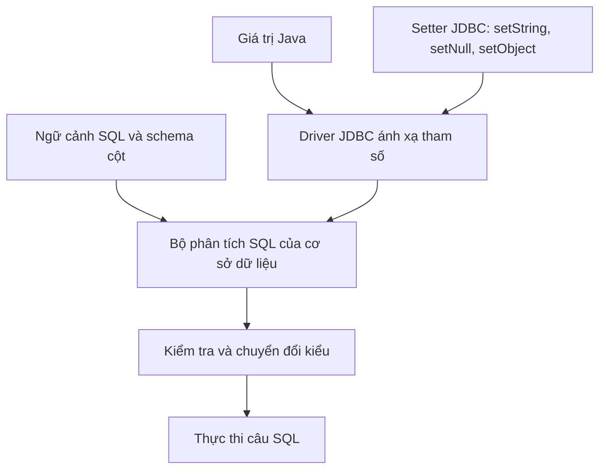

# Gán kiểu tường minh khi driver JDBC không suy luận được

## 1. Vì sao tham số JDBC đôi khi cần khai báo kiểu?

**JDBC (Java Database Connectivity)** là API Java để truy cập cơ sở dữ liệu quan hệ thông qua driver. Khi dùng `PreparedStatement`, ứng dụng viết câu SQL có các dấu giữ chỗ `?`, rồi truyền giá trị qua `setInt()`, `setString()`, `setObject()` hoặc các setter khác.

Trong trường hợp đơn giản, driver có đủ thông tin để xác định kiểu:

```java
String sql = "SELECT id FROM account WHERE id = ?";
try (PreparedStatement statement = connection.prepareStatement(sql)) {
    statement.setLong(1, accountId);
    try (ResultSet rs = statement.executeQuery()) {
        while (rs.next()) {
            System.out.println(rs.getLong("id"));
        }
    }
}
```

Giả sử `account.id` là cột `BIGINT`, lời gọi `setLong(1, accountId)` chỉ rõ kiểu giá trị Java cần truyền. Câu SQL còn cung cấp ngữ cảnh: tham số được so sánh với cột đã có kiểu trong schema.

Vấn đề xuất hiện khi **giá trị Java không nói rõ kiểu SQL**, **câu SQL không cung cấp ngữ cảnh đủ rõ** hoặc **driver không hỗ trợ suy luận một phép ánh xạ nhất định**. Các tình huống phổ biến:

- Truyền `null` bằng `setObject(index, null)`: không có đối tượng Java để suy ra kiểu.
- Câu SQL chứa `SELECT ?`, `COALESCE(?, ?)` hoặc biểu thức phức tạp chưa có kiểu đích rõ ràng.
- Truyền kiểu Java có nhiều cách lưu trong SQL, chẳng hạn ngày/giờ, UUID, JSON, enum hoặc kiểu do hệ quản trị định nghĩa.
- Một bảng dùng kiểu `DECIMAL`, `TIMESTAMP WITH TIME ZONE` hay `VARBINARY` nhưng driver chọn kiểu mặc định khác với kiểu cột mong muốn.
- Driver và phiên bản cơ sở dữ liệu không hỗ trợ đầy đủ ánh xạ `setObject(index, value)` cho một loại đối tượng.

Khi đó, ứng dụng có thể cần **gán kiểu SQL tường minh tại thời điểm bind** bằng `setNull(index, sqlType)` hoặc `setObject(index, value, targetSqlType)`. Nếu bản thân bộ phân tích SQL cần một kiểu tường minh ngay trong biểu thức, có thể phải dùng `CAST(? AS ...)` theo cú pháp hệ quản trị.

> **Nguyên tắc:** kiểu Java của giá trị, kiểu SQL của tham số và kiểu SQL của cột đích có liên hệ với nhau, nhưng không phải lúc nào chúng cũng được driver suy ra chính xác. Kiểu được truyền phải dựa trên **schema và ý nghĩa nghiệp vụ**, không chọn tùy tiện chỉ để hết lỗi.

## 2. Ba nguồn thông tin để driver xác định kiểu



Ví dụ sau minh họa các mức độ tường minh:

```java
// Rõ kiểu Java: long.
statement.setLong(1, 42L);

// Để driver tự suy luận từ lớp Java của value.
statement.setObject(2, someValue);

// Khai báo kiểu SQL rõ ràng cho NULL.
statement.setNull(3, java.sql.Types.VARCHAR);

// Khai báo kiểu SQL đích rõ ràng cho một đối tượng.
statement.setObject(4, someValue, java.sql.Types.DECIMAL);
```

Giả định `statement` là `PreparedStatement` còn mở và các vị trí tham số tồn tại. Lời gọi `setObject(index, value)` thường tiện khi đối tượng Java ánh xạ rõ ràng theo JDBC; tuy nhiên, khi `value == null` hoặc kiểu đối tượng không có ánh xạ được driver hỗ trợ, nên dùng overload có kiểu đích.

JDBC đánh số tham số bắt đầu từ **1**. Nếu câu SQL có hai dấu `?`, phải bind riêng vị trí `1` và `2`; cùng giá trị Java xuất hiện hai lần trong SQL vẫn là **hai tham số khác nhau**.

## 3. `setNull(index, sqlType)`: cách chuẩn để truyền SQL `NULL` có kiểu

`null` trong Java là tham chiếu rỗng; **SQL `NULL` là giá trị đặc biệt của một biểu thức có kiểu SQL**. Trong nhiều ngữ cảnh, cơ sở dữ liệu vẫn phải biết đó là `VARCHAR NULL`, `INTEGER NULL` hay `DATE NULL` để phân tích biểu thức.

JDBC cung cấp:

```java
void setNull(int parameterIndex, int sqlType) throws SQLException;
```

Tham số `sqlType` là một mã kiểu được định nghĩa trong `java.sql.Types`.

```java
String sql = """
        UPDATE customer_profile
           SET nickname = ?, loyalty_points = ?, birthday = ?
         WHERE customer_id = ?
        """;

try (PreparedStatement statement = connection.prepareStatement(sql)) {
    statement.setNull(1, java.sql.Types.VARCHAR);
    statement.setNull(2, java.sql.Types.INTEGER);
    statement.setNull(3, java.sql.Types.DATE);
    statement.setLong(4, customerId);

    int updated = statement.executeUpdate();
    System.out.println("Updated rows: " + updated);
}
```

Ví dụ giả định các cột `nickname`, `loyalty_points` và `birthday` cho phép `NULL`, lần lượt có kiểu `VARCHAR`, `INTEGER` và `DATE`. Nếu cột có ràng buộc `NOT NULL`, việc truyền SQL `NULL` vẫn có thể bị cơ sở dữ liệu từ chối; gán kiểu tường minh **không bỏ qua ràng buộc schema**.

### Chọn `sqlType` theo cột đích

| Cột SQL đích | Mã `Types` thường dùng | Cách bind NULL |
| --- | --- | --- |
| `VARCHAR` | `Types.VARCHAR` | `setNull(index, Types.VARCHAR)` |
| `CHAR` | `Types.CHAR` | `setNull(index, Types.CHAR)` |
| `INTEGER` | `Types.INTEGER` | `setNull(index, Types.INTEGER)` |
| `BIGINT` | `Types.BIGINT` | `setNull(index, Types.BIGINT)` |
| `DECIMAL(p, s)` | `Types.DECIMAL` | `setNull(index, Types.DECIMAL)` |
| `BOOLEAN` | `Types.BOOLEAN` | `setNull(index, Types.BOOLEAN)` |
| `DATE` | `Types.DATE` | `setNull(index, Types.DATE)` |
| `TIME` | `Types.TIME` | `setNull(index, Types.TIME)` |
| `TIMESTAMP` | `Types.TIMESTAMP` | `setNull(index, Types.TIMESTAMP)` |
| `TIMESTAMP WITH TIME ZONE` | `Types.TIMESTAMP_WITH_TIMEZONE` | `setNull(index, Types.TIMESTAMP_WITH_TIMEZONE)` nếu driver hỗ trợ |
| `BLOB` | `Types.BLOB` | `setNull(index, Types.BLOB)` |

Những kiểu trên là **mã kiểu SQL chuẩn của JDBC**, không có nghĩa mọi hệ quản trị hỗ trợ mọi kiểu theo cùng một cách. Ví dụ `BOOLEAN` có thể được triển khai khác nhau giữa các sản phẩm; một số driver có thể ánh xạ kiểu đặc thù sang `Types.OTHER`.

### Vì sao không nên chỉ dùng `setObject(index, null)`?

```java
// Có thể không đủ thông tin cho driver hoặc cơ sở dữ liệu:
statement.setObject(1, null);

// Tường minh về kiểu SQL:
statement.setNull(1, java.sql.Types.VARCHAR);

// Cũng khai báo kiểu đích, tùy contract driver:
statement.setObject(1, null, java.sql.Types.VARCHAR);
```

`setObject(index, null)` có thể chạy đúng khi hệ quản trị suy ra kiểu từ vị trí cột đích, nhưng có thể thất bại trong biểu thức phức tạp hoặc với driver yêu cầu kiểu SQL rõ ràng. `setObject(index, null, Types.VARCHAR)` là một overload có kiểu đích; khi chỉ muốn truyền `NULL`, **`setNull(index, Types.VARCHAR)` biểu đạt ý định rõ ràng hơn**.

Một số setter như `setString(index, null)` được driver hỗ trợ và có thể tạo kết quả phù hợp; tuy nhiên, khi nghiệp vụ chủ ý truyền SQL `NULL`, sử dụng `setNull` sẽ làm rõ kiểu đích và tránh phụ thuộc việc suy luận từ đối số rỗng.

## 4. `setObject(index, value, targetSqlType)` cho giá trị khác NULL

Khi giá trị không rỗng nhưng ánh xạ mặc định chưa chắc phù hợp, `PreparedStatement` có overload:

```java
void setObject(int index, Object value, int targetSqlType)
        throws SQLException;
```

`targetSqlType` cung cấp **kiểu SQL mà ứng dụng mong muốn driver chuyển giá trị sang**, thay vì chỉ dựa vào lớp Java của `value`. Ví dụ:

```java
import java.math.BigDecimal;
import java.sql.PreparedStatement;
import java.sql.Types;

// Giả định statement còn mở, SQL có 3 tham số tương ứng.
statement.setObject(1, new BigDecimal("1250.75"), Types.DECIMAL);
statement.setObject(2, 19, Types.INTEGER);
statement.setObject(3, "NEW", Types.VARCHAR);
```

Đoạn mã minh họa định hướng kiểu, không khẳng định driver luôn chuyển đổi được mọi cặp lớp Java → kiểu SQL. Nếu kiểu Java và kiểu SQL không tương thích, driver có thể ném `SQLException`. Cần giữ kiểu Java đúng với ý nghĩa nghiệp vụ; ví dụ với tiền tệ, dùng `BigDecimal` thay vì `double` để tránh sai số nhị phân.

### Overload dùng `SQLType` và `JDBCType`

Từ **JDBC 4.2 (Java 8)**, có overload nhận `java.sql.SQLType`:

```java
import java.sql.JDBCType;

statement.setObject(1, new BigDecimal("1250.75"),
                    JDBCType.DECIMAL);
statement.setObject(2, "ACTIVE", JDBCType.VARCHAR);
```

`JDBCType` là enum triển khai `SQLType` cho các kiểu JDBC chuẩn. Cách viết này tránh phải nhớ nhiều hằng số `Types`, nhưng **driver vẫn phải hỗ trợ overload và phép chuyển đổi tương ứng**. Một số driver hoặc phiên bản cũ có thể báo `SQLFeatureNotSupportedException` đối với overload `SQLType`; khi đó cân nhắc dùng overload `int targetSqlType` nếu được driver hỗ trợ và có cùng ngữ nghĩa.

JDBC còn có overload nhận tham số `scaleOrLength`:

```java
statement.setObject(1, new BigDecimal("123.456"),
                    java.sql.Types.DECIMAL, 2);
```

Với kiểu số như `DECIMAL`/`NUMERIC`, đối số cuối là **scale** (số chữ số sau dấu thập phân) theo contract JDBC; việc làm tròn/chuyển đổi và tính hợp lệ còn phụ thuộc driver, cột SQL, precision/scale thực tế. **Không thay cơ chế kiểm tra và làm tròn nghiệp vụ bằng một đối số `scaleOrLength` rồi giả định mọi driver xử lý y hệt nhau.**

## 5. Ví dụ hoàn chỉnh: cập nhật nhiều cột nullable với kiểu tường minh

Giả sử bảng có các cột:

```sql
CREATE TABLE customer_profile (
    customer_id    BIGINT PRIMARY KEY,
    nickname       VARCHAR(100) NULL,
    loyalty_points INTEGER NULL,
    credit_limit   DECIMAL(12, 2) NULL,
    birthday       DATE NULL
);
```

Cú pháp `NULL` và kiểu dữ liệu có thể khác giữa các hệ quản trị. Ví dụ Java dưới đây dùng **Java 17+** với `record` và sử dụng `DataSource` đã được cấu hình:

```java
import java.math.BigDecimal;
import java.sql.Connection;
import java.sql.Date;
import java.sql.PreparedStatement;
import java.sql.SQLException;
import java.sql.Types;
import java.time.LocalDate;
import java.util.Objects;
import javax.sql.DataSource;

public final class CustomerProfileRepository {
    public record ProfileChange(
            long customerId,
            String nickname,
            Integer loyaltyPoints,
            BigDecimal creditLimit,
            LocalDate birthday) {
    }

    private final DataSource dataSource;

    public CustomerProfileRepository(DataSource dataSource) {
        this.dataSource = Objects.requireNonNull(dataSource);
    }

    public int updateProfile(ProfileChange change) throws SQLException {
        Objects.requireNonNull(change);
        String sql = """
                UPDATE customer_profile
                   SET nickname = ?,
                       loyalty_points = ?,
                       credit_limit = ?,
                       birthday = ?
                 WHERE customer_id = ?
                """;

        try (Connection connection = dataSource.getConnection();
             PreparedStatement statement = connection.prepareStatement(sql)) {

            if (change.nickname() == null) {
                statement.setNull(1, Types.VARCHAR);
            } else {
                statement.setString(1, change.nickname());
            }

            if (change.loyaltyPoints() == null) {
                statement.setNull(2, Types.INTEGER);
            } else {
                statement.setInt(2, change.loyaltyPoints());
            }

            if (change.creditLimit() == null) {
                statement.setNull(3, Types.DECIMAL);
            } else {
                statement.setBigDecimal(3, change.creditLimit());
            }

            if (change.birthday() == null) {
                statement.setNull(4, Types.DATE);
            } else {
                statement.setDate(4, Date.valueOf(change.birthday()));
            }

            statement.setLong(5, change.customerId());
            return statement.executeUpdate();
        }
    }
}
```

Trong ví dụ này, mỗi cột nullable được bind **bằng setter có kiểu cụ thể**; khi giá trị Java là `null`, mã dùng `setNull` với kiểu tương ứng. Bên gọi truyền `ProfileChange`, còn repository xử lý chi tiết JDBC.

Lời gọi:

```java
CustomerProfileRepository.ProfileChange change =
        new CustomerProfileRepository.ProfileChange(
                101L,
                null,                         // nickname -> VARCHAR NULL
                20,                           // INTEGER
                new BigDecimal("1000.00"),    // DECIMAL
                null                          // birthday -> DATE NULL
        );

int updated = repository.updateProfile(change);
```

Giả định `repository` đã được tạo từ `DataSource` đúng môi trường. Tác vụ cập nhật trả số dòng bị tác động; kết quả `0` có thể nghĩa là không tìm thấy bản ghi theo `WHERE`. Tên cột, độ dài chuỗi, precision/scale và ràng buộc `CHECK`/`NOT NULL` vẫn do schema quyết định.

**Điểm thiết kế cần lưu ý:** mô hình trên hiểu `null` là “ghi SQL `NULL` vào cột”. Trong API cập nhật từng phần (PATCH), `null` có thể có nghĩa “xóa giá trị”, còn “không gửi trường” nghĩa “giữ nguyên”; hai trạng thái này cần được mô hình hóa riêng ở tầng API. Gán kiểu tường minh không thể giải quyết sự nhập nhằng nghiệp vụ đó.

## 6. Dùng một helper cho các trường nullable

Khi có nhiều cột nullable, có thể tách quy tắc bind thành một helper. Một phương án đơn giản vẫn yêu cầu **bên gọi truyền kiểu SQL đích**:

```java
import java.sql.PreparedStatement;
import java.sql.SQLException;

static void setNullable(
        PreparedStatement statement,
        int index,
        Object value,
        int targetSqlType) throws SQLException {

    if (value == null) {
        statement.setNull(index, targetSqlType);
    } else {
        statement.setObject(index, value, targetSqlType);
    }
}
```

Cách dùng với những kiểu driver hỗ trợ:

```java
setNullable(statement, 1, nickname, java.sql.Types.VARCHAR);
setNullable(statement, 2, loyaltyPoints, java.sql.Types.INTEGER);
setNullable(statement, 3, creditLimit, java.sql.Types.DECIMAL);
```

Helper xử lý **bước chọn overload JDBC**; nó không tự biết schema và không bảo đảm tất cả cặp kiểu chuyển đổi được. Với kiểu đặc biệt hoặc cần điều khiển chính xác như `LocalDate`, `OffsetDateTime` hay stream dữ liệu lớn, setter chuyên biệt có thể dễ kiểm soát hơn. Đối với hệ quản trị có kiểu `JSON`/`UUID` riêng, không nên dùng helper chung rồi mặc định `Types.VARCHAR` sẽ luôn phù hợp.

### Không dùng `Types.NULL` cho tất cả trường

`Types.NULL` là một mã kiểu trong JDBC, **không phải lối tắt thay thế kiểu của mọi cột nullable**. Nếu cột là `INTEGER`, dùng `Types.INTEGER`; nếu cột là `DATE`, dùng `Types.DATE`. Mã kiểu nên phản ánh **kiểu của tham số trong biểu thức SQL**. Việc dùng chung `Types.NULL` hoặc `Types.OTHER` cho mọi trường có thể khiến driver/cơ sở dữ liệu vẫn không có đủ thông tin cần thiết.

## 7. Câu SQL không cho biết kiểu: `COALESCE`, `CASE` và `CAST`

Một driver có thể suy ra kiểu tham số từ cột:

```sql
INSERT INTO account (display_name) VALUES (?);
```

Nhưng ở những biểu thức như:

```sql
SELECT COALESCE(?, ?);
```

khi **cả hai giá trị đều `NULL` và không có cột đích**, cơ sở dữ liệu có thể thiếu cơ sở để quyết định kiểu của biểu thức. Việc chỉ gọi `setObject(1, null)` và `setObject(2, null)` làm tình huống mơ hồ hơn.

Có thể khai báo kiểu lúc bind:

```java
String sql = "SELECT COALESCE(?, ?)";
try (PreparedStatement statement = connection.prepareStatement(sql)) {
    statement.setNull(1, java.sql.Types.VARCHAR);
    statement.setString(2, "Khách");

    try (ResultSet rs = statement.executeQuery()) {
        if (rs.next()) {
            System.out.println(rs.getString(1));
        }
    }
}
```

Tùy driver/DB, việc bind có kiểu vẫn có thể chưa đủ để bộ phân tích SQL chọn kiểu trong mọi ngữ cảnh. Khi đó, dùng **ép kiểu SQL tường minh** nếu cú pháp được hỗ trợ:

```sql
SELECT COALESCE(CAST(? AS VARCHAR(100)), ?);
```

`CAST(? AS VARCHAR(100))` cho cơ sở dữ liệu một kiểu đích ngay trong câu SQL. Đây là cách xử lý ở **tầng phân tích SQL**, còn `setNull(index, Types.VARCHAR)` xử lý kiểu tại **tầng bind JDBC**. Hai cơ chế hỗ trợ lẫn nhau nhưng không đồng nhất.

Ví dụ khác: một truy vấn có biểu thức `CASE WHEN ? IS NULL THEN ...` có thể khiến kiểu tham số không xác định do dấu `?` không được so sánh trực tiếp với một cột cụ thể. Cần xem kiểu yêu cầu của từng nhánh `CASE` và của tham số; có thể phải viết lại điều kiện hoặc dùng `CAST`.

**Không dùng `CAST` bừa bãi quanh cột đã được đánh chỉ mục.** Việc áp dụng phép biến đổi lên **cột** (ví dụ `CAST(indexed_column AS ...)`) có thể ảnh hưởng khả năng sử dụng chỉ mục. Khi cần, ưu tiên bind đúng kiểu hoặc ép kiểu **tham số**; kiểm tra execution plan trên hệ quản trị mục tiêu.

## 8. Lọc theo `NULL` khác với bind một giá trị `NULL`

Truyền `NULL` có kiểu không làm thay đổi **logic ba giá trị** của SQL:

```sql
-- Sai nếu muốn tìm các dòng nickname là NULL:
SELECT customer_id FROM customer_profile WHERE nickname = ?;
```

Nếu bind `?` bằng `NULL`, biểu thức `nickname = NULL` cho kết quả `UNKNOWN`, không phải `TRUE`, nên không chọn các dòng `nickname IS NULL` như mong muốn.

Câu SQL đúng để tìm giá trị rỗng:

```sql
SELECT customer_id
FROM customer_profile
WHERE nickname IS NULL;
```

Khi giá trị lọc có thể là `null`, ứng dụng có thể chọn một trong hai câu SQL đã định nghĩa sẵn:

```java
String sql = nickname == null
        ? "SELECT customer_id FROM customer_profile "
            + "WHERE nickname IS NULL"
        : "SELECT customer_id FROM customer_profile "
            + "WHERE nickname = ?";

try (PreparedStatement statement = connection.prepareStatement(sql)) {
    if (nickname != null) {
        statement.setString(1, nickname);
    }
    try (ResultSet rs = statement.executeQuery()) {
        while (rs.next()) {
            System.out.println(rs.getLong("customer_id"));
        }
    }
}
```

Việc lựa chọn SQL theo nhánh `null` ở đây là **ghép hai cấu trúc cố định**; giá trị động vẫn được bind bằng `PreparedStatement`. Không nối giá trị người dùng trực tiếp vào SQL.

Một số ứng dụng viết `WHERE (? IS NULL OR nickname = ?)`. Cách này đòi hỏi bind **hai vị trí độc lập** và có thể khiến kiểu tham số thứ nhất khó suy luận ở một số driver/DB; nó cũng có thể ảnh hưởng tối ưu hóa truy vấn. Hãy chọn cách diễn đạt và kiểu tham số dựa trên SQL thực tế, đặc biệt với bộ lọc tùy chọn hoặc bảng lớn.

## 9. Kiểu ngày giờ: chọn đúng ngữ nghĩa trước khi bind

Ngày tháng là nhóm dễ xảy ra lỗi khi Java và SQL biểu diễn các khái niệm khác nhau:

| Ý nghĩa | Kiểu Java phù hợp | Kiểu SQL đích | Cách bind minh họa |
| --- | --- | --- | --- |
| Ngày lịch không có giờ | `LocalDate` | `DATE` | `setDate(index, Date.valueOf(value))` |
| Giờ trong ngày | `LocalTime` | `TIME` | `setTime(index, Time.valueOf(value))` |
| Ngày giờ địa phương | `LocalDateTime` | `TIMESTAMP` | `setTimestamp(index, Timestamp.valueOf(value))` |
| Thời điểm có độ lệch UTC | `OffsetDateTime` | `TIMESTAMP WITH TIME ZONE` nếu DB/driver hỗ trợ | `setObject(index, value, JDBCType.TIMESTAMP_WITH_TIMEZONE)` |

Ví dụ:

```java
import java.sql.JDBCType;
import java.sql.PreparedStatement;
import java.sql.SQLException;
import java.sql.Types;
import java.time.OffsetDateTime;

static void bindCreatedAt(
        PreparedStatement statement,
        int index,
        OffsetDateTime createdAt) throws SQLException {

    if (createdAt == null) {
        statement.setNull(index, Types.TIMESTAMP_WITH_TIMEZONE);
    } else {
        statement.setObject(
                index, createdAt, JDBCType.TIMESTAMP_WITH_TIMEZONE);
    }
}
```

API `JDBCType.TIMESTAMP_WITH_TIMEZONE` thuộc JDBC 4.2; cần kiểm tra driver và kiểu cột thực tế. **Không ép `OffsetDateTime` thành chuỗi `VARCHAR` chỉ để driver chấp nhận** khi schema cần giá trị thời gian có ngữ nghĩa riêng. Nếu hệ quản trị không hỗ trợ `TIMESTAMP WITH TIME ZONE`, ứng dụng cần quy ước lưu thời điểm và múi giờ phù hợp rồi chuyển đổi rõ ràng; không chọn kiểu chỉ dựa trên tên lớp Java.

Với `Instant`, `ZonedDateTime` và những kiểu thời gian khác, mức hỗ trợ trực tiếp bằng `setObject` không giống nhau giữa các driver. Cần đọc khả năng driver hoặc chuyển đổi tường minh sang kiểu mà driver hỗ trợ, giữ nguyên quy tắc timezone của ứng dụng.

## 10. Kiểu đặc thù: UUID, JSON, enum và các kiểu do DB định nghĩa

Không phải kiểu SQL nào cũng có ánh xạ trực tiếp giống `VARCHAR`/`INTEGER`. Ví dụ UUID có thể được lưu dưới dạng:

- Kiểu `UUID` riêng của một số hệ quản trị.
- `CHAR(36)` chứa biểu diễn ký tự UUID.
- `BINARY(16)` chứa 16 byte.

Ba cách này khác nhau về loại cột và cách bind. Nếu schema dùng `CHAR(36)`, ứng dụng có thể truyền `uuid.toString()` bằng `setString()`; nếu dùng `BINARY(16)`, cần chuyển đổi nhất quán sang `byte[]` và dùng `setBytes()`; nếu dùng kiểu `UUID` đặc thù, cần đọc contract driver về `setObject` và kiểu đích mà driver công bố.

Ví dụ minh họa kiểu UUID riêng của hệ quản trị:

```java
java.util.UUID id = java.util.UUID.randomUUID();

// Có driver hỗ trợ UUID trực tiếp, có driver yêu cầu kiểu đích
// hoặc đối tượng riêng của nhà cung cấp.
statement.setObject(1, id);
```

Mã trên chỉ dùng được nếu driver hỗ trợ ánh xạ `UUID` sang cột mục tiêu. Khi driver báo không suy luận được, không có một lựa chọn `Types.OTHER` hay `Types.VARCHAR` **phổ quát** cho tất cả DB. Chọn cách bind dựa trên **DDL thật và tài liệu driver**, kiểm thử cả giá trị và `NULL`.

JDBC có overload `setNull(index, sqlType, typeName)` hữu ích trong một số trường hợp kiểu người dùng/structured type:

```java
// Mẫu cú pháp; typeName phải là tên kiểu mà driver/DB chấp nhận.
statement.setNull(1, java.sql.Types.STRUCT, "MY_CUSTOM_TYPE");
```

Không sao chép `MY_CUSTOM_TYPE` sang môi trường khác hoặc mặc định overload này là cách chuẩn cho mọi `UUID`/`JSON`. Kiểu `JSON`, JSONB, enum database, array, interval và structured type có quy tắc ánh xạ khác nhau giữa các hệ quản trị. Một số trường hợp phải dùng API/mô tả kiểu riêng của driver hoặc `CAST(? AS ...)` theo cú pháp máy chủ.

### Nguy cơ khi dùng `setString()` cho mọi thứ

`setString()` truyền **giá trị chuỗi**. Nếu cột đích có kiểu số, thời gian hoặc JSON, cơ sở dữ liệu *có thể* hỗ trợ chuyển đổi ngầm, nhưng không phải driver/DB nào cũng chấp nhận. Chuyển đổi ngầm có thể làm khác ngữ nghĩa, phát sinh lỗi format hoặc ảnh hưởng kế hoạch thực thi. **Chọn setter gần với kiểu nghiệp vụ/SQL đích** và chỉ chuyển đổi có chủ đích.

## 11. Có thể dựa vào `ParameterMetaData` để tự tìm kiểu không?

JDBC cung cấp `ParameterMetaData` để hỏi thông tin tham số:

```java
import java.sql.Connection;
import java.sql.ParameterMetaData;
import java.sql.PreparedStatement;
import java.sql.SQLException;

static void inspectParameters(Connection connection) throws SQLException {
    String sql = "UPDATE customer_profile "
            + "SET loyalty_points = ? WHERE customer_id = ?";

    try (PreparedStatement statement = connection.prepareStatement(sql)) {
        ParameterMetaData metadata = statement.getParameterMetaData();
        for (int index = 1; index <= metadata.getParameterCount(); index++) {
            System.out.println("Parameter " + index + ": "
                    + metadata.getParameterTypeName(index));
        }
    }
}
```

Một số driver trả thông tin có ích, nhưng **không phải mọi driver có thể xác định chính xác kiểu tham số của mọi câu SQL trước khi thực thi**. Một phương thức có thể báo `SQLFeatureNotSupportedException`, ném `SQLException`, hoặc trả thông tin tổng quát như kiểu không xác định.

Vì vậy, với repository có schema đã biết, nên **khai báo kiểu SQL trong mã ánh xạ từ schema/contract**, thay vì phụ thuộc hoàn toàn vào `ParameterMetaData` để suy ra kiểu lúc runtime. Dùng metadata để chẩn đoán khi driver hỗ trợ, hoặc để xây công cụ khám phá có xử lý fallback rõ ràng.

Phân biệt:

| API metadata | Nguồn lấy | Mục tiêu |
| --- | --- | --- |
| `DatabaseMetaData` | `Connection.getMetaData()` | Khả năng driver/DB, bảng, cột và kiểu SQL được công bố |
| `ParameterMetaData` | `PreparedStatement.getParameterMetaData()` | Tham số của câu SQL đang chuẩn bị |
| `ResultSetMetaData` | `ResultSet.getMetaData()` | Kiểu/nhãn cột trong kết quả một truy vấn |

`ResultSetMetaData` không thay thế trực tiếp kiểu SQL của input parameter; nó mô tả **cột kết quả**, không phải lúc nào cũng biết kiểu các dấu `?` ở đầu vào.

## 12. Xử lý lỗi và kiểm tra tính đúng đắn

Khi driver không nhận diện được kiểu hoặc không thể chuyển đổi giá trị, thường nhận `SQLException`. Biểu hiện có thể là:

- Driver không suy ra được kiểu của tham số tại một vị trí.
- Máy chủ không xác định được kiểu của một biểu thức `NULL`.
- Giá trị Java không chuyển đổi được sang kiểu SQL đích.
- Số ngoài miền cột hoặc `DECIMAL` không phù hợp precision/scale.
- Dùng kiểu tường minh nhưng driver/DB không hỗ trợ.
- Quên bind một tham số hoặc bind nhầm chỉ số.
- Dữ liệu `NULL` vi phạm ràng buộc `NOT NULL`.

### Đọc thông tin lỗi hữu ích

```java
try {
    // Bind tham số và thực thi câu SQL.
} catch (SQLException error) {
    System.err.println("SQLState: " + error.getSQLState());
    System.err.println("Vendor code: " + error.getErrorCode());
    System.err.println("JDBC exception: "
            + error.getClass().getName());
    throw error;
}
```

Đây là đoạn `catch` minh họa và cần được đặt trong một method có `throws SQLException`. Thông báo lỗi có thể khác nhau theo driver. Khi ghi log, tránh tiết lộ mật khẩu, token, dữ liệu cá nhân hoặc toàn bộ giá trị tham số nhạy cảm.

Một quy trình xử lý lỗi hiệu quả:

1. Xác minh **vị trí dấu `?`** và setter tương ứng, vì chỉ số bắt đầu từ 1.
2. Đọc **DDL hoặc contract schema** của cột; kiểm tra kiểu SQL, `NULLABLE`, precision, scale và giới hạn độ dài.
3. Kiểm tra lớp Java thực tế của giá trị, bao gồm trường hợp `null`.
4. Với `null`, dùng `setNull(index, Types.X)` phù hợp thay vì để driver suy luận từ tham chiếu rỗng.
5. Với đối tượng có nhiều ánh xạ, thử overload `setObject(..., targetSqlType)` hoặc setter chuyên biệt, theo hỗ trợ driver.
6. Nếu ngữ cảnh SQL vẫn mơ hồ, cân nhắc `CAST(? AS target_type)` hoặc viết lại biểu thức.
7. Kiểm thử với **driver và máy chủ thực tế**; đừng kết luận rằng một mẹo hoạt động trên một DB sẽ có cùng ngữ nghĩa trên tất cả DB.

### Không xử lý lỗi kiểu bằng cách nối giá trị vào SQL

Nếu `PreparedStatement` báo không xác định được kiểu, **không thay `?` bằng nối chuỗi trực tiếp từ input**. Cách đó có thể tạo SQL injection, lỗi escape và khác biệt format ngày/giờ. Hướng xử lý đúng là sửa kiểu bind, schema, hoặc cấu trúc SQL theo contract driver.

## 13. Những nhầm lẫn thường gặp

| Nhầm lẫn | Cách hiểu đúng |
| --- | --- |
| “Java `null` tự nói cho DB biết đó là loại `NULL` nào” | `null` không mang lớp cụ thể; thường cần kiểu SQL đích |
| “`setObject(index, null)` luôn tương đương `setNull(index, Types.X)`” | Driver/DB có thể cần kiểu SQL tường minh |
| “Mọi cột nullable đều bind bằng `Types.NULL`” | Dùng mã kiểu SQL thật của cột/tham số |
| “Cột `DATE` thì `setString()` chuỗi ngày là đủ” | Chuyển đổi ngầm phụ thuộc DB; dùng setter/kiểu ngày rõ ràng |
| “`setObject(..., JDBCType.X)` chắc chắn tương thích mọi driver” | JDBC 4.2 cung cấp API, nhưng driver còn phải triển khai và hỗ trợ chuyển đổi |
| “`ParameterMetaData` luôn cho biết kiểu trước khi thực thi” | Thông tin có thể thiếu, không hỗ trợ hoặc không chính xác |
| “`CAST` lúc nào cũng cần” | Nhiều truy vấn có kiểu cột rõ, bind có kiểu là đủ |
| “`setNull` giúp qua `NOT NULL`” | Ràng buộc schema vẫn được áp dụng |
| “Bind `NULL` vào `= ?` sẽ tìm được các dòng `IS NULL`” | SQL dùng logic ba giá trị; cần điều kiện `IS NULL` |
| “`Types.OTHER` phù hợp mọi UUID/JSON” | Kiểu đặc thù phụ thuộc hệ quản trị và driver |
| “Đã gán kiểu là không cần kiểm thử dữ liệu lớn/sai kiểu” | Vẫn phải kiểm tra giới hạn, scale, timezone và ràng buộc |

## 14. Bài tập thực hành

**Bài 1 – Sửa lỗi bind `NULL`.** Cho:

```java
String sql = "UPDATE customer_profile SET nickname = ? "
        + "WHERE customer_id = ?";
PreparedStatement ps = connection.prepareStatement(sql);
ps.setObject(1, null);
ps.setLong(2, 100L);
```

Hãy chuyển vị trí 1 sang `setNull(1, Types.VARCHAR)`, giải thích tại sao `Types.VARCHAR` phù hợp dựa trên schema, sau đó thêm `try-with-resources` để đóng statement.

**Bài 2 – Ba kiểu nullable.** Viết một phương thức cập nhật `price DECIMAL(10,2) NULL`, `quantity INTEGER NULL` và `available_since DATE NULL`. Với từng field, dùng setter tương ứng khi giá trị có mặt và `setNull` với mã `Types` phù hợp khi giá trị vắng mặt.

**Bài 3 – Phân biệt dữ liệu và điều kiện SQL.** Giải thích vì sao `WHERE nickname = ?` với tham số `NULL` không tương đương `WHERE nickname IS NULL`. Viết nhánh chọn câu SQL thích hợp khi người dùng muốn tìm tên rỗng.

**Bài 4 – Kiểu bị mơ hồ.** Thử câu `SELECT COALESCE(?, ?)` trên cơ sở dữ liệu thử nghiệm với hai tham số `null`. So sánh ba cách: `setObject(index, null)`; `setNull(index, Types.VARCHAR)`; dùng `CAST(? AS VARCHAR(100))` trong SQL. Ghi nhận kết quả và phiên bản driver/DB, không giả định mọi hệ quản trị có cùng hành vi.

**Bài 5 – Kiểu đặc thù.** Chọn một cột UUID/JSON của hệ quản trị đang dùng. Viết test tích hợp cho giá trị khác `NULL` và SQL `NULL`, đọc lại bằng `ResultSet` và so sánh với dữ liệu ban đầu. Giải thích kiểu SQL, setter JDBC và cách driver nhận diện kiểu.

**Bài 6 – Metadata.** Gọi `PreparedStatement.getParameterMetaData()` cho một truy vấn có dấu `?`; nếu driver không hỗ trợ đầy đủ, hãy cho biết ứng dụng sẽ dựa vào đâu để chọn đúng `Types.X` khi bind.

## 15. Ghi nhớ khi xây dựng repository JDBC

Khi cần truyền giá trị nullable hoặc dữ liệu có kiểu khó suy luận, hãy xác định **kiểu SQL đích từ schema trước**, rồi chọn setter JDBC phù hợp:

1. Giá trị không rỗng, kiểu quen thuộc: ưu tiên setter cụ thể như `setLong`, `setString`, `setBigDecimal`, `setDate`.
2. Giá trị `null`: dùng `setNull(index, Types.X)` với mã kiểu SQL thực sự mong muốn.
3. Giá trị có nhiều cách chuyển đổi: cân nhắc `setObject(index, value, targetSqlType)` hoặc `JDBCType.X` nếu driver hỗ trợ.
4. Biểu thức SQL thiếu ngữ cảnh kiểu: bổ sung `CAST` đúng cú pháp hoặc viết lại SQL, kiểm tra ảnh hưởng đến kế hoạch truy vấn.
5. UUID/JSON/enum/kiểu người dùng: dựa trên hợp đồng của driver và hệ quản trị; kiểm thử cả giá trị thật lẫn `NULL`.

**Tư duy cốt lõi:** `PreparedStatement` chỉ tách **cú pháp SQL** khỏi **giá trị được bind**. Để truyền dữ liệu đúng và ổn định giữa Java với cơ sở dữ liệu quan hệ, ứng dụng đôi khi còn phải nói rõ **kiểu SQL mà giá trị đó đại diện**, đặc biệt khi giá trị là `NULL` hoặc driver không thể suy luận đầy đủ.
