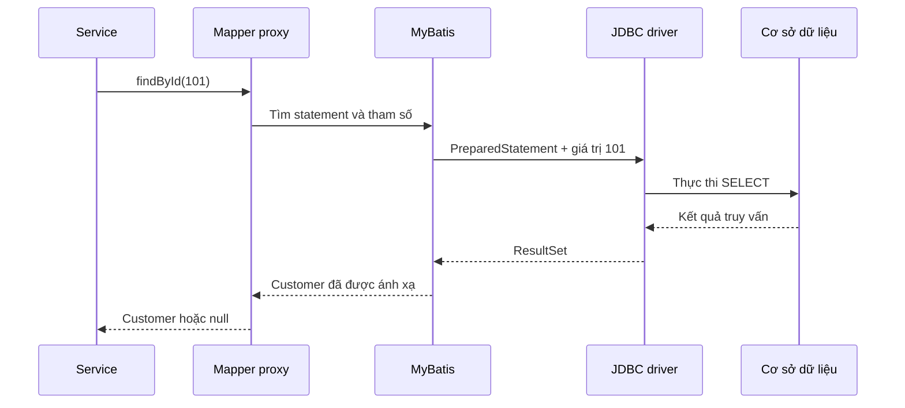

# MyBatis là gì và giải quyết vấn đề nào trong truy cập dữ liệu quan hệ

## 1. Mục tiêu của bài học

Trong một ứng dụng Java, dữ liệu nghiệp vụ thường được biểu diễn bằng đối tượng, còn cơ sở dữ liệu quan hệ lưu dữ liệu dưới dạng bảng, hàng và cột. Để đọc hoặc ghi dữ liệu, ứng dụng phải gửi SQL, truyền tham số, nhận kết quả và chuyển dữ liệu giữa hai cách biểu diễn này.

MyBatis hỗ trợ phần công việc nối Java với SQL: lập trình viên chủ động viết câu truy vấn, còn framework tổ chức việc thực thi và ánh xạ tham số, kết quả. Bài học này đặt nền tảng cho việc sử dụng Mapper, `SqlSession`, `resultMap`, SQL động, `TypeHandler`, giao dịch, cache, batch và tích hợp Spring Boot ở các phần tiếp theo.

Sau bài học, bạn có thể:

- Giải thích MyBatis làm gì và phần trách nhiệm nào vẫn thuộc về người viết ứng dụng.
- Nhận diện phần mã lặp khi truy cập dữ liệu bằng JDBC trực tiếp.
- Đọc được luồng từ phương thức Mapper đến SQL và đối tượng kết quả.
- Hiểu vai trò cơ bản của `SqlSessionFactory`, `SqlSession`, Mapper và `resultMap`.
- Phân biệt MyBatis với JDBC trực tiếp và cách tiếp cận ORM dựa trên entity.
- Xác định tình huống phù hợp để cân nhắc MyBatis.

## 2. Vấn đề bắt đầu từ đâu?

Giả sử một ứng dụng quản lý khách hàng có bảng `customer_account`:

```sql
CREATE TABLE customer_account (
    id BIGINT PRIMARY KEY,
    full_name VARCHAR(120) NOT NULL,
    email VARCHAR(255) NOT NULL UNIQUE
);

INSERT INTO customer_account (id, full_name, email)
VALUES (101, 'Nguyen An', 'an@example.com');
```

Ví dụ sử dụng ID do ứng dụng truyền vào để tập trung vào truy vấn và ánh xạ, chưa xét cơ chế sinh ID tự động.

Trong Java, cùng dữ liệu đó được biểu diễn bằng lớp `Customer`:

```java
package example.mybatis;

public class Customer {
    private Long id;
    private String fullName;
    private String email;

    public Customer() {
    }

    public Customer(Long id, String fullName, String email) {
        this.id = id;
        this.fullName = fullName;
        this.email = email;
    }

    public Long getId() {
        return id;
    }

    public void setId(Long id) {
        this.id = id;
    }

    public String getFullName() {
        return fullName;
    }

    public void setFullName(String fullName) {
        this.fullName = fullName;
    }

    public String getEmail() {
        return email;
    }

    public void setEmail(String email) {
        this.email = email;
    }
}
```

Ngay trong mô hình đơn giản này đã có một khác biệt: cột `full_name` trong SQL tương ứng với thuộc tính `fullName` trong Java. Khi truy vấn nhiều bảng, các khác biệt còn mở rộng thành tên cột trùng nhau, đối tượng lồng nhau, danh sách con, kiểu dữ liệu đặc thù và giá trị `NULL`.

Ứng dụng cần một cách nhất quán để trả lời ba câu hỏi:

1. Câu SQL nào thực hiện yêu cầu nghiệp vụ?
2. Giá trị Java nào được truyền vào từng tham số SQL?
3. Từng cột kết quả được đưa vào thuộc tính Java nào?

MyBatis cung cấp cơ chế tổ chức ba việc này, đồng thời sử dụng JDBC để giao tiếp với cơ sở dữ liệu.

## 3. JDBC trực tiếp: rõ ràng nhưng nhiều công việc lặp

Với JDBC, một phương thức tìm khách hàng có thể được viết như sau. `DataSource` được truyền vào từ phần cấu hình của ứng dụng.

```java
import java.sql.Connection;
import java.sql.PreparedStatement;
import java.sql.ResultSet;
import java.sql.SQLException;
import javax.sql.DataSource;

public Customer findById(DataSource dataSource, long id)
        throws SQLException {
    String sql = """
        SELECT id, full_name, email
        FROM customer_account
        WHERE id = ?
        """;

    try (Connection connection = dataSource.getConnection();
         PreparedStatement statement = connection.prepareStatement(sql)) {
        statement.setLong(1, id);

        try (ResultSet resultSet = statement.executeQuery()) {
            if (!resultSet.next()) {
                return null;
            }

            Customer customer = new Customer();
            customer.setId(resultSet.getLong("id"));
            customer.setFullName(resultSet.getString("full_name"));
            customer.setEmail(resultSet.getString("email"));
            return customer;
        }
    }
}
```

Đoạn mã dùng text block, yêu cầu Java 15 trở lên. Có thể thay bằng chuỗi thông thường nếu dự án dùng Java cũ hơn. Phương thức được đặt trong một lớp truy cập dữ liệu cùng với import lớp `Customer` phù hợp.

Cách làm trên hợp lý và thể hiện đầy đủ những gì xảy ra. Tuy nhiên, khi ứng dụng có nhiều thao tác tương tự, lập trình viên phải lặp lại:

- Tạo statement và gán tham số đúng vị trí.
- Thực thi câu lệnh và duyệt `ResultSet`.
- Lấy từng giá trị cột rồi gán vào đối tượng.
- Đóng tài nguyên trên cả đường thành công và đường lỗi.
- Giữ cách xử lý tham số, kết quả và lỗi thống nhất giữa các phương thức.

Ngoài ra, đoạn JDBC trên lấy một connection cho một lần gọi. Nếu một nghiệp vụ phải ghi nhiều bảng trong cùng giao dịch, ứng dụng còn phải tổ chức việc dùng chung connection và ranh giới commit/rollback. Đây là phần thiết kế riêng, không thể giải quyết chỉ bằng cách bọc từng câu SQL trong một phương thức.

Vấn đề không nằm ở việc SQL là một lựa chọn kém. Vấn đề là mã để thực thi SQL và chuyển dữ liệu dễ chiếm nhiều chỗ hơn chính câu truy vấn. MyBatis giảm phần mã cơ học đó, trong khi vẫn để câu SQL thể hiện rõ ý định truy cập dữ liệu.

## 4. MyBatis là gì?

MyBatis là framework hỗ trợ tầng persistence trong Java, cho phép khai báo SQL và cách ánh xạ dữ liệu thông qua XML hoặc annotation. Khi ứng dụng gọi một thao tác đã được ánh xạ, MyBatis sử dụng cấu hình đó để chuẩn bị câu lệnh, truyền tham số qua JDBC, thực thi và tạo kết quả Java.

Có thể xem mỗi thao tác MyBatis là một hợp đồng gồm:

| Thành phần | Ví dụ | Vai trò |
| --- | --- | --- |
| Đầu vào Java | `long id` hoặc một đối tượng `Customer` | Cung cấp dữ liệu cho câu lệnh |
| SQL | `SELECT ... WHERE id = #{id}` | Quy định dữ liệu được đọc hoặc thay đổi |
| Ánh xạ kết quả | `full_name` → `fullName` | Chuyển dữ liệu từ kết quả SQL sang Java |
| Kiểu trả về | `Customer`, `List<Customer>`, `int` | Diễn tả kết quả mà bên gọi nhận được |

MyBatis không yêu cầu mỗi bảng phải có một entity với cơ chế theo dõi thay đổi. Bạn có thể viết truy vấn trả về đối tượng nghiệp vụ đơn giản, DTO dành riêng cho một màn hình hoặc kết quả tổng hợp từ nhiều bảng.

Tên gọi SQL mapper giúp nhấn mạnh trọng tâm này: ứng dụng định nghĩa SQL, framework thực hiện việc gắn SQL với tham số và kiểu kết quả Java. MyBatis không tự động hiểu toàn bộ mô hình nghiệp vụ rồi sinh mọi câu truy vấn cần thiết.

### 4.1. Những việc MyBatis hỗ trợ

- Liên kết một phương thức hoặc mã định danh statement với câu SQL.
- Trích xuất giá trị từ tham số Java để gán vào câu lệnh.
- Ánh xạ cột kết quả sang thuộc tính hoặc cấu trúc đối tượng.
- Tổ chức câu SQL có điều kiện thông qua cơ chế SQL động.
- Cho phép mở rộng cách chuyển đổi kiểu dữ liệu bằng `TypeHandler`.
- Cung cấp API session và tích hợp với cơ chế quản lý giao dịch.
- Hỗ trợ những cơ chế như cache và thực thi batch khi được sử dụng phù hợp.

### 4.2. Những việc ứng dụng vẫn phải quyết định

- SQL nào đúng với yêu cầu nghiệp vụ và đặc điểm của hệ quản trị cơ sở dữ liệu.
- Điều kiện lọc, phân quyền dữ liệu, sắp xếp và phân trang.
- Chỉ mục, kế hoạch thực thi và lượng dữ liệu cần đọc.
- Ranh giới giao dịch và cách xử lý xung đột khi ghi đồng thời.
- Cấu trúc DTO, quy tắc dữ liệu và cách xử lý lỗi ở tầng nghiệp vụ.
- Khi nào dùng cache, batch hoặc truy vấn bổ sung và cách kiểm thử chúng.

Giảm mã ánh xạ không đồng nghĩa với tự động tối ưu truy vấn. Một câu SQL đọc quá nhiều hàng vẫn có thể chậm khi được gọi qua MyBatis.

## 5. Luồng xử lý cơ bản



Sơ đồ mô tả đường truy vấn tới cơ sở dữ liệu; các cơ chế cache có thể làm thay đổi đường đi trong một lần gọi cụ thể.

Các thành phần cần phân biệt:

| Thành phần | Ý nghĩa | Cách dùng thường gặp |
| --- | --- | --- |
| `DataSource` | Cung cấp connection JDBC | Được cấu hình cho ứng dụng, thường gắn với connection pool |
| `SqlSessionFactory` | Tạo `SqlSession` từ cấu hình MyBatis | Khởi tạo rồi tái sử dụng theo cấu hình tương ứng |
| `SqlSession` | Cổng thực thi statement, lấy Mapper và điều khiển giao dịch trong cách dùng độc lập | Có phạm vi ngắn; không chia sẻ session thông thường giữa các luồng |
| Mapper interface | Hợp đồng Java mô tả thao tác dữ liệu | Được MyBatis tạo proxy để thực thi statement |
| Mapped statement | Câu lệnh đã đăng ký cùng thông tin thực thi và ánh xạ | Ví dụ `example.mybatis.CustomerMapper.findById` |
| `resultMap` | Khai báo cách chuyển các cột thành đối tượng | Hữu ích khi tên hoặc cấu trúc kết quả khác mô hình Java |

Mapper interface không cần lớp triển khai thủ công cho từng câu truy vấn đã khai báo. Proxy do MyBatis tạo ra nhận lời gọi phương thức và dẫn nó tới statement tương ứng.

`SqlSession` không đồng nghĩa với một HTTP session hay một connection được dùng vĩnh viễn. Trong ứng dụng độc lập, bạn mở và đóng nó theo phạm vi công việc. Khi tích hợp Spring, cách cung cấp session và điều phối giao dịch thường được giao cho lớp tích hợp.

## 6. Ví dụ xuyên suốt: từ Mapper đến SQL

Ví dụ sau sử dụng MyBatis độc lập để làm rõ các thành phần. Nó giả định bảng đã được tạo, dự án có thư viện MyBatis và JDBC driver của cơ sở dữ liệu đang dùng. Cấu hình kết nối sẽ được truyền từ môi trường chạy.

### 6.1. Khai báo Mapper interface

```java
package example.mybatis;

import org.apache.ibatis.annotations.Param;

public interface CustomerMapper {
    Customer findById(@Param("id") long id);

    int insert(Customer customer);
}
```

Ý nghĩa của hai phương thức:

- `findById`: nhận ID, trả về một `Customer`; nếu không có hàng phù hợp thì trả về `null`. Với kiểu trả về một đối tượng, kết quả nhiều hàng sẽ gây lỗi; khóa chính trong ví dụ đảm bảo tối đa một hàng.
- `insert`: nhận dữ liệu khách hàng và trả về số hàng bị tác động ở cách thực thi cập nhật thông thường, chưa sử dụng batch.

Annotation `@Param("id")` đặt tên rõ ràng cho tham số của truy vấn. Với tham số đơn là một đối tượng `Customer`, các biểu thức như `#{fullName}` truy cập thuộc tính của đối tượng đó.

### 6.2. Khai báo SQL và ánh xạ trong XML

Đặt tài nguyên sau tại `example/mybatis/CustomerMapper.xml` trong classpath, thường tương ứng với `src/main/resources/example/mybatis/CustomerMapper.xml` trong dự án dùng bố cục Maven/Gradle thông thường:

```xml
<?xml version="1.0" encoding="UTF-8" ?>
<!DOCTYPE mapper
    PUBLIC "-//mybatis.org//DTD Mapper 3.0//EN"
    "https://mybatis.org/dtd/mybatis-3-mapper.dtd">
<mapper namespace="example.mybatis.CustomerMapper">

    <resultMap id="customerResult" type="example.mybatis.Customer">
        <id property="id" column="id" />
        <result property="fullName" column="full_name" />
        <result property="email" column="email" />
    </resultMap>

    <select id="findById" resultMap="customerResult">
        SELECT id, full_name, email
        FROM customer_account
        WHERE id = #{id}
    </select>

    <insert id="insert">
        INSERT INTO customer_account (id, full_name, email)
        VALUES (#{id}, #{fullName}, #{email})
    </insert>

</mapper>
```

Các liên kết quan trọng:

1. `namespace` là tên đầy đủ của Mapper interface.
2. `id="findById"` khớp với phương thức `findById`.
3. `resultMap="customerResult"` chỉ tới ánh xạ kết quả được định nghĩa trong cùng namespace.
4. `column="full_name"` chỉ cột SQL; `property="fullName"` chỉ thuộc tính Java.
5. `#{id}`, `#{fullName}` và `#{email}` là các vị trí nhận giá trị tham số.

Ở đây `resultMap` khai báo ánh xạ trực tiếp để người học thấy rõ dữ liệu đi đâu. Với kết quả đơn giản, có thể dùng `resultType` kết hợp alias cột hoặc cấu hình ánh xạ tên thích hợp. Không nên mặc định cho rằng `full_name` tự động chuyển thành `fullName` trong mọi cấu hình.

Thẻ `<id>` trong `resultMap` đánh dấu thuộc tính định danh của kết quả ánh xạ. Nó không tạo khóa chính trong cơ sở dữ liệu và cũng không làm MyBatis tự theo dõi thay đổi của đối tượng.

### 6.3. Cấu hình MyBatis độc lập

Tạo tài nguyên `mybatis-config.xml` trên classpath với nội dung minh họa sau:

```xml
<?xml version="1.0" encoding="UTF-8" ?>
<!DOCTYPE configuration
    PUBLIC "-//mybatis.org//DTD Config 3.0//EN"
    "https://mybatis.org/dtd/mybatis-3-config.dtd">
<configuration>
    <environments default="local">
        <environment id="local">
            <transactionManager type="JDBC" />
            <dataSource type="POOLED">
                <property name="driver" value="${jdbc.driver}" />
                <property name="url" value="${jdbc.url}" />
                <property name="username" value="${jdbc.username}" />
                <property name="password" value="${jdbc.password}" />
            </dataSource>
        </environment>
    </environments>

    <mappers>
        <mapper resource="example/mybatis/CustomerMapper.xml" />
    </mappers>
</configuration>
```

Đây là cấu hình phục vụ việc quan sát MyBatis độc lập. `POOLED` chọn data source có pool của MyBatis; ứng dụng thực tế có thể sử dụng data source được quản lý ở nơi khác.

Các biểu thức `${jdbc...}` trong cấu hình trên là biến cấu hình được thay bằng thuộc tính truyền khi khởi tạo. Không nhầm chúng với việc chèn trực tiếp nội dung vào câu SQL bằng `${...}`, được giải thích ở phần sau.

### 6.4. Tạo factory và thực thi

Lớp dưới đây sử dụng các biến môi trường `JDBC_DRIVER`, `JDBC_URL`, `JDBC_USERNAME`, `JDBC_PASSWORD`. Giá trị driver và URL phải phù hợp với JDBC driver đã thêm vào dự án; thông tin đăng nhập cần được cung cấp trước khi chạy.

```java
package example.mybatis;

import java.io.Reader;
import java.util.Properties;
import org.apache.ibatis.io.Resources;
import org.apache.ibatis.session.SqlSession;
import org.apache.ibatis.session.SqlSessionFactory;
import org.apache.ibatis.session.SqlSessionFactoryBuilder;

public final class MyBatisDemo {
    public static void main(String[] args) throws Exception {
        Properties properties = new Properties();
        properties.setProperty("jdbc.driver", requiredEnv("JDBC_DRIVER"));
        properties.setProperty("jdbc.url", requiredEnv("JDBC_URL"));
        properties.setProperty("jdbc.username", requiredEnv("JDBC_USERNAME"));
        properties.setProperty("jdbc.password", requiredEnv("JDBC_PASSWORD"));

        SqlSessionFactory factory;
        try (Reader reader = Resources.getResourceAsReader("mybatis-config.xml")) {
            factory = new SqlSessionFactoryBuilder().build(reader, properties);
        }

        // Đọc dữ liệu: đóng session khi kết thúc phạm vi này.
        try (SqlSession session = factory.openSession()) {
            CustomerMapper mapper = session.getMapper(CustomerMapper.class);
            Customer customer = mapper.findById(101L);

            if (customer == null) {
                System.out.println("Không tìm thấy khách hàng");
            } else {
                System.out.println(customer.getFullName());
            }
        }

        // Ghi dữ liệu: chủ động commit hoặc rollback.
        try (SqlSession session = factory.openSession(false)) {
            try {
                CustomerMapper mapper = session.getMapper(CustomerMapper.class);
                int affectedRows = mapper.insert(
                    new Customer(102L, "Tran Binh", "binh@example.com")
                );

                if (affectedRows != 1) {
                    throw new IllegalStateException("Số hàng ghi không đúng kỳ vọng");
                }

                session.commit();
            } catch (RuntimeException exception) {
                session.rollback();
                throw exception;
            }
        }
    }

    private static String requiredEnv(String name) {
        String value = System.getenv(name);
        if (value == null) {
            throw new IllegalStateException("Thiếu biến môi trường: " + name);
        }
        return value;
    }
}
```

Với dữ liệu mẫu, lần đọc ID `101` trả về khách hàng `Nguyen An`. Khối ghi thêm khách hàng có ID `102` và commit giao dịch. Chạy lại khối ghi mà không chuẩn bị lại dữ liệu sẽ vi phạm khóa chính hoặc ràng buộc email duy nhất; MyBatis không tự chuyển câu `INSERT` thành cập nhật.

`factory.openSession(false)` chỉ rõ việc không dùng auto-commit. Ứng dụng quyết định khi nào commit hoặc rollback. Một giao dịch có thể gồm nhiều lời gọi Mapper trong cùng session; không nên tùy tiện commit ngay sau mỗi câu lệnh nếu chúng thuộc cùng một nghiệp vụ cần tính nguyên tử.

Trong ứng dụng dài hạn, factory thường được tạo khi khởi động và tái sử dụng, thay vì tạo lại trong mỗi lần truy vấn. Đoạn `main` chỉ dựng một luồng minh họa hoàn chỉnh.

## 7. MyBatis đã giảm phần mã nào?

So với phương thức JDBC trực tiếp, bên gọi MyBatis chỉ cần:

```java
CustomerMapper mapper = session.getMapper(CustomerMapper.class);
Customer customer = mapper.findById(101L);
```

Ở tầng thực thi, MyBatis đảm nhiệm việc chọn statement, tạo và sử dụng tài nguyên JDBC cần thiết, gán tham số và đọc kết quả theo cấu hình ánh xạ. Trong cách dùng độc lập, người gọi vẫn phải đóng `SqlSession`; việc framework hỗ trợ statement và result set không loại bỏ trách nhiệm quản lý phạm vi session.

SQL vẫn tồn tại trong XML, vì đó là phần bạn chủ động kiểm soát. Lợi ích không nhất thiết là tổng số dòng của một ví dụ rất nhỏ giảm mạnh; lợi ích rõ hơn khi có nhiều thao tác dùng lại cùng quy tắc ánh xạ, có DTO phức tạp hoặc cần tách SQL khỏi luồng nghiệp vụ.

Ví dụ, khi đổi tên cột trong câu truy vấn, vị trí ánh xạ tương ứng được thể hiện rõ trong `resultMap`. Nếu dùng chung result map, nhiều câu truy vấn có thể cùng tái sử dụng một hợp đồng kết quả, miễn là chúng trả về các cột phù hợp.

## 8. Tham số SQL: dữ liệu phải được gán đúng cách

Trong câu truy vấn:

```xml
SELECT id, full_name, email
FROM customer_account
WHERE id = #{id}
```

`#{id}` được xử lý thành một tham số của câu lệnh chuẩn bị sẵn. Về mặt ý tưởng, SQL gửi qua JDBC có dạng:

```sql
SELECT id, full_name, email
FROM customer_account
WHERE id = ?
```

Giá trị `id` được gán riêng vào vị trí tham số. Không tự đặt dấu nháy quanh placeholder như `'#{id}'`.

Ngược lại, `${...}` trong nội dung SQL thực hiện thay thế chuỗi trực tiếp. Nếu dữ liệu không tin cậy được dùng làm đoạn SQL, ứng dụng có nguy cơ SQL injection.

Ví dụ cần tránh:

```xml
<!-- Không đưa trực tiếp chuỗi đầu vào tùy ý vào biểu thức này. -->
SELECT id, full_name, email
FROM customer_account
ORDER BY ${sortColumn}
```

Không thể sửa thành `ORDER BY #{sortColumn}` rồi kỳ vọng giá trị chuỗi biến thành tên cột. Tham số JDBC biểu diễn giá trị, không biểu diễn tên bảng, tên cột hay từ khóa SQL. Nếu ứng dụng cho phép chọn cột sắp xếp, phải ánh xạ các lựa chọn được phép sang các đoạn SQL do ứng dụng kiểm soát, chẳng hạn thông qua các nhánh cố định.

Cũng cần phân biệt an toàn tham số với phân quyền nghiệp vụ. Dù dùng `#{id}`, một truy vấn vẫn có thể trả sai phạm vi dữ liệu nếu thiếu điều kiện về người dùng, tổ chức hoặc quyền truy cập.

## 9. MyBatis, JDBC trực tiếp và ORM khác nhau thế nào?

JDBC là API nền tảng để Java giao tiếp với cơ sở dữ liệu quan hệ. MyBatis xây dựng cơ chế thuận tiện hơn trên nền JDBC. JPA là đặc tả persistence theo mô hình entity; Hibernate là một triển khai phổ biến của đặc tả đó và có các khả năng riêng.

| Tiêu chí | JDBC trực tiếp | MyBatis | JPA/Hibernate theo cách dùng entity phổ biến |
| --- | --- | --- | --- |
| Nơi thể hiện truy vấn | SQL và mã JDBC | SQL trong XML, annotation hoặc cơ chế cung cấp SQL | Ánh xạ entity, truy vấn JPQL/Criteria, cùng khả năng dùng SQL trực tiếp |
| Quyền quyết định SQL | Lập trình viên viết trực tiếp | Lập trình viên viết trực tiếp | Provider thường sinh SQL cho thao tác entity; vẫn có truy vấn tùy chỉnh |
| Ánh xạ kết quả | Tự đọc từng cột | Khai báo và tái sử dụng ánh xạ | Ánh xạ theo mô hình entity hoặc kết quả truy vấn |
| Theo dõi thay đổi đối tượng | Không có sẵn | Không tự động theo dõi như persistence context của JPA | Có cơ chế theo dõi entity được quản lý |
| Ghi khi đổi thuộc tính Java | Cần lệnh cập nhật tường minh | Cần gọi statement cập nhật phù hợp | Có thể được đồng bộ khi flush trong điều kiện quản lý phù hợp |
| Tính phụ thuộc hệ quản trị | Phụ thuộc SQL và driver sử dụng | Phụ thuộc SQL và driver sử dụng | Có lớp trừu tượng hóa nhưng vẫn có các khác biệt cần xử lý |

Không nên kết luận MyBatis luôn nhanh hơn ORM hoặc ORM luôn sinh SQL kém. Hiệu năng phụ thuộc vào câu truy vấn thực tế, số lượt gọi cơ sở dữ liệu, chỉ mục, dữ liệu, giao dịch và cách cấu hình framework.

MyBatis đặc biệt hấp dẫn khi SQL là một phần quan trọng cần được đọc và điều chỉnh trực tiếp. Cách tiếp cận entity có thể phù hợp khi ứng dụng hưởng lợi nhiều từ việc quản lý vòng đời và quan hệ của các entity. Một hệ thống cũng có thể kết hợp nhiều cách truy cập, nhưng cần thiết kế thống nhất giao dịch, cache và nguồn dữ liệu.

## 10. Những vấn đề thường gặp và mức độ MyBatis hỗ trợ

| Vấn đề trong dự án | MyBatis hỗ trợ ra sao? | Điều vẫn phải làm rõ |
| --- | --- | --- |
| Mỗi truy vấn có một đoạn đọc `ResultSet` gần giống nhau | Dùng ánh xạ kết quả và DTO | Các cột có đúng kiểu và đúng ý nghĩa không? |
| SQL khó tìm vì nằm xen trong luồng nghiệp vụ | Tổ chức thành Mapper và statement | Ranh giới trách nhiệm giữa service và Mapper |
| Bộ lọc tìm kiếm có nhiều điều kiện tùy chọn | SQL động có các phần tử như `<if>`, `<where>`, `<foreach>` | Ý nghĩa của điều kiện rỗng, danh sách rỗng và phạm vi truy vấn |
| Cột dùng kiểu dữ liệu đặc thù | Mở rộng bằng `TypeHandler` | Quy tắc chuyển đổi, `NULL` và hỗ trợ của JDBC driver |
| Một nghiệp vụ ghi nhiều bảng | Nhiều statement cùng giao dịch | Tính nguyên tử, rollback và xung đột đồng thời |
| Cần ghi nhiều bản ghi | Có cơ chế executor batch | Thời điểm flush, xử lý lỗi và giới hạn tài nguyên |
| Nhiều lần đọc lặp lại | Có các cơ chế cache | Phạm vi cache, dữ liệu cũ và invalidation |
| Truy vấn join trả về cấu trúc khác một bảng | Dùng DTO và `resultMap` phù hợp | Tên cột, số hàng, quan hệ lồng nhau và số truy vấn phát sinh |

Bảng này là bản đồ định hướng cho các phần sau, không phải yêu cầu bật tất cả tính năng ngay từ đầu. Một Mapper đơn giản với SQL rõ ràng và ánh xạ đúng thường là điểm xuất phát phù hợp.

### Ví dụ nghiệp vụ có lợi khi kiểm soát SQL

Một màn hình báo cáo cần danh sách khách hàng kèm tổng số đơn và tổng doanh thu trong một khoảng thời gian. Kết quả có thể là `CustomerRevenueRow`, không phải toàn bộ đối tượng khách hàng cùng mọi đơn hàng.

Với MyBatis, bạn có thể chủ động viết câu truy vấn tổng hợp trả về đúng các cột màn hình cần rồi ánh xạ trực tiếp sang DTO. Điều này giúp thể hiện rõ tập dữ liệu, phép tổng hợp và điều kiện thời gian ở một nơi. Bạn vẫn phải xử lý đúng những vấn đề như khách hàng chưa có đơn, ranh giới thời gian, kết quả `NULL` và mức độ lớn của dữ liệu.

Tương tự, với cơ sở dữ liệu cũ có nhiều bảng và quy ước tên không đồng nhất, `resultMap` cho phép diễn đạt việc ánh xạ mà không buộc mô hình Java phải sao chép nguyên tên cột.

## 11. Những giới hạn và hiểu nhầm cần tránh

### 11.1. Đổi đối tượng không tự ghi về cơ sở dữ liệu

Sau khi đọc một `Customer`:

```java
Customer customer = mapper.findById(101L);
customer.setFullName("Nguyen An Moi");
```

Dòng `setFullName` chỉ thay đổi trạng thái đối tượng trong bộ nhớ. MyBatis không tự sinh `UPDATE` vì bạn đã gọi setter. Muốn ghi, phải có statement cập nhật phù hợp và gọi nó trong giao dịch được quản lý đúng.

### 11.2. Ánh xạ thành công chưa chắc truy vấn đúng nghiệp vụ

Một truy vấn có thể chạy được, trả về một `Customer` hợp lệ nhưng vẫn thiếu điều kiện giới hạn dữ liệu. Kiểu trả về Java không thay thế được việc kiểm tra câu SQL có đáp ứng đúng yêu cầu hay không.

Với truy vấn nhiều bảng, nếu nhiều cột cùng có tên `id`, cần alias và ánh xạ rõ ràng. Nếu quan hệ một-nhiều làm lặp lại các hàng cha, phải hiểu hình dạng kết quả trước khi chọn cách ánh xạ.

### 11.3. Có cache không có nghĩa dữ liệu luôn mới

Cache có phạm vi và quy tắc làm mới riêng. Ghi dữ liệu từ nơi khác, chia sẻ đối tượng hoặc chọn sai phạm vi cache có thể dẫn đến kết quả không như mong đợi. Không dùng cache để che một truy vấn chưa được hiểu hoặc chưa được kiểm thử.

### 11.4. MyBatis không loại bỏ N+1

Nếu đọc một danh sách khách hàng rồi với mỗi khách hàng lại gọi một truy vấn lấy đơn hàng, số lượt truy vấn có thể tăng theo số khách hàng. Cách ánh xạ quan hệ cũng có thể dẫn đến truy vấn bổ sung tùy cấu hình. Cần quan sát số truy vấn thực tế và chọn join, truy vấn theo tập ID hoặc phương án khác phù hợp.

### 11.5. SQL vẫn có thể phụ thuộc hệ quản trị

Cú pháp phân trang, hàm ngày giờ, cơ chế sinh khóa và khả năng xử lý JSON có thể khác nhau giữa các hệ quản trị. MyBatis cho bạn quyền viết SQL nên đồng thời bạn chịu trách nhiệm với những khác biệt đó. Việc chuyển cơ sở dữ liệu không mặc nhiên chỉ là thay JDBC URL.

## 12. Khi nào nên cân nhắc MyBatis?

MyBatis thường đáng cân nhắc khi:

- Nhóm phát triển thành thạo SQL và muốn xem rõ câu SQL cho từng thao tác.
- Ứng dụng có truy vấn báo cáo, join hoặc tổng hợp cần điều chỉnh trực tiếp.
- Cần tận dụng cơ sở dữ liệu đã tồn tại với cấu trúc và quy ước riêng.
- Mỗi màn hình hoặc use case có hình dạng dữ liệu đầu ra khác nhau.
- Muốn giảm mã JDBC lặp mà vẫn giữ quyền quyết định câu truy vấn.

Cần đánh giá kỹ hơn nếu nhóm kỳ vọng framework tự quản lý phần lớn vòng đời entity, tự phát hiện thay đổi đối tượng hoặc tự đồng bộ quan hệ phức tạp. MyBatis không cung cấp sẵn mô hình làm việc đó, nên nhóm phải chấp nhận viết và duy trì các thao tác SQL tương ứng.

Với một chương trình rất nhỏ chỉ có vài câu SQL, JDBC trực tiếp có thể đã đủ. Với một hệ thống có nhiều thao tác dữ liệu, lợi ích về tổ chức Mapper, ánh xạ và tích hợp thường rõ hơn. Lựa chọn nên xuất phát từ cách ứng dụng làm việc với dữ liệu và năng lực của nhóm.

## 13. Vị trí của MyBatis trong ứng dụng Spring Boot

Trong ứng dụng phân lớp thường gặp, luồng gọi có thể là:

```text
Controller → Service → Mapper → MyBatis/JDBC → Cơ sở dữ liệu
```

- Controller nhận yêu cầu và chuyển dữ liệu vào tầng ứng dụng.
- Service điều phối nghiệp vụ và thường xác định ranh giới giao dịch.
- Mapper biểu diễn các thao tác SQL cụ thể.
- MyBatis và JDBC thực thi, truyền tham số và ánh xạ kết quả.

Khi tích hợp với Spring, các Mapper thường được đăng ký thành bean, còn session và connection được điều phối thông qua lớp tích hợp. Giao dịch có thể được quản lý ở tầng service bằng cơ chế giao dịch của Spring.

Không bê nguyên việc tự mở session rồi gọi `commit()` từ ví dụ độc lập vào một service đang dùng giao dịch do Spring quản lý. Hai cách có mô hình sở hữu tài nguyên khác nhau và cần được dùng nhất quán. Chi tiết cấu hình, quét Mapper và kiểm thử tích hợp sẽ được học riêng.

MyBatis cũng không buộc phải có Spring Boot: ví dụ độc lập ở trên cho thấy framework có thể được sử dụng mà không có container Spring.

## 14. Bài tập củng cố

### Bài 1: Chỉ ra trách nhiệm

Với lời gọi `mapper.findById(101L)`, hãy xác định nơi quyết định:

1. Bảng và cột được truy vấn.
2. Giá trị của điều kiện `id`.
3. Cách chuyển `full_name` thành `fullName`.
4. Thời điểm đóng session.

Gợi ý: câu SQL trong XML quyết định bảng/cột; tham số phương thức cung cấp ID; `resultMap` định nghĩa ánh xạ; khối `try-with-resources` trong ví dụ độc lập đóng session.

### Bài 2: Bổ sung truy vấn theo email

Từ ví dụ hiện có, thêm phương thức tìm một khách hàng theo email. Giữ nguyên bảng và tái sử dụng `customerResult`.

Một cách khai báo interface:

```java
Customer findByEmail(@Param("email") String email);
```

Statement tương ứng đặt trong `CustomerMapper.xml`:

```xml
<select id="findByEmail" resultMap="customerResult">
    SELECT id, full_name, email
    FROM customer_account
    WHERE email = #{email}
</select>
```

Ràng buộc `UNIQUE` của cột email giúp kết quả có tối đa một hàng. Đầu vào không tìm thấy sẽ nhận `null` với hợp đồng phương thức này. Việc so sánh hoa/thường của email còn phụ thuộc quy tắc dữ liệu và cách so sánh chuỗi của cơ sở dữ liệu; cần xác định yêu cầu trước khi coi hai chuỗi email là tương đương.

### Bài 3: Giải thích vì sao dữ liệu chưa đổi

Bạn đọc khách hàng, gọi `setEmail(...)`, rồi kết thúc session mà không gọi statement cập nhật. Vì sao dữ liệu trong bảng chưa thay đổi?

Vì thay đổi đối tượng Java không phải một câu lệnh ghi. Cần khai báo và gọi thao tác cập nhật, sau đó hoàn tất giao dịch theo cơ chế đang sử dụng.

## 15. Các ý chính cần nhớ

MyBatis giúp tổ chức truy cập dữ liệu quan hệ bằng cách gắn SQL với phương thức Java, tham số và ánh xạ kết quả. Framework giảm phần mã JDBC lặp nhưng giữ câu SQL dưới quyền kiểm soát của lập trình viên.

Các khái niệm nền tảng nối với nhau như sau: `SqlSessionFactory` tạo session; session cung cấp Mapper; phương thức Mapper liên kết với statement; statement dùng tham số Java và ánh xạ kết quả về đối tượng. Trong cách dùng độc lập, ứng dụng quản lý phạm vi session và giao dịch một cách tường minh.

Khi bắt đầu với MyBatis, hãy bảo đảm mình giải thích được câu SQL đang làm gì, giá trị đi vào từ đâu, các cột đi vào thuộc tính nào và ai sở hữu giao dịch. Những câu hỏi đó là cơ sở để học tiếp SQL động, `TypeHandler`, cache, batch, tích hợp Spring Boot, kiểm thử và tối ưu truy vấn.
