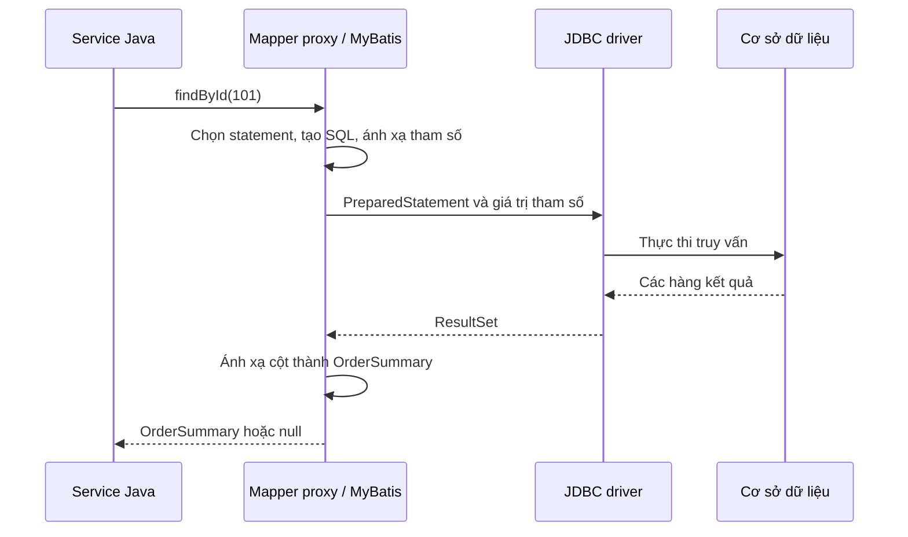

# Vai trò SQL mapper và mức kiểm soát câu lệnh SQL

## 1. Vấn đề cần hiểu khi lựa chọn MyBatis

Trong ứng dụng Java làm việc với cơ sở dữ liệu quan hệ, có hai việc liên quan nhưng khác nhau: xác định dữ liệu cần lấy hoặc thay đổi bằng SQL, và chuyển dữ liệu qua lại giữa JDBC với đối tượng Java. MyBatis là một SQL mapper: nó hỗ trợ công việc truyền tham số, thực thi câu lệnh và ánh xạ kết quả, trong khi lập trình viên chủ động viết phần SQL chính.

Ví dụ, chức năng tra cứu đơn hàng cần trả về mã đơn, trạng thái và tổng tiền. Nhóm phát triển muốn biết chính xác truy vấn đọc bảng nào, chọn cột nào, dùng điều kiện nào và sắp xếp ra sao. Đồng thời, nhóm không muốn mỗi phương thức đều lặp lại việc tạo `PreparedStatement`, gọi `setLong`, duyệt `ResultSet` và gán từng thuộc tính.

MyBatis đứng ở điểm giao của hai nhu cầu đó. Nó không loại bỏ SQL khỏi ứng dụng; nó tạo một cách tổ chức và thực thi SQL có ánh xạ rõ ràng với mã Java.

Sau bài này, bạn cần có thể:

- Giải thích SQL mapper làm gì trong luồng Java → JDBC → cơ sở dữ liệu.
- Phân biệt quyền kiểm soát SQL với quyền quyết định kế hoạch thực thi của hệ quản trị.
- Đọc một Mapper và chỉ ra câu lệnh, tham số, kiểu kết quả, cùng ranh giới giao dịch.
- Nhận diện trách nhiệm mà ứng dụng vẫn phải đảm nhận khi sử dụng MyBatis.

## 2. SQL mapper ánh xạ những gì?

Từ “mapper” trong MyBatis không chỉ mang nghĩa đổi một hàng dữ liệu thành một đối tượng. Có ba mối liên hệ chính.

| Mối liên hệ | Ví dụ | Vai trò của MyBatis |
|---|---|---|
| Phương thức Java ↔ câu lệnh SQL | `findById(101L)` ↔ một câu `SELECT` | Tìm mapped statement dựa vào interface và tên phương thức |
| Tham số Java ↔ tham số JDBC | `id` ↔ giá trị gắn vào `WHERE order_id = ?` | Đọc giá trị và dùng cơ chế binding của JDBC |
| Cột kết quả ↔ thuộc tính Java | `total_amount` ↔ `totalAmount` | Đọc giá trị từ `ResultSet` và tạo/điền đối tượng theo cấu hình ánh xạ |

**Mapped statement** là định nghĩa một thao tác SQL trong MyBatis. Nó bao gồm mã định danh, nội dung SQL và các thông tin như ánh xạ kết quả, tùy chọn thực thi. Một phương thức Mapper thường gọi một mapped statement tương ứng.

**Mapper interface** là interface Java mà ứng dụng dùng để gọi thao tác dữ liệu. MyBatis có thể tạo đối tượng proxy triển khai interface này. Lập trình viên thường không viết lớp triển khai chứa toàn bộ JDBC thủ công.

**`SqlSession`** là API làm việc với MyBatis trong cách sử dụng trực tiếp: lấy Mapper, thực thi thao tác, commit hoặc rollback. Trong môi trường Spring, việc quản lý session và giao dịch thường được tích hợp với cơ chế của Spring; không nên áp dụng máy móc cách quản lý session thủ công vào một luồng đã do Spring quản lý.

**`resultMap`** mô tả cách chuyển dữ liệu kết quả sang đối tượng Java. Nó đặc biệt hữu ích khi tên cột khác tên thuộc tính, có dữ liệu lồng nhau hoặc cần quy tắc ánh xạ cụ thể.

Những thành phần này tạo ra một hợp đồng dữ liệu: phương thức nhận gì, SQL dùng những giá trị nào và kết quả được biểu diễn bằng kiểu Java nào.

## 3. MyBatis nằm ở đâu trong luồng truy cập dữ liệu?



Đây là luồng đọc thông thường khi truy vấn thực sự đi xuống cơ sở dữ liệu. Cache có thể làm một số lần đọc được phục vụ từ dữ liệu đã lưu; batch có thể trì hoãn một số thao tác ghi tới lúc flush. Vì vậy, không nên đồng nhất mỗi lời gọi Mapper với một lần giao tiếp mạng ngay lập tức.

Ở mức JDBC, MyBatis vẫn dựa trên connection, statement và result set. Quyền truy cập dữ liệu, khả năng SQL, isolation, khóa và xử lý truy vấn vẫn phụ thuộc cơ sở dữ liệu cùng cấu hình kết nối.

Một lời gọi Java ngắn không có nghĩa công việc ở cơ sở dữ liệu cũng nhẹ. Phương thức `findAll()` có thể gây đọc hàng triệu hàng; phương thức trả một danh sách đối tượng có quan hệ lồng nhau có thể gây nhiều truy vấn nếu được cấu hình bằng các lần chọn bổ sung.

## 4. “Kiểm soát SQL” cụ thể đến mức nào?

### 4.1. Những phần lập trình viên chủ động quyết định

Với MyBatis, lập trình viên thông thường viết hoặc cấu tạo nội dung SQL dùng để truy cập dữ liệu. Các lựa chọn nằm trong phạm vi này gồm:

- Bảng, cột, alias và biểu thức cần truy vấn.
- Kiểu `JOIN`, điều kiện nối và điều kiện lọc.
- Cách tổng hợp bằng `GROUP BY`, `HAVING`, hàm tổng hợp hoặc hàm cửa sổ.
- Thứ tự kết quả và cách phân trang phù hợp với hệ quản trị.
- Phạm vi cập nhật, cột cần thay đổi và điều kiện bảo vệ thao tác ghi.
- Cách biểu diễn một truy vấn bằng SQL cố định hoặc các nhánh SQL động.
- Các đặc tính SQL riêng của hệ quản trị khi ứng dụng cần dùng chúng.

Ví dụ, nếu chỉ cần mã đơn và tổng tiền, bạn có thể chỉ chọn hai cột đó. MyBatis không buộc phải đọc mọi cột của một bảng hoặc tạo một đối tượng đại diện đầy đủ cho toàn bộ thực thể nghiệp vụ.

### 4.2. Những phần MyBatis thực hiện theo cấu hình

MyBatis giúp kết nối SQL với chương trình Java:

- Định vị câu lệnh được gọi từ Mapper.
- Tạo nội dung SQL cuối cùng từ câu lệnh và nhánh động.
- Gắn giá trị tham số, thường qua `PreparedStatement`.
- Chuyển kiểu dữ liệu thông qua TypeHandler.
- Ánh xạ kết quả về đối tượng, danh sách hoặc kiểu giá trị phù hợp.
- Phối hợp cơ chế executor, cache và batch khi được cấu hình.

Đó là tự động hóa cơ chế truy cập dữ liệu, không phải tự quyết định toàn bộ nghiệp vụ hay tự thiết kế truy vấn tối ưu.

### 4.3. Những phần cơ sở dữ liệu vẫn quyết định

Viết rõ SQL không đồng nghĩa ép được cơ sở dữ liệu thực thi theo một thuật toán cố định. Bộ tối ưu truy vấn có thể lựa chọn thứ tự join, kiểu scan và cách dùng index dựa trên SQL, index, thống kê và dữ liệu thực tế.

| Bạn kiểm soát trực tiếp | Bạn cần kiểm chứng ở cơ sở dữ liệu |
|---|---|
| Có điều kiện `customer_id = ?` trong SQL | Điều kiện đó có dùng index trong tình huống thực tế không |
| Có `ORDER BY order_id` | Cơ sở dữ liệu có phải sort thêm không |
| Chỉ chọn bốn cột | Tổng lượng dữ liệu và chi phí truy vấn thực tế là bao nhiêu |
| Gọi một statement có `JOIN` | Kế hoạch join và số hàng trung gian có phù hợp không |

Quyền chủ động viết SQL tạo điều kiện để phân tích và tối ưu. Nó không phải cam kết hiệu năng. Muốn đánh giá hiệu năng, vẫn cần quan sát SQL thực thi, tham số đại diện, kế hoạch truy vấn và tải thực tế.

Plugin hoặc interceptor cũng có thể chỉnh sửa hành vi thực thi, chẳng hạn thêm phân trang hay điều kiện dữ liệu. Khi dùng chúng, cần xem SQL cuối cùng thực sự được gửi tới JDBC, thay vì chỉ dựa vào đoạn SQL trong Mapper.

## 5. Một ví dụ xuyên suốt: đọc thông tin đơn hàng

Ví dụ sau dùng cú pháp PostgreSQL và cách dùng MyBatis trực tiếp, chưa có Spring. Mục đích là làm rõ hợp đồng giữa SQL và Java; đây không phải cấu hình triển khai hoàn chỉnh. Để chạy cần thư viện MyBatis, JDBC driver PostgreSQL, cơ sở dữ liệu có dữ liệu mẫu và các lớp/resource đặt đúng vị trí classpath. Phiên bản thư viện cần theo cấu hình của dự án.

### 5.1. Dữ liệu nguồn

```sql
CREATE TABLE purchase_order (
    order_id BIGINT PRIMARY KEY,
    customer_id BIGINT NOT NULL,
    order_code VARCHAR(30) NOT NULL,
    status VARCHAR(20) NOT NULL,
    total_amount NUMERIC(15, 2) NOT NULL
);

INSERT INTO purchase_order (
    order_id, customer_id, order_code, status, total_amount
) VALUES
    (101, 7, 'ORD-101', 'PAID', 250000.00),
    (102, 7, 'ORD-102', 'NEW', 125000.00),
    (103, 8, 'ORD-103', 'PAID', 400000.00);
```

Ứng dụng cần tìm một đơn bằng khóa chính và chỉ lấy bốn cột để hiển thị. `customer_id` có trong bảng nhưng không cần nằm trong đối tượng kết quả của thao tác này.

### 5.2. Kiểu Java biểu diễn kết quả

```java
package vn.learning.mybatis;

import java.math.BigDecimal;

public class OrderSummary {
    private Long id;
    private String code;
    private String status;
    private BigDecimal totalAmount;

    public OrderSummary() {}

    public Long getId() { return id; }
    public void setId(Long id) { this.id = id; }

    public String getCode() { return code; }
    public void setCode(String code) { this.code = code; }

    public String getStatus() { return status; }
    public void setStatus(String status) { this.status = status; }

    public BigDecimal getTotalAmount() { return totalAmount; }
    public void setTotalAmount(BigDecimal totalAmount) {
        this.totalAmount = totalAmount;
    }
}
```

`BigDecimal` phù hợp với giá trị tiền cần biểu diễn thập phân chính xác trong ví dụ. `OrderSummary` là mô hình kết quả của truy vấn; nó không phải bản sao bắt buộc của toàn bộ bảng.

### 5.3. Mapper interface

```java
package vn.learning.mybatis;

import org.apache.ibatis.annotations.Param;

public interface OrderMapper {
    OrderSummary findById(@Param("id") long id);
}
```

`@Param("id")` đặt tên tham số dùng trong SQL. Khi một phương thức có nhiều tham số, đặt tên rõ ràng giúp câu lệnh dễ đọc và không phụ thuộc việc suy luận tên tham số từ thông tin biên dịch.

### 5.4. SQL và ánh xạ tường minh

Đặt resource XML tại `vn/learning/mybatis/OrderMapper.xml`:

```xml
<?xml version="1.0" encoding="UTF-8" ?>
<!DOCTYPE mapper
    PUBLIC "-//mybatis.org//DTD Mapper 3.0//EN"
    "https://mybatis.org/dtd/mybatis-3-mapper.dtd">
<mapper namespace="vn.learning.mybatis.OrderMapper">
    <resultMap id="orderSummaryMap"
               type="vn.learning.mybatis.OrderSummary"
               autoMapping="false">
        <id column="order_id" property="id"/>
        <result column="order_code" property="code"/>
        <result column="status" property="status"/>
        <result column="total_amount" property="totalAmount"/>
    </resultMap>

    <select id="findById" resultMap="orderSummaryMap">
        SELECT order_id, order_code, status, total_amount
        FROM purchase_order
        WHERE order_id = #{id}
    </select>
</mapper>
```

Các mối liên hệ cần đọc được trong đoạn XML:

1. `namespace` trùng tên đầy đủ của Mapper interface.
2. `id="findById"` trùng tên phương thức cần gọi. Trong ví dụ này, mã định danh statement là `vn.learning.mybatis.OrderMapper.findById`.
3. `#{id}` lấy tham số mang tên `id`.
4. `resultMap="orderSummaryMap"` chọn quy tắc chuyển cột sang thuộc tính.
5. `autoMapping="false"` làm rõ rằng ví dụ dùng những ánh xạ được khai báo, không dựa vào việc tự đoán tên cột.

Phần tử `<id>` nhận diện trường định danh trong ánh xạ; nó không tạo khóa chính hay ràng buộc duy nhất trong cơ sở dữ liệu. Chính `PRIMARY KEY` trong DDL mới bảo đảm `order_id` không trùng.

Ở đây dùng `resultMap` vì `order_code` cần ánh xạ sang `code`, còn `total_amount` sang `totalAmount`. Với truy vấn đơn giản, có thể dùng alias và `resultType` phù hợp. Không nên cho rằng mọi tên cột dạng snake_case luôn tự chuyển thành camelCase nếu chưa cấu hình quy tắc tương ứng.

### 5.5. Kết nối SQL với một session

Đặt resource `mybatis-config.xml` trên classpath:

```xml
<?xml version="1.0" encoding="UTF-8" ?>
<!DOCTYPE configuration
    PUBLIC "-//mybatis.org//DTD Config 3.0//EN"
    "https://mybatis.org/dtd/mybatis-3-config.dtd">
<configuration>
    <environments default="learning">
        <environment id="learning">
            <transactionManager type="JDBC"/>
            <dataSource type="UNPOOLED">
                <property name="driver" value="org.postgresql.Driver"/>
                <property name="url" value="${jdbc.url}"/>
                <property name="username" value="${jdbc.username}"/>
                <property name="password" value="${jdbc.password}"/>
            </dataSource>
        </environment>
    </environments>
    <mappers>
        <mapper resource="vn/learning/mybatis/OrderMapper.xml"/>
    </mappers>
</configuration>
```

Các `${jdbc...}` ở đây là biến thuộc tính cấu hình được cấp lúc dựng factory. Chúng không phải vị trí nhận chuỗi tùy ý từ người dùng để ghép vào SQL. `UNPOOLED` được dùng để giữ ví dụ ngắn; cấu hình connection pool của ứng dụng thực tế cần được lựa chọn riêng.

Đoạn gọi sau giả định ba biến môi trường `JDBC_URL`, `JDBC_USERNAME`, `JDBC_PASSWORD` đã được thiết lập phù hợp với cơ sở dữ liệu mẫu:

```java
package vn.learning.mybatis;

import java.io.Reader;
import java.util.Properties;
import org.apache.ibatis.io.Resources;
import org.apache.ibatis.session.SqlSession;
import org.apache.ibatis.session.SqlSessionFactory;
import org.apache.ibatis.session.SqlSessionFactoryBuilder;

public class ReadOrderExample {
    public static void main(String[] args) throws Exception {
        Properties properties = new Properties();
        properties.setProperty("jdbc.url", requiredEnv("JDBC_URL"));
        properties.setProperty("jdbc.username", requiredEnv("JDBC_USERNAME"));
        properties.setProperty("jdbc.password", requiredEnv("JDBC_PASSWORD"));

        SqlSessionFactory factory;
        try (Reader reader = Resources.getResourceAsReader("mybatis-config.xml")) {
            factory = new SqlSessionFactoryBuilder().build(reader, properties);
        }

        try (SqlSession session = factory.openSession()) {
            OrderMapper mapper = session.getMapper(OrderMapper.class);
            OrderSummary order = mapper.findById(101L);
            if (order == null) {
                System.out.println("Không tìm thấy đơn hàng");
            } else {
                System.out.println(order.getCode() + ": " + order.getTotalAmount());
            }
        }
    }

    private static String requiredEnv(String name) {
        String value = System.getenv(name);
        if (value == null || value.isEmpty()) {
            throw new IllegalStateException("Thiếu biến môi trường: " + name);
        }
        return value;
    }
}
```

Với dữ liệu mẫu, đơn `101` được ánh xạ thành đối tượng có `code` là `ORD-101`, `status` là `PAID` và `totalAmount` tương ứng `250000.00`.

`SqlSessionFactory` thường được dựng một lần cho cấu hình ứng dụng rồi tái sử dụng. `SqlSession` trực tiếp không dùng chung giữa nhiều luồng; hãy giới hạn vòng đời theo đơn vị công việc và đóng sau khi dùng. Đoạn `try` với resource ở trên bảo đảm session được đóng cả khi có lỗi.

Vì `findById` trả một đối tượng đơn, không có hàng phù hợp thì kết quả là `null`; nếu SQL trả nhiều hàng cho một phép chọn đơn như vậy, MyBatis báo lỗi thay vì tự chọn tùy ý một hàng. Trong ví dụ, điều kiện theo khóa chính bảo đảm nhiều nhất một hàng.

### 5.6. SQL thực thi và dữ liệu tham số là hai phần khác nhau

Về ý nghĩa JDBC, câu truy vấn là:

```sql
SELECT order_id, order_code, status, total_amount
FROM purchase_order
WHERE order_id = ?
```

Giá trị `101` được binding riêng vào placeholder. Việc log hiển thị SQL và tham số trên một hay nhiều dòng không làm thay đổi nguyên tắc này.

Bạn đã chủ động chọn bảng, cột và điều kiện. MyBatis hỗ trợ việc đưa `101L` xuống JDBC và chuyển hàng dữ liệu về `OrderSummary`.

## 6. SQL động vẫn là SQL do ứng dụng chịu trách nhiệm

SQL động hữu ích khi người dùng có thể lọc theo trạng thái hoặc bỏ qua bộ lọc đó. Lập trình viên định nghĩa các nhánh hợp lệ; MyBatis đánh giá điều kiện để tạo câu lệnh tương ứng.

Thêm phương thức sau vào `OrderMapper` của ví dụ; bổ sung import `java.util.List`:

```java
List<OrderSummary> search(
    @Param("customerId") long customerId,
    @Param("status") String status,
    @Param("limit") int limit,
    @Param("offset") int offset
);
```

Thêm statement này bên trong phần tử `<mapper>` hiện có, để tái sử dụng `orderSummaryMap`:

```xml
<select id="search" resultMap="orderSummaryMap">
    SELECT order_id, order_code, status, total_amount
    FROM purchase_order
    <where>
        customer_id = #{customerId}
        <if test="status != null and status != ''">
            AND status = #{status}
        </if>
    </where>
    ORDER BY order_id ASC
    LIMIT #{limit} OFFSET #{offset}
</select>
```

Với dữ liệu mẫu:

- `search(7L, null, 20, 0)` trả hai đơn `101`, `102`.
- `search(7L, "PAID", 20, 0)` chỉ trả đơn `101`.
- `search(7L, "NEW", 20, 0)` chỉ trả đơn `102`.

`<where>` hỗ trợ ghép mệnh đề `WHERE` và xử lý tiền tố `AND`/`OR` dư khi cần. Nó không xác nhận rằng điều kiện nghiệp vụ đã đầy đủ. Trong ví dụ, điều kiện khách hàng luôn tồn tại; việc bỏ trạng thái không biến truy vấn thành đọc mọi khách hàng.

Lớp gọi vẫn cần kiểm tra `limit > 0`, giới hạn kích thước trang tối đa và yêu cầu `offset >= 0`. Nếu API chỉ cho phép khách hàng xem đơn của chính họ, `customerId` phải được xác định hoặc kiểm tra từ ngữ cảnh đã xác thực; chỉ có `@Param` và placeholder không tạo ra phân quyền.

`ORDER BY order_id ASC` làm thứ tự xác định trên khóa duy nhất. Tuy vậy, dữ liệu thay đổi giữa hai lần đọc vẫn có thể ảnh hưởng phân trang bằng offset. Với dữ liệu lớn hoặc yêu cầu nhất quán khác, cần cân nhắc cách phân trang và giao dịch phù hợp. MyBatis không tự quyết định những lựa chọn đó.

Cú pháp `LIMIT ... OFFSET ...` ở ví dụ là một quyết định SQL theo hệ quản trị. MyBatis không tự dịch câu lệnh này sang mọi dialect khác.

## 7. Kiểm soát SQL đi kèm trách nhiệm binding an toàn

### 7.1. Dùng `#{}` cho giá trị dữ liệu

```xml
WHERE status = #{status}
```

Với cách thực thi prepared statement thông thường, `#{status}` tạo một tham số JDBC. Chuỗi do người dùng cung cấp được xử lý như giá trị, không trở thành một mảnh cú pháp SQL.

Trong khi đó:

```xml
<!-- Không nhận trực tiếp status từ đầu vào người dùng theo cách này. -->
WHERE status = '${status}'
```

`${status}` thay thế nội dung chuỗi vào câu lệnh trước khi thực thi. Nó không tự escape để biến đầu vào thành giá trị an toàn. Nếu chuỗi đến từ đầu vào không tin cậy, cách viết này có thể làm thay đổi cấu trúc truy vấn và tạo SQL injection.

### 7.2. Placeholder không thay thế được tên cột hoặc từ khóa SQL

Không nên viết `ORDER BY #{sortColumn}` rồi mong cơ sở dữ liệu dùng tên cột từ tham số. Placeholder biểu diễn giá trị, không phải một định danh SQL như tên cột.

Khi cần sắp xếp động, hãy ánh xạ lựa chọn đầu vào sang các mảnh SQL cố định. Ví dụ, với một statement có tham số `sortBy`, có thể dùng:

```xml
<choose>
    <when test="sortBy == 'amount'">
        ORDER BY total_amount DESC, order_id ASC
    </when>
    <otherwise>
        ORDER BY order_id ASC
    </otherwise>
</choose>
```

Nếu áp dụng vào `search`, thêm `@Param("sortBy") String sortBy` vào chữ ký phương thức và thay mệnh đề `ORDER BY` cũ bằng khối trên. Không đặt hai mệnh đề `ORDER BY` liên tiếp.

Trong cách này, chuỗi đầu vào chỉ chọn giữa các nhánh đã được lập trình viên cho phép. Nó không được chèn nguyên văn vào SQL. Đây là ví dụ cho thấy “chủ động viết SQL” bao gồm việc giới hạn những câu lệnh ứng dụng được phép tạo.

Binding còn khác với kiểm tra nghiệp vụ: `#{limit}` giúp truyền giá trị theo cơ chế JDBC, nhưng không ngăn người dùng yêu cầu một triệu bản ghi. Các ràng buộc nghiệp vụ vẫn phải được kiểm tra ở nơi phù hợp.

## 8. Đặt MyBatis cạnh JDBC và ORM để hiểu đúng vai trò

Đối chiếu dưới đây nói về cách sử dụng điển hình. Một ORM vẫn có thể cho phép native SQL; MyBatis cũng có thể kết hợp với công cụ sinh SQL hoặc provider. Cần đánh giá cách dự án thực sự sử dụng công cụ, không chỉ tên thư viện.

| Khía cạnh | JDBC trực tiếp | MyBatis theo cách dùng trong bài | ORM với cơ chế quản lý thực thể |
|---|---|---|---|
| Nguồn SQL chủ đạo | Lập trình viên viết | Lập trình viên viết trong XML, annotation hoặc provider | Thường sinh từ ánh xạ thực thể và API truy vấn; có thể có SQL riêng |
| Binding và đọc kết quả | Thường tự viết hoặc dùng tiện ích bổ trợ | Framework thực hiện theo tham số và ánh xạ | Framework thực hiện theo ánh xạ và mô hình quản lý |
| Mô hình trả về | Tự chọn và tự ánh xạ | Có thể là DTO, giá trị, đối tượng hoặc danh sách | Thường gắn với thực thể; cũng hỗ trợ projection/DTO |
| Thay đổi một đối tượng sau khi đọc | Không tự ghi xuống DB | Không tự ghi xuống DB | Có thể được phát hiện và đồng bộ nếu thực thể đang được quản lý |
| Điều chỉnh SQL theo hệ quản trị | Tự đảm nhận | Tự đảm nhận phần SQL đã viết | Một phần do ORM/dialect hỗ trợ; SQL riêng vẫn cần xem xét |

Khác biệt quan trọng là MyBatis không cung cấp cơ chế quản lý vòng đời thực thể và tự phát hiện thay đổi giống một persistence context của ORM. Ví dụ:

```java
OrderSummary order = mapper.findById(101L);
if (order != null) {
    order.setStatus("CANCELLED");
}
```

Đoạn trên chỉ thay đổi đối tượng Java trong bộ nhớ. Nó không tự tạo câu `UPDATE`. Muốn ghi xuống cơ sở dữ liệu, ứng dụng phải gọi thao tác ghi phù hợp và hoàn tất giao dịch.

Tương tự, khai báo quan hệ trong `resultMap` là mô tả cách dựng kết quả. Nó không tự biến việc sửa một danh sách con thành chuỗi thao tác insert/update/delete theo mô hình cascade của ORM.

Do đó, một tiêu chí lựa chọn thực tế là: nhóm có muốn chủ động sở hữu và bảo trì SQL cho từng nhu cầu truy cập dữ liệu không? Nếu có, MyBatis cung cấp cơ chế giúp thực hiện điều đó có tổ chức. Nếu phần lớn công việc dựa trên quản lý thực thể và đồng bộ thay đổi, cần đánh giá nhu cầu đó riêng trước khi chọn công cụ.

## 9. Câu lệnh SQL không tự xác định toàn bộ giao dịch

Một câu `UPDATE` được viết đúng chưa đủ để bảo đảm toàn bộ nghiệp vụ đúng. Xét yêu cầu chỉ chuyển đơn từ `NEW` sang `PAID`.

Thêm vào Mapper:

```java
int markPaid(@Param("id") long id);
```

Thêm statement vào cùng XML:

```xml
<update id="markPaid">
    UPDATE purchase_order
    SET status = 'PAID'
    WHERE order_id = #{id}
      AND status = 'NEW'
</update>
```

Điều kiện `status = 'NEW'` nằm ngay trong thao tác cập nhật, giúp tránh việc kiểm tra trạng thái ở Java rồi cập nhật vô điều kiện sau đó. Đây là quyền kiểm soát SQL có ý nghĩa trực tiếp với tính đúng đắn nghiệp vụ.

Với cấu hình JDBC trực tiếp trong ví dụ, có thể gọi:

```java
try (SqlSession session = factory.openSession(false)) {
    try {
        OrderMapper mapper = session.getMapper(OrderMapper.class);
        int changed = mapper.markPaid(102L);
        if (changed != 1) {
            throw new IllegalStateException("Không thể chuyển đơn sang PAID");
        }
        session.commit();
    } catch (RuntimeException ex) {
        session.rollback();
        throw ex;
    }
}
```

Biến `factory` là `SqlSessionFactory` đã được dựng ở ví dụ trước. Với executor thông thường và dữ liệu mẫu, lần chuyển hợp lệ của đơn `102` cập nhật một hàng. Kết quả bằng `0` có thể do không tồn tại đơn hoặc trạng thái không còn là `NEW`; không thể chỉ nhìn số hàng để biết chắc nguyên nhân nào xảy ra.

Nếu chuyển sang batch executor, không được giữ nguyên giả định rằng giá trị trả về ngay từ từng lời gọi Mapper là số hàng đã thực thi cuối cùng. Việc đánh giá kết quả phải xét thời điểm flush batch và kết quả thực thi thực tế.

Nếu nghiệp vụ còn ghi thanh toán và lịch sử, ứng dụng phải xác định các thao tác cần cùng giao dịch. Giao dịch bao trùm những gì, dùng isolation nào và xử lý xung đột ra sao là quyết định của thiết kế ứng dụng cùng cơ sở dữ liệu.

Khi tích hợp Spring Boot với quản lý giao dịch của Spring, ranh giới thường được đặt tại lớp service, chẳng hạn qua `@Transactional` với cấu hình phù hợp. Khi đó cần dùng cơ chế session được tích hợp, không tự mở thêm session rồi commit độc lập trong cùng luồng nghiệp vụ.

## 10. Những gì MyBatis hỗ trợ nhưng không tự giải quyết

### Ánh xạ kiểu dữ liệu

TypeHandler nối kiểu Java với kiểu JDBC, chẳng hạn đọc/ghi giá trị thập phân hoặc kiểu miền riêng. TypeHandler không thay thế điều kiện SQL hay kiểm tra hợp lệ của nghiệp vụ. Ánh xạ sai kiểu vẫn có thể gây lỗi hoặc mất ý nghĩa dữ liệu.

### Quan hệ và số lượng truy vấn

Một đối tượng kết quả có danh sách con có thể được dựng từ một truy vấn join hoặc từ các truy vấn bổ sung. Nếu chọn truy vấn bổ sung cho mỗi hàng cha, tổng số lần truy cập có thể tăng theo số hàng cha, thường được gọi là vấn đề N+1. Một phương thức Mapper trả về “đủ dữ liệu” không bảo đảm chỉ có một truy vấn phía dưới.

### Cache và dữ liệu thay đổi

MyBatis có cơ chế cache ở phạm vi session và có thể cấu hình cache cấp hai. Phạm vi, cấu hình, thao tác ghi và cách dữ liệu bị thay đổi ảnh hưởng kết quả đọc. Không nên bật cache rồi mặc định mọi thay đổi từ ứng dụng khác đều được phản ánh ngay. Ngược lại, thấy một lời gọi Mapper cũng chưa đủ để kết luận cơ sở dữ liệu đã được truy vấn lại.

### Batch và thời điểm thực thi

Batch giảm một phần chi phí cho nhiều thao tác phù hợp nhưng thay đổi thời điểm gửi lệnh và nhận lỗi. Nó không tự tạo chính sách giao dịch an toàn, không biến một tập thao tác sai thành thao tác đúng và không bảo đảm luôn nhanh hơn trong mọi trường hợp.

### Tích hợp framework

Spring Boot có thể hỗ trợ cấu hình datasource, phát hiện Mapper và phối hợp giao dịch. Những tiện ích đó không làm SQL trở thành độc lập với schema. Đổi tên cột, thay kiểu dữ liệu hoặc đổi hệ quản trị vẫn có thể đòi hỏi sửa câu lệnh, ánh xạ và kiểm thử.

### Tối ưu và kiểm thử

MyBatis không tự thêm index cần thiết hoặc tự chứng minh một truy vấn đúng. Nhóm phát triển vẫn cần kiểm tra dữ liệu rỗng, giá trị `null`, nhiều hàng, lỗi ràng buộc, kết quả cập nhật, rollback và kế hoạch truy vấn theo ngữ cảnh thực tế.

## 11. Tình huống nào thể hiện rõ giá trị của SQL mapper?

### Màn hình báo cáo có SQL đặc thù

Một báo cáo doanh thu có thể cần join nhiều bảng, lọc theo nghiệp vụ và tính tổng theo nhóm. Nhóm muốn review chính câu SQL cùng kế hoạch thực thi. MyBatis giúp gắn truy vấn đó với một DTO chuyên cho báo cáo, không buộc DTO phải mô phỏng toàn bộ quan hệ của các bảng nguồn.

### Làm việc với schema đã tồn tại

Hệ thống có tên cột và cấu trúc bảng do lịch sử phát triển để lại. `resultMap` giúp tách tên cột khỏi tên thuộc tính Java. Tuy nhiên, đây là ánh xạ tường minh cần bảo trì: khi schema thay đổi, hợp đồng ánh xạ phải được kiểm tra lại.

### Thao tác ghi có điều kiện cụ thể

Một thao tác cần cập nhật khi phiên bản hoặc trạng thái còn phù hợp. SQL viết rõ điều kiện có thể biểu diễn quy tắc ngay tại câu lệnh. Ứng dụng vẫn phải xử lý trường hợp không cập nhật được hàng nào và quyết định cách phản hồi hay thử lại.

Trong cả ba tình huống, lợi ích đến từ việc kiểm soát câu lệnh đồng thời giảm phần JDBC lặp lại. Chi phí tương ứng là phải tổ chức, review, kiểm thử và bảo trì SQL như một phần quan trọng của mã nguồn.

## 12. Các ngộ nhận dễ dẫn đến thiết kế sai

| Ngộ nhận | Cách hiểu chính xác hơn |
|---|---|
| “Dùng Mapper thì không cần học SQL.” | SQL là phần lập trình viên chủ động thiết kế; MyBatis giúp thực thi và ánh xạ. |
| “MyBatis chỉ đổi tên cột thành tên thuộc tính.” | Nó còn nối phương thức với statement, xử lý tham số và phối hợp thực thi qua JDBC. |
| “Có thể đưa mọi thứ vào `#{}`.” | Binding dành cho giá trị; tên bảng, tên cột và từ khóa cần được cấu tạo từ lựa chọn SQL được kiểm soát. |
| “SQL viết tay chắc chắn nhanh hơn ORM.” | Hiệu năng phụ thuộc câu lệnh, kế hoạch, số lần truy cập, dữ liệu và nhiều yếu tố vận hành. |
| “SQL động tự tránh được truy vấn thiếu điều kiện.” | Các nhánh có thể tạo SQL quá rộng nếu người viết không bảo vệ điều kiện bắt buộc. |
| “Sửa thuộc tính rồi commit là cập nhật DB.” | Cần một thao tác ghi tường minh; commit không tự sinh `UPDATE` từ thay đổi POJO. |
| “Một Mapper method luôn bằng một lần đi DB.” | Cache, ánh xạ bằng truy vấn bổ sung và batch có thể làm mối quan hệ đó khác đi. |
| “Framework lo giao dịch nên service không cần thiết kế ranh giới.” | Framework thực thi theo cấu hình; ứng dụng phải xác định các thao tác cần nguyên tử. |

## 13. Tự kiểm tra cách đọc một Mapper

Khi gặp một phương thức truy cập dữ liệu, hãy lần theo những câu hỏi sau:

1. Statement nào được gọi, nằm trong namespace nào?
2. Những phần SQL nào cố định, những nhánh nào phụ thuộc tham số?
3. Giá trị đầu vào được binding hay chèn chuỗi trực tiếp?
4. Kết quả gồm những cột nào và chúng được ánh xạ sang kiểu Java nào?
5. Trường hợp không có dữ liệu, nhiều dữ liệu hoặc không cập nhật được hàng nào được xử lý ra sao?
6. Một lời gọi có thể tạo thêm truy vấn, dùng cache hoặc chờ flush batch không?
7. Ai mở/đóng session và ai chịu trách nhiệm commit/rollback?
8. Cần quan sát hoặc kiểm thử gì để biết SQL đúng và đáp ứng hiệu năng?

Áp dụng vào `findById` của bài: statement có mã định danh rõ ràng, SQL chọn bốn cột theo khóa chính, `id` được binding, `resultMap` tạo `OrderSummary`, không tìm thấy thì trả `null`, và session do khối `try` quản lý. Phần SQL cùng schema cho biết ý định truy vấn; kế hoạch thực thi và dữ liệu thực tế mới cho biết chi phí của nó.

Đó là năng lực cốt lõi khi làm việc với MyBatis: đọc liền mạch hợp đồng giữa phương thức Java, tham số, câu SQL, dữ liệu trả về và đơn vị công việc chứa thao tác ấy.