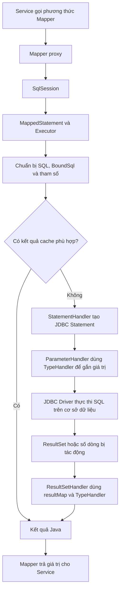

# Luồng dữ liệu từ phương thức Mapper tới cơ sở dữ liệu và kết quả Java

Khi gọi một phương thức Mapper, mã Java trông giống như đang gọi một đối tượng thông thường. Tuy nhiên, đối tượng Mapper thường là proxy do MyBatis tạo ra. Proxy chuyển lời gọi đó thành một thao tác trên `SqlSession`; MyBatis tìm câu lệnh đã đăng ký, chuẩn bị SQL và tham số cho JDBC, rồi chuyển dữ liệu trả về thành giá trị Java.

Nắm được luồng này giúp bạn trả lời những câu hỏi thực tế: vì sao tên phương thức phải khớp với câu lệnh XML, `#{...}` lấy giá trị từ đâu, khi nào `TypeHandler` hoạt động, vì sao một cột có dữ liệu nhưng thuộc tính Java lại `null`, và tại sao một lần gọi Mapper chưa chắc tạo ra một lần truy cập cơ sở dữ liệu.

## 1. Mô hình tổng thể

Trong bài này, luồng chính là một truy vấn `SELECT` dùng Mapper XML và JDBC `PreparedStatement`. Các biến thể như cache, batch và giao dịch do Spring quản lý sẽ được đặt vào đúng vị trí sau khi luồng cơ bản đã rõ.



Đây là sơ đồ trách nhiệm để học và chẩn đoán lỗi, không phải bản sao từng lời gọi nội bộ. Chẳng hạn, việc dựng `BoundSql` và khóa cache có thể diễn ra bên trong các lớp thực thi; với `INSERT`, `UPDATE`, `DELETE`, đầu ra thường là số dòng bị tác động nên không đi qua bước ánh xạ `ResultSet` như một truy vấn thông thường.

| Thành phần | Vai trò trong luồng |
|---|---|
| `SqlSessionFactory` | Được dựng từ cấu hình, dùng để tạo `SqlSession`. Thường được dùng chung trong ứng dụng. |
| Mapper proxy | Nhận lời gọi interface và nối phương thức Java với thao tác MyBatis tương ứng. |
| `SqlSession` | Cung cấp các thao tác đọc/ghi và quản lý phạm vi làm việc với MyBatis. |
| `MappedStatement` | Mô tả câu lệnh đã đăng ký: định danh, loại thao tác, nguồn SQL, ánh xạ kết quả và các tùy chọn. |
| `Executor` | Điều phối truy vấn/cập nhật, cache và việc thực thi thông qua JDBC. |
| `BoundSql` | Chứa SQL của lần gọi hiện tại, danh sách ánh xạ tham số và các tham số bổ sung nếu có. |
| `StatementHandler` | Chuẩn bị và thực thi JDBC statement thích hợp. |
| `ParameterHandler` | Lấy các giá trị đầu vào và gắn chúng vào statement bằng các `TypeHandler`. |
| `ResultSetHandler` | Đọc kết quả JDBC và tạo kết quả Java theo cấu hình ánh xạ. |
| `TypeHandler` | Chuyển giá trị giữa kiểu Java và cách đọc/ghi kiểu JDBC. |

MyBatis giúp điều phối các bước trên nhưng lập trình viên vẫn chủ động viết SQL. Cơ sở dữ liệu vẫn chịu trách nhiệm phân tích SQL, kiểm tra ràng buộc, chọn kế hoạch thực thi và xử lý dữ liệu.

## 2. Ví dụ xuyên suốt: tìm tài khoản theo đơn vị và số dư

Giả sử ứng dụng cần tìm các tài khoản đang hoạt động của một đơn vị, có số dư tối thiểu cho trước. Ví dụ dùng Java, MyBatis 3, JDBC Driver PostgreSQL và không dùng Spring để làm rõ vòng đời `SqlSession`.

Các lớp Java nằm trong package `vn.example.mybatis`. Hai tài nguyên cấu hình cần có trên classpath là `mybatis-config.xml` và `mybatis/AccountMapper.xml`. Cơ sở dữ liệu phải được tạo trước; mã SQL dưới đây được dùng để chuẩn bị bảng và dữ liệu mẫu trong cơ sở dữ liệu đó.

### 2.1. Bảng và dữ liệu mẫu

```sql
CREATE TABLE accounts (
    id BIGINT PRIMARY KEY,
    tenant_id BIGINT NOT NULL,
    display_name VARCHAR(100) NOT NULL,
    balance NUMERIC(15, 2) NOT NULL,
    status VARCHAR(20) NOT NULL
);

INSERT INTO accounts (id, tenant_id, display_name, balance, status)
VALUES
    (101, 7, 'Mai', 150.00, 'ACTIVE'),
    (102, 7, 'Lan', 95.00, 'ACTIVE'),
    (103, 8, 'Nam', 300.00, 'ACTIVE'),
    (104, 7, 'An', 500.00, 'INACTIVE'),
    (105, 7, 'Binh', 220.00, 'ACTIVE');
```

Điều kiện `tenant_id` là một phần của SQL nghiệp vụ trong ví dụ. MyBatis không tự suy ra điều kiện phân tách dữ liệu theo đơn vị chỉ từ một tham số Java.

### 2.2. Đối tượng kết quả Java

```java
package vn.example.mybatis;

import java.math.BigDecimal;

public class Account {
    private Long id;
    private String displayName;
    private BigDecimal balance;

    public Account() {
    }

    public Long getId() {
        return id;
    }

    public void setId(Long id) {
        this.id = id;
    }

    public String getDisplayName() {
        return displayName;
    }

    public void setDisplayName(String displayName) {
        this.displayName = displayName;
    }

    public BigDecimal getBalance() {
        return balance;
    }

    public void setBalance(BigDecimal balance) {
        this.balance = balance;
    }
}
```

Lớp này có constructor không tham số và các setter để ví dụ sử dụng cách ánh xạ JavaBean. MyBatis còn hỗ trợ ánh xạ qua constructor khi được khai báo phù hợp, nhưng không cần dùng đến trong luồng hiện tại.

### 2.3. Interface Mapper

```java
package vn.example.mybatis;

import java.math.BigDecimal;
import java.util.List;
import org.apache.ibatis.annotations.Param;

public interface AccountMapper {
    List<Account> findActiveAccounts(
        @Param("tenantId") Long tenantId,
        @Param("minBalance") BigDecimal minBalance
    );
}
```

`@Param` đặt tên rõ ràng cho từng đầu vào. Nhờ đó XML có thể dùng `#{tenantId}` và `#{minBalance}` mà không phụ thuộc vào tên tham số được giữ lại như thế nào khi biên dịch Java.

### 2.4. Mapper XML

Nội dung tài nguyên `mybatis/AccountMapper.xml`:

```xml
<?xml version="1.0" encoding="UTF-8" ?>
<!DOCTYPE mapper
  PUBLIC "-//mybatis.org//DTD Mapper 3.0//EN"
  "https://mybatis.org/dtd/mybatis-3-mapper.dtd">
<mapper namespace="vn.example.mybatis.AccountMapper">

    <resultMap id="accountResult"
               type="vn.example.mybatis.Account"
               autoMapping="false">
        <id property="id" column="id"/>
        <result property="displayName" column="display_name"/>
        <result property="balance" column="balance"/>
    </resultMap>

    <select id="findActiveAccounts" resultMap="accountResult">
        SELECT id, display_name, balance
        FROM accounts
        WHERE tenant_id = #{tenantId, jdbcType=BIGINT}
          AND status = 'ACTIVE'
          AND balance >= #{minBalance, jdbcType=DECIMAL}
        ORDER BY id
    </select>

</mapper>
```

`namespace` là tên đầy đủ của interface Mapper. `id` của câu lệnh là tên phương thức. Định danh hoàn chỉnh của câu lệnh là:

```text
vn.example.mybatis.AccountMapper.findActiveAccounts
```

`resultMap="accountResult"` tham chiếu phần mô tả cách tạo `Account`. Thiết lập `autoMapping="false"` giúp ví dụ chỉ dùng những ánh xạ đã khai báo rõ trong `resultMap`.

Đối với phương thức có nhiều đối số và được đặt tên bằng `@Param`, ví dụ này không khai báo `parameterType`: MyBatis nhận cấu trúc tham số của lần gọi và xác định các giá trị theo tên. `parameterType` cũng không phải là chỗ để liệt kê lần lượt các kiểu tham số của phương thức.

### 2.5. Cấu hình và lời gọi Java

Nội dung tài nguyên `mybatis-config.xml`:

```xml
<?xml version="1.0" encoding="UTF-8" ?>
<!DOCTYPE configuration
  PUBLIC "-//mybatis.org//DTD Config 3.0//EN"
  "https://mybatis.org/dtd/mybatis-3-config.dtd">
<configuration>
    <environments default="learning">
        <environment id="learning">
            <transactionManager type="JDBC"/>
            <dataSource type="POOLED">
                <property name="driver" value="org.postgresql.Driver"/>
                <property name="url" value="${db.url}"/>
                <property name="username" value="${db.username}"/>
                <property name="password" value="${db.password}"/>
            </dataSource>
        </environment>
    </environments>

    <mappers>
        <mapper resource="mybatis/AccountMapper.xml"/>
    </mappers>
</configuration>
```

Các biểu thức `${db.url}`, `${db.username}`, `${db.password}` ở đây là tham chiếu thuộc tính cấu hình khi dựng factory. Chúng khác ngữ cảnh với `${...}` dùng để chèn văn bản vào câu SQL, được giải thích ở phần sau.

Ứng dụng cần có thư viện MyBatis và JDBC Driver PostgreSQL trên classpath. Trước khi chạy, đặt `DB_URL`, `DB_USERNAME`, `DB_PASSWORD` theo cơ sở dữ liệu đã chuẩn bị; ví dụ `DB_URL` có dạng `jdbc:postgresql://localhost:5432/learning`.

```java
package vn.example.mybatis;

import java.io.Reader;
import java.math.BigDecimal;
import java.util.List;
import java.util.Objects;
import java.util.Properties;
import org.apache.ibatis.io.Resources;
import org.apache.ibatis.session.SqlSession;
import org.apache.ibatis.session.SqlSessionFactory;
import org.apache.ibatis.session.SqlSessionFactoryBuilder;

public class Demo {
    public static void main(String[] args) throws Exception {
        Properties properties = new Properties();
        properties.setProperty("db.url", requiredEnv("DB_URL"));
        properties.setProperty("db.username", requiredEnv("DB_USERNAME"));
        properties.setProperty("db.password", requiredEnv("DB_PASSWORD"));

        SqlSessionFactory factory;
        try (Reader reader =
                 Resources.getResourceAsReader("mybatis-config.xml")) {
            factory = new SqlSessionFactoryBuilder()
                .build(reader, "learning", properties);
        }

        try (SqlSession session = factory.openSession()) {
            AccountMapper mapper = session.getMapper(AccountMapper.class);

            List<Account> accounts = mapper.findActiveAccounts(
                7L, new BigDecimal("100.00")
            );

            for (Account account : accounts) {
                System.out.printf("%d | %s | %s%n",
                    account.getId(),
                    account.getDisplayName(),
                    account.getBalance().toPlainString());
            }
        }
    }

    private static String requiredEnv(String name) {
        return Objects.requireNonNull(
            System.getenv(name), "Missing environment variable: " + name
        );
    }
}
```

Với dữ liệu mẫu, kết quả là:

```text
101 | Mai | 150.00
105 | Binh | 220.00
```

Đây là luồng đọc dữ liệu nên ví dụ không cần `commit()` để lưu thay đổi. Bảng dữ liệu phải tồn tại trước khi chạy `Demo`; việc dựng `SqlSessionFactory` không tự tạo bảng và không tự chạy đoạn SQL chuẩn bị dữ liệu ở trên.

## 3. Trước lời gọi: cấu hình được biến thành các định nghĩa đã đăng ký

Khi dựng `SqlSessionFactory`, MyBatis đọc cấu hình và các Mapper đã đăng ký. Với ví dụ trên, nó biết được:

- Nguồn kết nối JDBC và cách quản lý giao dịch.
- Interface `vn.example.mybatis.AccountMapper`.
- Câu lệnh `vn.example.mybatis.AccountMapper.findActiveAccounts`.
- Nguồn SQL của câu lệnh và ánh xạ `accountResult`.

Các định nghĩa này được giữ trong `Configuration` mà factory sử dụng. Không phải mỗi lần gọi Mapper đều mở và phân tích lại toàn bộ file XML.

Cần phân biệt hai thời điểm:

| Thời điểm | Việc chính |
|---|---|
| Khởi tạo factory | Đọc tài nguyên, đăng ký Mapper, câu lệnh và cấu hình ánh xạ. |
| Mỗi lần gọi Mapper | Nhận giá trị tham số, chuẩn bị SQL cho lần gọi, kiểm tra cache khi phù hợp, thực thi và trả kết quả. |

Việc dựng factory thành công cũng chưa có nghĩa mọi truy vấn đã đúng với lược đồ dữ liệu thực tế. Một số vấn đề như tên cột không tồn tại chỉ lộ ra khi câu SQL được gửi đến cơ sở dữ liệu.

Trong ứng dụng thực tế, factory thường có vòng đời dài. Ngược lại, `SqlSession` thông thường nên có phạm vi ngắn, gắn với một đơn vị công việc và không được chia sẻ tùy tiện giữa các luồng.

## 4. Bước 1: Mapper proxy nhận lời gọi Java

Lời gọi:

```java
mapper.findActiveAccounts(7L, new BigDecimal("100.00"));
```

không yêu cầu bạn tự viết lớp `AccountMapperImpl`. Đối với phương thức Mapper thông thường như trong ví dụ, proxy của MyBatis tiếp nhận lời gọi và xác định:

1. Câu lệnh nào cần được thực thi.
2. Các đối số Java được trình bày dưới tên nào cho SQL.
3. Kết quả cần trả theo dạng một giá trị, danh sách hay hình thức khác.

Vì có hai `@Param`, đầu vào có thể được hình dung như cấu trúc tra cứu sau:

```text
{
  tenantId: Long(7),
  minBalance: BigDecimal("100.00")
}
```

Đây là mô hình để hiểu việc tra cứu tham số, không phải JSON được gửi đến cơ sở dữ liệu. Trong nội bộ MyBatis có thể có thêm các tên tham số quy ước; mã Mapper nên sử dụng tên rõ ràng đã chọn bằng `@Param`.

Nếu một phương thức chỉ nhận một JavaBean, các biểu thức như `#{tenantId}` thường tra cứu thuộc tính tương ứng trên đối tượng đó. Với tham số được đặt tên là `@Param("filter")`, đường dẫn có thể là `#{filter.tenantId}`. Tên trong SQL phải khớp với cấu trúc thực sự mà lần gọi cung cấp.

### Liên kết phương thức với câu lệnh

Trong ví dụ, MyBatis tìm câu lệnh theo tên interface và tên phương thức. Nếu XML chứa `id="findAccounts"` nhưng phương thức là `findActiveAccounts`, lời gọi không tự đoán ra câu SQL cần dùng.

Cũng không nên dùng nhiều phương thức cùng tên với các danh sách đối số khác nhau rồi kỳ vọng XML phân biệt được bằng chữ ký Java. Định danh statement không bao gồm toàn bộ chữ ký tham số. Hãy dùng những tên phương thức thể hiện rõ các truy vấn khác nhau.

## 5. Bước 2: SqlSession và Executor điều phối thao tác

Proxy chuyển lời gọi thành thao tác tương ứng trên `SqlSession`. Với kiểu trả về `List<Account>`, MyBatis sử dụng nhánh truy vấn nhiều kết quả, về mặt khái niệm tương đương:

```java
session.selectList(
    "vn.example.mybatis.AccountMapper.findActiveAccounts",
    parameters
);
```

`parameters` ở đây chỉ cấu trúc đầu vào đã được giải thích, không phải một biến bổ sung trong mã `Demo`.

`SqlSession` dùng `MappedStatement` để biết phải thực hiện truy vấn nào. `Executor` điều phối phần thực thi, bao gồm việc dùng kết nối, cache và các đối tượng xử lý statement.

Ở cấu hình thông thường, executor mặc định là `SIMPLE`. MyBatis còn có `REUSE` và `BATCH` để thay đổi cách sử dụng statement hoặc gom thao tác ghi. Việc chọn executor không thay đổi nguyên tắc rằng tên tham số và ánh xạ kết quả phải đúng.

### Khi nào kết nối được sử dụng?

`openSession()` tạo một phiên làm việc MyBatis. Trong cấu hình JDBC thông thường, kết nối có thể được lấy khi thật sự cần làm việc với JDBC, thay vì nhất thiết ngay tại thời điểm tạo session. Không nên suy luận rằng số lần tạo session luôn bằng số lần lập tức mở kết nối vật lý mới.

Trong ví dụ, `POOLED` quản lý pool kết nối. Đóng session sẽ giải phóng các tài nguyên mà session sở hữu và trả kết nối về pool theo cơ chế tương ứng, không nhất thiết đóng ngay kết nối vật lý tới PostgreSQL.

## 6. Bước 3: tạo SQL và BoundSql cho lần gọi hiện tại

Sau khi gắn với `MappedStatement`, đầu vào được dùng để chuẩn bị câu SQL thực thi. Với SQL động, các thành phần như `<if>`, `<choose>`, `<foreach>` có thể làm thay đổi nội dung hoặc số lượng tham số của từng lần gọi.

Ví dụ hiện tại không có nhánh SQL động. Với JDBC `PreparedStatement`, hai biểu thức `#{...}` trở thành hai vị trí tham số:

```sql
SELECT id, display_name, balance
FROM accounts
WHERE tenant_id = ?
  AND status = 'ACTIVE'
  AND balance >= ?
ORDER BY id
```

Có thể hình dung `BoundSql` của lần gọi chứa:

```text
SQL: câu SQL có hai dấu ? như trên
Parameter mappings:
  1 -> tenantId, jdbcType BIGINT
  2 -> minBalance, jdbcType DECIMAL
Parameter values: lấy từ đầu vào của lần gọi
```

Chính xác hơn, `BoundSql` lưu SQL và các ánh xạ tham số, cùng các tham số bổ sung khi cần; `ParameterHandler` sử dụng các thông tin đó và đối tượng tham số để lấy giá trị. Không nên hiểu `BoundSql` chỉ là một chuỗi SQL đã chèn hết mọi giá trị.

### SQL động có thể thay đổi cả số lượng dấu hỏi

Nếu sau này hỗ trợ bỏ qua bộ lọc số dư, phần điều kiện có thể được viết như sau:

```xml
<if test="minBalance != null">
    AND balance >= #{minBalance, jdbcType=DECIMAL}
</if>
```

Khi `minBalance` là `null`, nhánh đó bị bỏ khỏi SQL; vị trí tham số tương ứng cũng không còn. Nếu giữ nguyên câu SQL ban đầu rồi truyền `null`, điều kiện so sánh với `NULL` không tự biến thành “bỏ qua bộ lọc”. Muốn có ý nghĩa đó phải diễn đạt bằng SQL hoặc SQL động phù hợp.

### Phân biệt #{...} và ${...} trong SQL

| Cú pháp | Cách xử lý trong SQL | Ý nghĩa |
|---|---|---|
| `#{minBalance}` | Tạo vị trí tham số JDBC và gắn giá trị riêng. | Dùng cho dữ liệu đầu vào. |
| `${columnName}` | Chèn trực tiếp văn bản vào SQL. | Chỉ dùng khi thật sự cần thay đổi cấu trúc SQL và đã kiểm soát chặt giá trị. |

Không thể dùng `ORDER BY #{columnName}` để thay một tên cột theo cách thông thường: một giá trị tham số không trở thành định danh SQL. Nếu cần cho phép người dùng chọn cột sắp xếp, ánh xạ lựa chọn của họ sang danh sách tên cột được cho phép hoặc dùng các nhánh SQL cố định; không chèn trực tiếp văn bản đầu vào tùy ý.

## 7. Bước 4: gắn tham số Java vào JDBC Statement

Trong nhánh không lấy được kết quả từ cache, `StatementHandler` chuẩn bị JDBC statement. Với kiểu statement mặc định của truy vấn này, đó là một `PreparedStatement`.

Tiếp theo, `ParameterHandler` lần lượt lấy giá trị theo ánh xạ tham số. `TypeHandler` phù hợp thực hiện việc ghi giá trị vào JDBC:

| Vị trí JDBC | Tên tham số | Giá trị Java | Hành động tiêu biểu |
|---|---|---|---|
| 1 | `tenantId` | `Long` có giá trị `7` | `setLong(1, 7L)` |
| 2 | `minBalance` | `BigDecimal("100.00")` | `setBigDecimal(2, value)` |

Chỉ số tham số JDBC bắt đầu từ `1`. Thứ tự gắn giá trị tuân theo thứ tự vị trí trong SQL đã được dựng, không dựa trên thứ tự duyệt một `Map` tùy ý.

`jdbcType` trong XML mô tả kiểu JDBC khi gắn tham số. Nó đặc biệt hữu ích khi giá trị là `null`, vì JDBC có thể cần biết kiểu để gọi `setNull`. Kiểu Java, kiểu JDBC và `TypeHandler` phải thống nhất với ý nghĩa của cột dữ liệu; khai báo `jdbcType` không thay thế việc thiết kế kiểu dữ liệu đúng.

Với `PreparedStatement`, SQL và giá trị tham số được cung cấp qua các thao tác JDBC riêng. Các dòng log hiển thị “SQL đầy đủ có giá trị” có thể chỉ là cách công cụ trình bày để quan sát, không chứng minh rằng MyBatis đã nối chuỗi SQL theo cách đó. Việc driver hoặc máy chủ tái sử dụng kế hoạch thực thi còn phụ thuộc vào hệ quản trị và cấu hình; không nên suy ra chỉ từ sự có mặt của `PreparedStatement`.

## 8. Bước 5: JDBC Driver gửi thao tác tới cơ sở dữ liệu

Sau khi statement được chuẩn bị và gắn tham số, MyBatis gọi API thực thi JDBC. Driver xử lý giao tiếp theo giao thức của PostgreSQL. Cơ sở dữ liệu chạy truy vấn trong ngữ cảnh kết nối và giao dịch hiện tại.

Với dữ liệu mẫu, SQL lọc theo ba điều kiện:

- `tenant_id = 7` loại tài khoản `103` của đơn vị khác.
- `status = 'ACTIVE'` loại tài khoản `104` đã ngừng hoạt động.
- `balance >= 100.00` loại tài khoản `102` có số dư `95.00`.

Hai hàng còn lại là `101` và `105`, được sắp xếp theo `id` do có `ORDER BY id`. Nếu không khai báo `ORDER BY`, không nên dựa vào thứ tự hàng tình cờ mà cơ sở dữ liệu trả về.

Tới thời điểm này, kết quả JDBC chưa phải là `List<Account>`. Kết quả truy vấn là một `ResultSet` mà các thành phần ánh xạ của MyBatis sẽ đọc tiếp.

## 9. Bước 6: từ ResultSet thành đối tượng Java

Với ánh xạ phẳng trong ví dụ, `ResultSetHandler` đọc từng hàng và áp dụng `accountResult`:

| Nhãn cột JDBC | Thuộc tính Java | Giá trị ở hàng đầu |
|---|---|---|
| `id` | `id` | `Long(101)` |
| `display_name` | `displayName` | `"Mai"` |
| `balance` | `balance` | `BigDecimal("150.00")` |

MyBatis dùng `TypeHandler` để đọc các giá trị JDBC theo kiểu Java phù hợp, tạo đối tượng `Account` và gán các thuộc tính đã khai báo. Trong ánh xạ JavaBean ở đây, constructor không tham số và các setter cho phép hoàn thành bước đó.

Phần tử `<id>` đánh dấu thuộc tính định danh trong ánh xạ kết quả. Nó đặc biệt hữu ích khi ánh xạ quan hệ và gom nhiều hàng; nó không tự tạo ràng buộc khóa chính trong cơ sở dữ liệu.

### Vì sao cần resultMap?

Tên cột `display_name` khác tên thuộc tính `displayName`. `resultMap` nối chúng một cách tường minh, nên ví dụ không phụ thuộc vào thiết lập tự chuyển tên có dấu gạch dưới sang camel case.

Có những truy vấn đơn giản có thể dùng `resultType` cùng alias cột hoặc cấu hình ánh xạ tự động. Khi dùng `resultType` cho truy vấn trả danh sách, kiểu đó là kiểu phần tử kết quả, chẳng hạn `Account`, không phải `List`. Một câu lệnh thường chọn `resultMap` hoặc `resultType` để mô tả kết quả; không cần khai báo đồng thời cả hai cho cùng ví dụ này.

### Không phải mọi hàng đều tương ứng với một đối tượng gốc mới

Trong ví dụ phẳng, hai hàng tạo hai phần tử `Account`. Khi có join và `resultMap` lồng nhau với `association` hoặc `collection`, nhiều hàng có thể được gom thành một đối tượng gốc cùng các đối tượng con. Vì vậy, quy tắc “một hàng luôn bằng một đối tượng trả về” chỉ đúng trong những ánh xạ thích hợp, không phải nguyên tắc chung cho mọi truy vấn MyBatis.

### Hình dạng giá trị trả về cũng là một hợp đồng

| Kiểu phương thức Mapper | Hành vi điển hình của truy vấn |
|---|---|
| `List<Account>` | Trả danh sách; không có kết quả thì trả danh sách rỗng. |
| `Account` | Mong đợi tối đa một kết quả; không có thì trả `null`, nhiều hơn một thì lỗi. |
| Kiểu scalar như `Long` | Ánh xạ giá trị scalar phù hợp với câu SQL; phải xét khả năng `null`. |

Một phương thức trả `Account` không tự lấy hàng đầu tiên nếu truy vấn trả nhiều kết quả. Muốn lấy một hàng theo một quy tắc cụ thể, cần diễn đạt quy tắc đó trong SQL, bao gồm thứ tự khi cần.

Cũng cần phân biệt không có hàng với có một hàng chứa giá trị `NULL`. Chẳng hạn `COUNT(*)` thường trả một hàng có giá trị `0` khi không có bản ghi phù hợp; `SUM(...)` có thể trả một hàng với giá trị `NULL`. Chọn kiểu Java nguyên thủy cho một kết quả có thể `null` sẽ tạo thêm rủi ro khi trả kết quả.

## 10. Bước 7: trả kết quả và kết thúc phạm vi làm việc

Kết quả được đưa ngược qua `Executor`, `SqlSession` và Mapper proxy tới mã gọi. Ở ví dụ hiện tại, ứng dụng nhận một `List<Account>` đã được đọc đầy đủ và có thể duyệt danh sách sau khi truy vấn hoàn tất.

Đây là những đối tượng Java thông thường. Thay đổi `account.setBalance(...)` không tự tạo lệnh `UPDATE`. Muốn ghi thay đổi, cần có thao tác SQL ghi rõ ràng và một ranh giới giao dịch phù hợp.

Sau khi khối `try` của ví dụ kết thúc, `SqlSession` được đóng. Nguyên tắc đóng tài nguyên này không có nghĩa mọi kết quả đều được dùng tùy ý sau khi đóng session: `Cursor` đọc dần và các thuộc tính lazy loading, nếu được cấu hình, có yêu cầu vòng đời khác với danh sách đã đọc đầy đủ trong ví dụ.

### Nếu thao tác là INSERT, UPDATE hoặc DELETE

Luồng đầu vào vẫn gồm tra cứu statement, chuẩn bị SQL, gắn tham số và thực thi JDBC. Đầu ra thường là số dòng bị tác động, rồi được chuyển thành kiểu trả về thích hợp của phương thức Mapper.

Với thao tác ghi thực thi thông thường, một phương thức trả `int` thường dùng để biểu diễn số dòng bị tác động. Con số này không phải giá trị khóa chính vừa sinh. Khi cấu hình generated keys thích hợp, khóa có thể được ghi vào thuộc tính được chỉ định bằng `keyProperty` trên đối tượng tham số.

Trong chế độ `BATCH`, thao tác ghi có thể được xếp hàng và chỉ thực thi khi flush; không nên dùng giá trị trả về tức thời như số dòng thực tế cuối cùng. Kết quả batch và thời điểm lỗi phải được xem cùng lúc flush hoặc commit.

## 11. Giao dịch nằm ở đâu trong luồng?

Giao dịch gắn với việc thực thi qua kết nối JDBC hoặc cơ chế quản lý giao dịch mà ứng dụng cấu hình. Một lần gọi Mapper không đồng nghĩa với một giao dịch nghiệp vụ hoàn chỉnh.

Ví dụ, chuyển số dư giữa hai tài khoản cần hai câu lệnh cập nhật cùng thuộc một giao dịch. Nếu mỗi câu lệnh dùng một session tự quản lý độc lập và được commit riêng, thao tác đầu có thể được lưu dù thao tác sau thất bại.

Với `SqlSession` tự quản lý và `transactionManager type="JDBC"`:

- `factory.openSession()` mặc định không bật auto-commit.
- Nhiều lời gọi Mapper trong cùng session có thể cùng nằm trong một giao dịch JDBC.
- Sau các thao tác ghi thành công, gọi `session.commit()` ở ranh giới công việc phù hợp.
- Khi công việc ghi thất bại, thực hiện rollback và đóng session đúng phạm vi.
- Không coi việc đóng session là cách thay thế cho commit một công việc thành công.

Khi tích hợp MyBatis với Spring đúng cách, giao dịch thường do Spring quản lý, chẳng hạn qua `@Transactional`. Mapper được ứng dụng sử dụng thông qua hạ tầng tích hợp; `SqlSessionTemplate` quản lý việc dùng session phù hợp với ngữ cảnh giao dịch. Khi đó, không mang nguyên cách tự gọi `commit()`, `rollback()` và `close()` của session trong ví dụ thuần MyBatis vào Mapper do Spring quản lý.

Lời gọi Mapper trả về thành công chỉ cho biết thao tác tương ứng đã hoàn thành theo cơ chế đang dùng. Với giao dịch chưa commit hoặc với batch chưa flush, không thể kết luận toàn bộ thay đổi đã được lưu bền vững chỉ từ việc phương thức đã trả về.

## 12. Cache có thể rút ngắn đường đi tới JDBC

Cần thêm một nhánh vào mô hình: một lời gọi truy vấn hợp lệ có thể trả kết quả cache mà không gửi SQL mới tới cơ sở dữ liệu.

### Cache cục bộ của SqlSession

Theo thiết lập mặc định thông thường, cache cục bộ có phạm vi session. Hai truy vấn phù hợp về định danh statement, SQL, giá trị tham số và các thành phần liên quan của khóa cache có thể dùng lại kết quả trong cùng session khi chưa bị làm mất hiệu lực.

Do đó, gọi cùng phương thức hai lần không bảo đảm có hai lượt truy vấn JDBC. Cache không chỉ dựa trên tên phương thức: thay `tenantId` hoặc `minBalance` có thể tạo khóa khác. Phạm vi này cũng có thể được cấu hình thành `STATEMENT` qua `localCacheScope`.

Kết quả trong cache cục bộ có thể được dùng lại dưới dạng các tham chiếu đối tượng. Không nên sửa các đối tượng kết quả tùy tiện rồi kỳ vọng lần truy vấn tiếp theo trong cùng session chắc chắn đọc lại trạng thái từ cơ sở dữ liệu.

### Cache cấp hai theo namespace

Cache cấp hai cần được khai báo hoặc tham chiếu cho namespace tương ứng và chịu các điều kiện cấu hình, giao dịch, flush và vô hiệu hóa cache. Nó không tự xuất hiện ở mọi Mapper chỉ vì ứng dụng dùng MyBatis. Trong ví dụ này không có `<cache/>` hoặc `<cache-ref>`, nên không cấu hình cache cấp hai cho Mapper.

Khi chẩn đoán dữ liệu cũ, cần kiểm tra cả phạm vi cache lẫn ranh giới giao dịch và cách dữ liệu bị cập nhật. Không nên kết luận ngay rằng cơ sở dữ liệu chưa thực thi chỉ vì ứng dụng trả lại cùng một giá trị.

## 13. Đặt điểm quan sát đúng nơi khi có lỗi

Bảng dưới đây giúp nối triệu chứng với giai đoạn cần kiểm tra. Đây là cách định hướng điều tra; vẫn cần đọc toàn bộ chuỗi nguyên nhân của ngoại lệ.

| Triệu chứng | Giai đoạn liên quan | Kiểm tra đầu tiên |
|---|---|---|
| Không lấy được Mapper | Đăng ký và khởi tạo | Interface và tài nguyên Mapper đã được đăng ký đúng chưa? |
| `Invalid bound statement` | Nối phương thức với statement | `namespace`, `id`, đường dẫn tài nguyên và cấu hình nạp Mapper. |
| Không tìm thấy tên tham số | Xử lý đầu vào | Tên trong `@Param`, đường dẫn thuộc tính và tên trong `#{...}` có khớp không? |
| SQL sai cú pháp hoặc thiếu bảng/cột | JDBC và cơ sở dữ liệu | SQL thực tế sau xử lý động, schema, tên đối tượng và dialect. |
| Không thể gắn giá trị hoặc lỗi chuyển kiểu | Gắn tham số | Giá trị thực tế, kiểu Java, `jdbcType`, `TypeHandler` và kiểu cột. |
| `displayName` bị `null` dù có dữ liệu | Ánh xạ kết quả | Nhãn cột trả về, `resultMap`, tên thuộc tính và cách tạo đối tượng. |
| Phương thức trả một đối tượng nhưng truy vấn có nhiều kết quả | Hợp đồng kết quả | Điều kiện lọc, tính duy nhất và kiểu trả về Mapper. |
| Gọi hai lần nhưng chỉ thấy một lần truy vấn SQL | Nhánh cache | Có dùng cùng session và cùng đầu vào không; cache có còn hiệu lực không? |
| Cập nhật xong nhưng session khác chưa thấy | Giao dịch hoặc batch | Đã flush/commit đúng lúc chưa; mức cô lập và cache ảnh hưởng thế nào? |
| Một truy vấn xuất hiện thêm nhiều truy vấn phụ | Ánh xạ quan hệ | Có nested select hoặc lazy loading khiến dữ liệu liên quan được tải thêm không? |

Khi quan sát log, hãy tách ít nhất ba thông tin: định danh statement, SQL có placeholder và giá trị tham số theo đúng thứ tự. Sau đó mới đối chiếu số hàng và dữ liệu được ánh xạ. Không ghép mọi vấn đề thành một nhận định chung như “Mapper không hoạt động”. Chỉ bật hoặc chia sẻ giá trị tham số trong phạm vi phù hợp với dữ liệu của ứng dụng.

## 14. Tự kiểm tra khả năng đọc luồng dữ liệu

Hãy dùng chính ví dụ trong bài để trả lời:

1. Tại sao XML dùng `#{tenantId}` thay vì phụ thuộc vào tên đối số được compiler Java giữ lại?
2. Nếu `namespace` đúng nhưng `id` đổi thành `findAccounts`, lỗi xảy ra trước hay sau khi cơ sở dữ liệu thực thi SQL?
3. Ai chuyển `BigDecimal("100.00")` thành giá trị JDBC của vị trí tham số thứ hai?
4. Tại sao cột `display_name` được đưa vào thuộc tính `displayName` dù ví dụ không bật ánh xạ camel case tự động?
5. Nếu cùng session gọi lại truy vấn với cùng đầu vào, vì sao không nên mặc định sẽ có thêm một lần gửi SQL?
6. Nếu sửa số dư trên một `Account` trong danh sách, điều gì còn thiếu để cập nhật bảng?

Gợi ý đối chiếu:

1. `@Param("tenantId")` công bố tên dùng khi tra cứu giá trị đầu vào.
2. Lỗi nối phương thức với statement xảy ra trước bước gửi SQL của lời gọi đó.
3. `ParameterHandler` chọn và dùng `TypeHandler` phù hợp để gắn giá trị vào JDBC statement.
4. `resultMap` đã khai báo rõ `column="display_name"` và `property="displayName"`.
5. Cache cục bộ có thể trả lại kết quả khi khóa truy vấn phù hợp và cache còn hiệu lực.
6. Cần câu lệnh ghi được gọi rõ ràng và quản lý giao dịch phù hợp; đối tượng Java không tự theo dõi thay đổi để phát SQL.

Khi đọc một Mapper mới, hãy lần theo thứ tự: phương thức và đầu vào → định danh statement → SQL cùng các vị trí tham số → JDBC và giao dịch → các cột kết quả → ánh xạ Java → hình dạng giá trị trả về. Chuỗi này giúp xác định trách nhiệm của từng thành phần, đồng thời giữ được khả năng chủ động viết và tối ưu SQL mà MyBatis hướng tới.