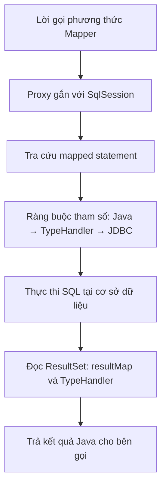

# Các thuật ngữ: Mapper, statement, SqlSession, resultMap và TypeHandler

Khi dùng MyBatis, lập trình viên chủ động viết SQL, còn MyBatis kết nối câu SQL đó với lời gọi Java và xử lý việc đưa dữ liệu qua JDBC. Để đọc được một cấu hình hay lần theo một truy vấn, cần phân biệt năm thuật ngữ: **Mapper**, **statement**, **SqlSession**, **resultMap** và **TypeHandler**.

Bài học thuộc chương **Định hướng** của module **MYBATIS**. Mục tiêu là hiểu vai trò và mối liên hệ giữa các thành phần trước khi đi sâu vào SQL động, giao dịch, cache, batch hoặc tích hợp Spring Boot. Ví dụ xuyên suốt là đọc một đơn hàng rồi cập nhật trạng thái của đơn hàng đó.

## 1. Bức tranh tổng thể

Giả sử mã nghiệp vụ gọi:

```java
PurchaseOrder order = mapper.findById(1001L);
```

Đằng sau một dòng Java này là nhiều trách nhiệm khác nhau:

| Thuật ngữ | Vai trò chính | Ví dụ trong bài |
| --- | --- | --- |
| Mapper | Cung cấp hợp đồng Java để gọi các thao tác đã ánh xạ | Interface `OrderMapper` với phương thức `findById` |
| Statement | Định nghĩa một thao tác SQL mà MyBatis nhận diện và thực thi | `com.example.mybatis.OrderMapper.findById` |
| SqlSession | Cung cấp ngữ cảnh thực thi, truy cập Mapper và điều khiển giao dịch trong cách dùng MyBatis thuần | Phiên được mở bằng `factory.openSession(false)` |
| resultMap | Mô tả cách ghép các cột của kết quả truy vấn vào đối tượng Java | `customer_name` → `customerName` |
| TypeHandler | Đọc hoặc ghi một giá trị giữa kiểu Java và JDBC | Mã `P` trong cột `status` ↔ `OrderStatus.PAID` |

Một luồng truy vấn thông thường có thể hình dung như sau:



Sơ đồ mô tả trường hợp đi tới cơ sở dữ liệu. Khi một kết quả được phục vụ từ cache hợp lệ, phần truy cập JDBC có thể không diễn ra. Điều đó không làm thay đổi trách nhiệm của Mapper, statement hay ánh xạ kết quả.

Có hai hướng ánh xạ cần nhớ:

- **Đầu vào:** đối số Java → tham số SQL → giá trị JDBC.
- **Đầu ra:** giá trị JDBC trong từng cột → thuộc tính hoặc tham số khởi tạo của đối tượng Java.

`resultMap` tập trung vào đầu ra. `TypeHandler` có thể tham gia ở cả hai hướng.

## 2. Mapper: hợp đồng Java cho các thao tác dữ liệu

### 2.1. Mapper interface là gì?

Trong cách dùng thông dụng, Mapper là một interface Java, mỗi phương thức đại diện cho một thao tác truy cập dữ liệu:

```java
package com.example.mybatis;

import org.apache.ibatis.annotations.Param;

public interface OrderMapper {
    PurchaseOrder findById(@Param("id") long id);

    int updateStatus(
        @Param("id") long id,
        @Param("status") OrderStatus status
    );
}
```

Lập trình viên thường không viết một lớp `OrderMapperImpl` bằng tay. MyBatis tạo proxy thực thi interface và chuyển lời gọi phương thức sang thao tác đã cấu hình.

Kiểu trả về diễn đạt kết quả mà bên gọi nhận được:

- `PurchaseOrder` phù hợp với truy vấn mong đợi tối đa một đơn hàng. Không có dòng thì trả về `null`; có nhiều hơn một dòng thì MyBatis báo lỗi vì kết quả không phù hợp với truy vấn một đối tượng.
- `List<PurchaseOrder>` phù hợp với truy vấn nhiều đơn hàng; mỗi phần tử là một đối tượng kết quả được ánh xạ.
- `int` trong `updateStatus` biểu diễn số dòng do thao tác cập nhật báo về, không phải mã định danh đơn hàng.

Mapper giúp mã nghiệp vụ gọi một phương thức có tên và kiểu dữ liệu rõ ràng. SQL vẫn cần được viết và ánh xạ ở XML hoặc annotation.

### 2.2. Liên kết phương thức với SQL bằng cách nào?

Với Mapper XML, quy ước quan trọng là:

```text
namespace của XML = tên đầy đủ của Mapper interface
id của statement  = tên phương thức
```

Ví dụ, với `orderResultMap` được định nghĩa trong cùng Mapper XML:

```xml
<mapper namespace="com.example.mybatis.OrderMapper">
    <select id="findById" resultMap="orderResultMap">
        SELECT id, customer_name, total_amount, status
        FROM purchase_order
        WHERE id = #{id}
    </select>
</mapper>
```

Định danh đầy đủ của statement là:

```text
com.example.mybatis.OrderMapper.findById
```

Interface và XML phải được đăng ký vào cấu hình MyBatis theo cách phù hợp. Chỉ tạo interface trong mã nguồn chưa đủ để MyBatis biết SQL cần chạy.

Không nên nạp chồng phương thức trong cùng Mapper để đại diện cho các SQL khác nhau chỉ bằng danh sách tham số. Định danh statement dựa trên `namespace` và tên phương thức, không bao gồm chữ ký tham số Java. Nên dùng tên rõ nghĩa như `findById` và `findByCustomerName`.

### 2.3. Mapper XML khác Mapper interface ra sao?

Cụm từ “Mapper” đôi khi được dùng cho cả hai, nhưng chúng chứa thông tin khác nhau:

| Thành phần | Chứa gì? |
| --- | --- |
| Mapper interface | Tên phương thức, tham số, kiểu trả về và có thể có annotation SQL |
| Mapper XML | Namespace, các statement, resultMap, đoạn SQL dùng lại và các cấu hình ánh xạ liên quan |

Có thể dùng annotation như `@Select` thay cho XML đối với một số truy vấn. Hai cách này đều tạo ra các mapped statement trong cấu hình MyBatis. Bài này dùng XML để tách rõ SQL, ánh xạ đối tượng và chuyển đổi giá trị.

## 3. Statement: một thao tác SQL có định danh và cấu hình

### 3.1. Không chỉ là chuỗi SQL

Trong ngữ cảnh MyBatis, “statement” thường chỉ một **mapped statement**: định nghĩa đã được đăng ký, gồm SQL cùng thông tin cần thiết để thực thi và xử lý kết quả.

Các phần tử XML thường gặp là:

| Phần tử | Mục đích |
| --- | --- |
| `<select>` | Đọc dữ liệu và ánh xạ kết quả |
| `<insert>` | Thêm dữ liệu |
| `<update>` | Cập nhật dữ liệu |
| `<delete>` | Xóa dữ liệu |

MyBatis biểu diễn định nghĩa này bằng đối tượng nội bộ `MappedStatement`. Nó gắn với các thông tin như định danh, loại thao tác, nguồn SQL, ánh xạ kết quả và lựa chọn thực thi. Với SQL động, SQL cuối cùng và danh sách tham số ràng buộc được xác định theo đầu vào của lần gọi.

Ví dụ:

```xml
<update id="updateStatus">
    UPDATE purchase_order
    SET status = #{status}
    WHERE id = #{id}
</update>
```

Đây là phần khung của lệnh cập nhật. Khi `status` là enum lưu bằng mã riêng, cần bổ sung TypeHandler như ví dụ đầy đủ ở phần 7. SQL trả lời câu hỏi “cập nhật dữ liệu thế nào”; định danh statement trả lời “MyBatis tìm đúng thao tác này bằng tên nào”.

### 3.2. Phân biệt với Statement và PreparedStatement của JDBC

Hai tầng có tên gần giống nhau:

| Tầng | Ý nghĩa |
| --- | --- |
| MyBatis mapped statement | Định nghĩa thao tác đã cấu hình và đăng ký theo định danh |
| JDBC `Statement` hoặc `PreparedStatement` | Đối tượng JDBC được sử dụng để gửi lệnh đến cơ sở dữ liệu |

Không nên hiểu một mapped statement là một đối tượng `PreparedStatement` tồn tại cố định cho toàn bộ ứng dụng. Cách tạo, sử dụng lại hay gom lệnh JDBC còn phụ thuộc vào phiên thực thi, executor và cấu hình.

Theo mặc định, statement MyBatis sử dụng kiểu `PREPARED`. Với kiểu này, tham số viết bằng `#{...}` được chuyển thành placeholder JDBC và được gán giá trị riêng:

```xml
WHERE id = #{id}
```

Về mặt SQL gửi để chuẩn bị, điều này tương ứng với:

```sql
WHERE id = ?
```

Giá trị `1001L` được ràng buộc vào vị trí tham số, không được ghép trực tiếp vào chuỗi SQL.

Ngược lại, `${...}` thay thế văn bản vào SQL. Không dùng `${...}` để nhận các giá trị tự do từ người dùng như tên, email hoặc mã đơn hàng. Với trường hợp cần thay tên cột hay hướng sắp xếp, phải giới hạn lựa chọn bằng danh sách giá trị được phép; placeholder JDBC không đại diện được cho tên bảng hoặc tên cột.

### 3.3. Tham số của Mapper và tham số của SQL

`@Param` đặt tên cho đối số mà SQL có thể tham chiếu:

```java
int updateStatus(
    @Param("id") long id,
    @Param("status") OrderStatus status
);
```

SQL dùng `#{id}` và `#{status}` tương ứng. Cách đặt tên này làm rõ hợp đồng ngay cả khi không dựa vào tên tham số được giữ lại bởi trình biên dịch Java.

MyBatis có thể suy ra kiểu tham số từ đối tượng Java trong nhiều trường hợp, nên `parameterType` không bắt buộc phải xuất hiện trên mọi statement. Với nhiều đối số có `@Param`, các tên đó được MyBatis cung cấp cho quá trình phân giải tham số.

## 4. SqlSession: ngữ cảnh để gọi Mapper và thực thi SQL

### 4.1. Vai trò và vòng đời

`SqlSession` là API trung tâm của MyBatis thuần để:

- Lấy Mapper proxy bằng `getMapper(...)`.
- Gọi trực tiếp thao tác như `selectOne(...)`, `selectList(...)` hoặc `update(...)` bằng định danh statement.
- Quản lý giao dịch với `commit()` và `rollback()` khi dùng mô hình giao dịch do ứng dụng điều khiển.
- Giữ ngữ cảnh thực thi và cache cục bộ theo cấu hình của phiên.
- Giải phóng tài nguyên bằng `close()`.

Các đối tượng liên quan có vòng đời khác nhau:

| Đối tượng | Cách dùng thông thường trong MyBatis thuần |
| --- | --- |
| `SqlSessionFactoryBuilder` | Dùng khi xây dựng factory |
| `SqlSessionFactory` | Tạo khi khởi động, dùng lại trong phạm vi ứng dụng hoặc cấu hình tương ứng |
| `SqlSession` | Mở cho một đơn vị công việc rồi đóng; không chia sẻ đồng thời giữa các luồng |
| Mapper lấy từ một `SqlSession` thuần | Sử dụng trong phạm vi phiên đang mở |

Không giữ một `SqlSession` dùng chung dưới dạng biến `static` để nhiều yêu cầu đồng thời cùng gọi. Phiên MyBatis thuần không an toàn để chia sẻ giữa các luồng.

### 4.2. Truy vấn trong một phiên

Giả sử ứng dụng đã có `SqlSessionFactory`:

```java
try (SqlSession session = factory.openSession()) {
    OrderMapper mapper = session.getMapper(OrderMapper.class);
    PurchaseOrder order = mapper.findById(1001L);
}
```

`try-with-resources` gọi `close()` khi ra khỏi khối. Đối tượng kết quả có thể được giữ và sử dụng sau khi phiên đóng nếu dữ liệu cần dùng đã được tải đầy đủ. Nếu cấu hình tải lười, việc truy cập thuộc tính chưa tải có thêm yêu cầu về vòng đời và cách truy vấn; ví dụ trong bài không sử dụng tải lười.

Cũng có thể gọi trực tiếp bằng định danh:

```java
PurchaseOrder order = session.selectOne(
    "com.example.mybatis.OrderMapper.findById",
    java.util.Map.of("id", 1001L)
);
```

Cách gọi trực tiếp trên dùng `Map.of`, cần Java 9 trở lên. Mapper interface thường thuận tiện hơn vì trình biên dịch kiểm tra tên phương thức và kiểu đối số tại nơi gọi. Cả hai cách vẫn phải tìm được statement đã đăng ký.

### 4.3. Phiên không đồng nghĩa với một kết nối mở thường trực

`SqlSession` làm việc thông qua executor và cơ chế giao dịch để truy cập JDBC connection. Không nên suy ra rằng mỗi lời gọi `openSession()` lập tức tạo một kết nối vật lý mới. Connection có thể được lấy khi cần và có thể đến từ pool.

Với data source có pool, việc đóng phiên thường dẫn tới đóng logic hoặc trả connection về pool theo cơ chế quản lý tài nguyên tương ứng. Phiên MyBatis cũng không phải HTTP session và không phải một vùng lưu dữ liệu người dùng qua nhiều yêu cầu.

### 4.4. Giao dịch và Spring

Trong MyBatis thuần, `openSession()` mặc định không bật auto-commit. Có thể viết rõ `openSession(false)` để thể hiện chủ ý điều khiển giao dịch. Các thay đổi cần được `commit()` để hoàn tất theo mô hình này; khi xử lý thất bại, dùng `rollback()` và đóng phiên.

Trong môi trường Spring dùng MyBatis-Spring, Mapper được inject thường đi qua `SqlSessionTemplate`, còn giao dịch do Spring điều phối. Mapper đó có thể được sử dụng trong các bean theo mô hình tích hợp đã cấu hình. Không áp dụng máy móc việc tự mở, tự commit và tự đóng phiên của ví dụ MyBatis thuần vào một luồng đang được Spring quản lý giao dịch.

## 5. resultMap: bản thiết kế để dựng đối tượng từ kết quả

### 5.1. Cột SQL và thuộc tính Java là hai hệ tên

Một dòng dữ liệu có thể gồm:

```text
id   | customer_name | total_amount | status
1001 | Nguyễn An     | 125000.00    | N
```

Trong Java, ta muốn có:

```text
PurchaseOrder
  id           = 1001
  customerName = "Nguyễn An"
  totalAmount  = BigDecimal("125000.00")
  status       = OrderStatus.NEW
```

`resultMap` mô tả cách liên kết cột với thuộc tính hoặc tham số khởi tạo của đối tượng. Ví dụ khởi đầu với ba thuộc tính thông thường:

```xml
<resultMap id="orderResultMap"
           type="com.example.mybatis.PurchaseOrder"
           autoMapping="false">
    <id property="id" column="id"/>
    <result property="customerName" column="customer_name"/>
    <result property="totalAmount" column="total_amount"/>
</resultMap>
```

Statement sử dụng bản ánh xạ đó qua thuộc tính `resultMap`:

```xml
<select id="findById" resultMap="orderResultMap">
    SELECT id, customer_name, total_amount
    FROM purchase_order
    WHERE id = #{id}
</select>
```

Trong ví dụ:

- `id="orderResultMap"` là tên của bản ánh xạ trong namespace hiện tại.
- `type` là kiểu đối tượng đầu ra.
- `property` là tên thuộc tính Java.
- `column` là tên hoặc nhãn cột JDBC trả về.
- `autoMapping="false"` làm cho ví dụ chỉ sử dụng các liên kết đã khai báo.

Phần tử `<id>` đánh dấu thuộc tính định danh, đặc biệt hữu ích khi MyBatis ghép kết quả có quan hệ lồng nhau. Nó không tạo khóa chính trong cơ sở dữ liệu và không làm phát sinh giá trị ID khi insert.

### 5.2. resultType và resultMap

Đối với kết quả đơn giản, có thể dùng `resultType`:

```xml
<select id="countAll" resultType="long">
    SELECT COUNT(*) FROM purchase_order
</select>
```

Với POJO đơn giản, `resultType` có thể kết hợp ánh xạ tự động dựa trên tên thuộc tính và nhãn cột. Có thể đặt alias trong SQL:

```sql
SELECT customer_name AS "customerName"
FROM purchase_order
```

Hoặc bật cấu hình `mapUnderscoreToCamelCase` khi muốn ánh xạ tên như `customer_name` sang `customerName`. Không nên mặc định rằng quy tắc này luôn được bật; giá trị mặc định của thiết lập đó là `false`.

`resultMap` phù hợp khi muốn khai báo rõ tên cột, ánh xạ constructor, quan hệ đối tượng hoặc TypeHandler cho một thuộc tính. Một `<select>` dùng một trong hai thuộc tính `resultType` hoặc `resultMap`; không khai báo đồng thời cả hai.

Nếu phương thức Mapper trả về `List<PurchaseOrder>`, kiểu phần tử được ánh xạ vẫn là `PurchaseOrder`. Không đặt `resultType="java.util.List"` để thể hiện danh sách đơn hàng.

## 6. TypeHandler: chuyển đổi từng giá trị qua biên JDBC

### 6.1. Phân biệt ánh xạ cấu trúc và ánh xạ giá trị

Hai câu hỏi khác nhau xuất hiện khi đọc cột `status`:

1. Cột `status` cần gán vào thuộc tính Java nào? Đây là trách nhiệm của ánh xạ kết quả.
2. Giá trị chuỗi `P` tương ứng với đối tượng Java nào? Đây là phần TypeHandler xử lý.

Với tham số cập nhật, chiều chuyển đổi đảo lại:

```text
OrderStatus.PAID → "P" → PreparedStatement
```

Với kết quả truy vấn:

```text
ResultSet trả "P" → OrderStatus.PAID → thuộc tính status
```

MyBatis có sẵn nhiều TypeHandler cho các kiểu thông dụng như `String`, `Long` và `BigDecimal`. Chỉ cần tự viết khi quy ước lưu trữ và kiểu Java đòi hỏi chuyển đổi riêng.

TypeHandler thông thường không có trách nhiệm dựng toàn bộ đồ thị đơn hàng và chi tiết đơn hàng. Việc ghép nhiều cột, nhiều dòng hay các quan hệ thuộc về result mapping và cách tổ chức truy vấn.

### 6.2. Chọn handler và xử lý null

MyBatis chọn handler dựa trên kiểu Java, thông tin JDBC cùng cấu hình đã đăng ký hoặc handler được chỉ định tại vị trí ánh xạ. Có thể:

- Đăng ký handler cho một kiểu Java để dùng trong các ánh xạ phù hợp.
- Gắn `typeHandler` trực tiếp vào một `#{...}` hoặc một phần tử kết quả để lựa chọn rõ tại vị trí đó.

Ví dụ trong bài dùng cách chỉ định trực tiếp. Điều này giúp nhìn thấy nơi handler tham gia mà chưa cần cấu hình một đăng ký dùng chung.

Với giá trị đầu vào `null`, JDBC có thể cần biết kiểu SQL khi gán null. Khai báo `jdbcType=VARCHAR` cho tham số trạng thái giúp nêu rõ kiểu cột, đặc biệt khi tham số có thể là `null`. Thuộc tính `jdbcType` không tự biến một enum thành mã chuỗi; phần chuyển đổi đó vẫn cần handler thích hợp.

`BaseTypeHandler` xử lý việc đặt SQL NULL cho tham số null theo thông tin JDBC được cung cấp. Phương thức `setNonNullParameter` của lớp con chỉ xử lý giá trị khác null. Ở chiều đọc, lớp con phải trả về giá trị phù hợp khi cột là SQL NULL. Khi đọc bằng getter kiểu nguyên thủy của JDBC, còn phải chú ý `wasNull()` để không nhầm SQL NULL với `0` hoặc `false`.

## 7. Ví dụ liên kết đầy đủ năm khái niệm

Ví dụ sau dùng MyBatis thuần và PostgreSQL. Ứng dụng cần thư viện MyBatis cùng PostgreSQL JDBC driver trong classpath. Các tên tệp dưới đây là vị trí minh họa trong một ứng dụng, không phải những tệp cần sửa để đọc bài học.

### 7.1. Bảng và dữ liệu mẫu

```sql
CREATE TABLE purchase_order (
    id BIGINT PRIMARY KEY,
    customer_name VARCHAR(100) NOT NULL,
    total_amount NUMERIC(12, 2) NOT NULL,
    status VARCHAR(1) NOT NULL
);

INSERT INTO purchase_order (id, customer_name, total_amount, status)
VALUES (1001, 'Nguyễn An', 125000.00, 'N');
```

Quy ước trạng thái trong ví dụ là `N` cho đơn mới, `P` cho đã thanh toán và `C` cho đã hủy. Quy ước này do ứng dụng quyết định, không phải quy tắc có sẵn của MyBatis.

### 7.2. Kiểu Java của trạng thái

Tệp `com/example/mybatis/OrderStatus.java`:

```java
package com.example.mybatis;

public enum OrderStatus {
    NEW("N"),
    PAID("P"),
    CANCELLED("C");

    private final String code;

    OrderStatus(String code) {
        this.code = code;
    }

    public String getCode() {
        return code;
    }

    public static OrderStatus fromCode(String code) {
        for (OrderStatus value : values()) {
            if (value.code.equals(code)) {
                return value;
            }
        }
        throw new IllegalArgumentException("Unknown order status: " + code);
    }
}
```

Handler enum mặc định của MyBatis lưu tên enum, chẳng hạn `PAID`. Nó không tự biết rằng ứng dụng muốn lưu `P`. Vì vậy, ví dụ cần một handler riêng cho quy ước mã này.

### 7.3. Đối tượng nhận kết quả

Tệp `com/example/mybatis/PurchaseOrder.java`:

```java
package com.example.mybatis;

import java.math.BigDecimal;

public class PurchaseOrder {
    private Long id;
    private String customerName;
    private BigDecimal totalAmount;
    private OrderStatus status;

    public PurchaseOrder() {
    }

    public Long getId() {
        return id;
    }

    public void setId(Long id) {
        this.id = id;
    }

    public String getCustomerName() {
        return customerName;
    }

    public void setCustomerName(String customerName) {
        this.customerName = customerName;
    }

    public BigDecimal getTotalAmount() {
        return totalAmount;
    }

    public void setTotalAmount(BigDecimal totalAmount) {
        this.totalAmount = totalAmount;
    }

    public OrderStatus getStatus() {
        return status;
    }

    public void setStatus(OrderStatus status) {
        this.status = status;
    }
}
```

POJO này sử dụng constructor không tham số và các setter rõ ràng. Những kiểu dữ liệu bất biến cũng có thể được ánh xạ, nhưng cần xem xét ánh xạ constructor tương ứng.

### 7.4. Handler chuyển đổi mã trạng thái

Tệp `com/example/mybatis/OrderStatusTypeHandler.java`:

```java
package com.example.mybatis;

import java.sql.CallableStatement;
import java.sql.PreparedStatement;
import java.sql.ResultSet;
import java.sql.SQLException;

import org.apache.ibatis.type.BaseTypeHandler;
import org.apache.ibatis.type.JdbcType;

public class OrderStatusTypeHandler extends BaseTypeHandler<OrderStatus> {
    @Override
    public void setNonNullParameter(
            PreparedStatement statement,
            int index,
            OrderStatus parameter,
            JdbcType jdbcType) throws SQLException {
        statement.setString(index, parameter.getCode());
    }

    @Override
    public OrderStatus getNullableResult(
            ResultSet resultSet, String columnName) throws SQLException {
        return decode(resultSet.getString(columnName));
    }

    @Override
    public OrderStatus getNullableResult(
            ResultSet resultSet, int columnIndex) throws SQLException {
        return decode(resultSet.getString(columnIndex));
    }

    @Override
    public OrderStatus getNullableResult(
            CallableStatement statement, int columnIndex) throws SQLException {
        return decode(statement.getString(columnIndex));
    }

    private OrderStatus decode(String code) throws SQLException {
        if (code == null) {
            return null;
        }
        try {
            return OrderStatus.fromCode(code);
        } catch (IllegalArgumentException exception) {
            throw new SQLException(
                "Invalid purchase_order.status: " + code,
                exception
            );
        }
    }
}
```

Ba phương thức đọc đáp ứng các cách JDBC có thể cung cấp giá trị. Ví dụ truy vấn hiện tại đọc từ `ResultSet`; phương thức cho `CallableStatement` hoàn thiện hợp đồng của `BaseTypeHandler`.

`getString(...)` trả về `null` khi cột là SQL NULL, nên `decode` xử lý được trường hợp đó. Dù schema mẫu đặt `NOT NULL`, handler vẫn định nghĩa hành vi đọc null rõ ràng. Với mã lạ như `X`, ví dụ báo lỗi thay vì âm thầm biến dữ liệu bất hợp lệ thành một trạng thái nghiệp vụ.

Handler nên tập trung vào chuyển đổi giá trị và không giữ trạng thái thay đổi theo từng đơn hàng. Không thực hiện thanh toán, kiểm tra quyền hay truy vấn dịch vụ khác trong handler này.

### 7.5. Mapper interface

Tệp `com/example/mybatis/OrderMapper.java` dùng interface đã giới thiệu:

```java
package com.example.mybatis;

import org.apache.ibatis.annotations.Param;

public interface OrderMapper {
    PurchaseOrder findById(@Param("id") long id);

    int updateStatus(
        @Param("id") long id,
        @Param("status") OrderStatus status
    );
}
```

### 7.6. Mapper XML

Đặt tài nguyên `com/example/mybatis/OrderMapper.xml` trong classpath:

```xml
<?xml version="1.0" encoding="UTF-8"?>
<!DOCTYPE mapper
    PUBLIC "-//mybatis.org//DTD Mapper 3.0//EN"
    "https://mybatis.org/dtd/mybatis-3-mapper.dtd">
<mapper namespace="com.example.mybatis.OrderMapper">

    <resultMap id="orderResultMap"
               type="com.example.mybatis.PurchaseOrder"
               autoMapping="false">
        <id property="id" column="id"/>
        <result property="customerName" column="customer_name"/>
        <result property="totalAmount" column="total_amount"/>
        <result property="status"
                column="status"
                javaType="com.example.mybatis.OrderStatus"
                jdbcType="VARCHAR"
                typeHandler="com.example.mybatis.OrderStatusTypeHandler"/>
    </resultMap>

    <select id="findById" resultMap="orderResultMap">
        SELECT id, customer_name, total_amount, status
        FROM purchase_order
        WHERE id = #{id}
    </select>

    <update id="updateStatus">
        UPDATE purchase_order
        SET status = #{status,javaType=com.example.mybatis.OrderStatus,jdbcType=VARCHAR,typeHandler=com.example.mybatis.OrderStatusTypeHandler}
        WHERE id = #{id}
    </update>

</mapper>
```

Handler được gắn ở hai vị trí có chủ đích:

- Trong `resultMap`, nó giải mã cột `status` khi đọc.
- Trong `#{status,...}`, nó mã hóa đối số `OrderStatus` khi cập nhật.

Chỉ gắn handler vào ánh xạ kết quả không có nghĩa là tham số của mọi statement khác cũng tự động dùng handler đó. Ví dụ này không đăng ký handler dùng chung cho kiểu enum, nên khai báo rõ cả chiều đọc và chiều ghi.

`BigDecimal` của `totalAmount` sử dụng handler có sẵn. `resultMap` xác định cột đích, còn handler phù hợp đọc giá trị số tiền từ JDBC.

### 7.7. Cấu hình để nạp Mapper

Tài nguyên `mybatis-config.xml`:

```xml
<?xml version="1.0" encoding="UTF-8"?>
<!DOCTYPE configuration
    PUBLIC "-//mybatis.org//DTD Config 3.0//EN"
    "https://mybatis.org/dtd/mybatis-3-config.dtd">
<configuration>
    <environments default="demo">
        <environment id="demo">
            <transactionManager type="JDBC"/>
            <dataSource type="POOLED">
                <property name="driver" value="org.postgresql.Driver"/>
                <property name="url" value="${db.url}"/>
                <property name="username" value="${db.user}"/>
                <property name="password" value="${db.password}"/>
            </dataSource>
        </environment>
    </environments>

    <mappers>
        <mapper resource="com/example/mybatis/OrderMapper.xml"/>
    </mappers>
</configuration>
```

Các biểu thức `${db.url}`, `${db.user}` và `${db.password}` trong tệp cấu hình là placeholder thuộc tính cấu hình, không phải tham số truy vấn của người dùng. Không nhầm chúng với việc chèn `${...}` vào nội dung SQL.

Khi XML có namespace trùng với interface tương ứng đang có trong classpath, quá trình nạp Mapper XML có thể đăng ký interface đó. Với cấu hình mẫu này, ứng dụng lấy được `OrderMapper` từ phiên sau khi factory được xây dựng.

Hàm khởi tạo factory:

```java
package com.example.mybatis;

import java.io.IOException;
import java.io.Reader;
import java.util.Properties;

import org.apache.ibatis.io.Resources;
import org.apache.ibatis.session.SqlSessionFactory;
import org.apache.ibatis.session.SqlSessionFactoryBuilder;

public final class MyBatisBootstrap {
    private MyBatisBootstrap() {
    }

    public static SqlSessionFactory buildFactory(Properties dbProperties)
            throws IOException {
        try (Reader reader = Resources.getResourceAsReader("mybatis-config.xml")) {
            return new SqlSessionFactoryBuilder().build(reader, dbProperties);
        }
    }
}
```

`dbProperties` phải chứa `db.url`, `db.user`, `db.password` phù hợp với cơ sở dữ liệu đã chuẩn bị. Ví dụ URL là `jdbc:postgresql://localhost:5432/mybatis_demo`. Ứng dụng nạp tài khoản và mật khẩu từ cấu hình môi trường của mình trước khi gọi hàm, rồi giữ factory để dùng lại; không xây một factory mới cho mỗi truy vấn.

### 7.8. Đọc và cập nhật trong một đơn vị công việc

Tệp `com/example/mybatis/OrderOperations.java`:

```java
package com.example.mybatis;

import org.apache.ibatis.session.SqlSession;
import org.apache.ibatis.session.SqlSessionFactory;

public final class OrderOperations {
    private OrderOperations() {
    }

    public static void markPaid(SqlSessionFactory factory, long id) {
        try (SqlSession session = factory.openSession(false)) {
            try {
                OrderMapper mapper = session.getMapper(OrderMapper.class);
                PurchaseOrder order = mapper.findById(id);

                if (order == null) {
                    throw new IllegalStateException("Order not found: " + id);
                }

                int affectedRows = mapper.updateStatus(id, OrderStatus.PAID);
                if (affectedRows != 1) {
                    throw new IllegalStateException(
                        "Unexpected affected rows: " + affectedRows
                    );
                }

                session.commit();
            } catch (RuntimeException exception) {
                session.rollback();
                throw exception;
            }
        }
    }
}
```

Với dữ liệu mẫu và lời gọi `markPaid(factory, 1001L)`, truy vấn đọc đơn hàng có trạng thái `NEW`, rồi lệnh cập nhật ghi mã `P` vào cột `status`. `commit()` hoàn tất giao dịch cập nhật. Nếu xảy ra lỗi trong khối xử lý, mã thực hiện rollback rồi truyền lỗi cho bên gọi; phiên luôn được đóng.

Đây là ví dụ về liên kết MyBatis và giao dịch, chưa phải quy trình thanh toán hoàn chỉnh. Trong nghiệp vụ thật, việc chuyển trạng thái còn cần kiểm tra quy tắc hợp lệ và xử lý cập nhật đồng thời, chẳng hạn đặt trạng thái mong đợi vào điều kiện `WHERE` rồi kiểm tra số dòng ảnh hưởng. Một TypeHandler không thực hiện các quy tắc chuyển trạng thái đó.

Cũng cần phân biệt dữ liệu trong bộ nhớ với dữ liệu trong bảng: `updateStatus` không tự thay đổi thuộc tính `status` của biến `order` đã đọc. Muốn dùng trạng thái mới trong đối tượng đang giữ, ứng dụng phải cập nhật đối tượng một cách có chủ đích hoặc đọc lại dữ liệu phù hợp.

## 8. Lần theo từng bước của ví dụ

### 8.1. Khi gọi findById

1. `session.getMapper(OrderMapper.class)` tạo hoặc cung cấp proxy gắn với phiên hiện tại.
2. `mapper.findById(1001L)` được phân giải tới statement `com.example.mybatis.OrderMapper.findById`.
3. `@Param("id")` cho phép `#{id}` nhận giá trị `1001L`.
4. Khi truy vấn đi tới JDBC, handler phù hợp với `long` ràng buộc giá trị ID vào placeholder.
5. Cơ sở dữ liệu trả về dòng có `id = 1001`.
6. `orderResultMap` gắn các cột vào thuộc tính của `PurchaseOrder`.
7. `OrderStatusTypeHandler` chuyển chuỗi `N` thành `OrderStatus.NEW`; các kiểu thông thường dùng handler có sẵn.
8. Mapper trả về đối tượng cho mã gọi.

Ở đây, statement quyết định SQL và bản ánh xạ cần dùng; `resultMap` quyết định cấu trúc đối tượng; handler quyết định biểu diễn của từng giá trị.

### 8.2. Khi gọi updateStatus

1. Lời gọi được phân giải tới statement `com.example.mybatis.OrderMapper.updateStatus`.
2. `@Param` cung cấp hai tên `id` và `status`.
3. Handler được khai báo tại tham số `status` chuyển `OrderStatus.PAID` thành chuỗi `P` và gọi JDBC để gán giá trị đó.
4. JDBC thực thi cập nhật; MyBatis chuyển số dòng ảnh hưởng về kết quả `int` của Mapper.
5. `session.commit()` xác nhận giao dịch trong mô hình MyBatis thuần của ví dụ.

Lệnh update này không trả về một dòng đơn hàng nên không sử dụng `orderResultMap`. MyBatis cũng không có cơ chế tự theo dõi rồi ghi mọi thay đổi trên POJO: chỉ sửa `order.setStatus(...)` sẽ chưa cập nhật bảng nếu ứng dụng không gọi một thao tác SQL tương ứng.

## 9. Các nhầm lẫn thường gặp và hướng kiểm tra

| Biểu hiện hoặc cách hiểu | Điều cần phân biệt hoặc kiểm tra |
| --- | --- |
| Đã có interface nhưng gọi báo `Invalid bound statement` | Kiểm tra Mapper đã được nạp, namespace, ID và tên phương thức có khớp không |
| `customerName` không nhận dữ liệu | Kiểm tra nhãn cột, `property`, alias, cấu hình ánh xạ tự động và các liên kết trong resultMap |
| Enum không đọc được mã `P` | Handler enum mặc định không biết quy ước mã tùy chỉnh; kiểm tra handler đang được chọn |
| Đọc trạng thái được nhưng cập nhật lại ghi `PAID` | Handler mới được gắn ở chiều kết quả; kiểm tra ánh xạ tham số hoặc đăng ký handler dùng chung |
| Cho rằng `resultMap` là một `Map` Java | resultMap là cấu hình ánh xạ; đối tượng đầu ra có thể là POJO hoặc kiểu khác |
| Cho rằng `<id>` tự tạo khóa chính | Nó đánh dấu định danh trong ánh xạ kết quả; sinh khóa khi insert là cấu hình khác |
| Dùng một SqlSession cho nhiều luồng | Mỗi phiên thuần cần phạm vi sử dụng phù hợp và không chia sẻ đồng thời |
| Update có trả số dòng nhưng dữ liệu không được lưu như mong đợi | Kiểm tra ranh giới commit/rollback và cơ chế giao dịch thực sự đang dùng |
| Truy vấn một đối tượng nhưng SQL trả nhiều dòng | Kiểm tra điều kiện và tính duy nhất của dữ liệu hoặc đổi hợp đồng thành danh sách |
| Sửa POJO rồi chờ MyBatis tự ghi dữ liệu | Cần gọi statement cập nhật; MyBatis không tự đồng bộ mọi thay đổi trên đối tượng |

Khi điều tra một lỗi ánh xạ, có thể lần theo chuỗi: **phương thức Mapper → định danh statement → tham số SQL → cột kết quả → resultMap → TypeHandler**. Với lỗi tài nguyên hoặc giao dịch, kiểm tra thêm phạm vi `SqlSession`, cơ chế cấp connection và điểm commit/rollback.

## 10. Tự kiểm tra cách hiểu

**Một Mapper có thể có nhiều statement không?** Có. Mỗi phương thức thường gắn với một statement tương ứng. Một XML có thể chứa nhiều statement và nhiều resultMap trong cùng namespace.

**Một resultMap có thể dùng lại không?** Có. Nhiều truy vấn có cấu trúc kết quả phù hợp có thể tham chiếu cùng một resultMap. Truy vấn vẫn phải cung cấp các cột hoặc nhãn cột mà ánh xạ đó yêu cầu.

**Có bắt buộc viết TypeHandler cho mọi thuộc tính không?** Không. MyBatis có sẵn handler cho nhiều kiểu phổ biến. Handler tùy chỉnh dành cho những quy ước chuyển đổi mà các handler hiện có chưa đáp ứng.

**Có thể bỏ Mapper interface và gọi SqlSession trực tiếp không?** Có. Tuy nhiên, khi dùng định danh chuỗi, lỗi sai tên statement thường chỉ được phát hiện lúc chạy. Interface tạo ra hợp đồng Java rõ hơn cho bên gọi.

**Có resultMap thì không cần TypeHandler nữa đúng không?** Không. resultMap xác định cách dựng và điền đối tượng; các giá trị vẫn phải được đọc từ JDBC bằng handler phù hợp.

**Gọi update xong có đồng nghĩa giao dịch đã commit không?** Không. Điều này phụ thuộc cấu hình auto-commit và cơ chế quản lý giao dịch. Trong ví dụ `openSession(false)`, lệnh `session.commit()` là bước xác nhận riêng.

Sau bài này, khi gặp một cấu hình MyBatis, hãy xác định được năm điểm: Java gọi qua Mapper nào, SQL nằm ở statement nào, phiên do ai quản lý, kết quả dùng ánh xạ nào và các kiểu giá trị được chuyển đổi ra sao. Năm điểm đó là nền tảng để tiếp tục học SQL động, cache, batch, tích hợp Spring Boot, kiểm thử và tối ưu truy vấn.
