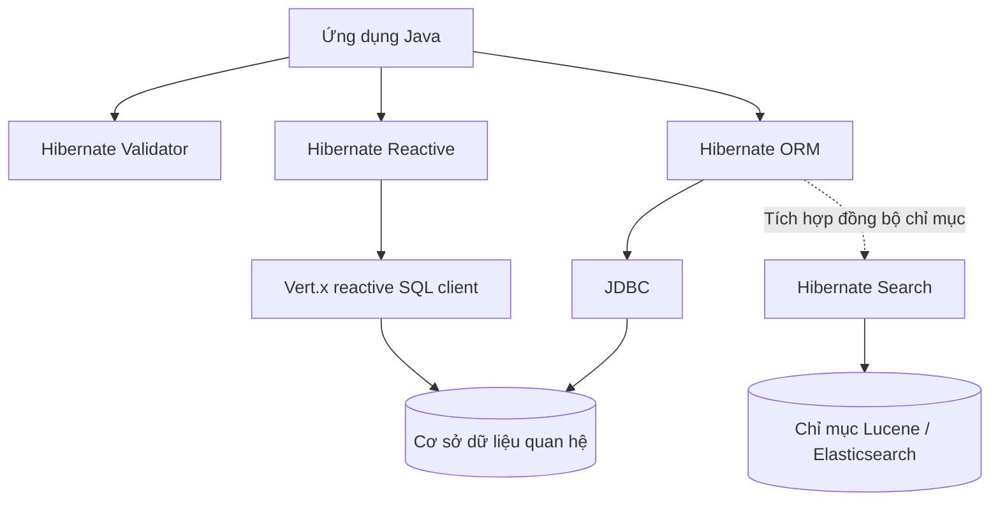

# Phân biệt Hibernate ORM với Hibernate Validator, Search và Reactive

Khi học về persistence trong Java, bạn sẽ gặp nhiều dự án mang tên **Hibernate**: **Hibernate ORM**, **Hibernate Validator**, **Hibernate Search** và **Hibernate Reactive**. Chúng liên quan đến dữ liệu nhưng giải quyết các vấn đề khác nhau. Hiểu đúng ranh giới giữa chúng giúp bạn chọn thư viện phù hợp, đọc cấu hình dự án chính xác và tránh dùng một công cụ để giải quyết bài toán của công cụ khác.

## 1. Bức tranh tổng quan

Hãy hình dung một ứng dụng quản lý sách cần thực hiện bốn công việc:

1. Lưu, sửa và đọc thông tin sách trong PostgreSQL.
2. Kiểm tra rằng tên sách không được để trống và không vượt quá 200 ký tự.
3. Cho phép người dùng tìm sách theo từ khóa, kể cả khi từ khóa chỉ xuất hiện trong một phần tiêu đề hoặc phần mô tả.
4. Nếu ứng dụng vận hành trên nền tảng bất đồng bộ, truy cập cơ sở dữ liệu mà không chặn luồng xử lý trong lúc chờ I/O.

Mỗi công việc tương ứng với một mảng trách nhiệm:

| Công nghệ | Câu hỏi chính mà nó giải quyết | Vai trò |
|---|---|---|
| **Hibernate ORM** | Làm thế nào ánh xạ đối tượng Java thành dữ liệu trong cơ sở dữ liệu quan hệ và quản lý vòng đời của dữ liệu đó? | **Persistence / ORM** |
| **Hibernate Validator** | Dữ liệu của một đối tượng có thỏa các ràng buộc nghiệp vụ hoặc định dạng đã khai báo không? | **Validation** |
| **Hibernate Search** | Làm thế nào lập chỉ mục và tìm kiếm toàn văn trên dữ liệu của ứng dụng? | **Search / indexing** |
| **Hibernate Reactive** | Làm thế nào thực hiện persistence quan hệ theo cách bất đồng bộ, không chặn luồng chờ I/O? | **Reactive persistence** |

Sơ đồ sau minh họa các vai trò trong một hệ thống; **không có nghĩa ứng dụng nào cũng cần cả bốn**:



Luồng dùng **ORM → JDBC** và luồng dùng **Reactive → reactive SQL client** là hai hướng triển khai truy cập dữ liệu. **Validator** có thể được gọi trực tiếp hoặc tích hợp vào một framework. **Search** thường phối hợp với ORM để duy trì chỉ mục phục vụ truy vấn tìm kiếm.

## 2. Hibernate ORM: ánh xạ và quản lý dữ liệu quan hệ

**Hibernate ORM (Object–Relational Mapping)** ánh xạ lớp/đối tượng Java với bảng/bản ghi trong cơ sở dữ liệu quan hệ. Đây là một framework ORM và là một implementation phổ biến của **Jakarta Persistence (JPA)**.

Ví dụ, một đối tượng Java:

```java
Book book = new Book("Hibernate ORM Essentials");
```

có thể được lưu dưới dạng một hàng của bảng `books` thông qua ánh xạ entity.

Những trách nhiệm quan trọng của Hibernate ORM gồm:

- **Ánh xạ dữ liệu:** các annotation như `@Entity`, `@Table`, `@Id`, `@Column`, `@OneToMany` và `@ManyToOne` mô tả quan hệ giữa mô hình đối tượng và mô hình quan hệ.
- **Quản lý entity:** theo dõi các trạng thái transient, managed, detached và removed; phát hiện thay đổi ở entity đang được quản lý (*dirty checking*).
- **Truy vấn và persistence:** cung cấp `EntityManager` (API JPA), `Session` (API Hibernate), JPQL/HQL và các cơ chế tải dữ liệu.
- **Transaction và flush:** phối hợp những thay đổi trong một transaction, chuyển chúng thành câu lệnh SQL tại thời điểm thích hợp.
- **Tối ưu truy cập dữ liệu:** hỗ trợ lazy loading, batching, cache cấp một theo persistence context và các tính năng cache bổ sung khi được cấu hình.

Trong cách dùng ORM truyền thống, thao tác tới cơ sở dữ liệu đi qua **JDBC**, thường theo mô hình **blocking I/O**. Hibernate ORM hữu ích khi ứng dụng có nghiệp vụ CRUD, quan hệ giữa nhiều entity và transaction trên cơ sở dữ liệu quan hệ.

**Ranh giới cần nhớ:** Hibernate ORM quyết định *dữ liệu được ánh xạ, tải và lưu như thế nào*. Nó không tự biến mọi quy tắc validation thành hợp lệ, cũng không mặc nhiên cung cấp công cụ tìm kiếm toàn văn như một search engine.

## 3. Hibernate Validator: kiểm tra tính hợp lệ của dữ liệu

**Hibernate Validator** là một implementation của đặc tả **Jakarta Validation** (trước đây thường được gọi là Bean Validation). Nó cho phép khai báo các ràng buộc trực tiếp trên field, property, tham số phương thức và các vị trí được đặc tả hỗ trợ.

Ví dụ:

```java
import jakarta.validation.constraints.Email;
import jakarta.validation.constraints.NotBlank;
import jakarta.validation.constraints.Size;

public class RegisterRequest {
    @NotBlank
    private String username;

    @Email
    private String email;

    @Size(min = 8, max = 64)
    private String password;

    // Constructor, getter và setter được lược bỏ.
}
```

Ý nghĩa của các ràng buộc:

- `@NotBlank`: chuỗi phải khác `null` và chứa ít nhất một ký tự không phải khoảng trắng.
- `@Email`: chuỗi, nếu có giá trị, phải phù hợp với quy tắc định dạng email của validator. Nếu yêu cầu bắt buộc phải có email, hãy kết hợp với ràng buộc không để trống.
- `@Size`: kiểm tra độ dài chuỗi hoặc kích thước collection, array, map tùy kiểu dữ liệu.
- `@Valid`: kích hoạt **cascaded validation** trên đối tượng lồng bên trong.

Có thể gọi validation một cách tường minh:

```java
import jakarta.validation.ConstraintViolation;
import jakarta.validation.Validation;
import jakarta.validation.Validator;
import jakarta.validation.ValidatorFactory;
import java.util.Set;

try (ValidatorFactory factory =
         Validation.buildDefaultValidatorFactory()) {
    Validator validator = factory.getValidator();
    RegisterRequest request = new RegisterRequest();

    Set<ConstraintViolation<RegisterRequest>> errors =
        validator.validate(request);

    if (!errors.isEmpty()) {
        // Trả thông báo lỗi hoặc từ chối xử lý request.
    }
}
```

Hibernate Validator còn hỗ trợ custom constraint và validation groups, phù hợp khi các thao tác tạo mới, cập nhật hoặc từng giai đoạn xử lý áp dụng những bộ quy tắc khác nhau.

### Validator và ràng buộc của cơ sở dữ liệu khác nhau thế nào?

Hai annotation sau có thể xuất hiện trên cùng một thuộc tính nhưng phục vụ hai mục tiêu:

```java
@NotBlank
@Column(nullable = false, length = 200)
private String title;
```

- `@NotBlank` là ràng buộc validation trên **giá trị Java**. Khi validation chạy, chuỗi chỉ có khoảng trắng cũng bị coi là không hợp lệ.
- `@Column(nullable = false, length = 200)` mô tả **ánh xạ cột** cho ORM. Nó có thể ảnh hưởng đến DDL do ORM sinh ra khi bật chức năng tạo/cập nhật schema; bản thân annotation này không thay thế một lần kiểm tra nghiệp vụ.
- Ràng buộc `NOT NULL` và độ dài ở **schema thực tế** còn là lớp bảo vệ tính toàn vẹn dữ liệu, kể cả khi dữ liệu được ghi ngoài ứng dụng.

Trong một số cấu hình, Hibernate ORM có thể tích hợp Jakarta Validation và kích hoạt validation ở các sự kiện persistence như trước khi insert hoặc update. Tuy nhiên, việc đó phụ thuộc thư viện hiện diện và cấu hình tích hợp. Không nên mặc định rằng chỉ thêm `@NotBlank` sẽ làm cơ sở dữ liệu tự sinh một constraint tương đương.

**Ranh giới cần nhớ:** Validator trả lời câu hỏi *đối tượng có hợp lệ không?*, không chịu trách nhiệm viết SQL, lưu entity hoặc xây dựng search index.

## 4. Hibernate Search: tìm kiếm toàn văn bằng chỉ mục

**Hibernate Search** giúp ánh xạ dữ liệu ứng dụng sang một **search index** và cung cấp DSL để truy vấn chỉ mục đó. Tùy phiên bản, cấu hình và backend, chỉ mục có thể được quản lý bằng **Apache Lucene** hoặc **Elasticsearch**.

Tìm kiếm toàn văn hữu ích cho các chức năng như:

- Tìm sản phẩm theo từ khóa trong tiêu đề, mô tả.
- Phân tích văn bản thành token và áp dụng analyzer phù hợp.
- Tìm kết quả theo độ liên quan (*relevance score*), kết hợp full-text query với filter/sort.
- Tạo trải nghiệm tìm kiếm linh hoạt hơn truy vấn SQL `LIKE` đơn giản.

Khi tích hợp với Hibernate ORM, bạn có thể đánh dấu một entity để đưa vào chỉ mục:

```java
import jakarta.persistence.Entity;
import jakarta.persistence.GeneratedValue;
import jakarta.persistence.GenerationType;
import jakarta.persistence.Id;
import org.hibernate.search.mapper.pojo.mapping.definition.annotation.FullTextField;
import org.hibernate.search.mapper.pojo.mapping.definition.annotation.Indexed;

@Entity
@Indexed
public class Article {
    @Id
    @GeneratedValue(strategy = GenerationType.IDENTITY)
    private Long id;

    @FullTextField
    private String title;

    protected Article() {}

    public Article(String title) {
        this.title = title;
    }
}
```

Với Hibernate Search đã được tích hợp và cấu hình backend, mã truy vấn có thể có dạng:

```java
import org.hibernate.search.mapper.orm.Search;
import org.hibernate.search.mapper.orm.session.SearchSession;
import java.util.List;

SearchSession searchSession = Search.session(entityManager);

List<Article> articles = searchSession.search(Article.class)
    .where(f -> f.match()
        .field("title")
        .matching("hibernate"))
    .fetchHits(20);
```

Ở đây:

1. `@Indexed` đánh dấu entity được lập chỉ mục.
2. `@FullTextField` định nghĩa trường văn bản có khả năng tìm kiếm toàn văn.
3. `Search.session(entityManager)` lấy Hibernate Search session gắn với ORM `EntityManager`.
4. Truy vấn đi vào **search index**; khi trả về entity, Hibernate Search có thể tải entity tương ứng từ persistence layer theo cách mapper đã cấu hình.

### Chỉ mục tìm kiếm không phải bảng dữ liệu gốc

Một search index chứa biểu diễn dữ liệu tối ưu cho tìm kiếm. Cơ sở dữ liệu quan hệ thường vẫn là nơi lưu dữ liệu nghiệp vụ gốc. Vì vậy, cần phân biệt:

| Tình huống | Cơ chế thích hợp |
|---|---|
| Tìm sách theo khóa chính `id` | `EntityManager.find(...)` hoặc truy vấn persistence tương đương |
| Lọc đơn hàng theo `status` và `createdAt`, có transaction | Truy vấn ORM / SQL |
| Tìm nhiều bài viết có nội dung liên quan đến một cụm từ | Hibernate Search với full-text index |
| Cập nhật số lượng hàng tồn và đảm bảo transaction | Hibernate ORM / cơ chế persistence với transaction |

Khi entity thay đổi **thông qua luồng ORM được tích hợp**, Hibernate Search có thể tự lập kế hoạch cập nhật chỉ mục. Chi tiết thời điểm index nhìn thấy dữ liệu mới phụ thuộc chiến lược đồng bộ indexing và backend. **Không mặc định chỉ mục luôn tức thời đồng nhất với database.** Dữ liệu có sẵn trước khi bật indexing thường cần chạy quá trình lập chỉ mục ban đầu, chẳng hạn mass indexing. Nếu dữ liệu bị sửa trực tiếp bằng SQL hoặc một hệ thống khác, cần cơ chế đồng bộ hoặc lập chỉ mục lại phù hợp.

**Ranh giới cần nhớ:** Hibernate Search bổ sung năng lực *search và indexing*; nó không thay thế database, transaction, hay chức năng lưu entity của ORM.

## 5. Hibernate Reactive: persistence quan hệ theo kiểu non-blocking

**Hibernate Reactive** cung cấp API persistence bất đồng bộ cho cơ sở dữ liệu quan hệ. Nó kế thừa nhiều khái niệm ánh xạ entity quen thuộc từ Hibernate ORM nhưng dùng **reactive SQL client dựa trên Vert.x**, thay vì thực hiện truy cập database qua JDBC blocking thông thường.

Khác biệt rõ nhất nằm ở cách nhận kết quả:

```java
// Phong cách ORM truyền thống: lời gọi có thể chặn luồng khi chờ I/O.
Book book = entityManager.find(Book.class, bookId);
```

```java
// Phong cách Hibernate Reactive với Mutiny: kết quả bất đồng bộ.
import io.smallrye.mutiny.Uni;
import org.hibernate.reactive.mutiny.Mutiny;

Mutiny.SessionFactory reactiveSessionFactory = /* cấu hình sẵn */;

Uni<Book> bookUni = reactiveSessionFactory.withSession(
    session -> session.find(Book.class, bookId)
);
```

`Uni<Book>` biểu diễn một phép tính bất đồng bộ có thể trả về `Book` hoặc lỗi. Việc thực thi và tiêu thụ kết quả cần nằm trong một luồng xử lý reactive phù hợp; gán một `Uni` vào biến không giống nhận ngay một `Book`.

Với thao tác ghi, Hibernate Reactive hỗ trợ transaction theo API reactive:

```java
Book newBook = new Book("Persistence trong ứng dụng reactive");

Uni<Void> saved = reactiveSessionFactory.withTransaction(
    (session, transaction) -> session.persist(newBook)
);
```

Đây là **mẫu API minh họa**: cần khai báo entity, cấu hình session factory, driver/database được hỗ trợ và lifecycle của `Uni` theo framework đang sử dụng.

Một vài điểm thiết kế quan trọng:

- **Không dùng JPA `EntityManager` cho các lời gọi Hibernate Reactive.** Hibernate Reactive cung cấp session API bất đồng bộ riêng, ví dụ `Mutiny.SessionFactory` và `Mutiny.Session`.
- **Non-blocking không đồng nghĩa với tự động nhanh hơn trong mọi hệ thống.** Giá trị của mô hình reactive rõ rệt hơn trong ứng dụng cần quản lý nhiều yêu cầu I/O đồng thời trên số lượng luồng hạn chế.
- **Phải giữ đường xử lý I/O nhất quán.** Đặt một lệnh JDBC blocking vào event loop của ứng dụng reactive vẫn có thể chặn luồng đó.
- **Transaction vẫn tồn tại.** Bất đồng bộ thay đổi cách kết hợp các thao tác và điều phối phiên làm việc, không loại bỏ yêu cầu đảm bảo tính nhất quán.
- **Hệ sinh thái có điều kiện tương thích.** Cần kiểm tra phiên bản Hibernate Reactive, database driver và framework; không mặc định mọi extension của Hibernate ORM đều hoạt động giống nhau với Hibernate Reactive.

**Ranh giới cần nhớ:** Hibernate Reactive giải quyết *cách truy cập và lưu dữ liệu quan hệ theo kiểu non-blocking*. Nó không phải thư viện validation hay search engine. Đồng thời, API của nó không phải bản JPA đồng bộ chỉ được bọc thêm một future.

## 6. Đặt bốn công nghệ cạnh nhau

| Tiêu chí | Hibernate ORM | Hibernate Validator | Hibernate Search | Hibernate Reactive |
|---|---|---|---|---|
| Mục tiêu | Lưu/truy xuất dữ liệu quan hệ qua object mapping | Kiểm tra constraint trên đối tượng và tham số | Lập chỉ mục, tìm kiếm dữ liệu | Lưu/truy xuất dữ liệu quan hệ bất đồng bộ |
| Đơn vị chính | Entity, session, persistence context, transaction | Bean, constraint, violation | Indexed entity, index field, search query | Reactive session, transaction, async result |
| API thường gặp | `EntityManager`, `Session`, JPQL/HQL | `Validator`, `ConstraintViolation`, `@Valid` | `SearchSession`, `@Indexed`, `@FullTextField` | `Mutiny.SessionFactory`, `Uni` |
| Nền tảng liên quan | Jakarta Persistence; JDBC | Jakarta Validation | Search mapper; Lucene/Elasticsearch backend | Vert.x reactive SQL client |
| Cần database quan hệ? | Có, trong bài toán ORM quan hệ | Không bắt buộc | Không bắt buộc trong mọi kiểu mapper, nhưng thường có khi tích hợp ORM | Có, với database/driver tương thích |
| Tự làm full-text search? | Không phải mục tiêu chính | Không | Có | Không phải mục tiêu chính |
| Tự kiểm tra ràng buộc đối tượng? | Có thể gọi tích hợp validation khi được cấu hình | Có | Không | Tùy cách tích hợp validation |
| Cách trả dữ liệu | Thường đồng bộ, blocking | Đồng bộ khi gọi `validate` | Phụ thuộc mapper/API và backend | Bất đồng bộ, non-blocking |

Đặc biệt, **Hibernate ORM và Hibernate Reactive** có phạm vi nghiệp vụ gần nhau vì cùng phục vụ relational persistence, nhưng khác mô hình thực thi và API. **Hibernate Validator và Hibernate Search** lại là các năng lực bổ sung theo chiều ngang; chúng có thể được dùng khi ứng dụng cần validation hoặc full-text search.

## 7. Ví dụ một chức năng đi qua nhiều lớp

Xét chức năng **đăng một bài viết** và sau đó **tìm bài viết bằng từ khóa** trong một ứng dụng dùng ORM:

```text
HTTP POST /articles
    |
    v
Kiểm tra dữ liệu nhập
    |  Hibernate Validator: @NotBlank, @Size, ...
    v
Lưu bài viết
    |  Hibernate ORM: persist + transaction
    v
Cơ sở dữ liệu quan hệ
    |
    +----> Hibernate Search: cập nhật chỉ mục theo cấu hình

HTTP GET /articles/search?q=hibernate
    |
    v
Hibernate Search: truy vấn full-text index
    |
    v
Trả kết quả bài viết
```

Quy trình có thể được diễn giải theo trách nhiệm:

1. **Validator** báo lỗi sớm nếu `title` không hợp lệ. Việc validate có thể do tầng HTTP/service thực hiện hoặc do cơ chế tích hợp kích hoạt.
2. **ORM** quản lý entity và transaction để ghi dữ liệu chính thức vào cơ sở dữ liệu.
3. **Search** cập nhật chỉ mục theo cơ chế indexing đã cấu hình rồi phục vụ truy vấn tìm kiếm. Chỉ mục có thể có độ trễ hiển thị dữ liệu so với transaction vừa commit.
4. Nếu toàn bộ ứng dụng được thiết kế theo **reactive stack**, nhóm thao tác persistence có thể chuyển sang **Hibernate Reactive** và dùng API bất đồng bộ. Cần đánh giá cách tích hợp validation, search và phiên bản tương thích thay vì tự động thay tên thư viện.

## 8. Những nhầm lẫn phổ biến

### “Có `@Entity` là tự động kiểm tra dữ liệu đúng”

`@Entity` xác định class được ánh xạ cho persistence. Nó không tự đặt ra quy tắc như tên người dùng không được trống hay ngày kết thúc phải sau ngày bắt đầu. Những quy tắc đó thuộc validation và logic nghiệp vụ.

### “Có `@NotNull` thì cột chắc chắn là `NOT NULL`”

`@NotNull` là constraint của Jakarta Validation. Khả năng chuyển thông tin constraint thành schema hoặc kích hoạt kiểm tra trước khi ghi phụ thuộc vào tích hợp và cấu hình. Muốn bảo đảm tính toàn vẹn ở cấp database, cần kiểm tra migration/schema thực tế.

### “Tìm kiếm bằng JPQL `LIKE` cũng là Hibernate Search”

JPQL `LIKE` là phép so khớp mẫu trong truy vấn cơ sở dữ liệu. Hibernate Search lập chỉ mục và dùng search backend với các khả năng như analyzer, tokenization và relevance. Một số màn hình lọc đơn giản dùng ORM là đủ; tìm kiếm toàn văn thường cần công cụ chuyên biệt.

### “Lưu entity xong là search index luôn thấy dữ liệu mới”

Điều này tùy chiến lược đồng bộ, loại backend và cách dữ liệu được sửa. Cần phân biệt transaction commit của database với thời điểm bản ghi có thể được tìm thấy trong chỉ mục.

### “Hibernate Reactive là Hibernate ORM cộng `CompletableFuture`”

Chuyển một lệnh JDBC blocking sang thread khác không làm lệnh đó trở thành database I/O non-blocking. Hibernate Reactive dùng client và session API riêng để phối hợp truy cập dữ liệu bất đồng bộ.

### “Các dự án có tên Hibernate luôn chạy chung với nhau”

Chúng có vòng đời phát hành, bộ phụ thuộc, API và điểm tích hợp khác nhau. Ví dụ, Hibernate Search có **ORM mapper** để tích hợp với Hibernate ORM; không thể tự suy ra mapper ấy hỗ trợ trực tiếp Hibernate Reactive trong mọi phiên bản. Cần tra tài liệu tương thích trước khi kết hợp.

## 9. Chọn giải pháp theo yêu cầu

| Yêu cầu thực tế | Lựa chọn phù hợp | Vì sao? |
|---|---|---|
| Ứng dụng CRUD Java dùng Spring Data JPA hoặc JPA truyền thống | **Hibernate ORM** (nếu là JPA provider đã chọn) | Quản lý ánh xạ entity, quan hệ và transaction |
| Kiểm tra dữ liệu form, DTO, request hoặc entity | **Hibernate Validator** | Dễ khai báo và tái sử dụng constraint |
| Tìm kiếm sản phẩm theo từ khóa, phân tích văn bản và xếp hạng kết quả | **Hibernate Search**, thường phối hợp ORM | Có index và query DSL chuyên cho tìm kiếm |
| Dịch vụ truy cập database trên stack reactive non-blocking | **Hibernate Reactive**, nếu ecosystem hỗ trợ | Truy cập dữ liệu quan hệ theo pipeline bất đồng bộ |
| Vừa lưu sản phẩm, vừa kiểm tra dữ liệu, vừa tìm kiếm | **ORM + Validator + Search** | Mỗi phần đảm nhiệm một trách nhiệm riêng |
| Chỉ cần tìm đơn hàng theo mã hoặc lọc theo trạng thái | **ORM** hoặc truy vấn SQL phù hợp | Truy vấn quan hệ thông thường có thể đáp ứng mà không cần search index |

Khi quyết định, nên đặt câu hỏi theo thứ tự: **Dữ liệu nằm ở đâu?** Nếu là cơ sở dữ liệu quan hệ, chọn phương thức persistence theo kiến trúc blocking hay reactive. **Dữ liệu cần tuân thủ quy tắc nào?** Thêm validation tại ranh giới phù hợp. **Người dùng cần tìm kiếm kiểu gì?** Chỉ bổ sung search index khi yêu cầu tìm kiếm cần đến nó.

## 10. Ghi nhớ qua một câu cho mỗi công nghệ

- **Hibernate ORM:** “Ánh xạ entity Java và quản lý dữ liệu trong database quan hệ.”
- **Hibernate Validator:** “Kiểm tra giá trị có tuân thủ constraint đã khai báo hay không.”
- **Hibernate Search:** “Lập chỉ mục và truy vấn dữ liệu theo nhu cầu tìm kiếm.”
- **Hibernate Reactive:** “Truy cập và quản lý persistence quan hệ bằng API bất đồng bộ, non-blocking.”

Từ cách phân vai này, bạn có thể đọc một codebase Java dễ hơn: gặp `EntityManager` hoặc `Session` đồng bộ thì nghĩ đến ORM; gặp `@NotBlank`, `Validator` thì nghĩ đến validation; gặp `@Indexed`, `SearchSession` thì nghĩ đến search index; gặp `Mutiny.SessionFactory` và `Uni` cho thao tác database thì nghĩ đến Hibernate Reactive.

### Tài liệu chính thức để đào sâu

- [Hibernate ORM](https://hibernate.org/orm/)
- [Hibernate Validator](https://hibernate.org/validator/)
- [Hibernate Search](https://hibernate.org/search/)
- [Hibernate Reactive](https://hibernate.org/reactive/)
- [Jakarta Persistence](https://jakarta.ee/specifications/persistence/)
- [Jakarta Validation / Bean Validation](https://jakarta.ee/specifications/bean-validation/)
