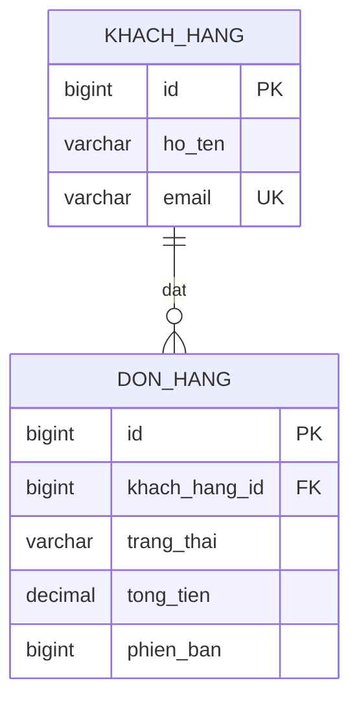

# Mối liên hệ giữa lớp, đối tượng, bảng, hàng, khóa và giao dịch

Trong ứng dụng Java, ta thường mô tả nghiệp vụ bằng **lớp** và **đối tượng**; còn cơ sở dữ liệu quan hệ lưu dữ liệu trong **bảng**, **hàng** và **cột**. JPA/Hibernate là cầu nối giữa hai cách biểu diễn đó. Để dùng ORM đúng, cần hiểu không chỉ cách một thuộc tính trở thành cột, mà còn cách định danh đối tượng, liên kết dữ liệu và ranh giới giao dịch phối hợp với nhau.

Bài học sử dụng ví dụ hệ thống quản lý đơn hàng với hai thực thể chính: `KhachHang` (khách hàng) và `DonHang` (đơn hàng). Ví dụ SQL dùng cú pháp PostgreSQL; các khái niệm áp dụng cho phần lớn cơ sở dữ liệu quan hệ, dù cú pháp tạo bảng hay sinh khóa có thể khác.

## 1. Hai mô hình nhìn cùng một dữ liệu

Trong mô hình hướng đối tượng, ta tập trung vào **hành vi và quan hệ giữa các đối tượng**:

```java
KhachHang khachHang = ...;
DonHang donHang = ...;

// Đơn hàng giữ tham chiếu đến một đối tượng khách hàng.
KhachHang nguoiDat = donHang.getKhachHang();
```

Trong mô hình quan hệ, ta tập trung vào **tập các bản ghi và ràng buộc giữa chúng**:

```sql
SELECT d.id, d.tong_tien, k.ho_ten
FROM don_hang AS d
JOIN khach_hang AS k ON d.khach_hang_id = k.id;
```

Hai mô hình tương ứng với nhau như sau:

| Java / hướng đối tượng | Cơ sở dữ liệu quan hệ | Ý nghĩa |
| --- | --- | --- |
| `class KhachHang` | Bảng `khach_hang` | Kiểu dữ liệu và cấu trúc lưu trữ cho khách hàng |
| Một đối tượng `KhachHang` | Một hàng của `khach_hang` | Một khách hàng cụ thể |
| Trường `hoTen` | Cột `ho_ten` | Một thuộc tính của khách hàng |
| `KhachHang.id` | Khóa chính `khach_hang.id` | Định danh bản ghi |
| `DonHang.khachHang` | Cột khóa ngoại `don_hang.khach_hang_id` | Liên kết đơn hàng tới khách hàng |
| `List<DonHang>` của khách hàng | Các hàng `don_hang` có cùng `khach_hang_id` | Tập đơn hàng liên quan |
| Thay đổi và lưu các đối tượng | Các lệnh `INSERT`, `UPDATE`, `DELETE` | Ghi thay đổi xuống cơ sở dữ liệu |
| Giao dịch ứng dụng | Transaction của cơ sở dữ liệu | Nhóm nhiều thay đổi thành một đơn vị công việc |

Đây là **mối tương ứng thường gặp, không phải quy tắc một-một tuyệt đối**. Một lớp không đánh dấu thực thể có thể không cần bảng; một đối tượng giá trị có thể được nhúng vào hàng của thực thể khác; quan hệ nhiều-nhiều thường cần bảng nối; kế thừa và ánh xạ tùy biến cũng có thể làm một lớp trải trên nhiều bảng hoặc nhiều lớp dùng chung một bảng.

### Lớp khác đối tượng như thế nào?

Lớp là **bản thiết kế**, còn đối tượng là **một thể hiện tại thời điểm chạy**:

```java
KhachHang a = new KhachHang("An", "an@example.com");
KhachHang b = new KhachHang("Bình", "binh@example.com");
```

`a` và `b` thuộc cùng lớp `KhachHang`, nhưng là hai đối tượng khác nhau và có thể được lưu thành hai hàng khác nhau. Việc gọi `new` chỉ tạo đối tượng trong bộ nhớ Java; **nó không tự động tạo hàng trong cơ sở dữ liệu**. Chỉ khi ứng dụng thực hiện thao tác lưu phù hợp trong ngữ cảnh ORM thì dữ liệu mới được đưa tới cơ sở dữ liệu.

## 2. Mô hình quan hệ: bảng, hàng, cột và khóa

Giả sử có hai bảng:

```sql
CREATE TABLE khach_hang (
    id       BIGINT GENERATED BY DEFAULT AS IDENTITY PRIMARY KEY,
    ho_ten   VARCHAR(120) NOT NULL,
    email    VARCHAR(255) NOT NULL UNIQUE
);

CREATE TABLE don_hang (
    id             BIGINT GENERATED BY DEFAULT AS IDENTITY PRIMARY KEY,
    khach_hang_id  BIGINT NOT NULL REFERENCES khach_hang(id),
    trang_thai     VARCHAR(20) NOT NULL,
    tong_tien      NUMERIC(15, 2) NOT NULL CHECK (tong_tien >= 0),
    phien_ban      BIGINT NOT NULL DEFAULT 0
);
```

Một trạng thái dữ liệu minh họa:

**Bảng `khach_hang`**

| id | ho_ten | email |
| ---: | --- | --- |
| 10 | An | an@example.com |
| 11 | Bình | binh@example.com |

**Bảng `don_hang`**

| id | khach_hang_id | trang_thai | tong_tien | phien_ban |
| ---: | ---: | --- | ---: | ---: |
| 501 | 10 | MOI | 250000.00 | 0 |
| 502 | 10 | DA_THANH_TOAN | 100000.00 | 1 |
| 503 | 11 | MOI | 80000.00 | 0 |

Từ dữ liệu trên có thể suy ra: hàng `don_hang.id = 501` thuộc khách hàng `khach_hang.id = 10`, vì `don_hang.khach_hang_id = 10`. Khách hàng 10 có hai đơn hàng 501 và 502. Cơ sở dữ liệu lưu **giá trị khóa ngoại** `10`, chứ không đặt nguyên đối tượng `KhachHang` vào một ô của bảng `don_hang`.

### Khóa chính (primary key, PK)

Khóa chính xác định duy nhất một hàng **trong một bảng**:

- `khach_hang.id = 10` chỉ hàng của An.
- `don_hang.id = 501` chỉ một đơn hàng cụ thể.
- Hai bảng khác nhau có thể cùng xuất hiện giá trị khóa chính `10`; tính duy nhất được xét trong từng bảng.

Khóa chính không được `NULL` và không được trùng. Nó có thể là khóa tự nhiên (ví dụ mã nghiệp vụ ổn định, thực sự duy nhất) hoặc khóa thay thế như số `BIGINT` được sinh tự động. Nhiều ứng dụng chọn khóa thay thế vì thông tin nghiệp vụ như email, số điện thoại hoặc tên có thể thay đổi.

### Khóa ngoại (foreign key, FK)

Khóa ngoại diễn đạt một **quan hệ tham chiếu được cơ sở dữ liệu bảo vệ**. `don_hang.khach_hang_id` tham chiếu `khach_hang.id`, nên việc tạo đơn hàng cho khách hàng không tồn tại sẽ bị cơ sở dữ liệu từ chối (nếu ràng buộc FK đang được áp dụng). Ràng buộc `NOT NULL` còn quy định mỗi đơn hàng bắt buộc phải có khách hàng.

Khóa ngoại **không bắt buộc là duy nhất**: nhiều đơn hàng cùng tham chiếu một khách hàng là hợp lệ. Nếu một FK cũng có ràng buộc `UNIQUE`, quan hệ được giới hạn tối đa một hàng phía tham chiếu cho mỗi hàng phía được tham chiếu.

### Những loại khóa và ràng buộc khác

| Thành phần | Ví dụ | Vai trò |
| --- | --- | --- |
| Khóa ứng viên | `email` nếu được quy định duy nhất | Thuộc tính hoặc tập thuộc tính có thể định danh một hàng |
| Khóa thay thế | `id` sinh tự động | Định danh ổn định, ít phụ thuộc nghiệp vụ |
| Khóa ghép | `(don_hang_id, so_thu_tu)` của dòng đơn hàng | Nhiều cột cùng tạo định danh |
| `UNIQUE` | `khach_hang.email` | Chặn giá trị trùng theo quy tắc của hệ quản trị và xử lý `NULL` |
| `NOT NULL` | `don_hang.trang_thai` | Bắt buộc có giá trị |
| `CHECK` | `tong_tien >= 0` | Bảo vệ một điều kiện dữ liệu tại cơ sở dữ liệu |

Lưu ý: một **chỉ mục (index)** giúp tìm kiếm hoặc kiểm tra tính duy nhất hiệu quả hơn, nhưng không phải mọi chỉ mục đều là khóa; và `@Column(unique = true)` trong Java không thay thế việc đảm bảo ràng buộc thật tồn tại trong lược đồ cơ sở dữ liệu đang chạy.

## 3. ORM chuyển các cấu trúc đó thành Java như thế nào?

ORM (*Object–Relational Mapping*) mô tả quy tắc ánh xạ giữa cấu trúc đối tượng và cấu trúc quan hệ. **JPA** (hiện thuộc Jakarta Persistence) định nghĩa API và các annotation ánh xạ; **Hibernate** là một triển khai phổ biến của JPA, phụ trách quản lý thực thể, sinh và thực thi SQL, theo dõi thay đổi và phối hợp giao dịch.

Ví dụ dưới đây dùng `jakarta.persistence.*` (thông dụng với Hibernate 6+). Mỗi lớp `public` nằm trong file Java riêng; các đoạn mã chỉ minh họa phần mô hình và giả định ứng dụng đã có cấu hình persistence phù hợp.

**`KhachHang.java`:**

```java
import jakarta.persistence.*;
import java.util.ArrayList;
import java.util.List;

@Entity
@Table(name = "khach_hang")
public class KhachHang {
    @Id
    @GeneratedValue(strategy = GenerationType.IDENTITY)
    private Long id;

    @Column(name = "ho_ten", nullable = false, length = 120)
    private String hoTen;

    @Column(nullable = false, unique = true, length = 255)
    private String email;

    @OneToMany(mappedBy = "khachHang")
    private List<DonHang> donHangs = new ArrayList<>();

    protected KhachHang() {} // JPA cần constructor không tham số.

    public KhachHang(String hoTen, String email) {
        this.hoTen = hoTen;
        this.email = email;
    }

    public Long getId() { return id; }
    public String getHoTen() { return hoTen; }
    public List<DonHang> getDonHangs() { return donHangs; }
}
```

**`TrangThai.java`:**

```java
public enum TrangThai {
    MOI, DA_THANH_TOAN, DA_HUY
}
```

**`DonHang.java`:**

```java
import jakarta.persistence.*;
import java.math.BigDecimal;
import java.util.Objects;

@Entity
@Table(name = "don_hang")
public class DonHang {
    @Id
    @GeneratedValue(strategy = GenerationType.IDENTITY)
    private Long id;

    @ManyToOne(fetch = FetchType.LAZY)
    @JoinColumn(name = "khach_hang_id", nullable = false)
    private KhachHang khachHang;

    @Enumerated(EnumType.STRING)
    @Column(name = "trang_thai", nullable = false, length = 20)
    private TrangThai trangThai;

    @Column(name = "tong_tien", nullable = false, precision = 15, scale = 2)
    private BigDecimal tongTien;

    @Version
    @Column(name = "phien_ban", nullable = false)
    private Long phienBan;

    protected DonHang() {}

    public DonHang(KhachHang khachHang, BigDecimal tongTien) {
        this.khachHang = Objects.requireNonNull(khachHang);
        this.tongTien = Objects.requireNonNull(tongTien);
        this.trangThai = TrangThai.MOI;
    }

    public Long getId() { return id; }
    public KhachHang getKhachHang() { return khachHang; }
    public BigDecimal getTongTien() { return tongTien; }
}
```

Các annotation ở đây có ý nghĩa cụ thể:

| Annotation | Tác dụng trong ví dụ |
| --- | --- |
| `@Entity` | Đánh dấu lớp thuộc mô hình thực thể được quản lý |
| `@Table(name = ...)` | Chỉ rõ bảng tương ứng |
| `@Id` | Chọn thuộc tính định danh làm khóa chính |
| `@GeneratedValue(IDENTITY)` | Sử dụng cơ chế sinh định danh kiểu identity của cơ sở dữ liệu |
| `@Column` | Ánh xạ cột, tên cột và gợi ý/ràng buộc lược đồ |
| `@ManyToOne` | Một đơn hàng liên hệ với một khách hàng; nhiều đơn hàng có thể cùng khách hàng |
| `@JoinColumn(name = "khach_hang_id")` | Chỉ cột FK ở bảng `don_hang` |
| `@OneToMany(mappedBy = "khachHang")` | Ánh xạ chiều xem các đơn hàng của khách hàng qua trường `DonHang.khachHang` |
| `@Enumerated(EnumType.STRING)` | Lưu tên enum như `MOI`, tránh phụ thuộc vào vị trí của hằng enum |
| `@Version` | Theo dõi phiên bản bản ghi để phát hiện xung đột cập nhật đồng thời |

Vì `DonHang.khachHang` là **phía sở hữu quan hệ** (*owning side*), thay đổi tham chiếu này là thay đổi quyết định giá trị `don_hang.khach_hang_id`. `KhachHang.donHangs` là chiều ngược lại (*inverse side*) do `mappedBy` xác định; thêm phần tử vào danh sách mà không cập nhật phía sở hữu có thể làm đồ thị đối tượng trong bộ nhớ không khớp quan hệ sẽ lưu. Trong mã nghiệp vụ thực tế, nên dùng phương thức tiện ích để giữ cả hai phía đồng bộ nếu cần thao tác từ cả hai phía.

### Không phải mọi trường Java đều là một cột

Ví dụ `DonHang.khachHang` là một **tham chiếu đối tượng**, nhưng dưới bảng chỉ có FK `khach_hang_id`. `KhachHang.donHangs` là một **collection**, nhưng không tạo cột chứa `List` trong `khach_hang`: Hibernate tìm các hàng liên quan ở `don_hang`. Ngược lại, một trường được đánh dấu `@Transient` không được lưu vào bảng. Việc ánh xạ có thể tùy biến tên cột, enum, kiểu dữ liệu, đối tượng nhúng và các kiểu quan hệ.

Đối với kiểu dữ liệu, `Long` thường ánh xạ `BIGINT`; `String` có thể ánh xạ `VARCHAR`; `BigDecimal` phù hợp số tiền cần độ chính xác thập phân và thường ánh xạ `NUMERIC`/`DECIMAL`. Lựa chọn Java và SQL phải tương thích; **`NULL` ở SQL khác với giá trị mặc định của kiểu nguyên thủy Java**. Chẳng hạn, một trường SQL có thể `NULL` thường cần `Integer` thay vì `int` nếu muốn bảo toàn trạng thái thiếu giá trị.

## 4. Quan hệ giữa đối tượng trở thành quan hệ giữa các khóa

Ba dạng quan hệ thường gặp:

| Dạng quan hệ | Ví dụ đối tượng | Cách thể hiện quan hệ điển hình |
| --- | --- | --- |
| Một–một (`1:1`) | Người dùng ↔ hồ sơ riêng | FK có ràng buộc `UNIQUE`, hoặc dùng chung khóa chính |
| Một–nhiều (`1:N`) | Khách hàng → nhiều đơn hàng | FK ở bảng phía nhiều (`don_hang.khach_hang_id`) |
| Nhiều–nhiều (`N:N`) | Sinh viên ↔ môn học | Bảng nối, ví dụ `dang_ky(sinh_vien_id, mon_hoc_id)` |

Sơ đồ quan hệ cho hai bảng đang xét:



Trong cơ sở dữ liệu, các quan hệ được xác định bằng **giá trị khóa và phép `JOIN`**, không dựa vào vị trí hàng hay địa chỉ bộ nhớ. Câu lệnh sau lấy các đơn hàng của khách hàng 10:

```sql
SELECT id, trang_thai, tong_tien
FROM don_hang
WHERE khach_hang_id = 10;
```

Tại phía Java, có thể truy vấn thực thể:

```java
KhachHang khachHang = em.find(KhachHang.class, 10L);
// Khi truy cập collection và nó cần nạp, Hibernate có thể truy vấn
// các đơn hàng có khach_hang_id = 10.
List<DonHang> donHangs = khachHang.getDonHangs();
```

`getDonHangs()` có thể trả về collection chưa được nạp ngay do cơ chế **lazy loading**; truy cập các phần tử mới có thể kích hoạt SQL. Thời điểm nạp dữ liệu phụ thuộc cấu hình ánh xạ, persistence context và cách thực hiện truy vấn. Đừng mặc định rằng chỉ vì Java thấy một collection thì toàn bộ hàng liên quan đã được tải vào bộ nhớ.

## 5. Định danh: đối tượng Java khác bản ghi SQL

Xét hai cách so sánh:

```java
KhachHang x = ...;
KhachHang y = ...;

boolean cungThamChieuJava = (x == y);
boolean cungId = x.getId() != null && x.getId().equals(y.getId());
```

`x == y` hỏi hai biến có đang trỏ tới **cùng một instance trong bộ nhớ**. So sánh `id` hỏi hai thực thể có mang **cùng giá trị định danh** hay không (cần xét cả kiểu thực thể). Hai đối tượng được nạp trong **hai persistence context khác nhau** có thể biểu diễn cùng hàng SQL nhưng không phải cùng instance Java.

Trong **cùng một persistence context**, JPA duy trì định danh thực thể sao cho một hàng được quản lý ứng với một instance của kiểu thực thể đó. Vì vậy `em.find(KhachHang.class, 10L)` lặp lại trong cùng context thường trả về cùng object đã được quản lý, và có thể không cần truy vấn SQL lần nữa.

Không nên tự suy luận rằng `id == null` luôn đồng nghĩa "không tồn tại trong database" trong mọi chiến lược sinh khóa; cũng không được dùng `==` trên hai biến `Long` để xác nhận khóa bằng nhau. Khi tự triển khai `equals()`/`hashCode()` cho entity, cần cân nhắc định danh được sinh sau khi persist, proxy và collection hash: đó là một quyết định thiết kế riêng, không đơn giản bằng so sánh mọi trường.

### Vòng đời một thực thể trong JPA

| Trạng thái | Ý nghĩa | Ví dụ |
| --- | --- | --- |
| New / transient | Đối tượng mới, chưa do `EntityManager` quản lý | `new DonHang(...)` |
| Managed / persistent | Đang được persistence context theo dõi | `em.find(...)` hoặc `em.persist(...)` thành công |
| Detached | Từng được quản lý nhưng đã rời persistence context | Đối tượng sau `em.detach(...)` hoặc sau khi đóng context |
| Removed | Được đánh dấu để xóa khi đồng bộ thay đổi | `em.remove(entity)` trên entity đang managed |

Với entity **managed**, Hibernate có thể phát hiện sự thay đổi thuộc tính (*dirty checking*) rồi sinh `UPDATE` khi đồng bộ với database; không nhất thiết phải gọi phương thức `save()` cho từng lần sửa. Với entity **detached**, sửa trường trong bộ nhớ không tự ghi xuống database: cần lựa chọn cách gắn lại hoặc cập nhật trong một context phù hợp (ví dụ `merge()` theo đúng ngữ nghĩa của JPA).

## 6. Lưu và đọc: từ thao tác Java đến SQL

Giả sử đã có khách hàng `id = 10`. Một ví dụ dùng `EntityManager` và transaction cục bộ (*resource-local*) là:

```java
EntityManager em = emf.createEntityManager();
EntityTransaction tx = em.getTransaction();

try {
    tx.begin();

    KhachHang khachHang = em.find(KhachHang.class, 10L);
    if (khachHang == null) {
        throw new IllegalArgumentException("Không tìm thấy khách hàng");
    }

    DonHang donHang = new DonHang(
        khachHang,
        new BigDecimal("250000.00")
    );

    em.persist(donHang);
    tx.commit();
} catch (RuntimeException e) {
    if (tx.isActive()) {
        tx.rollback();
    }
    throw e;
} finally {
    em.close();
}
```

Ở đây `emf` là `EntityManagerFactory` đã được cấu hình và mở trước đó; các import Java/JPA tương ứng được lược bỏ. Cách quản lý transaction trên phù hợp ví dụ Java SE dùng resource-local; trong ứng dụng có container hoặc Spring quản lý giao dịch, thường để framework kiểm soát ranh giới transaction thay vì tự gọi `begin()`/`commit()`.

Luồng xử lý về mặt khái niệm:

1. `find(KhachHang.class, 10L)` đọc hoặc lấy từ bộ nhớ đệm persistence context một khách hàng, tương ứng với hàng `khach_hang.id = 10`.
2. `new DonHang(...)` tạo object chưa managed; thuộc tính `khachHang` giữ tham chiếu đến khách hàng 10.
3. `persist(donHang)` đưa đối tượng mới vào phạm vi quản lý. Hibernate sẽ tạo `INSERT` vào `don_hang`; cột `khach_hang_id` mang giá trị khóa chính `10`.
4. Khi dữ liệu được đồng bộ xuống database và transaction `commit()` thành công, hàng mới trở thành dữ liệu đã cam kết. Khóa `id` có thể được lấy từ cơ chế identity của database.

SQL minh họa phần quan trọng (thời điểm thực thi thực tế tùy chiến lược sinh ID và cơ chế flush):

```sql
INSERT INTO don_hang (khach_hang_id, trang_thai, tong_tien, phien_ban)
VALUES (10, 'MOI', 250000.00, 0);
```

### `flush()` khác `commit()`

- **`flush()`** đồng bộ các thao tác đang chờ trong persistence context thành câu lệnh SQL gửi tới database. Hibernate có thể flush tự động trước một số truy vấn hoặc trước khi commit. Với `IDENTITY`, thao tác `INSERT` có thể cần xảy ra sớm để lấy khóa sinh ra.
- **`commit()`** kết thúc transaction thành công, khiến các thay đổi của transaction được xác nhận bền vững theo cam kết của hệ quản trị.
- Một `INSERT` đã chạy do flush **vẫn có thể bị `ROLLBACK`** nếu transaction chưa commit. Vì vậy "đã chạy SQL" không đồng nghĩa "đã lưu thành công vĩnh viễn".

Ngược lại, nếu transaction thất bại và rollback, một số object Java trong bộ nhớ có thể vẫn giữ giá trị vừa được thay đổi. Không nên xem trạng thái của chúng sau rollback là bằng chứng rằng database đã cập nhật; thường nên kết thúc context thất bại và nạp lại dữ liệu khi cần.

## 7. Giao dịch bảo vệ tính nhất quán của nhiều thay đổi

**Transaction (giao dịch)** là một đơn vị công việc gồm một hoặc nhiều lệnh đọc/ghi mà database xử lý theo những bảo đảm xác định. Đặt đơn hàng thực tế có thể yêu cầu đồng thời:

1. Tạo hàng `don_hang`.
2. Tạo các dòng chi tiết cho đơn hàng.
3. Giảm tồn kho sản phẩm.
4. Ghi lịch sử hoặc trạng thái thanh toán tương ứng.

Nếu thao tác 1 thành công còn thao tác 3 thất bại, dữ liệu có thể rơi vào trạng thái "có đơn nhưng chưa giữ được hàng". Khi các bước thuộc cùng **một transaction database**, ứng dụng có thể rollback tất cả thay đổi chưa cam kết thay vì để lại một phần kết quả.

Ví dụ SQL độc lập sau tạo khách hàng và đơn hàng cùng một transaction (giả sử lệnh đầu trả về ID `10`):

```sql
BEGIN;

INSERT INTO khach_hang (ho_ten, email)
VALUES ('An', 'an@example.com')
RETURNING id;
-- Giả sử id được trả về là 10.

INSERT INTO don_hang (khach_hang_id, trang_thai, tong_tien)
VALUES (10, 'MOI', 250000.00);

COMMIT;
```

Nếu lệnh thứ hai vi phạm ràng buộc, ví dụ `tong_tien = -1` trong khi có `CHECK (tong_tien >= 0)`, giao dịch cần được xử lý bằng rollback; hàng khách hàng mới cũng không được cam kết. Trong PostgreSQL, transaction chứa lỗi SQL phải được rollback trước khi tiếp tục các lệnh giao dịch mới thông thường.

### Bốn tính chất ACID

| Tính chất | Câu hỏi cần bảo đảm | Ý nghĩa thực tế |
| --- | --- | --- |
| **Atomicity** – nguyên tử | Các thay đổi trong transaction có thành công cùng nhau không? | Nếu một bước ghi thất bại, rollback những bước ghi trước đó chưa commit |
| **Consistency** – nhất quán | Sau khi commit, dữ liệu còn thỏa quy tắc và ràng buộc không? | PK, FK, `NOT NULL`, `CHECK` cùng các kiểm tra nghiệp vụ đúng phải được thực thi |
| **Isolation** – cô lập | Các transaction đồng thời ảnh hưởng lẫn nhau như thế nào? | Mức cô lập và cơ chế khóa/phiên bản quy định những hiện tượng đồng thời có thể xảy ra |
| **Durability** – bền vững | Thay đổi đã commit có được lưu giữ qua sự cố theo cam kết database không? | DBMS dùng cơ chế lưu trữ, nhật ký và phục hồi để duy trì dữ liệu đã cam kết |

**Consistency không có nghĩa database tự hiểu hết nghiệp vụ.** Ví dụ FK biết rằng đơn hàng phải tham chiếu khách hàng tồn tại, nhưng không tự biết quy tắc "không bán vượt tồn" nếu quy tắc ấy chưa được triển khai bằng khóa, điều kiện cập nhật, ràng buộc hoặc logic giao dịch phù hợp.

### Giao dịch và ranh giới nghiệp vụ

Một phương thức nghiệp vụ như `taoDonHang()` thường là nơi thích hợp để xác định ranh giới giao dịch, vì nó gom các thay đổi phải thành công hoặc thất bại cùng nhau. Trong ứng dụng Spring, `@Transactional` thường được dùng tại lớp service:

```java
@Transactional
public void taoDonHang(...) {
    // Xác minh dữ liệu, tạo đơn, cập nhật tồn kho
    // trong cùng transaction do Spring quản lý.
}
```

Đây là **mã phác thảo ý tưởng**, không phải phương thức biên dịch độc lập. Với Spring theo cấu hình mặc định, transaction thường rollback khi có `RuntimeException` hoặc `Error`; điều kiện rollback cho checked exception có thể cần cấu hình rõ. Khi dùng JPA/Hibernate thuần, ứng dụng cần quản lý đúng `EntityTransaction` hoặc dùng bộ điều phối transaction do môi trường cung cấp.

Transaction của **một database** cũng không tự động bảo đảm tính nguyên tử cho lời gọi HTTP tới dịch vụ ngoài, gửi email hoặc publish message vào hệ thống khác. Các bước trải nhiều hệ thống cần cơ chế thiết kế riêng như outbox, idempotency hoặc điều phối phân tán phù hợp.

## 8. Khi hai giao dịch cùng sửa một hàng

Giả sử hai nhân viên cùng đọc đơn hàng 501 ở trạng thái `MOI`, sau đó một người cập nhật trước, người còn lại ghi dựa trên dữ liệu cũ. Nếu không có cơ chế đồng thời phù hợp, thay đổi sau có thể **ghi đè** thay đổi trước (*lost update*).

Trong entity `DonHang`, `@Version` ánh xạ cột `phien_ban` để hỗ trợ **optimistic locking**. Khi cập nhật, Hibernate thường sinh điều kiện tương đương:

```sql
UPDATE don_hang
SET trang_thai = 'DA_THANH_TOAN', phien_ban = 2
WHERE id = 501 AND phien_ban = 1;
```

Nếu transaction khác đã tăng `phien_ban` lên `2`, lệnh dựa trên phiên bản cũ `1` không cập nhật được hàng mong đợi. Hibernate/JPA phát hiện xung đột và báo lỗi khóa lạc quan (ví dụ `OptimisticLockException`), để ứng dụng rollback và quyết định đọc lại, thông báo cho người dùng hoặc thử lại theo quy tắc nghiệp vụ.

`@Version` không thay thế mọi cơ chế bảo vệ dữ liệu đồng thời. Những thao tác như trừ tồn kho, kiểm tra giới hạn hoặc giữ chỗ có thể cần câu `UPDATE` có điều kiện, khóa bi quan hoặc lựa chọn mức cô lập phù hợp; hành vi còn phụ thuộc database và mẫu truy cập. **Transaction** xác định phạm vi thao tác, còn **cơ chế đồng thời** xác định các thao tác song song có thể tác động nhau ra sao.

## 9. Các nhầm lẫn dễ gặp khi bắt đầu dùng Hibernate

| Nhầm lẫn | Hiểu đúng |
| --- | --- |
| `new KhachHang(...)` đã tạo hàng SQL | Mới tạo object Java; cần persist trong ngữ cảnh thích hợp và transaction commit thành công |
| Một entity luôn ứng với một bảng và một field luôn ứng với một cột | Quan hệ tham chiếu, collection, embedded value, inheritance và `@Transient` là những ngoại lệ phổ biến |
| Trường `khachHang` chứa cả object trong cột SQL | Cơ sở dữ liệu lưu FK `khach_hang_id`; Hibernate dùng FK để nối/nạp đối tượng liên quan |
| `id` là địa chỉ bộ nhớ | `id` là định danh bản ghi; hai instance khác nhau có thể cùng đại diện một hàng trong các context khác nhau |
| `persist()` tương đương `commit()` | `persist()` quản lý một entity mới; việc ghi SQL và cam kết transaction là các bước khác |
| `flush()` khiến thay đổi không thể rollback | SQL đã flush vẫn thuộc transaction và có thể rollback nếu chưa commit |
| Có `@ManyToOne` thì không cần FK ở database | Ánh xạ Java không tự bảo đảm rằng schema đang chạy có ràng buộc FK thực tế |
| Collection quan hệ luôn nạp sẵn | Lazy loading có thể phát sinh SQL khi truy cập, hoặc lỗi nếu context cần thiết đã đóng |
| Một transaction loại bỏ mọi xung đột đồng thời | Vẫn phải xét isolation level, locking, phiên bản và đặc thù nghiệp vụ |

### Hệ quả thiết kế và hiệu năng

Không nên trả thẳng mọi entity qua các tầng của ứng dụng rồi truy cập quan hệ tùy ý sau khi `EntityManager`/session đã đóng: lazy loading có thể không còn điều kiện để truy vấn. Mặt khác, nếu duyệt danh sách `N` đơn hàng và mỗi lần truy cập khách hàng lại phát sinh một truy vấn riêng, ứng dụng có thể mắc lỗi hiệu năng **N+1 query**. Khi cần, hãy thiết kế truy vấn nạp dữ liệu theo nhu cầu (`JOIN FETCH`, entity graph hoặc DTO projection) và đặt việc truy cập dữ liệu trong phạm vi quản lý thích hợp.

Với các quan hệ chứa danh sách, cũng cần hiểu rằng cấu hình **cascade** (`PERSIST`, `REMOVE`, v.v.) và `orphanRemoval` quyết định cách hành động trên entity cha ảnh hưởng entity con. Chúng không đồng nghĩa với khóa ngoại và không nên được bật bừa bãi, đặc biệt với quan hệ giữa những thực thể có vòng đời độc lập.

## 10. Đi lại toàn bộ ví dụ từ Java tới database

Hãy xem tình huống: "Khách hàng An đặt một đơn trị giá 250.000 đồng".

```text
Ở Java                                 Ở database
───────────────────────────────       ─────────────────────────────────
class KhachHang                        table khach_hang
  id: Long                               id (PK): BIGINT
  hoTen: String                          ho_ten: VARCHAR

object KhachHang { id = 10 }    <---->  row khach_hang { id = 10, ... }
                ^
                | tham chiếu
                |
object DonHang {                     row don_hang {
  id = 501,                       <--->  id (PK) = 501,
  khachHang = <An>,                      khach_hang_id (FK) = 10,
  tongTien = 250000.00                   tong_tien = 250000.00
}                                      }

     EntityManager / Hibernate
          ánh xạ các giá trị
          và phát sinh SQL

     Transaction của database
          quyết định COMMIT
          hoặc ROLLBACK
```

Ta có thể lần theo sáu câu hỏi cốt lõi:

1. **Lớp nào mô tả dữ liệu?** `KhachHang` và `DonHang` định nghĩa những thuộc tính và quan hệ Java.
2. **Đối tượng nào đang tồn tại?** Một instance `KhachHang` có `id = 10`, một instance `DonHang` liên kết tới khách hàng đó.
3. **Bảng nào chứa dữ liệu?** `khach_hang` và `don_hang` lưu những hàng tương ứng theo mapping.
4. **Hàng được nhận diện thế nào?** Mỗi hàng có PK như `khach_hang.id` và `don_hang.id`.
5. **Hai hàng kết nối thế nào?** FK `don_hang.khach_hang_id = 10` tham chiếu PK `khach_hang.id = 10`.
6. **Khi nào dữ liệu được xác nhận?** Khi Hibernate đã đồng bộ những thay đổi cần thiết và transaction được `commit()` thành công.

### Tự kiểm tra cách hiểu

**Tình huống A:** Có một `DonHang` mới với `khachHang` trỏ tới đối tượng khách hàng `id = 10`. Trong hàng `don_hang`, cột nào thể hiện liên kết này?  
**Trả lời:** `khach_hang_id`; giá trị của nó là `10`, tham chiếu tới `khach_hang.id`.

**Tình huống B:** `em.persist(donHang)` đã được gọi và Hibernate đã gửi `INSERT`, nhưng transaction rollback. Hàng vừa chèn có còn là dữ liệu được cam kết không?  
**Trả lời:** Không. `flush` hoặc thực thi `INSERT` trước `commit` không tước đi khả năng rollback của transaction.

**Tình huống C:** Hai `EntityManager` khác nhau cùng đọc `KhachHang` có `id = 10`. Hai biến Java có buộc phải thỏa `x == y` không?  
**Trả lời:** Không. Chúng có thể là hai instance khác nhau nhưng cùng biểu diễn bản ghi có PK `10`.

**Tình huống D:** Vì sao một khách hàng có thể có nhiều đơn hàng mà không cần một cột danh sách trong `khach_hang`?  
**Trả lời:** Các hàng `don_hang` mang FK tới cùng khách hàng. Quan hệ một–nhiều được truy xuất bằng điều kiện trên FK; ORM có thể trình bày kết quả dưới dạng `List<DonHang>`.

Khi hiểu được **lớp → đối tượng → ánh xạ ORM → bảng/hàng → PK/FK → transaction**, người học có thể dự đoán dữ liệu thực sự được lưu ở đâu, vì sao Hibernate thực hiện truy vấn SQL, và đâu là thời điểm một thay đổi được database xác nhận. Đây là nền tảng để học tiếp truy vấn JPA, mapping quan hệ phức tạp, quản lý persistence context và tối ưu hiệu năng Hibernate.
