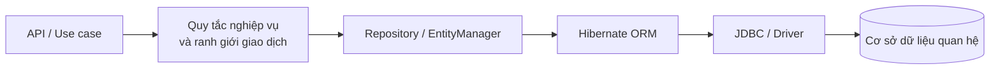

# ORM tự động hóa những gì và ứng dụng vẫn phải chịu trách nhiệm điều gì?

Trong ứng dụng Java làm việc với cơ sở dữ liệu quan hệ, **ORM (Object–Relational Mapping)** giúp chuyển đổi giữa mô hình đối tượng và dữ liệu trong các bảng. Hibernate là một ORM phổ biến, đồng thời là một triển khai của **Jakarta Persistence (JPA)**. Nhờ ORM, lập trình viên ít phải tự viết mã JDBC lặp lại để tạo đối tượng, gán tham số SQL, đọc `ResultSet` và theo dõi các thay đổi của đối tượng.

Tuy nhiên, câu “Hibernate tự lưu dữ liệu” chỉ đúng ở **cấp độ cơ chế lưu trữ**. ORM không biết một đơn hàng có được phép xác nhận hay không, người dùng có quyền xem dữ liệu nào, thao tác nào phải nằm trong cùng giao dịch, hoặc một truy vấn có đủ nhanh trong sản xuất hay không. Các quyết định đó vẫn thuộc về ứng dụng và hệ quản trị cơ sở dữ liệu.

## 1. Ranh giới trách nhiệm: ai quyết định, ai thực thi?

Một luồng xử lý thường có dạng:



- **Ứng dụng** quyết định thao tác nào hợp lệ, ai được phép thực hiện, dữ liệu phải nhất quán theo quy tắc nào và cần đọc/ghi bao nhiêu dữ liệu.
- **Hibernate** dựa trên cấu hình mapping và trạng thái entity để thực hiện thao tác truy cập dữ liệu: tạo SQL, bind tham số, chuyển hàng dữ liệu thành đối tượng, theo dõi thay đổi và đồng bộ khi cần.
- **Cơ sở dữ liệu** thực thi SQL, khóa, ràng buộc, giao dịch, chỉ mục và kế hoạch truy vấn theo khả năng của engine.

Bảng sau là ranh giới thường gặp:

| Vấn đề | ORM có thể tự động hóa | Ứng dụng vẫn phải quyết định |
|---|---|---|
| Ánh xạ dữ liệu | Đọc `@Entity`, `@Column`, `@Id` và chuyển kiểu Java ↔ SQL | Bảng, cột, khóa, kiểu dữ liệu, quan hệ nào phản ánh đúng miền nghiệp vụ |
| Đọc/ghi | Sinh nhiều câu lệnh `SELECT`, `INSERT`, `UPDATE`, `DELETE` và gán tham số | Khi nào đọc/ghi, điều kiện lọc, quyền truy cập, phạm vi dữ liệu |
| Thay đổi đối tượng | Theo dõi entity đang được quản lý và phát hiện trường bị sửa | Thay đổi nào hợp lệ, bất biến nghiệp vụ nào phải giữ |
| Quan hệ | Dựa trên mapping để đồng bộ khóa ngoại, tải quan hệ, cascade | Chủ sở hữu quan hệ, phạm vi cascade, chính sách xóa và fetch |
| Giao dịch | Tham gia giao dịch do ứng dụng/transaction manager mở; flush các thay đổi | Ranh giới, isolation, retry, xử lý lỗi và tác động ngoài DB |
| Đồng thời | Hỗ trợ kiểm tra version/lock khi được cấu hình và sử dụng | Cách giải quyết xung đột, chống ghi đè, bảo đảm tồn kho/số dư |
| Hiệu năng | Có persistence context, tùy chọn batching/cache/fetch | Chỉ mục, phân trang, N+1, số lượng truy vấn, SLA, đo đạc |
| Schema | Có công cụ tạo/kiểm tra schema theo cấu hình | Thiết kế schema, migration, tương thích dữ liệu và triển khai |
| Bảo mật | Bind tham số trong các truy vấn ORM đúng cách | Xác thực, phân quyền theo bản ghi/tenant, dữ liệu nhạy cảm |

**Quy tắc thực hành:** giao cho ORM các thao tác cơ học có thể suy ra từ mapping; giữ các quyết định phụ thuộc ý nghĩa nghiệp vụ trong code ứng dụng và các ràng buộc bền vững tại database.

## 2. Những việc Hibernate thực sự tự động hóa

### 2.1. Ánh xạ đối tượng thành hàng dữ liệu

Với metadata như `@Entity`, `@Table`, `@Column`, `@Id`, `@Enumerated`, `@Embedded` và mapping quan hệ, Hibernate biết cách biến dữ liệu của bảng thành một entity Java và ngược lại.

Ví dụ rút gọn:

```java
@Entity
@Table(name = "products")
class Product {
    @Id
    @GeneratedValue(strategy = GenerationType.IDENTITY)
    private Long id;

    @Column(name = "sku", nullable = false, length = 40)
    private String sku;

    @Column(name = "price", nullable = false, precision = 19, scale = 2)
    private BigDecimal price;

    protected Product() { }
}
```

Mapping cho biết entity dùng bảng `products`, thuộc tính `sku` ánh xạ sang cột `sku`, còn `price` dùng kiểu số thập phân có độ chính xác và thang đo đã khai báo. Khi đọc hàng dữ liệu, Hibernate khởi tạo entity và gán thuộc tính theo mapping.

Nhưng Hibernate **không thể suy ra** mã SKU có phải duy nhất toàn hệ thống hay không, giá có được âm hay không, sử dụng đơn vị tiền nào hoặc có cần ghi lại lịch sử giá hay không. `nullable = false` là metadata mapping và có thể ảnh hưởng đến DDL được sinh ra; nó không thay thế việc thiết kế constraint và quy tắc kiểm tra dữ liệu một cách có chủ đích.

Chiến lược sinh ID cũng là lựa chọn của ứng dụng: `IDENTITY`, `SEQUENCE` và các chiến lược khác có điều kiện hỗ trợ và đặc tính hiệu năng khác nhau theo database. ORM thực thi chiến lược đã chọn, không tự chọn khóa định danh phù hợp mọi hệ thống.

### 2.2. Tạo SQL, bind tham số, đọc kết quả

Thay vì tự viết code `PreparedStatement` và gán từng trường từ `ResultSet`, ứng dụng có thể dùng:

```java
Product product = entityManager.find(Product.class, productId);
entityManager.persist(newProduct);
entityManager.remove(product);
```

Hibernate sinh những SQL cần thiết theo mapping, trạng thái đối tượng và dialect của database. Câu lệnh được sinh ra phụ thuộc ngữ cảnh; không nên hiểu rằng mỗi lời gọi Java luôn tương ứng ngay với đúng một câu lệnh SQL.

Trong JPQL/HQL, ứng dụng vẫn phải định nghĩa truy vấn, ví dụ:

```java
List<Product> products = entityManager.createQuery(
        "select p from Product p where p.sku = :sku", Product.class)
    .setParameter("sku", requestedSku)
    .getResultList();
```

`:sku` là tham số được bind an toàn theo cơ chế query API. Khả năng bind tham số **không đồng nghĩa** ORM tự kiểm soát được người dùng có quyền đọc SKU đó. Đồng thời, việc tự ghép chuỗi từ input vào HQL/SQL, đặc biệt cho tên cột, tên bảng hoặc mệnh đề động, vẫn có thể tạo lỗ hổng nếu không kiểm soát.

### 2.3. Quản lý vòng đời và phát hiện thay đổi (dirty checking)

Bên trong một **persistence context**, Hibernate theo dõi các entity đang ở trạng thái *managed*. Cách hiểu cơ bản về vòng đời:

| Trạng thái | Ý nghĩa | Hệ quả quan trọng |
|---|---|---|
| New/transient | Đối tượng Java chưa được gắn vào persistence context | Chỉ `new` không làm dữ liệu xuất hiện trong database |
| Managed | Đối tượng được persistence context quản lý | Sửa thuộc tính có thể được ghi xuống DB khi flush |
| Detached | Đối tượng từng managed nhưng không còn thuộc context hiện tại | Sửa detached entity không tự được đồng bộ |
| Removed | Entity managed được đánh dấu để xóa | SQL xóa được thực hiện khi đồng bộ theo quy tắc của ORM |

Ví dụ:

```java
@Transactional
public void changePrice(Long id, BigDecimal newPrice) {
    Product product = entityManager.find(Product.class, id);
    if (product == null) {
        throw new NoSuchElementException("Product not found");
    }
    product.changePrice(newPrice); // Phương thức kiểm tra quy tắc giá.
    // Không cần gọi update(product) cho managed entity.
}
```

Ở đây, transaction manager mở giao dịch; `find` trả về entity managed; Hibernate phát hiện thuộc tính đổi; khi flush, nó có thể sinh `UPDATE` tương ứng. Chúng ta vẫn phải tự định nghĩa `changePrice` để kiểm tra giá hợp lệ.

Cần phân biệt ba khái niệm:

- **Dirty checking**: phát hiện trạng thái đã thay đổi của managed entity.
- **Flush**: đồng bộ những thay đổi cần thiết từ persistence context thành SQL gửi tới database; có thể xảy ra trước commit hoặc trước một số truy vấn, tùy flush mode và tình huống.
- **Commit**: kết thúc giao dịch thành công, khiến các thay đổi được xác nhận theo cơ chế của database. **Flush không phải commit**; một thay đổi đã flush vẫn có thể bị rollback.

`merge(detachedEntity)` cũng không có nghĩa “gắn lại chính đối tượng cũ”: API trả về phiên bản managed tương ứng sau khi chép trạng thái. Việc merge toàn bộ entity lấy từ input người dùng dễ gây ghi đè trường không được phép; nên tải entity hiện tại và cập nhật rõ từng thuộc tính được phép.

### 2.4. Đồng bộ quan hệ theo mapping

Hibernate có thể theo dõi `@ManyToOne`, `@OneToMany`, `@OneToOne`, `@ManyToMany` và thực thi khóa ngoại, bảng nối hoặc cascade theo cấu hình.

```java
@ManyToOne(fetch = FetchType.LAZY, optional = false)
@JoinColumn(name = "customer_id", nullable = false)
private Customer customer;
```

Ở ví dụ này, entity đang chứa quan hệ tới `Customer` qua cột `customer_id`. Khi đọc, Hibernate có thể trì hoãn việc tải `Customer` đến khi thuộc tính được truy cập, trong những điều kiện được hỗ trợ.

Ứng dụng cần quyết định:

- Quan hệ nào thật sự tồn tại trong miền nghiệp vụ; đâu là phía sở hữu quan hệ cần cập nhật.
- Xóa một đối tượng có được phép xóa đối tượng liên quan không. `CascadeType.REMOVE` và `orphanRemoval = true` có thể khiến dữ liệu bị xóa theo quan hệ; chỉ cấu hình khi đó là ý nghĩa nghiệp vụ mong muốn.
- Dữ liệu nào cần tải cho use case hiện tại. `LAZY` có thể giảm tải ban đầu, nhưng đọc quan hệ lặp lại có thể tạo N+1 query; `EAGER` cũng không bảo đảm có một truy vấn tối ưu.
- Khi nào phải cập nhật cả hai phía của quan hệ hai chiều trong mô hình Java để giữ đồ thị đối tượng nhất quán.

### 2.5. Hỗ trợ giao dịch, khóa, cache và tối ưu truy cập — nếu sử dụng đúng

Hibernate tích hợp với cơ chế giao dịch và có những hỗ trợ như `@Version` để optimistic locking, locking API, batch DML, first-level cache trong persistence context và tùy chọn cache cấp hai. Một số khả năng cần **bật/cấu hình hoặc gọi rõ ràng**; không nên coi là hiệu năng hay tính nhất quán tự có.

Persistence context giữ identity của entity managed trong phạm vi của nó: cùng một entity theo khóa định danh thường được biểu diễn bởi cùng một đối tượng managed. Điều này hữu ích cho tính nhất quán của một đơn vị công việc, nhưng không phải cache toàn hệ thống và không bảo đảm dữ liệu luôn mới trước các thay đổi từ giao dịch khác.

Việc generate/update schema cũng là một công cụ có cấu hình, phù hợp một số tình huống phát triển hoặc thử nghiệm. ORM không tự thiết kế chiến lược migration an toàn cho môi trường sản xuất.

## 3. Những quyết định ứng dụng không thể giao cho ORM

### 3.1. Quy tắc nghiệp vụ và bất biến dữ liệu

ORM thấy thuộc tính đổi từ `DRAFT` sang `CONFIRMED`; nó không biết có cần thanh toán thành công, đủ hàng trong kho hoặc xác nhận của quản trị viên trước khi chuyển trạng thái hay không.

Những điều như sau phải được phát biểu rõ:

- Đơn hàng chỉ được xác nhận khi đang ở trạng thái nháp.
- Số lượng mua phải lớn hơn 0; số dư không được giảm dưới giới hạn được phép.
- Người dùng chỉ hủy được đơn theo điều kiện cụ thể.
- Giá trị tiền tệ phải dùng đơn vị và quy tắc làm tròn đúng.

Có thể đặt quy tắc trong entity/domain service, application service và thêm constraint ở database nếu biểu đạt được. Đừng chỉ dùng setter cho tất cả trường rồi hy vọng ORM “xác thực” ý nghĩa của trạng thái mới.

### 3.2. Ranh giới giao dịch và mức nhất quán

Ứng dụng quyết định toàn bộ thao tác nào phải *cùng thành công hoặc cùng thất bại*.

Giả sử chuyển tiền giữa hai tài khoản: việc trừ tài khoản A và cộng tài khoản B cần ràng buộc nhất quán phù hợp. Hibernate có thể flush cả hai `UPDATE`, nhưng chính ứng dụng phải mở một giao dịch bao trùm, xử lý lỗi, cân nhắc isolation/lock và thiết kế để không ghi đè khi có hai giao dịch đồng thời.

Trong Spring, `@Transactional` trên một phương thức application service thường đánh dấu ranh giới giao dịch, ví dụ:

```java
@Transactional
public void transfer(Long fromId, Long toId, BigDecimal amount) {
    Account from = entityManager.find(Account.class, fromId);
    Account to = entityManager.find(Account.class, toId);

    from.debit(amount);
    to.credit(amount);
}
```

Đây chỉ là **phác thảo**, chưa phải chức năng chuyển tiền hoàn chỉnh: phải kiểm tra số tiền và quyền truy cập, xử lý tài khoản không tồn tại, khóa/đồng thời, mức isolation, thứ tự khóa, lỗi và lịch sử giao dịch. Chỉ hai lời gọi `debit/credit` không bảo đảm tránh double spending dưới mọi điều kiện đồng thời.

Lưu ý trong mô hình Spring dùng proxy, gọi nội bộ từ phương thức này sang phương thức khác trên cùng đối tượng có thể không đi qua interceptor `@Transactional` như mong muốn. Ranh giới thực tế cần được xác nhận ở tầng ứng dụng.

ORM cũng không tự tạo giao dịch nguyên tử giữa một database và một dịch vụ bên ngoài. Nếu vừa ghi đơn hàng vừa gửi email, gọi cổng thanh toán hoặc publish event, cần lựa chọn cơ chế phù hợp: outbox, idempotency, retry có kiểm soát, hoặc saga khi quy trình chạy qua nhiều dịch vụ. Đưa một HTTP call vào phương thức `@Transactional` không biến HTTP call thành một phần có thể rollback của giao dịch database.

### 3.3. Constraint, schema và migration

Các annotation mô tả mapping, nhưng **database phải bảo vệ những bất biến có thể áp dụng ở cấp dữ liệu**, nhất là khi có nhiều luồng ghi hoặc nhiều ứng dụng cùng truy cập:

- `PRIMARY KEY` bảo đảm định danh bản ghi.
- `FOREIGN KEY` bảo vệ tham chiếu.
- `UNIQUE` bảo đảm tính duy nhất đúng phạm vi; nếu hệ thống nhiều tenant, khóa duy nhất có thể cần gồm `tenant_id`.
- `NOT NULL` và `CHECK` bảo vệ điều kiện mà database có thể kiểm tra.

Ví dụ, kiểm tra “email chưa tồn tại” ở Java rồi mới insert vẫn có race condition: hai request có thể cùng vượt qua kiểm tra. Ràng buộc `UNIQUE` trên database mới đóng vai trò bảo vệ cuối cùng; ứng dụng phải bắt lỗi trùng và trả thông báo phù hợp.

Ứng dụng còn phải quyết định dùng migration có kiểm soát (ví dụ Flyway hoặc Liquibase), thứ tự deploy, backfill dữ liệu, thay đổi schema tương thích với phiên bản ứng dụng cũ và cách rollback. Không nên tùy tiện cho ORM cập nhật cấu trúc database production trong mỗi lần khởi động.

### 3.4. Quyền truy cập, dữ liệu theo tenant và riêng tư

ORM có thể đọc `PurchaseOrder` với ID đã cho, nhưng **ID hợp lệ không có nghĩa người gọi được phép truy cập**. Phải quyết định và thực thi quy tắc owner/role/tenant.

Một truy vấn có điều kiện `where o.id = :id` có thể đúng cú pháp nhưng vẫn làm lộ đơn của khách hàng khác. Ứng dụng có thể dùng điều kiện `ownerId/tenantId` ngay trong query, kết hợp kiểm tra quyền trong service và cơ chế bảo vệ của database khi phù hợp. Cần kiểm soát nhất quán mọi con đường truy cập, kể cả batch job và native query.

Việc mã hóa trường nhạy cảm, ẩn dữ liệu trong log, lưu vết truy cập, thời hạn giữ dữ liệu và chính sách xóa là các quyết định thiết kế riêng. Dirty checking không tự tạo audit trail đáp ứng yêu cầu nghiệp vụ.

### 3.5. Fetch plan, truy vấn và hiệu năng

ORM không biết màn hình danh sách cần 20 dòng tóm tắt hay màn hình chi tiết cần đầy đủ quan hệ. Nếu tải collection lazy cho từng phần tử của danh sách, ứng dụng có thể gặp **N+1 query**:

```sql
-- Một câu truy vấn lấy N đơn hàng
SELECT * FROM purchase_orders WHERE owner_id = ?;

-- Sau đó mỗi lần truy cập danh sách item của một đơn hàng
SELECT * FROM order_items WHERE order_id = ?;
SELECT * FROM order_items WHERE order_id = ?;
-- ... có thể lặp N lần
```

N+1 không luôn xảy ra, nhưng có thể xuất hiện khi cách truy cập thuộc tính phối hợp không phù hợp với mapping/query. Phương án giải quyết tùy use case: `JOIN FETCH`/entity graph cho dữ liệu cần thiết, batch fetching, query theo projection/DTO hoặc truy vấn riêng theo lô. Không phải cứ chuyển toàn bộ quan hệ sang `EAGER` là tốt.

Ứng dụng cũng phải chọn:

- Giới hạn kích thước kết quả, phân trang, sắp xếp ổn định và chiến lược lọc.
- Chỉ mục cho các mẫu `WHERE`/`JOIN`/`ORDER BY` thường xuyên.
- Số truy vấn chấp nhận được, kích thước kết quả, memory của persistence context và chính sách batching.
- Chỗ nào phù hợp JPQL/HQL, native SQL, projection hoặc truy cập dữ liệu khác.
- Cách đọc SQL thực tế, execution plan, latency và các chỉ số trong production.

Cẩn trọng khi fetch join một collection rồi phân trang: kết quả hàng SQL bị nhân theo số phần tử liên quan, khiến pagination khó đúng và có thể dẫn đến xử lý trong bộ nhớ hoặc cảnh báo tùy cấu hình/phiên bản. Thường nên phân trang ID của entity gốc rồi fetch dữ liệu chi tiết cho nhóm ID đó, hoặc dùng projection theo nhu cầu.

### 3.6. Đồng thời và xử lý xung đột

`@Version` cho phép Hibernate thực hiện **optimistic locking** trên entity được cấu hình. Khi hai giao dịch cùng đọc version và cùng sửa bản ghi, một giao dịch có thể thất bại lúc đồng bộ vì version đã thay đổi. ORM giúp *phát hiện* xung đột; ứng dụng quyết định thông báo cho người dùng, tải lại để sửa hay retry có điều kiện.

Nhưng `@Version` không tự giải quyết mọi race condition, đặc biệt các phép kiểm tra tổng hợp qua nhiều hàng, cập nhật tồn kho, phân bổ tài nguyên duy nhất hoặc thay đổi từ bulk SQL không tuân theo cơ chế version. Khi cần, phải thiết kế transaction isolation, pessimistic lock, atomic update với điều kiện, constraint hoặc thuật toán đồng bộ phù hợp.

### 3.7. Xóa, lưu lịch sử và vòng đời dữ liệu

`entityManager.remove(entity)` có thể tạo SQL xóa, nhưng ORM không biết bản ghi nào phải được lưu giữ vì hóa đơn, đối soát hay quy định retention. Quyết định hard delete, soft delete, archive, cascade, audit và khôi phục dữ liệu thuộc về hệ thống.

Ví dụ, cascade remove từ khách hàng sang lịch sử giao dịch có thể hợp lệ về mapping nhưng gây mất dữ liệu nghiêm trọng về nghiệp vụ. Chỉ dùng cascade/orphan removal sau khi xác định rõ quan hệ sở hữu và vòng đời của từng loại entity.

## 4. Ví dụ xuyên suốt: xác nhận đơn hàng

Xét một use case: người dùng đăng nhập xác nhận đơn hàng của chính mình; đơn chỉ được chuyển từ `DRAFT` sang `CONFIRMED`. Ví dụ dùng **Jakarta Persistence + Hibernate + Spring transaction** để làm rõ ranh giới.

### 4.1. Entity giữ bất biến nghiệp vụ, ORM giữ mapping

```java
import jakarta.persistence.*;
import java.util.Objects;

@Entity
@Table(name = "purchase_orders")
public class PurchaseOrder {
    @Id
    @GeneratedValue(strategy = GenerationType.IDENTITY)
    private Long id;

    @Column(name = "owner_id", nullable = false, length = 64)
    private String ownerId;

    @Enumerated(EnumType.STRING)
    @Column(name = "status", nullable = false, length = 24)
    private OrderStatus status;

    @Version
    private long version;

    protected PurchaseOrder() {
        // Constructor cho ORM.
    }

    public PurchaseOrder(String ownerId) {
        this.ownerId = Objects.requireNonNull(ownerId);
        this.status = OrderStatus.DRAFT;
    }

    public Long getId() {
        return id;
    }

    public String getOwnerId() {
        return ownerId;
    }

    public OrderStatus getStatus() {
        return status;
    }

    public void confirm() {
        if (status != OrderStatus.DRAFT) {
            throw new IllegalStateException(
                "Only a draft order can be confirmed");
        }
        status = OrderStatus.CONFIRMED;
    }
}

enum OrderStatus {
    DRAFT, CONFIRMED
}
```

Vai trò từng phần:

- `@Entity`, `@Table`, `@Id`, `@GeneratedValue`, `@Column`, `@Enumerated`: metadata để Hibernate ánh xạ và ghi/đọc entity.
- `@Version`: yêu cầu kiểm tra phiên bản khi cập nhật managed entity theo cơ chế optimistic locking.
- `confirm()`: quy tắc nghiệp vụ *chỉ đơn nháp mới được xác nhận*, do chính ứng dụng viết. Hibernate không tự phát minh quy tắc này.
- `ownerId`: dữ liệu cần để kiểm tra quyền; chỉ khai báo cột chưa làm xuất hiện cơ chế phân quyền.
- `OrderStatus` lưu kiểu `STRING` giúp dữ liệu dễ đọc hơn cách lưu ordinal, nhưng việc đổi tên giá trị enum vẫn cần tính đến dữ liệu đang lưu và migration.

### 4.2. Application service chọn giao dịch và kiểm tra quyền

```java
import jakarta.persistence.EntityManager;
import jakarta.persistence.PersistenceContext;
import java.util.NoSuchElementException;
import org.springframework.stereotype.Service;
import org.springframework.transaction.annotation.Transactional;

@Service
public class OrderApplicationService {
    @PersistenceContext
    private EntityManager entityManager;

    @Transactional
    public Long createDraft(String authenticatedUserId) {
        PurchaseOrder order =
            new PurchaseOrder(authenticatedUserId);
        entityManager.persist(order);
        return order.getId();
    }

    @Transactional
    public void confirm(
            Long orderId,
            String authenticatedUserId) {
        PurchaseOrder order =
            entityManager.find(PurchaseOrder.class, orderId);

        if (order == null) {
            throw new NoSuchElementException("Order not found");
        }
        if (!order.getOwnerId().equals(authenticatedUserId)) {
            throw new SecurityException("Access denied");
        }

        order.confirm();
        // Không cần gọi save/update: order là managed.
    }
}
```

Trong ví dụ này, `authenticatedUserId` phải do tầng xác thực đáng tin cậy cung cấp, **không lấy nguyên từ request body**. Dự án thực tế cũng cần xác định cách ẩn thông tin tồn tại của đơn khác người dùng, ghi audit và xử lý lỗi thành HTTP response phù hợp.

Diễn tiến của `confirm`:

1. **Spring transaction manager** mở giao dịch cho phương thức được gọi qua proxy.
2. **Hibernate** truy xuất `purchase_orders` theo ID (hoặc dùng entity đang có trong persistence context).
3. **Ứng dụng** kiểm tra bản ghi tồn tại và có thuộc người dùng hiện tại không.
4. **Entity** thực thi điều kiện chuyển trạng thái.
5. **Hibernate** phát hiện `status` đổi và tạo SQL cập nhật khi flush.
6. **Database** thực thi cập nhật theo điều kiện version và các constraint; transaction manager commit hoặc rollback theo kết quả.

SQL dưới đây chỉ mô tả cơ chế thường gặp, **không phải câu SQL cố định Hibernate luôn sinh ra**:

```sql
UPDATE purchase_orders
SET status = ?, version = ?
WHERE id = ? AND version = ?;
```

Nếu version cũ không còn khớp, optimistic locking báo xung đột. Ứng dụng phải quyết định xử lý xung đột này; không nên retry mù quáng những thao tác có tác động ngoài database.

Trong `createDraft`, chiến lược `IDENTITY` có thể khiến Hibernate phải thực hiện insert sớm để lấy ID. Đây là ví dụ cho thấy thời điểm phát SQL phụ thuộc chiến lược sinh ID và vòng đời entity; không thể mặc định tất cả insert luôn đợi tới commit.

### 4.3. Cần thêm gì trước khi xem đây là tính năng production?

Dù ví dụ đã thể hiện mapping, dirty checking, transaction và optimistic locking, một tính năng đơn hàng thật còn cần quyết định điều kiện thanh toán, số lượng tồn kho, ràng buộc dữ liệu, cách tạo mã đơn, phân quyền theo tenant, idempotency của yêu cầu lặp, event sau commit, index, observability và kiểm thử cạnh tranh.

Những yêu cầu đó không mâu thuẫn với ORM; đó chính là phần ứng dụng phải định nghĩa để ORM thực hiện đúng ý định.

## 5. Những nhầm lẫn thường gặp khi giao quá nhiều trách nhiệm cho ORM

### “Có annotation rồi, database sẽ luôn đúng”

Annotation chỉ cung cấp metadata. Nếu schema thực tế thiếu constraint, có luồng native SQL ghi ngoài Hibernate hoặc migration sai, dữ liệu vẫn có thể không hợp lệ. Validation ở Java cải thiện phản hồi lỗi; constraint ở database bảo vệ tính toàn vẹn khi nhiều luồng ghi cùng lúc. Cần thiết kế cả hai theo trách nhiệm riêng.

### “Gọi `save` là đã commit”

`persist`/`save` thường thay đổi trạng thái trong persistence context; thời điểm phát SQL và commit là các sự kiện khác nhau. Một số thao tác có thể phát SQL sớm, nhưng nếu transaction rollback thì dữ liệu không được xác nhận. Hãy dựa vào transaction boundary thực tế thay vì suy diễn từ tên method.

### “Đối tượng Java thay đổi thì database tự thay đổi”

Dirty checking áp dụng cho **managed entity** trong persistence context thích hợp. Đối tượng mới, DTO, entity detached hoặc một object được xây từ JSON không tự được đồng bộ. Ngược lại, bulk update JPQL/SQL có thể bỏ qua trạng thái các entity đang managed, nên cần chủ động xử lý đồng bộ persistence context nếu dùng kiểu cập nhật này.

### “ORM sẽ tự chọn truy vấn nhanh nhất”

Hibernate sinh SQL dựa trên mapping và câu query, nhưng có thể tạo nhiều round-trip, join dư dữ liệu hoặc tải collection không cần thiết. ORM không thay thế được thiết kế index, hiểu kế hoạch thực thi, chọn fetch plan và đo hiệu năng thực tế.

### “`LAZY` lúc nào cũng tốt” hoặc “`EAGER` lúc nào cũng tốt”

`LAZY` giúp trì hoãn đọc, nhưng truy cập quan hệ ngoài persistence context phù hợp có thể gây lỗi lazy initialization; truy cập trong vòng lặp có thể phát sinh N+1. `EAGER` làm tăng dữ liệu tải mặc định và cũng có thể sinh nhiều truy vấn. Nên chọn fetch plan theo từng use case. Ví dụ, truy vấn danh sách thường phù hợp DTO/projection, còn màn hình chi tiết cần quan hệ cụ thể.

### “Cascade giúp khỏi phải nghĩ về vòng đời dữ liệu”

Cascade là **quy tắc lan truyền thao tác** mà chính ứng dụng khai báo. `CascadeType.ALL` không phải lựa chọn mặc định an toàn: nó gồm cả remove, có thể đi ngược quy tắc lưu lịch sử. Chọn cascade dựa trên aggregate và chính sách xóa được định nghĩa rõ.

### “`@Version` giải quyết mọi xung đột”

Optimistic locking chủ yếu phát hiện ghi đè trên entity có version khi thao tác đi qua cơ chế phù hợp. Nó không tự kiểm tra mọi bất biến liên hàng hoặc nghiệp vụ đa giao dịch. Phải kết hợp transaction, constraint và cơ chế đồng thời theo loại xung đột.

### “Đã dùng ORM thì không cần biết SQL”

Đọc hiểu SQL vẫn cần thiết để phân tích truy vấn chậm, số câu query, index, lock, deadlock và sự khác biệt giữa các database. Người dùng ORM giỏi hiểu cả mô hình đối tượng **lẫn** mô hình quan hệ.

## 6. Cách phân chia trách nhiệm cho một use case mới

Khi chuẩn bị triển khai một chức năng có lưu trữ, có thể suy nghĩ theo trình tự sau:

1. **Định nghĩa kết quả nghiệp vụ**: ai được thực hiện, điều kiện trước/sau, lỗi nào phải trả, điều gì không bao giờ được vi phạm.
2. **Thiết kế dữ liệu và constraint**: entity, khóa, quan hệ, tính duy nhất, phạm vi tenant, kiểu dữ liệu và migration.
3. **Chọn giao dịch và chiến lược đồng thời**: thay đổi nào phải nguyên tử, cần optimistic hay pessimistic lock, lỗi xung đột được xử lý ra sao.
4. **Chọn mapping phù hợp**: ID strategy, quan hệ, cascade, ownership, các converter và lifecycle.
5. **Thiết kế đường đọc**: query, projection, fetch plan, pagination, index và số SQL dự kiến.
6. **Ủy quyền việc cơ học cho Hibernate**: mapping hàng ↔ entity, parameter binding, persistence context, dirty checking và SQL DML.
7. **Xác định hành vi bên ngoài transaction**: thông báo, thanh toán, phát sự kiện, retry và idempotency nếu có.

Thí dụ cụ thể:

| Yêu cầu | Nơi quyết định/chịu trách nhiệm chủ yếu |
|---|---|
| “Chỉ chủ đơn hàng được xác nhận đơn” | Authentication/authorization và application service |
| “Đơn đã xác nhận không được chuyển về nháp” | Domain invariant; thêm bảo vệ dữ liệu khi phù hợp |
| “Trạng thái sửa được ghi xuống bảng” | Hibernate dirty checking + SQL trong transaction |
| “Không để hai yêu cầu ghi đè thay đổi của nhau” | Chiến lược concurrency ứng dụng chọn; Hibernate hỗ trợ `@Version` |
| “Mã đơn không trùng” | Thiết kế khóa duy nhất + constraint trong database; ứng dụng xử lý lỗi |
| “Danh sách 20 đơn tải nhanh” | Query/projection, pagination, index, đo lường; Hibernate thực thi |
| “Thông báo không bị mất khi commit thành công” | Thiết kế tích hợp đáng tin cậy, chẳng hạn transactional outbox |

## 7. Kết luận

Hibernate tự động hóa phần lớn công việc **chuyển trạng thái đối tượng Java thành thao tác lưu trữ quan hệ**: mapping, sinh và thực thi SQL, quản lý entity, dirty checking, đồng bộ quan hệ và các cơ chế hỗ trợ giao dịch, khóa, cache khi sử dụng phù hợp. Nhờ đó, ứng dụng không phải lặp lại hàng trăm đoạn JDBC.

Đổi lại, ứng dụng phải tiếp tục sở hữu các quyết định làm nên tính đúng đắn của hệ thống: **nghiệp vụ, phân quyền, nhất quán giao dịch, mô hình dữ liệu, constraint, migration, chiến lược đọc dữ liệu, concurrency và hiệu năng**. Dùng ORM hiệu quả là biết phần việc nào có thể để framework thực thi và phần việc nào bắt buộc phải được xác định rõ trước khi ORM chạm vào database.
