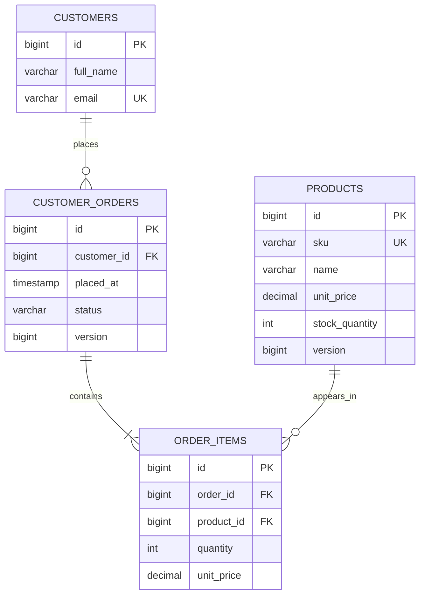
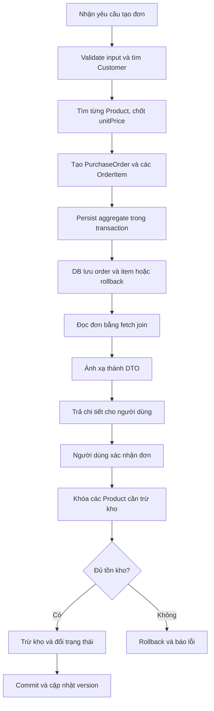

# Lộ trình học Hibernate ORM qua ví dụ khách hàng, đơn hàng, dòng hàng và sản phẩm

## 1. Mục tiêu và cách học

Trong bài này, ta xây dựng dần một hệ thống quản lý đơn hàng nhỏ để học **Hibernate ORM** theo đúng trình tự vấn đề phát sinh trong ứng dụng thực tế. Thay vì học từng annotation riêng lẻ, ta theo dõi một nghiệp vụ xuyên suốt: khách hàng chọn sản phẩm, hệ thống lưu đơn hàng cùng các dòng hàng, truy vấn lại chi tiết đơn và xử lý các thay đổi an toàn.

Sau khi hoàn thành lộ trình, bạn có thể:

- Phân biệt mô hình quan hệ trong cơ sở dữ liệu với mô hình đối tượng Java, hiểu Hibernate chuyển đổi giữa hai mô hình như thế nào.
- Ánh xạ các quan hệ `Customer` → `PurchaseOrder` → `OrderItem` → `Product` bằng Jakarta Persistence (JPA), với Hibernate là nhà cung cấp ORM.
- Tạo đơn hàng trong một transaction, hiểu persistence context, trạng thái entity, dirty checking và thời điểm SQL thực sự được thực thi.
- Viết truy vấn JPQL, xử lý lazy loading, tránh lỗi N+1 và phân trang hiệu quả.
- Xử lý cập nhật đồng thời, giữ lịch sử giá, tổ chức migration và kiểm thử nghiệp vụ có database.

**Nền tảng nên có:** Java 17 trở lên, class/record/collection, SQL cơ bản (`SELECT`, `JOIN`, `INSERT`, khóa chính/khóa ngoại), Gradle hoặc Maven. Ví dụ dùng **Spring Boot + Spring Data JPA + Hibernate**, nhưng các khái niệm entity, `EntityManager`, transaction, JPQL và fetch strategy vẫn áp dụng nếu dùng Hibernate trực tiếp. Đoạn mã minh họa dùng `jakarta.persistence.*` (không dùng package `javax.persistence.*` cũ).

> Quy ước: `PurchaseOrder` là **đơn hàng**; không đặt entity tên `Order` để tránh dễ nhầm với từ khóa SQL `ORDER`. `OrderItem` là **dòng hàng**, tức một sản phẩm cùng số lượng và đơn giá tại thời điểm đặt hàng.

## 2. Một nghiệp vụ xuyên suốt: đặt hàng

Giả sử khách hàng **An** (`an@example.com`) chọn hai sản phẩm:

| Sản phẩm | Mã SKU | Giá hiện tại | Số lượng đặt | Thành tiền |
|---|---|---:|---:|---:|
| Bàn phím cơ | `KB-01` | 250.000 đ | 2 | 500.000 đ |
| Chuột không dây | `MS-02` | 120.000 đ | 1 | 120.000 đ |
| **Tổng đơn** | | | | **620.000 đ** |

Ta cần lưu bốn loại dữ liệu:

1. **Customer:** thông tin khách hàng, như họ tên và email.
2. **Product:** danh mục sản phẩm, SKU, tên, giá bán hiện tại và số lượng tồn kho.
3. **PurchaseOrder:** một lần đặt hàng của một khách, thời điểm đặt và trạng thái đơn.
4. **OrderItem:** một dòng thuộc đơn hàng, tham chiếu sản phẩm, số lượng và **đơn giá được chốt khi đặt**.

### Quan hệ giữa các bảng



Điểm cần hiểu trước khi viết code:

- Một khách có thể tạo nhiều đơn (`1-N`); mỗi đơn thuộc đúng một khách (`N-1`). Có thể ánh xạ chỉ chiều `PurchaseOrder.customer` nếu không cần `Customer.orders`.
- Một đơn có nhiều dòng hàng (`1-N`); mỗi dòng tham chiếu đúng một sản phẩm (`N-1`). Một sản phẩm có thể xuất hiện trong nhiều đơn khác nhau.
- `order_items.unit_price` là **giá lịch sử của dòng hàng**. Không tính tổng đơn bằng `products.unit_price`, vì giá danh mục có thể thay đổi sau khi đặt.
- `ORDER_ITEMS` không đơn thuần là bảng nối many-to-many: nó là **entity độc lập có thuộc tính nghiệp vụ** (`quantity`, `unit_price`). Vì vậy không dùng `@ManyToMany` trực tiếp giữa đơn và sản phẩm.
- Xóa một đơn nháp có thể xóa các dòng của nó; **không** được cascade xóa khách hàng hoặc sản phẩm chỉ vì chúng được tham chiếu trong đơn.

Đặt các bất biến nghiệp vụ ban đầu: email và SKU là duy nhất; số lượng dòng hàng lớn hơn 0; giá và tồn kho không âm; một đơn nháp phải có ít nhất một dòng khi lưu; trong ví dụ này, một sản phẩm chỉ xuất hiện **một lần** trong một đơn (muốn mua nhiều thì tăng `quantity`).

## 3. Bản đồ lộ trình

| Chặng | Kiến thức trọng tâm | Bài thực hành cần đạt |
|---|---|---|
| 0. Đọc mô hình dữ liệu | PK, FK, `JOIN`, chuẩn hóa, giới hạn dữ liệu | Vẽ ERD và viết SQL lấy chi tiết đơn |
| 1. Ánh xạ entity | `@Entity`, `@Id`, `@ManyToOne`, `@OneToMany`, owning side | Lưu được khách, sản phẩm, đơn, các dòng hàng |
| 2. Vòng đời entity | `persist`, `find`, managed/detached, flush, dirty checking | Giải thích vì sao sửa entity trong transaction làm DB đổi |
| 3. Tầng nghiệp vụ | `@Transactional`, cascade, validation, aggregate | Tạo đơn nhiều dòng theo nguyên tắc tất cả hoặc không gì cả |
| 4. Đọc dữ liệu hiệu quả | LAZY, JOIN FETCH, N+1, DTO, pagination | Trả chi tiết đơn và danh sách đơn mà không tải thừa |
| 5. Truy vấn | JPQL, derived query, projection, aggregate | Tìm đơn theo khách, ngày, trạng thái và thống kê doanh thu |
| 6. Tính đúng đắn đồng thời | `@Version`, locking, isolation, tồn kho | Tránh bán vượt tồn và phát hiện ghi đè song song |
| 7. Vận hành và kiểm thử | migration, index, constraint, integration test | Chạy test với DB thật và kiểm soát schema khi triển khai |

Bạn có thể hoàn thành chặng 1–3 trước khi làm REST API. REST chỉ là một cách đưa yêu cầu vào hệ thống; transaction, entity và query mới là phần cốt lõi của bài học Hibernate.

## 4. Chặng 0 — Hiểu SQL trước khi học ánh xạ

Một lược đồ quan hệ tối giản (ví dụ PostgreSQL) có thể bắt đầu như sau:

```sql
CREATE TABLE customers (
    id BIGINT GENERATED BY DEFAULT AS IDENTITY PRIMARY KEY,
    full_name VARCHAR(150) NOT NULL,
    email VARCHAR(255) NOT NULL UNIQUE
);

CREATE TABLE products (
    id BIGINT GENERATED BY DEFAULT AS IDENTITY PRIMARY KEY,
    sku VARCHAR(64) NOT NULL UNIQUE,
    name VARCHAR(200) NOT NULL,
    unit_price NUMERIC(19, 2) NOT NULL CHECK (unit_price >= 0),
    stock_quantity INTEGER NOT NULL CHECK (stock_quantity >= 0),
    version BIGINT NOT NULL DEFAULT 0
);

CREATE TABLE customer_orders (
    id BIGINT GENERATED BY DEFAULT AS IDENTITY PRIMARY KEY,
    customer_id BIGINT NOT NULL REFERENCES customers(id),
    placed_at TIMESTAMP WITH TIME ZONE NOT NULL,
    status VARCHAR(24) NOT NULL,
    version BIGINT NOT NULL DEFAULT 0
);

CREATE TABLE order_items (
    id BIGINT GENERATED BY DEFAULT AS IDENTITY PRIMARY KEY,
    order_id BIGINT NOT NULL REFERENCES customer_orders(id),
    product_id BIGINT NOT NULL REFERENCES products(id),
    quantity INTEGER NOT NULL CHECK (quantity > 0),
    unit_price NUMERIC(19, 2) NOT NULL CHECK (unit_price >= 0),
    CONSTRAINT uq_order_product UNIQUE (order_id, product_id)
);

CREATE INDEX idx_orders_customer_date
    ON customer_orders(customer_id, placed_at);
CREATE INDEX idx_order_items_order ON order_items(order_id);
```

Nếu chọn để Hibernate tự tạo schema trong môi trường luyện tập (phần sau), **không chạy thêm** bộ DDL này trên cùng database; hai cách tạo bảng phục vụ hai giai đoạn khác nhau. Ở giai đoạn triển khai, dùng migration (Flyway/Liquibase) và cấu hình Hibernate kiểm tra schema.

Viết tay một truy vấn SQL trước khi viết JPQL:

```sql
SELECT o.id AS order_id,
       c.full_name AS customer_name,
       p.sku, p.name AS product_name,
       i.quantity, i.unit_price,
       i.quantity * i.unit_price AS line_total
FROM customer_orders o
JOIN customers c ON c.id = o.customer_id
JOIN order_items i ON i.order_id = o.id
JOIN products p ON p.id = i.product_id
WHERE o.id = :order_id
ORDER BY i.id;
```

Truy vấn trả **nhiều hàng SQL cho một đơn**. Đây là một khác biệt quan trọng: Hibernate phải kết hợp các hàng quan hệ để tái tạo một đối tượng `PurchaseOrder` chứa nhiều `OrderItem`.

## 5. Chặng 1 — Khởi tạo dự án và ánh xạ bốn entity

### 5.1. Môi trường thực hành

Trong dự án Spring Boot có plugin/dependency management phù hợp, cần các dependency tương đương:

```groovy
dependencies {
    implementation 'org.springframework.boot:spring-boot-starter-data-jpa'
    runtimeOnly 'com.h2database:h2'
    testImplementation 'org.springframework.boot:spring-boot-starter-test'
}
```

Để thực hành ban đầu với H2 in-memory, thêm cấu hình `application.yml`:

```yaml
spring:
  datasource:
    url: jdbc:h2:mem:orders;DB_CLOSE_DELAY=-1
    driver-class-name: org.h2.Driver
    username: sa
  jpa:
    open-in-view: false
    hibernate:
      ddl-auto: create-drop
    properties:
      hibernate:
        format_sql: true
logging:
  level:
    org.hibernate.SQL: DEBUG
```

`create-drop` chỉ dùng cho dữ liệu thử nghiệm: ứng dụng có thể tạo và xóa bảng theo vòng đời của nó. `open-in-view: false` giúp phát hiện việc đọc quan hệ lazy bên ngoài transaction. Hãy chuyển sang PostgreSQL và migration khi tới chặng 7.

### 5.2. `Customer` — khách hàng

```java
import jakarta.persistence.*;

@Entity
@Table(name = "customers")
public class Customer {
    @Id
    @GeneratedValue(strategy = GenerationType.IDENTITY)
    private Long id;

    @Column(name = "full_name", nullable = false, length = 150)
    private String fullName;

    @Column(nullable = false, unique = true, length = 255)
    private String email;

    protected Customer() {} // JPA cần constructor không tham số

    public Customer(String fullName, String email) {
        this.fullName = fullName;
        this.email = email;
    }

    public Long getId() { return id; }
    public String getFullName() { return fullName; }
    public String getEmail() { return email; }
}
```

`@Entity` nói với JPA/Hibernate đây là một kiểu đối tượng được quản lý; `@Id` xác định danh tính; `@GeneratedValue(IDENTITY)` dùng khóa sinh bởi database; `@Column` quy định tên và ràng buộc cột. `unique = true` cung cấp metadata để tạo schema; **ràng buộc UNIQUE tại DB** mới là nơi ngăn hai transaction lưu email trùng nhau.

### 5.3. `Product` — danh mục sản phẩm

```java
import jakarta.persistence.*;
import java.math.BigDecimal;
import java.util.Objects;

@Entity
@Table(name = "products")
public class Product {
    @Id
    @GeneratedValue(strategy = GenerationType.IDENTITY)
    private Long id;

    @Column(nullable = false, unique = true, length = 64)
    private String sku;

    @Column(nullable = false, length = 200)
    private String name;

    @Column(name = "unit_price", nullable = false, precision = 19, scale = 2)
    private BigDecimal unitPrice;

    @Column(name = "stock_quantity", nullable = false)
    private int stockQuantity;

    @Version
    private long version;

    protected Product() {}

    public Product(String sku, String name, BigDecimal unitPrice, int stockQuantity) {
        if (unitPrice == null || unitPrice.signum() < 0 || stockQuantity < 0) {
            throw new IllegalArgumentException("Giá hoặc tồn kho không hợp lệ");
        }
        this.sku = Objects.requireNonNull(sku);
        this.name = Objects.requireNonNull(name);
        this.unitPrice = unitPrice;
        this.stockQuantity = stockQuantity;
    }

    public void decreaseStock(int quantity) {
        if (quantity <= 0 || stockQuantity < quantity) {
            throw new IllegalStateException("Không đủ tồn kho hoặc số lượng không hợp lệ");
        }
        stockQuantity -= quantity;
    }

    public void changePrice(BigDecimal newPrice) {
        if (newPrice == null || newPrice.signum() < 0) {
            throw new IllegalArgumentException("Giá mới không hợp lệ");
        }
        unitPrice = newPrice;
    }

    public Long getId() { return id; }
    public String getSku() { return sku; }
    public String getName() { return name; }
    public BigDecimal getUnitPrice() { return unitPrice; }
    public int getStockQuantity() { return stockQuantity; }
}
```

Với tiền tệ, dùng `BigDecimal` (ở đây giả định hai chữ số thập phân lưu trữ), không dùng `double` để tránh sai số nhị phân. `@Version` sẽ được dùng cho optimistic locking ở chặng 6.

### 5.4. `PurchaseOrder` — gốc của cụm đơn hàng

```java
import jakarta.persistence.*;
import java.math.BigDecimal;
import java.time.Instant;
import java.util.ArrayList;
import java.util.Collections;
import java.util.List;
import java.util.Objects;

@Entity
@Table(name = "customer_orders")
public class PurchaseOrder {
    @Id
    @GeneratedValue(strategy = GenerationType.IDENTITY)
    private Long id;

    @ManyToOne(fetch = FetchType.LAZY, optional = false)
    @JoinColumn(name = "customer_id", nullable = false)
    private Customer customer;

    @OneToMany(mappedBy = "order", cascade = CascadeType.ALL, orphanRemoval = true)
    private List<OrderItem> items = new ArrayList<>();

    @Enumerated(EnumType.STRING)
    @Column(nullable = false, length = 24)
    private OrderStatus status = OrderStatus.DRAFT;

    @Column(name = "placed_at", nullable = false)
    private Instant placedAt;

    @Version
    private long version;

    protected PurchaseOrder() {}

    public PurchaseOrder(Customer customer) {
        this.customer = Objects.requireNonNull(customer);
        this.placedAt = Instant.now();
    }

    public void addItem(Product product, int quantity) {
        Objects.requireNonNull(product);
        if (status != OrderStatus.DRAFT || quantity <= 0) {
            throw new IllegalArgumentException("Không thể thêm dòng hàng");
        }
        if (items.stream().anyMatch(item -> item.getProduct().getId().equals(product.getId()))) {
            throw new IllegalArgumentException("Sản phẩm đã có trong đơn");
        }
        items.add(new OrderItem(this, product, quantity, product.getUnitPrice()));
    }

    public BigDecimal getTotal() {
        return items.stream()
            .map(OrderItem::getLineTotal)
            .reduce(BigDecimal.ZERO, BigDecimal::add);
    }

    public void confirm() {
        if (status != OrderStatus.DRAFT || items.isEmpty()) {
            throw new IllegalStateException("Chỉ xác nhận đơn nháp có dòng hàng");
        }
        status = OrderStatus.CONFIRMED;
    }

    public Long getId() { return id; }
    public Customer getCustomer() { return customer; }
    public OrderStatus getStatus() { return status; }
    public Instant getPlacedAt() { return placedAt; }
    public List<OrderItem> getItems() { return Collections.unmodifiableList(items); }
}
```

```java
public enum OrderStatus {
    DRAFT, CONFIRMED, CANCELLED
}
```

Ở đây `PurchaseOrder` là **aggregate root** trong nghĩa thiết kế nghiệp vụ: nơi điều phối các `OrderItem`. `mappedBy = "order"` chỉ ra quan hệ `OneToMany` này là **phía nghịch đảo**; khóa ngoại `order_items.order_id` được quản lý bởi `OrderItem.order`. `cascade = ALL` và `orphanRemoval = true` chỉ phù hợp vì dòng hàng thuộc vòng đời của đơn. Không thêm `CascadeType.REMOVE` vào `@ManyToOne Product` hay `Customer`.

### 5.5. `OrderItem` — dòng hàng và giá chốt

```java
import jakarta.persistence.*;
import java.math.BigDecimal;
import java.util.Objects;

@Entity
@Table(name = "order_items",
       uniqueConstraints = @UniqueConstraint(columnNames = {"order_id", "product_id"}))
public class OrderItem {
    @Id
    @GeneratedValue(strategy = GenerationType.IDENTITY)
    private Long id;

    @ManyToOne(fetch = FetchType.LAZY, optional = false)
    @JoinColumn(name = "order_id", nullable = false)
    private PurchaseOrder order;

    @ManyToOne(fetch = FetchType.LAZY, optional = false)
    @JoinColumn(name = "product_id", nullable = false)
    private Product product;

    @Column(nullable = false)
    private int quantity;

    @Column(name = "unit_price", nullable = false, precision = 19, scale = 2)
    private BigDecimal unitPrice;

    protected OrderItem() {}

    OrderItem(PurchaseOrder order, Product product, int quantity, BigDecimal unitPrice) {
        if (quantity <= 0 || unitPrice == null || unitPrice.signum() < 0) {
            throw new IllegalArgumentException("Dòng hàng không hợp lệ");
        }
        this.order = Objects.requireNonNull(order);
        this.product = Objects.requireNonNull(product);
        this.quantity = quantity;
        this.unitPrice = unitPrice;
    }

    public Product getProduct() { return product; }
    public int getQuantity() { return quantity; }
    public BigDecimal getUnitPrice() { return unitPrice; }
    public BigDecimal getLineTotal() {
        return unitPrice.multiply(BigDecimal.valueOf(quantity));
    }
}
```

Mỗi lần `order.addItem(product, qty)` ta tạo **một bản ghi giá** từ `product.getUnitPrice()`. Sau này `product.changePrice(...)` không làm thay đổi `OrderItem.unitPrice` đã lưu. Điều này vừa đúng nghiệp vụ vừa tránh truy vấn lại lịch sử bảng giá khi hiển thị hóa đơn.

**Thử ngay:** lưu một khách và hai sản phẩm, sau đó tạo một đơn có hai dòng. Mở log SQL, xác định những câu `INSERT` dành cho `customer_orders` và `order_items`. Quan sát khóa ngoại nào chứa ID của bản ghi liên quan.

## 6. Chặng 2 — EntityManager, persistence context và transaction

Hibernate theo dõi các entity **managed** trong một persistence context, thường tồn tại trong phạm vi transaction. Có thể hình dung:

```text
new Customer(...)                    -- transient: đối tượng Java mới
entityManager.persist(customer)      -- managed: Hibernate theo dõi
transaction commit / flush           -- SQL INSERT/UPDATE đồng bộ xuống DB
entityManager.clear()                -- detached: không còn được theo dõi
entityManager.find(Customer.class, id) -- managed trở lại sau khi truy vấn
```

Các thao tác cơ bản:

| Thao tác | Ý nghĩa cần quan sát |
|---|---|
| `persist(entity)` | Đưa entity mới vào persistence context; có thể phát sinh `INSERT` ngay nếu cần ID theo chiến lược `IDENTITY`. |
| `find(Entity.class, id)` | Lấy một entity; có thể dùng bản managed sẵn có thay vì truy vấn database. |
| Sửa field của entity managed | **Dirty checking** tự phát hiện và đồng bộ thay đổi khi flush, không nhất thiết gọi `save` lần nữa. |
| `flush()` | Đồng bộ các thay đổi đang chờ thành SQL trong transaction; **chưa đồng nghĩa commit**. |
| `clear()` / kết thúc context | Entity trở thành detached; sửa đối tượng này không tự ghi database. |
| `merge(detached)` | Sao chép trạng thái vào một entity managed được trả về; phải dùng đúng giá trị trả về, không coi bản detached là managed. |
| `remove(managed)` | Đánh dấu xóa; SQL thực thi theo quy tắc flush/transaction. |

Ví dụ dùng `EntityManager` trực tiếp:

```java
import jakarta.persistence.EntityManager;
import jakarta.persistence.PersistenceContext;
import org.springframework.stereotype.Service;
import org.springframework.transaction.annotation.Transactional;

@Service
public class CustomerExampleService {
    @PersistenceContext
    private EntityManager em;

    @Transactional
    public Long createCustomer() {
        Customer customer = new Customer("An", "an@example.com");
        em.persist(customer);
        // Với IDENTITY, Hibernate thường phải INSERT sớm để lấy id.
        return customer.getId();
    }

    @Transactional(readOnly = true)
    public String findCustomerName(Long id) {
        Customer customer = em.find(Customer.class, id);
        if (customer == null) throw new IllegalArgumentException("Không tồn tại khách");
        return customer.getFullName();
    }
}
```

`@Transactional` bảo đảm các thao tác cùng tham gia một transaction; ngoại lệ runtime thường làm rollback trong Spring. Chi tiết thời điểm SQL có thể thay đổi tùy chiến lược cấp ID, flush mode và cách truy vấn. Không nên học quy tắc “`save` = SQL ngay lập tức” vì nó không đúng tổng quát.

**Bài thực hành:** lấy cùng một `Customer` hai lần trong một persistence context và so sánh tham chiếu object; đổi một trường thông qua phương thức nghiệp vụ rồi xem SQL ở commit; sau đó tách context và thử sửa bản detached để quan sát khác biệt.

## 7. Chặng 3 — Repository và tạo đơn hàng nguyên tử

Trong Spring Data JPA, repository giảm mã CRUD lặp lại, nhưng **quy tắc nghiệp vụ và transaction nằm ở service**.

### 7.1. Các repository

```java
import org.springframework.data.jpa.repository.JpaRepository;
import java.util.Optional;

public interface CustomerRepository extends JpaRepository<Customer, Long> {
    Optional<Customer> findByEmail(String email);
}

public interface ProductRepository extends JpaRepository<Product, Long> {
    Optional<Product> findBySku(String sku);
}

public interface PurchaseOrderRepository extends JpaRepository<PurchaseOrder, Long> {
}
```

### 7.2. Input và service đặt đơn

```java
import java.util.List;

public record OrderLineInput(Long productId, int quantity) {}
public record CreateOrderInput(Long customerId, List<OrderLineInput> lines) {}
```

```java
import org.springframework.stereotype.Service;
import org.springframework.transaction.annotation.Transactional;
import java.util.HashSet;
import java.util.Set;

@Service
public class OrderApplicationService {
    private final CustomerRepository customers;
    private final ProductRepository products;
    private final PurchaseOrderRepository orders;

    public OrderApplicationService(CustomerRepository customers,
                                   ProductRepository products,
                                   PurchaseOrderRepository orders) {
        this.customers = customers;
        this.products = products;
        this.orders = orders;
    }

    @Transactional
    public Long createDraft(CreateOrderInput input) {
        if (input == null || input.lines() == null || input.lines().isEmpty()) {
            throw new IllegalArgumentException("Đơn phải có ít nhất một dòng hàng");
        }
        Customer customer = customers.findById(input.customerId())
            .orElseThrow(() -> new IllegalArgumentException("Không có khách hàng"));

        PurchaseOrder order = new PurchaseOrder(customer);
        Set<Long> usedProductIds = new HashSet<>();
        for (OrderLineInput line : input.lines()) {
            if (line == null || line.productId() == null || line.quantity() <= 0 ||
                !usedProductIds.add(line.productId())) {
                throw new IllegalArgumentException("Dòng hàng trùng hoặc không hợp lệ");
            }
            Product product = products.findById(line.productId())
                .orElseThrow(() -> new IllegalArgumentException("Không có sản phẩm"));
            order.addItem(product, line.quantity());
        }
        return orders.save(order).getId();
    }
}
```

Khi `orders.save(order)` lưu `PurchaseOrder`, cơ chế cascade lưu các `OrderItem` mới. Các `Customer`/`Product` đã được truy vấn trong transaction và đang được tham chiếu, **không cần cascade persist** chúng. Nếu một dòng không hợp lệ gây exception runtime, transaction rollback nên không tồn tại đơn chỉ có một phần dòng hàng.

Trong giai đoạn này, `createDraft` **chưa trừ tồn kho**. Ta tách bước giữ bản nháp khỏi bước xác nhận/trừ kho để tập trung từng vấn đề. Phần đồng thời ở chặng 6 sẽ giải quyết việc hai người cùng mua sản phẩm cuối cùng.

> Lưu ý thực tế: service có transaction cần được gọi qua Spring proxy, chẳng hạn từ controller hoặc bean khác; gọi một phương thức `@Transactional` qua `this.method()` trong cùng bean thường không kích hoạt advice transaction mới.

### 7.3. Một tình huống kiểm tra tính nguyên tử

Gửi yêu cầu gồm hai dòng: dòng đầu có `productId` hợp lệ, dòng sau có `productId` không tồn tại. Hệ thống phải báo lỗi, số lượng đơn/dòng hàng trong DB không tăng. Sau đó thay dòng thứ hai bằng ID hợp lệ: hệ thống lưu một đơn cùng hai dòng, tổng tiền 620.000 đ theo dữ liệu mẫu.

**Điểm học được:** transaction không phải “bọc mọi lệnh bằng `save`”; nó xác định phạm vi nhất quán của một ca sử dụng. Kiểm tra ràng buộc ở Java giúp đưa lỗi dễ hiểu; constraint trong database vẫn là tuyến bảo vệ cuối khi có nhiều transaction đồng thời.

## 8. Chặng 4 — LAZY, N+1, JOIN FETCH và DTO

### 8.1. Vì sao chọn lazy?

`@ManyToOne` theo đặc tả JPA có mặc định `EAGER`; ta đã **ghi rõ `fetch = LAZY`** cho các liên kết tới khách hàng, đơn và sản phẩm. `@OneToMany` mặc định là `LAZY`, nhưng vẫn nên hiểu chi phí đọc nó. Với `open-in-view: false`, đụng tới liên kết lazy sau khi transaction/persistence context đã đóng có thể gây `LazyInitializationException`.

Ví dụ N+1: lấy 100 đơn rồi vòng lặp gọi `order.getCustomer().getFullName()` hoặc `order.getItems().size()`. Tùy truy vấn và context, Hibernate có thể chạy một câu lấy danh sách rồi rất nhiều câu lấy liên kết. Đừng chuyển mọi quan hệ thành `EAGER` để chữa lỗi; điều đó thường tạo các truy vấn nặng và khó dự đoán hơn.

### 8.2. Lấy một đơn chi tiết bằng fetch join

Bổ sung vào `PurchaseOrderRepository`:

```java
import org.springframework.data.jpa.repository.Query;
import org.springframework.data.repository.query.Param;

@Query("""
    select distinct o from PurchaseOrder o
    join fetch o.customer
    left join fetch o.items i
    left join fetch i.product
    where o.id = :id
    """)
Optional<PurchaseOrder> findDetailedById(@Param("id") Long id);
```

Ở đây `JOIN FETCH` chỉ áp dụng cho **một đơn cụ thể**, nên việc nhân hàng theo số dòng hàng là chấp nhận được. Hibernate dựng lại `PurchaseOrder` và quan hệ đã fetch trong persistence context.

Tạo DTO trả về ngoài tầng persistence:

```java
import java.math.BigDecimal;
import java.util.List;

public record OrderItemView(String sku, String productName,
                            int quantity, BigDecimal unitPrice,
                            BigDecimal lineTotal) {}

public record OrderDetailView(Long orderId, String customerName,
                              String status, BigDecimal total,
                              List<OrderItemView> items) {}
```

```java
@Transactional(readOnly = true)
public OrderDetailView getDetail(Long orderId) {
    PurchaseOrder order = orders.findDetailedById(orderId)
        .orElseThrow(() -> new IllegalArgumentException("Không có đơn hàng"));

    var items = order.getItems().stream()
        .map(i -> new OrderItemView(
            i.getProduct().getSku(), i.getProduct().getName(),
            i.getQuantity(), i.getUnitPrice(), i.getLineTotal()))
        .toList();
    return new OrderDetailView(order.getId(),
        order.getCustomer().getFullName(), order.getStatus().name(),
        order.getTotal(), items);
}
```

Đặt `getDetail` trong chính `OrderApplicationService`, nơi đã khai báo field `orders`; đây là ví dụ **một phương thức bổ sung**, không phải class độc lập. DTO giúp API không trả proxy Hibernate, không vô tình serialize toàn bộ graph, và giữ transaction ở tầng service.

### 8.3. Phân trang danh sách đơn

Không dùng `JOIN FETCH` collection (`o.items`) cùng `Pageable` một cách tùy tiện: DB trả nhiều hàng trên một đơn khiến việc áp dụng `LIMIT/OFFSET` không còn tương ứng trực tiếp với số đơn; Hibernate có thể phải phân trang trong bộ nhớ hoặc từ chối tùy cấu hình.

Với màn hình danh sách, chỉ chọn những cột thực sự cần:

```java
public record OrderListRow(Long id, String customerName,
                           OrderStatus status, java.time.Instant placedAt) {}
```

```java
@Query("""
    select new com.example.orders.OrderListRow(
        o.id, c.fullName, o.status, o.placedAt)
    from PurchaseOrder o join o.customer c
    where (:customerId is null or c.id = :customerId)
    """)
Page<OrderListRow> findList(@Param("customerId") Long customerId,
                            Pageable pageable);
```

Đổi `com.example.orders.OrderListRow` thành **package thực tế** của DTO; khai báo `Page` và `Pageable` từ `org.springframework.data.domain`. Có thể thêm `Sort` theo `placedAt` rồi `id` để thứ tự ổn định. Nếu màn hình cần cả dòng hàng cho nhiều đơn, cân nhắc quy trình hai bước: lấy một trang ID đơn, sau đó fetch các đơn trong trang theo ID, rồi khôi phục thứ tự của trang.

**Bài thực hành:** bật log SQL, so sánh số câu query khi dùng `findById` rồi đọc items bên ngoài transaction, khi dùng `findDetailedById`, và khi truy vấn danh sách DTO. Ghi lại **số câu SQL và số hàng**, không kết luận chỉ từ số lượng object Java trả về.

## 9. Chặng 5 — JPQL và các truy vấn nghiệp vụ

JPQL dùng **tên entity và thuộc tính Java**, khác SQL dùng tên bảng/cột. Ví dụ:

```java
@Query("""
    select o from PurchaseOrder o
    where o.customer.id = :customerId
      and o.status = :status
      and o.placedAt >= :fromTime
      and o.placedAt < :toTime
    order by o.placedAt desc, o.id desc
    """)
List<PurchaseOrder> findOrders(Long customerId, OrderStatus status,
                               java.time.Instant fromTime,
                               java.time.Instant toTime);
```

Với báo cáo doanh thu từ các đơn đã xác nhận, ta có thể truy vấn scalar aggregate:

```java
@Query("""
    select sum(i.quantity * i.unitPrice)
    from OrderItem i
    where i.order.status = :status
      and i.order.placedAt >= :fromTime
      and i.order.placedAt < :toTime
    """)
BigDecimal sumRevenue(OrderStatus status,
                      java.time.Instant fromTime,
                      java.time.Instant toTime);
```

Truy vấn tổng có thể trả `null` khi không có dòng nào khớp; service cần chuyển `null` thành `BigDecimal.ZERO`. Chọn rõ định nghĩa nghiệp vụ: “doanh thu” ở đây là **tổng giá dòng hàng của đơn CONFIRMED** trong khoảng thời gian đặt đơn; chưa tính giảm giá, phí vận chuyển, hoàn trả hay thanh toán thực nhận. Khi hệ thống có những khái niệm đó, truy vấn cần thay đổi theo mô hình nghiệp vụ.

Các bài toán mở rộng theo thứ tự tăng dần:

- Tìm khách theo email, sản phẩm theo SKU: hiểu `findBy...`, unique index và query parameter.
- Lọc đơn theo khách/trạng thái/khoảng thời gian, luôn dùng khoảng nửa mở `[from, to)` để tránh đếm trùng ở ranh giới.
- Thống kê sản phẩm bán chạy bằng `group by i.product.id` và `sum(i.quantity)` trên các đơn xác nhận.
- Tạo DTO chỉ gồm dữ liệu cần xuất báo cáo, thay vì tải toàn bộ entity graph.
- Giải thích khi nào dùng JPQL, Criteria API/Specification cho điều kiện động và native SQL cho trường hợp DB-specific.

## 10. Chặng 6 — Xử lý tồn kho và cập nhật đồng thời

### 10.1. Vì sao transaction đơn thuần chưa đủ?

Ví dụ sản phẩm còn **1 chiếc**. Hai request cùng đọc `stockQuantity = 1`, đều thấy có thể mua. Nếu kiểm tra ở Java rồi cùng trừ và commit mà không có chiến lược cạnh tranh dữ liệu, kết quả có thể sai kỳ vọng. Cần kết hợp transaction, constraint và **cơ chế khóa/phát hiện xung đột**.

Hai kỹ thuật phổ biến:

| Kỹ thuật | Cách hoạt động | Phù hợp |
|---|---|---|
| Optimistic locking (`@Version`) | `UPDATE` kiểm tra version đã đọc; một transaction cập nhật trước khiến transaction còn lại nhận lỗi xung đột. | Tỷ lệ tranh chấp thấp, có thể báo người dùng thử lại. |
| Pessimistic locking (`PESSIMISTIC_WRITE`) | Khóa hàng DB khi đọc để các transaction cùng muốn ghi phải chờ hoặc nhận lỗi theo timeout/DB. | Tài nguyên có tranh chấp mạnh như tồn kho số lượng ít. |

Trong `Product` và `PurchaseOrder` đã có `@Version`. Nếu dùng optimistic locking, phải **xử lý trường hợp xung đột** (trả lỗi nghiệp vụ hoặc thử lại cả transaction theo chính sách), không đơn giản bỏ qua exception. `@Version` phát hiện cập nhật cạnh tranh trên **cùng entity được update**; nó không tự khóa mọi hàng liên quan.

### 10.2. Một cách xác nhận đơn có khóa tồn kho

Thêm phương thức vào `ProductRepository`:

```java
import jakarta.persistence.LockModeType;
import org.springframework.data.jpa.repository.Lock;

@Lock(LockModeType.PESSIMISTIC_WRITE)
@Query("select p from Product p where p.id = :id")
Optional<Product> findByIdForUpdate(@Param("id") Long id);
```

Phương thức xác nhận đơn minh họa:

```java
@Transactional
public void confirmOrder(Long orderId) {
    PurchaseOrder order = orders.findDetailedById(orderId)
        .orElseThrow(() -> new IllegalArgumentException("Không có đơn hàng"));
    if (order.getStatus() != OrderStatus.DRAFT) {
        throw new IllegalStateException("Đơn đã được xử lý");
    }

    // Khóa theo thứ tự ID để giảm nguy cơ deadlock giữa các đơn khác nhau.
    var lines = order.getItems().stream()
        .sorted(java.util.Comparator.comparing(i -> i.getProduct().getId()))
        .toList();

    for (OrderItem line : lines) {
        Long productId = line.getProduct().getId();
        Product lockedProduct = products.findByIdForUpdate(productId)
            .orElseThrow(() -> new IllegalArgumentException("Sản phẩm không tồn tại"));
        lockedProduct.decreaseStock(line.getQuantity());
    }
    order.confirm();
    // Dirty checking đồng bộ thay đổi tồn kho, trạng thái và version ở flush/commit.
}
```

Đặt `confirmOrder` trong `OrderApplicationService`; `ProductRepository` ở trên có sẵn `@Param` từ import ở phần truy vấn. Ví dụ cố ý xác nhận **một đơn nháp đang tồn tại** và chỉ trừ kho khi chuyển `DRAFT → CONFIRMED`. Khi thực hiện lại cùng thao tác sau khi đã xác nhận, hệ thống phải báo lỗi và không trừ kho thêm.

Với yêu cầu nghiêm ngặt hơn (nhiều request cùng xác nhận *chính một đơn*), cần khóa hoặc xử lý optimistic conflict **trên bản ghi `PurchaseOrder`** nữa. `@Version` đã giúp phát hiện ghi xung đột ở thời điểm flush, nhưng lỗi có thể chỉ xuất hiện khi commit; caller phải xử lý. Nếu xử lý retry, phải retry **toàn bộ transaction** và kiểm tra lại trạng thái đơn, không retry riêng lẻ câu trừ kho. Cần kiểm thử hành vi lock theo DB thực tế (PostgreSQL/MySQL), vì H2 không đại diện đầy đủ cho mọi cơ chế isolation/locking.

### 10.3. Những quy tắc tiếp theo

- Với đơn đã xác nhận, hủy đơn có hoàn kho hay không phụ thuộc trạng thái giao hàng và chính sách hoàn trả; đừng đổi `status` rồi tự ý cộng kho thiếu kiểm soát.
- Khi cập nhật giá của `Product`, đơn cũ vẫn dùng `OrderItem.unitPrice` chốt lúc tạo.
- Nếu thao tác xác nhận còn gửi email/thanh toán/gọi hệ thống ngoài, transaction DB **không tự rollback hệ thống ngoài**; nghiên cứu idempotency key và transactional outbox.
- Constraint `stock_quantity >= 0` ở DB là lớp bảo vệ bổ sung; validation/locking ở service cung cấp ngữ nghĩa và thông báo lỗi phù hợp.

**Bài thực hành đồng thời:** tạo sản phẩm còn 1, tạo hai đơn nháp mỗi đơn mua 1; dùng hai transaction/luồng độc lập xác nhận cùng lúc. Kỳ vọng đúng là tối đa một đơn được xác nhận thành công, tồn kho không âm. Sau đó thử hai luồng cùng xác nhận **cùng một đơn**, kiểm tra không bị trừ kho hai lần.

## 11. Chặng 7 — Schema migration, quan sát SQL và kiểm thử

### 11.1. Không để Hibernate tự sửa schema trong production

Trong ứng dụng triển khai, dùng Flyway/Liquibase để quản lý SQL migration có phiên bản; để Hibernate **validate** sự phù hợp giữa mapping và schema:

```yaml
spring:
  jpa:
    open-in-view: false
    hibernate:
      ddl-auto: validate
```

Với PostgreSQL, bổ sung driver và datasource phù hợp, chạy migration tạo `customers`, `products`, `customer_orders`, `order_items` cùng unique/check/FK/index đã mô tả. Bảng có dữ liệu thật cần chiến lược migration khi thêm cột NOT NULL, đổi enum, thay khóa ngoại. Không dựa vào `ddl-auto: update` để xử lý thay đổi schema lâu dài.

### 11.2. Kiểm thử theo hành vi nghiệp vụ

Một bộ integration test nên chứng minh được:

| Tình huống | Kỳ vọng |
|---|---|
| Tạo đơn với hai sản phẩm | Một đơn + hai dòng; tổng theo giá chốt là 620.000 đ. |
| Một dòng không tồn tại | Rollback toàn bộ thao tác đặt đơn. |
| Giá sản phẩm thay đổi sau khi đặt | Đơn cũ giữ `unit_price` cũ; đơn mới dùng giá mới. |
| Đặt sản phẩm trùng hai lần trong một đơn | Trả lỗi hoặc gộp số lượng theo quy tắc đã công bố; ở ví dụ này trả lỗi. |
| Đọc chi tiết đơn với `open-in-view: false` | Service trả DTO đầy đủ, không phụ thuộc session ở controller. |
| Hai đơn tranh một đơn vị tồn kho | Không bán quá tồn; có kết quả rõ ràng cho request thất bại. |
| Hai request xác nhận cùng đơn | Không trừ kho hai lần, có xử lý xung đột. |

Có thể bắt đầu bằng `@SpringBootTest` + test repository/service, sau đó dùng **Testcontainers với PostgreSQL** cho các bài kiểm tra lock và SQL dialect. Với `@Transactional` trên test method, chú ý transaction kiểm thử có thể che khuất lỗi chỉ xảy ra lúc commit; dùng các transaction riêng khi kiểm tra race condition và rollback thực tế.

### 11.3. Đọc execution plan khi truy vấn chậm

Bước tối ưu đúng thứ tự: quan sát SQL được sinh → ghi số lượng câu query và hàng trả về → xác định index phù hợp với `WHERE/JOIN/ORDER BY` → đo execution plan (`EXPLAIN` hoặc `EXPLAIN ANALYZE` ở DB hỗ trợ). `JOIN FETCH`, batch fetching, DTO projection hay cache chỉ nên chọn sau khi hiểu cách dữ liệu được truy cập.

Hibernate có cache cấp 1 gắn với persistence context. Cache cấp 2 là tùy chọn, cần provider/cấu hình và chiến lược invalidation rõ ràng; không nên bật như một “cách chữa N+1” mặc định.

## 12. Dòng chảy hoàn chỉnh của một ca sử dụng



Hãy thử tự giải thích **mỗi mũi tên** theo ba góc nhìn: đối tượng Java nào được tạo/đổi, persistence context đang theo dõi gì, và SQL nào có thể được gửi xuống database.

## 13. Các lỗi phổ biến và cách nhận diện

| Hiện tượng | Nguyên nhân thường gặp | Hướng khắc phục |
|---|---|---|
| `LazyInitializationException` | Đọc quan hệ LAZY khi persistence context đã đóng | Fetch những gì use case cần trong service, trả DTO. |
| Cập nhật `PurchaseOrder.items` nhưng FK sai/null | Chỉ sửa phía `mappedBy`, chưa gán `OrderItem.order` | Đồng bộ cả hai phía quan hệ qua `order.addItem()`. |
| Xóa đơn làm mất cả sản phẩm | Cascade REMOVE sai hướng | Cascade chỉ từ đơn sang dòng hàng, không sang sản phẩm/khách. |
| Nhiều SQL bất ngờ | N+1 do đọc quan hệ trong vòng lặp | Dùng fetch join/entity graph/DTO theo từng use case. |
| Tổng tiền đơn cũ đổi khi tăng giá sản phẩm | Dùng giá hiện tại của `Product` thay vì giá dòng hàng | Lưu `OrderItem.unitPrice` như snapshot. |
| Xung đột cập nhật bị ghi đè | Thiếu version/locking, xử lý retry sai | `@Version` hoặc row lock, quản lý retry ở transaction. |
| Phân trang chậm/sai kỳ vọng | Fetch collection cùng `Pageable` | Trang danh sách dùng DTO hoặc truy vấn hai bước. |
| Test H2 chạy nhưng production lỗi | Khác SQL dialect, constraint, concurrency | Dùng PostgreSQL Testcontainers cho ca tích hợp quan trọng. |

## 14. Bài thực hành tổng hợp và tiêu chí hoàn thành

Xây dựng các use case sau trong cùng ứng dụng: tạo khách, tạo sản phẩm, đổi giá sản phẩm, tạo đơn nháp nhiều dòng, xem chi tiết đơn, xem danh sách đơn theo khách với phân trang, xác nhận đơn có trừ tồn và thống kê doanh thu đơn xác nhận theo khoảng ngày.

Một kết quả hoàn chỉnh nên chứng minh được **mô hình đúng và truy cập dữ liệu có chủ đích**:

1. Với khách An, bàn phím 250.000 đ × 2 và chuột 120.000 đ × 1, đơn mới có tổng 620.000 đ; các `OrderItem` giữ nguyên đơn giá khi giá `Product` thay đổi.
2. Một lần đặt đơn gồm nhiều dòng được lưu hoặc rollback trọn vẹn; không có đơn dở dang.
3. Truy vấn chi tiết đọc đầy đủ khách, sản phẩm và dòng hàng trong phạm vi transaction; DTO có thể được dùng sau khi transaction kết thúc.
4. Danh sách đơn được phân trang theo **đơn hàng**, không theo số dòng hàng do join làm nhân bản.
5. Xác nhận đơn trừ tồn chính xác một lần; hai giao dịch tranh chấp sản phẩm cuối cùng không cùng thành công.
6. Schema có ràng buộc PK/FK/UNIQUE/CHECK và index phù hợp; các phép chuyển schema được quản lý bằng migration.

**Thứ tự học cần ghi nhớ:** hiểu bảng và khóa ngoại → ánh xạ entity → hiểu persistence context → đặt ranh giới transaction → truy vấn đúng dữ liệu → tối ưu fetch → giải quyết đồng thời → kiểm thử với DB triển khai. Đi theo một bộ dữ liệu khách hàng–đơn hàng–dòng hàng–sản phẩm từ đầu đến cuối giúp thấy Hibernate là công cụ duy trì quan hệ giữa trạng thái đối tượng và dữ liệu, còn tính đúng đắn nghiệp vụ vẫn do thiết kế mô hình, transaction và ràng buộc dữ liệu quyết định.
